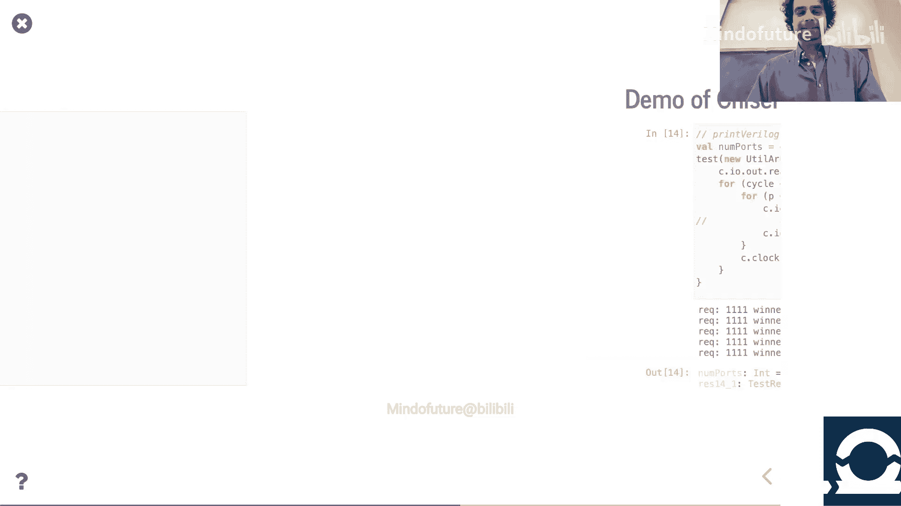
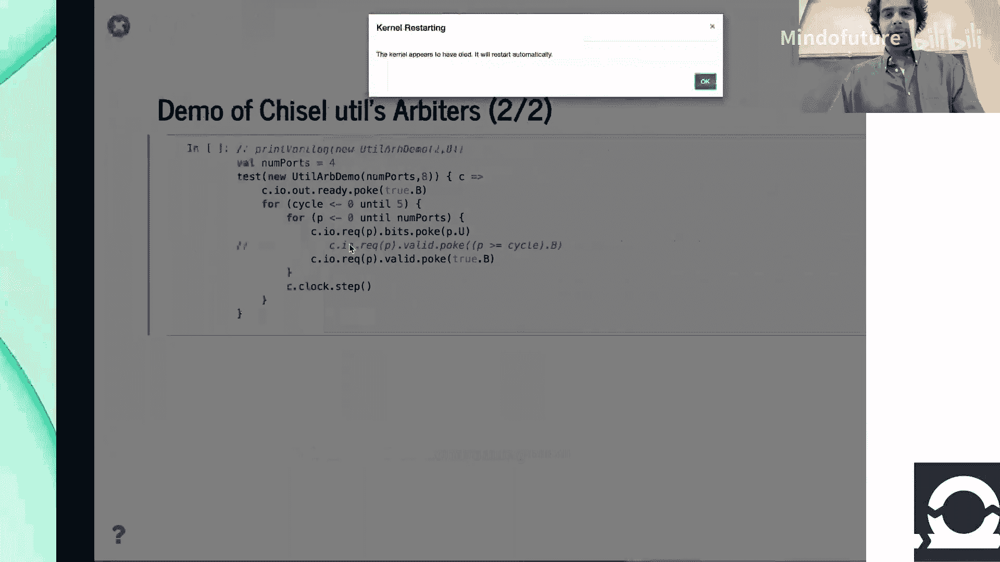
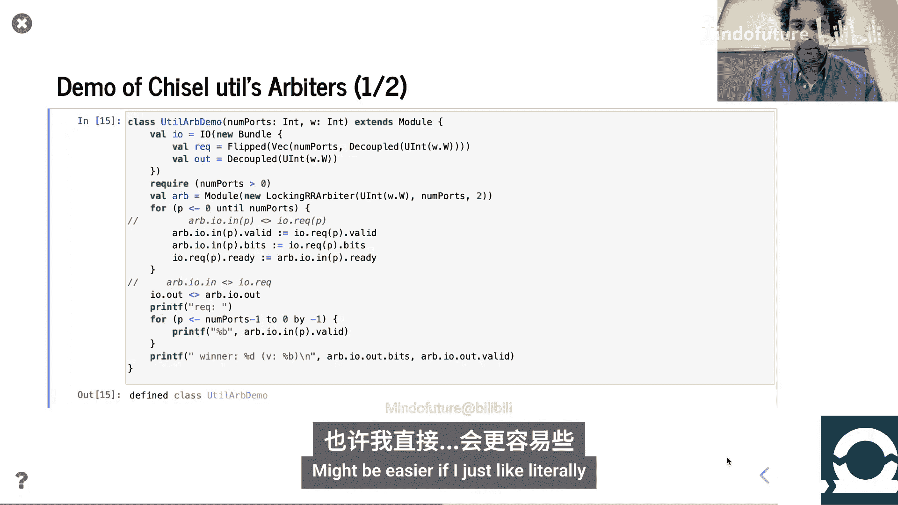
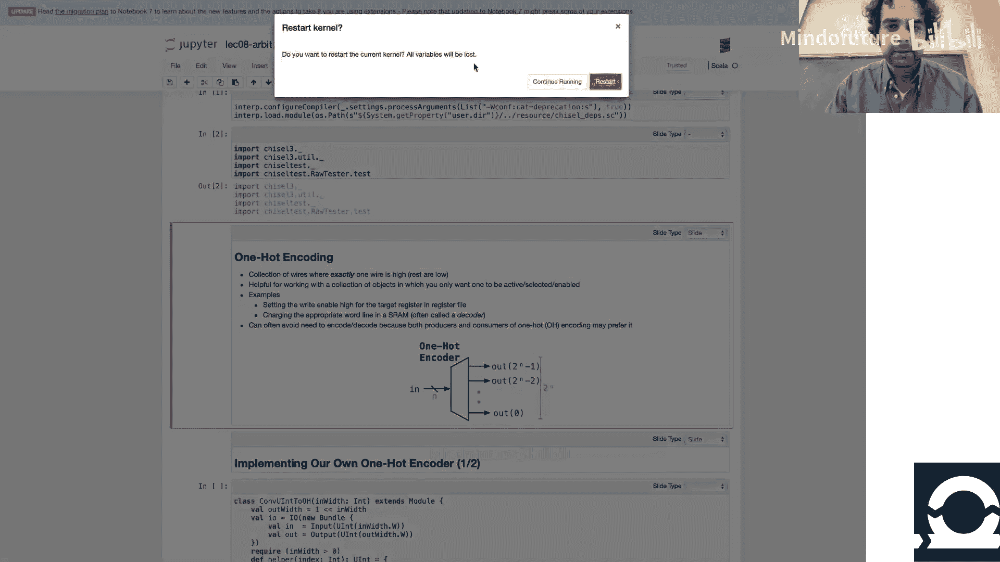
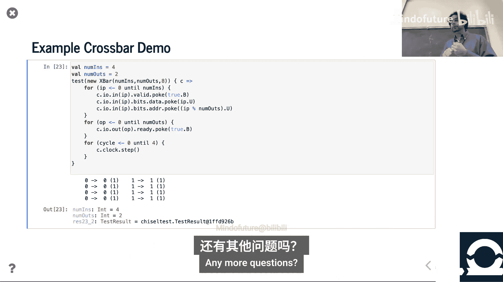

# 【加州大学】敏捷硬件设计-CSE228A-｜-Agile-Hardware-Design-Spring-2025-p12-P22_第8讲-仲裁_第2部分共2节--BV1M6ivBzESw_p12-

Hello and welcome to lecture8 part two， so number of introductions to this lecture we were talking about arbitration and we actually didn't quite get there。

 we talked about one hot encoding and priority encoders and how we could build those in various ways。

😡，Let's actually get to arbitration。We're going to do that in two ways。

 we're going to spend some time studying the arbiter chisel provides。

 We're going to go ahead and build our own arbiter。

 And then we're going to use our arbiter to build a crossbar。

 And we're kind of continually building up abstractions and components and generators to build。

More and more sophisticated pieces of hardware right so first off。

 what is arbitration So arbitration is in a situation where you need to choose。Who gets access。

 right？ You're some sort of scarcest resource。 It could be one thing。 and could be multiple things。

 but somehow you have more consumers than you have providers， right。

It doesn need some way to decide who gets access to that resource and the word for that course is arbitrate。

😡，And so if you have multiple sit request， now， let's say， for example。

 in a situation where you could have requesting something。But as particular moment。

 there's only one requester， great， you know， only one request， only one thing， sure。

 give it to the load requester， that's easy。Arbitration comes up when you need to handle ties。

 right And it's like， you know， we actually have multiple requesting at the same time。

 and we can' satisfy all of them。 How do we do that， right？ And so well， the arbiter， beside。

 there's some algorithm inside the abiter determines when we have， you know。

Multipleencies making a request。 We can't provide all of them。 Who wins， right？

 And you can imagine there's types of algorithms for this。 You can have things like， you know。

 fixed priority。 so and so always outranks a entity， right， And this makes sense， for example。

 their processor you know， maybe we'll make sure your cash missed path always has priority getting access to D around because that way you make your processor run faster。

Alternatively， maybe have something around robin to try and make it somehow more fair。

 so it does depend on a situation。 There's not always one size for solve for arbitration。嗯。

You see the kind of things。 And so for example later on。

 you'll see we do like you know another switch in the crossbar later on。

 I give you an example to processors， but big passion we're triangle is the bias switch。

Takes requests for a resource and there's only one request， great。

 they get it there's multiple requests as some way to tie break and without that less of generality today we're handling the case of only one resource to grant this to you can imagine you can have an arbiter which could grant access to two things to end things right and then it could be more general。

 but for today， there's that one resource we're trying to control access to。So。

Very common hardware design pattern， so arbiters are like many things in the Chisel standard libraries。

Make sure your recording is on， by the way。 Great， So how does it work Well。

 as drawn below as this boxed arbiter， you have some number of inputs， which is parameterized。

 you have an output。😊，Each of these inputs actually uses deco coupled。So that way you can indicate。

 you know， hey， is this request actually valid？And then the aor net end responds back to even though this arrow is drawn one way。

 it just kind of out， you know。Ready to look back from the arbiters， saying，" you know what？啊。

Did you actually get the grant， So that way the person who's you requesting knows did they actually succeed in sending something through？

And at the other end， this Ied out and also decoupled。It also has the ready balancing link。

 So it also can from whatever resource you're contending for。

 see the resource actually is ready to receive。A request。Likewise， so basically。

If this resource over here is ready， then information correspond its way into the arbiter。

 the arbiter of course， will see many valids， people making requests and then across those many valids。

 the arbiter uses this internal logic to figure out you know who wins and whoever wins we' see。😡。

Do you register single claim back to D that way they get the right thing？

This is one those cases I was talking about the dinner day。 was saying， be careful when you have。

A ready signal depending on the valid signal。 But in this case is kind of inevitable， right。

 because the arbiter is not going to tell somebody it's ready if they're not even making request。

 right， because there could be multiple requesters。 No point of giving the right signal。

 somebodys not making requests。 You want to see to make a request for you and give them a chance of saying you're ready。

 so。Watch out for Commissioner Luke。Okay， I'll pause here for a second before I dive into example arbiters for any questions so far。

 yes。So here again。Yes， yeah， exactly right。 Every single one these ports has their own ready invalid。

 exactly。 Yeah， this is one of the things where you can see with chisel you're starting to appreciate somebody。

Advanage is is nothing， you know。Groundbreaking here is just， yeah， we have all these ports。

These ports can be declared of ave。 end port， you've seen that。

 and these ports can be marked the coupled and you get the ready valid too。

 So you can see if not really liness of code。 is's generating a lot of wires。

 and these wires aren't wasteful。 You would need to to run by hand in the very log。

 You still need that functionality。Yeah， so a good question about these different types of schedulers。

 we can talk about a few of them， right。The default one arbiter。

 which first can go click at the Chile dock。Six priority， right， so you know。

 there's a hard coded priority or precedence and。According to that， you know。

 if the higher presence won request， they will always win。That can cause starvation issues。

 So then around Robin。Amongst those requesting rotates who gets it。So this tries to be more fair。

There's some subtleties about some corner case I which is the right way to handle that and then。

There is theing our arbiter， which is transfer locking around Robbin arbiter。

 basically you can imagine that this arbiter by default might make this decision every cycle。

 so perhaps to get access to this resource。For a cycle。 And that's great。

 And S cycle tells you you've lost access。 And someplication is maybe not a good idea。

 Maybe you want to access to 2 or four cycles that the red number is。

 that's what you use the locking abiter for。Okay， so。Like I said。

 the roadmap base we're going to demonstrate using the standard library arbiter first。

And then we'll go ahead and write our own in a second。This module mostly exists to kind of wrap up。

The arbiter from Chisel， right so right now it's the super spiffy locking round Robbin arbiter。

 we can try a few variants in a second。So what do we have， Okay， we have some number of。

It puts coming in nu ports。We have an output。 We made all these the couple。 and no reason why。

 of course， the Darer itself has a couple ports were kind of。Try and make it happen。

Now here's one thing we haven't seen yet in this course， that may become kind of common。

So this arbiter has n input parts。This module has n input port。So to connect all those up。

 we can use a for loop， right？So rather than having that's why it's parameterized， right。

 so I can have this and be anything。And they're going to do connections。嗯。

Now these connections we're using this bolt connection operator because it's going to connect。

All three sets of wires right things like the ready， the valve and the bits。

 right because murder coupled isn't just one wire as you know those three things in that bundle。嗯。

And so that's kind of setting all that up。嗯。Then of course， it' just collecting up the output。

And then for me to， you know， parse what's going on。

I have some printfs here to kind of see what's happening。Okay， let's go ahead and fire this up。嗯。And。

Yes， go ahead。That。Yeah， yeah。 So referred to as the bolt connect operator。

 If you have bundles on both sides， look like altogether the entire bundle。 So the bundle。

 remember can have lots of wires inside of it， and it'll try to put them together。

 It has some amount of smarts where。Even the bundles aren't exactly the same。

 sometimes actually kind of can make it work。There's a lot of additional book connect operators。

 there's some like you know， offensive the word symbols。

 this is the most basic one that some we're using in this course。

 and yeah if you have a bundle in this case the bundles because it was a uin。

But we made it decoupled。And say， yeah，s sticking all together。 If we didn't have that。

 we would need to say。嗯。You know， otherwise though I need to have a much longer thing here。

 I say I owe do in oops。啊，That， you know， valid。And then。It'd be a lot more work， right？

They would need。The valid， I would need。The bit。嗯。And actually， I got this backwards。

I would need to be on this side。啊。Groups， I should save one of these for ready。

So you can see like already that bull connect operation help the south some right。

 Otherwise would need to be。Ready。Ready。And just why you flip around again。嗯。Oops。

 I also forgot to put in。Yeah， you can see。That single line kind of innocuously。

Is replacing like three lines， right in this in this case， it could be a lot more。

 So the book connects super helpful。And it's kind of saving some space for us there。

 So I'll take it out for now， but we'll show in a second。 It's going to work。Cool， other questions。

Let's。Dan Runeth。Test bench。 So in this test bench， what are we doing， We are in Sanchna module。

 sure。We're going to set the output to always ready so that way have to worry about the output' ready at all and then。

For five cycles。This is maybe a little clever to test bench because it was kind of being concise for a lecture slide。

And you said。The ports， right， so for every port。I'm going to find set the bits to be the poor number。

 Sure， whatever。 But then。For valid as， is this port making a request？I use some math based on cycle。

All that matters for now is basically you can see that some ports will eventually not make a request。

 some ports eventually will make a request， right？Okay， let's kick this thing off。

So we're kind of counting on our prints to see what happens。 And so basically。

You can see that originally， you know。We have all four ports requesting。And then， you know。

 port one wins。As time goes on， we have a few reports requesting and then port two eventually wins。

Let's start tweaking this。 For example， instead doing a locking round Robin， what if we just did。

The Og。Which doesn't even require that feel。Great， all right， so。

Basic arbiter member has six priorities。 So you can see now。That， you know。

 since Po zero is making a request， Po zero is always going to win。Since Port theza request。

 port1 is now the highest requester。IS in the sense of priority， of course， it's numerically lower。😡。

Port one wins， right， turn that one off。 Then port two wins。 that one wins。 And you see， eventually。

 for example the end， when we have nobody way making any requests。

The valid on anything thing is invalid valid because nobody way making nobody's getting anything。

 right。 So， yeah， that's the example of the。Original one。Let's kind of。Play around a little， but yes。

 go ahead。Yes。Yeah， I'll come back to locking a second。 before we do locking。

 I'm actually gonna do round Robin and we're way back to there。 So I'm gonna。For now。

Just turn them all on， you see yeah， you know， fixed priority port zero always wins。

 so now to your point。Let's start modifying this， right？My memory is like a goldfish。

 So what is this round Robin arbiter R R arbiter。 Okay， arbiter。

SoNow we're turning on to round Robin， so we had all zeros with priority based with around Robbin。

 we see yes， it does change。But as you can see， it changes every cycle。 right。

 So then the question you had was， okay， about that locking around Robin Arrbiter。What about that。

 so let's go ahead and put that back in there？And if I put this。To one， that cycle grant。

 it should look the same as the round robin。I guess it may be rotated it by one。

 I'm not sure if my memory is that good， but still it's rotating， right。 Meanwhilewhile， if I was to。

Make this longer。It's going to still do a run Robin。

 it just should be holding oh got to run us again too it's just hanging on to it for the reservations are no longer。

 right so。😡，Yeah。Yes。That's that example。We can still kind of keep playing around with things a little bit。

 So for example， you saw me have this four loop picking things up。嗯。

And that for loop was better than the alternative。The alternative should be functional。

啊。Or maybe I got a connection wrong， oops。

I got connections so wrong， I crashed my scholar colonel， let me say， looking， dad。

 figure out what I got wrong。I owe that wreck。He that valid。Oops， I got these on the wrong side。

 So yeah， connectinging things on the wrong side broke the scholar kernelel。

We're gonnala out in a second。 Don't worry， I go ahead and fix this first。嗯。

Y I got these  hundred0% backwards， right the。Input on the left， right？And so then。

 this one's also backwards。Okay， so we' go ahead and。Get that there。 And then now I need to go。

Might be easier if I just， like， literally。

We start the whole scholar colonel。Reload in the boiler plate。Go back to this example。Okay。

 this time it did not break it。And this time it has the same app we saw a second ago。 So yeah。

 we can see that。The bolt connect allow us to turn。Those three lines into one line。

 or I should say two lines where we have you know， the for loop as well。So the other question。

 of course， is， well， what's this other line I have comment about down here？That is me doing a。

Super Bowl connect， let's see if that works。啊。And the answer is， yes。

So that's5 a zillion freaking wire， right connecting。Two Vs， each of Vs。

 the elements themselves are bundles， right， loss of connected。In just one line。So yeah。

 the book I operator is pretty freaking spity。U。The reason why in lecture slides I originally had。

This version up here was this pattern of using a photo to kind and go through a back is very common。

Sometimes the Vs line up perfectly， you just do a bulk connection times you don't quite line up perfectly and you' got to do a full loop。

I kind of wanted to show that example like said I had some magic the printf to kind of show what's going on internally。

 But mostly it just kind of showing these arbiters。In practice， and we saw a second ago。

 they only could really get interesting when everybody has simultaneous requests。

 there's only some requesting。 You know， it's easier to kind of determine who wins。Cool。

 other questions on the behavior so far。Yes。😊，Where is Iod indefinant。

 Let's go back at the code and figure that out。U。So。Yes， let's kind of go through it so IO。

It refers to the IO for the module。So that's， you know， these io。 rec， you know， It out。

 that's where they come from。Now the arbiter itself is also a module。

 This bit of code here is some boil clip you've got to kind of use in order to like instantiate a module and chisel。

So ab。itself has its own IO。So A's I O is donet in and they says。

 one a sink if you were unsure of that。Yeah， we go ahead and oops， that's cool。

 I mean to do that one， let's just get it here。And yeah。

 it's going to have IO and here's an example kind of showing you yeah， it has IO。Connected up。

But if you weren't sure， you go ahead and。Even like， you know。Read。The Tle doc4 IO。

 and you can see it has it in and a chosen and this kind of stuff。No problem。

And the questions are always appreciated。 Thank you。Cool。Sure。Oh yeah good question。

 So what I do to recommend， I recommend intelligent。It's made by jettbrains。

 so there's a community edition which is free and that's。Supicient functionality for this course。Yes。

 yes。 So IntelJ has those nice IDE features of， you know。

 showing you decompletion doesn't make sense。It'll underline things that are syntactically wrong that we you need to wait till you compile。

 It's a pretty nice idea has a lot of smarts to it。 It may seem very complicated。

 but it's one of these things where it's like those developers making that product are very keen to respond to communities was a very functional product。

😊，嗯。That's the recommended thing， I know a lot of students love， love， love。

 intelligent until JRVS code。And so for that scenario。

 there's a way usually something called Sch medals to get them up behavior into the S code。

 right So Sch medals if you run。A process in conjunction with the S code。

 lets you get to some of that same ID kind of functionality so you get the completions。

 you get the syntax warnings。There's a link to via Scha Meals on the toolsol page for the course。

And I's thought I've counting like AI assistance or anything。That什么。Yeah。It's pretty cool。 on a。

 I recommend， you know， either using Sca metals as a matter of your choice or intelligent， doing NiR。

 I mean， it's just more work right， and the spirit of course as you know。

 make tools do to work in Unfortunately， Scala and Java are very ver both languages。

 but on the plus side， tools is also very good at helping you out to complete them。嗯。Cool。Yeah。

 it's a conversation。 cool。 So we demonstrated a orbitrbiter。 We've seen how it behaves， so。😊。

Maybe out of curiosity， actually we'll back to in a second。What if you built your own？

And so if ti look confusing， let's kind of talk our way through it。

 So ultimately what does Ter need to do？It has some number of ports。And for those ports。

 they all make requests。And so they kind of key functionality。Is it somehow。

We take N request and have one winner。How is that going to happen， Well。

 for the one we're building here， like the basic arbiter renews a prior encounter。

 So the center that design。Is a priority collect can taking all these requests。In this case。

These requests are the v mill of the ports， the way kind of like the Chiselum module structured it。

You just have a port going to the arbiter。And so the abiter is not just an arbiter。

 Its also an arbiter's flash mus。 right， We're kind of also。

 it's not just telling you if you got your request received right， in this case。

 why it's syndicating dot ready to you， it's also telling you。It's also going to do deing。It now。

 for example， now you can see how the things kind of fit together where we have a priority encoders for taking all of requests。

Based on the prior encoder， of course， you can steer。The right input and the mus， and we also can。

Tell the right person。Did they actually won the grant？

And I mainly drew some logics in here to kind of try to show some scenarios， for example。Um。

 you know， if the output's not even ready。nobody is going to get。

Anything because they're not going to win， right？ And so you kind of see what comes together where it's like。

啊啊。It's a little bit unclear， but basically。This is a endbit bus coming out of here。With one hot。

 And you can see it with one hot。 It's nice because you send just one wire at times to these end gates and then。

We can make this kind of work。 basically， if your thing has been requested and， you know。

 the output's ready。It comes together。 This orate here is kind of seeing are any requests。

 If there's no request， then nobody should be getting a a signal or anything， so。

Something I was talking about five minutes ago， or yes。

 there's a path now from valid through this logic8， through that logic 8 back to Read。

But it was kind of a boldness case。Let's。Coode this up。And the final scary of that diagram is this。

 this coding actually isn't the worst thing in the world， right， So starting off of the IO， you know。

 our vector of ports。 Yeah， we had decoupled for the ready valid signalling output， sure。

To make some the future stuff easier。I'm going to make these wires that are Vex。

 right So in other words， I'm going to go ahead and go through all the ports。

I'm going to grab all the vs and attach them to this invalid sing。

 I'm going to go through all the bits and attach them to this bit sing。

I'm also going to set all the input ports ready signals to false。

Whoever wins we need to have theirs chased to true later on， I said， you know。

 last right wins thing we were talking about earlier， last right semantics。Okay。

 so you're kind of at this point， it's kind of grabbing wires。

And then how are we actually making a choices well？

We're actually just feeding in these wires directly into the p encoder。

And the project is making a choice。 And I'm using this O H。

Notation indicates one hots both for convention use in the chisel standard libraries。

 convention using in this design。We have this one hot of。Who won。嗯。And then what do we do with that。

 well we have the MX1 hott we saw on the prior slide using the One hott chosens to actually route the data。

Okay， and then。嗯。You remember when the prior slide， he said， oh， yeah this out valid。啊。Is gonna be。

The orar。Of all the input valids。So that's what this is。

 so this is one thing I haven't covered yet it was I you to teach if you were looking closely。

Dot O R big R。 So it's or as in like a logical or。 And then the big R stands for reduction。

 So reduction is something that happens when you have， you know many coming down。

 So given in this case， N wires， it just or's them all together。Unbeknownst to us。

 that could be one massive orgate， it could be able to pairs of ors in a tree。

 we're not specifying that we're giving the tools a little freedom on that。嗯。But yeah， it's。

Doing an or reduction for that and then。We are going to need to mark over one， true。

So what way it could be to kind of match like the prior slide of the an gates。Alternatively。

 what I chose to do here is to。Acknowledge when a fire occurs， so I would doubt that fire means it。

Both I O dot out ready and valid are both true。 So ready comes from the actual output。

 We can't control that here。 And the valid， of course， is set by this signal here。 So In other words。

 if we're going， if we have a valid request， anybody makes a request。

 at least one request and the output's ready， I it gonna fire And then the question is well who's can be told they they won。

The answer was over was chosen。In this case， we chose to you know unencoach from one hot back to a uent。

 which is what this chisel sand lab thing does， so we get this you know log n bit signal telling us who won and that's the one we go ahead and mark is ready。

So this is one way of doing it。It works。 We'll back to design and future lectures in。

You continue to find ways write this code more concisely of more fancy operators。

Functionally it all there。嗯。😊，And so。We will tweak that in the second and the next slide。

 but before we got any questions on this version of the implementation。Let's go ahead and tie us up。

 right。If you kind of saw what we're doing here， he spent all this time blow these wires and Vex and pulling these things out and then attaching to the priority encoder and etcter。

What could be cleaner than that， right？嗯。One thing we can do。Is。

We can do like we showed in the actual diagram。In set the ready bits to be。Based on the。

I'll play the priority encoder and the end gate， right， that's kind of going back to this。

 Like I said， actually having that in。R of anage here， that's what this is showing。😡，So cool。

That's there， so that removes a need to have that unencoding of the one hot encoder。嗯。

Notice how because of your wires， we can kind of attach things and orders that make sense to us right。

 so we actually declare all the input valids here。We attach as inputs to the priority encoder。

And then we actually set the inputs invalid over here， right that's totally fine。

Eventually both sides of im ballots are being used。And there're just kind of the same。

 this is a little bit more concise。Yeah， this also works。 So here's another demo like we saw before。

We can go ahead and fire us up。And then actually， you know， run this。And see， yeah。

 here's the same behavior we saw with the other original arbiter， which didn't have any。Persistence。

 right， like before， if I was to。How would be all things always requesting？We would feed it。

 you know。Zero always wins， it's a fixed priority， but you know we can turn this back on。Cool。

Questions on that。I like curiosity。What if we had the questions like we always do of？

How on the heck did Chisel do this？With their version， right so if we make this a regular arbiter。

And then we print very， let's see what we see。Obviously a lot of stuff。But。Can I， there you go。

 hit that one， okay。Lock going on， there's an arbiter declared in the。Oops， fully trail to print up。

 printups always make a mess of stuff。We do not need the printf。Okay， print effort it turned off。嗯。

All of a sudden looks a lot simpler right remember， first of all， it's only a， you know。

Two port arbiter。But yeah， you can see the readyies come in。

 Some of the logic here is based on who gets the grant。

 but that that's kind of really that's kind of the core of the arbiter right there。

 And then the rest of this is just kind of。All wiring stuff up if I wouldn't make this maybe to say a fourport。

And I start seeing some of the priority encoder logic like we saw before in the prior lecture。

AHow kindth Mu。Cool， but yeah， I mean you start to see kind of like you're saying generators this is what we're talking about where we have。

 you know， all this characterization changing the reports。

 lots changing port it's changing the internal structure accordingly and you know。😡。

Get it working out you can the first time。And then， you know。

Look for opportunities to kind of simplify your code and make it more readable， etctera。😡，Cool。Let's。

We already kind of printed it all out。Cool， let's go ahead and move on to a crossbar。

So now we have an arbiter， you can you can of build the way up where you start off like our priority encoder。

 use a priority encoder to build an arbiter， now you have an arbiter be crossbar so a crossbar is a。

Neworking component in hardware。 and you have some of inputs， some of outputs， and a crossbar。

Any input can reach any output。Now there is something called a blocking crossbar in which case。

 maybe some limitations on that， but we're not doing that full and non blocking right， you know。

 any input can reach any output and so。Thats a should cause a little bit head scratch for some people because wait a second。

 if I have any input port can reach any output port。😡。

That means multiple input ports could request the same output port。

 And then we have this need for arbitration， right， We have a situation where。

Who gets actually sent to the output port so guess what what we're going to do in our design you see in this drawing。

 we're going to put an arbiter on every output port。😡。

And then to send wires from every input port to every arbiter for every output port。

 so there's a lot of wires internally。But in terms of the actual logic。

 the logic is kind of constrained to the arbiters for the output port。I like kind of convey they。

 you know。Progress or no progress for using decoupled everywhere right to kind of ready Valin they kind of communicate。

 you know， yes everyday the send and the other ends going to respond。

 you know are they actually receiving update they are they actually ready for and what it ready could be is the actual output itself ready or it could be that the output is ready。

But someone else is requesting this port and they have a higher presence quarantine abiter and you haven one the grant。

 right？Okay， so then。We're going to start。Below the whole world here。First， in our network。

 we need a message type， right， our message is're going to have。

An address if we can trying to message so。Given a the number of outputs。

 I can identify them all with you know log number log mis two that number of outputs。

 this is some you know two bit deal if I have four outputs， you know which one I'm trying to go。

Then there's the actual payload， the actual data。I'm going to find the IO here。

 you'llt need to find it inside the module and find it outside the module for convenience。

 so it's a bundle so yeah we have a vector of inputs。😡，And of course。

 they're the type message and they're decoupled。Because the inputs were flipping it， meanwhile。

 the output is also tighttan message the couple vector。😡，Cool， we got that， we're building stuff up。

And here's the actual crossbar。So wait a second。 So crossbar， okay， number of inputs。

 number of outputs， payload size。Here I am， you know。

 extensionching that bundle is made from across by arrow what you those parameters just talked about。

嗯。What about the arbiters？We need declare clear an arbiters。For this version of the code today。

 I'm using Seeed upfi。It says no everything seek， right， I want end things。

But because this is address is not happening in the hardware。

 We should use a scala collection rather than the Chile collection。 Okay， so seek up still。

Number of outputs， for each output， I'm declaring a module in this case。

We are deciding to do around Robbin Aers for fairness， sure。嗯。And cool。

Notice how the round robin arbiter takes in the type for what type is going through the abiter。

 in this case we're saying it's going to be the message type in each arbiter。

It's decidingiding between a number of inputs。 right， So go back to the diagram， right。

 So one arbiter per output and is choosing between however number of inputs we have。Okay。

 let's go keep looking at this code。Great， so。You can see here we between' these four loops of candles。

Inither answer through all those zillion wires， we've got to wire up， right， So example。

 for every input。I'm going to。Grab all the。 I'm declaring a v here。 And I'm going to go ahead and。

Grab all the readyies from every。嗯。From every arbiter， so remember， ready is going from the arbiter。

Back out to the input， right， and then。We're grabbing all those and pulling them back out， cool。

And then for every output。I now need to connect every input to every opposite this nested loop。

 the zillion wires in here and saly。 we have things like。You know， bulk connects。U。

We also have this interesting channel which wasn't shown on a diagram。

 but I'll go back to kind of talk about anyways， So it's because this input is making a request or' input from the point of view of the outside。

 it just sees a message going in， the message has an address field inside there and it's ready valid signaling。

The actual fact of that information is being， you know。

 effectively broadcast every arbiter is something inside to the crossbar。

 And so the reality is an input。 You actually only want one arbiter take your request seriously。

 So that's the one that's actually you' requesting。 So， you know。

 we're having that comparator risk of seeing， you know， oh， in the message。What are you requesting。

 right？ and so that's what that comparator was we were just looking at。So yeah， you know。

 you are requesting。Whatever port we're talking about。

It actually matches ya before we're talking about cool。 And oh， yeah， this is actually valid。 right。

 If it's not valid， we shouldn't be even be bothering the poor arbiter。嗯。It's all wired up。

 please hand its in there， we wire up the outputs。I yeah， like before I have some print stuff so。嗯。😊。

Here and what？18 lines of chisel here。And。Seven， six lines that chile there。

We cant plan the crossbars parameterized by number of reports。

Input and output are independent number reports， as well as the message payload size。

This is quite concise right， this would be oodles of code。

In very log to just do one set numbers and here we're doing this for arbitrary， right？

And we'll see as future lectures， we actually can。Furtherer sitis codes。 right now。

 we have these kind of。Pairs of nested for loops。It works， we talk our way through it。

We'll see ways that make this even more concise and more elegant。

 but yeah I'll admit this is complicated。 if look at this the first time kind of a little bit away。

 it's not just you。If we go ahead and run this。Here's kind this notation of。

You know which pore is receiving， this is port zero， port one。

 this is showing the valid bits so you can see it。Yeah。We make this test bench easy to read。

 the payload we're sending is what poor is sending it。😡，So you see， for example。

 output port0 is rotating between input ports0 and 2。😡。

In outputport one is rotating between input ports one and three， who wins？And you can see， well。

 who are we trying the message in the first place？Well。

 whatever the input port is mod number of outs， right。

 And you see this behavior because I chose to use the run Robbin arbiter， of course， if I。

Didn't use around Robin arbiter， we would see a different behavior because。Static precedence。

But yeah， so this is an example of this and hopefully。

This is kind of showing how here we are designing an abstraction and using that as a building block to build an even bigger abstraction。

 right， we started off with things like， you know， one hot encoders and priority encoders。

And worked way up to arbiters， now worked way up to a crossbar。

 So this is kind of just done as library a generators functionally kind of constructing more and more sophisticated hardware。

Cool。Any more questions。

Okay， let's stop。