# 【加州大学】敏捷硬件设计-CSE228A-｜-Agile-Hardware-Design-Spring-2025-p13-P23_第9讲-测试--BV1M6ivBzESw_p13-

No， welcome to Le 9。Today's topic is testing， so spirit discourse and our agile approach。

We've cover a little bit of scala， a little bit of chisel， a little bit design methodologyology。

And this current loop going around， we're over to for some more design and methodologyology。

 So in the last lecture we covered how to take things like priority encoders in when hot encodings to build up arbiters and then turn build up things like a crossbar。

But testing is really important and we haven't given enough attention。

 and so that's what tastes about。Testing so what we're going to do， well。

 make the case for why testing is important。We're going to show examples of testing combination of component。

That is something that has no registers in it。 And thats something look easier to test and get really strong confidence in their tests。

I'm talking about how to organize a test better something called Sch tests。

 and then we'll talk about testing a statebook opponent。That is something to have registries in it。

In this case， it has a couple interfaces。 This our good old friend， the trustee Q。

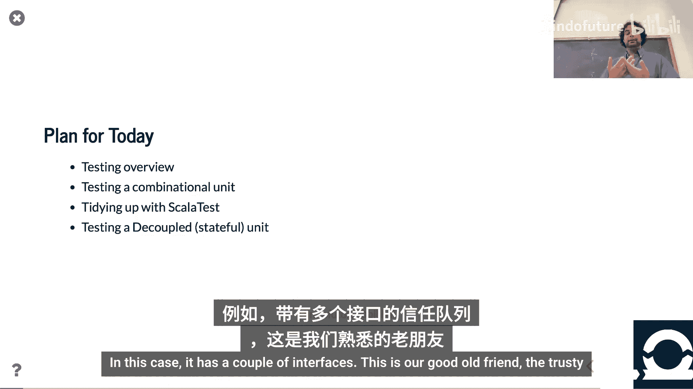

嗯。

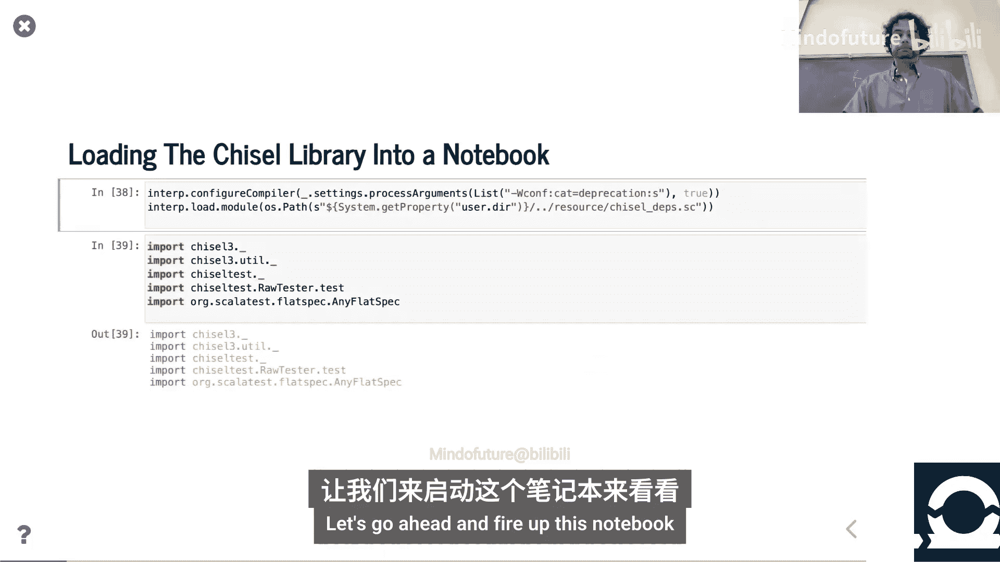

It's good ahead and part this notebook。So why are we testing？Number one。

 who wants hardware but it's not known to work right like I yeah。

 not helpful right if youre to spend time with this hardware， it's better be known to work。嗯。

You also need to prove yourself it works that's an important step， you also， you know。

 beyond proving to yourself。Its also take this harder you need to prove to others it works right so these tests aren't just the fact that making sure it's correct。

 you also want to to prove to people is correct。That's an important step。

 but beyond those two things。Underappreciated， tests help you develop better hardware。

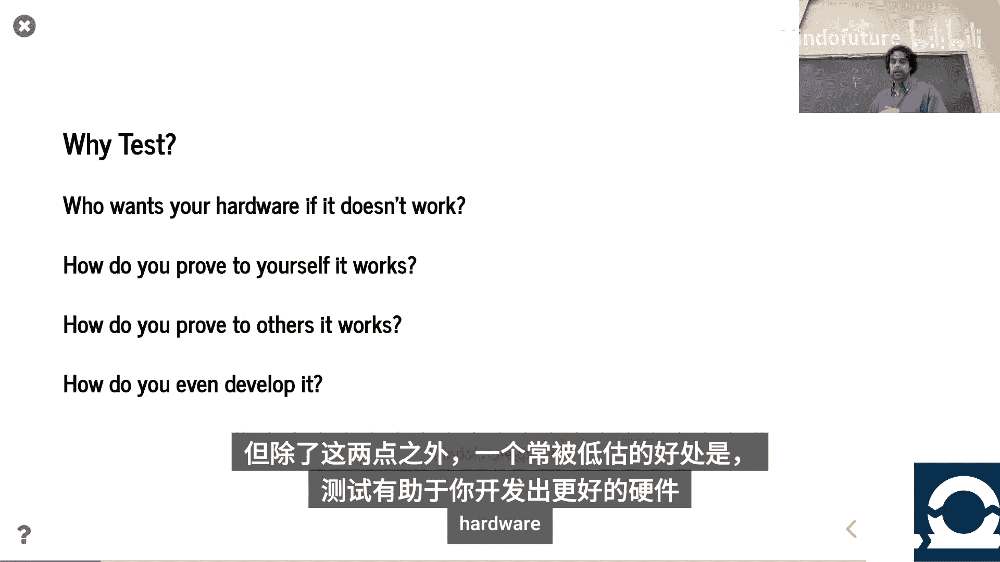

嗯。If you use tests not just at the end， but along the way。

 you will both develop not just more correct hardware。

 believe better design for testing and have higher quality tests。

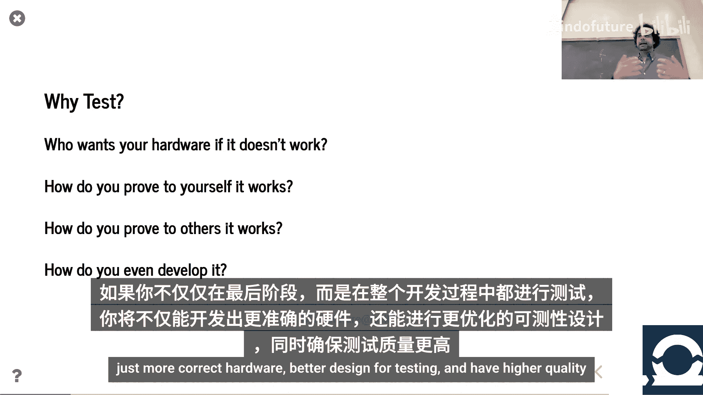

Yet testing is part of the process， that's what we're arguing for in today's lecture。

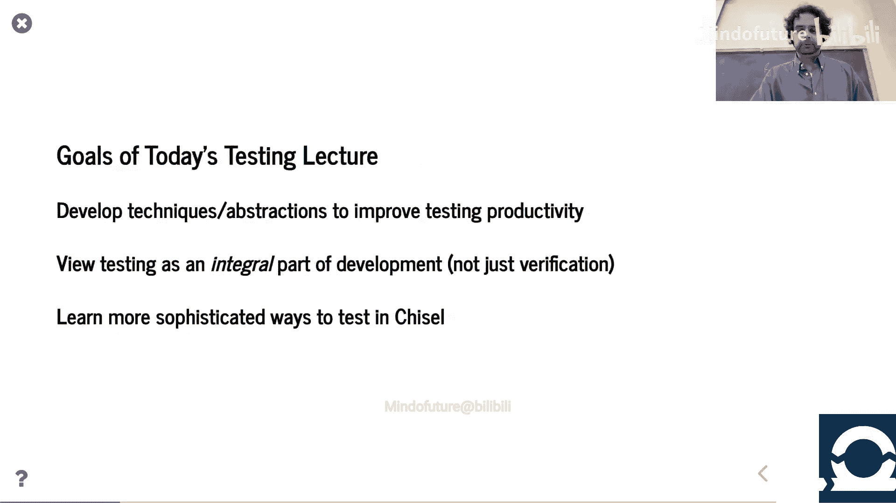

Okay， so in this testing lecture。We to cover a few concrete skills， right， So number one。

 what are the actual， you know， API functions， but more generally techniques we can use to like。

Do testing and web can we build up to make testing more productive。

I really want you to kind of get sold on this， right。

 testing is just thing to do at the end of the detail， no no its。

Part of the process and you do it well， it actually makes the process easier and smoother right The whole point of agile programming and the agile development has been to be more productive。

 make high quality outputs and getting testing as part of it。

 making an integral part of it really helps with that， right。

There's some cool tricks how to kind of take the best advantage what was available in Sca。

 chisel and Chiile tests。The kind of pull all together。So for testing。There's three main components。

 right？First off you need a test case right， so you know what is the actual thing being asked to do？

😊，Andnitially you write these by hand。But at some point。

 maybe you also might want to use some kind of code that you generate these。😡，And of course。

 when you generate these， you can generate every possible combination。

 which is possible for very few inputs， you have a lot of inputs， maybe you need to do it random。

 sometimes random is too random and you want to be what's called directed random kind of choose certain things that kind of steer it。

嗯。When you have these inputs， then of course the question is for a test， it's both。

Give input in a harder module and then harder module responds。 And you kind of see， well。

 is that correct， right， So testing is the automatedmate checking。 Its the question of， well。

 what is the right answer， It also may be part of the test。For your very first version of a test。

 you can once again handwr these， handw write the inputs。

 hand write the outputs that can work to get started。 But of course this is brittle， right。

 We'd much rather。Have have a more reliable way to do this。

 this is a methodology using this course that we call model generated。We're going to write scala。

 which is not chisel， it's just pure scala that does functionality that we care about。

 it'll model one it's supposed to do functionally。And we'll use that to tell what our answer to how should be。

 right？We will give a input to both it。Chsel design under test as an inside a test bench。

 we'll also give the input to the model， the model will you know tell us the output should to make sure that the chisel matches the model now。

😡，The right question would be， well， who checks the model， right？And that's that's up to you。

 So there's different a way to kind check these models to make sure that's true。 And this course。

 we're going to handle it a little bit and say， well， hope their models are。

Simple enough and sure enough to kind of can visually inspect them and hopefully really clear。😡。

But in practice， taking route is a really important thing when it comes to things like the project。

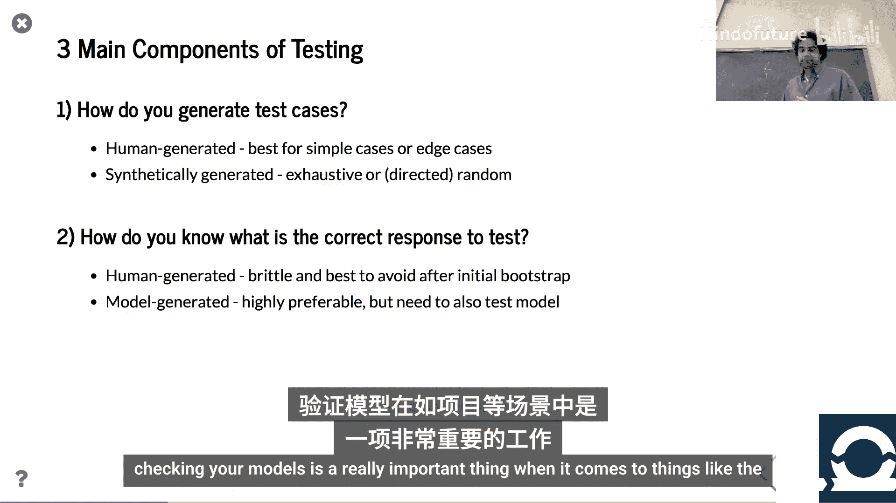

You may find SA and Stars where we you can for find functionality you're trying to build your project in Python or Java。

 and then compare that to your model to make sure your model correction from the beginning。😡。

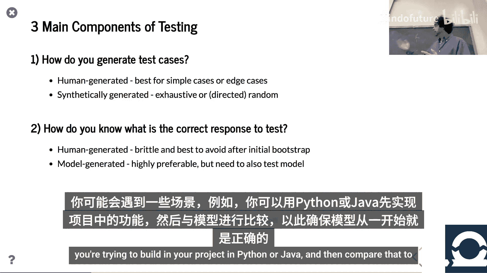

And okay， so we have the input to our test case， we have the correct output， we're done， right？

Actually， we need one more thing for testing and that is a way to actually perform a test， right？

And so you need some sort of way to accentiate the hardware。Fed at the inputs。

 extract the outputs and compare。 And so。There's a whole bunch of scripting execution involvement iss a lot collateral。

And so if you think about this in the common case， in the general case， you think go oh my go。

 how I could balance you know flexibility， portability， speed， etcter， for this course。

 we can just kind of hand this on down to you。For're actually assimilating your design。Under hoodod。

 you'll know it recently called treadle is' a sca based way to simulate chisle code。

 So great simulation check。Who would like to do an execution of these tests？Chle test。

 the thing I was telling you about was so excited about and then how to organize the or multiple tests and kind of pull things together。

 reading scholar tests。Those are three tools only separate for dis course。

We've already made these choices， you only worry about this， it's already solved， right？

When you get coverVD homework repository， it's already using all these things for you。

 it's already all configured。But this for curiosity， that's what's they going to happen。

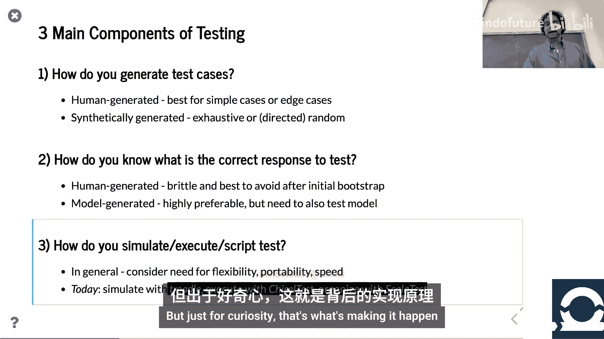

Cool， questions so far。

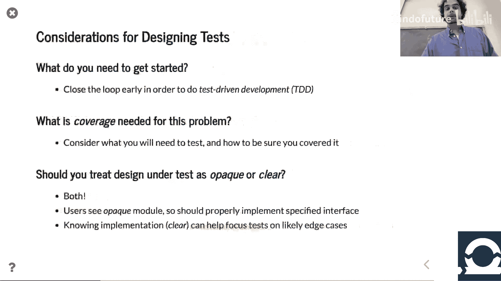

Okay。So you're making these tests， Oh yes， go ahead。还的。Ceach。Okay， good question。

 the question is how do you make sure your tests aren't too circular in a sense of like your model being the same as the thing you're testing for really trivial components。

 your model will look a lot like the thing you're testing and I think that's okay I think you're right for testing robustness when possible it's nice to have your model you're written in a different approach in the actual module a thing under test that way just like some you know or fuckingno some differences there。

But sometimes that's inevitable。

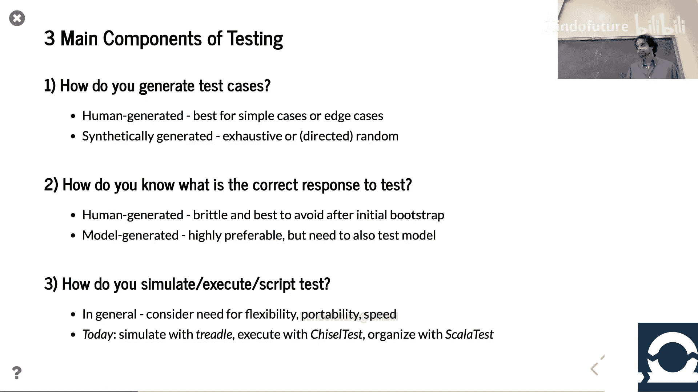

This's going to happen。嗯。

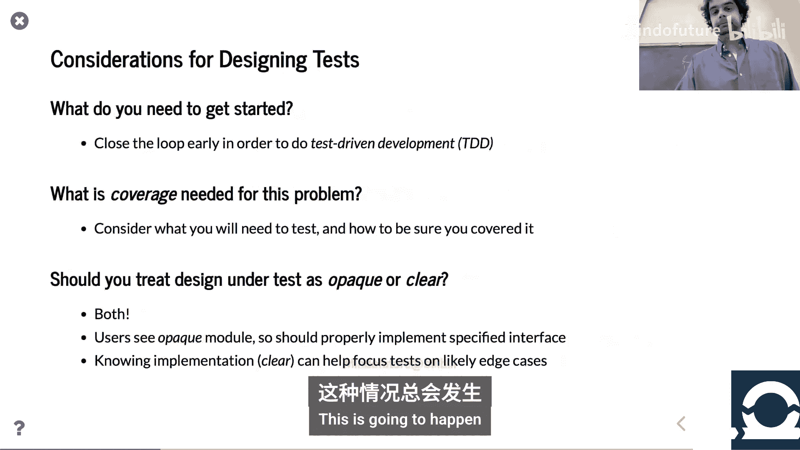

There， one thing you also mentioned later on this course， we also still will cover。

Formal verification。😡，And when formal you actually do want them to be the same， right。

 that's the whole point and so。Um， this is more of us kind of， you know。

 dynamic empirical testing rather than informal testing， right？

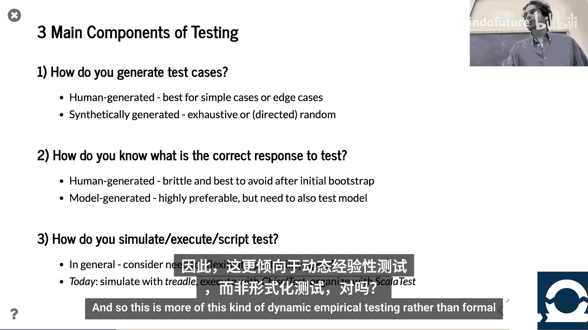

Okay， so you're making tests。What are you thinking about as I've always in this course you right close a loop that's the course logo right get thingss going as soon as you can so you want to get some test case running on something as soon as possible we want to do test driven development。

How can I get some simple test bench running on some simple version of module as simple as possible？

😡，Dense and it comes up a lot。 You might hear this term coverage。In design。

 and it cover refers to what fraction of the horror's functionality。Now if you actually test it。

 right， if you write a test， it does one thing and your module do five things right so that means you've not tested the entire module intensity。

 2% is functionality right so。😡，You should be thinking about what do you actually want make sure you cover your testing and make sure your testing actually covers all those functionalities。

And then the third thing comes up a lot。How should you think about your design？

So I use the terms opaque and clear here and other communities you may hear the term black box or white box。

Black box meaning。All I the stand in for opaque in other words。You can't see inside the module。

 so you know that the module is supposed to do functionally？😡，But you have no idea。

What's going on in the side of it。 The alternative， of course。

 is white box testing where you know exactly how' it limited。 And so it's kind of transferred both。

 right， thege of black box testing， for example， I suggested earlier was that way if Imos been inside there。

 I can。Kind of for us to be more defensive， I'm forced to kind of really make sure everything works correctly。

 however if I doing white box testing or clear testing that you see inside there。

I can know where the corner cases are， because I can read the code and see the code's corner cases。

 make sure I're actually hitting them。And so。What I recommend， both。

 I think you should make sure you cover the case of these little C which is kind of that opaque case from the outside。

But also you know yourself right， you put in some special case inside the hardware。

 make sure your habit edge case is actually tested， and you actually have that coverage。😡。

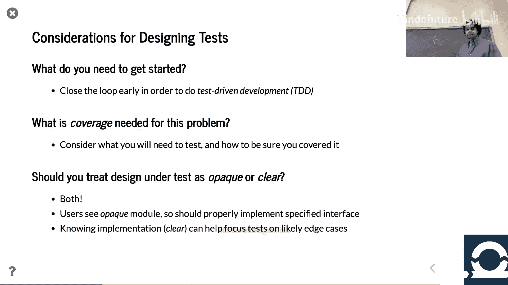

Okay， so then。When we' actually testing， I've been saying all lecture。Imvibe it， embrace it。

 It's gonna be integral。 right， So it's not just the end final verification。

 When your first availableve the set， you won find the simplest test bench。

 simplest module and get them right together right away。 So you're using that。Or get things going。

As you start getting going and modeling get more and more sophisticated。

 is use something called continuous integration， which means。

The tests are going to be running under module into the background。

 It's not you running manually all the time， but things like your Gitthub serverber can run it for you into backgrounds。

We'll go back to that material later on this quarter， but just be aware as their timeix comes up。

One of the most important times haveve testing。Is actually when you're talking with external collaborators。

 right because。Someone puts a pull request for your code on GitHub。If so one line fixed。

 you can look at me like， I can probably reason about that， and I need to drop 100 lines on you。

Did it break anything， I don't know。Well， how would you trust someone else's code has had your code。

 you'd want it out of it， you want to definitely look at it， but you also want to check it。

 so how you check it？Tests right you to check it with tests and better yet if you share those tests publicly。

😡，The person contributing this can run those tests before they make the pull request。

 asking to send you the code so that you can know it's going to work in the first place。

Another time anyone want to use tests is doing design space exploration。 right。

 you have a parameterized hardware generator and you want tune those parameters to see， you know。

How it does in design space。 So in this case， you're actually using the test to animate the design。

 Hopefully it's correct。 Yes， but it's also a way you kind of see performance， for example。

 So a lot of different times we want it。And so I said it's really important to not just do testing at the end。

 but along the way， it makes the along the way process easier and better。

 but also by doing testing earlier， you actually do testing better and so for example we may find there this massive。

 super complicated module， it's really hard to test。😡，That can happen。 How can you avoid that？

If you include testing earlier in the process。You can design abstractions and even adjust your module boundaries to ease testing。

For example， a module which has no state internally。

 it's just conventionalal logic is so much easier to test so if you can kind of decompose your design。

😡，And two things that are mostly combinational and things that are the safe allowments。

 you can make it so much easier to test。 So like I said， considering testing early。

It's a great thing， it's often through to as design for test DFT。

These are the harder folks who's referred to to making the chips design for testing the actual。😡。

Physical chip， but I'm using today refer to actually changing the way you're design。

 so it's actually easier to test in the RTL world。

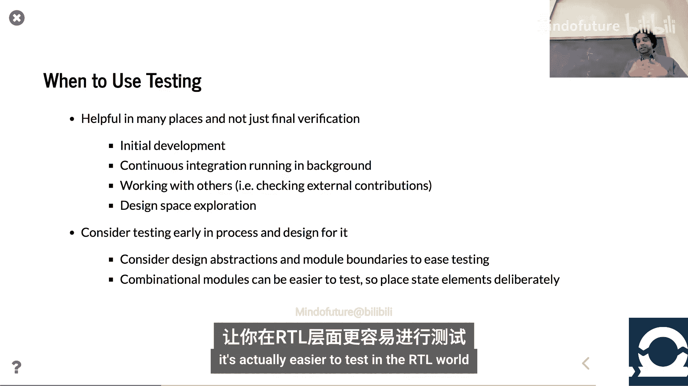

Cool。Okay， so。

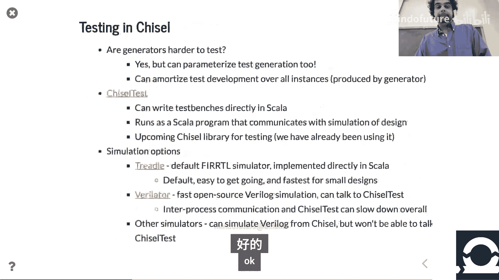

What's it like inside chisel？I've been extolling the virtue of the generators all quarter。 you know。

 don't write a single design， write a generator。 Are generators harder to test a single design。 Yes。

 because now。You need to test。呃。Multiple things， so what can you do well？😡。

We recommend doing in this course is if you parameterize your test environment。

Someone can then use that to test an instance that came out of your generator right， in other words。

 let's see your generator can produce n possible designs because you have that parameter can go from zero to n。

😡，啊。You don't want to write N test benches， right， You want to write one test benches parameters that thing as an end user when they can use it。

 they can then。

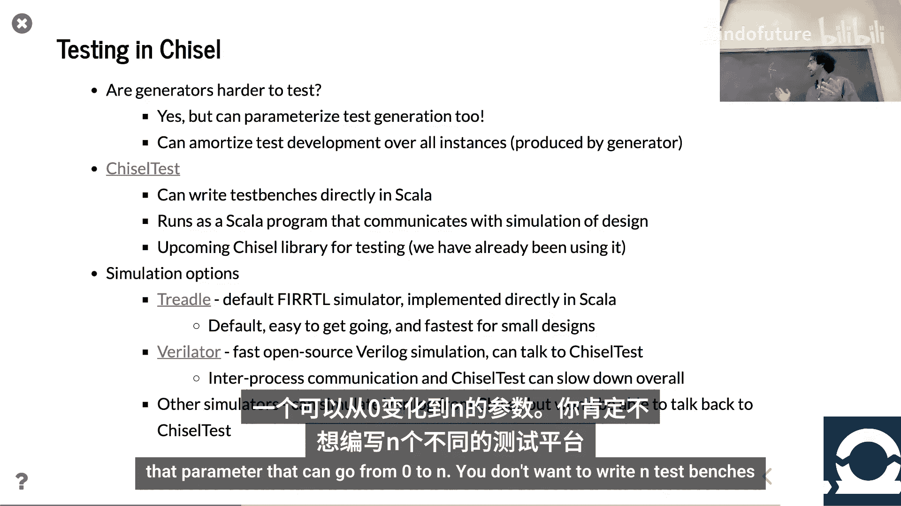

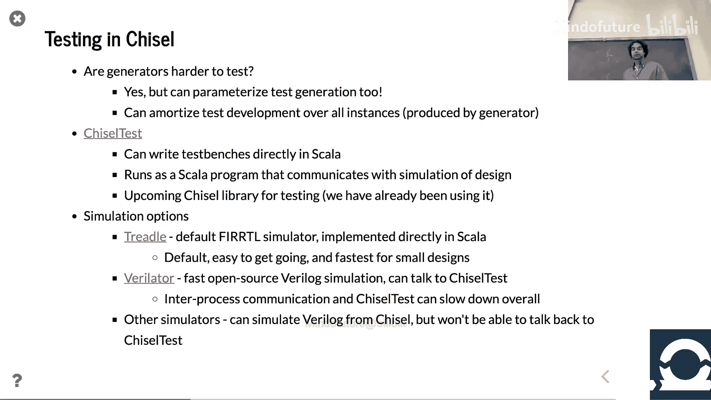

嗯。Hereing that test bench that same parameter and you get that same instance tested， so we aren't。

Exhausttedively make any kind of strong guarantee about every possible parameter recognition being safe。

But we're giving someone the power by having this parameterized test to make sure the instance you're actually using is tested。

嗯。Cool。What about chillle test， I keep having it up。 You you've seen it all quarter kind of already。

 It's a way to write Testment directly in the Sca it。Runs what you write there in a snippet。

 is a scholar program。It has that talking。To a simulationimil of the design。For this course。

 we're using something called Treadllch， as I said， a sca based simulator。

 and so it's all a scholara land that's all GBM it runs pretty fine。

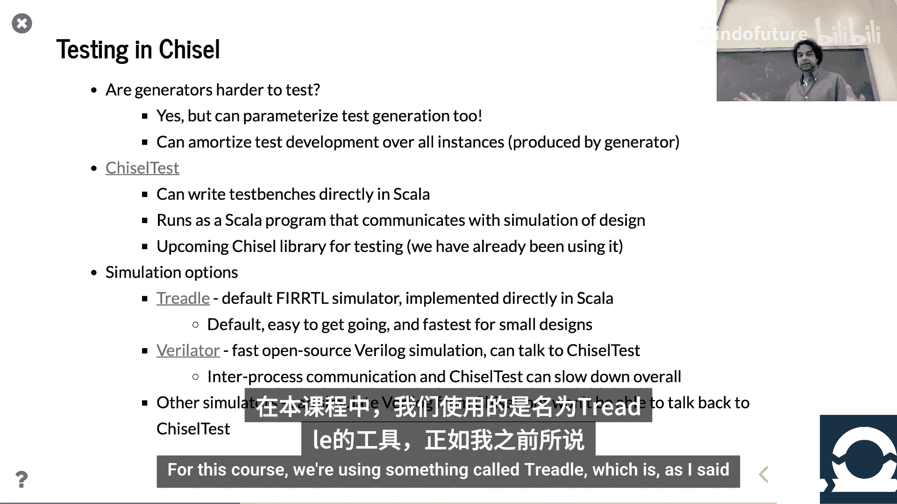

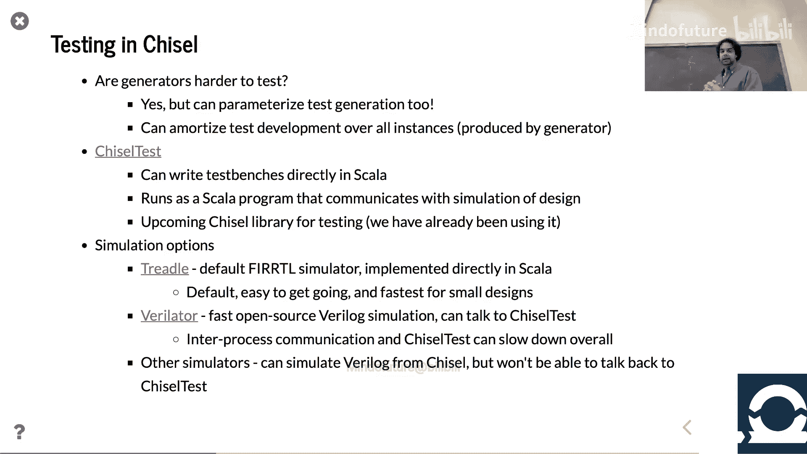

Triddle of course， as simulator eventually for massive massive designs is not the fastest thing in the world。

But turns out a small design has a very fast startup time is way easier to use。

 but there are ways to actually change a similulator you're using and even when you change a similulator you're using it's now running in a different process。

😡。

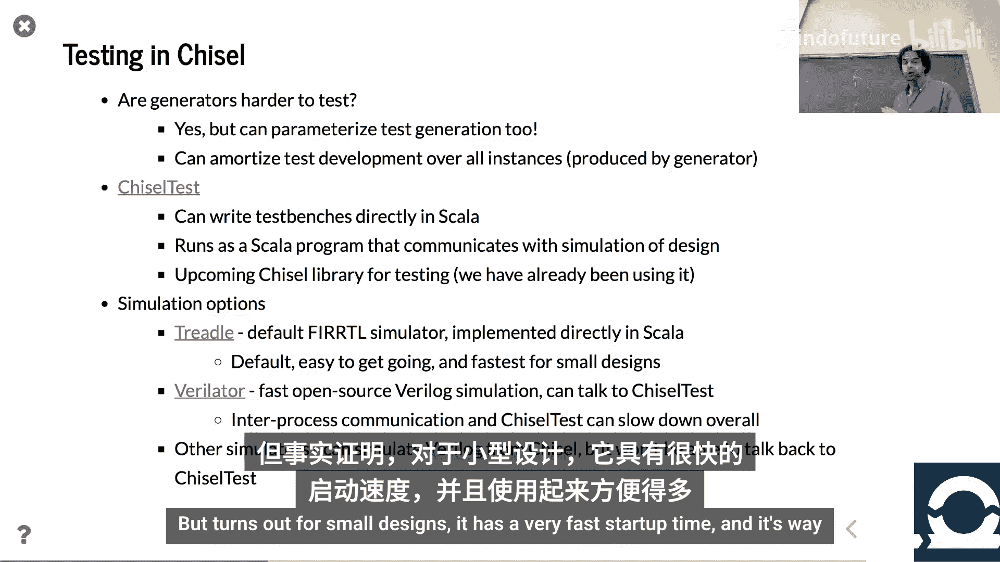

It still talks to your chisel test test bench， which is still a scholar program， so for example。

 if you use something called verilator。Which will generate a custom Sw plus program for your hardware design。

That will be one program running an estimation will be controlled by a chile test which is a scholar program actually talking to it and exchanging data values and stimuli and that kind of stuff let's you have a commercial similar you want to use that's also possible。

😡，嗯。And so yeah。These are situations for this course。

Trusty tread is fine and you can have millions of cycle simulation there and generate waveforms。

 you'll be happy， you'll be fine， but through our course other tools。

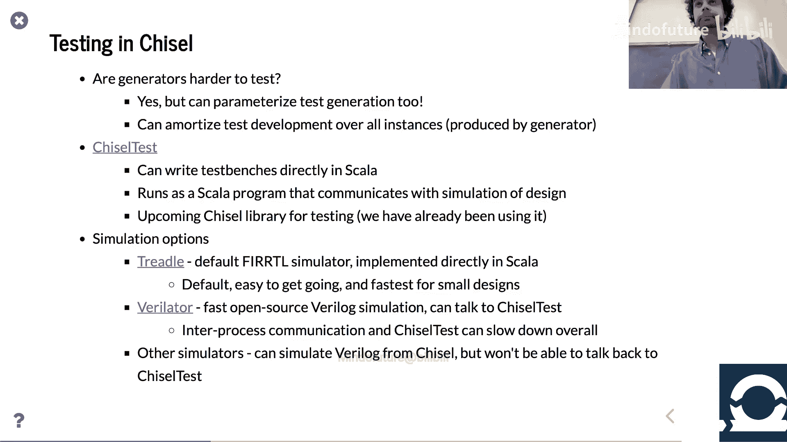

So I promise you publishing the poetry easy to test。

 let's talk about it so a combinational means a stateless， that means no matter whatever I do。

 if I put the same inputs in， I'm always at the same outputs。

 a safe element I can give the same inputs and may get different outputs we may depend on the history of prior inputs right。

😡，Fantastic accommodation opponent， of course you'd be thinking about， you know。

How much range do inputs have， what are a range of parameters and how do the parameters impact these size of input space。

 right， So if the combination of all these things together is that the space of possibilities is reasonably small。

I can just test things exhaustively right， that's high confidence right I tested every possible scenario and that works。

😡，And so sometimes do exhaust testing， that's great。However。

 you can imagine that if the parameter is get made too big。That search base gets way too big。

W else testing is not an option。

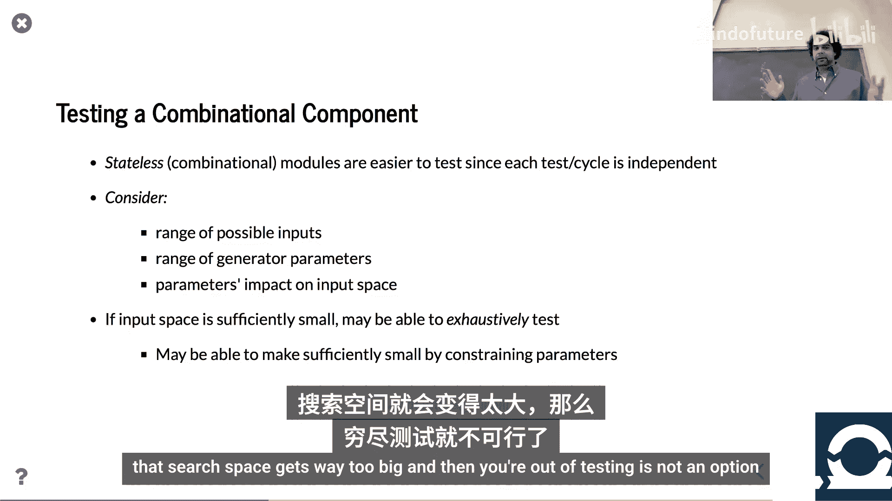

Let's see how that play out。So let's imagine we're building。An adder。

Through a sine and magnitude numbers。 remember sine magnitude numbers。

 we've got this notion of there's the magnitude or mag n。Which is a u in right。

 and the sign tells us those pods that were negative， right？

And so if we want to do an addition for this， well， if the two numbers have the same sign。

We simply just you know， copy the sign to the output and add the magnitudes， however。

If they have different magnitudes。You know， adding a positive negative or negative to a positive。

We need to subtract the magnitudes and it's science accordingly。

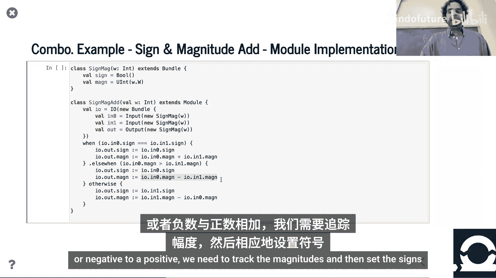

Cool。

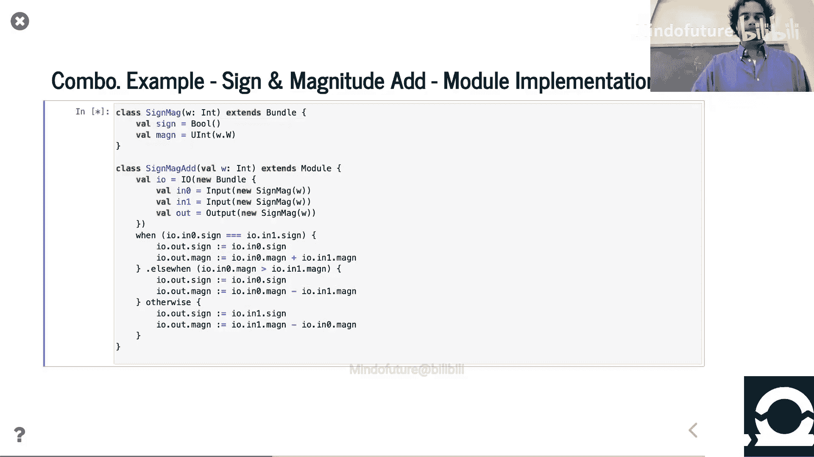

Great，Bless write test。 Like I said， we wrote that module is right test right away。 Our first test。

 What do I do， Well， I'm going to set。positiveitive four。

 so the sign bit is false and it's our positive one， sorry。Iroving positive too。

And then I'm going to spec three， this is all handwritten， so to speak。And they run through。

 and as we've seen before。If that bench works， it actually tells us nothing because it's supposed to work。

 but's say selected four， it's going to break， you know， I got three。

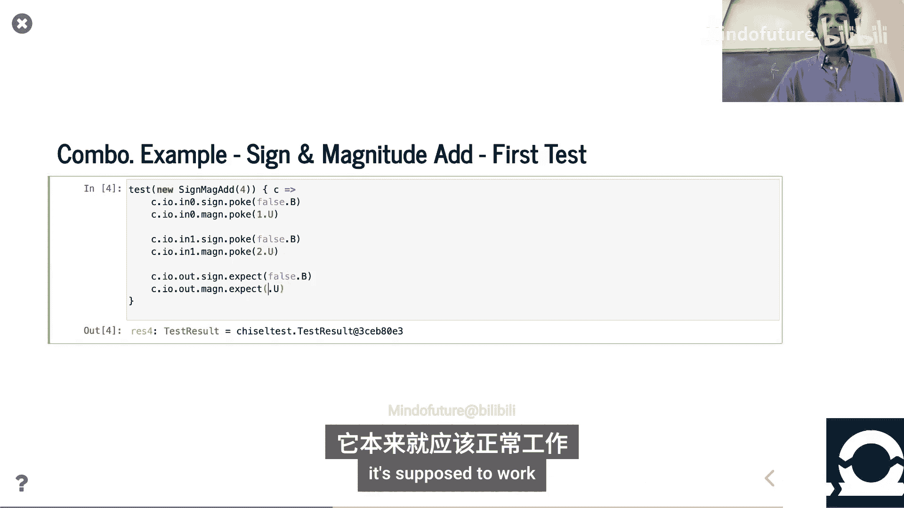

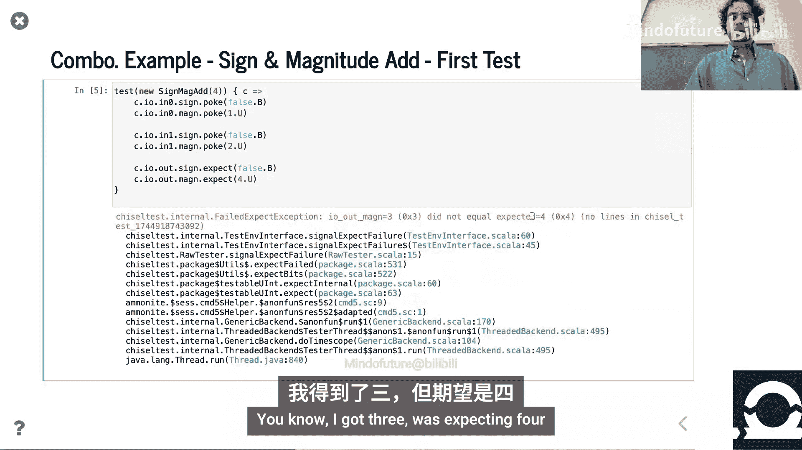

Was was expecting four。 Okay， so great，1 plus two is3。Thing is working so far。But。

Which has exactly one input case here， right， and now it's a lot of work to write。

 so I can make this more efficient。As I I said before， let's build a model。And so to the point of。

 well， gee， if I'm building an adder。At the end of the day， aren't I just going to be doing a sum。

 yes， yes， you are， however。You can see there's more lines to this than just the sum。

So what heck is all this other crap？I'm representing the truncating edition right so if we go back to our design。

 which you know important think about what properties we're designing for。

 we have a w bit input and a w bit output so as a result，😡。

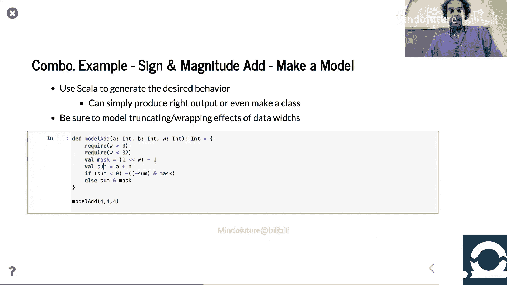

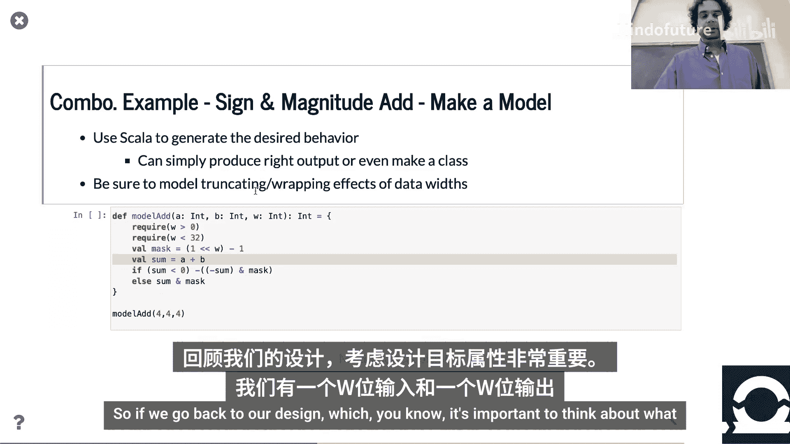

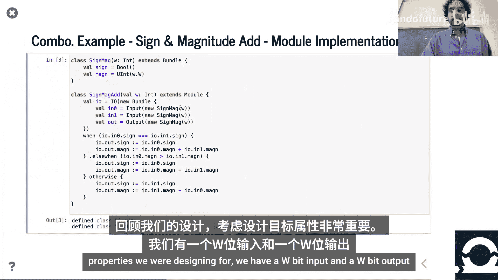

Trunation is possible。Meanwhile， a sca int is32 bits。So first of。

 someone wants to do with W way bigger than 42。 That's not going to work because you can't represent that with a sion。

There is a big in class， which of course can be arbitrary， but not not right now。

 but also we want to model the truncation behavior， so to model trunccation behavior。

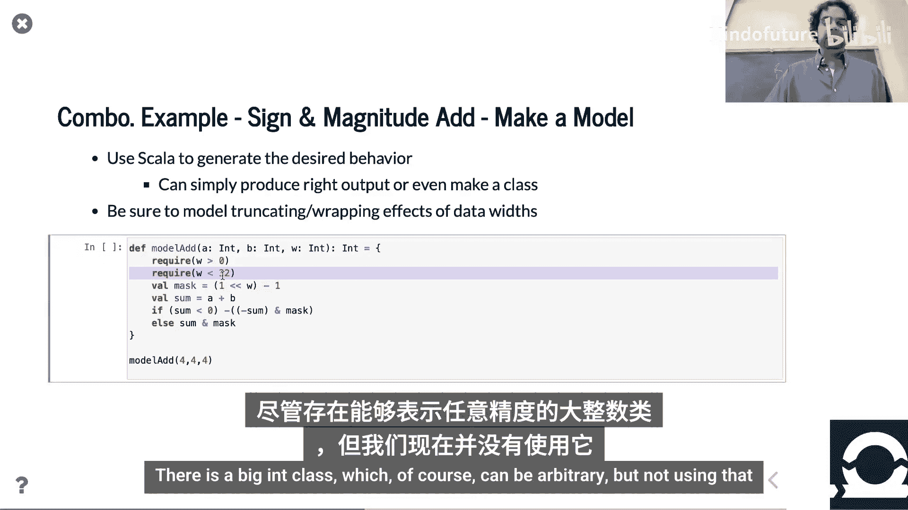

We kind of have this。Buyers tickets you're not going to go into right now， which。

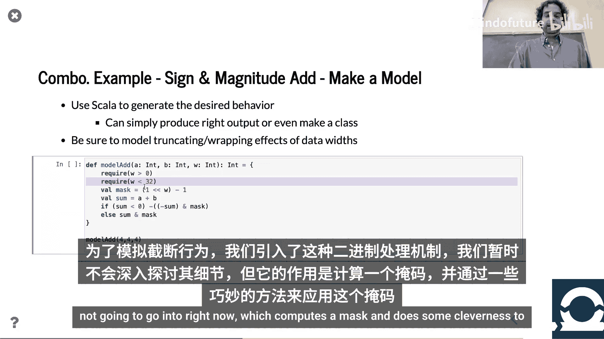

If yous a mask and does some cleverness to apply the mask。

And it works out part of the complexity here is that this is a sign number。

 and so to handle a sign number， you' going to do some extra stuff。

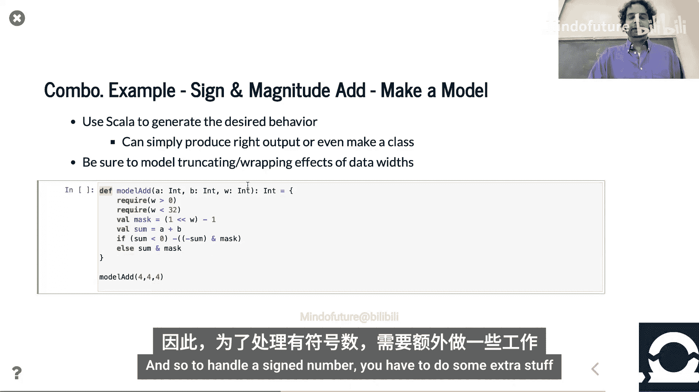

But。Let say， for example， I， you know， have a four bit W and add a， you know， A and B， you know。

44 is， you know。8ight， you know， nine， et cetera now， except， so four plus4 being eight。

 that fits fine in four bits。If you made this three bits， for example。Zero。

 right because you can't fit eight in three bits。If I made it a little bit smaller， it's 7 does fit。

 So this model is reproducing the truncation behavior。 But big picture is this model。

 you know given A and B and a width。Repress the number， it has the constraints on the width， okay。

So now。We have a model。Are we done Not quite。 We want to kind of automate more things， right。

 May tools do to work。 So here we have this function， which is going to take in。2 numbers to test。

A unit to test with， right， this module module all right here。

And then what's itre going to do is's going to course set the test。

 right So'm gonna poke in the inputs into。Module under test， right， the C。 And you see， for example。

 for s bit， for example， it's studying that based on the numerical value of it。嗯。And then。

30 magnitude。 it just calls into。Our model to do the addition。And then。For the sign bit。

 it also calls into the model and it checks lesson than zero。 So yeah。

 if just say want to do two plus3。No problems you can sign C else kind of all fits together so。

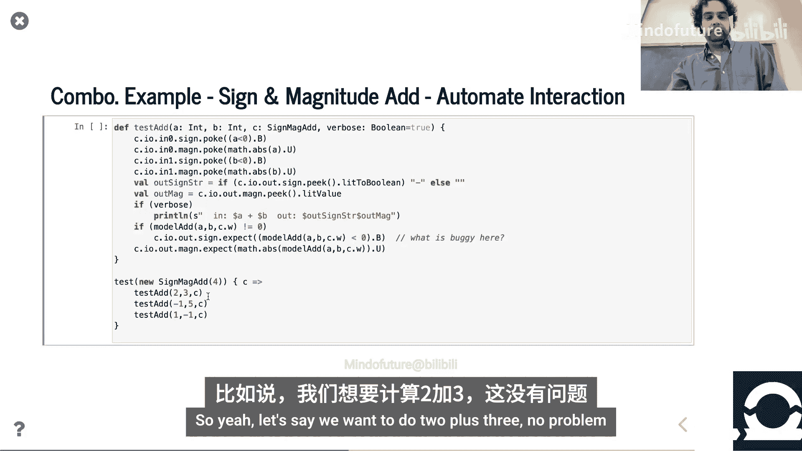

I've had some print names to kind of make this all print out pretty， but。Yeah， you know。

2 plus3 went in， the alpha was5， we can see the test bench passed into no issues。This test bench。

Is kind of concise。 right we have ability to kind of have a parameterized model。

 We have this test a function kind of bias things together for us。

 That's kind of that third bullet point。 If you know。

 how do you kind of automate the interaction and do all this stuff。

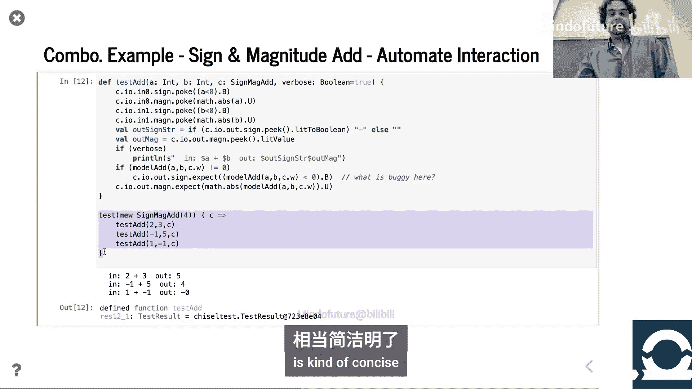

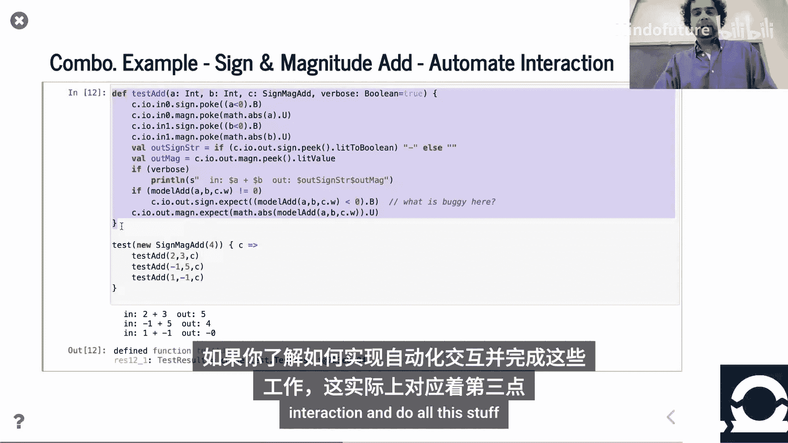

And now writing a new test bench rather and writing six lines， like you did。

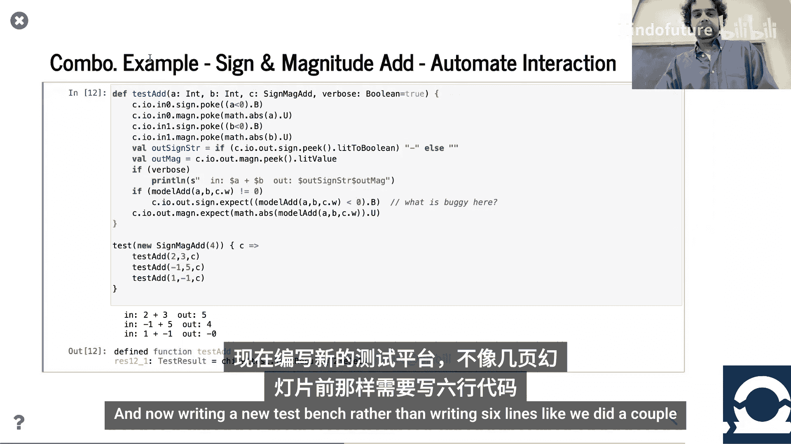

A couple slides ago。I have to set the inputs manually in the output now writing a new test case easy as just writing one line and notice how not only am I just writing the two inputs。

 I actually don't even write the outputs，' using the model to compute the output for us。

 So actually just set more automation。😡。

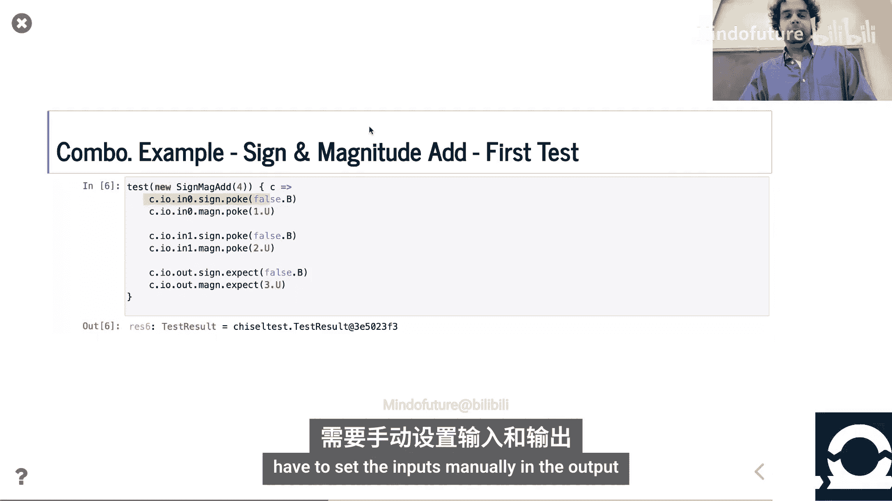

Less chances to get this wrong。Okay， now let's come back to this comment。

I have this comment here about。The sign。And。So what's going on at the sign？

So this is both visible in the code here and this a general issue is sign and magnitude。

 maybe if folks remember back to undergrad。What's the challenge with s of magnitude numbers？

Or I'll give you a hint。喂。Why do I have this if statement？Why can't always just trust the output？

As a third hint， I'll say， look at the text output for the test cases and see if anything there looks a little funny too。

Yeah。Yeah， so it's one of these things we ask about an mathmatician is zero positive or negative and kind of ask me like yeah。

 you said like that doesn't make sense， but with the encodings。

 we can't have positive or negative zero。As you can see down here。We have negative zero right。

 that's a node we to assign sign of magnitude numbers。

This is part of why it seems like two Kaman or great because too Kaman only has one0。

So if you ever worked with floating point， floating point does have20。

 there's a positive negative zero， which。Most of people seem like a bad thing， but actually。

things like representing limits actually having both zeros is considered a feature。

And so in this case， we kind of put a hole in our test bench because yeah， wait。

 there's some fineness about。Zeros and signs， and so yeah， if it's not zero。J comparison is zero。

Inpectively is not checking a sign because there's no specified behavior， right， we to specify。

When we get the result of zero， should be positive or negative。

 we have no model for that and so we're just not checking the assignment in that case。

Small detail but kind of interesting。 but big picture， yeah。

 this complicated function is doing a lot of work for us。

 and now we great test is simple as just writing a new test right like two inputs and it does it talks to the model。

 it just with the inputs， it checks the outputs。 It even has some print statements in there for us。

 Pretty cool。😊，These print statements， of course are also gated by a verbosity flag。

 which by default is trueth why we're seeing it right here but。

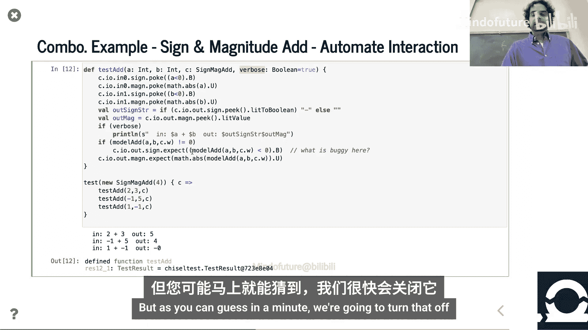

As in guess in a minute， we're going to turn that off。嗯。

So what if I just want to try every possible combination？

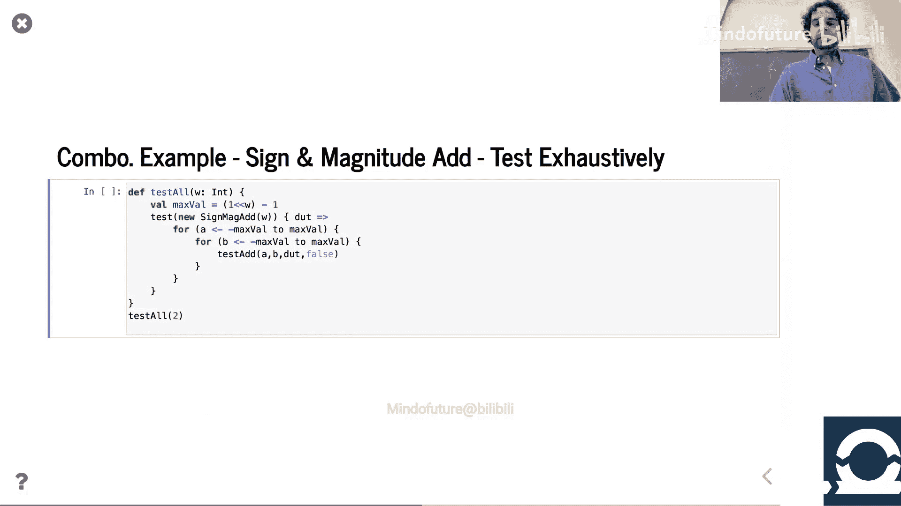

So given a input， I'm going to now。Pick the maximum value and then you try all maximum values for a for negative deposits of all B。

 and there we go。Like also testing for two， not too bad。I forgot what the cutoff slap up is。

 It'll be kind of fun to find out。 I think you're probably can do for。 Oh yeah， you know， it's。

 it's not breakinging a sweat yet。 Remember it， whatever this number is， right。

Let's say four bits right， was one inputs four bits， so two inputs is eight bits。😡，嗯。And so yeah， so。

啊。26 that's not too bad， but you can imagine as this crank this up， it might start to get slower。

Yeah， do a little bit time。😊，and we'll keep going till you' get bored， right。

 it's taking longer and yeah， I think maybe 80000。Much patience I have for today。Or things working。

 okay。So passing， if that's testing， it's working。 So you can see in this case， right？

Fvis is actually building the prior slide test a， we can easily just chuck in more inputs at it and。

 you know， go to town and also by turning off the print statements， our screens not full of。

 you know。Gbberish， right？So thing I want to emphasize about the tests right tests aren't just the fact you ran your design with some sort of input stimulus。

 the test is also checking the output for you right if your response is I want to you know go to line five。

 read the output of this line five is the value six， that means it works。😡，That's not a test。

 that's the bug of printf。 That's not a test。 The test needs to automatically check for you。

Is it correct or not？Okay， cool， so that was exhaust testing， which， you know。

 I just saw eventually they were run out of steam。So what's the alternative。

 the alternative could be what if we did it randomly， right， so we just say， hey。

 you call this function。😡，And I'm going to randomly generate an input and just have two inputs randomly generate it and then test it。

Yeah， so we can fix the number of trials and justs let it run。

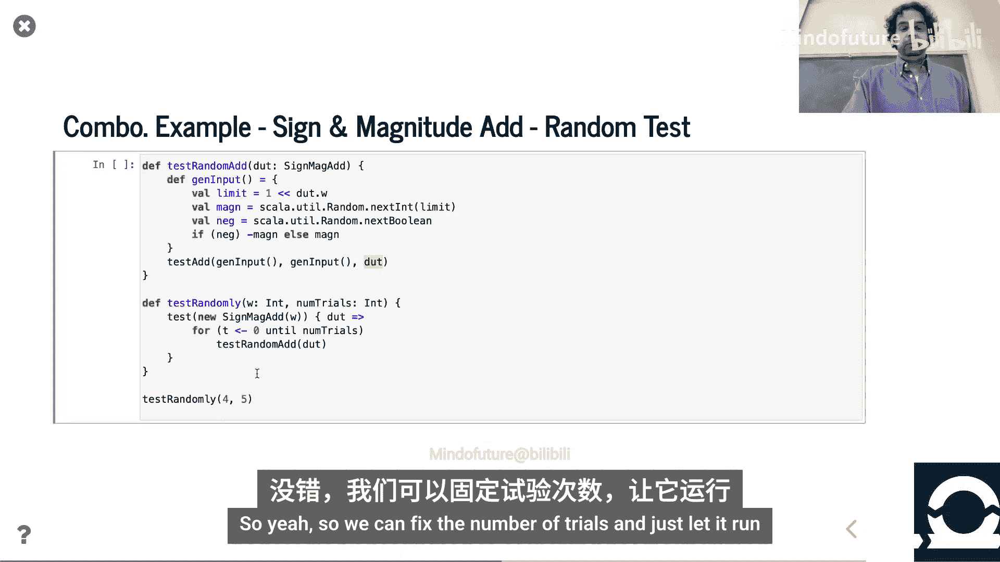

In this case， I'm leaving the verbosity on so you can see what's trying。Yeah。

 randomly generated five test cases for us。No problem。 I can run this again。

It's going to generate five new test cases。So you can see already we've booked our way up， right。

 even though it's something as simple as an adder。😡。

We have had ability to kind of exhaust test all inputs， which makes sense if W is small。

As W gets bigger， that's maybe not a good idea。We can do things like。Randdom testing， et cetera。

So you can see we're kind of building abstractions rather than just writing simple test cases。

 rather than doing tons of copy pasting。😡，We're writing code to kind of build up something more sophisticated about this。

Cool questions on that。type great， okay so。Let's。啱。Organized think， so scholarlet tests。

 we've been using under the hoodod and notably necessarily knowing it。Like I guess name and imply。

 it's know the se from Java test right， so everybody's going back to Java。

So the SVT tool will use this course for things like the homeworks is aware of Sclet tests。

 and knows how to talk to it， some example you say test it knows how I go digging into the source people and running a test。

 you also can say， hey， I only want to run。😡，A certain test， great chill test。

Internally depends on Schs。These Slet test features does also work with chisel tests， which is great。

So you've already been using this and didn't even know it。m，So uh。

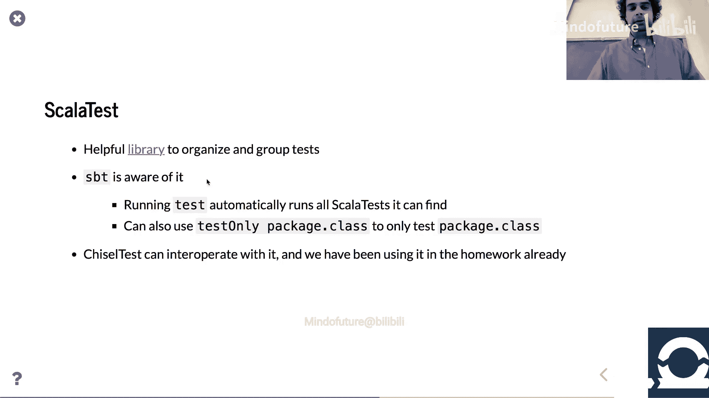

For example。With sc test。You can actually not just write a test case。

 you can write a test case it actually。Appears you remember into homework？When you run things。

You kind of see this green text when it's running， right。

 So the green text is coming from the tester。The black text is coming from our test bench。

 our test bench has that print up inside there， right？嗯。And so this kind of compares per a second。

 right， So here you can see we have this sign mag test。What is this stuff over here。

 This is the border platelate for the testers， right， This， any flat spec comes from the sca test。

 This comes from chisel test。嗯。And then the internal structure here is。

 I actually made these test cases so that it appears like this over here。For example， you know。

 behavior of is this block of tests this， you know。S mag a。

You see already kind interpolation like Dylan the bit with horse us。 if I changed a bit with。

It's going to let， you know。Change output here， which is kind of nice。

And then we actually have the label for the test。 So here actually chose to just write out what it's doing。

 Maybe youd use English words， describe it。Now， the syntax。

 if you're looking at just might like a little bit silly， right， You're like。

 wait a second behavior of there's like no dots in here。 There's no parentheses what's going on。

 So in Scala。One， the feature is a designerist language for is to make it easy to develop new languages on top of it。

 So as part of that in the language。啊。And both things are do object into programming。😡，You know。

 it would be behavior。Dot of。Like this。So this should also work？And it does。

But it turns out that the scholar par is smart enough。 the language rules allow it that instead of。

Requiring the arguments of the inpremes， you can put them just separated by space。

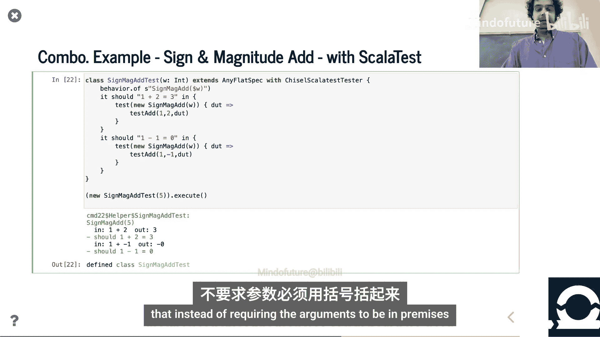

And then you also can replace the function name which is setting a dot there you can actually have a space and it's going to figure it out。

 So really， yeah， you are totally a function there。 And the reason why， you know。

 designers and Sc test chose to do this kind of looks human readable， right， It says， oh yeah。

 behavior of blank。

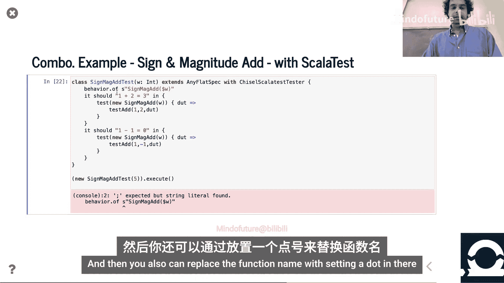

And then it should。Is you know， these are keywords defined within sca test， this is an argument。

This is another function call， and so you said Fatic I uses biop where basically you fill in what goes in the quotes。

 but you get these nice kind of tests， you can kind of have appeared inside your thing， etc。Cool。

 questions。Okay。

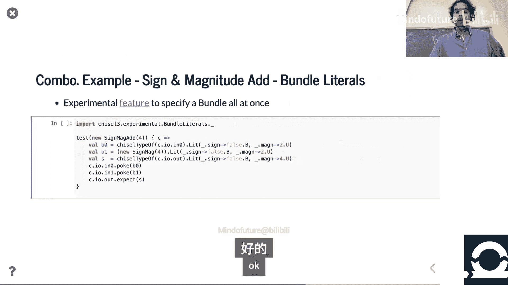

So we've seen。Sometimes a lot of lines of code dedicated to。Poking。Wirrees。

 and if you put up those pokes inside of a test bench as an automated function， it's not so bad。

 but sometimes。You still want more conciseness， so there's a feature called bundle literals。

Whereas a way for you to instantiate。A bundle full of constants or literals and then connect it together。

 So here I'm doing that。De generaterate B0 and B1。And even S， because see in this case I'm doing。

Two plus two to get four。And I'm showing different ways of declaring it。

 This is a feature which is still， I believe， in experimental literature will still not been fully blessed。

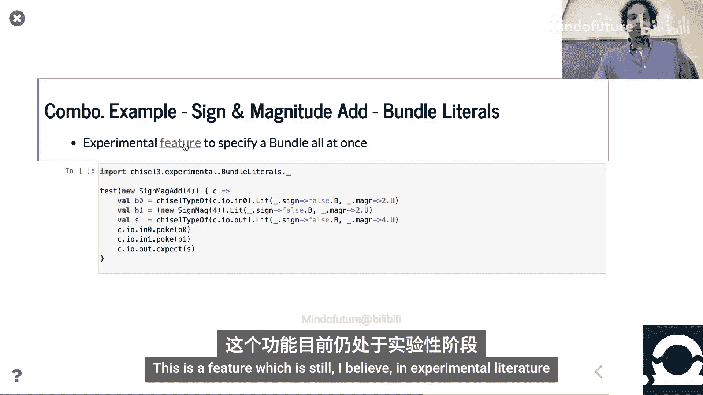

嗯。But yeah， it lets you describe that and yeah， you can see one way to write it is like you say the bundle type you want dot lit and you fill it in。

Another style which I showed。

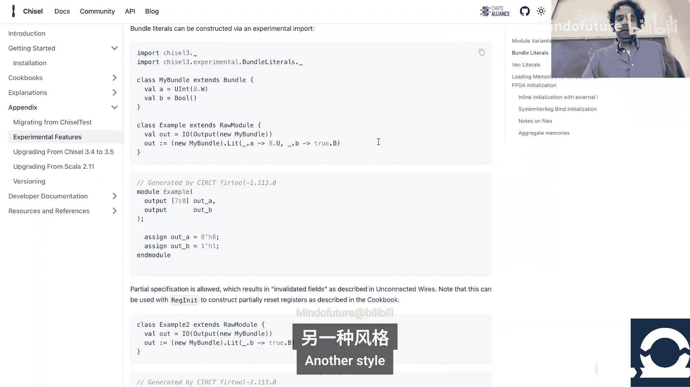

On the thing is you actually can also use reflection。😡，To identify sorry not reflection。

 introspection apologies， to identify the type of the thing you're working on that way we make sure the types match up。

So in some ways this is more robust because。This is saying， okay， what type is here， Let's grab that。

 and then we go ahead and populate it。 But the end of the day， this is still going to just， you know。

 plug in literals and test it。

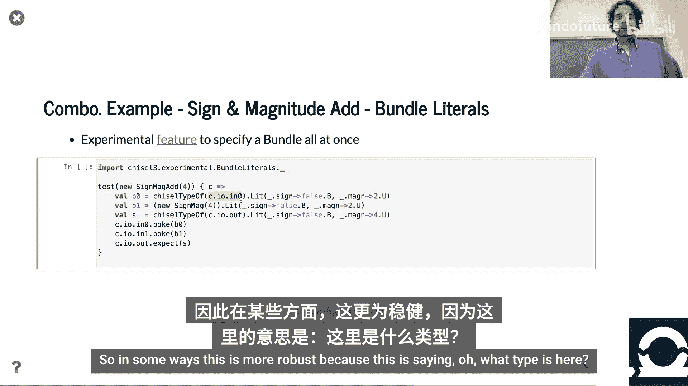

Using is interesting， otherwise don't worry， question。So。Yeah， so remember， yeah， this yeah。

 question， what's going on here so here I'm setting。The poke for n 0 that B 0。 if I go back to our。

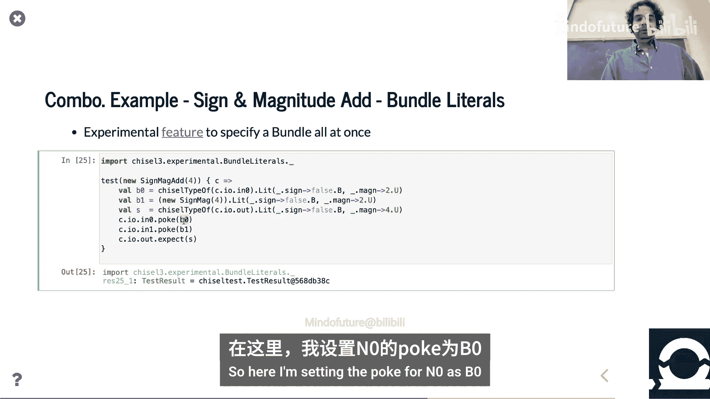

马雀。Remember， this is a sin and mag， which is a bundle has two fields。

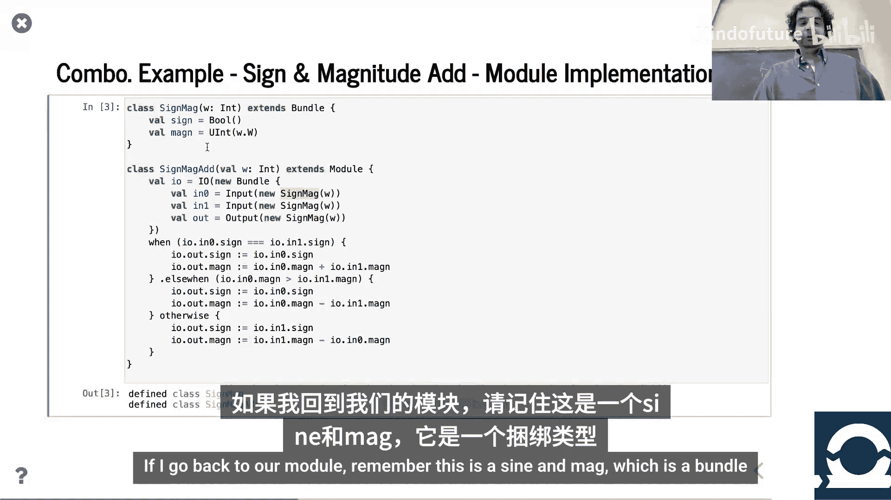

So instead of having two pokes per input， I'm having one poke per input now。it's a small one。

 like I said， this is something I find disint so verbo and scary， I don't usually bother with this。

 but。

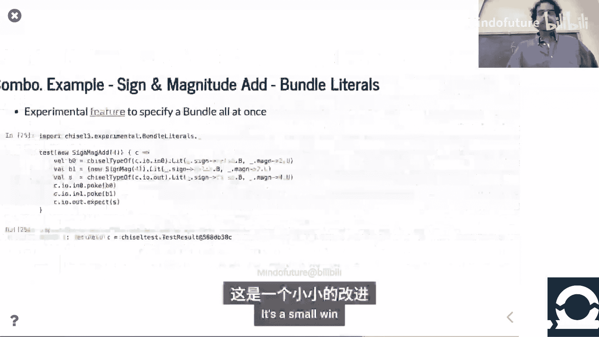

Maybe you find that better somehow。Cool， okay。So for a finale。We're going to take。Chissel。

 which has a Q class， which we've already seen in the prior lecture and we're going to build a way better test for。

 so the prior lecture we kind of had this very manual thing that was kind of dicey。

We're going to build a way better tested for it。Why is this interesting or challenging in the mixture of time for this And we do queuees have state。

 right， They have registers or even SRAM to hold what's going on side there。

 And so how we go about testing this in the way that makes sense number one。

Exhausive testing is probably not to possible。Uh， the test that we're going to show today I can't promise is like the perfect tester that guarantees Q is 00% perfect。

But we are going to show is how do we make a model for steep component？

And plug it into a test bench around it to kind of build up abstraction。

 we just saw that a second ago the signine and magnitude adder。

We built up all these attraction of sew the other day。

 we could simply just generate your test cases of one line we could do。Exhausted random easily。

We're going to get kind of similar with the queue， but mostly of us worried about how to Google that infrastructure up。

 So remember when we had the chisel queue。Oops， we have， you know， a type nervev entriesries。

We talk about these parameters， right you know there's a little pipe being true let you have。😡。

It inQ into a queue is full if it's also dequeuing。A flow we're going leave Fallsford today。

 which is to ability the kind of bypass to registers， it was empty。And remember。

 the inputs the and the outputs are all decoupled。

Okay， so first we need a bottle， right？And like said the model is tricky because。

Were trying to represent the behavior registers。And so。So in terms of the acuY functionality itself。

Guess what， there's a cu in the scholara language， we're going to go ahead and use that。

Notice using the mutable cutes。 you're actually going to like do push it some pops。On this Q。

 it's going to change。 It's not our immutable style and only do， but we know what we'll take that。

 So Mq or amable Q got it。 But what'st all need to do remember。The Q is two sets of ports。

 right it's the input ports， the output port， the NQ in the DQ。😡，And so both sides are decoupd。

 So that means we have ready valid and bits on both sides so。For example， let's say someone。

Ask the model， hey。Is the DQ side valid right now。In other words。

 it is something that can come off of this queue。Well。

 that should be the case that the actual Q inside this model is not empty， right？嗯。So yeah。

 you may have seen this before I mentioned a second ago that， you know， scholars raver both。

 the Ra is saying， you know， not dot is empty。 They also have it is empty and not empty because。

Why not if that kind of stuff appeals to you， there is a link I have on the homep page under scholar references。

 there's a blog I link to where someone has a lot of good idioms and。

 you know kind mistakes about writing scholar。I the true for any language。

 you can write code that is totally correct。But as a way I do it more elegantly。

 if you know that language better and kind embrace it better。

 And Sai has a blog kind of lists them all。 I'm very optimistic in the modern era of all these large language models L Ms。

 You know， as you're writing I D you can tell you know what。

 is this better in the coitions and that kind of stuff。 And so。

Here's example of something that's kind of a little bit unintuitive。

 but maybe not you wouldn't think to look for it， but it's kind of nicer okay。Then。

What else do we have， well， we have some more functions， except said let's say a tenth DQ。

So what does that mean， so remember the DQ happens？If the DQ side。

 the output of the Q is both ready and valid， so we make sure that's the case right， in other words。

 hey， if ready and valid， then yes， we take something off of the queue and。

The scholar terminology for P is dotDQ， okay， so yeah， we wrapped down some。

Meanwhile， to be more elegant to imagine of scala， guess what。

 If someone tries to deque and there's nothing to deque。

 whether it be the queue is empty and is's not valid， or perhaps it wasn't ready in the first place。

We say， hey， none， this is an option type right， and there're same something coming out。

But then this DQ ready， what is this remember DQ ready， the ready port on the DQ on the outside。

Is a input coming into the queue？😡，So in the model the way represent that as a mutable field， right？

That the choice I made， alternatively， you could have DQ ready。Be a parameter in a lot of functions。

Different way to handle it。On the NQ side。What do we have， for example， is there a room to encu？Well。

If。I have， you know， free entries otherwise don， I have less than dumb entries。

 so even though this scholar queue can grow。Indefinitely。

 we're parameterizing or model such a cast of entries to be less than that。 Sure， great。 However。

 let's say I am already at the limit。But。嗯。I'm going to de you with that pipe thing you talked about before。

Also allowed Co we model out behavior and then if someone wants to do an Ncue， right。

 if someone wants to do an Ncue。They give me an element well。If I'm ready to un queue， great。

 I go ahead and。Append to the queue。嗯。And so yeah， and so you see here in the comments， you know。

 the fact someone's columnist function is kind of implying that the NQ valid is true。

Okay。So we have a model。It works， there's some subtleties here right the biggest subtlety is that these registers internally we're in this case they' would actually that。

 you know MQ。嗯。For commercial logic， it's in my modules， models like we did for the adder。

 for staple elements， can to be careful because in programming languages。

 you can have a sequence of variables。Ill say they're all references fine。

 or they're readably you changed them。😡，We kind of think of it still as a sequence of events。

Remember in hardware， of course， things are kind of simultaneous， right， So。

 what we don't want to have happen is have somebody modify or register。

That will be changed the end cycle this's focus on wrong value too soon right register is kind of the case where you change inputs of registers and then you'll get a new value until the next cycle right and so the kind of model that behavior。

😡，A best practice is to， if any register is internal to the model。

Make sure if they're ever going to be changed， for example， like MQ。That happens last。

 if everyone's going to be reading those registers， it happens first。So that way， you're okay。

 The alternative is register to actually have。Two copies。

 the copy you're allowed to read from the copy're allowed to write to。

 And then the end of cycle your model will。Copy the right ones to the internal values。

Two ways of doing it， okay， we have a model， so with for model， here's some examples。

 say I want to push one into it。😡。

嗯。

Oop I didn't load the par slide。You can see， for example， yeah， I can go ahead and push a one on。

 No problem。I can push two and pop one。As you can see we attempt DQ， we get a value out。Yeah。

 it works。Once again。Yeah， oh my gosh， there's so many fields of set to like mimic this， right？

For development this the first time， maybe Manle is okay， but we want to automate this， right。

 So get bootstrapped， close the loop， get things going and then。Let's build up so。What if we want to？

Do the same thing， but maybe we just run a little longer than prints in there。 Sure we can see。

 for example。

Initially。We're trying to incu。And we don't add Dq until Las for three cycles。 So for three cycles。

 we N Q and。So you can see the DQ。Becomes valid after a second once originally is empty and then after there one second with something in there。

And we Steve if for say， okay， sure and then。After a we cycle， we start turning on a DQ ready。

 which is here。And when a DQ ready is on， then， of course， things start coming up the other end。So。

I wrote some arbitrary scholars try and get a longer test case running， but。

There's still a lot of work going on here。嗯。So。

啊。This is just the model running。So let's say now I take an actual。

She look cute。And the model， and I want to make sure it's doing the right thing。

This long been of code is only a few cycles， right。Essential sentate the model。

And it is kind of comparing it to you， right， he's doing a lot of expects in there。

But it's also doing work to make sure the model is in sync。 In some example。

 I'm trying to Dque from empty and make sure it says it doesn't work。

 then an NQ1 and an inQ nothing in DQ1。 So this works right。

 You can trust me that works and that you know no air is popped up。Oh my gosh。

 this is a wall of text， what if one line was wrong， how would you know？

嗯。What can we do？Let's automate the interaction， right， So basically for given cycle。

 what are the key things we want to do， We want to see， are we trying to en queuee。

Are we trying to de you and if we are trying to in you with the data？That's it。

 and really the rest stuff can take care of itself。

The reason why I rest something to itself is because。We have a model to compare against， right。

 So we can see now in this function。 This is kind of the key link。

 This function is going to use the model。And make sure。

The actual chill look you matches is up with it。 so you can see you kind of all this cleverness to make sure。

It up so for example， front input， DQ ready， make sure the model does that。

We also poked that into the actual Chisel module。We make sure， for example。

 that the DQ valid from the model matches the actual chisel component。嗯。Et cetera。Um。

This all kind of comes together and so yeah。Now， running a new test case per cycle as simple as writing。

 you know， one of these we're passing in。Design their test， which is the chisel model。

 D T is a classic Hard abbreviation for that。 Our Q model。 And then we say saying， hey。

 we're not going to in queue anything。Or if you're arguing something， there must be won。This works。

Cool。Questions是 four。Okay， but。I wrote the print cases and everything you can to see the queues originally empty。

 now as one is empty。

This is the key thing right the model as well as interacting it's our automating the interaction between the model and the design。

 those are the key parts， once you have those two things together。

 then you can write test gets to look more productively like this。😡。

But let's say I want to write something spiffier， right if I want test filling it and then draining it。

So now when I can write tests case so simply， I'm just going to fill up。And then drain it。So C。

 for example， yeah， it fills up， you know， three entries，0，1，2，0，1，2， I can make this， you know。

5ive willll see it actually runs longer。This is the power parameterization of both of the。

Sizzle as well as the test benchch。So yeah， we can now make sure it does the right thing。

 Maybe I want to。You know， run it another cycle to really try to overflow it。That works。

 So that means it going that she reject it and。Because of the model telling us it should reject it。

 its doing the right thing。嗯。So we're kind of building these kind of more sophisticated testing abstractions。

What if I want to try and do it randomly， right if？I want to just。Make up some numbers， right？

How are doing this well？I'm going to use RA to pick a bully for what I'm trying to encue what I'm trying to deque。

 and then for the number I' incuuing。😡，It'll just be able recycl run， okay？

Let's run this and we see， oh yeah， it happened to N Q 1 and then not do anything for a while in N Q to 4。

Hoendous again。It grows。This time it grew and it shrink right because it randomly chose NQ or DQ。

So you can see once' again， with the right automation in place。

 it becomes a lot easier to kind of keep writing more and more tests to kind of build a s out。😡。

Cool， so wrapping up the lecture。What are the kind of key points？Key point number one。

Get humans out of the loop。 right We're trying to do automated testing， right。

 You're writing these tests。The goal of rather than writing oodles and noodles of tests is instead build abstractions and code。

 so it generates tests and does a lot stuff for you， but there needs to be tests， right。

 It needs to be both giving your hardware design input stimuli。

Reading its output and comparing against something， the thing we use miscourse。😡，Are these models？

That's one methodology。Looking at things like print statements and waveforms。

 that's great for debugging， but that's not， testing needs to be automated。randomand would be great。

 but it's not perfect， so you may want to， I guess nursing' in corner cases and make sure you get those two another thing about random。

If you have a very rarely occurring bug。And you run random？And let's it comes 100 times。

 And so it occurs once。 And then you try to run it again。

 you run like a thousand times doesn't happen again。 and so。There's two ways to handle， number one。

 if you log your test cases。You can at least run the same test if you know， fails。

Number two， is something called seeding a random generator。 So when you see a random generator。

It becomes less random because of course it follows， according to seed that way it's reproducible so。

Liter option。We haven't covered assertions a whole bunch yet in this course。

They are helpful I recommend them， but they don't replace testing right you still need tests。

 search are also great， they can catch a lot of issues， but they aren't a replacement for testing。

 they're complementary to testing。And one thing I。Proto' gone from many years of coding。

 both hardware and software。Someday you're going to have a really annoying bug youre going spend days。

 maybe even weeks， hopefully not。

Finding it and you finally find it has been some super subtle thing。

And you ask yourself， how could I change my code or my test benches。

 so it's not so painful to bug this again？

And oftentimes one， the answers is wow， there's some invariant about my design or my code that if this invariance is not true。

 it's going to be a bad time right and for that invariant。

Just couldn't find assertion right that way。You can know early on where things go south。

 these usually have those long debugging experiences。

 the problem is that the things went south or things went wrong。

Far away from where the test failed if the thing went wrong closer test failed you can find that pretty fast。

 but it's like the test fails， but then the issue is some very silent subtle thing a long time before it's hard to find that。

嗯。Cons help you cache those。Cool， any last questions？Okay， well wraps that up。

