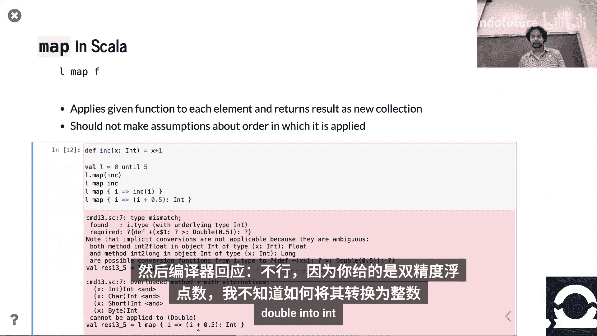
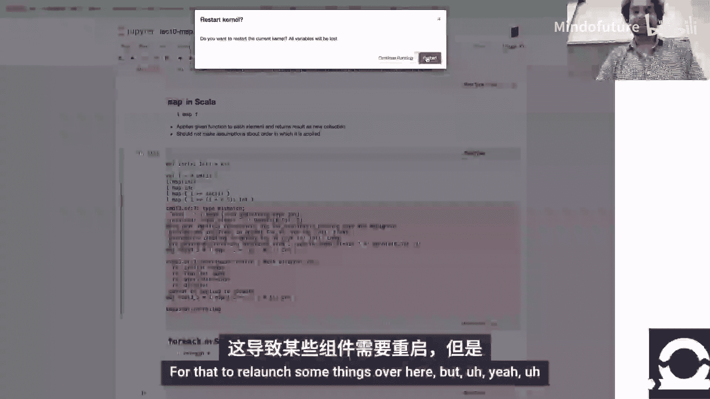
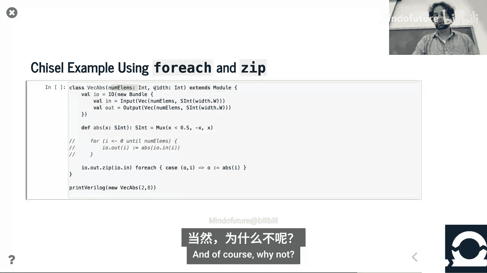
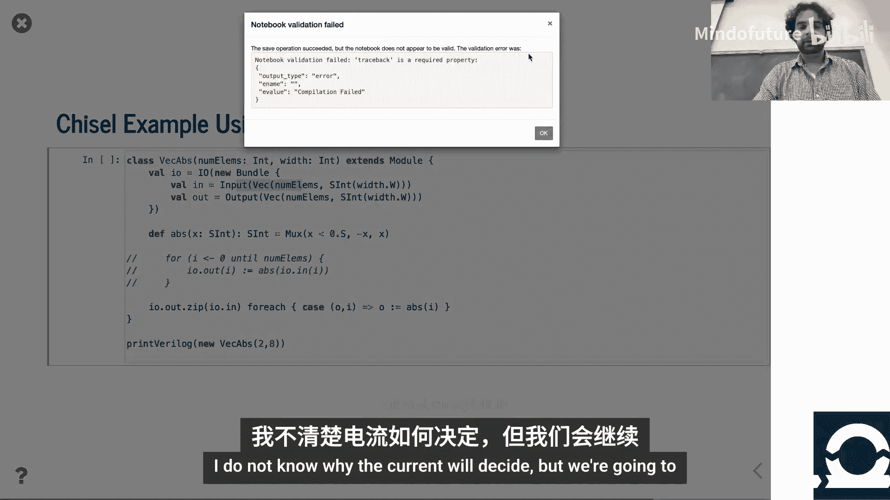
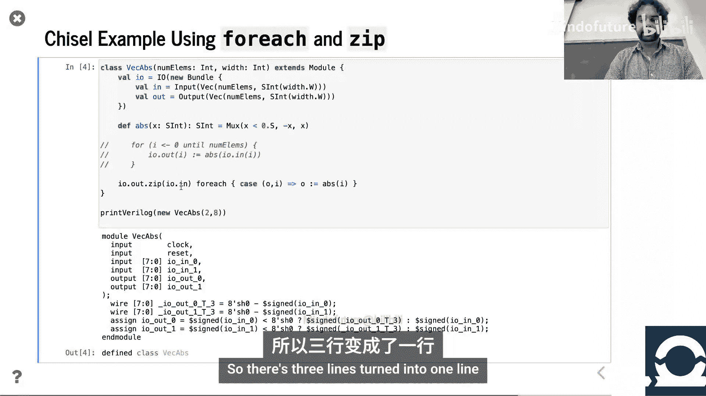
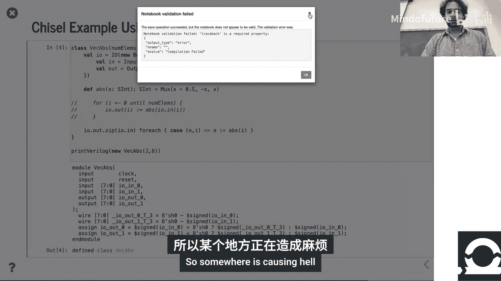
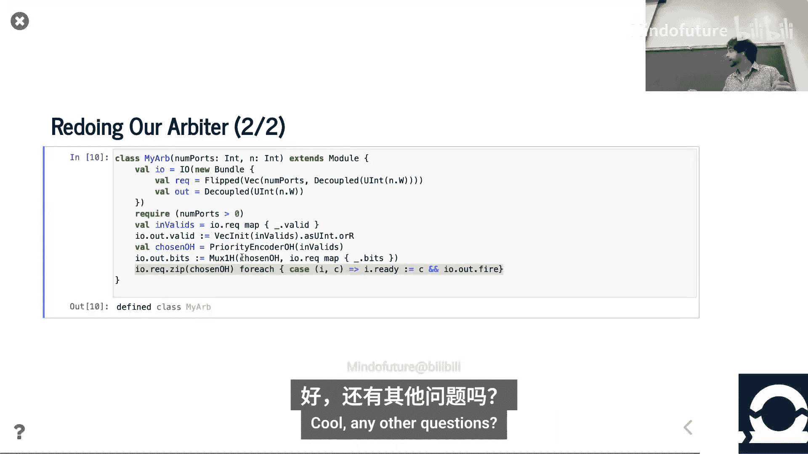

# 【加州大学】敏捷硬件设计-CSE228A-｜-Agile-Hardware-Design-Spring-2025-p14-P24_第10讲-浮点数介绍--BV1M6ivBzESw_p14-

A welcome to Lec 10。As you can see from the title slide。

 they were talking about functional programming。Many of you probably wondering。

 what I mean about functional programming。 I mean， I， I make programs that are correct。

 They're functional。 I use functions in my programs。

 So functional programming for particular of ideas and philosophies and。😊，Primitives。

Don't worry in this course， we're not struggling language， this course。

 we're talking too formal about it。Extremely informal with sh hand wavy。

The reason why we're talking about it at all is remember the whole goals and we're talking about her agile hard design F。

 right， we had four themes for this course。 number one， close the loop as shown by our course logo。

 number two designed for reuse， number3， make tools due to the work and number four designed for readability。

Turns out for all four of those goals， if it functional programming correctly。We can get a win。

 right？Va functional program correctly， we can。Make it more pun for us to write our code so we can get our code written less time。

 Close a loop earlier。Fun programming correctly increases reuse， which is good。Also， make some work。

 make us do less work that we want， make tools do to work。 and finally。

If we function programming judiciously， and I'm essentially show you times where I go too far。

It can be more readable， right。 And so like I said， theres， there's a balance。

 once some room for discussion as the lecture goes on about this。 So for the next three lectures。

 which， of course， thrills you here in person， we spread over next two lectures this week in person。

😊，嗯。We talk all about functional programming， how apply it to Sca and Chiselin。

 We're very fortuitous this quarter where somehow lectures lined up where all three lectures happened all fit perfectly in one week。

 That's， that's awesome。 Okay， so。😊，What's nice functional programming， of course。

 what we're talking about， you've actually already been seen this notion of like， you know。

 immutability and that kind of stuff。For today and this week， we're talking more about the notion of。

Thinking about how to apply a function to a collection of elementss， right。

 for rather than thinking about， you know， thinking of the steps to wave and taught your entire careers how to program。

Thinking more about。I have much of things and how I want these things to be transformed and how do the way very regiment and constructed。

 And so that's what say when we mean functional programming or FP for short in this course。

 And that's what we're doing。To do that， we're need to cover a little bit of scala， as always。

 Dun covers from Chisel using the scala and you， the classic back and forth。嗯。

So it's fire an notebook。Co ready to go？So on the first side。

 I tried to make that pitch but more concrete what we're trying to do， right。

 the whole point of chisel is to make these reable hardware generators right。

 if you're writing a straight line code。There's some benefit over very， right， Str types。

 that kind of stuff， but。The real power of these generators， right， gave that reuse， right。

 one makes parameterrized generators。 And so。As we've seen in the last week and a half two weeks。

 these generators are more than just having a simple， you know。

 template for Bi width for I can do things like actually change internal topology。

 actually construct things pretty liberally。 saw example of the crossbar recently。

And so these are all things working over collections。

 And so functions to work on collections is are a great way to do that， right。

 And what we're going to see is that。You know， any programming of language is especially general purpose you can write anything in it。

 But if you're able to best have these teachers in language to use them correctly。

Regogni certain patterns， rather having to keep reventing the wheel， actually reusing these patterns。

 It's not just less reading writing for us to write this code。

 It's also actually more read for else to read this code later on， so。

You can see this kind of throughout today。 And what weak is。

 how do we use functional programming to kind of recognize common patterns that are very abstract and then reuse them over and over again。

 right。And so as the developer trying to use these patterns。

 you may need a problem a little bit differently in order to kind of get fit as abstraction。

 it's really worth it， it'll be good。And if we do it correctly。

 you also can pile up with spots on those nerves too。嗯。And， you know。

One little bit of advice I'll give you is that。You know， we've seen be pushing all quarter。

 try these valveel rather and var， try to have， you know， all this， you know， immutable code。

 that kind of stuff。Chissel has some amount of intrinsic mutability right when you make that connection operator。

 you are changing those objects for that connection， right。

Functional programming is intended to be side effect free， you know， immutable， et cetera。

 But chisel has some liver side effects， so。Be mindful of this distinction。

 And I'll show you today some examples of how to kind of convey your code is gonna have side effects rather than just being a pure function。

Co。😡，So why collections they said， one of these generators looking end things？Et cetera。

 questions aggregate things that are similar to some extent。嗯。

If we want to use these to kind of pull all together right and so you may have seen their languages your you courses we have a collection of things you kind of using a for loop and oh I'm to do a4 two to this and then pro two to that right and so start thinking about it。

 you've kind of had a full loop with this pattern in your mind of how do I deal with end things right？

😡，And it's very general， that's why it works so well。But。We could do better， right。

 We can recognize some subtle nuances to handle that more cleanly， Right。

 So that's kind of point I see， okay， every time hes at for loop。You're right that saying， you know。

 perhaps the C， know 4 in I equals 0， you're tired to writing that， etc ceter。

What can do is better than that， right。So learn these patterns。

 how do we kind of use those patterns and make sure we actually follow those patterns like probably can help us check those。

 So how about that， Let's iterate this notion of parallel as well。

The first two operators we're going to teach you are map and forage。

 I're teaching to them you at the same time， side by side， right， So map。

 as a name suggests we're going to map that is apply a function to each element。

 So given some sort of collection of n things。I'm going to apply that function F。Element by element。

 right。 And so yeah， so's the input collection， upper collection， this is a different collection。

And you apply the function， okay， sounds cool， so what's for each for each apply a function to each element。

There is no output collection。So that's a subtle different， so we thinking like， wait。

 they're both applying the function to each element。😡，But for each has no output。

So what's it do well used for each when there's some side effect of that function right， for example。

 today's lecture to see that side effect being printing to the console right print line。😡。

But in Chisville， it might be doing a connection operation， right， which has a side effect。 and so。

You know， if we're thinking about this from a。Simplicity point of view you。

 probably thinking yourself wait a second。 if they both apply。A function to element。

And sometimes I want the output， sometimes I don't want the output。

Wouldn't map be in some ways more general because that you know。If I want the output， I have it。

 if I don't care about the output， I just not look at it。

 and I can still apply to function and that function could have a side effect。 The answer is， yes。

 that is technically possible， but discouraged， right。

 And the reason why is someone reading your code， they seem manup。They're thinking。

What matters for the map is the output， there shouldn't be side effects in this function。😡。

If someone receives for each。They're thinking。T side is happening somewhere， right。

 You kind of right away from that keyword telling them what's happening Word4 of you even read the contents of your function。

Okay。So let's actually play with some code。Before we do that， we gotta be a little more formal。

 for a second about the functions we're using， right， So in particular。

 there's this notion of an anonymous function。 You've seen these。

And a lot of language is often called maybe lambmbdas and English language you're using。In Scala。

 they are called function literals。And what you do is is's basically a way of describing a function in this case。

 you know， let's say taking in an X isn't it which is an inch member a scholara。

 the types go to the right。Iypical。You know， this little error operator And then what function does。

 So these are great for tiny little， you know， one line functions。

 There are ways to use braces and make this multi line。😊，If you find yourself in that situation。

 just write a traditional function。Okay， so maybe I'll kind of。

Com some stuff out and start from the beginning。 Okay， so we have our anonymous function。

And it even tells you， yes， this is a function that takes an int and produces an int。 Okay， yeah。

 so it's adds one。Great， now I can assign that to a name， like a vow。So now ink。You know， is。A valve。

 you know， with a reference that points to this function literal synonymous functions。 So， of course。

 I can。Then。Invoke that function， sure。Great， that checks out。

 that's kind of what we would expect what happened。So then there's a really subtle point， which。

For course。The difference doesn't really matter。 but if you're curious。Wait a second。

 we've been defining functions like， you know， this with death。嗯。Whats。The difference， right。

 So one defines function。And the other one。Its a think。And yeah， you can also call that。

And there you go。 So the answer is， in this tiny， simple example for this kind of simple one liners。

 those two things are。Visibly， if the point theater programmer equivalent。

Some programming language is semantics other equivalent， no， they are different。

 but says distinction pattern in this course， no， however， what I recommend， I recommend， yeah。

 if you're writing a function， use de， you can assign these anonymous functions to avow totally legitimate。

嗯。😊，But oftentimes you'll need to often they're actually usually unnamed and you know。

 anonymous mix into an opera， you'll see that in a second now what is the difference？This。I creating。

So v this is a reference difference on the right side equals sign。This is the function literal。Great。

😊，So in other words， this is evaluated， creates a function literal。 And this this points to it。

 What does this do， This defines a function， the function actually。Is reevals death。

 It's actually evaluated any time you do it， right， and so。

This is part of why you just before talking about avoiding side effects。

 If you have a side effect with one Ds， it'll happen every time you applied to function。

 it will happen every time you use the function。 It's like a little bit different the nuance。

This is part of why it' discourage side effects， right？嗯。

Ensure you can have two arguments functions so。If this distinction is。Confuing， don't worry about it。

 would matter go the slides can look the syntax of arguments。

Arrow function body for simple short one line。 You a couple arguments you need to。

 You a single argument。用。Cool， question， yes。So depending on that way the function is written。

Of course we call a function it's going to do to function body right。

 but like there's certain things that may exist inside of that body that will only get evaluated once versus every time。

Like I said， this is the way things were like。If you're in a situation where your code will work with Valel or death。

 but not the other， that's that's a pretty crazy situation。 This course。

 you can use probably one or the other interchangeably。 I tend to think death is clear because I oh。

 I have no a function。But， you know， this kind of shows you the power of having how the term they use is that these functions are first class。

 meaning that。It can be use anywhere， right？Next。Yeah。

 we're gonna use amazing one liner say exactly right。

 So The reason why we're so excited about dysfunction literals or these amazing one liners。😊。

Us these function litals like I've highlighted。 And so usually these one liners。

We're going to have this literal be anonymous so that the fact you buy into either a val or de not im。

And like I said， when you have a longer function you want to use， just write a de。

 you can have a def with one line， you can write two line de， sure。

 no problem right you can write a 10 line de， whatever you want。对呀。Yes。好。

If like a return type is wrong as the compiler report errors it can and will let's see if we can make that happen。

So part of the challenge is's going to be that in some cases， if you put a return type on things。

It's going to cath， right？So like， can I do this？Okay， this one says no。

 This one says is not turn it into a string。 So it's gonna tell us no。嗯。

But the question is for function literal。How can I give thista type。

 I actually don't know I'm going to try this。Is that how you give it a type， we'll find out。So， then。

Yeah， okay。So， so it can do that The reason why of course I didn't have to label that type is because the type inference right where in comes in。

 do a math operation on int。The result type is presumed to be an int。 But yeah， as you suggested。

 hey， in a spirit of making progress to work， what if I。

Put a type in there and make sure they match up。 And so one example of a type is what you would expect。

 I think it's better to leave it off。 It's more clear and the inference is gonna work。

 It there a more complicated expression。 Yeah， using the type on both ends is a good way to make sure your code。

 speaking to same language itself。好。Okay， so then。Let's play around as map operator。

 So we're going back。 remember， map p to function each element。

 and there's going to be an output collection， okay。So how do we do map， Well。

 collection on left map and then function on the right。You may remember I mentioned this previously。

 these collections actually implement all these features。

 So map is not a feature of the scholar language。 Ma is a。

Function implemented on almost every collection you ever receive。

And it just so happens that that way it's written is so consistent。

That it feels like a feature of the language。 really is a feature of the scholar center library。

 right。Okay， so here we have an example， you know， Windows death， it does have plus one。

 so how can we use it well？We can apply map in a variety of ways。 we can。

We have a range just to get someone to work with。We can， you know， do a very deliberate syntax。

 you know， except the very obvious we're doing right， I'm calling map on the collection L。

An ink is the argument， which is a function。Right like I showed above， you can write like this。

I may be a bit biased to write things that way， because I， you know。

 many years ago learned scheme and scheme is similar syntax， right。With spaces and so。So。

 it's very clear。 And as I mentioned before， right Scala。As far enough， you know， parsing that。

You know， it can infer a dot should go here and it can infer that these are print for an argument。

 So yeah， we'll kind of figure that out。Um， but to be honest。

 I actually reached Schal guys I actually recommend。The more explicit writing like this。

 And it's not because this is Airprone。 It's not。It's because there's been a huge push in Scala to make it more readable by programmers who don't know Scala。

So the concern is that people that are reading Sca who don't know it are going see syntax。

 and confusedfuse and they want to improve the readability for Google outside of Sca so。

People outside Sca are often Java or Python programs things like， you know。

 sparkar brought a lot of python folks in the Sca。 So yeah。

 they've kind of adopted language features from bothative languages to try to make it。

More like them yeah， So this is the downing encourage。Syntaxxi is because。You know。

 even if you don't know Scala， you see， oh， yeah， I'm calling a function map on Allen in is the argument。

 see if about that stuff。 It's not as obvious， but。In the safety of your own homes。

 I will prefer to have this simpler syntax。What else can you do Well， you can。Of course。

 apply a function using map and then here we now giving that function alert time when everybody you know。

 skip you one liners， here's that anonymous function。In this case， we're saying， hey。

 let's take an I and then call ink of I on it。 right， So we're using this function here。 This。

 of course， is a little bit redundant。 right you already have ink in the proper。You know。

 a form it can take in an in and return a in。Alternatively。

 we can also write the literal directly right here， so there's no need to define anything separately。

You know， we thick in an I turn I plus  one and notice how， you know。

 there's no types in here because it's all being inferred。As a reminder， yeah， we started off with 0。

1，2，3，4， and then we turned it into 1， through，5。 We use it for examples。Questions。Yeses。😊，这个。对。Yeah。

 so wide typeping third is the question， the answer is it little firm whatever it。Can， right。

 So if you don't label a type order form to compile it statically。

 It not dynamically interpreted language， it needs to have a type to compile it， Right。

 So the compiler is going to go running through and。Everything that's not labeled。

 has to figure out type 4。 So it's going to try and infer to types。And though we can't figure it out。

 it's going to tell you， but they can that's going to do it for us， yeah。高兴。Okay， if I add 0。

5 is that going to change the type， what do people think， let's kind of turn that around。Yeah。

 I think so too， let's see what happens。Yeah， see it does， right。 So what happened was， yeah I。

You know， the scholara type inference rules are such that yeah， if I have a clearly decimal number。

And I interoperate with an inch that gets turned into a double right。

 instance type been figured it out。 So then， of course， the question is， can I break this。By saying。

 you know what， I really want you to give me an hintt。And it says， no。

 because you're giving me a double and I don' know how to turn the double tint。

I can。Yeah， I even crashed the colon， look at me， good job。

So that's already rela some things over here， but yeah， I can do as youent。

 which will do in the explicit rounding， but in terms of saying， hey， I'm giving you an int。

It knows for sure this is definitely not an in。 This is， you need to call a conversion intentionally。

So yeah， I can go ahead in。You know， I can definitely say。That。

I guess I need to do rounding and I forgot what it is， but I can hit the tab key and it'll remind me。

啊。Oh， oh， there we go， there we have that round， okay。Had a little painful on the log week。

 but we did it。 Let me go ahead and get this notebook running again Ca I broke it。😊，Andw seen that。

 you know， this Ammonite which gives us the power of。Scala in Jupiter is a little bit brittle。

 And so when things go toic of stuff。Cool。So that was map。

 right so remember map was we have an output right。

 you know we have this thing going in comes out at the other end。And then for each， of course。

 still lives functionary element。 So everything else we've learned applies is just。

There is no output collection and hold points are side effect this function has。So like I said。

 the canonical side effect might be， I want to print to the console。😡，And so yeah， let's。Do that。

 right。 And so， yeah， I have this range。 and I'm saying， hey， print that to the console now。

Like I said before， right， in some ways， map seems more general， could I use map for this， Yes。

 I could。😡，And what happens？It still applies a function teach element。But then they get this。

 you know？Result， which is all empty because， you know， the result of print line is unit。

 So the empty parentheses is what's called unit in skull， which means， you know。

 this is like a voice like a non type right And so yeah， again， empty collection of non types。

Again if I a collection， it's not empty， full of these empty types， right in such。😡。

This isn't very useful。 And I said， so by using for each， not only we not having this。

Output nobody cares about。I'm also conveyed the point was functional calling。

Is going to be the side effect， right， So instead of being printline imagine as being some function of someone's writing for their code。

Before you even see inside that function， you see 4 each， you know it。

The point of thing is going to be the side effect。是。Cool。So let's try this out in chisel。Um。

 so what's kind of nice is that before we talked about， oh yeah。

 there's sky that just like seek and their chiella gets like back。

More often not you're gonna to seek in this course。

 But sometimes a few times you're gonna need vector。 Gus what。

 Both of those collections implement these functional programming operators， right， So seek。

 of course， being part of the scholar center library。 Yes， the course it has mapping for each。

Vec is written the Chiel library。They deliberately added map into it to make it look like the scholar map。

 and they get kind of more seamless， right， So here's some， you know， trivial trivial examples。

 I would worry less about。Why and more about just recognizing here is the most conscise。

Wai using some of these features， right， So's say， for example。

 have this module that's really silly that just。Takes the number of elements in the constant and gives you that reports to that constant。

 right， Heaven knows why you need this。Okay， so。First we do the Sc seekk， right？

So I have a seek events， right，0 until no illness。 we've seen that。 Okay， that's a range。Dan。

 I'm going to。Map those ins。 These are scholara ins into chisel Us， right， We seen the。

Dot you syntax before， cool。And then so now I have a seek of viewance。

I'm going to connect each of those u ins to the output。

 So I'm gonna do is take the output collection。 This is now a chisel back。I'm going to call4 each。

And give it a sca sequence， so Chiselve， map or for each， given a scholara collection。

 they interopated there。😡，And then features those elements is it iterates through one of the my times features notes what I'm labeling O in this case。

😡，I think each of those is to a constant。 So the fact that， as you know。

 zero through nu elements doesn't really matter。What matters is that。

h we're kind of doing this and see gives you guys really kind of。A little bit of Aum。

Extrot for the proof of stuff where was kind of showing things put together right， so like I said。

 you can map things together。In this case， we're not even using either of these。

We're actually just directlying actinging the list some kind of dead code， but。

I'm just showing you how， yeah， you can play map。To seek。

 you comp4 each end map to a scholara a search chisel V。 No problem。 Sure， two outputs a constant。

 You know， we could have four。Still works So yeah， I mean， we've seen from。Trivial scala。

 now we're seeing trivial chisel。 in the minute we're going to show you more sophisticated usages。

 but any questions so far。Yes。😊，啊。对。Could the range be the same line as a map， absolutely。

 so I could definitely do this。Right。Also remember， of course， the N are these lines of impacting。

This， but even if if they were impacting it that'll be fair， that would be fair game。機会挨拶して。Yeah。

 so the order arguments do matter， right so this is the collection you're applying the operation to。

😡，Then the operation and then the function of doing with the operation， right， And so yeah。

 this is kind of reminding us what we're doing here。This't the pattern， right， The pattern is。

I had a collection of things， and I want to treat them all the same。

 I want them all to have this function applied to them。

And so both map and 4H let me do that map saves the output for each does not and Four is an implication of course is we want to see the side effect but yeah。

 so the every collection you're doing this on needsV first and the function goes on the right。😡，Oh。

Okay， then。How about tus？I'm covering twos now because we're gonna to use them in just a second。

 So we've kind of seen this before， and。Maybe a little more proper treatment。

 So a lot of languages have this construct。 It's a way to。Put together things into a object right。

 into rather being like name feels like a。Scholar class， case class， chisel bundle， this is just。

 you know， pull things put together， they do not need to be the same type。

Typically they're heterogeneous， but there's no rule about that。So yeah， for a couple of things。

 you know， two， three things， these are perfect， right， if you have 10 things。Maybe she's a class。

 but we'll see some examples in a second we're we to do two things the two polls really good。

It's also helpful sometimes maybe you have a function that wants to return two things you can return that in a tuple and you can take those two things and separate them back out and so what are kind of key details of a tu number one。

 the numbers the members that aren't really named。So you can see in this example。

 I just kind of toss them together。There's no names。You can grab them by field。That's totally legit。

Odly enough the fields start numbering from one instead of zero as a scholar specific decision。

 I forgot the reasoning behind that， but they made that choice。

And let's say a tuple and you want to turn it back into individual items so you get the exact same combination of things it it checks out。

😡，Now I'll say， for example， add in a third thing。So's the complain because， oh， wait， I have。

A tufoldness of the form int int， right， And the thing on the left is saying it wants three things。

 right， in this case。This is the scholaratyran for talking back to us。It's being very general， right。

A B and C could all be different types。 That's why T 1， T2 T 3。

 It doesn't know what types they are is trying to make them match up And it's saying， wait a second。

 you ask for。What needs to be three things。Could be threeDifferent types。

 could be three to same type， but。Potentially up the three types。 And you only gave me two things。

 right， So I's not going check out。But yeah， the simple case is， you know。

 I want to put two things together。It works。 like said。

 So you'll see some example the second of when does horse great，2 or three things。

When we start getting bigger， we've seen that， right， We like case classes。

 They're nice to handle a lot of things。 The fields are named。 You can add functions to it。

 It's great。 And chis we like bundles。 and so。😊，Scholarupples， yeah。

 you varyringly up to a certain number of fields。Cool。Okay。

 so what I'm going to do with these there's an operation called ZP。😡，So what is zip。

 Let's go for a slide。 So given our input collections。 So let's say input dot zip and then argument。

 is it a second collection。 What's it going to do is's going to go through El by element。

Iaired them together meaning that。Where I had two independent collections。 Now。

 I have one collection。 Each element is itself， a tuple， a pair。

That have element from each collection。This's a really helpful sometimes so here are the elements。

 you can join them together。 And so where this comes up is very often。

You can kind of see how fits together where we had this map pattern a second ago and map was I apply a function to each element and the answer is well well the question might be。

 well what happens if I want to have a function？😡，And they want to apply it to。

And I'll from one collection and I'll let another collection at the same time。

 right I want to take you I'll from collection A and I want to collection B and put them together in some sort of function。

And while it these two constructs， we can put them together， right， we can compose that operation。

 right， we can first zip the two collections together。

 So what was two separate elementsments are now one element joins the tuple。A pair specifically。

 And then they canly map that actually have that function apply that those that pair of things。

 So very commonly， you'll see zip followed by map before we is kind of way to merge things together。

 So yeah， so you here's some trick examples。 So just to get a collection going， let's say 0 to 5。

 if I。I'll just do it move by one right， if we run this， yeah， okay， weve got zero to four sure。

Zip them together， zip of itself。You're going to see， yeah，0，0，1，1。 these are two different。

 you know versions being set together， sure。Now we' starts getting interesting。

 maybe wondering wait a second。What collections that are zipping together are at the same length。

 what am I do in that case？What if folks think should happen on this next line？L1 zip C of A。

 C of A is going to be only one element。Yeah， yeah， good suggestion question was。

I'm just going to take that first element that's it absolutely Yeah。

 because it can't go any farther so you get the minimum of the two length， right。嗯。Now。

As said a second ago， right， power to power was if without something zip followed by some like map4 right。

 so here。We're taking two things together。So it was， you know， a set of elements。

 Now we have a set of pairs of elements， right， great， take map。

 and now I'm going to add them together。嗯。So what we have。You know， at this point， right。

 you can see。This is a， you know， seek and the type isn't just ints。 like we've seen in prior slides。

 So I go back a slide， right。嗯。It's actually， that one's not even evaluated。Oh， what happened。嗯。

Who sees actually a pair， right a tuple， right to two ins。Great， then。Now。

 we need a function that takes two arguments， right。

 because the tuple is hard as sorry tuple is one element。

 We want to kind of pull out those two fields。 Yeah both fields， A and B like that。 And so。

The reason why this case keyword pops up。 This pops a few times throughout Sca。

 It's a way to tell the language whichs called pattern matching。 And basically， the issue is。

And the point of view this map operation， each element is being given。Is a single element。

 but it's actually a tuple inside。 And so to kind of match that tuple with A And B。

 you need that case keyword to tell to try and get pattern matching。 And if you let that off。

It should complain。And it's going to tell you。Consider pattern matching。 and yeah。

 put a case in there。I would have been more direct to my terminology， like did you forget a case。

 but yeah。You can see what's happening right， So zip， okay， we take two collections。

Pairm up Elmo by element。 If one on the shorter， we stop prematurely。

Is as helpful the way to kind of join collections before applying something like map for each。😡。

As you can see already a handful of these operators， things like map and zip。

 being start building and composing。The probably makes the sophisticated pipelines， right？嗯。😊。

These are all kind of simple patterns were kind of stitching together， yes。大。不。Okay， good question。

 So how does this compare to the bolt connection operator in chisel。

 which I'll write it out on the screen if people can remember， that's like this， right， I have。

 you know， A bull connect B。 So the bull connect operation in。Chissel has some similarities right。

 so the idea of that is yeah， I have two collections。I'm going to go through。One by one and。

Connect them to best of ability。 Now， the book operator has some flexibility。 right。

 The things on left or right don't need be exactly the same type。

 They could be in different input output directions。 and it kind of figures it out。

 But I think you're right。 If you were to kind of try to write this alternatively。You might say， oh。

 I'm trying to implement bulk Connect。Which， of course， is not correct out of thing。

 I might say someone'm like， oh， what if I。Vippped A and B， right， like you were saying。And then。

Daniel can now。Collection of tuples， and then I map them。And then I got to do connections。

 So let's say I want to do the connections then。What's going to happen Well I'm gonna have that tu I got a match on thirst。

So I'm choosing the kind of name。These elements like that。 and then。

So I would say this in the same spirit as the bulk connectect is not the same， right。

 for the bulk connectect is smart enough to figure out。We're going to go to through both sides。

 who's the input， who's the output， it's going to change on the left and right side of this connection operator。

There's some smarts in there， but in spirit， yes， you can think of a zip and map。😡，Or I should say。

 actually， map。This test should have been4 each right， decidedted by some matters here。

 map plus 4 each would have been， I guess similar in spirit to the bull connect for sure。Cool。

 good question。Let's keep going so。This diagram keeps under rendering。 I don't know why。now。

Let's try using these exchange in jsel。 So in this case。

 we have another arbitrarily simple module given number of elements。And of course， better if why not。

 we're going to take in。

I do not know why the colonel just died。

But， we're gonna。Rebuild。And then。As always。Prime up the notebook。Great， okay， back to here。Sure so。

Given a vector of essence， these are assigned integers。

We're going to apply the absolute valid operation to all of them， right so。

Here is one way you might go about writing it。 You could。First， write this absolute value function。

A scala function that， you know， works on truth objects。 And what it do， uses the mus， right。

 the thing you give me is less than 0， negate it。 Otherwise leave it alone。

And so basically what you learned so far in this course， you'd probably write。Something like this。

 right？And yeah， you could。Is going make totally fine。Very well。 you see， it works out where has the。

Negative versions of each number and then uses the mues to see do you get the neg version or not。

 right？Totally fine。I think students also may ask wait a second。 Well， why am I。

I think someone' iterating eyes through the range is helpful。But if you want to have perhaps a。

No actually it sorry you need the eye because you want to see both out in it at the same time you need to kind of index in both of them right and so yes。

 you need to kind of get the right input port and the right output port So if I did this with the functional programming。

😡，Oops。I would， of course， zip them together。And like you just saw， you know， I have to do a case。

 I have an output port， an input port， and yeah， cut the output to the input and I' applying the function in between。

是呀。Also works。You know， so there's three lines through the one line。

I don't know if lines are right。metric， and I really don't understand why。ち道。Some somewhere。

Cod think hell， okay， well， then maybe I'll remove my sins。Actually， it still seems to be working。

 so we'll keep trying to go forward and the keep crashing。嗯。够。Questions。Yes， okay。

 we're doing four each we're doing zip。嗯。So you made have seen before in the quarter。

 And now I'm actually gonna tell you what was going on。 So it's something called。Play folder。

And it's a way to make these functional literals even more concise。So。Rather having to say。Arguments。

 and then use it。I can have just the body。And the way it works is I I this underscore。

To be the argument。Now， the， the catches。Well， gee。

 what happens if I have more to an argument or more to one usage of that argument？

The way it works is。It goes in order， argument by argument and every application of it is in order。

 right， So in other words， here it's trivial。 just only one argument， I only can use it once。

 but I only get to use it once。 if I tried to say。And to itself， going' do it correctly first。Right。

 sides 04。 add1。 Sure， but now if I tried to add it to itself， it's going to yell at me。Because。

If I have two underscore here， that means this is expecting two arguments coming in， right。

 So you it's like like a single shot kind of usage， right。This is very constrained。

 but the time it helps is helpful if those constraints are you know not applicable in your case。Just。

Just write it out。And let's I， I've never used this with three arguments。 right。

 I do a leader one or two arguments。 We'll see two arguments later today。嗯。It is very concise。

 that's kind of nice。But yeah。Cool。So we have that in our pocket for then。

Let's go back to arbiter from last week， so。We wrote a few versions of this。

SoGetting the exact details of arbitration is fine。 But remember what we had， right， we had。

A v of inputs。 They were the couples who've always raised in ballots。

We had a single output that was decoupled。 and internally。

 we have these vexs because actually we are。Indexing and the things these aren't just。6ix。

And actually your wire is because they're cuttinging them on both sides for enable invalids。

We declare。Then the for loop would go in and go ahead and connect it to each file coming in on an input port。

 okay？And then we later on use it here to make the output valid。 and we do that by。

Doing convert to a ut and then do this called an ore reduction。 right in order words。

 much it ors to bring down the one or take bits， for example， once again， declare as a wire。

Connect it up in this for loop， and then now it's an argument to just much one hot。

 much one hot the courses。This is election signal， and this is the things that's choosing between。嗯。

So yeah， so this code wasn't our first draft， like the second draft from last time。And question。

 can you do better。With functional programming， so let's see what we can do。So。First。

 let's track invalids， invalids， we want to get the valid bit from all of our input ports。

 so we declared it there and then we grabbed them all here all by one side of four loop。Well。

 we could just do that actually with map， right， in this case， it's map because we want the result。

 right， We want to go through all those input ports。Map this function was a do。 Well。

 isn't that placeless the next we just covered。 say each ring you give me。

Call do valid on it and put then a collection right， so now I have a collection of all the valids。

So I think in this is what his case where I would argue function programming is definitely helping us right we definitely went from。

 you know declaring a wire iterating through it on the flo loop， and now it's just yeah。

 I want to grab those things that's fast that's clean I' gonna read that same thing what you're doing What else can we do。

Well， let's see。Can I go done less now。Like before we had。The out valid。

 we still convert into an ore reduction here。Where else we use functional programming use it here for the。

嗯。Bits， so if we go back and slide， over bits， I declared as。Oh yeah， it's a wire。 it's a v。

 we go ahead and grab the fields， and then we pass it into the mucks。Here is even more concise usage。

I didn't even bother her making a valve for the bits。 I actually just did it in place right here。

The same thing， right， applying map to the request ports。Using that placeable with syntax， just。

 you know， hey， Eric can you give me call dot bits？So you can see in this case。

 I didn't even need name it。 It was just。That concise so。

You can really kind of collapse things and then。We have this logic about。How do we want to do？

The ready signaling。 So is remember， even though we're that' like it's output put。

It came in and it kind of like an input。 because remember these the couple of things that things is going both directions。

 right， so。Everyone one these ports， the ready field we want to set。

As the end of this chosen one hot。So whatever， you know。Is chosen whatever that bit is， right， P。

 we won't pull out。 And if the output is firing。 So how do we kind of do that logic again。

 So here we did it。As a forlo。Let's go all in on the functional programming。

Sma go ahead and zip the aisle request with a chosen one hot。And for each one of those。

I'm going to take the IO side， which is a connection， okay to dot ready。And then the chosen one hot。

Normally we did the zips that's kind of two things。And then okay。

 we then and needs to get with dog fire so。This is also correct。

It's I think you can now can kind sort get maybe a little bit of your own opinion， right。

 where I think。Things like grabbing fields out of a bundle， a V really clear。 let me get that right。

 so clear we didn't even bother our naming in here。This time we do a zip for each combo。This works。

But I think it's a reasonable question to have or conversation to have， okay。

 do I think this is more clear？Then。This， and I think for some I think the problem might be more clear。

 right， what's going on。So， yeah， as， it's not， you not always forced to use functional programming。

 like said， our goal is to build code that is not just correct。

 but more expressive and more readable。 And I think you should definitely。

Have that conversation you're having in your writing your code about what makes the most sense it looks more clear。

I think of course， a nice kind of safe playground for you to try things out。

 Maybe try to push yourself on a homework or a lap。 You use functional programming constructs。

And then when it comes time for your project， you can decide。

 do I want to keep using them or I wantna do things that are simpler or because that way。

 either you have a partner and you want to make sure you're on the same page and that kind of stuff。

People often joke with the functional programming stuff that it's really easy to kind of chain together。

 you can have， you know two， three operators online。

 you get hooked and you can write it and you can come back and look at that code six months later like what is going on here right and so。

😡，Yeah， I recommend cat yourself to you know， one at most two functional operators in a line。

You can usually do four or five to a problem right， but that's not going to be easy to debug。So yeah。

 with some amount of hesitancy， right？Cool， any other questions？

Lad。