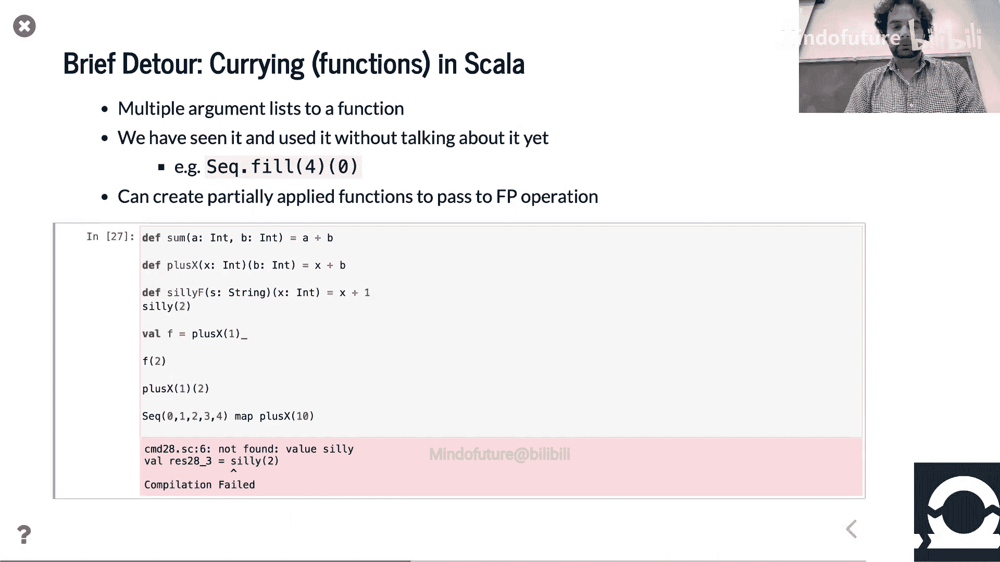
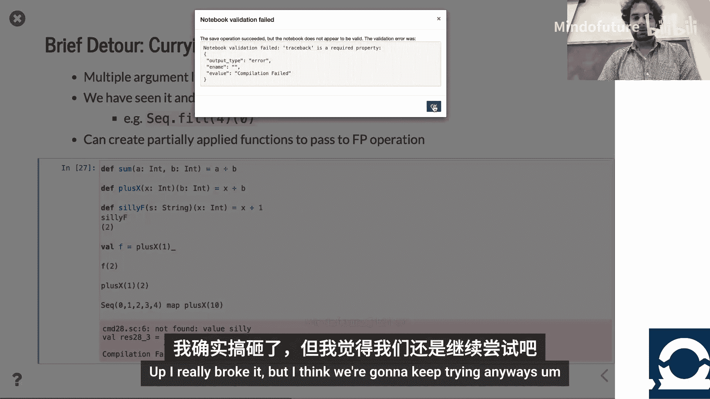
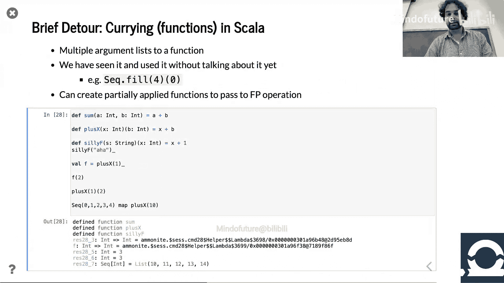

# 【加州大学】敏捷硬件设计-CSE228A-｜-Agile-Hardware-Design-Spring-2025-p15-P25_第11讲-浮点数深入_第1部分共2节--BV1M6ivBzESw_p15-

Do that hellello and welcome to Le 11 part one。😡，So we in the prior lecture saw some introductory functional programming construct。

 Pler， map， forish and zip。😡，And we're going to cover a couple more of this lecture。嗯。

So what is this today about， actually， Jason more about。Reduce and full the operators。

 But more so what happens we want to downsize， right。 So if you think about。Map and for each and zip。

 all those the number of input things， the same as number of output things， right， You know。

 I applied function one by one。We're using fold or ways to take a collection of end things。

 and somehow I'll get one thing out the other end。So let's fire up the notebook。Good to go。Right。

 like I said， so we previously just talked about doing things one on one， right。

 whether you combine collap things， right and。Glassing sounds easy after。 Oh， you， that makes sense。

 right， But then there's some kind of some nuances， right。

What order do I apply these claps and operations on which elements？And also， I want to be grateful。

 right， if I am a asked to handle。An empty the collection， what happens。

 right or I'll say I want to handle collection It has only one element and my collapsing operator requires two elements right。

 two arguments， right it's a binary operator。How does that work right， so let's talk about that。

So the first one is reduced， right。 And I think people often heard this word and periphery。

 If you haven't learned functional programming before， because you may have heard things like。

 you know， Google's map reduced framework， right， You know， map reduced。😊。

As an aside who does listening。Google's map Red。The reason why I chose that naming is it has both map and reduce。

Name is T concise it this middle step shles really important people to lose track of。

And it's a lot of differences， too。 So other net simple name， similarity。

 I would think it reduces a more general， a different kind of concept。 But anyways。

 it was reduced given the binaryner operator。Keep applying it on a collection until you're down to one element。

So you can imagine eight， given a collection of sustain sec of zero through five。I say， hey。

 I want to reduce that， right， I could say， hey， reduce， so。嗯。These are all elements。

 And thats reduced operator。 Like like I said， it's taking a binary function， a binary operator。

 right。 So knows how。It expects two arguments， right？嗯。And then I've added them together， Sure。

 or I can use that spiffy placeholder syntax。So this is going to be A is going to be B， right。

 the reason why I can do it here and I couldn't do before is actually have two arguments。

 the first argument is the second argument。Gool that checks out。Now let's say one and two。Okay。

 if you just squares of things， sure。Now， some squares， I。Ca simply yeah。

 apply reduce on the squares。 Yeah， that checks out。Um。

Or I get this all on one line without even naming things。In this case。

 you have you know literally map and reduce。Going together and to get the same result still。So far。

 it seems like， you know？How we're hoping to get。Questions so far。Okay， so。

Let's try to make reduce go to work for us。So as arbitrary was just a few minutes ago。

 here's the original code。What we're going to target with this reduction thing is。This reduction。

 So hey， guess what， R is is an oral reduction。We have a reduced operator。

 we now put these two together， and answer is yes。嗯。We can go ahead， and。We're right here。

So you're here to。Yeah， so here recently take we want the ore reduction of those operators so before we had to like grab the invalids with the map and then we had to you know。

 do this typecasting or I could just do this。right， I can hey， given all these things。Reduce。嗯。很大。

That works， that's pretty cool， So this is really helpful。But of course。

 there's got be a gotcha somewhere， right？And the question is。

 what happens when you give reduces zero elements or even just one element？嗯。

Or what happens I want to collapse？A collection， this' one type in the output's going to be a different type。

 So somehow。I'm。Changing things， right？ And so I like say。

 I would think more generally about his constructs， I'm thinking about it in terms of， you know。

 these simple examples of integers。 I we thinking about more as kind of the more general pattern。

 More general pattern is， Ive N things。I I want to apply functions to these things somehow。

Welled is down to a single result。 Reduce it down to a single result。

And so were kind of did that play out。Ener something called F left。So this is another operator。Uh。

 the name fold left， you may wonder is there fold right， yes。

 we comes to that later u and so what is a do？It's similar but different than reduce。

 I a picture for this， not for reduce， but。What we do is。So if we， we took two elements at a time。

Applied it， got a result。 And then we took that and kind of kept going through with fold left。

 we're going to take this initial element。So this initial thing you give it， in this case。

 you can see I give it zero， theres actually a separate argument。And then the function， So with a do。

 it takes the thing you give it。And the function applies one by one， right。

 It's made more' going to show you here。 You have this in it。 This thing you go initially。

 you give it a function F。Put these two together。 You get an output。

 then an output is then applied to the function again。

 So you can see that kind of that goes through it。And eventually to resolve this。

 we get it as a single output， so even the function was applied at n times。嗯。

We only get one thing out the other end and what we're doing is each time we're taking this kind of currentren value in it element and applying it。

Now， for guards to fold left verse fold right。I've drawn this such that， you know。

 fold left starts from the left。And fold right starts from the right。 That was me。

Delibverally tweaking。The choice of how drew the array。If you put the zero on the left of the array。

 then yes， this works out the way if you put the zero on the right。

Perhaps like you do like numbering bits in a number， different ending in this。

Doing it the opposite directions。 So the way to think of it more generally is your default model should be full left。

 Now starting from 0 going up。Bold right starts from the end coming down， Right。

 So you think about your for loop just rightness not functionally。 You're probably gonna say。

 you know，4 I equals 0。 And then you're working I equals 0 first。 And so。

Full lesson even that same behavior， there's kind of a good default in your mental mappings， yes。对。

Question is our full left and floor right implemented differently and how does that work。 So， yes。

 you can。Call reverse on the input to one of them to get the other one。

I believe the actual skeleton compiler is smarter in it。But yes， if you forget F right。

 we'll see example that you can call dot reverse instead。嗯。So let's actually play with this， right？嗯。

And so what's nice about F left is kind of a more general operation。

It's probably going to use more often， however， there cases where it's safe enough and you can' use。

I use it reduce because it's more concise， right， So so the part of challenge fold left is not just the operator。

 So reduce required to operator a function。 now you also need to give it the in value， Rights okay。

 give it the in value。Give it the function。嗯。Let's say， for example， I want to add things up， well。

 what would I do？I have this function， remember this function takes in two arguments， right？

What's two arguments to go back to the next slide， right， you have this in it value。

And the element you've been given from the collection right So I label them hopefully more clearly right。

 total Soar an Elm。 All right great， so we're just adding them up。So the result of this。

There's going to be semi in for the edition。That's gonna be passed on to next thing， right。

 So we're going to pass it on。You know， down this chain。

 that's going to become Tullsa far next time itsvoked。

Here I'm running this out very painstakingly verbose。I can use that placeholder syntax。

I can also use reduce。And because scholar scholar， there's also just a dot sum。

 which applies the plus operator to collection。Which is interesting， because。

You can have your own classes and you can define addition on them and then called outsomy。

 which doesn't make Mam to make of as adding， but you can take advantage of that feature to call a reduction on the ad operator。

😡，Cool， okay， so I can show the next thing with the fold left in a second。

 but before that questions so far。These are some of the shortest lectures of the quarter。

 but I deliberate have not put content into them because this is like the most conceptual tricky stuff。

 And so we can pause and talk about it， yeah。That can be a different type than the element。

In this case， it's the same type， but it could be different。对。Yeah。😊，Yeah， so so。😊，Initially。

 we had this in it， which is 0。 and that the first imification total Sar is going to be 0 and the first element。

 So we get I equals zeros element and， you know， total sar is equals 0 and then。We get some result。

 that's the new totalpar and that comes in here， and then we have the  equals  one element applied to it。

So index album is I0 through whatever as it goes through it。

 So also far that thing kind of being passed along。

 It's kind of like like like a carry chain and like a hardware and so stuff that's kind of what you're seeing there。

是。So it's kind of， you know， think about this construct， right， let's say you're writing this。

You know， my flies are， you know， pretty impure。 What if I was to soil them by。Saying var。You know。

You know， for。X and L。I actually have to do， it's not Python， I'm sorry。Then I could say。Total。

 so far。Plus equals x， I think this is going to work。Yeah， right， so it's kind of what we're doing。

Right， so。E make Vr。Edwin T far a， the kind of show is mutating。In this case。

 that mutation is encapsulated by this functional programming operator， right。嗯。

The function is a pure function， right， does function I defines。

Simply takes two elements and adds them together。The fact that， you know。

Each imvocation is given a different argument， different value of tool so far。

 that details hidden from personal rightness as's done by the full left operation kind of pulling altogether for us。

So yeah， we can kind of see a different ways of rightness， right when ride like that， we could even。

Be naughty。And say， L for each。totalt。So far plus equals this。Will this work， fingers crossed。

Also works， right， sort of robust language but。Guess what， we don't need to do this。

Because we can call。Reduce。Fold left or even the sum in this case。 some because of the plus operator。

 But you can imagine the course if you aren't just doing integers in the real world。

 And that's always possible。Cool， now， let's。Ste， my attempts at Max down here。So down here。

 I'm trying to write a way of finding max element。 So what do we do， Well， we have this function。

 which has a max so far and given a new element returns the greater over two。

 Ra everyone needs bigger。I'm going to return that， so if being Maxifier is bigger。

 that's what we get， otherwise that sure。So like said that max the hard way。I'm using fold left。

 I'm saying originally let assume there's at least some positive of integer。

 So 0 is not bad starting point。嗯。And yeah， we just give it the function。做。😡，And yes。

 so we got you know， Magals 5。 Scotland also has a built in dot max。 That's nice。

But we're seeing applied right， in this case we're going through it， but yes question。Yeah。Yeah。

 so do Chisel bes have full left。 They should。 And let's say I forget if they do， let's。

Use the power of a。More complete programming environment to answer that question。Dot。

 so now you can see all the things defined on this spec。 So do we have。We have full。

And do we have a reduce？Yep， we got reduced。So yeah， but the answer is yes。😊。

They said that's because the chisel library implementers implement those functions within。

Those collections。 so these are operations that each class is implementing。

And because this is a common pattern。 we use a outsider can say， I don't even know choose little X。

 right， but I know what map means。 I can use map， right， That's kind of point。

 So that's the power having a pattern， right that you can kind of reuse this concept over and over again。

 even though it's different code and stuff， right。That's definitely the goodness we want。Unm coolol。

Actually， I'm going to use this opportunity to do an example of， okay。

 let's say Ive sold you and you say， hey， I want。So you fold right， what happens？For some of these。

 it's really not gonna break too much because。Left first right only change all right， Eds， you know。

 associative， so that checks out， but。Just because of trying it out。

 let's see what's gonna what's going to happen so。It's gonna let me do it。 just fine。

This is glossing over an important difference， and that is that for fold rights。

The order of these two things coming into the function are flipped。So this works out because。

Soecial Chi edition， right？With fold right， it's actually element and then total so far。I I yeah。

 you you can argue that either way， but they chose to make that choice。

 So we'll see that in a second with an example bit of code。Okay。So， then。嗯。

We have so much time to feel bad cutting the soft halfway。

 I'll take you a question a question perfect yeah。So your question is for fold， left and fold right。

 any chiswa V， are they recursive in implementation？So。The question simply about tele recursion。

 reasons why I'm paing is because。What we care about is。

There's the execution as a generator is running。 And then there's the hard that gets materialized。

 right， and so。嗯。If you think about it， if you're calling fold left。That me to become hardware。

What you're saying is each functionification is。Doing some sort of operation。

And those operations are going be， you know， creating some sort of lattice You will be building in hardware。

 right， And so。嗯。Yeah， I'm not sure。If a tail recursion notions will be visible。

 I guess normally help point tail recurion is， oh， that's great。 I can。

Be really clever of my invitation the software。 and I can get some nice fish games， right。

 But in terms of hardware。啊。Yeah， but I guess also that me question turning back to you， right？

Wouldood fold left already on its own kind of be tail recursive right because like because you're forced to like beless about what you're carrying on for each thing and you can't do work after you you do one element and then you're done with it。

 You can't touch element anymore。 now you on to the next element。

 I feel like it kind of already is tele recursive。 I'm saying I have a question mark I not a P person。

 but。😡，嗯。😊，To me， loved at least had the spirit of being tailworkersive if not。Formly so。

Good question。Okay， so。是。I'm going to do one bonus slide。

 and then we're going to stop early and then。We'll also have a shorter electron on Thursday the beginningating between like doing two today and one Thursday。

It need to couldn to happen still the plan。 So we're gonna to do that。 Okay， so。

We've seen the syntax。We can talk about a little bit， right， So thing called curring。

With regardds to functions。And that is the ability to break up your argument list into multiple co blocks。

 So at first。That may not seem。Very helpful。 Like， why would I want to bring up remember we did the seek that fill earlier。

 right， And， you know， this is the number of elements， this is the thing。 So why was that a feature。

The reason why it's a feature。Is you can do partial application of functions。

So I can apply one function block one set arguments and leave their sub function arguments unapplied。

So。Let's kind of hit play out so I could define two functions。You know， sum and plus x。 So they both。

Add two numbers。So in order to get a number out the or end， at some point， you're need to give it。

2 numbers， right， that's， that's， that， that's inevitable。 Now， what's interesting is。If I。

Take the second version which has you are going to split up like this。

And I you would do it like this。We saw a syntax earlier today， right， This is a function。

 It takes an int。And。It is returning an end。We look at the definition for plus X。Ultimately。

It has two in argumentsments。So what heck is going on while we're partially applying。The function。

 right， through applying。This one。To be here。And so I guess plugged in here。 and so as a result。

This F is going add one to whatever we do， right， we say plus one。 And so it does that。 So waiting。

 let's take of this is like a function generator， right， We have like a function and a function。

 We're gonna populate some of its arguments now。And other ones are going to leave unbound intentionally。

So that way we can go ahead and apply them later on。So yeah， of course。

 I can you know directly apply them both from the beginning， that's fine。

But the reason why we're excited about this is we can do things like this down here， Regan。

Cre a function。Copulates arguments。 and then remembers going to be a function that。

So' one argument unbound。😡，Guess what for map， you need a function that takes in one argument。

 and I can apply this to there， and I can add you know， in this case， plus 10 to all of them。

 Yes questions。对。Yeah。😊，不那个。That' a great question。

 So what about this underscore here I have over here。

 I'm pretty sure if removed this since it's gonna break。 Let's see what it tells us。Yes。

 so what's telling us is， hey， you're trying to call this function and I didn't get all the arguments。

😡，As a hear was saying， you know what， I didn't get all the arguments。So， right。

 you'll get at it later， right？嗯。And then of course， if I tried this on thumb。No chance， right。

 thumb。Said it takes two arguments， I only give it once。 So by breaking things up， we can do this。

 And the reason why you break it up is because you're going to at some point， partially apply now。

So why does this syntax work down here？So what's happening is。This is being partially applied。

The result is a function。 So plus X becomes like a function generator in a way。 And the result is。

A function， right， We get back a function it takes in an int， right， given an int。

This will not give me a new function， which given it add and together， right。

 And so because I now have this is producing a function that gets plugged in the meeting of the map。

 It's happy in this case。You know， they made a choice to this is。Not Thursday needed market as。

Chill for the other placeholders。Cool， yes， questions。Oh。

 so what why is plus sex in some different behavior and partial application。

 It because of this privacyency block， thepreency block， they need to be complete。

 You can have a partially complete block， so。You can do that now。Let's try the Geer。Something。

What if I said， hey， I want to make a function？Which is you know， my plus x。So I'm going to use。

The same technique we just saw。But then， internally。You some， I think that's totally fine。Right。Yeah。

 that's totally fine。Right， so the key thing is， yeah， in Sca， these kind of see， you know。

Braed argument list need to be complete。 so you can't have only some of them。Unless， of course。

 you made one of them， let's say like a default value or something that's different， right。

So occurring， you can pick it up in the multiple group。

And the reason why it'st useful is because you can do partial application。

We'll see example of this in the second half lecture your should be different day， but yes。Yeah。😊，Oh。

 great question。 Yes， So I'm gonna read this sort recording。

 So if I have multiple argument blocks and kind of slightly rephrasing it。

 what is the application order， How does that work， I believe it is left to right。

 You definitely can't skip them。 So if I had like something like a third or a fourth one。

 I seem don't want the town on this。😊，I couldn't do like this one， but not this one。

 I think it's left to right。And now I'm trying to figure out a way I can try and differentiate that。

 What would be a clever。Programs show a difference。Well I know。 What if I made a function that。

Took one of each， right， I guess what if we had somebody that said， hey。This is this silly function？

Let's say it takes in。A string。And an int。And I don't know。

 we're actually not even to using the string。Okay， so we define CF。 And then if I try to。Say， hey。

 silly F。2。

Plus live in the right name。U， I really broke it， but I think we're going keep trying anyways。

啊。You can see that yeah， it's going to apply from left in in out right。

 So it's it's trying to do the string first and that's not going to work because hey。

 its is the wants string for that first argument block。 and I'm giving an integer。 So yes。

 if I said aha。嗯。Then of course， I need to have that syntax。是。So yeah， so to answer your question。

 which we just kind of rediscovered on our own， like if we forgot。

You can't skip over any blocks and it goes from left to right from inside to out in the way。

If I use the underscore，' way to skip over it。嗯。I don't think so。

 I think it's one of these things where you when you design your function you probably。

Need to declare him in the right order。 but there's always some wrinkled skull I didn't know。

So it may be possible a whole。Se the functionality and language I only covered it all in this courserus about lazy evaluation。

And so yeah， that you there some kind of work around with you what you're describing and I' not quite sure how to do it。

But fortunately， for Chisel， right， we're trying to write hardware。 We're not trying to do the most。

 you know， obscure Scala。 We're trying to make hardware to make useful generators。

 So we had this kind of very utilitarian。😊，Persspective of， you know。

Definitely write code either more procly as in left time writing。😡。

Easy to get correct or easier to read。 It doesn't help me into those three things。

 We're probably not going be embracing it。嗯。Cool， great questions。So yeah。

 I think rather than sprinting the finish， but we's going to park it here for today。

And then we'll pick up on Thursday。

