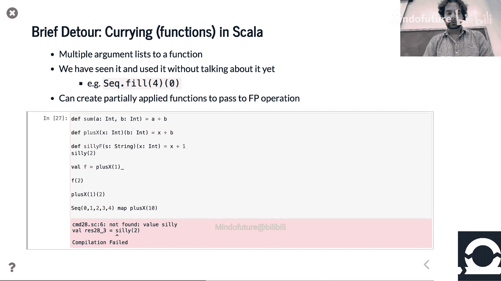
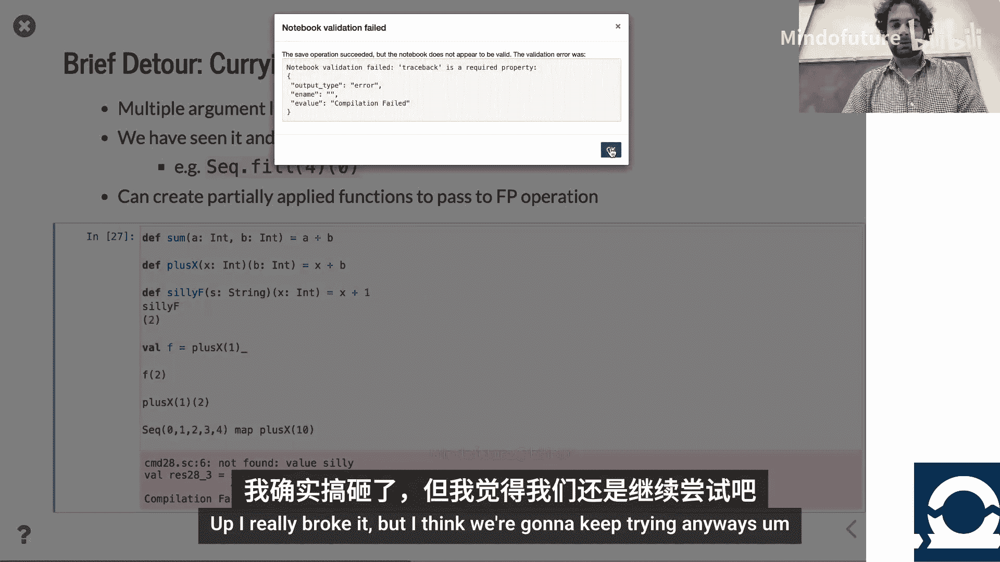
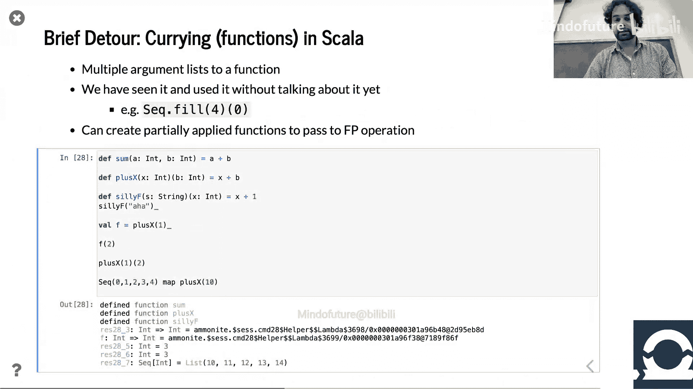

# 敏捷硬件设计：第11讲：浮点数深入（第1部分）

在本节课中，我们将要学习函数式编程中两个重要的高阶操作：`reduce` 和 `fold`。我们将探讨它们如何将集合中的多个元素“缩减”为单个结果，并理解它们与之前学过的 `map`、`foreach` 和 `zip` 操作的区别。

## 概述：从一对一映射到聚合操作

上一节我们介绍了 `map`、`foreach` 和 `zip` 等一对一操作的函数式编程构造。本节中我们来看看 `reduce` 和 `fold` 操作符，它们用于将集合中的多个元素聚合为单个结果。

`map`、`foreach` 和 `zip` 操作的输入项数量与输出项数量相同。`reduce` 和 `fold` 则不同，它们接收一个包含 N 个元素的集合，最终输出一个结果。

## `reduce` 操作符

`reduce` 操作符接收一个二元运算符（函数），并将其连续应用于集合中的元素，直到将集合缩减为单个元素。

例如，给定一个包含 0 到 5 的整数集合，我们可以使用 `reduce` 进行求和操作。

```scala
val sum = Seq(0, 1, 2, 3, 4, 5).reduce(_ + _)
```

`reduce` 期望一个接收两个参数的二元函数。我们可以使用占位符语法 `_ + _`，其中第一个 `_` 代表第一个参数，第二个 `_` 代表第二个参数。

我们也可以将 `map` 和 `reduce` 链式调用。例如，先计算平方，再求和：

```scala
val sumOfSquares = Seq(0, 1, 2, 3, 4, 5).map(x => x * x).reduce(_ + _)
```

或者写成更简洁的一行代码：

```scala
val sumOfSquares = Seq(0, 1, 2, 3, 4, 5).map(x => x * x).reduce(_ + _)
```

`reduce` 操作非常有用，但它存在一些边界情况需要考虑。例如，当集合为空或只有一个元素时，`reduce` 会如何工作？此外，如果输入类型与输出类型不同，又该如何处理？

## `fold` 操作符：更通用的聚合

`fold` 操作符是比 `reduce` 更通用的聚合操作。它需要一个初始值和一个二元函数。`fold` 有两种主要变体：`foldLeft` 和 `foldRight`。

`foldLeft` 从集合的左侧开始，将初始值与第一个元素结合，然后将结果与下一个元素结合，依此类推。其过程可以形象地表示为：

```
初始值 --(函数)--> 元素[0] => 中间结果1
中间结果1 --(函数)--> 元素[1] => 中间结果2
...
中间结果N-1 --(函数)--> 元素[N-1] => 最终结果
```

`foldRight` 则从集合的右侧开始操作。对于满足结合律的操作（如加法），`foldLeft` 和 `foldRight` 的结果相同。但对于非结合律的操作，顺序就很重要了。

在 Scala 中，`foldLeft` 是更常用的默认选择，因为它符合从左到右遍历集合的直觉。

以下是使用 `foldLeft` 求和的示例：

```scala
val sum = Seq(1, 2, 3, 4, 5).foldLeft(0)((totalSoFar, elem) => totalSoFar + elem)
```

我们可以使用占位符语法使其更简洁：

```scala
val sum = Seq(1, 2, 3, 4, 5).foldLeft(0)(_ + _)
```

对于简单的求和，Scala 集合还提供了内置的 `.sum` 方法：

```scala
val sum = Seq(1, 2, 3, 4, 5).sum
```

`foldLeft` 的强大之处在于它可以处理更复杂的聚合逻辑。例如，查找集合中的最大值：

```scala
val maxValue = Seq(3, 1, 4, 1, 5, 9).foldLeft(0)((maxSoFar, elem) => if (elem > maxSoFar) elem else maxSoFar)
```

当然，Scala 也提供了 `.max` 方法：

```scala
val maxValue = Seq(3, 1, 4, 1, 5, 9).max
```

在 Chisel 硬件描述库中，集合类型同样实现了 `reduce`、`foldLeft` 和 `foldRight` 等方法。这使得我们可以在硬件生成代码中利用这些强大的函数式模式。

## 柯里化与部分函数应用

柯里化是指将接收多个参数的函数转换为一系列接收单个参数的函数的过程。这允许我们对函数进行部分应用。

例如，我们定义两个加法函数：

```scala
def sum(a: Int, b: Int): Int = a + b
def plusX(x: Int)(y: Int): Int = x + y
```

`sum` 函数一次性接收两个参数。而 `plusX` 函数使用了两个参数列表，这允许我们部分应用它：

```scala
val addOne = plusX(1)_ // 部分应用，创建一个将输入加1的新函数
val result = addOne(5) // 结果为 6
```

部分函数应用在函数式编程中非常有用，特别是在与高阶函数（如 `map`）结合使用时：

```scala
val numbers = Seq(1, 2, 3)
val numbersPlusTen = numbers.map(plusX(10)_) // 结果为 Seq(11, 12, 13)
```

柯里化允许我们创建灵活的函数工厂，动态生成具有特定行为的函数。





关于多个参数列表的部分应用，需要遵循从左到右的顺序，不能跳过中间的参数列表。

## 总结

本节课中我们一起学习了函数式编程中的聚合操作。我们探讨了 `reduce` 操作符如何将集合缩减为单个值，以及更通用的 `foldLeft` 和 `foldRight` 操作符如何通过一个初始值和二元函数实现聚合。我们还了解了柯里化和部分函数应用的概念，它们允许我们创建更灵活、可复用的函数。



这些高阶函数抽象是编写简洁、表达力强的 Chisel 硬件生成器代码的重要工具。在下一讲中，我们将继续深入探讨函数式编程在硬件设计中的应用。