# 【加州大学】敏捷硬件设计-CSE228A-｜-Agile-Hardware-Design-Spring-2025-p17-P27_第12讲-浮点数并发与模式匹配--BV1M6ivBzESw_p17-

Hello and welcome to Le 12， as you can see from the title。

 we're going to finish our functional programming stuff。

And it comes something else called pattern matching， so we'll see what that is。All week。

 we've been talking about how to use functional programming as these operations on collections。

To be more productive and do things in a more regimented。

 more testable and more productive way to build a camera codes our generators often have collections of things。

 So having thingss that working on collections are great。 So we covered。😊。

One to one operations on the。First day we talked about map and4 reaching zip and then we talked about things like。

Reduce the folds in the next lecture。Today， we're kind of covering a few remaining details。

 something called flatmap filter and thumb， but basically。Kind of rounding out the。

The arsenal things。But then we you heard to in confirm today， right，'re covering pattern matching。

 which is help make the code a bit more clean。 And you've been doing this。

 not even knowing what it is。 So once again， kind of peeling back more and more the language semantics and making it less boilerplate more clear what's happening。

We've shown option types in this course。Now only on the functional programming constructs。

 we can see more ways the handle option。And then actually。Not listed， but time permitting。

 I will be also talking about the project if there's time。😡，Okay。

 so let's fire up your yield notebook。

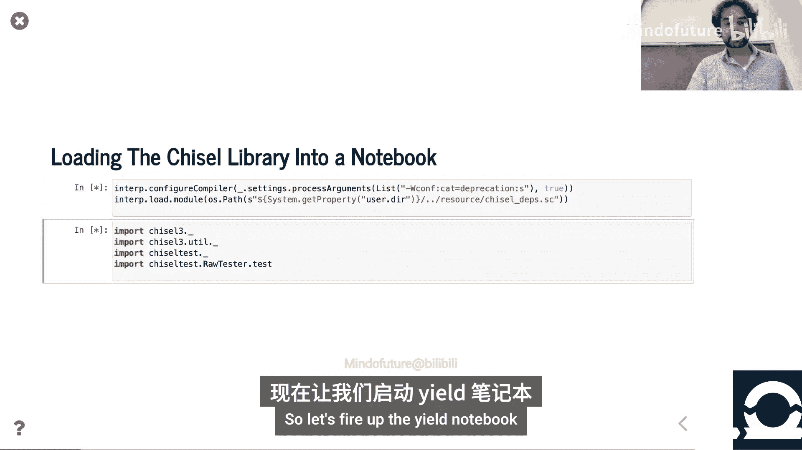

Good to go。 So what is Flmap？Well， map is great。 And if you only know map， you're in good shape。

 However， some special cases where maybe flat maps even more powerful， right。

 So what does the difference， So math has this notion of one element in。😊，One element out。

 one element in， one element out。Sometimes。a situation where。The thing is the element in quotes。

It's actually a collection itself。😡，Right， so you're going to have a collection of collections。

And you're going to want to do something with them。And so let's see how this plays out。嗯。

I'm going to come some code up first。So let's say for that we have a range。😡，And you know。

 maybe remember from before。You'll seek that still right， we say， hey， I want， you know two threes。

 that's what we syn text for it， I get two threes。Okay， now。

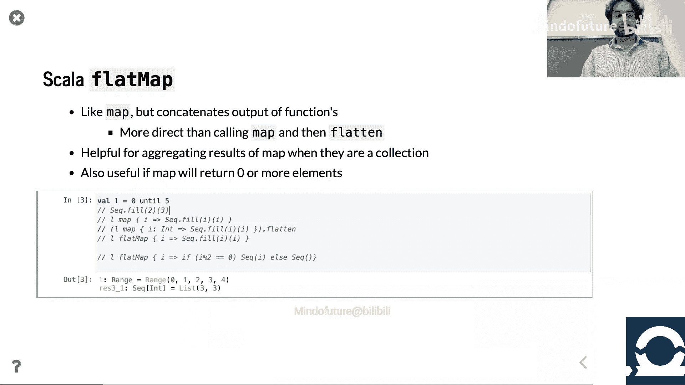

Given this range of zero to five。I'm gonna to call this code that's going to make a sink of that length。

 So whats it look like， You can see， Oh， yeah， I'm going create。

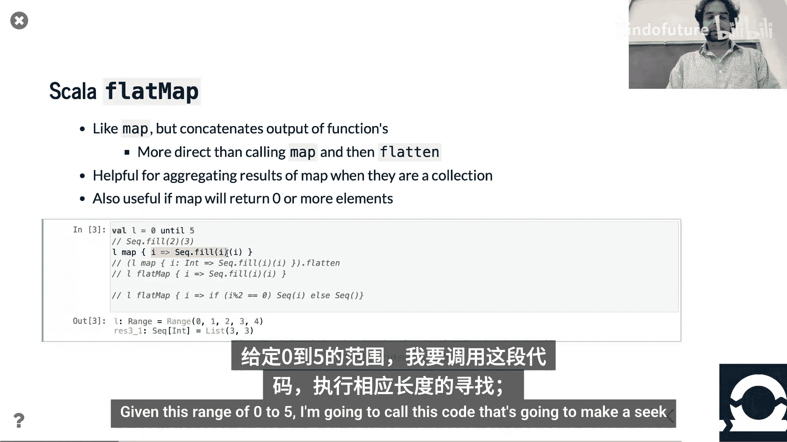

Empty because 0 as 0， zeros，1，1，2，2，3，3s，4，4s， right， trivial examples kind of show what's going on。

 But already now we have a collection of collections， right， a vector of lists， but。

For today we can hand I have his call all seeks， right？Okay， so that's pretty cool。Now。

Maybe this is what you want。Maybe this is not what you want， maybe you want。

These all to be in one collection altogether。We can do that。

Going from a collection of collections and kind of removing that distinction into a single collection is doable for a dot flat in command。

嗯。Alternatively。And you see where the name flat Matt nu comes from？I think I'm beginning。

 going to say， hey， you know what， whatever this thing produces。Cancatenate this to the collection。

 rather making this additional element collection。Cancateistic collection。

 So when get the exact same result。

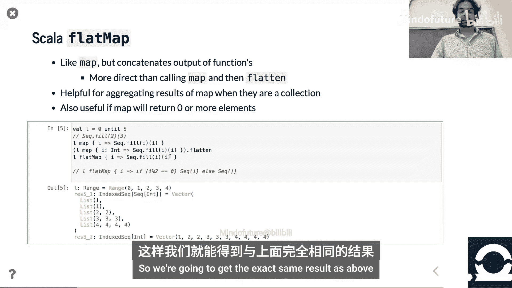

As about right here we。Did the operation anything called flatten， Fllamap can， you know。

 pull those together。Now。That's where an name comes from。To be fully honest。

 writing multiple large scholar projects and even chisel projects。Llat mapap used in the situation。

I use it， but it's not super common， right， That's not a very common thing。However。

 this next case is when we actually use a lot more often。And that is。

 if you have this select capability， what you really have is the ability to say。

I'm applying math to something。And the output of that map。Is going to be collection。

 and I want the collection to be appended rather than treated as an element on a own。

And so you get this notion of the output of map being a collection。

A really useful application of this is actually now you have a map function。

That can return zero or more elements， right rather being one to one，1 to one。

 Maybe you want math times to not emit anything。 So it's kind of like a map in a filter combined。

Or maybe if situation where is going to produce more things。 And so let's say， for example， given L。

 I wanted to。Do a kind of a filtering behavior。Where I want to only grab things that are even。

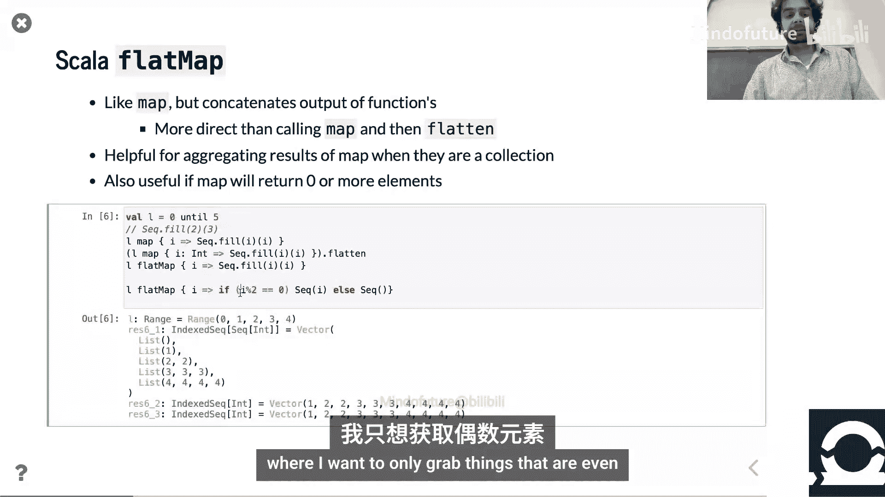

Sure。They can do that， right？This is kind of another use of Flmap I think is more common。

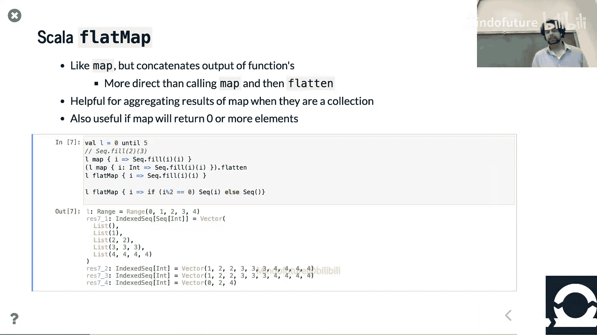

嗯。In the grands scheme of things， you' would probably use map 5 times more use flatmap， but。

Doesn't mean flat doesn't have as purpose， and you'll see。

 I you change with the pattern matching at the end in the options。

Where we find more value still out of flat maps。 This is kind of why it exists。 It's a very general。

 robust。Concepts。However。There's different ways to kind of perceive it。

 So I've shown you two ways of perceiving。 And one is think of it as， you know。

 calling dot flattenden on math。 Another is to think of it as just。

The output of your function is itself a collection。 And we're concateing appending them together。

 right。think have a picture for this。 I do。 So yeah， so here's maps call map on a collection。

 You know， there's an outer collection and then an inner collection we。😊，You know， have one to one。

 okay， great major collections。Now， if I was to do flatmap。It combines all elements this together。

 right， if that that level hierarchy is kind of intentionally evaporated。不。Questions so far。

That's like呢。There's a few other handy functional construct。

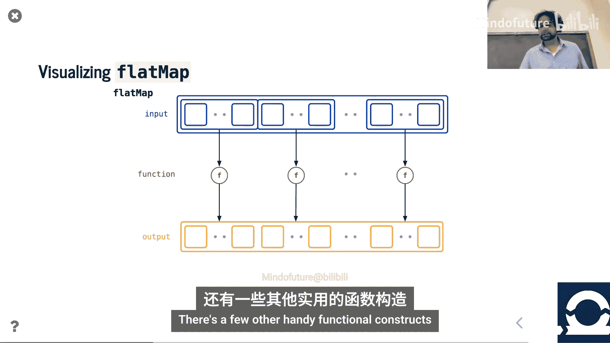

So I've kind of mentioned one in passing now to make it more formal filter。

And so in order to apply this， we need a。Conditions， so this is called a predicate。

 which is a simple function， which given an element， returns a boolean。

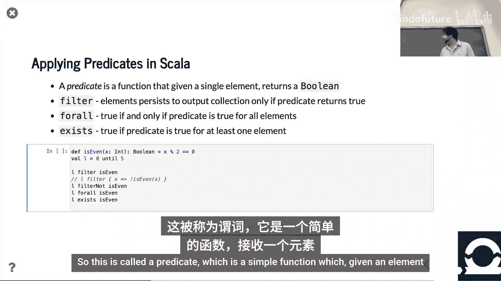

And based on that bullolean sort of things happen right So as you imagine for a filter。

 you apply this function to every element， every element that's true we keep in the output collection。

 and for every element is's not true we drop we don't keep anymore。So， you know。I could。As you see。

 I defined as predcateates， the function takes an element。And。You turns if it's invisible by two。

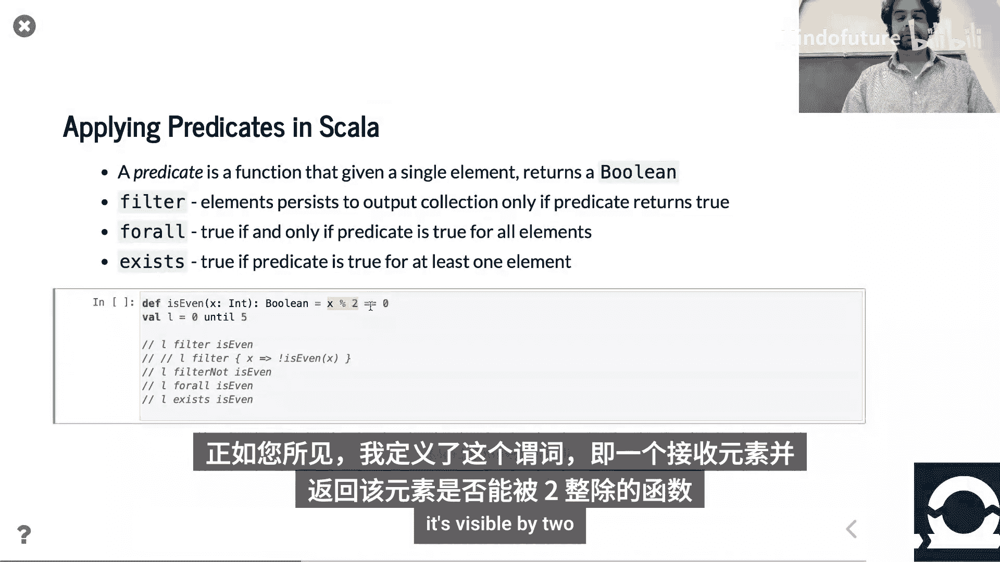

So yes， so going through。I have the range 0，1， two， three，4，5。

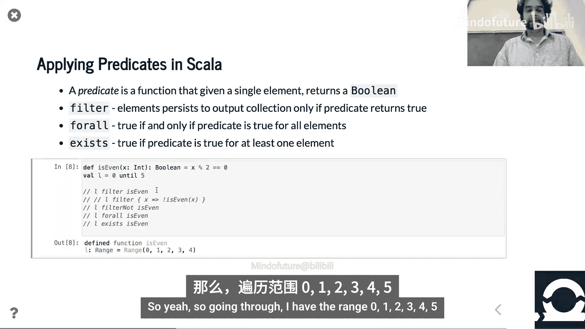

Apply is even the course I get those。

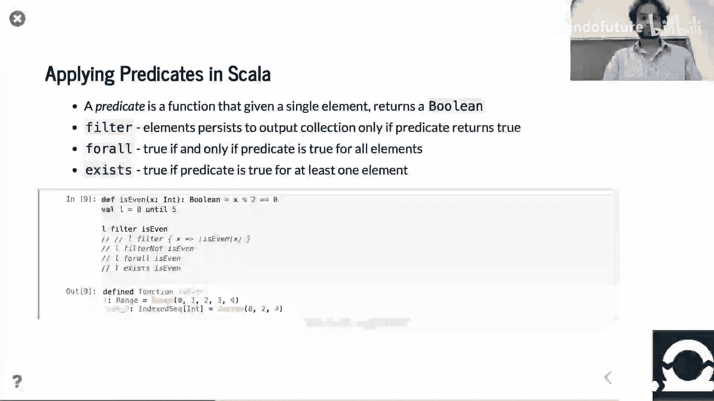

Now it's interesting about filter， of course in the Sch style。There's， you know， there's choices。

 right， I can do filter。I could。

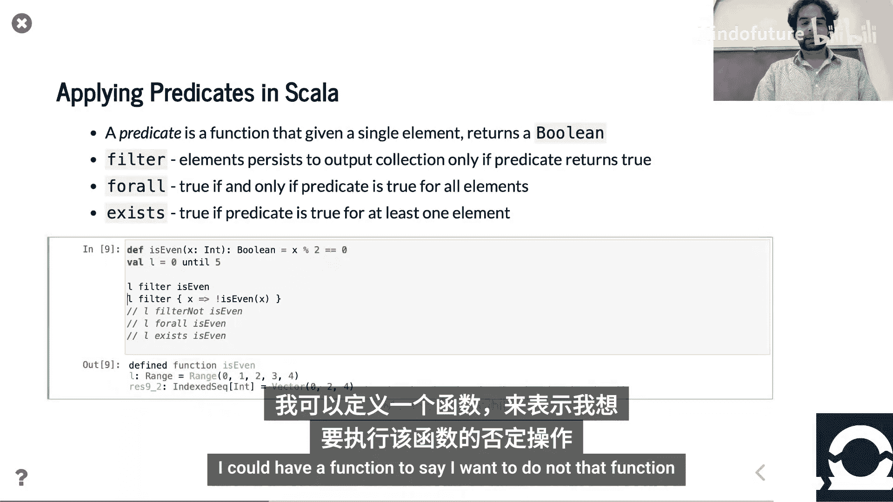

How a function say I want to do not that function， sure。Get the odd numbers。And you know what。

 because Scala does this kind of stuff rather than being filtered and then having the manually in the your function。

You can just say filter not。 And now anytime predicate is true。

 it drops similar time prediic is fall it keeps the elements。 So yeah， that's cool。

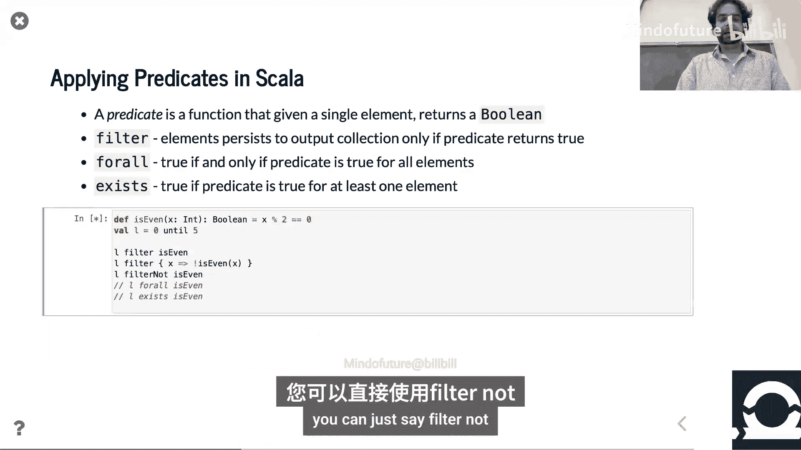

That is a very prominent scholar， I had this notion of some of you can definitely express and then you can express them more concisely and more explicitly get way。

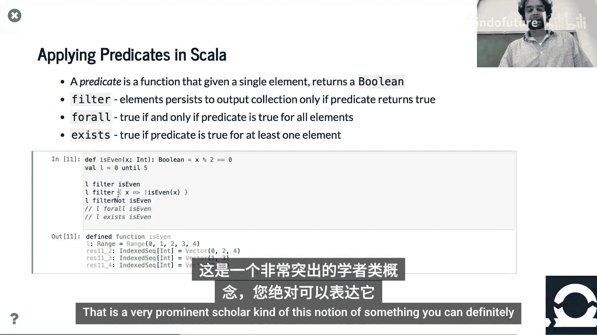

嗯。As someone that came from the wrist philosophy since I'm seeing what is not strict necessarily say functionality。

 always makes seem a little bit know nervous at times， but eventually it grows on you， you realize。

 oh wait， yes， you know， if the thing you really is a filter not。

 it's better right not to filter and then man negating it。

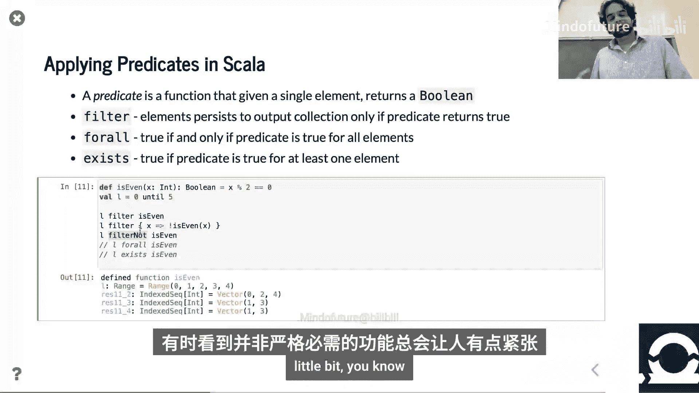

Cool， yes。把后钱。Oh yeah， good question so is this like before one of these scenarios absolutely。

You can see I love the space style syntax， but Ldot filter would be。

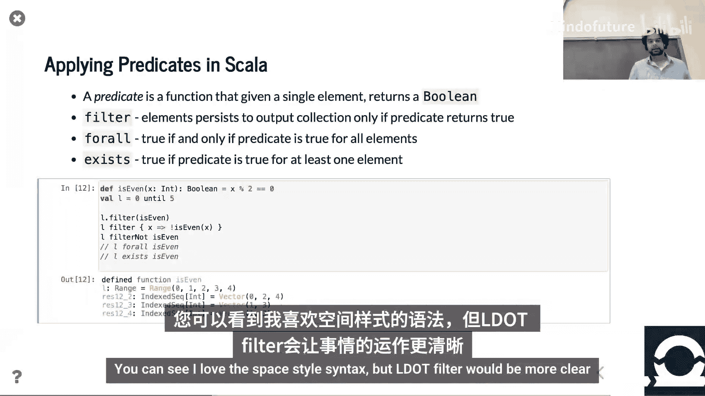

More clear。What's going on？My schemeing background is showing。啊，呀。So like I said。

 these is the kind of features are built into skull that makes it really easy to embed。

A new language inside of sca， that's kind of some these things and choices they made。And yeah， you。

 I'm happy to embrace them。Okay， so what things we do with these predcateates。

 when he talk about filter。 that's pretty clear is actually these two。

Ways of going across entire collection。 it's actually interesting。 you think about this。

 You may have written this code before， and this is nice。 It's such a compact thing。 So for all is。😊。

I'm going to apply it to creditcate to every element collection。And guess what， name applies for all。

 In other words， it has to be true for each and every single element。 if that's the case。

 the for all of that collection is true。嗯。If。🤢，Anyone was false， it is going to complain。 So。

 for example， if I say。嗯。Are all the elements in that original range even No， of course not。

 Now if I was to sheet。And then， you know， paste this in there。

So I only take even elements in the course， yes， this may be true because they're all true。嗯。

And then it also exist， which as name says Smith right there。If only one or more predcate is true。

 then we get that result。 So is there an even number in that range， Yes。

 is that entire range all even No， right， So we have before all and exists。

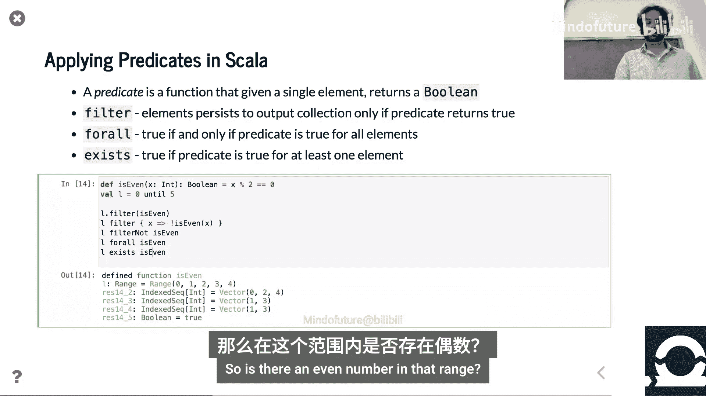

And'd be surprised how you can start， you know。Using these things。

 use some surprisingly sophisticated code quite concisely。 Instead， these are robust patterns。

 It's not just some sort of hack， like。The math， mi Sammanants。

 what you're doing here is well understood， right， you know？For all exist。

 are turns from the math literature。The defining app predicate， this is all very structured， right。

 yes。Yes。Yeah， so exactly right。 I'm gonna to repeat this start recording。 Yeah。

 this has some hilar we did before what we did what the box is in the prior lecture。 You know。

 actually， so all these things， like I said， a lot of these functional programming constructs。😊。

They apply to collections， right， That's kind of the key point of them is we're given end things。

 how do we programmatically interact with that for most of our lives programming。

 we've been taught you about four loops， right， For loops and mutation。

 is's how we've done that stuff。 And with these functional programming construct。

We can now interact in those n elements in perhaps a more structured way that doesn't necessarily require mutation。

 right， you know， for all， you can imagine right up by hand， right for all， I'd probably have to say。

 you know， let's， let's do it right now。 Let's see fun。

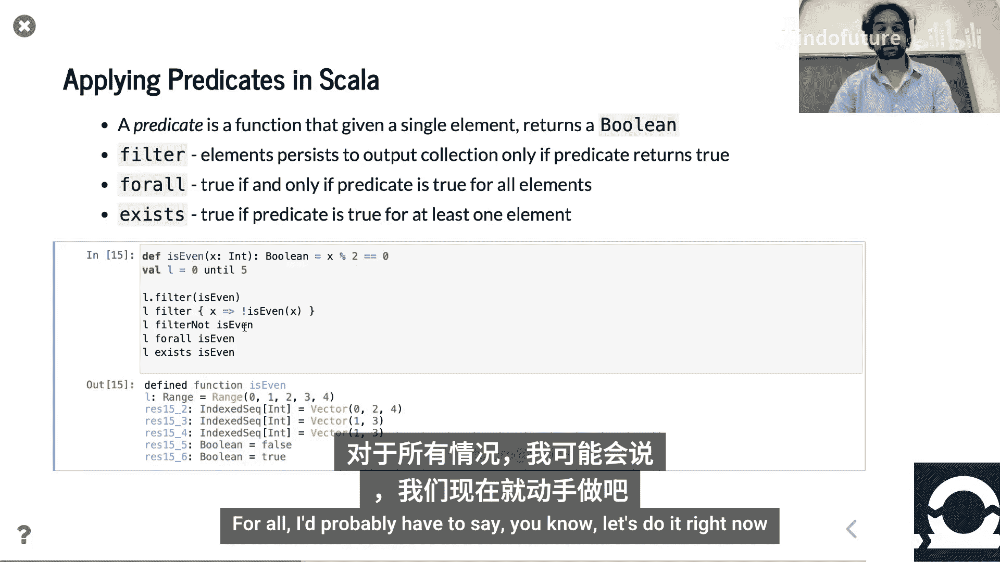

明白了。You know。All true will say is false。actually know what， let's say it's true。

And then we'll go through for x in。L。

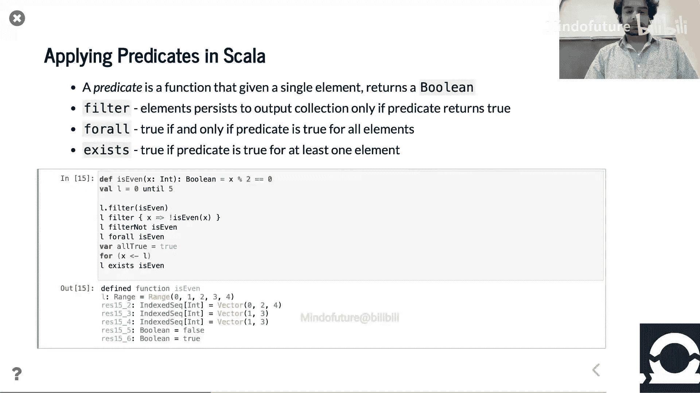

And then we'll say all true。Equals all true。And S。And then， let's print。Actually， we'll just yeah。

 then I'll just say all true and see what the result is。

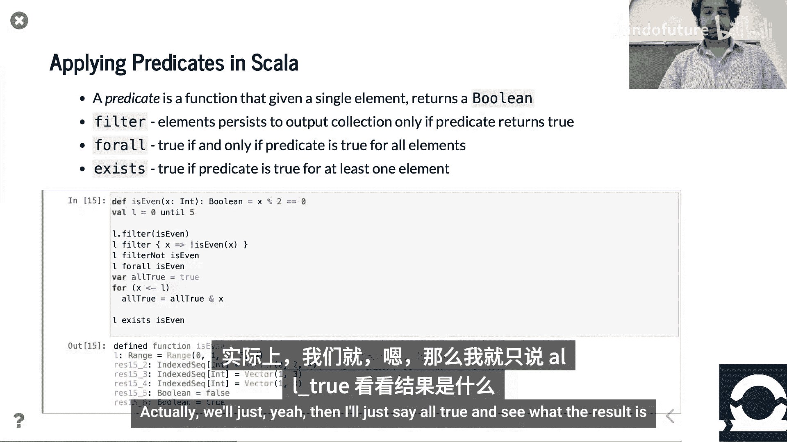

嗯ps。Hope I didn't apply to the predicate， we got to apply our own predicate， okay。

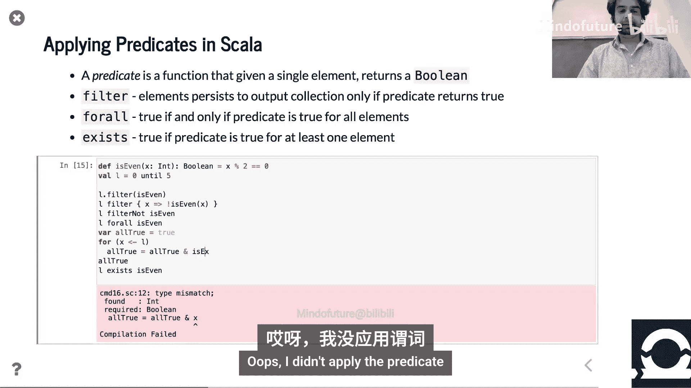

So yeah， so this thing did the right result， you know， instead of putting that in there。I。

Applied this to the even elements， which would better be true。Yeah， it checks out。嗯。But yeah。

 you can see like this is a very nice concise way of doing it。 kind of way through these operations。

 right， is it？We have a collection of things。 And the question is。

 how do you want an architect collection。 And yeah， as we talked about。

 if it's some very common patterns， right， So， you know， for loop itates through something。

 that pattern is well captured by map for each fold left， etc cetera。

 And you can see these a scenarios， right that map is the one to one。 We want the output。

 for each is one to one where we don't care about the output。

 F left and we're trying to combine those things down to one thing。

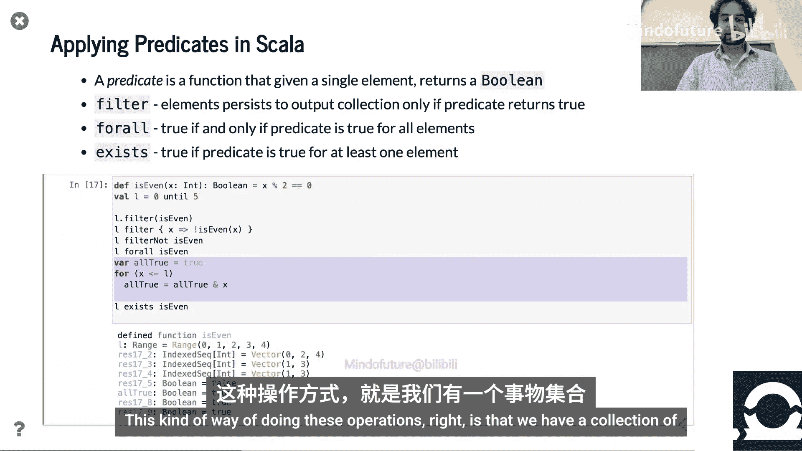

You could almost imagine。啊。Writing for all and exists with F left， you probably could。啊。

One thing I will point out is， like I said， normal map， the whole point is。It's one to one。

You shouldn't。Be trusting and have a certain evaluation order， right。

 If you devvalueu order matters to you as you're kind of breaking the rules because map is one to one。

 they should all be parallel， right。 And so if you devaluation order matter with them you just sort of secret side effects。

Don't do that no， not the hand the reason why is， yeah， it's not going to be good。

Looks like I've not covered at all in this courserus does not rather than just the your chisel programmers。

 but your hardware Sch programmer。You actually use these functional program constructs correctly on your code。

You thought it's switch in the compiler？It's all pal。Right。

 it's amazing you're rather being like I' gonna go write parallel code。 No， no， no。

 You just write your code with the function programming contracts correctly。

Turn on the parallel collections and boom is parallel。 So that map has parallelism， right。

 You can imagine it as a math function as being parallel。 They can do that。 And so。Yeah。

 and embrace functionalness， there's some license to it。

 This is kind of why it has had some adoption。 And so in places we can do some things very gracefully and very cleanly。

Cool。So u filter， right， you know， given and collect elements， things are true。

 we keep things that are not true， we don't keep。嗯。

So let's put these together and build something up in concise code。

This surprisingly concise what it's doing。 So let's say you are。Wine to build a prime s。

 In other words， a piece of code that generates prime numbers。

So I'm going to show you how much a handful of lines you can build up a pretty sophisticated one。

So what do we do， Well， first of， we have this functionality I which is multiple os， right。

 In other words， given two numbers。You know， does A evenly divide B， right？Okay。😊。

Notice how I broken up the arguments to two pieces right that should be like your your hint。

 you know that oh wait it's probably going to partially apply us at some point。

 yes I'm going to partially apply us at some point。😡。

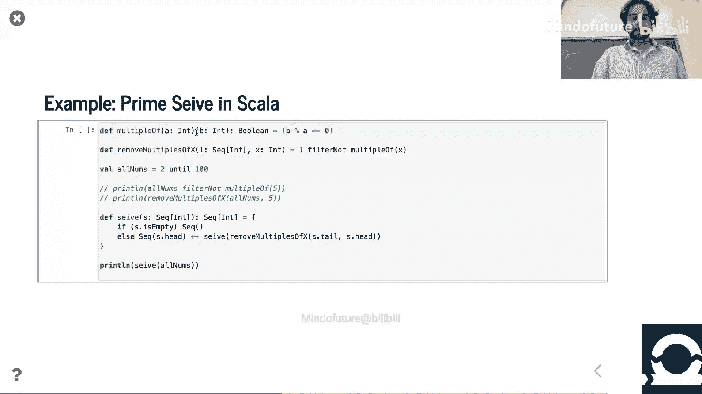

嗯。So now let's see what we have， we as a function， for example， remove multiples of x。So okay。

 given a collection of integers。Give an X。

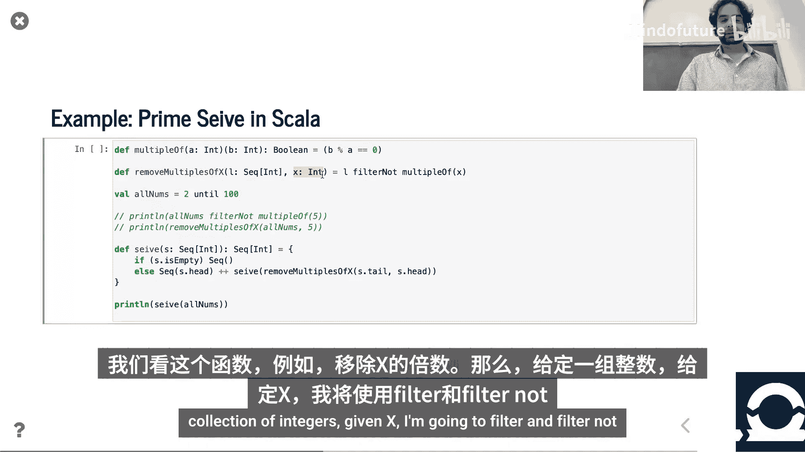

I'm going to filter and it filter not。So in other words。Whatever this is true， drop the element。

 And you can see how kind of comes together， right， Okay， give a collection of numbers。

Isn't it multiple effects over it the multiple effects？😡，We doing filter not drop it。

 So as the name implies， yes， we're going to remove all multiples of x。过。

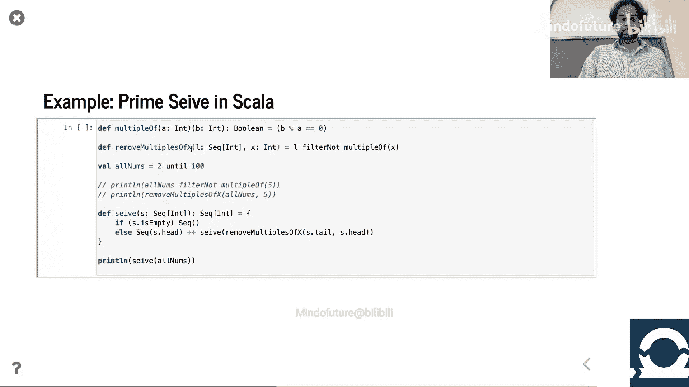

And then。What are we going to do？嗯。We are going to go through some sub numbers， this case。

 all numbers。

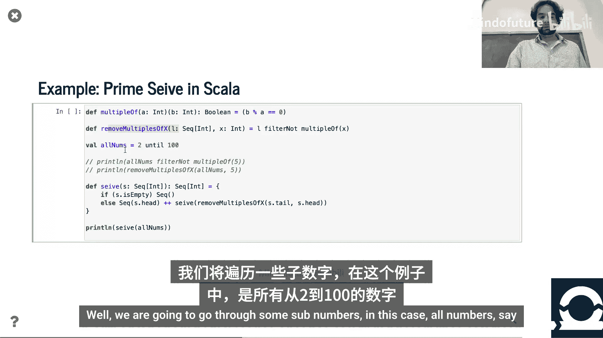

Is say from 2 to 100。And we'll see some examples first。

 So we're actually do to final little punch line， let's kind of build our way up so。You know。

That's all numbers being printed。Yeah， you can see that coming out。

 Is think your print things out intentionally。 How about all numbers that are not multiples of five。

 right。Yeah， that that checks out。 I don't see 5 or 10 or 15 in here。

So that's kind of about code working， so this is basically。Remove multiples of。

It's I instead use that actual functionous throat。Yeah， through we are dropping multiples of five。

This is a very famous prime status literally thousands0 years old。

Which is basically how do I find prime numbers？Well， I start of a number。And okay， great。

 if it was empty， then sure I'm done。If not， I say that number is prime。

And then they remove all multiple of the numbers from remaining numbers。Right， and so。

This head and tail， we haven't shown whole much in this course。

 which I've spend time talking about for a second。So given a seek， you， it's a collection of things。

The head is the very first element。 That's the dot， you know， index0 element。

The tail is everything after the head， right， so it's one to the very end。

And so basically what we're saying is， hey， given that collection。Take the first element and keep it。

And then。Call recursively。On the remaining elements and remove all multiples of that element。

 In other words， I'm going to take two and then say two is in the collection， good。

Remove all those of two。

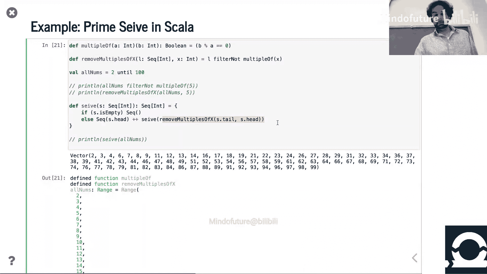

This pattern of having some minutes like know， the head and then appending。On the left。

 including the tail， this is a very common pattern， not just in scala， but in scheme。

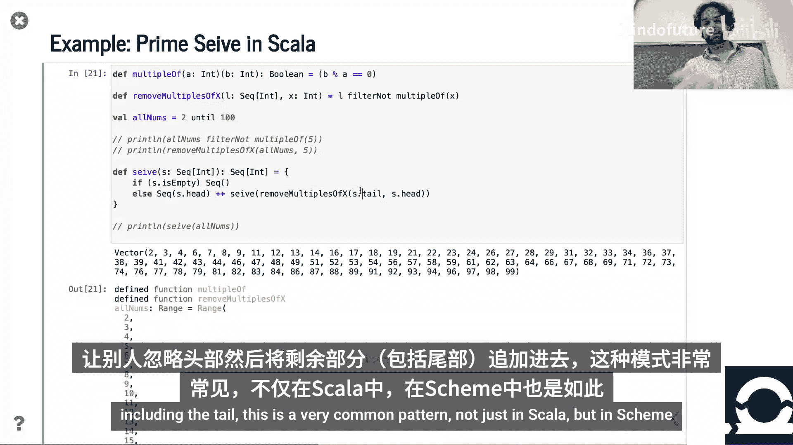

And you see this allow me to do recursion， this is camera recurs， there's nice properties with that。

More importantly， let's go ahead and see what happens。Yeah， she recognize， oh yeah。

 here's the primes。Less 100。

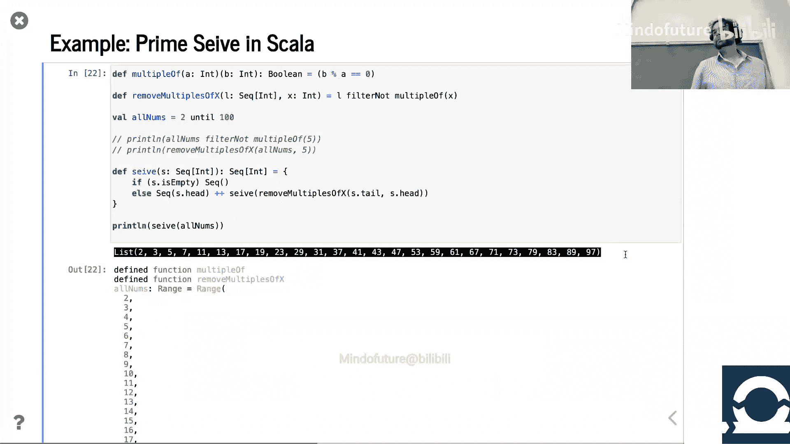

And we did that and， you know。One， two， three， four， you know， like， I don't know。

 seven lines of code， six lines of code。That's pretty cool， right？嗯。So yeah。

 we were kind of applying these， you know， predicates on predicates， filters on filters。But。

 we filter down the numbers from 2 to 100 to only be the ones remaining prime， right， we grabbed two。

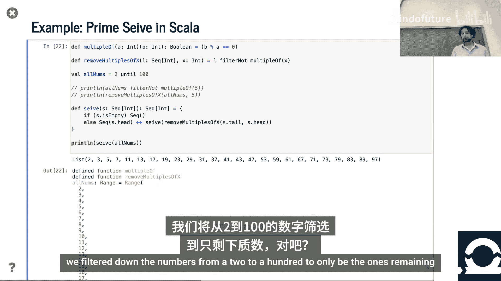

Drrop ous of two。 What left，3。 O， great，3 is a prime。Let's move multiples of three。

 what's after that five because fourgar moved when we move all multiples to two。

 so five is the prime。Re moveve almost little of five。What happened to six， removed by two。

 what happened to 7，08， it's a prime， let's add it so you can see this how of the s works。Cool， okay。

 so here we are， you know。Go and create your functional programming。U。

We saw this earlier and kind of came back to this concept。A lot of these common operations， like。

 you know， adding， multiplying。啊 they。Buildils into the collections。 So in other words。

 when you have a collection， you can call these operations and they there。

 So you can say reduce and say plus， it's really clear。 but it's also just a sum。

You can do reduce multiplication， that's the product。

M and Max are there and it's really helpful right， you can imagine you' writing code is very productive and convenient to go say。

 hey， I want a min， I want a max。It's not just a matter of you saying， oh， it meet tag men。

The three characters。Thus' saving a lot of time compared to me writing out my own code to find them in。

Actually' the person reading the code， right when they're reading your code。Very quickly。

 they understand what's happening as opposed to reading your full loop or reading your fold left to find them in。

 right。So I said， when these things exist， it's really good to use them。

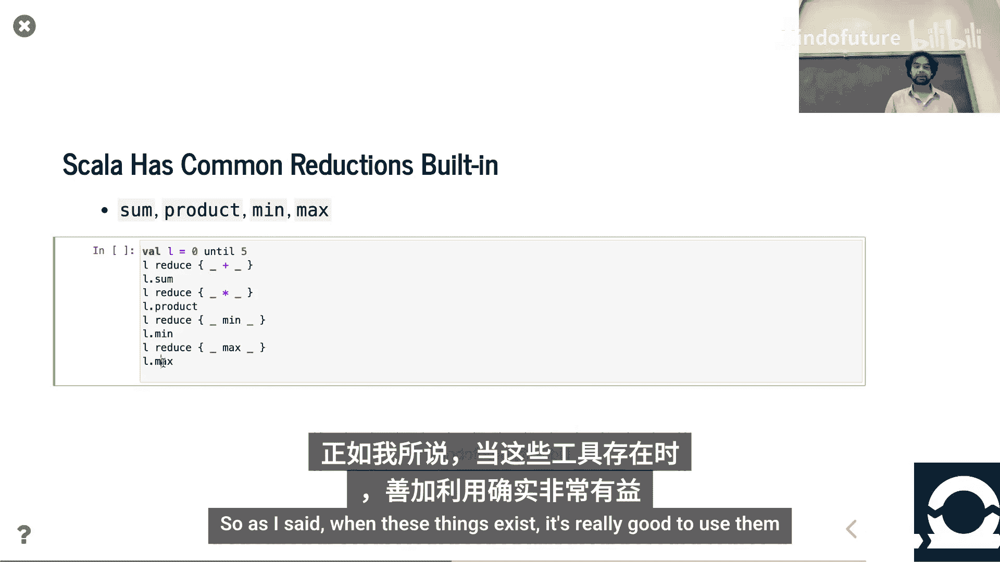

And yeah， we can go ahead and run it， sure。Oh。

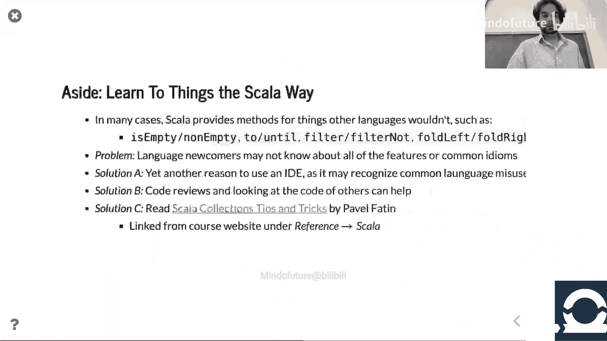

So as said you want to see this， it's good to use them， right。

 Sca provides a zillion in these freaking methods， right， So how would you possibly learn themable。

 This is a problem that's not just in Sca of any language。 You can write code that works。

 It solves your problem。And if it solves your problem and works。

 you probably have no reason to doubt it right and so given that。

 what can you do to make your code better right， there may be features in language you might not be familiar with maybe be idioms in the language you'm familiar with。

Some example， let's say you're a longtime C programmer and you learn Python。😡，And C。

 you're very used to writing4 in i equals0， i less n i plus plus。

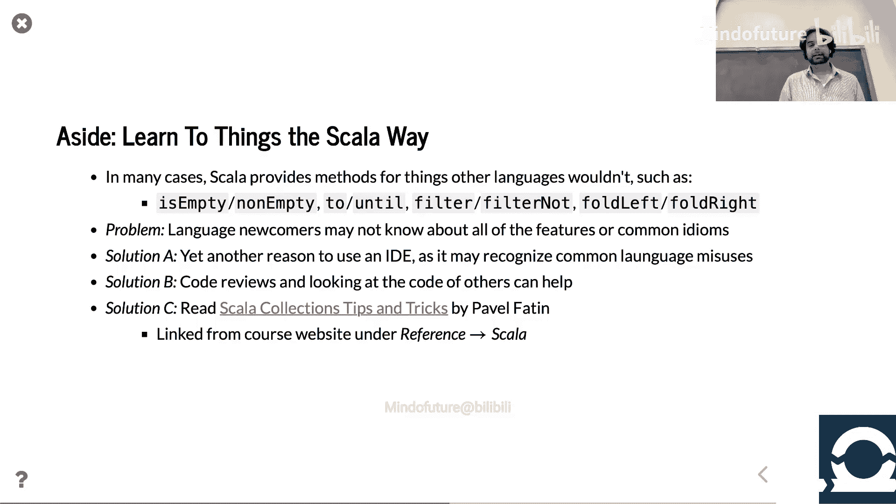

You can do that in Python as someone writes， you know。

4 I in the range of0 to n that that's correct code， but you're probably better off saying， you know。

4 X and L and Alba collection right。 So oft even have more direct iterator syntax is encouraged Pyon an idiom and Python and so。

The similar things was kind of learning that language is idioms。Helps Jacobbe better。

So how do you go about doing it number one？Use an I， which I think most students are right。

 But you're using like a very basic tech editor， please， please， please turn up Scotland medals。

 help you out a little bit。 And kind it may tell you some of the things you're doing。 You know what。

It said this you could do that。Take a suggestion at heart。 It can help numberumb two， code reviews。

 right， So we're going to talk about code reviews later on this course。 We're can do some。

Looking at other people's code， you learn when reading and they also might tell you things and they read your code。

 so it goes both ways。I can help the third， make give a shout is blog post。

 which I've been referencing for years。Some took the time to write down in their experience。

 common things people weren't aware of they were scholars that are there。

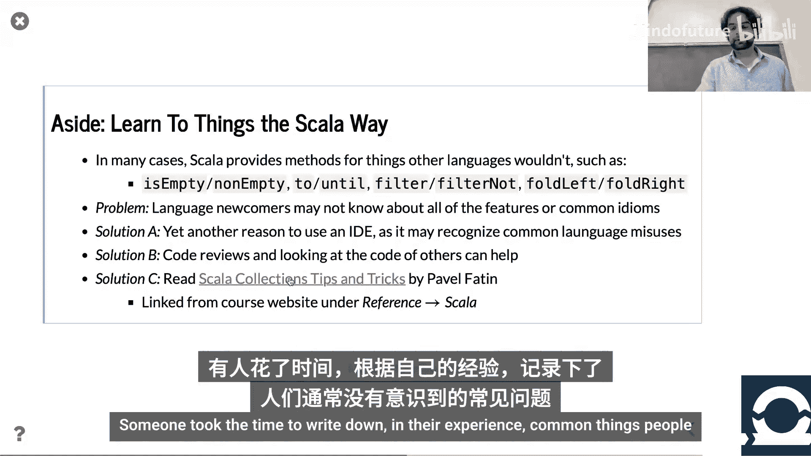

So。啊。

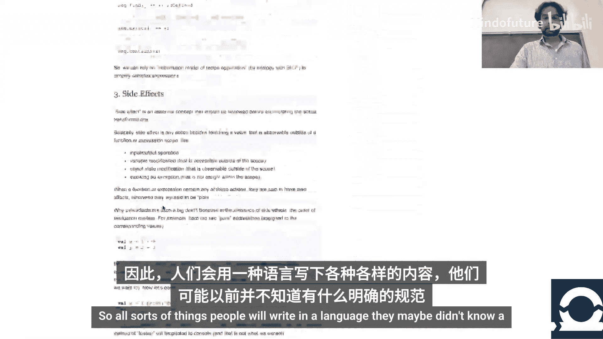

All sorts of things you will write in a language and maybe didn no scholara before。

 and now you can learn。How to write more idiomatic code。 And he kind of explains various things。

 yeah， you know what， there is a non empty， for example， right and that kind of stuff。

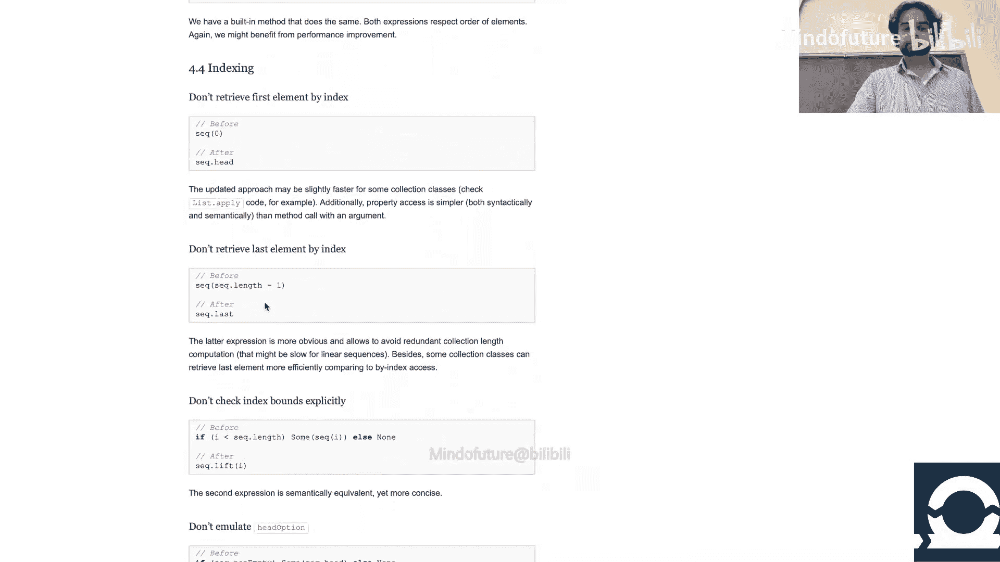

So cool， worth doing make phenotypener code。And if forget this link is of course also available on the course homepage。

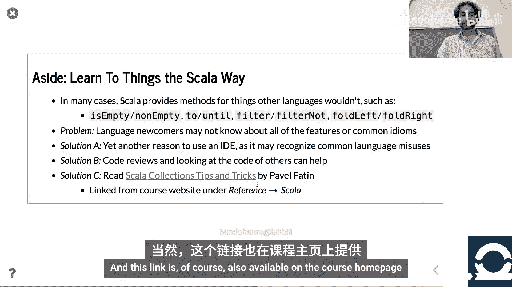

If you want to take a look at that。Cool， okay， so。

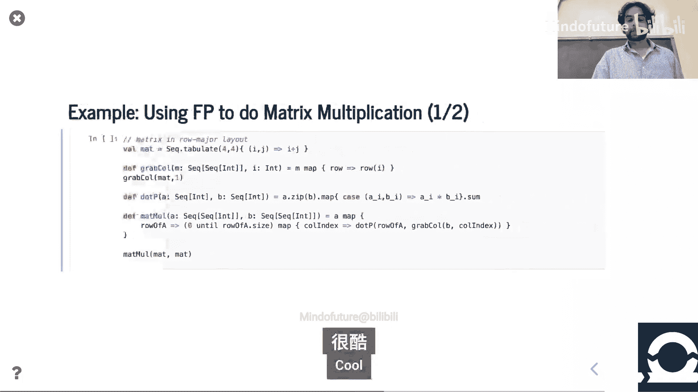

Let's。Go super hand on functional programming stuff and see what we can do。

So let's say we have a matrix。 Now， of course， there's going to be a library for this。

 linear algebra for this。 This is not about the matrix。 It's about just。

Getting more practice functional programming。Um，How was like a look， well， turn the C command。

You can actually give it multiple element and multiple numbers out just one number。

 and you get a multidimensional collection。 Right， Let's go ahead and see that from the beginning。

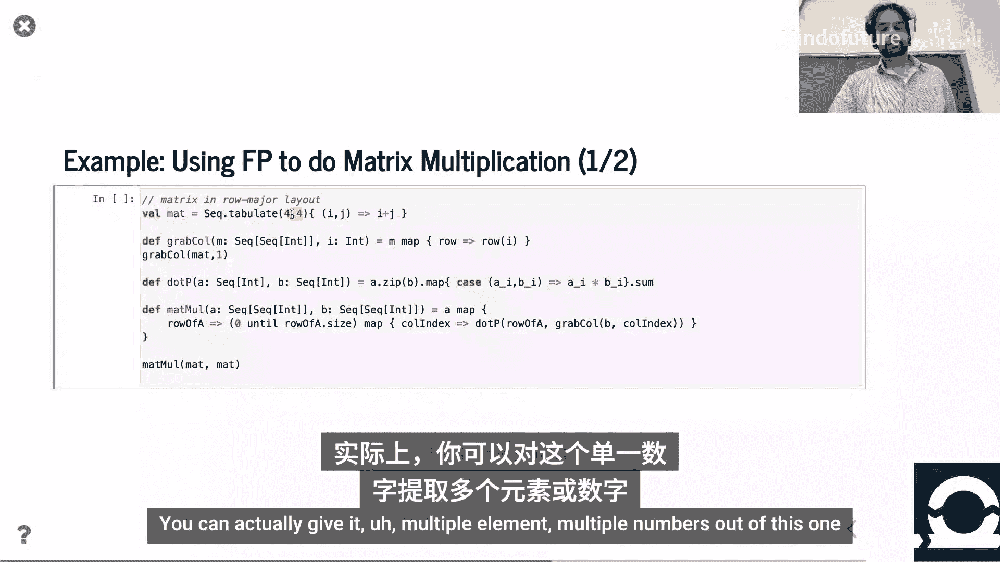

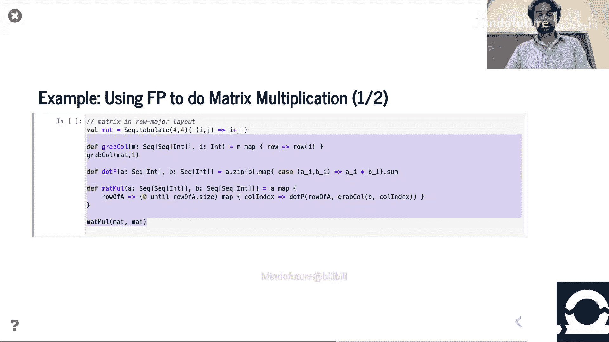

Yeah， you know， I say， hey， give me a four by four of sequences and then rather having a static number。

Which I could do。 I could just say， make it all once。

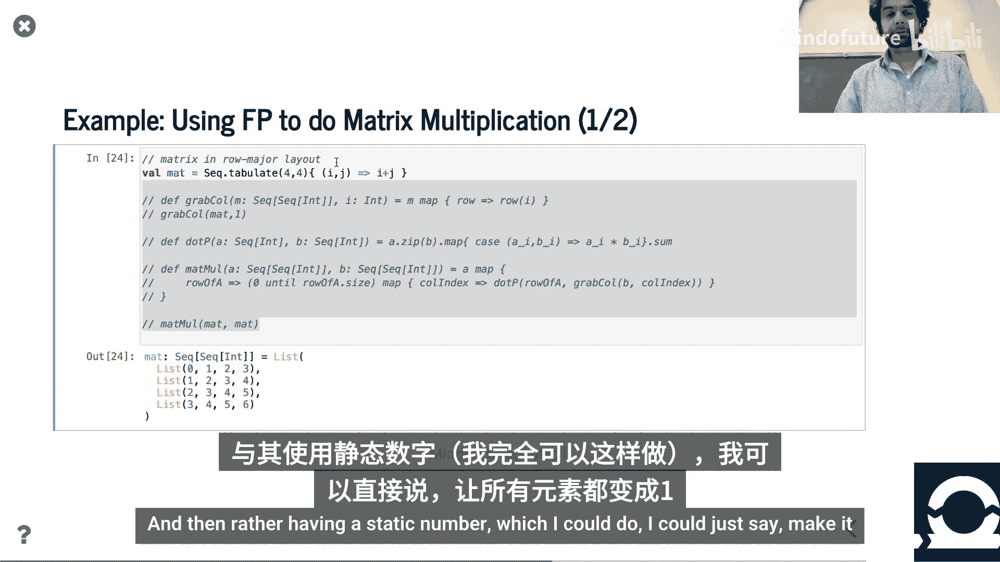

I I got to use the different braces for that。

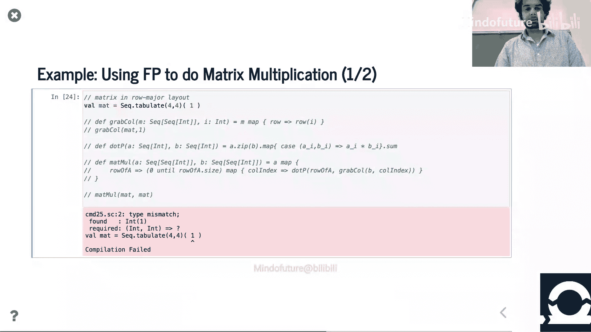

Oh， maybe I can't even do that。 Okay， I use a function。 Okay， we use the function。

This is armair chosen just to generate the matrix， okay， we have a matrix。You know， four by four。

Let's say， for example， I want use functional programming to grab a column。😡。

So what a column look like a column， you know？Tce the pattern of my mouse， right。

 but technically it's， you know， going through multiple lists， right？

So really what I want to do is they want to go。3D outer collection， that's its first map。

And then for each row。Grab a road thing a certain index。 right， So if I want to get， you know。

 column I0 indexed。This code will do that right so we're expecting， you know， let's say column 1。

 that should be  one，2，3，4， and， okay， that works。Now。

What else we need to do in order to do measurement location， okay， do measurement location。

The management ways of thinking about it， maybe think about it as threeness four loops。😡。

Or you think about it mathematically as。You know， for every output element， there's a dot product of。

 you know。A vector from one input，1，1 row vector from one input and the conve from other input。

 right so。How do that that product？Well， we're going to be given these two vectors。

 so to speak of A and B famous two vectors。We can simply zip them together。And then。Multiply them。

So now we have all those pairwise products across those vectors。

 and then we can reduce them all of sum， right， so that checks out。😡。

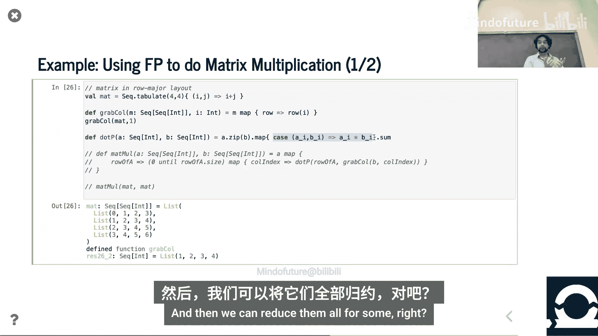

Cool， that's top product。So， then。If you want to be really aggressive USAL。

 could I do this with the placeholders， I think the answer is yes。

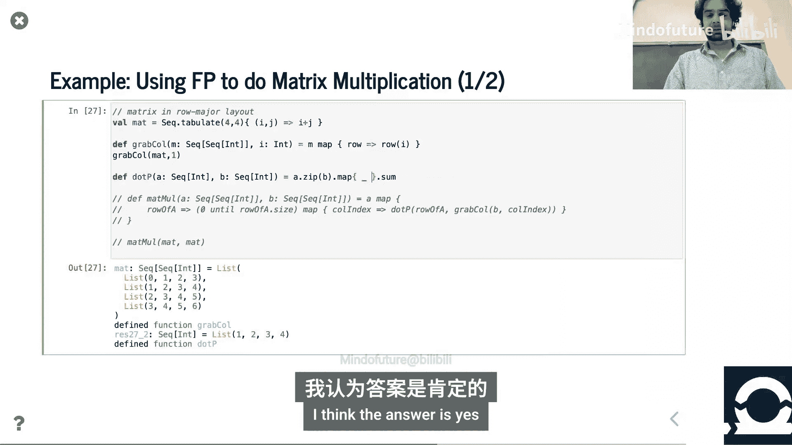

Oh， we can't because it's a tuple。So no， we would be forced to no we cannot。

 That's why because the zip created the tuple。 it's actually not two arguments of the tuple。

 and that's why we had to do it that way。 Sorry， yes to go ahead。

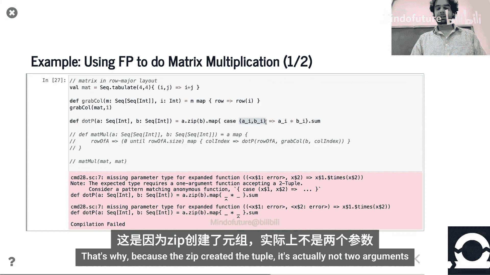

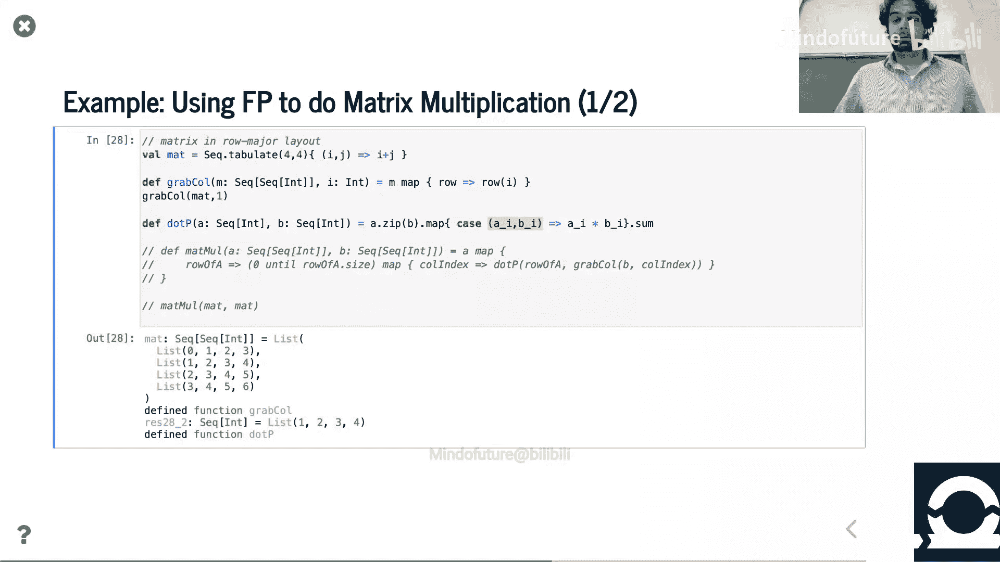

Yes， so like we saw that before， if you have， like， you know a Ch component。

 you can definitely say underscore do io。 in。 that's totally fair， yeah。嗯。Cool， okay。

 got our products。Method ready to go。 So now let's put it all together， right， so。In order do matrix。

 I。e。 Mattmo。Given two makeaces， which for today are these sequences of sequences。😡。

We're going to go through。AI me say A dot map is going to do the outer collection first， right。

 so it's going to be basically going through a row wise。 So we have a row A。

 I'm trying to use names help guys along。Okay。And then for the length of that row。

I eat a number of columns。We're then going to map， right， basically。

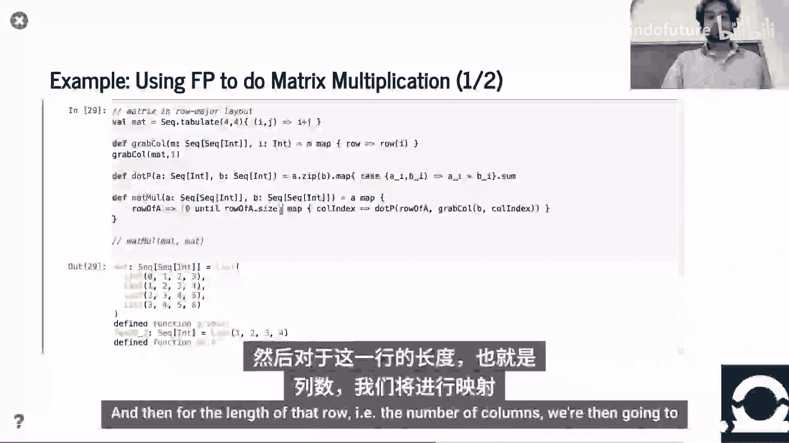

Go through each column。And if we have a row of a。And then we're going to grab the right column we want for that column index from B。

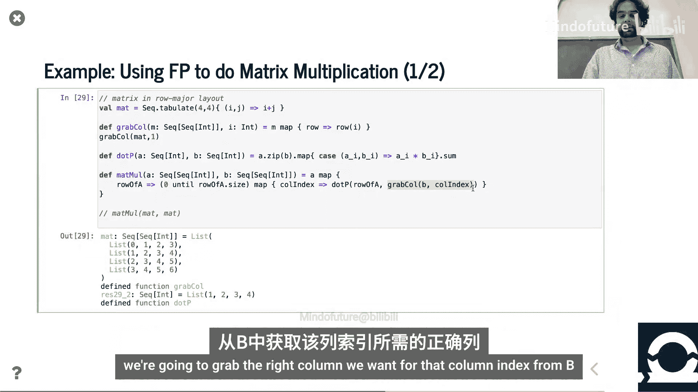

And then we're going to call our dot product method。So when it all comes together。

This gives mentionable location right， we're basically going to go through row by row and for each element of each row。

 we're going to grab the corresponding column。You can adopt product for going， you know。

Left to right， top down， you know， filling in this matrix。

 So you notice I didn't major re location here。Nowhere on this slide is a var。

 No is a mutable collection， right， I've used functional programming to practically， you know。

 shut the all up。

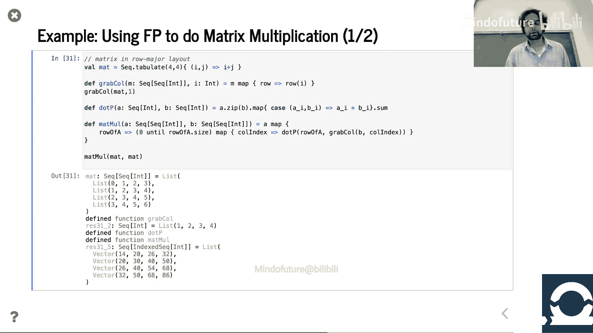

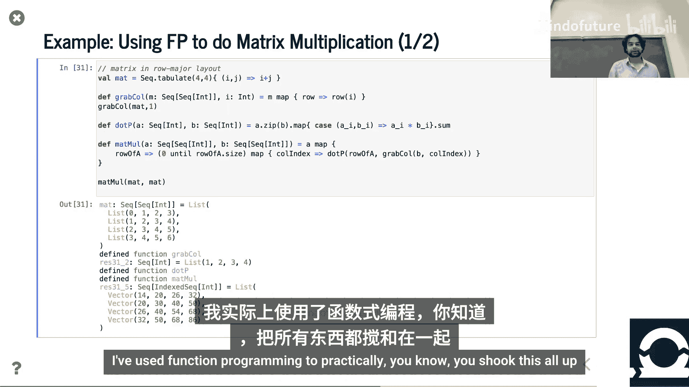

If he flips and switches in。Our compiler， it could use the parallel collections for studies operations do seen in multico parallel。

Co questions。Okay， let's see another way of doing it。

So。Here we。The you know map。Followed by basically map。

This is one way of writing it， maybe you find this following way more intuitive， right？

It's kind of like for every row， you know， from a to a do size， the outer collection。And then。

We're taking the first row of B， depending in the number of columns。

 the prior slide that kind explicitly assumed。

That the number columns will be the same。 but here we're making that more。

You actually having more general more flexible code is actually more correct， I would say。

Actually know what before I forgot， I just changed that。嗯。

Because yeah， technically。Be you can have their number of columns，'ll be totally fair。Oh。

 but it's not row of B。 we need。Okay， now I remember why Pa self did this。

 this is always fun every year。Because you can see in the next slide， why I did it that way。

Because this is mouthful to kind of go great go in and grab the head in order to get the size， sure。

But yeah， same corporation， still two maps。Maybe that。Formatting make them more clear。Um。

 what's absolutely wild， does Heri know how kind of blame this collection？

We're going you know row by row， Elma Ama and those rows。If we use that tablet message from earlier。

😡，And say， hey， I want to do a tabulate where for every given element， I J。

It's going to need a dot product。Of a row of I， A and a column of B。

And we shouldn't have two definitions of the mat mold。

It also works。 So yeah， I mean。

Not shown on this slide are dot product and grab call。

But in a surprisingly， if few amount lines or written mid location where the actual core logic is now。

Like one lime which is kind of wild， right？So it's a dot product and we get this Ij from Tite。

 which is kind of。Iterating through the space for us， because guess what， It's a very common pattern。

 if I have a。Multidiional collection， I'll probably use nested forms to kind right through it。

 why not encapsulate that pattern into dot tabulate and they did。So's kind of convenient。

For you in me if assignment， you're probably just going to do。嗯。Dot tabulate on a。

1D collection， but you can do that multiple collections。For those of you doing homework free still。

 you follow in playing what kind of a game of life right now， so。😊。

See buffer for four loops and functional programming。Cool。Questions。

Okay。Now， the as promised pattern matching。So what the name implies is a way to make the code。

Recogniized things and kind of connected up together。

 So they're all very familiar in programming and doing things like equals equals to comparisons。

And we can do if， do if else。嗯。And we're also seeing things like switchitch。

Switch is a chisel construct。嗯。Match is a scholar construct that does pattern matching。

 And I'm showing even just in this one slide， is's more in just a switch statement， right？ Yeah。

 you can have very clear。

Cases where got a single number。If handled certain way。

You can have situations where you have an or right， or you want one or three to have this behavior。

You can do that。You can even apply a little if statement。

 you can name the variable and then do something with that variable。That's fair。嗯。

And there's even a default case， which is the underscore。

So for example， yeah， you you can see it kind of goes through each cases， okay， if it's  zero。

 matches zero， if it's one， it goes there。If it's two， it's going to be even because， you know。

 satisfies this。3 is still nice that we're looking for。For as even。And then，5。Found it。

 And then anything bigger than that oops， did I。That's a new one。

Oh， that's why。 somehow I managed to。S went out code and never seen that before。Oh， whoa。

 it changed it to a not code cell。 That's wild， okay。

Well， here we are working again， so we're not going to mess with it。

 but anything that doesn't match any other criteria like even minus one， for example。

 from the other because that's matching this default case it matches none of these。

It's a default case， if I don't have a default case， it's actually totally fine。It's just。

'sGoing to work until it doesn't have a default case and it tells you there's a match here。

 there's nothing to match with。嗯。Cool， questions。So this is doing it on like， you know。

 a numeric type， right where the pattern matching is really powerful is using it for other things。

So let's use case class， which I've already been having up earlier in the quarter。嗯。

So we're going to pattern match on case classes， so for fun let's have no vehicles we'll have a helicopter in a submarine。

They both have， you know。A color and a driver， sure。

And they have a collection that has both helicopters and summaries in there， right。

 you see what you know， vehicle type it is， the color and you know who's piloting it， right？嗯。

So first off。I can simply just。Go through that collection。In this match， you know。

 helicopters in one case in some reason another case。

 the very common thing you can do where you have these。

You know， some nuances of types and you can just match on the types。So yeah， I。

 I can go through and print out。 Oh yeah， you know， hey， I saw a， you know。

Gray helicopter of blue yellle submarine， sure。

Now， what it gets really kind of amazing to me is where we can play with this and say， all right。

 you know what， I want to go match。But rather than matching the type。

I want to have so many fields in the type be set。Other ones be uns。 So， for example。

 this was telling it， hey， match anything that specifically a helicopter and specifically blue。

But the driver can be anything。Now you have that variable for the driver。

And you can say it has a blue helicopter， for example， or if。Given a summarymarine。

And the color is not yellow。I'm going to print out， you know， so and so submarine， right。

 So you can see these kind of tables play out。And so。You know。

 we had only a blue helicopter match these rules。Because the other one's the gray helicopters。

 a helicopter， but the color is the match。The submarine is yellow submarine。

 and we were looking for a not yellow submarine。 So we lost that one。This is pretty cool。

 so you can do some pretty cool stuff with this。嗯。A research I've built a project that looks kind like a compiler internally。

 and so yeah， you can imagine。Going through the interpretation of a language and IR and you can match on different node types for certain conditions really powerfully。

 this is just unimaginably productive for that kind of work。Aom matching is pretty awesome。不。😡。

So the kind of key the key pattern matching is being used in language is case。

 We saw that in lectures， even today， I think。

Or we've had some many things with tus。 like right here， this technically is pattern matching， right。

 The thing it's pattern matching against is on one side of the tuple。

On the other side it' these two variables and it's kind of making that connection by saying， hey。

 try to pattern match these two together。

That's the same， you know power net language。Cool。So then moving on， how are we you doing on time。

 or we're doing perfect on time。 We talked about more graceful ways to do option。 So remember。

 option was something that's in the language where。😊。

It either has a value or there's not only not a value。 we， we know by in the type。

 there's not a value。 either it's none or it's something that actually has， you know。A value and。

Beyond it being helpful just a scholar in general。In Chi。

 we found this helpful for things like having an optional IO port， right。

 We want to have a port that's either there or not there in the final hardware。 and so。

If you have a thumb type in the bundle。That turns into hardware， if it's a nun type。

 it's pruned to you get these kind of very nice description。Let's say， for example。

 we want to generate some data， let's say L。Is going to， you know。

Be the numbers counting up from 034 and hey， if they're odd， we'll go ahead and say there's some。

 if they're even， we'll make them none。So maybe it helps。If I was to print out L。Actually。

 you can see that down here。A CCL， you know， for even 0，24 is none。Threety odds one and three。

It's there。Cool。Now。Wellho we taught you a few weeks ago。When working with an option type he said。

 okay， well you don't know if it's actually there， so you got to see is it defined and if it is defined。

 meaning it's not none， you can go ahead and say doc get。And so as， you know。

You can see going through it。 Yes， the ones there are some are one and3。

 Let's say you were impatient and you didn't check。You're going to call dog get on a nun。

 That's an exception， right， You can't get swing this a nu。 Okay。

 so what are the alternatives to this It makes this a little bit less robustbo It makes this autoy even nicer。

One is something called getter else， which is， hey。You know， as name implies。

 either give me something or give me this default value。

 so either whatever that value is I'm going to get。开始。Index 1 is1。One is something。 So yeah。

 you get that value， otherwise a negative one， if I still give me the next one。Which is a nu。

 It's gonna to be a negative one。 So it get else， okay。That makes sense。

Now these following ones are showing you why we covered this concept today。So give it a collection。

 where of some nuns and some sums。Okay， what if Da Guy now is going to be removed。

 What if we don't care about distinction anymore， we just want the real data。Well， guess what。

 that flatten。I's going to drop the nun。It's also going to remove the sum wrappers around the thing。

 right， So this was an option type inside there。 Now it's just the result type。So that's pretty cool。

 so wait I called that flatden。😡，And it's there。嗯。And so you may see people， for example。En code。啊。

Do this， right？

W。

Oops， I don't mind that's why you can't do that， okay。

 but if people use Flmap all the time on option types they to kind of get their right behavior。嗯。

Okay， so then。Fladden is cool， you can also pattern match。Right， yes。So flatden in this case。

 given L， which is all of this。So L is a collection of options that inside the options and the you see it includes。

 you know， none or an actual value as both When I called out flatten， it removes all the nuns。

And it remove the wrappers around the sum。 So went from option event。Two inch。So yeah。

 that distinction's gone。Okay， and then the pattern matching， right？啊。For the pattern matching。

 we're just going to iterate through it。 I'm using for it's iterating through it looking at the output。

 And you can see using the option types really handy， I can say， hey， if it's something。

Give me that something。 right， I print it。 If it's none， I will just write out。 it's， you know。

It was empty。And so there you go， that's pretty cool so we can kind of。😊。

We're in a different way and then。Also， for each is smart enough to。

You see the output doesn't change。If you give an option type of four each。😡。

It will do it if it's there and not there if it's not if it's not there， we'll do it， so I said。

 well， one， we know ones exist。😡，It prints that one， but the zero we know is a nun。

It doesn't do that。 So use someone's code in case you even see someone write code where it's like。

 why do they call， you know，4 each channel one element thing。It's because they're doing。

 they're removing the options。 So occasionally people have where I have law code lot of options。

These are the various ways to interact fitness， kind of。At first， maybe a little daunting。

 but over time， it gets more graceful。 And there's also kind of thing an I D can really help you see。

 right， you have an I D， and you can kind of hover things， see what it types and see things kind of。

😊，Prickulating through you recognize， oh， one points an option。

 at some point later on to actually do real work， it needs to be not an option。

 You can't see that transformation happening。Cool， questions。Yes。😊，Yes。谁。

The most common chisel application is' the one described where you have。

Options to have optional itemss right other words ports we're not always going to have in the hardware design。

In Sc， it's a really common thing to have options because。You know。

 you may have some parameters where you want to indicate parameters is not active。

 right and you could。You know， have the parameter field and another field flowing around if its like a boolean saying。

 oh， is this active or not or you just make it an option that kind of combines two together。

So it's helpful in the sca that you can kind of write arbitrarily complex or uninesting sca。

But for Chisel direct application， yeah， usually it's for optional I。

Okay， well。

We have8 minutes。 I'm gonna try and give the project overview and see how that goes。 Hopefully。

 people will watch this online and catch up。 So as you're all aware， this course has a project。

 we've been。😊。

Cherious with lectures。Been zoomed by， right， before you realize that you've been learning quite a bit of chisel。

 quite a bit of scala。R lot code。It's worth than to shift gears。

As you kind of go more into project mode， now that you have these tools。

 you're going to go ahead and use them to build a project。

 I think the project is kind of the whole point dis course， right。😡。

To really build a generator and you're going to develop it， revise it， extend it， et cetera。嗯。

I encourage pairs The course is small enough this year。

 I'm not going mandate it some of you of course is big enough headcount wise' saying like you must work in pairs otherwise you know No。

 I highly recommend the pairs I think you learn a lot more you can do something really cool together。

 you can do something bigger courses for the project scale based on people in the group so you work alone Yeah you're expected to do less than a pair。

 but you have to do more than half the size right because there's not2 x gain from a pair。😡。

So what should you do， you're going to be building a generator So you Im going to do this Alice thinre。

 This is a process right so in the process you're going kind of propose it。

 you're gonna get feedback， you're going to develop it， keep iterating， extending it。

 doing all that good stuff right and so。😡，What are kind of key things we aware of？

You're going to pitch a project， it's going to be unique to you and your partner。

Everyone's been doing products throughout the course。You get feedback， you going develop it。

At the end， you're going to present to the class。And all like goodness。

In terms of how to think of what's the reasonable size。😡，Think of like 2 X the most recent homeworks。

 I say most recent homeworks。 Think of like， especially like next week right， or like even longer。

 And so like， that's a better way to stay of complexity。

 I keep moving the slide back in the lecture sequence。 That's why。And maybe was not as clear。

 So maybe I'll。Treed that wording if it more clear for the future， but。

Always good talk to the staff and the staff in this case is me this year about。

What you're thinking about， you can kind of give some early feedback and so。

Even though it' not like that big of a project， it's bigger than you realize because unlike the homeworks where I give you scaffolding of existing code。

 I also give you documentation to explain what exactly to do。

You're figuring out what to do so that process of figuring out what even needs to be done。

That takes time just starting literally from scratch。

 There is something called the product template repo。

 you clone that repo or you essentially say you fork that repo that way you get all the。

Chissel S BT stuff there all populated for you， But other than that， It's blank。 right。

 It's up to you to kind of make this。So now telling this conversation now we've knew a few weeks so deadlines for the project。

 just is kind of get。Talk to neighbors。

So project pairs， get that going。嗯。So one time I look like so technically we're in week four right now。

 as I said we're a little bit earlier this year but。In next two weeks。Find a partner。

Talk things over。Some office hours who want to get feedback from the staff， if you can't make office。

 feel free to send me an email I can try and give feedback back to the email。Get the ideas going。

 get the groups going， get the ideas going。 Then you're going to write a puzzle。 It's a one pager。

And I' from that one page， I'm going to give you feedback in person during class time。

So this is one the few times in this course where people are going to be required to come in in person and。

Really， the only times for this course your in is required is during the project proposal discussion for your project course to make that valuable。

 as well as at the end of the quarter for the final presentations。Otherwise， yeah。

 I appreciate as we come， but it's technical not required for your grade。

 but for the proposal feedback， yeah， you need to be here for those of you taking the undergraduate capstone course and talking Prossor Harrison。

Yeah， we schedule as such that you will not be required to be in person。In the same place。

 at same time， two courses， so。Yeah， the shift currently is it'll be Tuesday here and Thursday in that class if you're not boat so if you're。

In both classes are going to be put into the twoth sel， but anyways。You're going to build a project。

 get the loop going early， keep adding on to it， keep improving it。

 so I'm going to read down with the next slide， and then finally you're going to finish it up。

 present it。😡，All it done， cool so。

What that should look like， like I said， the first thing is going to be having a proposal just one page。

There's any instructions supposed to what patients explain when I want to see in that proposal。

 But for now， think about。Basically what the generator trying to do？

What' it supposed to do with what's really going is done， And then。

Given that vision of the final product。Like a little bit about how you would get there， right。

 How are you going to。Get started。 What's gonna be the simplest thing you get running first。

 and you kind of build features onto that。 And we're going to use the lecture as time， like I said。

 to get feedback on proposals。嗯。Along the way is kind of these various intermediate deadlines。

 for example， at one point we're going to ask you to a link to repo it works。😡。

It's not going to complete， but we need to be able to clone your repo。

Run some commands and see some things happening， right。 And so I said， we want to see， you know。

 not just， you know， some chisic code， but Chisic code actually talks to a test bench and actually runs something of simulation。

This is very log， etctera， right， so we actually kind of want to see that integration early。

 even though it's not feature complete yet。Kind of get things going。

Then there's any time period where you're going to be for example。

 you're going to give your project to another group and they're going give their project to you and you're to give each other feedback on via code review。

😡，So seeing up people's code， you're going to learn things， getting feedback。

 you can try to make that more clear， so will be a code review process。Then the final week of course。

 we'll have presentations。And then。Following the presentations， I'll be emailing you feedback。

And from that feedback， you have an opportunity to revise both your project and your presentation before it's like fully graded。

 So there's be a grade based presentation， but it's a chance to revise and improve and then improve the overall grade。

嗯。Now last little step is it。For the cens of coursework。

You are required to present to your classmates， but otherwise there's nothing public about what you're doing and to be clear。

 you know， I'm on YouTube all court presentationations are not going on YouTube so you're not going to be on that party of internet。

I encourage students to make their reos public， right， you on Github to make it public and so far。

 just everybody does。 And so not a requirement， but it's encouraged and people do it。 That's great。

 And so you can see if you go to the homepage， you can see prior groups projects are all public and kind of see what's there gets an inspiration。

😊，嗯。I pick some dates to get the ball rolling。 I reserve the right to fine tune to schedule。

 for example， as I'm you know。Negotiating with the guest speakers。

Making sure be compatible with theirtables， we're very grateful for Do presence that may need to move some dates around a little bit。

 but。This is the first order we're looking at。Cool， one thing which I didn't mention at all。

 I to mention some is what are example projects， right。

 Anything that has some amount of general generation and parameterization what we want for this course。

 So it was a single static function that's not as exciting as those parameters with some sort generators。

 So we've had students do things like。😊，Hey， let's do this compression protocol for LT。

 Let's do the math behind GPS。ve students do things that are totally fun and not real hardware。

 Like Alin doesn't manmmal broad fractal generator。

 and they did that as a chisle thing It was kind of cool。 or like given a grid size。

 they can compute di fractal， and that was kind of neat if people do things like snake。

 I think one of the most dramatic presentations seen this course if somebody built a generator that could take in。

😊，Either。Super NeES or Game Boy roms and play the music from them。And it can actually do that。

 And they implemented that not just in chisel， but also got to work on FPG。

 And then for bonus points for fun， they found a system very line to drive DHMI port and FJ and actually presentation from FPJ。

 So that was like the most extreme presentation of all time。 Not required get day of the course。

 But that's example of how far you can have a go to the have want to have fun。 But yeah。

 it's kind of thing to think about。Talk us partner， find a partner， talk it over。

 talk to your staff about it。 If you have absolutely zero idea what project to do。

 I can suggest some。 but usually， I think it's best if students have some interest。 And yeah。

 it the most interesting one we has a little bit of。

parit takes a little bit of generation of ability to it， rather than being， you know。

 a very fixed function thing。A little bit more enough to it。Cool， questions on that。

We'll be only one conversation， but that's good for starting。 Okay， well， that's it。

Like we folks。