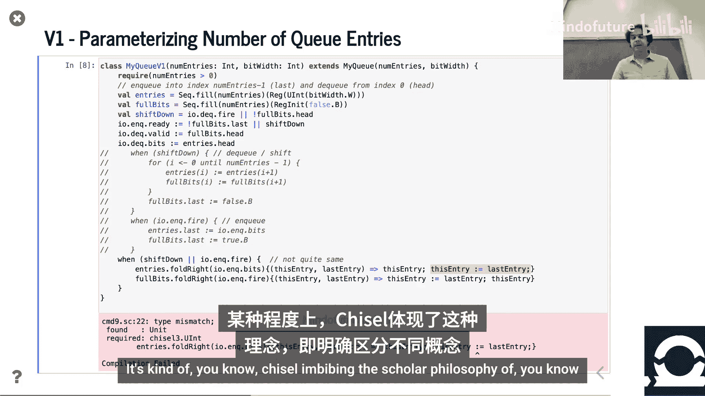
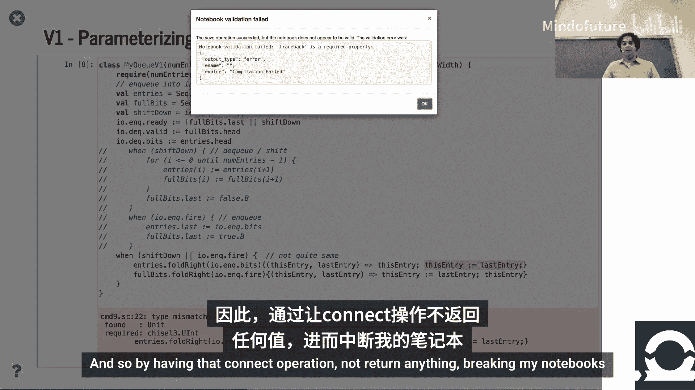
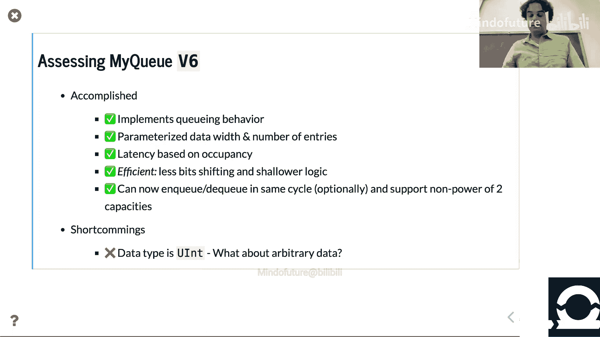

# 【加州大学】敏捷硬件设计-CSE228A-｜-Agile-Hardware-Design-Spring-2025-p18-P28_第13讲-队列设计案例研究--BV1M6ivBzESw_p18-

Hlow and welcome to Lecture 13 today of the fun lecture， we're going to do a case study。

We're going to do a couple of these in the this quarter。 So what I mean by that is we're going to。

Design is specific the component。And not to just show dynamic component。

 but showed this iterative process of building something really simple。

And then incrementally extending it， revising and improving it。

 And if it's not only on just examples of using chisel in practice， but also the process， right。

 how do we take this goal we have。Shrink it down its something manageable。

 get that first thing built， get that bootstrap and then build our way up from there So for the thing we going to be case9 today case study today。

It's going to be a， right， so these five boats we saw earlier。

St using a standard library version previously and of course。From here onwards。

 you should use the standard library version。 But today。

 we're gonna show how you might go about designing your own and the itative design process of getting there in by the time we're done。

 our end results actually be pretty similar to what's in standard library。

 We're gonna see how this really nice Po code did exist。 How is that ever written。

We're going to show how to get there incrementally。Doesn't come out nowhere。Okay， so you know。

 this entire course one of the main themes is designing for reuse， right。

 we want to build generators， we want to make reasonable code。

 alms a hunt for productivity right and so I think we're talking about how to design a queue and how do we iterly improve that queue。

So we can go ahead and fire up a notebook。So we were designing for reuse， right？

We need to kind of identify what do we think are use cases is for both the current problem as well。

Users we hope support and then figure out how to kind of do that。

 And so it's really about recognizing what is the not just the functionality。

 but the pattern functionality， me， you know， family of functionality is are very similar。

Hope that genuinely kind can support all of them， how do we recognize that pattern？

And how do we figure out okay for that pattern， What is the say parameterization， right。

 if there's parameters that really the user should need to figure about。

 we can figure out internally， we should figure out internally， right。

 and what's kind of the minimum we have to expose and how to actually support users what we need to do。

So。Like like I said， today's all about this process， right so what's the process？

We don't want to just spend you know waterfall style weeks and weeks of weeks to doing designs。

 weeks and weeks of weeks to do design reviews and then you know build it block by block and you know build each block independently。

 test each block independently， put them all together and help the whole thing works right that's not what we want to we want to do just know agile approach incremental right we're going to build something simple。

😡，It's could be somehow lacking。 It some be lacking functionalities mean lacking optimizations。

 You name it。 And we want to figure out a way to。Incremently kind of keep adding all what we need。

 right， It's like I said， whole Gophers course keep showing that logo right， close the loop。

 I get something working。For today it's going to be getting a simple design running in simulation against a test bench。

They're going to go ahead and keep， you know， tweaking it and we go ahead and change design。😡。

It may require a change at test bench too。And then try to keep repeating and keep extending。Um。

 and so like I said， kind of the key steps in this progressive design process， number one。

 how do I get started， what is the simplest thing I can build to get going？

And then how can I test it and then not just in the beginning， but also as it evolves right。

 it can be very hard if you have this entire project and you build it without testing and then someone else later on tells you make some tests。

 you're like what I can do it you see no。holehole integration test an entire thing running。

 but you know testing a module is kind of hard because there aren't really nice modules。

If you do testing for the entire lifetime。You will see how to change your multiple boundaries of such that it makes it easier to kind of test thesis individually and integrated。

😡，It's the thing even though I talked about the whole narrative of you know oh already do things progressive。

 we allt know for sure the right answer is we're going be kind of constantly evolving constantly adapting this because're constantly evolving constantly adapting doesn't mean there's not a plan and there shouldn't be a plan it just means you're able and willing to change along the way right so you know。

Charter roadmap， right？Here's my end goal I want to get to。

How do I get there from swimming simple and how do I get this progressive set of steps to get there kind of incrementally adding on a feature。

 incrementally adding on optimization， perhaps have more restrictedent level of testing and make sure that works to get there right and so this going to be thinking about interest for today but you'll also of course be doing this in your projects。

😡，嗯。So our good friend， the Q， also known as a FiIpo first and first out， right。

 So we covered this already in the course as an example of something using these decoupled interfaces。

 right， So these interfaces， even though we label a single arrow going one direction。

 we know internally， it's got， you know， within a decoupled has the bits。

 the actual payload as well as ready valid signals and between ready and valid with wires going opposite directions。

 so。😊，There's actually quite a few wires here。 And yeah， if you want to build a Q， of course。

 it has the NQ side where things come in， the DQ side where things come out。Tweet a producer。

 consumer。And so what， what our， what our dream， Our dream is gonna to be1 a Q。

Does the queuing properties？We want to parameterize both the depth of the queue and the data type。

 both of those seem like pretty necessary things to parameterize。

 those those like things we kind of can hide from the user。

And we may have certain know power performance area goals， in other words， efficiency。

So how can we take this， ambitious goal and make it something we can go start writing code for right away？

Well， let's think simple。How can we。Somehow， the first features to later and do simple stuff now。

 right， So maybe if having a parameterized Qd up， we can have a fixed queued up， right。

 Sam thing for data type， ratherin。Having arbitrary data types。 But if we fix the data type， okay。

And how about performance。 So what if we make it slow， but hopefully correct。

Or at least close to correct， then' kind of go from there。Okay， so how do you do that well。

Let's make a really， really simple cu。It's going to be a single entry queue， it only has one entry。

No parameter for that。But what is it gonna do It's gonna implement the interfaces， Right。

 Im this N Q and DQ， which are both these decoupled interfaces， which have， you know。

 both bits and the ready valid stuff。And so you can imagine if we're able to get this thing working。

We can build all stuff around it right， we can build you know test benches。

 expect all the stuff and as we improve this queuee。

Hopefully it's interfacecing going to stay the same， right。

 And so that's we can kind of reuse all that stuff we're building。

In terms of the exact details to make this as simple as possible or say， yeah， single entry。😡。

We're knocking that flow optimization so we can bypass the cube if it' empty， not going to do that。

 trying to get as simple as possible。We are going have one tiny thing for the pipe feature， Okay。

 if it's。啊。If it is full and we're both in community the same time， surery will allow us it is。

T it out the nation we could。You know the fur， but you'll see a second it's not so bad。

So here we are trying to draw as I would look like， and we can imagine， okay， well， we'll need。

 you know， summary through the whole the actual data。

It's an notice to kind of hold the notion that there， some metadata about how much。Did we have。

 right？And then really the kind of the。No， at the beginning is， of course。

 what logic goes near some conventional logic to figure out how to do to ready valid signaling both directions。

 that's kind of what we got to figure out。Okay， well， let's go ahead and code this up。So。

For today to get that reuse we're talking about in terms of。

Rg this once and continually reusing all the interfacing。I'm actually doing that with inheritance。

 So I'm coming to inheritance in the next lecture。 But for now， you can just kind of suffice to say。

Everything' is going to have the same IO pattern。 It's going to have the same number of。

N queued decoupled， deed decoupled。So even though it's writtenden like up here and then down here。

 it's the same thing。嗯。As you can see， for example， we have a depth of one。Okay。

We probably would try a bit because it's really easy， but that's not essential。

 But it was a key thing。 Okay， the data path， right。

 we have our entry for a single register and this full bit。 So we go back a slide。We can see yeah。

 there's a register。 there's our full bit。ど。Alright， then。We got a lot of things to connect that。

 right， Why don me trace the data pass first， right， So the DQ comes out to register， right。

 entry sure。😊，The NQ。Bits come into their entry， but only when it fires on incu。

 which kind of makes sense， firing on Yacu means both ready and valid or true。 In other words。

 we have space take something here and something legitimate coming in。Okay， that makes sense。

 But did we gotta， you know， handle all the arrows coming out or how do we do NQ dot ready or D Q dot valid well。

Thank you doready is either。If we're not full， that makes sense。 Okay， for're not full with space。

 sure。Or。If we're decoqueuing， if we know we're decoqueuing。

 because there's going to be space next cycle， that's that。Pepoli we were talking about， okay。

How about if the D Q is valid， Well， the DQ is valid if there's something in there， right。

 if it's full。Okay， cool。 and then。What's the remainder of stuff here。

 The remainder of stuff here is actually controlled that full bit， right， So you can see。

 for example， when we're dequeuing。And remember， in order to Dque for that fire to actually happen。

 that means ready and valid for DQ are true。So we're ready to be true as' something from external to this module。

But for Val to be true。That means full it' selfish is true， right， so。You know， remember this is。

 you know， the same as ready。啊。Ready。tdcu do ready。And i owe Dq。valad right， it's the same thing。

 right？So set D。Valid is already means this false。 So we， we need to un this thing。

 make it false because yeah， we're emitting it。 Now， notice that something comes in at the same time。

Morangga said full to true。So that pipe behavior we're talking about is implemented by this。

And because， you know， of the last right winning。La semantics。

 the second modification fall is going to win。You wrote this example and for today。

LikeSo the emphasis not just on the Chisli code itself， but also on the process， right。

 the process is。We made a really simple cue。 It's not technically the simplest we could have made a touch simpler。

 but it's pretty simple， right， S entry。Not very 50， not very parameterized。

 but it implement the interface。 It's ready validly on both sides。Okay， cool。

We got that and you know。Off screen， you know， you got the correctly implemented syntax Live。

Here is that Q model from before， which I'm not going to go in tons of detail。But yes， you know。

 we had all these various scenarios about how to work for model。

We've covered this in the prior lecture。And then we also have the ability to。

Take our model and plug your directly into a design， sure。And yeah。嗯。Cool， so then。Remember。

 when I was talking about testing， right talking about testing， we had to have both inputs。

 a notion of what's correct and a way to kind of plug all together。 And this is the。

Coastal nature technologyology you have in this course， right， we build a model。Prior slide。

We have the model integrate with design in this Sim cyclee function。

 And then we actually have a test， which in this case， the few cycles and。You know， it tries in Q 1。

 two， and three。While it's incuing the two， it's not decoing。

 there's no room and thus that two is lost because doesn't try again。

But this kind of shows this working， right？Okay。So questions so far。So yeah so面。

See how we even though we've a really a really simple module， it wasn't trivial， right。

 We still had to write up some test based hardes we to kind of think about this， right。

 to kind of think about from the beginning， Okay， well。What are I going to want to test this， Okay。

 and wants to start a test pan can kind of NQ and DQ。And we get it's interfaced right now。

 even though it's hard to get right， but try our best to get it close to right， at least。

 and then make the internal simple， but there's still a lot of other collateral we get to worry about。

Okay， so how did this do well？Itlics the human behavior， influenceity couple。 That's great。

We got a prayer I did it with if that was easy。To the that you know， getting you right。

 wasn't la well。Only one entry， so we want to have this actually be parameterized parameterized a depth。

So architecturally， how can we do that？We could build one those ship registers。 right。

 Remember the delay pipe we had earlier in this quarter。 Sure， we could have a ship register where。

know we parameterized the number of entries and we have these ship registers here for the data。

 perhaps we have a corresponding set of you full empty bits to track the if the entries are valid。

 sure。If yes， you can see us comes together， where just you know data path of these full bits going down。

 the entry is going down， and then some publisher logic we either implement actually you did ready valid signaling bas and all this。

Ill put loud parameters， you know， in green for you a number of entries。You can see， yeah。

 things come to one end and come on the other end。So this seems to be a step in the right direction。

 let's see you can encode it up。嗯。So，啊。Remember we was talking earlier about how we're using this inheritance to kind of hide。

Repeated code so。You don't see the I here because it comes from the inheritance。

 which' going gonna cover in the next lecture。 But for now， you can just see， sure。

 here's the body of our queue。 The IO is unchanged。 We have those entries。

 which is going be a sequence， you know， of non entries of the registers to hold。

Those bits of data pathway also the full bits。Okay。😊。

That's implementing with registering or chisel at the end of the day， iss just。

If the only thing is connecting things， right， So you're implementing bunch of registers。Okay。

 and then let's middle our pieces here。 Well， there's this notion of when we want to shift down。

We're about a logic in a second， but for now， let's say we are shifting down， what does that mean？

Well， for the entries， we kind of want to。Connect to the prior entry to kind of move things down。

Cool， so going back to the prior study of those， I had this like gray text for head and tail。

So in Sc， when you have collections， you know， things like Sik or even more general collections。

There's a notion of head and tail right so head is the very first element。

 tails the very last element， just make it clear how I'm choosing to map this to this design to put the head on the DQ side。

 so that means this is you know index zero this is index， you know n minus1。嗯。Cool， okay。

 so we can see with pieces fit together。And then in terms of like the actual endpoints of the casino。

Chiff register well？If we're shifting down。We're kind of in a way。

 putting a bubble in back the pipeline。 So it makes sense that the last full bit should be set the false。

 in words there's not a legitimate data there。Meanwhile。On the NQ side。Okay， yeah， if for' inqueuing。

 of course， we should be putting data in the last entry。And from working in the last century is true。

So what are the remaining parts here， Okay， well， we're ready to N queue。If either the。

Last century is not full， i。e。 it's empty。Or we're shifting down and north making a room， right？Okay。

😊，So。When we shift down， well， if we're dequeuing， sure， something's coming off the end of it。

Or if somehow， we encounter。An empty entry。Meaning， you know， we have somehow， you know。

 this is being marked as empty。We might as well this thing off so you kind of can move on to someone behind it。

 which hopefully is useful， right， so。Okay， that's the conditions for shifting down。

You can see of course we're ready when last entry is free and we're shifting down。

 the output is valid when。Simply just as laugh entryry has something。The bits， of course。

 is the last century。You guys has fist together， right， So is this is， I said。

 you couldn't write this in two minutes， but maybe， you know。

 half an hour and a little bit of trial and error could come together。嗯。Interestingly。

You can implement all of this。Effectively， not exactly the same。In two land functional programming。

Now， once again， we can always have this debate if we think this is an improvement or a step backwards。

嗯。In this case， remember in the original code we kind of had these four loops where we're kind of going through entries。

 we're doing that here with a fold right pattern where you know what we're doing is using the indexing here to kind of build a reach between I and I plus1 with the fold pattern here we're you know recording the last entry。

So that way when we get called it next time， we have the current entry in the last entry。

 how do get the last entry。A little bit sneaky here。 We are connecting the two of them together。

And then we're passing on this entry。With the fold as the result becomes the last entrygue next time gets called。

And so you haven't seen this all quarter。 This is a semicolon， right， you know， crazy world。

 But yeah， so the semicolon makes it clear that these are two separate statements。

 So this is a statement  one， which is。You know， due to connection statement two is simply just saying this entry and last thing there is going to be the things returned。

 so that's how we kind of get that pattern of the last entry。

We may notice how we had this notion of fold right。 And that's because。The DQ side is from zero。

 so we kind of want to connect up this way question。Yeah， that's a great question。

 so if we flip the order of these statements would this break， I think so。

No time we get present to find out， so of course it runs now。

I can show you the test case is's going to run。And now let's see if we break it。

What this boils down to is by changing the order of these statements。This of course。

 doesn't bleed you anything。This statement does the side effect and the question is。

 what is the return value of that line， if your return value is a entry。

 then perhaps that'll work just fine。So let's see what happens。

 I think it's gonna be maybe void or unit， I guess which case is the break。 Yeah， so it's unit。

 So connect statement has no return type。 a connect statement is just。A sideback intended statement。

kind of， you know， chisel andbbing a scholar philosophy of， you know。

 making it really clear what's what and so by having that connect operation not return anything。

And as you know breaking my notebooks， we can do that。 So yeah， I'm not to， you know。

 undo that change。 but yeah， good question to kind of get across that a key issue of。嗯。

What's going on here is we want this side effect。And we want this thing to be returned。

 And guys are using， you know， fold right rather and for each。 Yeah。

 we are trying to return something， right。 We are returning this。Reference to kind of passing around。

Yeah， so so so that's much after semicolon， but in any。Code block， whether it be a function。

 a class body， a if statement。Last line is the return。For that thing， right。 And so， yeah。

 in this case， we want to return disent so。We do that the return keyword actually does exist in Slet。

Rarely used， you haven't seen me use it。U， the advantage to return keyword rather than making the last line to function return something is that way you can return in the middle of the function。

Which， you know， sometimes that makes sense， sometimes you can structure your control logic such that。

 it's always the last line。Yes。😊，Oh， good question。 So sounds much a chile didn't declare the return。

 This is me using functional programming， right， So me using functional programming。

 trying to be slick。 Here I have an anonymous function。Right。

 my knowledge function is trying to be concise， right， I'm trying to do this。 I could do a full on。

You know， proper function， right， hey， death。You know， called here to connect and path， right。

 I don't know。And what will'll this take， this will take this entry。And last entry。Right。

Is going to return。啊 a。Youin't。Right。And then。Internally， we are going to。Do this， right。

And then I can， in theory。Replaceed his fingers crossed。You know what。

 I'm going to leave off return text because I might have gotten this text wrong。Oh， these don't have。

Types， that's on me。呃。Didn't break。So yeah， you can kind of see， right， you know？

If En functions ever look too gnarly。Stop， right， you can just。Write a regular function。

Or maybe the for's more clear， right？The goal is to have code is someone can kind of read through。😡。

and greatly understand what's going on someone to kind of spend two minutes kind of scratching their head and staring at it。

 scrolling up， scrolling back， getting help from their IDdeE。

 topping and pastcing in another window catch your T。

 what this code do that's not a good sign right good？Yes， exactly yeah， so the semicolon you know。

 when I use it down here is basically just putting us on two lines， correct？😡，That's why I was there。

Great question， yeah， thiss kind of fun of course to play around with Coe and see what happens。그。

So yeah， so。We've all in a version of our queue， right， it works to some extent of working。Um so u。

You know， we're able to kind of go too deep， sure。嗯。safe score， so simple plus queuing behavior。

And now it Pro has over ofvent， right， so that sounds pretty good， perhaps even done， right？

Not quite， so if we go ahead and analyze our Q， what do we see well？Performance is nothing。

 right particular。But for architecture， every entry to goes through the queue has to go through all of those registers。

 In other words， I can have an empty queue。The QTV empty has capacity for end registers。

 Gu what are you to come through there has to have at least an end cycle latency to get through。

And that's kind of silly。The it' empty Ly's high。 And as I said before， right， you can imagine。

 you know， maybe it gets filled up， maybe there's some bubbles and you put some more stuff in there。

 I try to drain the bubbles with things like， you know。Shift down。When， you know， last's empty。

I can't promise's perfect， right， This is maybe a little buggy。 So we assume。

 we have some concerns about how this thing handles bubbles and latency is not good。

 even in the best case， right， you imagine latency。

 the queue should be portion how full the queue is， right， not how big the queue is， period， yes。Yes。

So remember good question question is， why do you get bubbles in the middle so if I go back。

Imagine I in you something。And right now， it's all empty， I in you something。

So it's going to want to move that to the other end the queue。

And so it's going to keep putting in bubbles behind me as it goes down， yeah。Asynreous。

It's not as much because it's asynchronous synchronous。

 it's mores because even perfectly synchronous， the issue is yeah。

 data has to come in and go through all of the reries before you come out right and so it comes in。

And there data coming behind me。There's gonna to be bubble behind me immediately， right。

 and there's a bubble behind me。Does this logic you to write thing kind of squeezeing those bubbles out。

 right？U。So yeah， that's the concern。So we have， you know。

 these full empty bits tell us what's full or what' empty。嗯。But yeah， it's going to be， you know， oh。

 that's correct。So yeah， this queue， except said that bubbles could be long la to see。Okay。

 so you can kind of see where we're at though， right。

 we working hard to get a foothold with our V0 Q。Our V1 Q now has some of the parameters we're seeking It's just not as optimize or hoping。

 right， So we're going kind of keep incrementally going at this， figuring out。

What's it going to take to get optimization we want to get where we want to be？Okay。

 so these bubbles， well what if instead of putting everything in at the end？😡。

We put it into the first free slot。So if the queue is empty， heck。

 we can put the data right into the last century， so that way it's able to come out right away。

But if some of these are full， sure it'll put in the first free slot so that way。

 there'll be no bubble between that， there'll be continuous， you know。

 full data and then empty capacity and nothing in between， right？That sounds pretty cool。

 So how it would this look Well， we would still have a shift register because this queue is full。

And a data shift its way towards the end。But the key part is， you know。

 the data can come in anywhere where the free fl。 We won't put it in。

Particularly into the first free slot。How do we find the first three slot？

Prior to decoder we recovered that week ago， right， we actually point to work right。

 we want to find that first resource slot。Textbook， product encoder application， Go it。

 How the product encoder know what's available well。We have still have the full bits per entry。

So given know the trends are full or one are empty。

That goes in prior encoders can turn on the first one is free。

 and then the bits are going get routed to there。And like before。

 we got to no logic about how to do Read valid。Cool。Okay， so。D2 doing this。

 guess but data path is still largely the same， right still have。Are， you know。Registers。

Notice how before we had a C registers Now， it's a redge。 Sorry it's the be。 It's a redge of V。

 The reason why it's a beck is because we actually are going to want to in hardware。Dynaically index。

Which we're going to， right， So prouding carries we forth。 we really need to have that capability。

 Okay， so we have the that capability for both of these， cool。

And then we see some kind of interesting code。😊，So， for example， we have these registers indicating。

If it's one， that means the corresponding entry has legitimate data I。e it's full。

So for writing on his logic out， I thought gee， wouldn't be nice to be to say something is empty。

 so it's just the negation to that， right okay if something is not full is empty。😡，So how I do that。

 well， I could take the full bits and just basically mat them all to not symbol。😡，So once again。

 the functional programming extremely concise， right。

 So if you and your readers notice functional programming semantics。😊，This is probably。

More clear and more concise in doing it long way the thought over something。

So this is a case where I think it's a good good use。嗯。😊，So， for example。

How do I know if I'm ready to inCcu？Well， the question is， are there any empty slots？ And well。

 I could take the empty bits。And simply say， is any of them true， if any of thems true。

I can do reduce right， I can squ them all together， okay。Cool， how about if I'm writing to decue。

 well is that last entry？Full， right， Is it full， cool and that the， you know。

 the bits for the D cube shirt comes right off there。And then when it comes to， you know， decoqueing。

You know， if the DQ fires。What happened to our last entry。Is now empty。

And then I'm going to go ahead and shift everything down。So what is， you know， i plus1 now becomes I。

 right？And so you can see how， for example。This kind of plays out。

And so I'm shipping in the MTS at the end。everybody's kind of shifting down。 So， you know。

 using these paths here to shut everything down。My initial notation uses a for loop， like I said。

 make it simple， get it right the first time。And then。I didn't even bother in this case。

 trying to use a fold right pattern to do this again。

 but you can imagine trying a function program if you really want to。

And then for the NQ on the other end。Now I'm to put a priority encounterter to work。

So give our priority decor， the empty bit， we want to find the lowest index empty location to the current free index。

And then that's where we're going to write to。 And then the entry at the right index。

 we're going to go ahead and put the bits in there and mark it true。This mugs is actually。

A fun little detail so。You think the Pri photo tells you you go back a slide。Ier encoder says， hey。

 this one's free， I should write here， right？啊。That's close to range。If I'm if this is not shifting。

 yes， I should write here。If this thing is also simultaneously shifting down while I'm in queuing。

 that free slot's moving down one。So I need to subtract one from it。 So this is kind of a subtle bug。

 but it was found， actually。By one to lectures you're going to see in a few weeks。Kevinevin Laford。

 who's going to talk about verification。 And yeah， he ran some verification on on these codes and found a away way。

 there's a subtle bug here。 And this is kind of fun that we obviously know we can point to。😊，嗯。

And so yeah， so this is a subtle issue where if we're decoqueing， everything's shift down。

We subtract one from free index。 Otherwise， it is the right index。 It's not shifting。

 It's not moving。ho。Questions。Okay。Go ahead， make sure。Yeah， and then we go ahead and test it。Yeah。

 it works， you know， we're not doing super rigorous these test matcheses today， but。

You can kind of see， yeah， we're inqueuing， dequeuing， things are happening。嗯。How do we do Well。

 it put screen behavior before， which Ive data with no entriesies like before cool。

Keep thing about the whole use priority encoder， right。

 the lamey that gets through to queue depends on the occupancy， right， in other words。

If the queue is empty， I can get through this queue really fast。 If the queue is full。

 it takes me time to get through it， but that's's that's fundamental。

 It's kind of hard to avoid that。 It's better than our Q V1， which latency was always long。

 even though it' empty。So what do we don't like about this queue？啊。As written right now。

We can't use that pipe feature。 We can't simultaneously N Q and D Q into a full queue。

 There's somech。 If there's some free space。 Yes， you saw us coaching before。

 we can N Q and D Q simultaneously， but the Q is completely full。

When that pipe equals true feature is only enabled， right， we can in queue DQ in a full queue。

We can't right now。How about power？We haven't talked a lot about that in this course。

 but you go back to that design。Think about the thing， right， We have all registers。

 And if it's close to full。Day has been ridden here and working its way through here。

A lot of bits taught me， a lot of recycle， a lot of bits changing。So a lot of power consumed。

 The question is， can we figure out a way to have fewer bits of fewer wires toggled？

And then with have a critical path， you can imagine if this queue is only no two or four deep。

This product encode is pretty simple。Remember from before right。

 we even't been the proing coaches they do with， you know， the Muxes or what those and dates。

If theyre having a two or four entry queue with a 512 entry queue。That's a disaster right。

 a 511 input endgate obviously catules will break up in the by size pieces are two and three input end gates。

 but it's going to be a very deep tree for just one of those terms right that priority occurs going a real critical path in a hurry for high number of entries that's not going to be very scalable。

But hey， this is why it's good to do agile process， right， It turns out maybe if you're a team。

You plug this module into your entire design， just another two you work in other parts of your entire design and to say。

 you know what？😡，It's not the critical path， so we don't care。 We only need to be four entries。

 It's not the critical path。 Great， you can stop here。But maybe say you know what 。

 120 entries and you put it through tools and tools tell you， yeah， 120 entries。

 that is definitely the empirical path。Or we put it through the tools and it says， you know what。

 this thing burn up more power than we would like， can you bring that power down？

So now that you know you need to do this， you can go ahead and figure out how can we solve those issues。

 how can you solve this critical path， how can solve the power issue and this other ones a small detail about you know。

 how can we sound answer Q and DQ and a full Q。Okay。So one a D might have is a what if instead of。

 you know， having to shift or just through it rather than moving。Where I'm moving data。

 always having a single exit point， what if I can put data into and out of acute arbitrary locations。

 but to keep things the data doesn't move right in order to save power。

We're going to write the data once and leave it there until it leaves。That's the key idea， right。

 So we're going gonna change where we insert where we remove， right。

 And theres where we in queue where we D queue， But data doesn's not gonna move。

 They doesn't come in once to be rid。 It's good chill until tell it's time to release。

And so how does that work well？This is a classic things throughout systems and hardware called a circular buffer。

In other words， take a 1D array。With two pointers。And we keep track of things。

They put thequeing behavior。It does what we want， right the whole point of the queue is first and first out as long as we have that same order。

We can do in various ways。 And so。But if way of doing it。So we want to de you something。 well。

 whatever the out pointer points to。We take that element， and then we add one to the out pointer。

Meanwhile， if we want to en you something， we put it or the end pointer points and we add one to the inpointer right so you can see how either way these pointers in and out。

😡，Keep having one thing add on them whenever these operations happen， whether it be N Q or DQ。

 And they， you know， grow At some point， So a secret portion comes in， they need to wrap around。

 right， So this is， you know。Whatever this Q size is， whatever you'res going to be adding you know。

 plus one mod， the Q size。If the Q size a power tube， this might work out naturally for you。

 but if it's not a power tube going to be in lot operation， they're to kind of get wrap around。

Or at least the comparison in a number function， right， so when get to the end， you're wrap around。

So okay， that seems like a pretty cool idea。😡，How do I know。If it's empty or full， right， like if I。

 how would I know right， how do I know that what I would is point to is legitimate data。

 how do I know that what I'm trying to write in is empty as opposed to pull something？Well， for now。

 let's make it simple say。If both to in and out are equal。

 the Q is empty right if in and out players point to same location。Nothing's there if。

We get a situation where n plus one。😡，Equals out。Re call thatful。

So you might be saying wait a second， if input1 equals out would not mean we're losing one entry。

 yes， yes， we're losing one entry。The F app， we'll come back to that later。 But for now， yes。

 we'd be losing one entry。 But， hey， we're getting a foothold。

 This new idea we're building a circular buffer。As the kind of thing like said。

 the Ser buffer idea pans out， you know， you implement this new approach。

 hopefully you see reduction in a critical path， hopefully you see reduction in power consumption。

If that's encouraging， then you need a motivation to go forward and figure out this issue about using up that last entry right and maybe the last entry doesn't matter。

 maybe have 120 entries。Losing one entry， you don't sweat， That's fine。 But if you have always。

 you know， handful entries， maybe you care。 So like I said。

To what extent you can defer the heavy lifting until you know you need to do it， right？嗯。😊，Cool。

 so how does this come together？啊。The entries themselves for the circular buffer it's going to be。

 you know， a V of wdge and needs to be a vector because we're indexing into it dynamically。

For those indices， those are going to be registers as well。 there's going to be no number， right。

 an index， right what？Indexed into this V is it going to be there。

 so we have both an NQ index and DQ index。And you see the logic I just told you about from the prior slide。

 right， we're going to have。It's empty when the two inices are the same。

And we're going to say it's full one in Q index plus 1 equals DQ index。

They may notice I didn't want do to rap。The way I'm doing the rap for now for simplicity and this is requiring number entries to be a power or two。

Because it's the power of two， of course， with binaryertic and you had one。Oh man wrap around for us。

This is an example of once again of a way to make a sim to get started， right。

 this rap logic can obviously be solved in the future， but I'm not going to worry about it for now。😡。

Making reconstructionion， right？Hey， if you know， power to look over the large range， right so？

You know maybe the final design is gonna to want be a 40 entries。 Okay well。

 if I can push 32 and 64 through the tools， that is still give me a good sense of where I'll be on track for for 40 right And so look for opportunities to have s to get started。

 get things working and then incrementally take these small steps at the time right and so you can imagine going from a power tune of entries to a non- power tune of entries that's going to part and change to the logic。

 but that's a much smaller challenge and try and do it all the first go right take these baby steps going incremental。

😡，嗯。Cool， okay， so now we have this condition of empty in full。How hope popite thinks well。

 array N Q if we're not full， right， array the D Q， if we're not empty。That was valid。

 Dq is valid If we're not empty。 That's pretty simple。 How about the bits。 So how do we write things。

 Well， for DQ， we simply just read from the DQ index， cool。Of course， if we're dequeuing。

 we add one to DQ index， like I said before， because。Per team ofventries。

 This does the rap force automatically。And what about incuing？While we in queue at the Icu index。

 that's pretty simple。 And we also。Do that， right。Technically， I could pull this。

Into this one segment for symmetry， maybe makes them little happier to symmetry。 but really。

 it is not really a risk and leaving it outside， right， Like reading a register is not damaging it。

 right， The reason why for NQ have to do this is we don't want to， you。

 change the content of entries unless we're for sure doing it right。 But this read， of course。

 over here is nondestructive。 So we can leave on the outside for simplicity。 But yeah。

 if a person who wants the symmetry， you can poly it in there and see the cost for the hardware。

 And I think it's not much more。Co。Questions。So， you can imagine。Where we started from， right。

 we started with single entry queue。Went to a shift register？S from a priority encoder。

And now also'll circle buffer。 So you can see our micro architecture keeps changing， right。

 but the big picture is not changing。 big a picture of implementing a queue。

Whatever interface interface looked like that's not changing， we're able to reuse those test benches。

 The rest of our teammates working on other projects part of a larger design can still interface with our module。

 still push us through the tools and still see things， right。

And that's kind of the point right we're not just you know this gaping hole design until' done。

 all of a sudden it's supposed to be done and perfect。

 they have something right and we're trying to keep improving the thing that you know hopefully can be smaller。

 more efficient， you name it。And it's a kind of agile incremental process at work， right？Cool。

So yeah， go ahead and try it out， sure， it works， he does queuing stuff。嗯。So take score again。

It's a cube， right？Kryin of try to stay it with in number entries like before。

Like the priority code based one， believe he's based Nogamcy， that's really good。

But unlike product Q1 RV2， it's more efficient， right， there's less bits toggling right。

 we simply just write the data once and it stays put until we pull it back out。

And in general those indices right， those a you know logways to number of entries right those are not very big counters are kind of changing around。

So there's a lot more efficient for that。 Also the logic shallow， right。

 remember before for the priority encoder as we had more entries。

 that priority encoder gets bigger and bigger and bigger， right in this case。

 when we get more entries。😊，That you know a V of registrs gets bigger， sure。

And the counters get a little bit bigger， but they grow logarithmically right， it's not that bad。

What are shortcomings well。We have a few of them right and these are kind of subtle performance details and you can see that yeah we can go ahead and fix these and perhaps depending on the needs the entire project team。

 either we do or't need to worry about these， right？😡，So for example， for detecting if we're full。

 we kind of have that plus one condition we're talking about that kind of causes the sacrifice。

1 entries。 So we have， you know， n entries。 We actually only can use n minus- one of them。

 So we're losing one entry。Maybe that's not a problem， maybe it this。

dependepending on your usage case or we also this constraint I for simplicity ofvent needs to be power of two I did that and due to rapping force automatically you can imagine。

😡，I could do that， remove that constraint， and then do driving more gracefully。

And then performance wise， you know？Like the prior one， right， if the Q is full。

 I can't sound see N Q and D Q。 We imagine that's possible when Pi is true， that's the goal。

 But like as it is right now， it doesn't quite have that functionality。

 It's a good thing then go ahead address， right。So。How do we reclaim that last entry first？

We need to differentiate a case when it's full and empty。Like I said。

 if you have the indices point the same location。Het know if this pole are empty。Well。

 that's a subtle of information。 Why don't we just add a single bit of state called maybe full the capative corner case。

 right， you can see， okay， it's in either either equal and maybe full is true。Reple。

If industries are equal and maybe full is false， aree not maybe full。We know we're empty。

And indriciceencies aren't equal。あ。We could be full。''re not full or we're not empty。

 We're somewhere in the middle， right， And that point。

 we don't even need to look at them maybe full bits。 I didn't bother a writing in that line because。

We don't need deck to look at it So really what matters is only when this these are equal。

 really let fold and differentiate between full and empty。😡，Okay， so given that goal。

Did the code from before and now it was maybe false as another。Then to register。

 And you can see that loty told you about a second ago。 right。

 we're empty when indices are equal and maybe full is false。

 We are full when the indices are equal and maybe full is true。

And this other stuff's kind of unchanged。However， we have to add some logic to control this maybe full bit。

Okay， so what this logic， well， when we're decoqueing？And。The indiceities aren't equal。

We're just going to say。Nly full false。Meanwhile， if we're inqueuing。InIndices will become equal。

 So you can see， for example， right here， inQ index。It's going to be inQ index plus one。

 but of course it's a register。 so that value is available to the next cycle。

 So the new value of inQ index， if that's an equal DQ index that tell us we're going to have these key things be equal。

 And because we're going from not full to not adding one and becoming full。

 we're going remember that maybe be full。Like I said。

 this logic may not be trivial to get right the first time。

 this is part of why we want to do a babysit at a time， yes。Yeah。Yeah， I mean， so yes。

 from Mc corner put this out the description of an alternative way of how to resolve this full empty issue for cues in other digital design course in 125。

I don't know if people little side by heart， there's also the way to assign these cues。

When it comes down to it， right？There's the high level performance metrics。

 which is are able to use a ball of entries and that kind of stuff。

 Whether we have 1 bit extra or 2 B extra， that's immaterial。 right， What matters more is。あ。

Can I get the logic correct， is it correct in all the Qua cases I care about？Um。

 I think the solution you're describing， I can't imagine that having。

A worst critical path to what I'm describing here， so I think it's the least comparable。嗯。😊。

I don't know if this one is faster or slower people pathwaywise， but。These these。

 these auxiliary bits， these are kind of， you know， probably not Googlepath group path probably is。

The wide bus coming in going to the registers anyways。

But it's a good question I'd love to see that lecture I can track down Profesor Richmond ask him how he doesn't。

Cool。So yeah， we can go ahead and let me run it。It's now able to。We claimed that last entry。

 we had four entries and we can use all four。So yeahあ。

Less bit shifting and we can now use all of them。그거？What are we missing？Capacitity to be powered to。

Can sound the Nq and DQ to a4 Q， okay？Let's keep going after it。

 so let's do the simultaneous NQ DQ one full。嗯。So what does that require？It requires us。

Making this change right here。 So if we remember before。

 it was simply red N Q if we were not full and if we were full， it would not less N Q。

Now I're saying， you know what？We are totally ready to。Thank you。If we're not full， sure。Or。

 you know， if we。Are our full， I。e。 not not full。Then if or comes into play， right？If a DQ is ready。

So it's actually not too crazy， right， Okay， so why we not do this in the beginning。 Well。

 as you've seen this note， I'm warning you。Then now there's a path from Dq。ready。

All the way back to Nq。ready so our Dq。ready comes into our module， NQ。

ready is an output from our module， So now we have a path going through like that and depending on how the rest of your topology of your design is。

😡，This could also combination a loop， which is why pipe is not， you know。

 always on for Eq and as a feature turned it on or off。

We can imagine we do something similar we could have a pipe parameter and we could decide， you know。

 I shall do this right now， you know。是。Oh。U hype。It's going to be， you know。Boan， right？

And like we saw in the homework， right， you can imagine， you know， if pipe。We're going to do this。

 right？Otherwise。You're gonna do。Just that， right？So you can see how this is the kind of power hardware generator。

 right where？We canvol the scala mixed into our chisel。We can have this pretty cool prioritization。

 right， where's kind of fundamentally changes this cute， right， where does have this extra path。

 but it comes with the efficiency benefit or does it not have it， right， And we can。😊。

We can kind of easily do that。But yeah， so in general， this wasn't。The most。

Inveible changes to do what we described to have。The ability to in queue into a full queue if were de queue at the same time。

啊 so yeah。Here we have it only a2 entry queue， you can see us kind of putting things in and putting things out at the same time。

Foy happy。Cool， so you can see piece by piece， making this cubee better and better。 And you see how。

 you know， at these3， we already had something pretty close to the final product Arrguably D2 made been sufficient depending on our use case right and so。

😊，You know， keep evaluating， keep assessing and deciding what is needed。

 right if you look at your entire design listlistically。

 so you know what right now this Q is not consuming too much areas，'s not consuming too much timing。

😡，We have bigger fish of fries， a design team which is working on another project instead do that right this slide don't go 100 until you know you need to right？

嗯。So how do we do， Well， we can now NQ and DQ in the same cycle。All those other things are good。

 we've been doing great。What are the？Downside， well our fixing the last slide add this loop essentially in there。

 That's not great。 Also the capacity is be power too。

 So let if we go ahead and fix some of these let's fix the capacity or we're gonna to do both at the same time。

 So how are we tiedy this up well。Like I just showed you， right， we could write。This behavior， right。

 of pipe。Like that， so that way， the combinational path is there or not there depending on what we need。

Okay。What else happened here？I change these indB counters。So here they were acting like counters。

 right， we basically were adding one to them， nodding one to all time and adding one to them certain in cases。

And we want them to wrap around。 So guess what。 If we just use the counter concept， we get all that。

 right， The counter can take a number of entries。And we can tell a counter， hey。

I want that counter to increase by1 do ink Berment。

m notice how I don't have to have any logic in here。

About being wrapped around because the counter does it on its own， right。

 because gets the maximum value and you tell it increment。

 that counter module already exists is going to do that for us， right， And so yeah。

 this is a better design， right， we are。Putting less complexity into our design by leveraging。

Existing tested abstractions， right， And this counter abstraction makes sense。

 Some readiness rather than having to kind of。Figure out what's going on like， oh wait。

 So's still declared to register it value zero。And has， you know， certain math about how big it is。

 And then I see them adding one to it。 And， oh， wait， there's this details of power2。

 how does the wrap around。It's a lot of constant figure out when you're reading it right versus using a counter。

系。number of entries， someone knows counter is going to be increasing and then wrapping around。

That kind of all comes together， right， see a lot of this code gets simpler down here。

Well other thing that kind of comes up， which is maybe not immediately obvious。Is it？

Dimification for maybe full， which I would say is not obvious when you first look at it， but。

What are we saying， Okay， if I have a situation where the fact I'm firing on both sides is different。

 other words， I'm incuuing， but not decoqueuing or I'm decoqueing， but not incuuing。

What does that mean？that means the number of elements that are active in my queue is changing right。

 if I'm firing the same time on both sides or I'm not firing on both sides。

 number of active elements is unchanged， However， if I'm you know firing queue but not dequeing。

That means the occupancyumcy is going up by one， if I'm decoing， but not incuuing。

 it means occupancyccumC is going down by one。😡，So this cleverness as it recognize wait a second。

 I can just compare to these situations。And I can mark maybe full to be the case one I'm incuuing。

 So other words， I'm incuuing， but not decoqueing。That means increasing the capacity utilized， right？

I can marked be full to be true。 Does't mean we actually are full。

 Were saying maybe full is marked as true。 And if eventually you know， Nq index equals Dq index。

It's gonna be Marcus full。 I chose to。Bring us up more at the code and make。

 you know N equal to kind of show the logic reasoning here。嗯。This replacement of habits of having。

To equal test here versus having this individual signal there。

 That's not gonna have any noticeable change in the hardware。 not because it's small。

 but because it's called some common expression elimination tools not just fine。

 They will figured it out on their own。 They will， they will figured it out。 But I did as a human。

 I did a common expression elimination manually， because maybe makes them more clear the intent。

 right， We're saying， hey， the key thing is these inices are equal。

By labeling this comparison and using that label of someone reading this can perhaps better understand what's going on here。

Cool， questions。I can go ahead and run it。Um， so yeah， notice how because the reason count。

 for example， like does the rapidping forest， we no longer need to worry about power two。I also。

Sub under a rug， used a mem。Graed than a V of Rudge， right， which Ru a V of fair。Which， you know。

 mem can handle a lot of these cases pretty well pretty much of the time。If you need motor registers。

 Mam is great， remember Mam is not the same as a SRAM。Sychronous3 would be a sync read me， Right。

 So Mem just by itself is collecting series and bookss attached to them。

Memwork's great for a lot of things the time when you need to use a V of redch Ra or they should say red a V router than the mem is when you want to do like global inciion and all it one。

 you want to do like， you know， a rech in it。Then you'd use the red but like but if you're not use the mountain。

 so the mans tiier， I can just say， hey。Our entry is sp with。Does that for us。Cool。So yeah。

 it worked。How are we doing？So queuing behavior， paratris， la based knocking see， it's efficient。

 not maybe but shuffling。Canal and Q and DQ in the same cycle optionally depending what what to do and support a non power tumor over capacities that's pretty spiffy so what are we missing？

Oh how we flow？No， I'm not so a question especially is if you want to add that flow parameter we ability to bypass the empty queue。

 what would that look like good question let's take look at the code。

So it would be some sort of logic based on。Recognizing we're empty， right？

We're not going to be modifying the counters， right。

 because we're not writing to the actual queue or bypassing a queue。

 So you can imagine itd be some sort of。Uh， you know， mu here， perhaps， you know。On the DQ bits。

 right， It's either the DQ index。Uh，Or， you know， not orbit must。

In the case we're doing the flow where the queue is empty and someone's incuing andqueing the same time。

 So in other words。You know， if both sides are firing， so not I did DQ fire us。

Let's try write it out。So if we're a situation where。Both sides are firing。Right， and。We empty。Great。

So that's kind of the key condition。So both sides are firing and we empty。Then， I'm going to。

Want to have the Iioa Dcu bits。Equal iio dot NQ。Dot bits， right。

And then you can imagine some ready valid stuff as well。Yeah， yeah， you're right。

 so I would probably。日是。So great question。 I think I would cheat。And doith。Great。

And not shown is the ability to turn flow on and off， right， so if flow is true or if flow is false。

You would have some other structures to this code。U。😊，So you can see how I said， this Q abstraction。

 right？😡，Pretty simple， but。There's these different combinations is it got to be code to support all this there is some plex to these generators。

 but the goal is to do it incrementally right rather than doing it all at once。

 it's hard to figure it out from the beginning。😡，Add these features on piece by piece step by step。

所以呃。Basically， what's the only thing we're missing so far based on our criteria put out。Da type。

 it's a UN arbitrary with but。Needs to be it。 What if I want S， if I want something else。

We'll cover that in the next lecture so that one's not me solve boom， we did it。

 we built a pretty spiffy queue and got there， you know， on a long road。

 but it was an efficient road to get there that way right where stry queue really simple right that we didn't ship register but had a lot of issues。

😡，Priority encoder， fix some of those issues and then went a sugar buffer and even went had sugar buffer。

 which was a lot better。Kind of getting all those corner cases worked out and those other details took some time。

That incremental improvements kind of keep point had a roadmap where you wanted to get there。

With incremental improvement， you also， of course， can stop at any point if the results are satisfactory。

 right， you don't need to keep optimizing。If you don't need to。Cool， any other questions？

Great。😊。