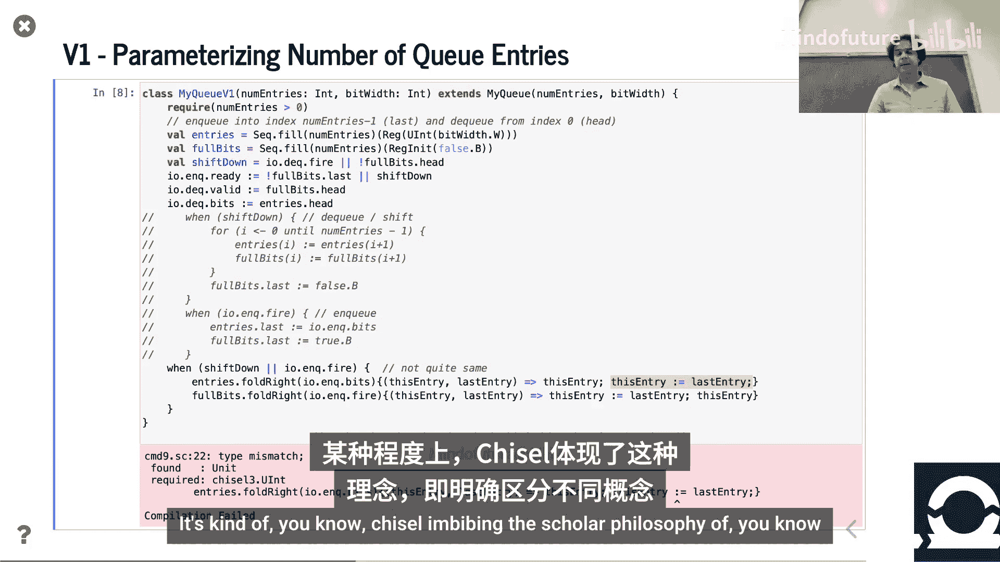
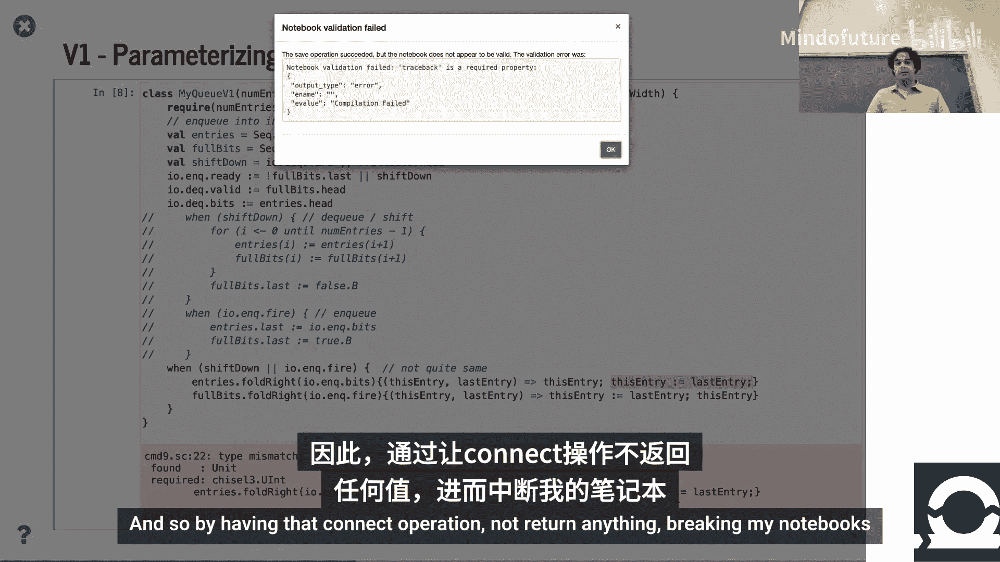
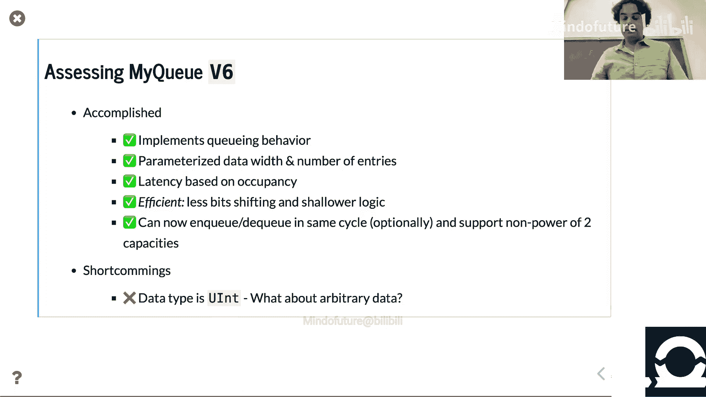

# 敏捷硬件设计：CSE228A：第13讲 - 队列设计案例研究 🧠

在本节课中，我们将通过一个具体的案例研究——设计一个队列（FIFO）——来学习敏捷硬件设计流程。我们将从一个极其简单的版本开始，然后通过迭代的方式逐步添加功能、优化性能并完善设计。在这个过程中，你将看到如何将宏大的目标分解为可管理的步骤，如何构建和复用测试环境，以及如何最终得到一个功能强大且高效的硬件生成器。

---

## 概述 📋

队列（FIFO）是数字系统中常见的组件，用于缓冲数据。我们的目标是设计一个参数化的队列，支持任意深度和数据类型，并追求高性能和低功耗。我们将遵循敏捷开发原则，从一个最简单的单入口队列开始，逐步迭代，最终实现一个功能完备、接近标准库实现的队列。

上一节我们介绍了敏捷设计的核心理念，本节中我们来看看如何将这些理念应用到一个具体的硬件组件设计中。

---

## 设计流程：从简单开始 🚀

敏捷设计流程的关键在于快速启动。我们不应试图一次性构建完美的最终产品，而是先构建一个能工作的、最简单的版本。

我们的第一步是设计一个最简单的队列。为了降低初始复杂度，我们做出以下简化：
*   **固定深度**：先实现一个单入口队列，不考虑参数化深度。
*   **固定数据类型**：先使用简单的位宽（如`UInt`），不考虑泛型数据类型。
*   **简化性能**：先实现正确但可能非最优的逻辑，暂不考虑流水线（pipe）或旁路（flow）等优化。

这个最简单的队列将实现标准的解耦接口（`DecoupledIO`），包含入队（`enq`）和出队（`deq`）两端。其核心是一个数据寄存器（`entry`）和一个表示队列是否已满的标志位（`full`）。

以下是其控制逻辑的公式描述：
*   **入队就绪**：`io.enq.ready := !full || io.deq.fire` （队列未满，或正在出队以腾出空间）。
*   **出队有效**：`io.deq.valid := full` （队列有数据时才可出队）。
*   **数据路径**：
    *   入队时：`entry := io.enq.bits` （当`io.enq.fire`为真时写入）。
    *   出队时：`io.deq.bits := entry` （直接连接到输出）。
*   **状态更新**：
    *   当`io.deq.fire`为真时，`full := false`（数据被取出）。
    *   当`io.enq.fire`为真时，`full := true`（数据被存入）。
    *   若两者同时为真（即队列满时同时进行入队和出队），则`full`保持为`true`（实现管道行为）。

通过这个简单设计，我们快速建立了一个可工作的、接口正确的模块，为后续迭代奠定了基础。

---

## 构建测试环境与复用 🔧

在迭代过程中，保持接口稳定至关重要，这样我们才能复用测试平台和其他依赖此模块的代码。

我们为队列构建了一个参考模型（`QueueModel`），它能在仿真中预测队列的正确行为。然后，我们创建一个测试平台，将我们的设计（DUT）与这个模型连接起来，在同一个仿真中比较两者的输出。

以下是连接设计与模型的代码框架：
```scala
// 这是一个简化的示意代码
val dut = Module(new SimpleQueue) // 我们的设计
val model = Module(new QueueModel) // 参考模型





// 将相同的输入同时提供给设计和模型
dut.io.enq <> model.io.enqSource
model.io.deqSink <> dut.io.deq

// 在仿真中，比较 model 的内部状态或输出与 dut 的行为是否一致
```
通过这种方式，我们可以在每次设计迭代后快速验证功能的正确性，而无需重写复杂的测试激励。

上一节我们建立了基本的队列和测试框架，本节中我们来看看如何扩展队列的深度。

---

## 迭代一：参数化深度（移位寄存器方案） 🔄

第一个主要的迭代目标是支持参数化的队列深度。一个直观的想法是使用移位寄存器（Shift Register）。

**架构描述**：
我们使用一个寄存器数组（`entries`）来存储数据，并用一个对应的布尔数组（`fullBits`）来跟踪每个位置是否存有有效数据。数据从入队端（尾部）进入，逐步向出队端（头部）移动。

以下是该方案的关键逻辑：
*   **移位条件**：当进行出队操作（`io.deq.fire`）时，或者当检测到队列中间有空位（`fullBits(i)`为假）时，数据需要向前移动以压缩气泡。
*   **入队位置**：数据总是写入`entries`数组的最后一个位置（`entries(n-1)`）。
*   **接口信号**：
    *   `io.enq.ready := !fullBits.last` （最后一个位置为空即可入队）。
    *   `io.deq.valid := fullBits.head` （第一个位置有效即可出队）。
    *   `io.deq.bits := entries.head`

**存在的问题**：
此方案的主要问题是延迟固定且与队列深度成正比。即使队列为空，新数据也需要经过N个周期才能到达输出端，并且队列内部容易产生“气泡”，导致性能不佳。

---

## 迭代二：优化延迟（优先级编码器方案） ⚡

为了解决固定延迟的问题，我们需要优化数据插入策略。目标是让新数据能够插入到第一个可用的空位，从而最小化输出延迟。

**架构描述**：
我们仍然使用寄存器数组（`entries`）和有效位数组（`fullBits`）。但入队逻辑发生了改变：
*   我们使用一个**优先级编码器**（Priority Encoder）来查找`fullBits`中第一个为假（即空）的位置。
*   新数据直接写入这个找到的空位，而不是固定写入末尾。

以下是该方案的核心改进代码逻辑：
```scala
// 找到第一个空位的索引
val freeIdx = PriorityEncoder(fullBits.map(!_))

// 入队时，将数据写入 freeIdx 指向的位置
when(io.enq.fire) {
  entries(freeIdx) := io.enq.bits
  fullBits(freeIdx) := true.B
}
// 出队时，从头部取出数据，并清除对应有效位
when(io.deq.fire) {
  fullBits.head := false.B
  // 需要将后续所有有效数据向前移动一位以填充空出的头部
  // ... 实现数据前移的逻辑 ...
}
```
**优点与缺点**：
*   **优点**：延迟现在与队列的占用率相关，而非固定深度。空队列的延迟很低。
*   **缺点**：
    1.  优先级编码器和数据前移逻辑在队列深度较大时会产生较长的关键路径。
    2.  功耗较高，因为数据需要在寄存器间频繁移动。
    3.  仍然不支持在队列满时同时进行入队和出队（pipe特性）。

---

## 迭代三：提升效率（环形缓冲区方案） 🎯

为了降低功耗和关键路径延迟，我们采用一种更高效的架构：环形缓冲区（Circular Buffer），也称为循环队列。

**核心思想**：
数据被写入寄存器后便保持不动，直到被读出。我们使用两个指针（索引）来跟踪下一个要写入的位置（`enqPtr`）和下一个要读出的位置（`deqPtr`）。

**初始简化版逻辑**：
*   **空/满判断（简化版，浪费一个条目）**：
    *   空：`enqPtr === deqPtr`
    *   满：`enqPtr + 1 === deqPtr` （这导致实际可用深度为 N-1）
*   **操作**：
    *   入队：写入`entries(enqPtr)`，然后`enqPtr := enqPtr + 1`
    *   出队：读出`entries(deqPtr)`，然后`deqPtr := deqPtr + 1`
*   通过将深度限制为2的幂，`+1`后的环绕（wrap-around）可以自动通过位溢出实现。

**优点**：
*   **低功耗**：数据只写入和读出时变化，中间不移动。
*   **低延迟逻辑**：指针比较和加减法的逻辑路径很短，且随深度对数增长，可扩展性好。

---

## 迭代四：完善功能（解决遗留问题） 🛠️

我们的环形缓冲区方案还有几个待解决的问题：1) 浪费一个条目；2) 深度需为2的幂；3) 不支持满队列下的同时出入队（pipe）。

以下是逐步的解决方案：

**1. 解决条目浪费问题**
引入一个额外的状态位`maybeFull`来区分指针相等时是“空”还是“满”。
*   空：`(enqPtr === deqPtr) && !maybeFull`
*   满：`(enqPtr === deqPtr) && maybeFull`
*   `maybeFull`的更新逻辑：当入队而不出队时置为`true`，当出队而不入队时置为`false`。

**2. 支持任意深度**
使用Chisel的`Counter`对象来管理指针，它可以自动处理任意最大值的环绕，无需我们手动实现取模运算。
```scala
val enqPtr = Counter(numEntries)
val deqPtr = Counter(numEntries)
when(io.enq.fire) { enqPtr.inc() }
when(io.deq.fire) { deqPtr.inc() }
```

**3. 支持Pipe特性**
修改`io.enq.ready`的逻辑，使其在队列满时，如果同时能出队（`io.deq.ready`为真），也允许入队。
```scala
val pipe = true.B // 可作为参数
io.enq.ready := (enqPtr =/= deqPtr) || !maybeFull || (pipe && io.deq.ready)
```
这引入了一个从`io.deq.ready`到`io.enq.ready`的组合路径，因此需要将其作为可选特性（通过参数`pipe`控制）。

**4. 支持Flow特性（旁路）**
Flow特性允许当队列为空时，入队的数据可以直接旁路到出队端，实现零延迟。其逻辑是：如果队列为空且入队和出队同时发生，则出队数据直接来自入队端口。
```scala
val flow = true.B // 可作为参数
val empty = (enqPtr === deqPtr) && !maybeFull
val bypass = flow && empty && io.enq.fire && io.deq.ready

when(bypass) {
  io.deq.bits := io.enq.bits
  // 注意：这种情况下不更新指针和 maybeFull
}.otherwise {
  io.deq.bits := entries(deqPtr.value)
  // ... 原有的指针更新逻辑 ...
}
```

---

## 总结 🎉

本节课中我们一起学习了通过迭代式、敏捷的方法来设计一个复杂的硬件组件——队列。

我们从一个功能正确但极其简单的单入口队列开始，逐步经历了以下迭代：
1.  **建立基础**：实现了解耦接口和基本队列行为。
2.  **参数化深度**：采用移位寄存器方案，但发现了性能问题。
3.  **优化延迟**：采用优先级编码器方案，根据占用率决定延迟，但存在面积和功耗开销。
4.  **提升效率**：转向环形缓冲区方案，大幅降低功耗和逻辑深度。
5.  **完善功能**：通过添加状态位、使用计数器、条件化组合路径，最终解决了条目浪费、深度限制、pipe和flow特性支持等问题。

整个过程中，我们始终坚持：
*   **接口稳定**：确保每次迭代不影响外部连接，便于测试复用。
*   **快速验证**：利用模型和测试平台在每一步进行验证。
*   **按需优化**：根据实际评估结果（如时序、面积、功耗）决定是否需要进行下一轮优化，避免过度设计。



这个案例充分展示了敏捷硬件设计的威力：通过小步快跑、持续集成和测试，我们能够高效、可靠地构建出高质量、可配置的硬件生成器。