# 【加州大学】敏捷硬件设计-CSE228A-｜-Agile-Hardware-Design-Spring-2025-p19-P29_第14讲-继承_第1部分共2节--BV1M6ivBzESw_p19-

Hello and welcome to lecture 14 so just on last lecture you we were talking about progressive developing。

 the cu of a a case I studied。And this one we're going to be talking about inheritance right so we've been throughout this course kind of have the same mentality of we're going to do a little bit of scala。

 a little bit of chisel， a little bit of design， apply it， put all together。

We just put all together that case design study， and now we're going to learn a little bit more sc that can be a little more powerful。

So we've been using inheritance and we haven't really talked about it properly。

 including even that last lecture。Let's talk about it more intentionally and also how we use it for profit。

 so to speak， talking about inherit originally in Scala， then of course how to be in Chisel。

There's some details， right， things like type parameterization。

 where we talking about our last lecture about the queue。arbitraryrary bit width for the data type。

 but it fill a U in， which for one arbitrary type？That would type parametertization and then mostly give some more advice about the project。

 as a reminder， right， we are expecting those proposals in。Six days question mark。I think so。Yeah。

 those a double double check yeah。is was it 13 days？Okay， 13 days， lucky you。

But still think about it right don't be afraid to come talking to me opposite about your ideas so I guess a week from Monday。

 so 13 days。😡，嗯。😊，Get those going Okay， so far up the old notebook。

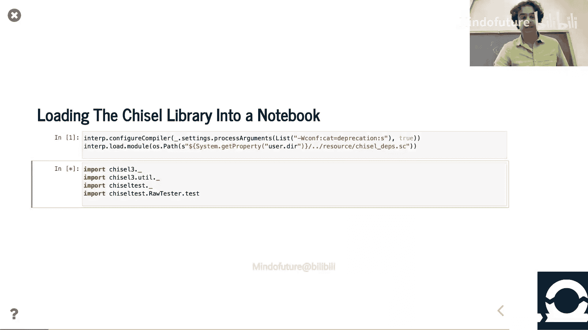

Good to go。So why use auditorienther， right if you were to break first lecture in this course or even the first couple lectures kept saying Sletton's great language。

 reuse all his powers and make hard design great， including auditorient programming and functional programming。

You've seen the pun program right theres a way where sometimes if we use it correctly。

 we can get these commonly used patterns captured concisely and correctly and it' very productive and very clear and easy to read if used correctly。

A did also been using and we use it once again also hopefully more intentionally right the whole idea is。

 of course， reuse right we want to make these things。😡，That are easy to reuse。

That's when inheritance comes at objectage， is its about encapsulation。

Inherence is about reuse or how do we make pieces that are the right size and shapes so we can kind of use what we want？

嗯。So when you think about inheritance， the goal is。Identifying the key similarities and differences。

 right？So in other words， I have components that are not exactly the same。

If there is something the same， of course， I can dissentate multiple times。😡，Both they're similar。

 but not quite the same。Okay， how do I have a way to reuse the code between both those components in the way for things that are the same。

 I can use the same code and for things that are different。😡，How can I。You know， expose a difference。

 right？That's what we're dealing with。 Now we've seen throughout this course。

 scholar is a very rich language。It will not have one feature when one will suffice。

 it'll give be five features right， and so you'll see the course of this lectures of course going in two parts。

 there's quite a few different opposite oriented mechanisms for inheritance in Scala。

It's a little bit daunting。 It's okay， take a deep breath。 I have a summary slide。

We'll get through it。

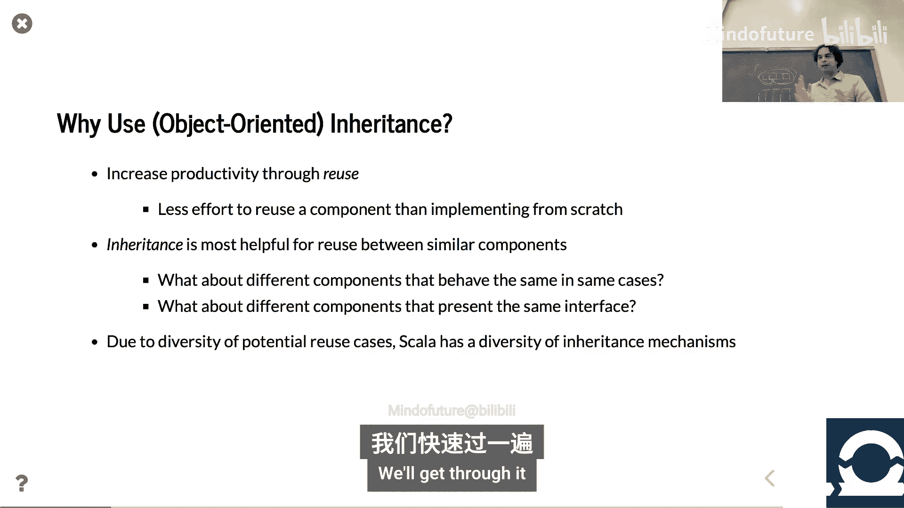

Okay。So what kind of inherance is there， well first off， there's the regular class inherance。

 which we've been doing and not even realizing we're doing it， which is simply we have a class。

Last case， let's say parents。And then make a new class， let's say child， which simply extends i。

e inherit from parent。So that's not super crazy， right， we've seen this in other languages。

 In other words， this class is going to behave exactly the same as this parent class。

Unless we specifically override something， right， And if you override something。

 meaning we want the child limitation to win。It'll behave differently， but if we don't do that。

 it should behave the same。So let's go ahead and put this together。 Let's say for example， we have。

Kate， who's in this instance a parent， right， you know， they have a name。

They have the ability to greet。So yeah， we run this。You know， we want to greet Kate， it'll say hello。

 Kate， right？Now for the child class。

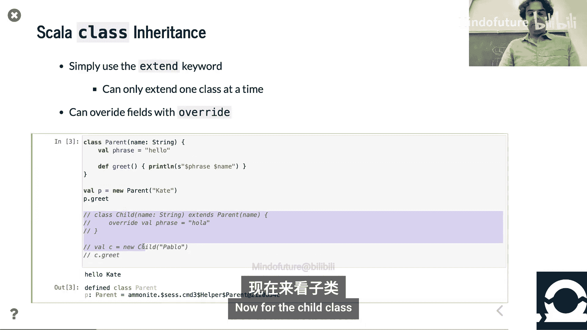

啊。If we override the phrase for greeting with Oah， right， now we greet Pablo， the child。

Theola problem right， but the key thing is like。The nurse had his child code。

We overrode the value of phrase。We didn't change Greek。

So greet is actually coming from the parent class。G。

Assemmbbleles the string by putting in phrase and phrase came from me， right， rat than from there。

Now， let's see a few scenarioaros， like what if I， for example， didn't overwrite anything？Well。

 then the childs going to behave just like the parent， right？Um。

 can you put things in children that aren't apparent at all， definitely， you know？That's fine。嗯。

Now what happens if I。Forget the override keyword。It's going tell you， whoa， whoa， whoa。

 you're overriding something right。 You need to be explicit about。

 You know what is something that exists in the。Parent， and I'm intentionally overriding it。Cool。

 but this is， you know。Like you probably see in their languages problems your inheritance。

 this is nothing too wild。But there's a couple of details， right， number one。啊。

When you do want to override things， I not do what the parent provides。

 You have to use the override keyword。Number two。You can only inherit from a single class。😡。

RightSo sometimes when you have multiple inheritances， you can multiple parents。Not sc。

We'll see a way to get a similar functionality with you another mechanism later in this lecture。

 but for the regular class inheritance， no， that can only be a single thing。😡，Cool。

You may have noticed， for example， that you know， when you declare modules in Chi we say no sense module。

 right， that's we'reheriting from modules from the Chisel library， yes。Oh。

That's a great language which I' to answer with the 80% confidence interval。 So the question is。

 is restriction of single parent inheritance is that something from all JBM languages or a more broad thing？

😊，So the more broad thing is， there's something called I believe， called a diamond problem。

Or basically， if you have multiple parents you inherit from。

 you can kind yourselfeldoms conundrum over comes ambuous of like。

How to I know where something comes from？AndF+ has problems well。

 however they have their waibra is solving it and I just forgive me for not remember any solution C+ has。

 I believe， you know， speaking opinionistically rather than authoritatively that the modern philosophy of language design is to encourage single inheritance。

Because of that diamond problem。Sless this is a JVM specific problem。

 I don't think JVM makes this easy， I agree that'd probably be tricky for sure。

But I also imagine people making new languages and making this choice。 Like， for example。

 I't if you probably know Rus isreley， you do multiple inherits or no。啊。

Becauseuse for the rest of the more modern language。

 the question is they they a choice and what choice did they make and they they decide know what this is more painted than it's worth。

Like so the issue is when you have multiple inheritance， it's kind of。

What comes from where right and you're going to see a way to approximate total inheritus something called traits later on or mixins。

And that suffices for a lot of cases， and so you'll see that later in this lecture。Yeah。

 these are kind of these like language design questions about， you know， how you design a language。

 and yeah， as I believe thinking。My impression how the Sop people chose this was not only Jaler required a single adheres。

 but they also ended kind of strain by JVM， but also I think that's kind of the belief is better for now。

对 yeah。Ask the question if she should notice does not no， good task。So。

 Dallas what I in here is check， I told you we so once。What's the next one。

 abstract class inheritities？So it's really similar， right， what's the difference？

The difference is the original parent class now just keyword abstractsh in front。

And what's different about that？Is。啊。Because an abstract class， this cannot not be instantd， right。

 if I want to。Say， hey， give me oops。A new parent， you know。Named， you know。

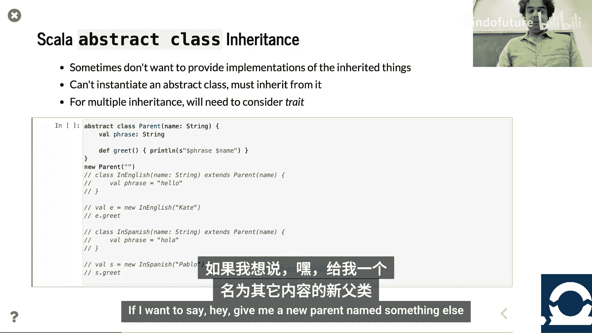

Something else。I can't send you an abstract class to write until you can't do that。

 So abstract classes are made to be inherited。And so the advantage of making this abstract class。

 opposed of just using any plain old class。Is。

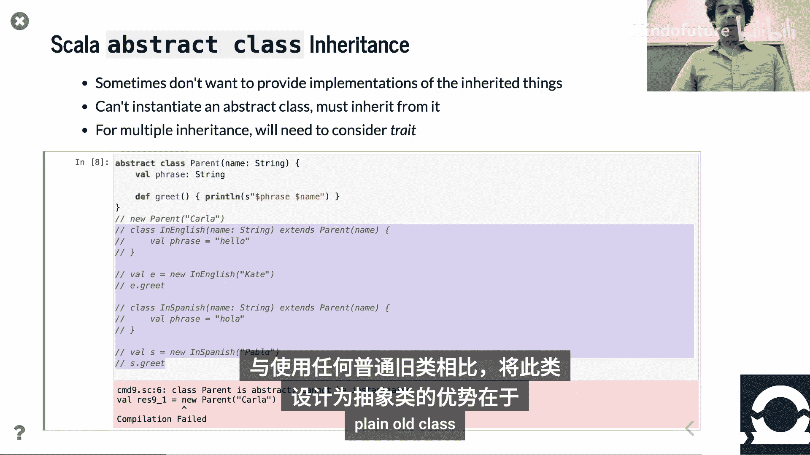

We're not required to fully populate it， right， it's not going to be fully self standing because it's never can be instantiated。

😡，Because thiss never be fully selfstand。mWe can kind of take some shortcuts， for example， like here。

 notice how。I say there's going to be something called phrase。 It's going to be a string。

But I don't give it the value。And it's a vow so I can't like change this value later on right。

 it's a little bit， you know， surprising right that seems a little peculiar what you know。

 but the reason why it's okay is you can see that classrooms that extend it。

They assign something to it。And they actually don't need to overwride keyword because it's an abstract class。

 right like abstract class is meant to be like overridden。Yes。😊，どした？Good question。

 if I don't set phrase something what happens， let's find out。I need to set it。Right。

 that' kind of point so。one way to kind of think of an abstract class it almost like you're sketching out like the shame of something needs to be。

And from the point of view of interfa other modules， right， and no， it's okay， you need to have。

These fields。But the actual biasible fields are required to be provided by the child， right， now。

 just because it's abstract doesn't mean you can't actually have some things implemented like we chose to have great implemented there。

 right。嗯。And yeah， we can see that we can have in English versus in Spanish。No problem， right。

 and so yeah， abstract classes must be inherited。And， you know， from a mechanistic point of view。

 okay， well， if I didn't have abstract classes， only had class。Just still write great code。

You can still write great code by adding abstract class。Kase you trying to get。

 you know more closely lining up the abstractions what's available。😡。

You can have this abstract class， which， if you know， aren't implementable。😡，Sorry。

 understandatiable and then you implement it with these children right as I said in the last slide。

 right， if you're really excited about multiple inherits。

 there's a thing called trait we'll be covering。

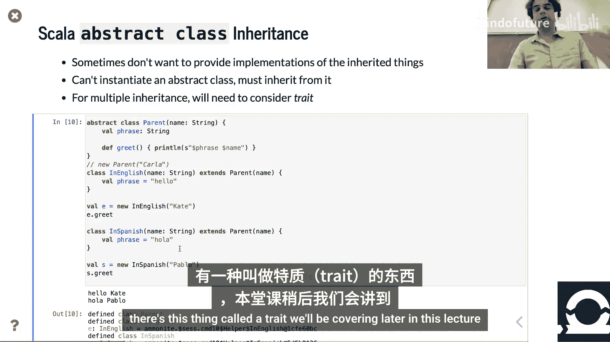

Later in this lecture。嗯。So already we we have。

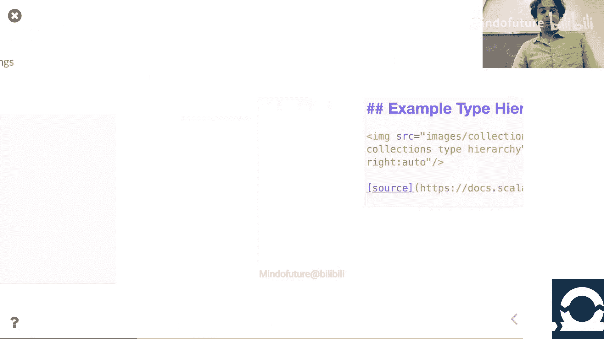

Class and abstract class。And then。To see how you might little a hierarchy of things with inheritance。

 let's take a look at actually at skulla itself， so we've been hypping up the skulla collections。

Here are this color collections。 So this is their。Tree showing what it hair is from what。

 you notice you trace this tree。啊。It is single。Aarent， right。

 each of these things has only one parent。And so。What is a collection， Well， at his core。

 is it reversible？I can't tell you there traveral or interval I don't that nuance。

 but you can see there's a difference in terms of some of those concepts when they made schemes out。

In this particular arrangement， all the blue boxes are abstract。So even though we say seek。

 it actually gets turned into， you know， we actually look at the code it turns into like a list or a vector。

 right？Typically， right？But the key thing is， yeah。My collection is interval， right， Okay。

 yeah that makes sense。 I have some end things and she will iterate through them and you can see。

 okay， well of those end things。What kind of properties might they have？

If if this notion of a set were to somehow all unique and it can't be redundant as one notion。

We have a notion of them being somehow numerically indexed contiguously from 0 to n。

That's a seek or a sequence。Ifve ever notion them being。

Indexible with some sort of arbitrary key type， that's a map， right。

 like a hash table hash map kind of thing。嗯。😊，You can kind of see how they kind of made hierarchy very deliberately kind of breaking things up。

 okay， we'll have a set。Now， a set is a property， having a set property。 I can have a sword set。

 I have a set using a bitm and reef， a bid set。Even for， right， you see。

Sh has's idea of American indices， but how's iment， is it done？With kind of a。

 you know continuousuous array like thing like a vector or has done more of a linked list kind of thing。

 right， you can see these are kind of nuances。 And so I'm pulling this up with an example。

 you can see how as you start building all this stuff up。

 you can realize that things are more similar that are different， right。

 the alternative would be rather than having this tree， if you had no inheritance。

 you would have you know，1，2，3，4，5，6。呃。I believe I count 14 dark gray boxes。

 so with 14 dark gray boxes， I could have 14 classes。That are just my collections available to me。

 I could scroll through the developer pick pick which one I want。And then， you know。

 with very deliberate effort from them person with people in those classes。

 they could have very similar seeming method names， Okay， you know， how do I get the dot size。

 how to do it dot empty or it could actually make them all inherited and it's like guaranteed to be the same API。

 right？So it kind of comes together and you can imagine a some of this functionality。Can be reused。

 right， like perhaps。If you had to functionality to do。Ittereration。

The same iteration functionality can also help you do things like full empty， right？

And so you can see that kind of comes together。 So objectient is really powerful。 this。

 you know diagram course I got from the scholara documentation。😊。

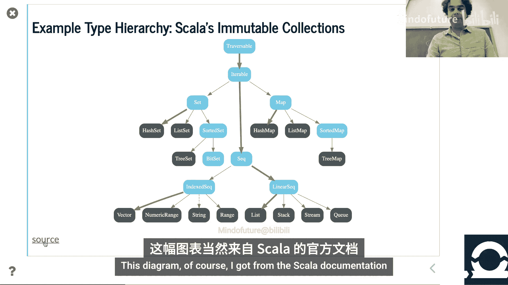

You can see here is showing the abstract classes， here is what the things in there。

 here' is the mutable version。

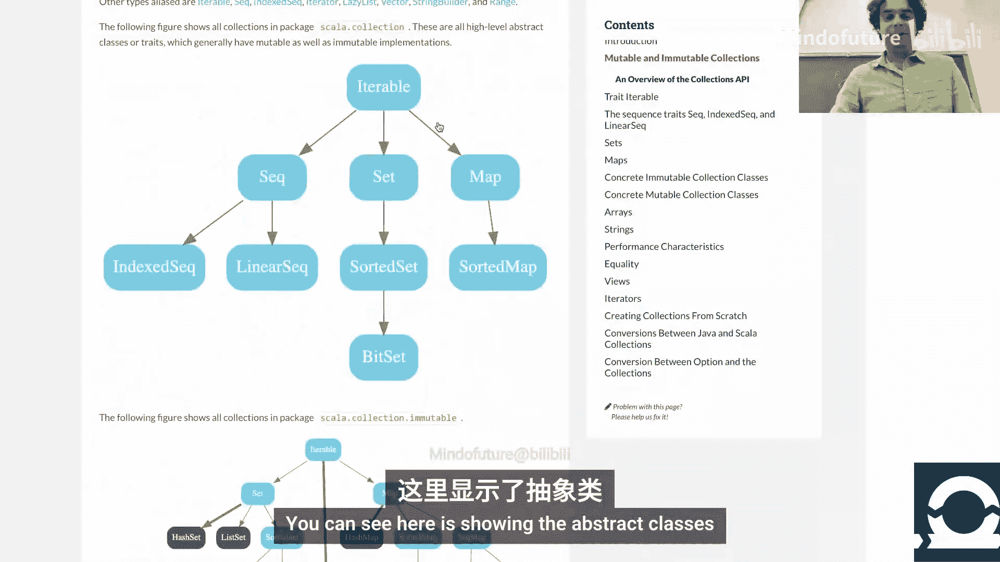

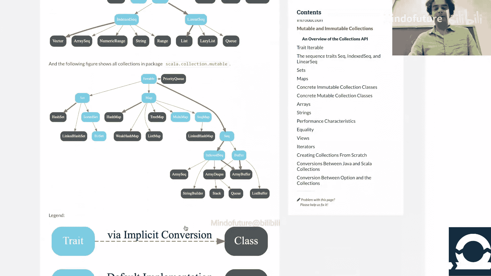

Here's more about what the legends actually mean。Cool。Questions。Sff， we've already seen。

Very good class here is after class here is。Unfortunately I thought， okay， what else do we have？

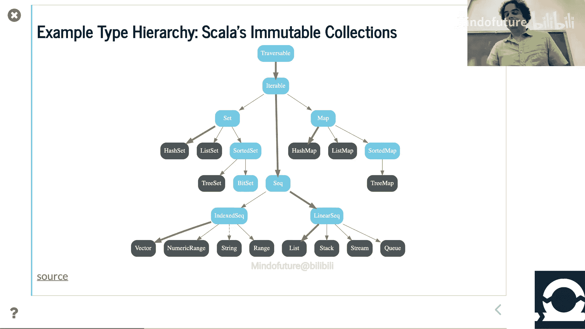

Before I do that， let's。Talk about how do we use these in Chisel？嗯。So we've been trying to get reuse。

 right， So number one to type of reuse8 you can't write。Stop writing new code， write code。

 we can use multiple places to save writing new code。😡，So number one， these parameter generators。

 right， we want to have the delete kind of do some parameters and sp out what we need。嗯。

And goal mapping it be a generator rather than a single design。

 Hopefully it's sufficiently flexible to be used in more places， right and。嗯。9 feet of her waist。

 right， typically we write a module。We actually saw on a prior homework because we can't even have code outside of a module a function body by itself。

 right？Um， we've also had these， you know， composable customizable bundles where we decide。

 you know what， we can go ahead and。You know encaps our functionality in ways of bundles。

 we can extend bundles， we can have optional fields and bundles。Then what today is， of course。

 is how can we get reuse the inheritance， right？How do we have similar functionality？But then。

Provide， you know， these like maybe distinct modules that actually share a lot of code， right？嗯。

And so yeah， it's a design decision right where you are implementing this as a library generator。

 you you the library， you may just say， okay， I want't provide family functionality。

 is that going to be a single generator which has more parameters or are those going to be different。

😡，Class as appears as generator， but actually in behind the scenes share code somehow。

 and I can share code directly or I can share code via inheritance， right？😡。

And note that we've been using a hair instead even talking about it， right。

 Things like extend module when you write a module， I chose Ja's But plate， well。

 now you know what that means It's actually extending module a certain class inside a chisel。 right。

 say if you extend bundle。 when you make a bundle。 It's also a certain class inside chisel。

 So now you can see modules like it's less， you know。

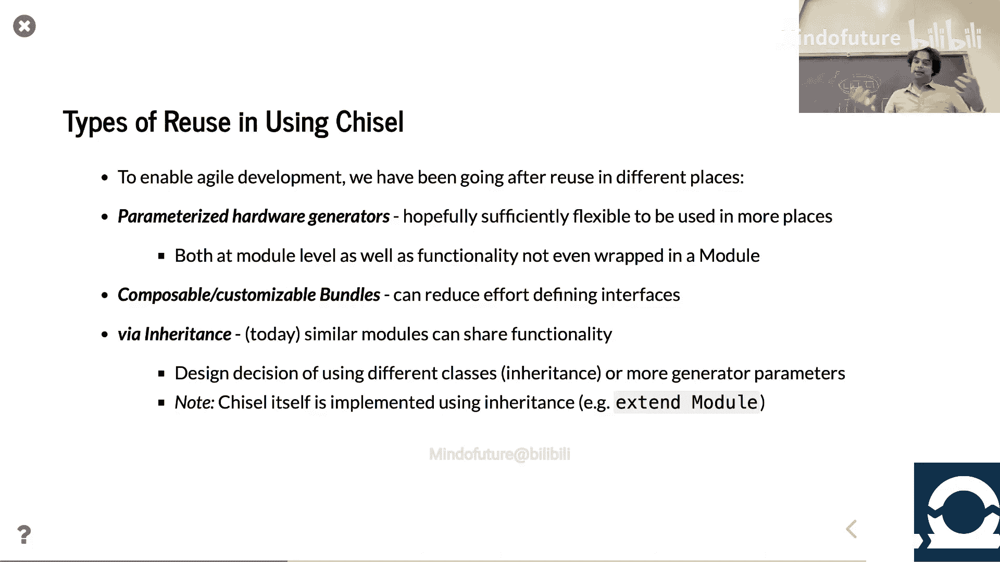

Both played didn before， right？It extends module， right， like we just talked about。

 So how about a simple example， Let's make a generator that is an abstract class。

Meaning I can not directly instantiate this。Now， what is the pattern we're capturing。

 we're going to say it's a uninary operator in other words it takes in one input。V is one output。

 and that input is gonna to have a certain width。 Okay， so whatever the operation is， it takes any u。

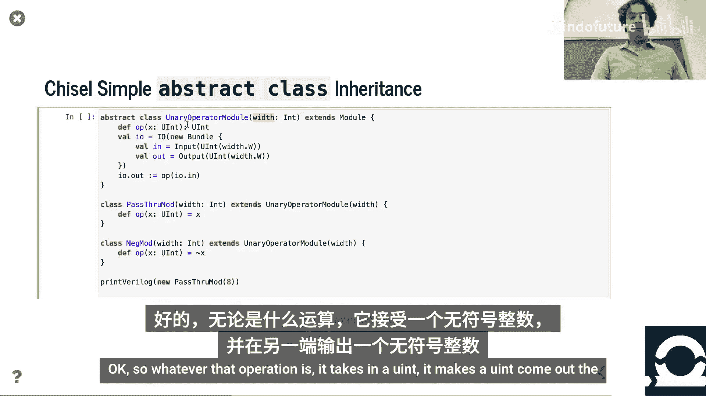

It makes you you。 Come out at end。RIo， of course， is going to be。You know， input coming in。

 Apple going out of the width， and then we simply apply this operation。There。

 it's no South abstract class we don't even say what op is going to be。Now。

 if I want to actually implement this， I can now say， hey， I want to pass through module。

 so I'm going to extend this， you know abstract class。And notice how as the actual the class has。

 you know， parameters you got to give it those parameters now， in this case， they're kind of。

Passing through her own parameter from here to here。Okay， but if we past the operation。

 we' will not change the module。 so we're going to implement up as just x given x， return x。

Alternatively。Read an negation module。😡，We could do NX， right。

 And so what's kind of cool about this is。If you， you know。

 appreciate the reuse here to write another unary up as simple as doing this。

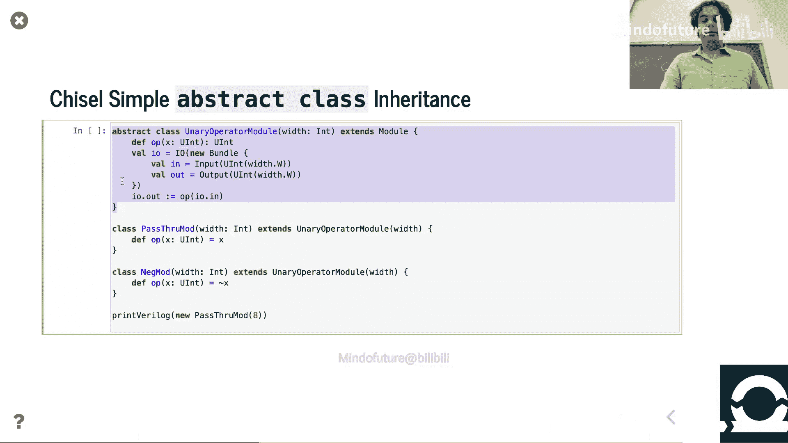

Right， so I can just write this very long。 Of course， we seems to before all quarter。 Sure。

 there it is， right。

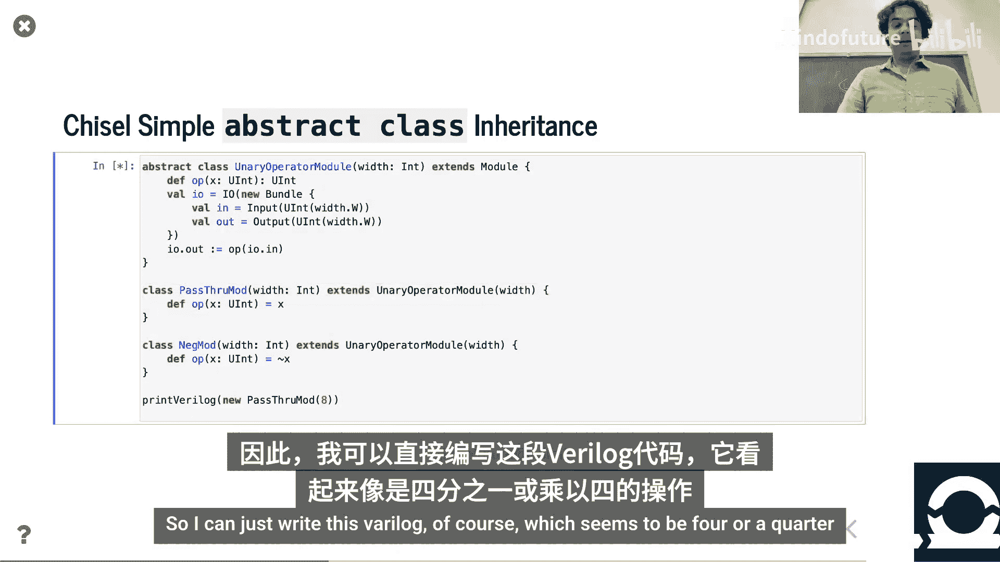

But now if I change from pastory mod to nag mod。Right。

So really easy to kind of make this stuff up that way， yeah， go ahead。帮。Yes。😊，ま。

What's a good question， Okay， so the question is， if I want to do obsorient inheritance with chisel。

Here I'm using the IO if I want each child to change the IO， what happens？嗯。That's the good question。

 so I is a little special in chisel。You'll notice this not just the name IO as a convention。

 there's also this IO。Code here， which is calling into an object。

 I ought to do some things behind the scenes。I'm not sure exactly。

If there's a requirement about that， but I will tell you that in to module。

 there's some other variations of it will help you that quest you have。 So raw module， for example。

Amongst other things doesn't have the default clock and reset。So that may help you。

 but's also a multi IO module make the name wrong。

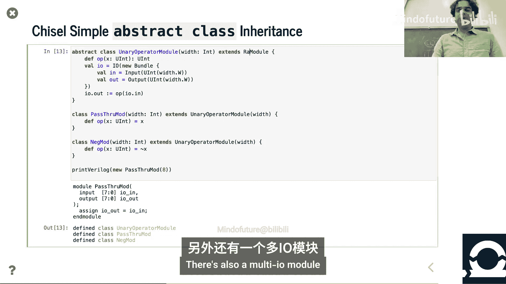

That might be it。If I。Outline， what have we got， that we have a。

There's something that looks like sounds like multi IO， maybe。哦，我是。Or multiO module。Like this？

Theres the way I do multis。 for for reasons of inheritance， there is a way to。

Dfined Io blocks in multiple places and you kind of keep acting all together and aggregate。

 but you giving me I'd like you're not remember an exact in text。

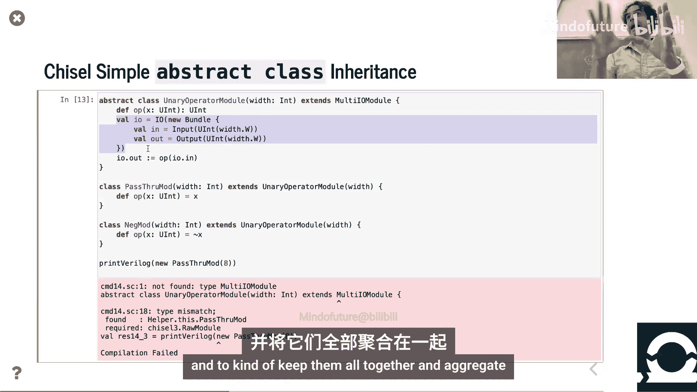

Yes， go ahead。But the question was， once I try to override it， let's just try it right now。

Students suggested this was impossible。 Let see what happens if I try it。 so of course。

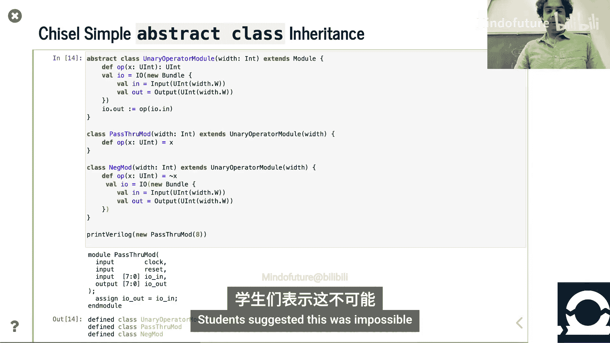

That didn't work。 Now， if I try override。

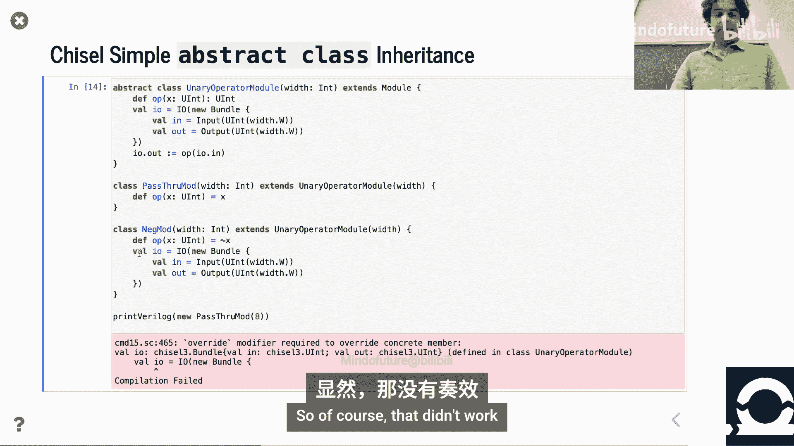

It might still not work？

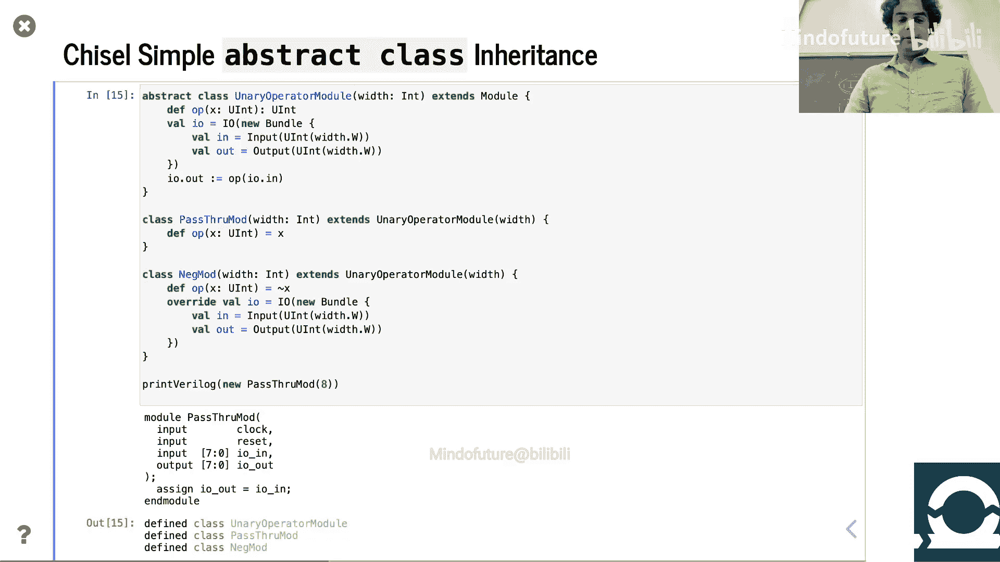

In this case， the。Work in question mark， but like I believe the conservatives might break in practice。

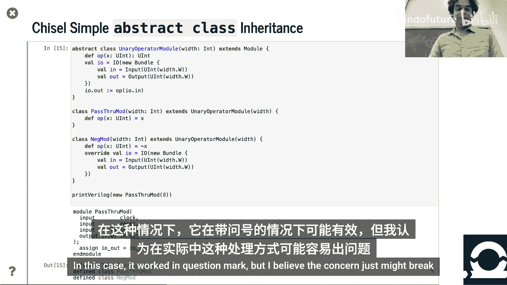

Like I said， I was a little special with the way Chisel handles it。Yeah， here we go。啊。

Heaven knows what this freaking exception is right So yeah。

 this is the worst kind of thing that you can trigger because this is not a compile time issue。

 This is a chiselwalls running issue right and has this own internal system to try and make sure it's in emit bad bear log which is good but me as a user I'm like right And like I said the weirdness here is yeah I've observed overriding IO doesn't work great。

 And so yeah， I think between either a raw module or multi module might be a better way to kind of do that situation。

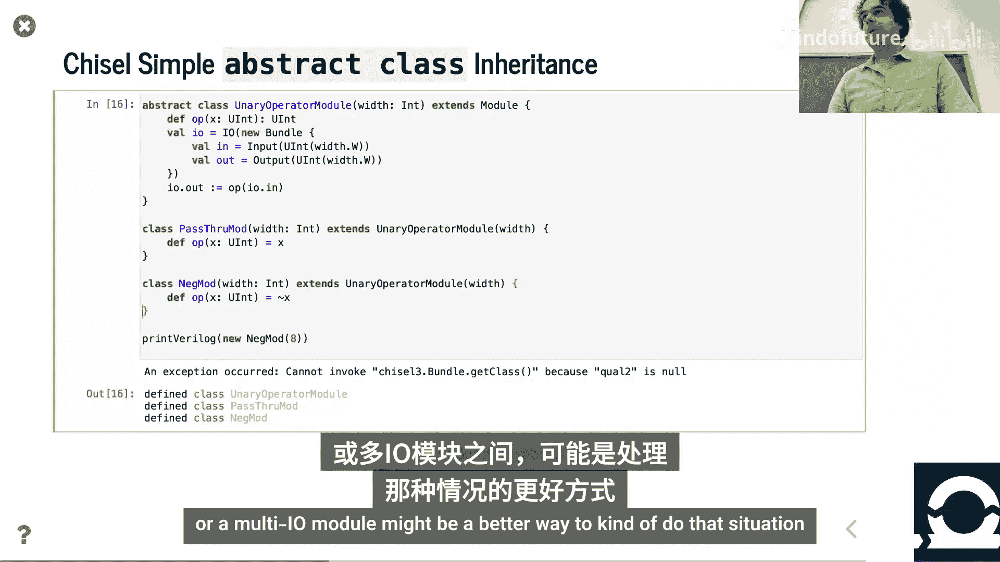

Good questions。So let。Try and build something and I'm trying to get the time。And。You know what。

 I think I'm doing this better on Thursday， so we'll end it there。And I'll see。

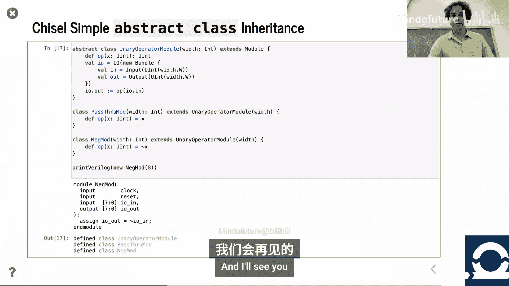