# 敏捷硬件设计：14：继承（第一部分）

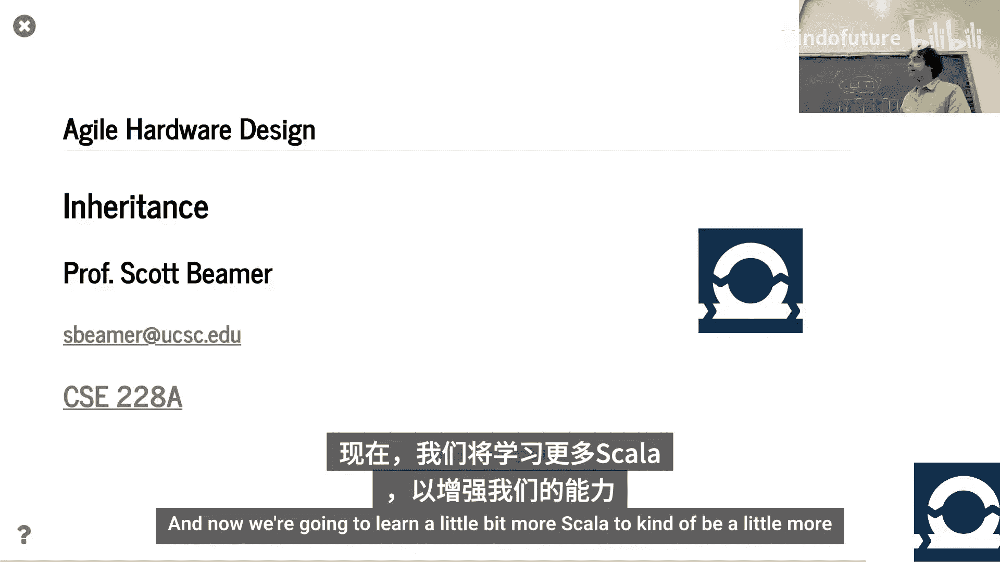

在本节课中，我们将要学习Scala和Chisel中的继承概念。继承是面向对象编程的核心特性之一，它允许我们复用代码并构建模块化的设计。我们将从Scala的基础继承开始，然后探讨如何在Chisel硬件设计中应用这些概念。

上一节我们通过一个案例研究探讨了渐进式开发。本节中，我们来看看如何通过继承更有效地实现代码复用。

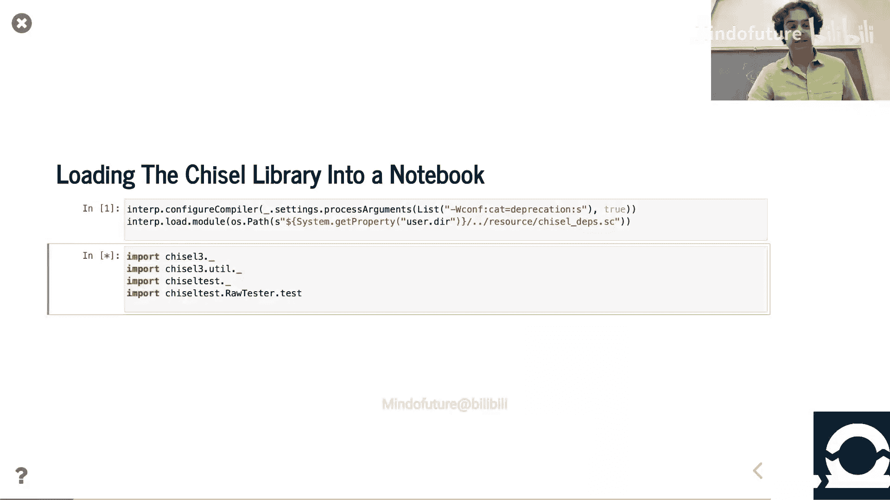

## 为什么使用继承？

继承的主要目标是识别组件之间的关键相似性和差异性。当多个组件功能相似但不完全相同时，我们可以通过继承来复用它们之间相同的代码，同时为不同的部分提供定制化的实现。这有助于创建易于重用、大小和形状合适的代码模块。

## Scala中的继承类型

Scala提供了多种面向对象的继承机制。虽然看起来有些繁多，但我们可以逐一理解。以下是几种主要的继承方式。

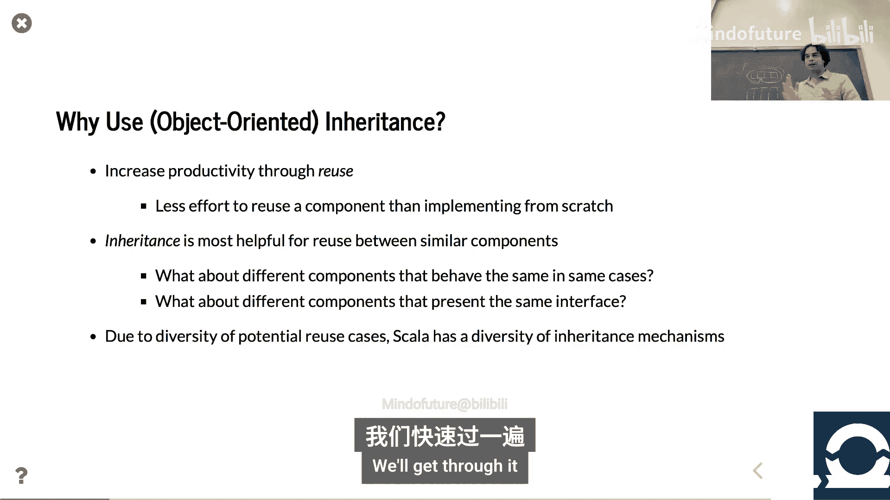

### 常规类继承

这是最基本的继承形式，我们可能已经在不知不觉中使用过它。一个类（子类）可以通过 `extends` 关键字继承另一个类（父类）。子类将拥有父类的所有特性，除非它明确地覆盖了某些部分。

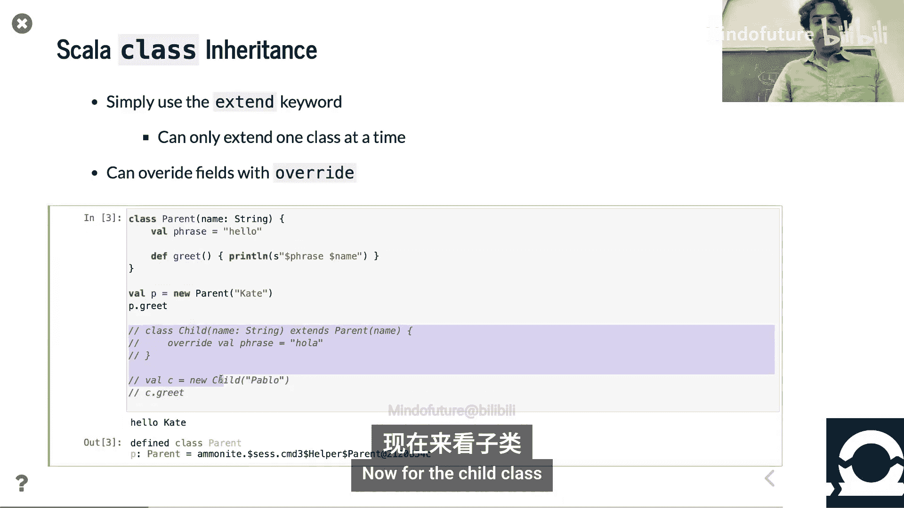

以下是常规类继承的一个简单示例：

```scala
class Parent(val name: String) {
  val phrase: String = "Hello"
  def greet(): Unit = println(s"$phrase, $name")
}

class Child(name: String) extends Parent(name) {
  override val phrase: String = "Ola"
}
```

在这个例子中：
*   `Child` 类继承了 `Parent` 类。
*   `Child` 类使用 `override` 关键字覆盖了 `phrase` 的值，但 `greet` 方法仍然来自父类。
*   如果不使用 `override` 关键字尝试覆盖父类成员，编译器会报错，要求明确意图。
*   Scala只支持单继承，即一个类只能直接继承自一个父类。

### 抽象类继承

抽象类与常规类类似，但使用 `abstract` 关键字声明。关键区别在于抽象类本身不能被实例化，它们被设计出来就是为了被继承。

抽象类的优势在于，我们不需要完全实现它，可以只定义接口或框架，而将具体实现留给子类。

以下是抽象类继承的一个示例：

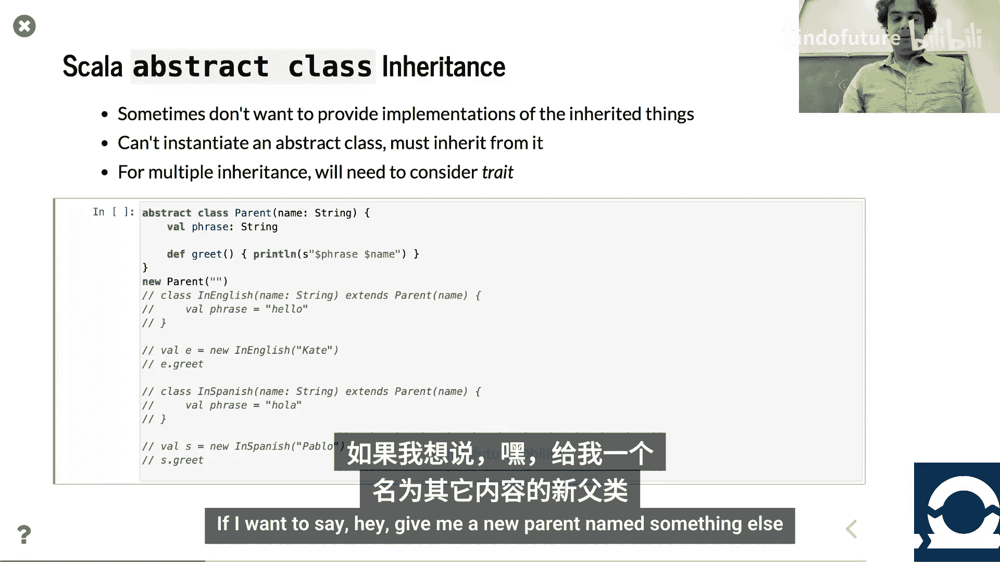

```scala
abstract class AbstractParent(val name: String) {
  val phrase: String // 抽象字段，没有初始值
  def greet(): Unit = println(s"$phrase, $name") // 具体方法
}

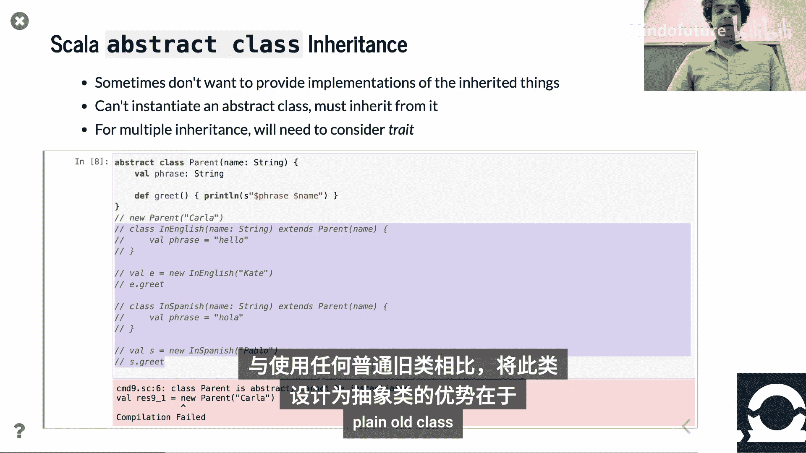

class EnglishChild(name: String) extends AbstractParent(name) {
  val phrase: String = "Hello" // 子类必须提供抽象字段的值
}

class SpanishChild(name: String) extends AbstractParent(name) {
  val phrase: String = "Hola"
}
```

在这个例子中：
*   `AbstractParent` 是一个抽象类，它定义了一个抽象字段 `phrase` 和一个具体方法 `greet`。
*   子类 `EnglishChild` 和 `SpanishChild` 在继承时必须为抽象字段 `phrase` 提供具体的值。
*   由于 `phrase` 在父类是抽象的，子类赋值时不需要 `override` 关键字。

## Scala集合库中的继承实例

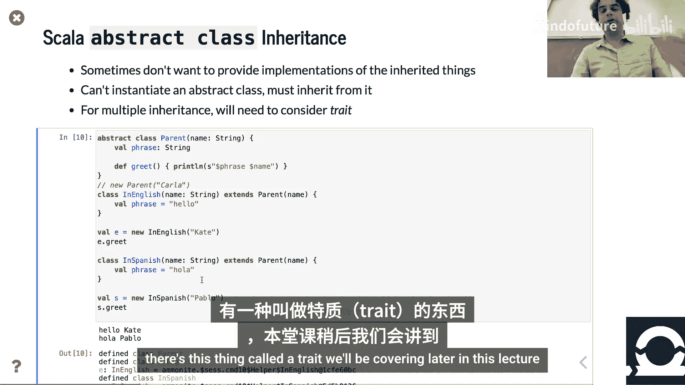

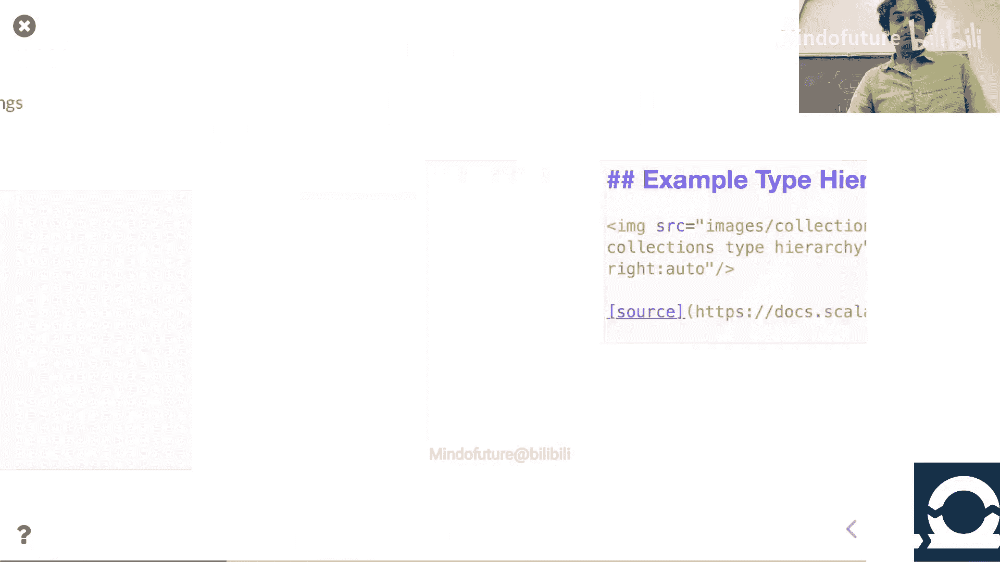

为了理解继承如何用于构建复杂的层次结构，我们可以看看Scala标准库中的集合类层次图。该图展示了一个清晰的单继承树，其中蓝色框代表抽象类。

例如，所有集合都继承自 `Iterable`（可遍历）特质。在此基础上，根据不同的特性进行细分：
*   `Set`（集合）要求元素唯一。
*   `Seq`（序列）要求元素有连续的整数索引。
*   `Map`（映射）允许使用任意类型的键进行索引。

然后，这些抽象类又有各种具体的实现，如 `List`、`Vector`、`HashSet` 等。通过这种层次结构，所有集合类型都共享一套统一的API（如 `.size`、`.isEmpty` 方法），并且公共的功能（如迭代逻辑）可以在高层级中实现并被所有子类复用。

## 在Chisel中应用继承

在硬件设计中，我们同样追求代码复用。继承可以帮助我们创建可定制的模块家族，这些模块共享核心逻辑，但可能在具体操作或接口上有所不同。

我们一直在Chisel中使用继承，例如：
*   `class MyModule extends Module`：让自定义模块继承Chisel的基础`Module`类。
*   `class MyBundle extends Bundle`：让自定义Bundle继承Chisel的基础`Bundle`类。

### 一个Chisel继承示例：一元操作符生成器

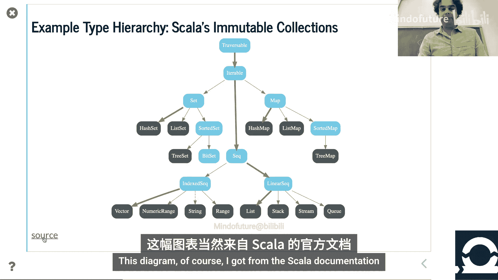

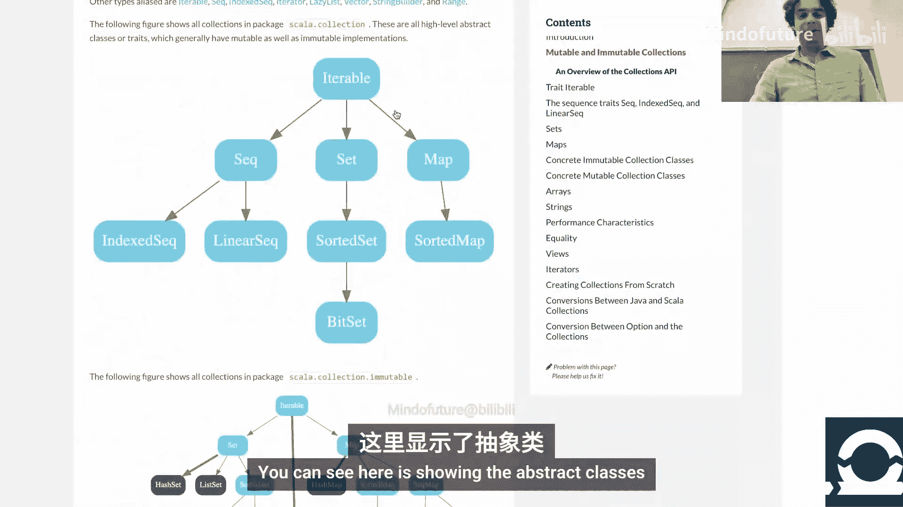

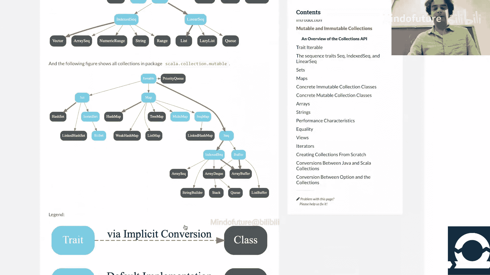

假设我们想创建一系列执行一元操作（一个输入，一个输出）的模块。我们可以先定义一个抽象类来捕获这个通用模式。

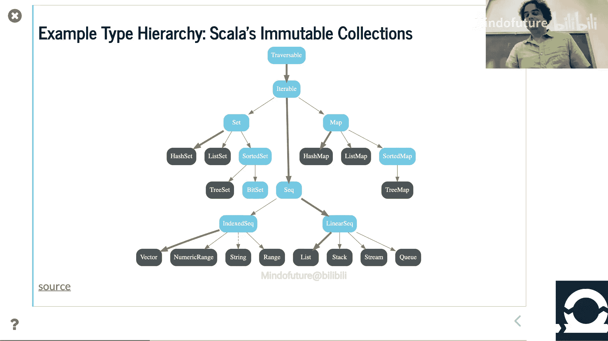

首先，我们定义一个抽象类 `UnaryOp`，它规定了输入输出的宽度和IO接口，但将具体的操作 `op` 留为抽象：

```scala
import chisel3._

abstract class UnaryOp(width: Int) extends Module {
  val io = IO(new Bundle {
    val in = Input(UInt(width.W))
    val out = Output(UInt(width.W))
  })
  def op(x: UInt): UInt // 抽象方法，定义操作
  io.out := op(io.in) // 具体逻辑：将操作应用于输入
}
```

接下来，我们可以轻松地通过继承这个抽象类来创建具体的模块：

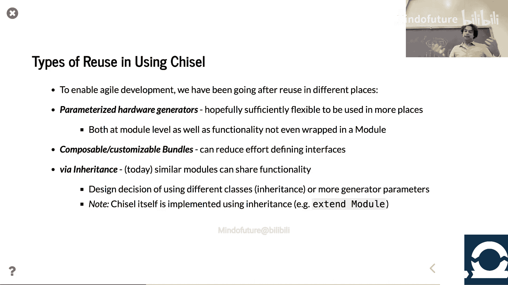

1.  **直通模块**：输出等于输入。

    ```scala
    class PassThrough(width: Int) extends UnaryOp(width) {
      def op(x: UInt): UInt = x // 实现op为恒等操作
    }
    ```

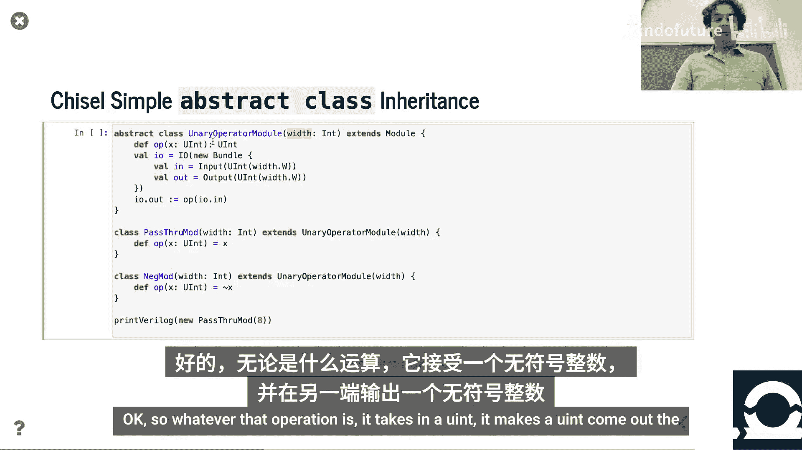

2.  **取反模块**：输出等于输入的按位取反。

    ```scala
    class Negation(width: Int) extends UnaryOp(width) {
      def op(x: UInt): UInt = ~x // 实现op为取反操作
    }
    ```

通过这种方式，我们复用了 `UnaryOp` 中定义IO和连接逻辑的代码，只需在不同的子类中实现核心的 `op` 方法即可。这使得创建新的、行为不同的一元操作模块变得非常简单。

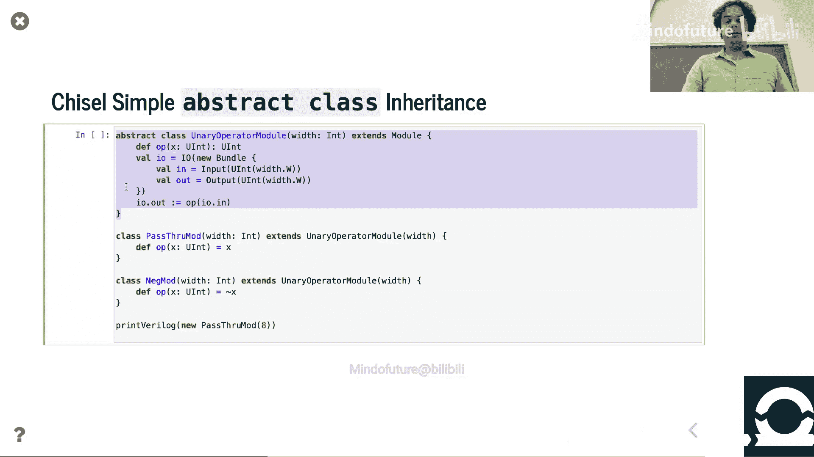

### 关于覆盖Chisel IO的注意事项

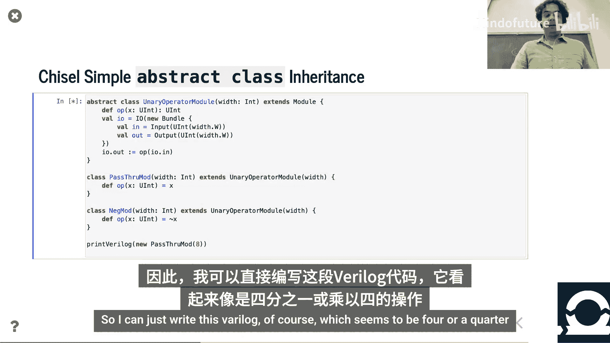

在尝试通过继承修改IO接口时可能会遇到问题。直接覆盖父模块中的 `io` 字段可能不会按预期工作，并可能导致运行时错误。

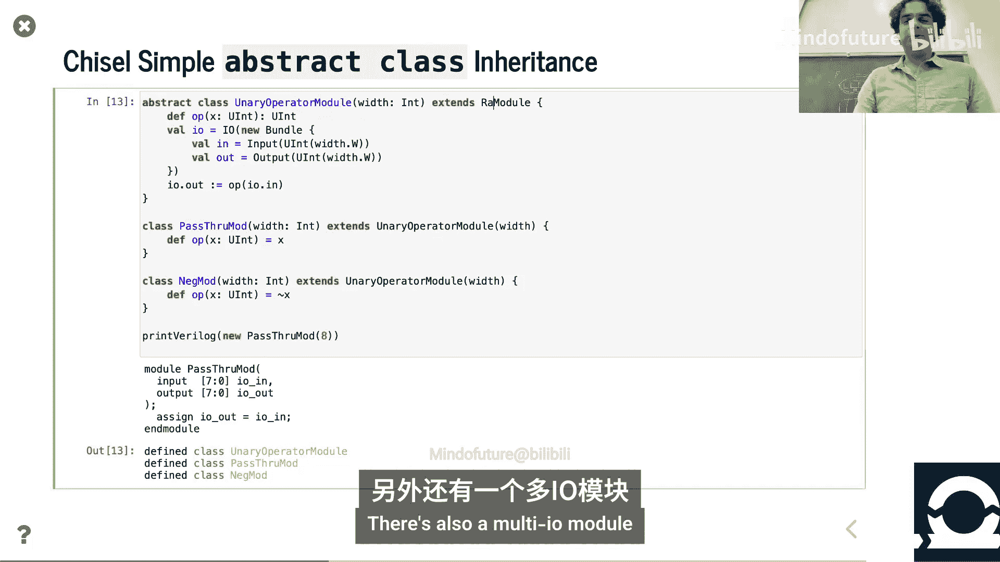

Chisel提供了其他模块类型来更好地支持这种场景，例如：
*   `RawModule`：不自动包含时钟和复位信号，提供更底层的控制。
*   `MultiIOModule`：允许以更灵活的方式定义和组合多个IO块。

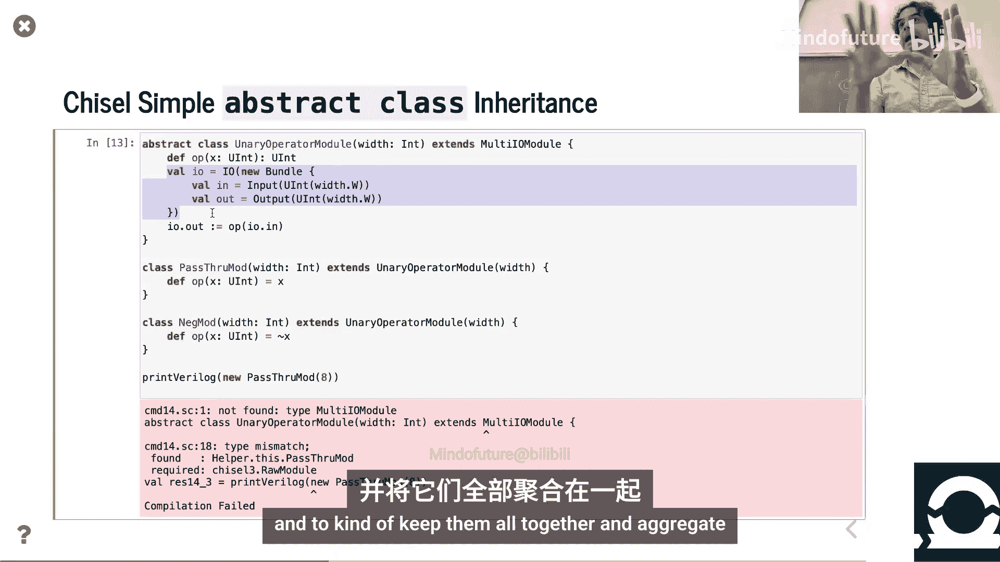

当你的设计需要通过继承来改变IO结构时，可以考虑使用这些模块作为基类。

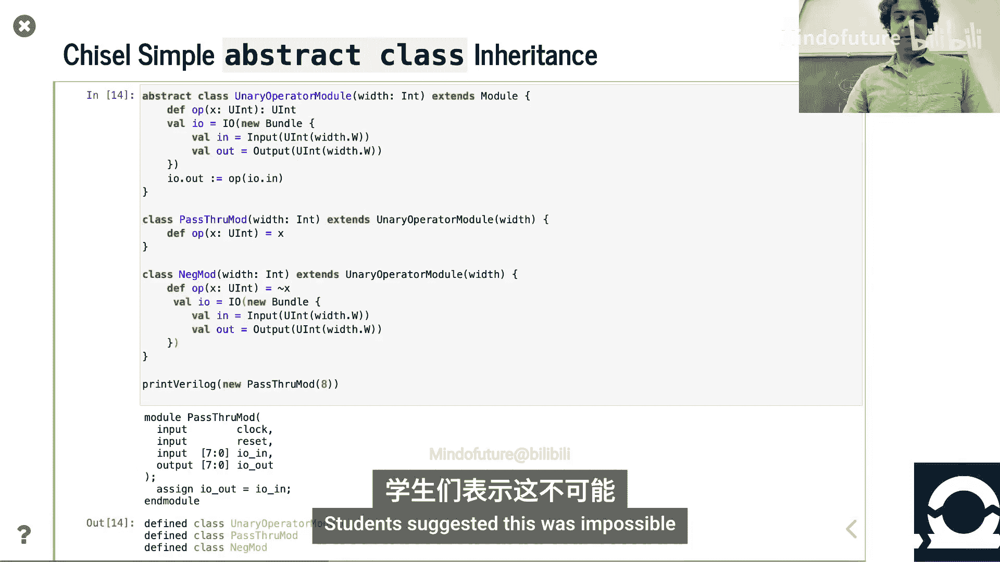

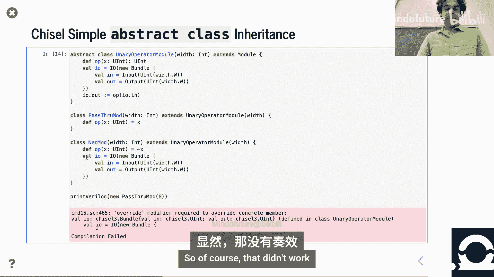

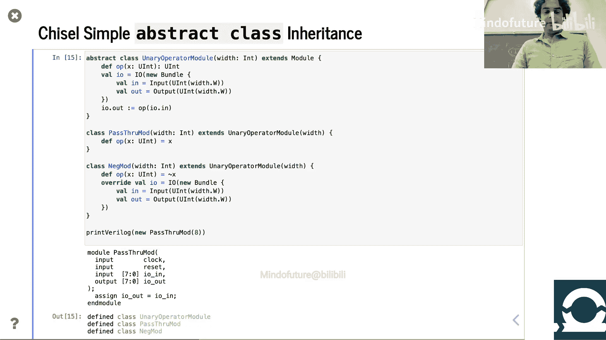

## 总结

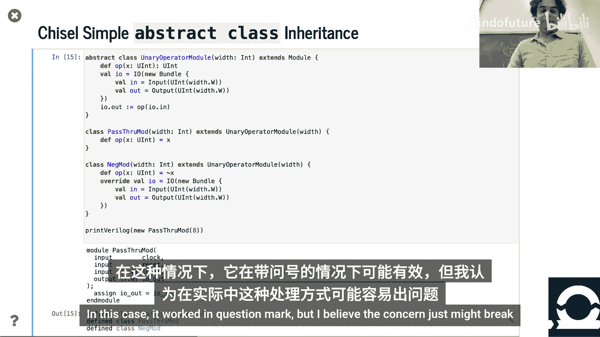

本节课中我们一起学习了Scala和Chisel中的继承。
*   我们了解了常规类继承和抽象类继承的基本概念与语法。
*   我们看到了继承如何用于构建像Scala集合库那样清晰的层次结构，促进代码复用和API统一。
*   我们探讨了如何在Chisel中利用继承来创建可定制的硬件模块家族，通过抽象类捕获通用模式，再通过具体子类实现特定行为。
*   我们还注意到了在Chisel中覆盖IO接口的特殊性，并了解了`RawModule`等替代方案。

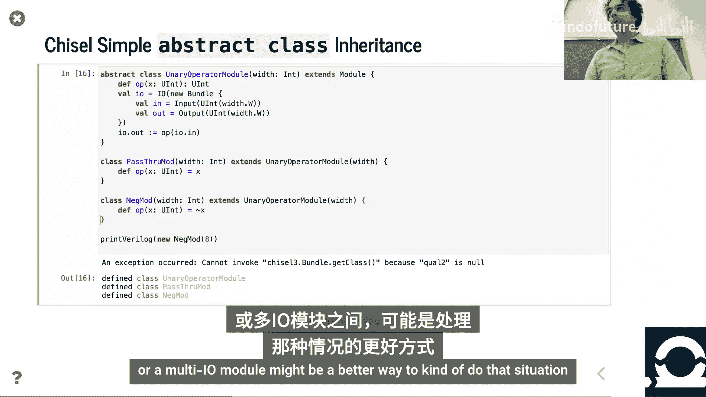

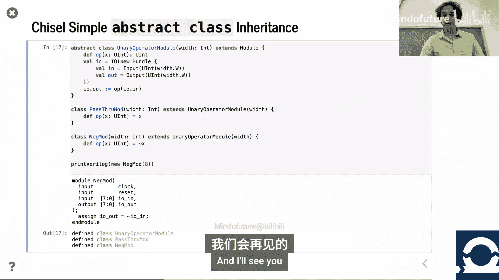

继承是构建灵活、可复用硬件生成器的重要工具。下一节我们将继续探讨继承的其他高级特性，如特质（Traits）和类型参数化。