# 【加州大学】敏捷硬件设计-CSE228A-｜-Agile-Hardware-Design-Spring-2025-p20-P30_第14讲-继承_第2部分共2节--BV1M6ivBzESw_p20-

Hello and welcome to lecture 14 part 2。 So we are talking about inheritance， right once again。😊。

Talking about features in the scholar language， how we can use it to make better。

 more musicalable hardware designs， right so。

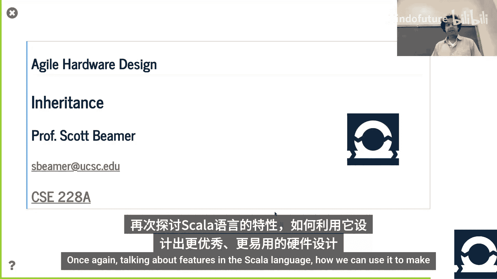

We covered something techniques used for inheritance of scholara so far things。

Like doing simple class inheritance， we talked about abstract classes。

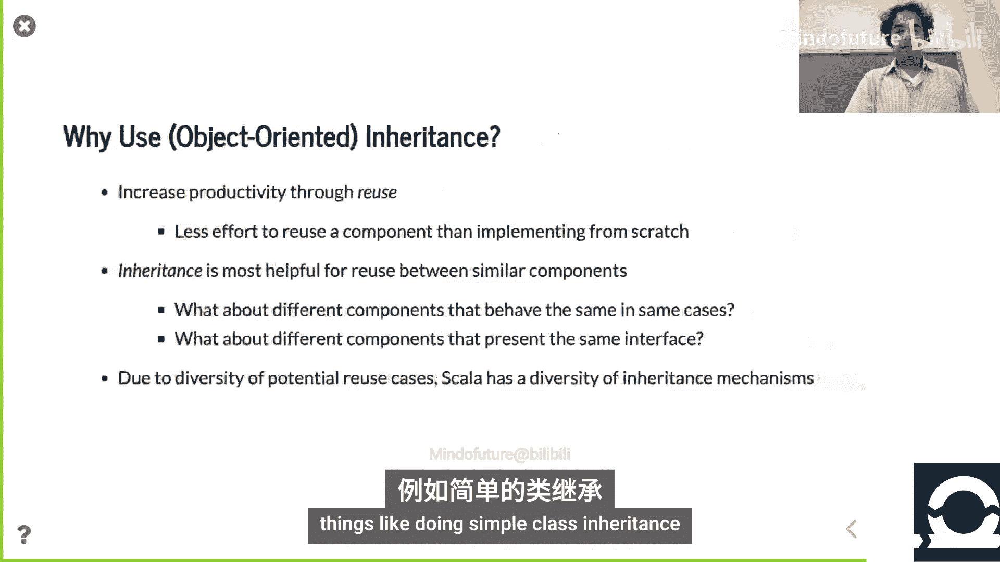

We looked at scholars collections。

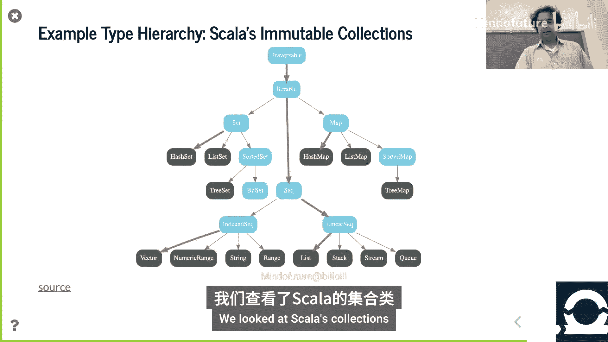

嗯。And so we did a simple example。And now we're going to do a slightly more sophisticated example。

 right， So let's say。We want to build this library we have these decoupled operators。

 these operators are decoupled they you know。Having decoupd interface on their inputs and outputs internally。

 they actually also will have it registered actually buffer their output。 So that way， you know。

 the Google path has only one operator long， rather than multiple operators， you can imagine。

Building up a circuit that， you know， a number of operators and kind of， you know。

 with full data flow operation。Getting very smooth elegant execution， right and so。

What we want to do is we want to cap not we can of what it means to be the up operator inside this parent base class。

 and then we're going to have some child class action implement features， right so。

Here here's the parent class， right， which we happen to define as an abstract class。

 meaning you know you can't instantiate this directly。

 it needs to be instantiated as a child who extends this class。And yeah， so what do we have。

 but we have our inputs A and B。Our output C。So we got， reduces sort operation。

 It takes an A And B and produces C。 That's goal。 These are all decoupled。 And see yes。

 So the operation we're doing。 not specified。 It's going to have this name up。

 That's where we're kind of defining it。 But as you can see。

 there's no body to this method definition。This is an abstract class you can do that and then you know in the child classes you actually will stand shade and explain what that is。

In terms of what's inside the actual body。We have a buffer to hold the output。

 we also have a bit to know if we're full or not， and basically you we are if we're full。

 we're not taking anything， but if we're not full， I'm sure we're ready to take inputs。😡。

How is our output valid well， only if for full meeting we have something there and then。You know。

 the output course reads out of the buffer and then， yeah。

 if our both inputs fire and we're not full， then sure。

 let's perform the operation and put the result in the buffer and mark to full。

And once our output fires， we of course will Marga salt is not full， i。e。 empty。

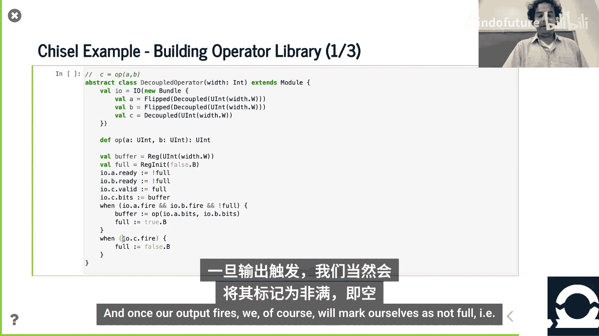

Cool， that all fits together。Questions so far。Let's。So doing something with it， right。

 so let's say we want to do an ad。We can go ahead and extend that class we just made。And say， hey。

 I want to do add to the operations， we' taking these two things we' saying the operation is going to be a。

Likewise， we want to do subtract， we can define operation to be a minus B。

And then of course we put all this together in a factory。Which， you know。

 can simply take in a string for operation they want to do。 And this object will return。

The right object for us。 And notice how， you know， I'm adding more operations is really easy， right。

 Just basically a one liner。For each new operation and we're able to reuse all this other code。

 right， And so all kind of this together。 Also it comes to things like testing。😊。

We can reuse the the interface for all this and it all fits together because it's all designed to work against decoupd operator and even though those it's different child classes。

 they all can reuse the same testing harnesses right so yeah， you can see of course。

 the ver log gen all corridor， we actually were to do run the test itself。

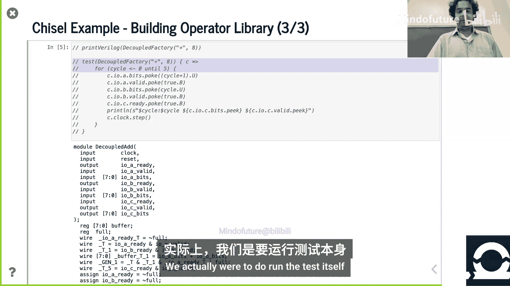

嗯。Sure， yeah， we can。 We can do that， right， you know， as cycles counts through 0，1，2，3，4。You know。

 we're adding them above， we can see looking at the output， for example， when's it valid oh。 yeah。

 you， we got 01， and we got a valid response later on， we added two and  three。

 and we got a valid response。 You know， it's， it's working。Cool。Questions。

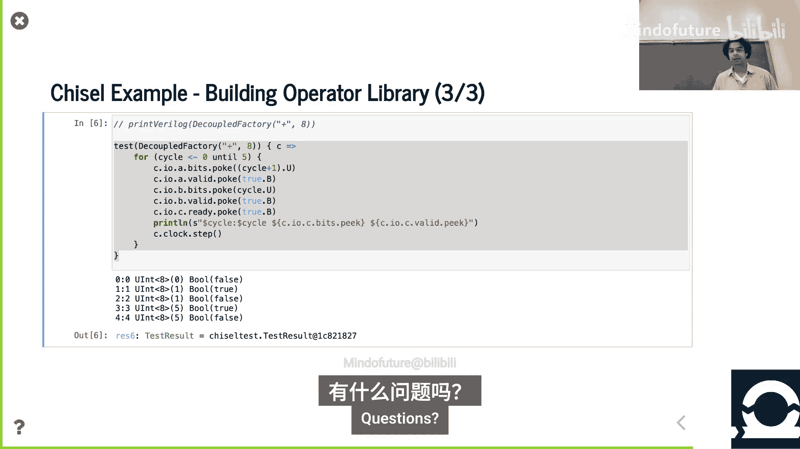

嗯。So so far， we've seen， you know， using。Extending a class。 And we said， you know sometimes。

You can extend an abstract class and making the abstract the base class abstract。

 you have some certification of locations possible by not to define everything and we can kind of make it clear to thing shouldn't instantiated and say you to instantiate when the child class is。

may you remember of all that in inherentherance we' talking about so far。

 we said you could not inherit from multiple things or look inherit from one thing。

So what's the solution you need toher from multiple things it's called a trait so a trait isn't quite the same Naavshot class。

 it has certain capabilities and certain constraints right and so the capability of what's excited about and is's more flexible you can inherit from multiple traits you look inherit from one class。

Whi you can inherit multiple traits sometimes youher it a term refer you just refer to as as mix ins as in you can you know。

 add some functionality to your class around thinking of your class as a specialization of some base class。

 it's more by using a trait， you're kind of mix ins some functionality， right。

It that coming to me kind had a little stuff in。What are some of the trade offs of traits Well。

 number one is taking you here from multiple them， but it's some constraints， for example。

 it doesn't take instructor parameters right so there's none of that kind of stuff in there it's kind of a way to inject some functionality into your code and you'll see that in chi is actually a really useful thing to have even though abstract class and trait both exist it's kind these you know overlapping but also somewhat distinct features between abstract classes and traits and that's why Scala has both and that also why we'll probably use both in our chisel designs。

So let's say， for example。You want to add some。Functionality to modify your module， Right。

 Let's say you have a module like counter mod down here。That， you know， has a counter inside。

 et cetera。But what if。We want to have a more standard standardized way to print with them。

 So In this case， doing prints to the console， maybe you have some sort of logging system or something that you can imagine whatever it is。

 So would it be nice to have functionality this kind of reusable across all sorts of modules。

 you're using it in one module。 imagine we have a lot of modules in our design。

 And we all want to kind of leverage this same。😊，Printing functionality。

What does printing functionality do well？But enabled。It's going to， you know， one print enable。

It's going to print a message。 This is the only organ simulation， of course。

 you can't do a printf on a real hardware design， but is it still useful。

 And you see it's a trait like an abstract class， you can have some of these fields defined but not fully instantating and not not fully described。

 just kind of declared。So you can see， oh yeah， we'll print this message and then。In this counter。

You'll notice it。 Okay， the counter itself takes no input， but it has。Some output。Yeah， you know it。

Have output and you have a counter basically continuously counting。And we also。

Mixed in this print and Sim。Right， so rather it extends its width， right？

So we're mixing this trait and then， oh yeah， for me to find message。We do that， and we can see， oh。

 yeah。 So conditionly， if we have。The counter。Start to printing， set the false。

It doesn't do anything， but then if we turn it on it'll print， right。

 and we can see that for example。The stop print and enable field。Is it directly visible here， right。

 It's because it was mixed in。By this trait print and Sim， which has this I O print and enable。 Yes。

Is bundle a trait？对。Yeah， that's a good question。 I thought bundle might have been a module。

 but I'm not sure。 so let's see if we can't find out。

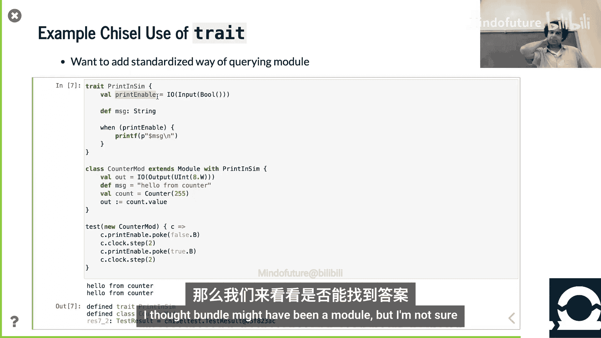

嗯。So here we are navigating to。Our standard library stuff。

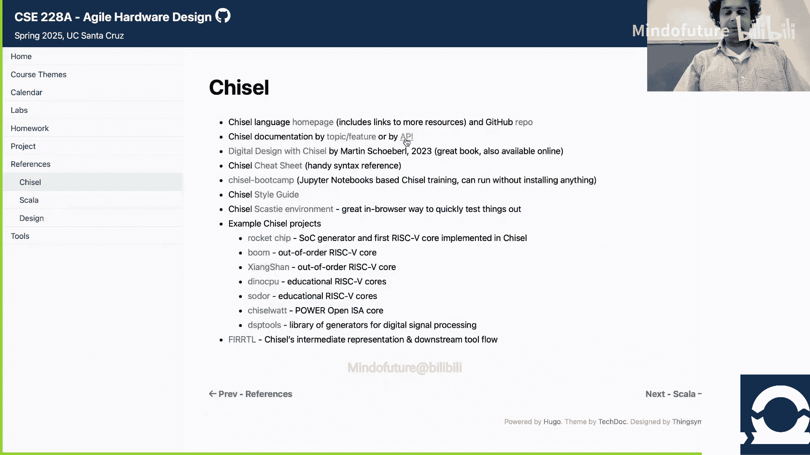

Do， why don't we need just search for bundle。搬到。I's an abstract class。So it's not a trait。

 But the reason why I check this is there was a possibility it could have been a trait。

 that could have been a reasonable design choice， right。

 that could have been a way to think it have worked。 that's why I had to check it， but。

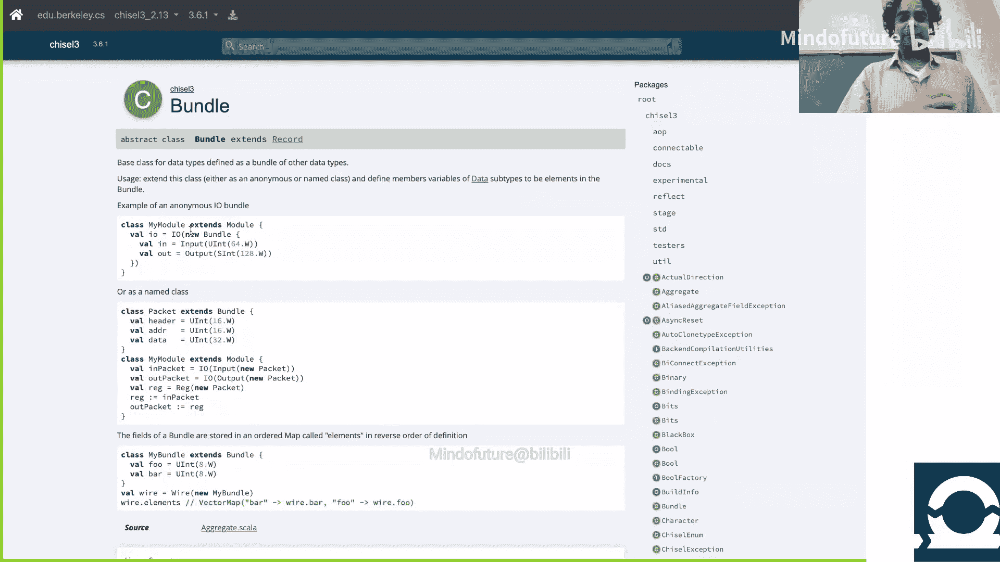

Yeah， good question， but there are plenty of other times to use traits and so。

This example shows a few things， number one。The nices of a mixing， right， we just。Add。

 with print and Sim， perhaps need to add some extra fields to kind of what we wanted。

 but maybe we didn't even need to do that。And we get this functionality added to this module， right。

 our module now is functionality that。Came from other code。

 and this was a great way to kind of reuse code across modules。 So that's cool。嗯。

Does anybody see any potential challenges with this？Let me give you a hint， let's say。

You' reading code scrolling through。And you see this。And then， you see this。But you don't。

Know where this came from， Ra。Yeah。Oh yeah， great point。 So So good position was wait a second。

 the trait is adding an I O to our module like that's， you know。A concern。 And also， what if that。

namee conflicts with the stuff there great concerns So sometimes you I to make sure there's no name conflicts。

 but yes it's adding to the IO and then more generally what I'm getting at is this is something that's not just specific due to chisel。

 but when you go really aggressive with object oriented inheritance or in this case using mixxs with traits。

嗯。There's a balance has be achieved like like I showed you earlier。

 Fun programming going too far because sometimes be hard to read the same things true object oriented programming right。

 if whole point of objects is to enlic complexity， right， you put things in the object So that way。

 you can just use the object not knowing how it's implemented。 However， like here， we're， you know。

 adding a thing to a module and then。It's changing the way for someone interacted with module and they don't。

 you know。Recognize this keyword over here to like where the heck is printed and Sim。

 they could even， you know， potentially grep on the file for counter mod and never even finds。

Print and enable， right， And so this happens a lot when I was goingiented programming where。

If you extend a lot of things that's really buried and really deep inside the inheritance path is sometimes less readable。

 right， to check multiple files。This is， you know， reason， you know， lost count， reason 15。

 why I keep recommending using the IDE because IDE， you know。

 you can hover over print label and say go to。Delaration and you say wait a second I'm not going back to countermod。

 I'm going to some other trait， right and so。This is the kind of thing why having that language server or an ID really is going to help you。

 but to the question earlier， what happens if we。啊。Have a name conflict。 I'm really curious。

 Let's find out。How print and enable is a type mismatch。Well， it's good there's an error。

Because they shouldn't have two people sign it's the same module name。

 I'm not sure this is the given this Em is not sure you'd figure out this is the cause。But。

So somehow， it seems like。This one won out， and it was first。 and now it's doing the second time。

 but。It's still a little odd， but yeah that was me trying to break it。

 so it officially accomplished a broke question。She。Yes。Yeah。

 yeah good questions let's see if I tried to define print enable。Just equal something different。

What can happen？Is is a similar behavior where you can see where it's actually kind of a little interesting me。

 I actually don't have a perfect answer from my understanding of Sca。 But here we have。

Effectively two vowels but the same name and the same namespace。Right。

 and somehow this is causing it to。Say the types don't match rather than saying you're redefining a bow and we've seen from before like of an object and a regular inheritance。

Class inheritance。If you redefine something， you need to override keyword， right。

 and then up something from an abstract class。You do not need to have the same name。

 So I guess this is maybe more like an abstract class in sense it allows you to redefine things that already exist。

 However， I guess it's。In order to maintain that。Interface。

 the trait provides it's requiring types to be consistent。 In this case， types are not consistent。

 Right， So you can imagine， you know， if I。啊。Instead of making this four， I said， you know。Man。

 we're breaking the kernel left and right， I don't even know how I did that， Okay， cool。

you can see where a break signaleller process。 first signal powder checks the types types in the match。

 Now that the types do match， it's complain that the names I'm redefining。

 So I would need to override explicitly。 So， yes， to answer your question from then they go。 Yes。

 it seems that the traits and mixs are treated like。Inherited us from a class。

 in which case youly override youjuna。Take it on。Great question， but yeah。

 its just kind of serious to play around let kind of and see what happens。

But you can see the big picture here is you have all these mechanisms available to you as a developer。

 and the goal is how can I use these mimic codes simpler， easier to read more robust， etc ceter。

 but you know complexity unmanage can make life hard to everybody。😡。

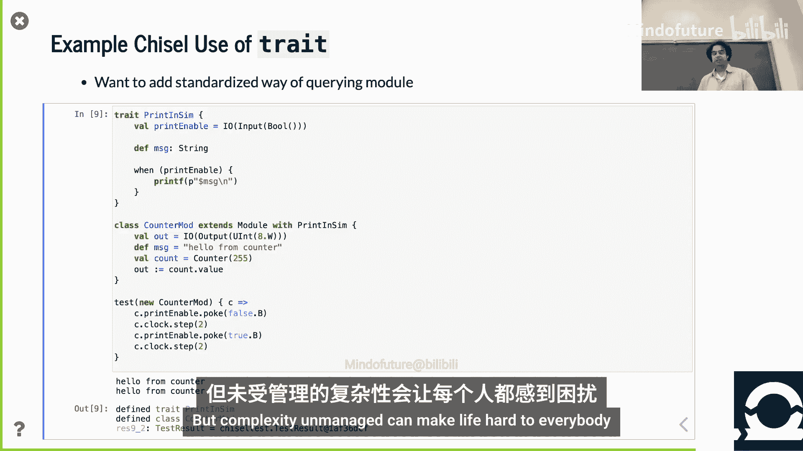

嗯。😊，So talking about that complexity， let's talk about all the arbitrarybit rate mechanisms we've covered so far in this class。

The sad part is this is not all to available to scholars。 when I said scholar search language。

 I was not kidding。 So we've talked about classes， right， we've talked about objects。

 We've talked about case classes。 We've talked about abstract classes。

 We've talked about traits today。Good news for us， no more， I'm not coming any in this course so。

This is the final list of object oriented concepts recovering in discourse。

 so let's recap right so class。We this a lot right it's a regular class we commonly use this。

 you can staate classes as many times as you want and a lot of things that we think of as childrens of opponents are really just us inheriting from a class。

 things like modules， bundles， we just talked about this in the apparently on slides sort of told me it bundles inheritance。

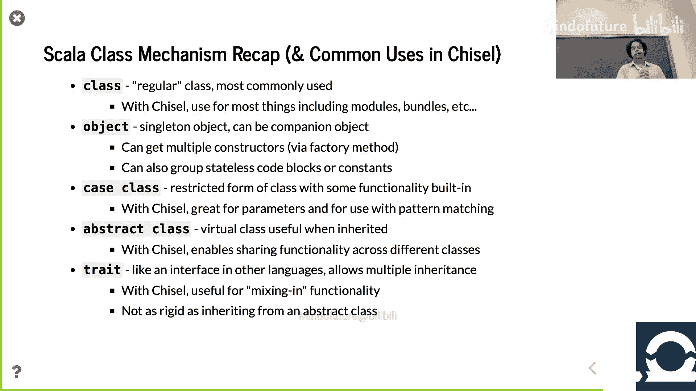

We've covered those right objects are a singlet object sometimes it's companion object to a class we've seen that and so we like this for a number of things sometimes it's helpful to put you know stateless code put together someplace some constants in there sure that's also helpful it's also a way to get multiple instructors you' can have factory methods factory pattern and we've seen that。

And then you know， in this lecture between part one and  two， we've seen some other things。

 for example， case class and varsity in this course。They're research type of class。

They can't do organic class can， however， they actually come with some benefits。

 you get some things like copy constructors， you get the ability to do printfs。

 you can do pattern matching on them really nicely， they do a lot of things as well。

And so we've found a lot mile chisel for case classes with things like parameters and pattern matching。

And then for us doing your own arbitrary inheritance。

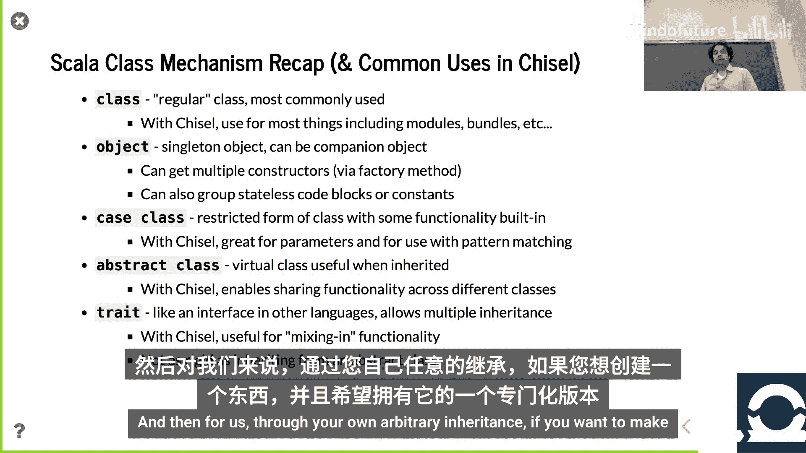

If you want to make something， and then you want to have a specialized version of it。

Fraditional class。 and here it works great。 If you have multiple things。

 they're going to share a lot of code， but they're all kind of peers。 There's no clear parent。

That's when an abstract class comes in， we can kind of have this。Single shared code。

 but it's not directly instanttid， you' have these trials that actually implemented。

And then the course we covered traits and so you can do things like mixing in。

So to give you an example of a really advanced use of a trait。There's something called Rockck chip。

 which is a system on chip generator writtenden in chisel。

And it has this really cool thing called diplomacy。Which allows different components in this SOC。

To plug into each other and as the code is running to do elaboration and generation。

Negotiate parameters。So for example， let's say you have multiple IP blocks on a bus on your SOC IP blocks need to figure out who gets which identifier on this bus and that's kind of a peer to peer conversation would be nice to do at runtime and so with diplomacy you can mix in。

😡，diplomaplcy functionality into your module。 And now it has capabilities ability to speak diplomacy other things。

 that's， you know， I think that pose a child the most sophisticated diplomacy I'm aware of in chisel。

 I'm sorry of a trait and chisel。嗯。And it's helpful for a lot of things and so yeah。

 maybe you'll find something for like debugging or testing is helpful。

 like I said maybe you want a hasstling for logging in your project and trade the way to kind of mix that in。

Cool， questions。

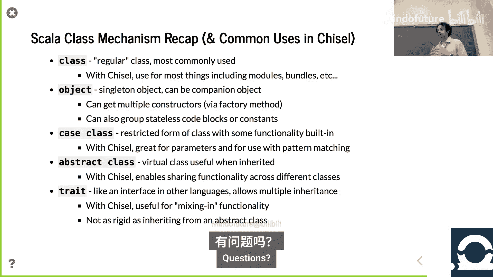

Okay， then。You know。As an additional detail we talk with coveredative。

 how can we have generics that is have templated types？In our system。

 we don't really want to make a code more usable， why don't we template types？嗯。

A lot of languages have generics。The generics of Scala have two。

Things that may not be something you've seen before when you've done generics and languages。

 Numb one， is when call a type bound， meaning rather than just letting any old type if you want to have a rule such as I'm only to take in any type for this thing as a generic as long as the type is。

 you know a subclass of X。 you can do that。😡，嗯。The other weird wrinkle about templating types or you know generics and Scala is something called T erasure。

 which was actually a thing can me traced back to the JVM and actually Java and。

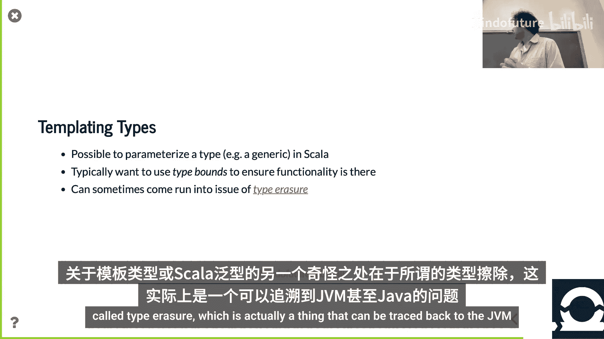

I'm quite critical of this particular issue， I think it's only of these things were mixed code。

Really confusing for people and it behaves in a way it's surprising then you know we don't like surprising when it comes to coding。

The justification for this is that， you know， choices are made many years ago for Java to have。

JDK8 compatibility。And those choices were persisted in Scala。

And I think Sca had made different choices that were more clear。

If you want to see what type ratio is and you go ahead clicking the link I put in the slides。

 go read on your own time long story short， there are situations where you can write code looks totally like makes sense。

 You're doing pattern matching on types with a generic and shocks can't do that because it turns out skull compiler discarded。

Information about which type is which and with the link I provided it has some information about how to do with some additional imports into your design。

 so that way it actually tells scholara to track types of what's' called a type tag and fixes all this。

 but that all sounds really complicated， I agree It's really complicated and it shouldn't be exposed to programmers that was me a real wordt and language。

And it's not a total coincidence， apparently the person who had a solution for Java is also to the scholar creators。

The same sin keeps compounding。Now let's see template types in chisel。😡。

This is the most canonical thing you're probably gonna to do， right， You're gonna have。You know。

 your module。 And then this is scholar style。 You know， you have square brackets indicate。

The type parameterization。And。Like a lot of other language is the type parameterization。

You don't always have to。Label everywhere to some， you know， carrying over and type inference。

 In this case， this is a very common pattern in chisel。

 you actually have both a type parameterization。And you also pass in the type。

And the reason why that's the case is that。Youent't。Even though we treat like a type in chisel。

 it's actually an object right， so it's actually not a type。 it's actually an object， right and so。😡。

嗯。We have a notion of a generator which producesces instances of a certain type。Yeah。

 that's kind of what we're doing here。Language from to society in countries is butterplay where if I want to have。

A type that comes into my module， say I want to use that type for the input and output。

I can pass it in like this。 and so yeah， here I have this setup of a question already， yeah。

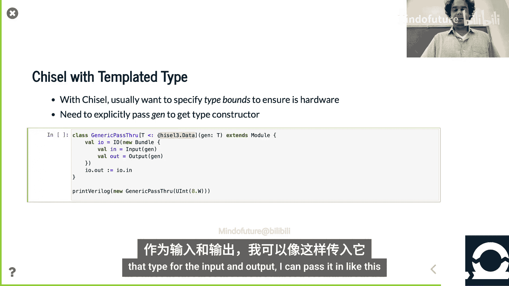

等定的。When I say you went eight like this， I'm saying I want， that's the type of passing in。For Scala。

 normally for type imaginationgen， you would normally ask type in like this。

 but the way we set up we're doing it the way I've shown， so example here I have it as。

 you know an eightpe， but you went， we've seen changing lifts all a quarter。

 I can easily change that to an essence。Which at this point doesn't really change anything。But also。

 of course， could do things like。You know， a bull。Right。They're all the same。

 So if I go to the next slide。

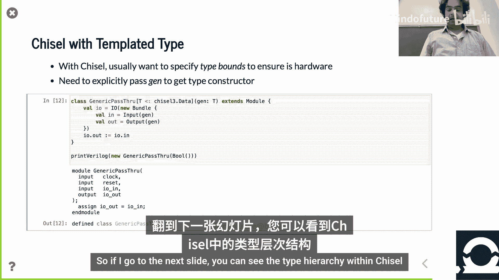

You can see the type power team was in chisel。And you can see that， you know。

 data is the most general。 and so a lot of times。Da is the right answer。

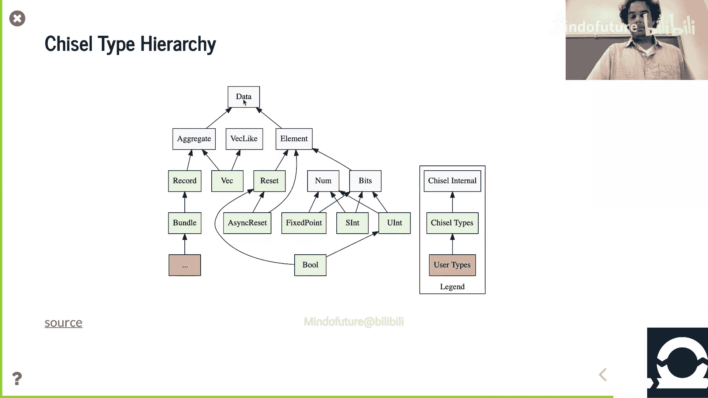

So you can see if I go back a slide， there wasn't type bound here。

 and it says whatever you pass as a type here needs to be。You know， a child of chisel data。

 And that's， that's a good choice for much of the time。

 But maybe it's a certain application where you want to be more strict， maybe you don't want。

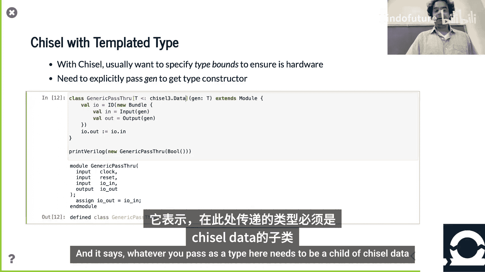

嗯。😊，To be so broad， Maybe you want it to be a number of bits， right。

 And so you can see how more should get right， you know。

 data includes both Vs and bundles as well as un。Those kind of more specific ones as well。不。

So then if you could take our trustee queue from before。Now， for the last step。

 we're going to ahead and template our， you know， type。And that's it。

This is Jen appears in a few places and。Now， QV7 is what we always wanted， right。

Tpe parameterized has all flexibility we're hoping for。You know。No problem for me to later stage。

 just say， you know， give me an essence or something。

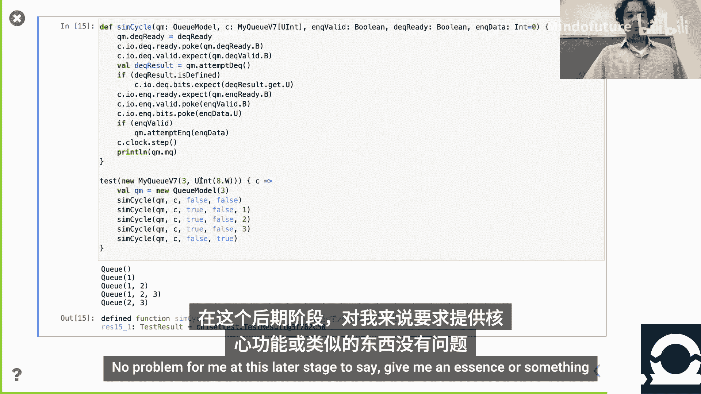

Oops， that breaks my test bench， but not the generator and so's goes for to be aware of that I wait I change it。

 I I change it here。

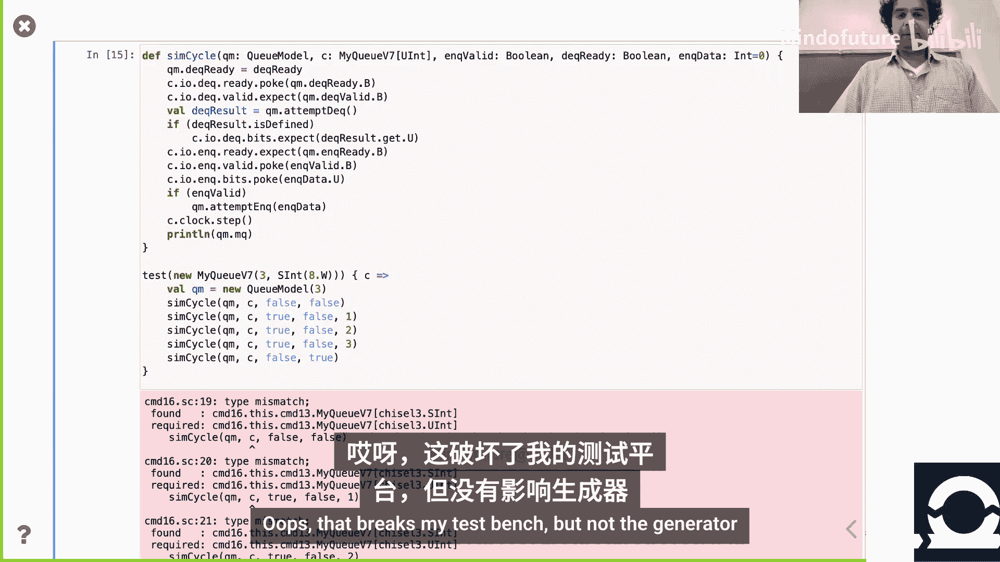

And here。And it might still work。Nope， because the test bench has gott you in it。

 so my test bench is not parameterized enough， I need my test bench type parameterized。

 but the generator itself is type parameterized。Oh。Okay。

 any other questions about inheritance or type parameterization。

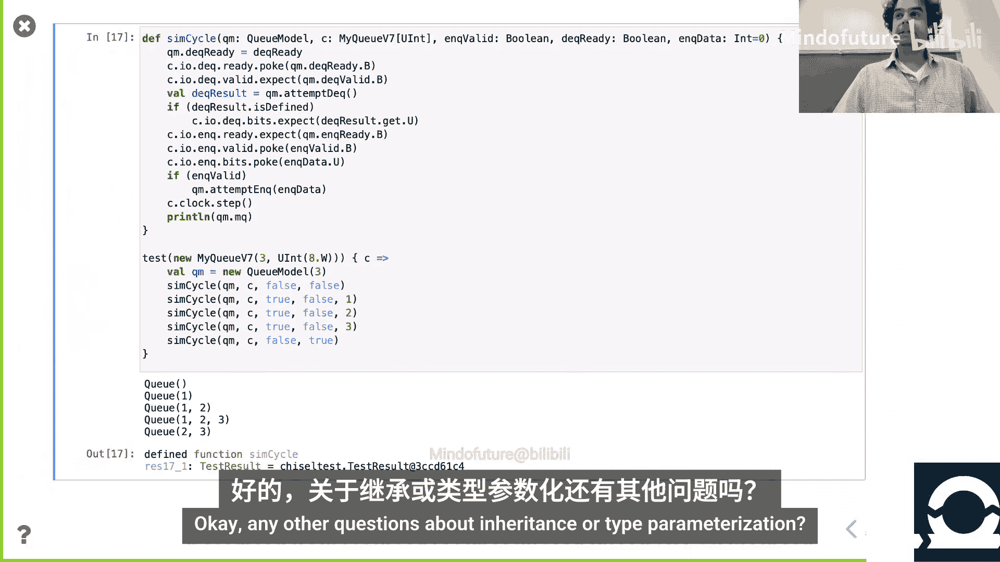

So， I with。A few slides here on Susa for project and。I can go over them now， but also， of course。

 and encourage folks that they aren't present or don't have the are talking watching live to answer today。

 come grabbing office hours next week as a reminder， a week from Monday where。

You're going to need your project proposals， you're to upload you know， a PDF。On Can and from there。

 we're going to have our project meetings the following that week， you know， on Tuesday and Thursday。

The talk them over。Stay forer。 right， What' to go to the project。 You're gonna is it， you know。

 as a pair or if you really need to alone， but recommended a pair。

 you're gained experience developing， revvising a generator， right。

 So you're gonna propose something on a build a generator to do X。

 And then you're gonna to go about building it。 remember， it's kind of a progressive step， You know。

 how do I think of the most simple， small thing to do。 How do I kind incrementally keep extending it。

 How do I test it how to get flexible enough and make it better in various ways。 And so。

Oftimes you get questions from students about how to pick a project and I usually just say。

 start with things you're familiar with， things your applications or domains if you're really interested in。

If you start there， you already kind of have some knowledge about that domain。But then again。

 if there's something new you want to try out， still free to， right。

 that plan students kind of use this product opportunity to kind of learn something new。

So that's totally fair。The things I want to see in the project is your generator is not just a single fixed function unit。

 but it has some sort of press to it you can change。

Some knob turns some knobs on and makes some sort of generation about it。Additionally。

 it's kind of good to take the right size project you know it's very easy to have something that's too small or too big and this is a good thing to have a conversation with an instructor about to make sure it's the right size one the thing that' nice to have when you have a project if possible is they call incremental progress in other words。

A project where， you know， it takes a four weeks for this project。

It's not always clear from the beginning before we started what's going to be possible or how fast you're going to be able to build it right and so I like to have projects where if you have a really rough time you only get a small fraction hopefully to get working working。

😡，There's still something there， rathering， know shots， it doesn't work at all。

 just something to show for it。At the same time， you know。

 there's room for if you do really well to kind of keep adding functionality on that can make it bigger and deeper。

 right So have this on kind of ramp or as you know。The bare minimum is still interesting。

 and then you can make even better still。嗯。Now in 2025， there are quite a few projects out there。

 both from this course and elsewhere so yeah， look around the web。

 make sure you know has this been done before， has this been in chisel before， if so。

 it doesn't mean you can't do it， just try identify how yours will be different and how you'll do something new。

嗯。And when you brain the proposal， one of the things I ask a lot of truth about is how do you get started right。

 what's the first thing you build， what's kind of simplest smallest things what's your roadmap where could kind of you know theer functionality eventually get to there eventually and stuff like that。

Questions。Okay， so some past projects while kind interesting to share least that we've seen alls of site threes and hashes over the years。

I normally am a little bit hesitant about some of these because like I said。

 a lot of these are very fixed functions， they're not really good generators。

When we've had better projects in the space， it's been because students have been very clever about how to use generation methodology to implement a hash in a way word a code。

 rathering less of copy and pasting or lots of constants actually like。

Is it touching it in much more verifiable？Elegant way， but。I've seen a lot of these projects。

 and they can be good， but I I prefer people to keep looking。 also out there。

 We've had people do all sorts of things for AI。 Of course。

 we'll take neural nets and then turn on hardware。 People have built components for AI accelerators。

 example like a sstolic mentioned location unit， like in the TPU。

People have built bloom filters and they still built things thatre just for fun that don't even make sense in hardware like building a manlebro frackal generator in other words。

I compute all these bits for fractal and had a way to visualize that。

 But even know that hardware software interfacing didn really makes sense in for real world。

 it was fine simulation。 It was kind of cool project。 that was fun。

 People doing secret climate for DNA or Smith waterman， things doing A。

 fact people doing video images。😊，Audio， all that。A lot of things are possible。

you haven't already maybe talked a stuff about your project and that sounds good and find a partner too。

 of course。Cool， any last points？Okay， let's end that lecture。

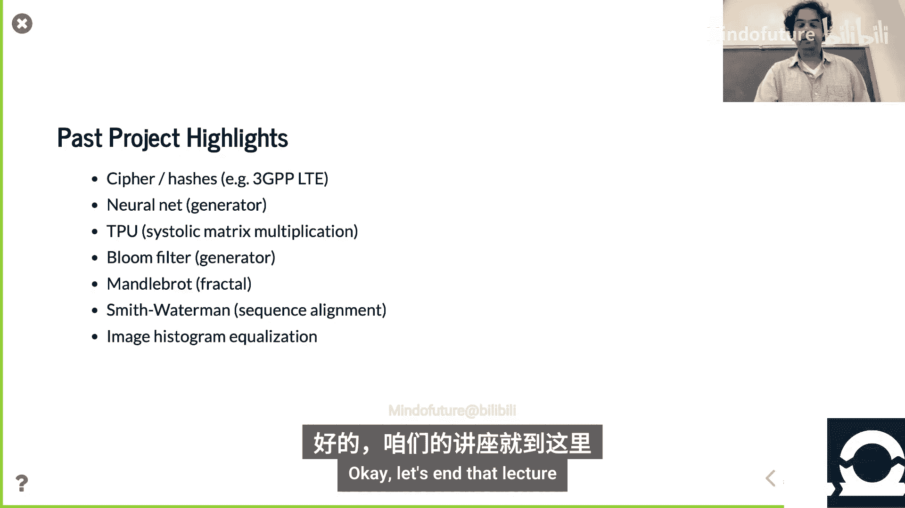