# 【加州大学】敏捷硬件设计-CSE228A-｜-Agile-Hardware-Design-Spring-2025-p21-P11_第15讲-网络设计案例研究--BV1M6ivBzESw_p21-

Hello， welcome to lecture 15。 We're doing yet another design case study。 So you're fun， right。

 We could take this process of。😊，Having a dream where we want to build。Identifying a simple。

 small version of it and incrementally extending it。Earlier this week。

 you saw me do a case study for designing a 50Q。In that design case study。

 we really emphasize a size on how they kind of get that first foothold by simply building a single entry queue。

And then how we kind of incrementally。Those little very sophisticated cu。

 and he saw in the last lecture now as filing type parametertrys that's a fully robust reusable group。

Great cute。The second design case study。Deemp is going to be on how can we use the features we just talked about。

 in this case， inheritance。To make a library of things that work together。And so unlike the Q design。

 today's design is not going to have。All of the code。

 there be some cases we're willing to show some of the code to kind of show the part we care about and there some functionality。

 we're not going to have space to show。But we'll still be able show kind these key points and get that across so let's you know talk about where we just kind of let's again have a breath of development plan。

We we're going to go from a crossbar， which is a really simple network component to a parametertri of network generator and kind of showed that progression and perhaps you can have a similar thing in mind for your project。

Okay， so as always， get the notebook going。

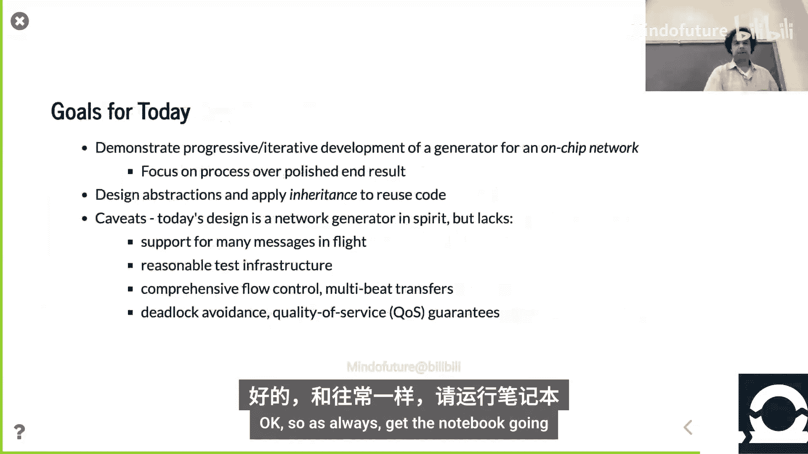

So。We want to launchup network， and we're going to show this itative development process， right。

As always， focus on the process over the result in these kinds of lectures。And today。

 the kind of goal is how can I do this in a way that shows productive use of the inherentherance functionalities？

And so as I said， design today is not going to be fully functional every time， every slide。

So you can imagine trying to build a full network on chipI。

You could be a lot of things you might like， maybe you know。

 understandably you want to have many messages in flight to have a lot of， you know。

 parallelism lost throughput。Today's designs will not be able to do that right you're going have really robust testing infrastructure。

 obviously really important。 Today's designs will not have that。

 Maybe you want to have really clever things for flow control or multib transfers you know ways to kind of stream data3 system。

We're not going to have that and all sorts of other concerns from network design。

 things like dead luck avoidance， quality of service。 Yeah。

 we're doing much simpler thing today and just kind of rolls the big picture right。

 we're trying to build network components。

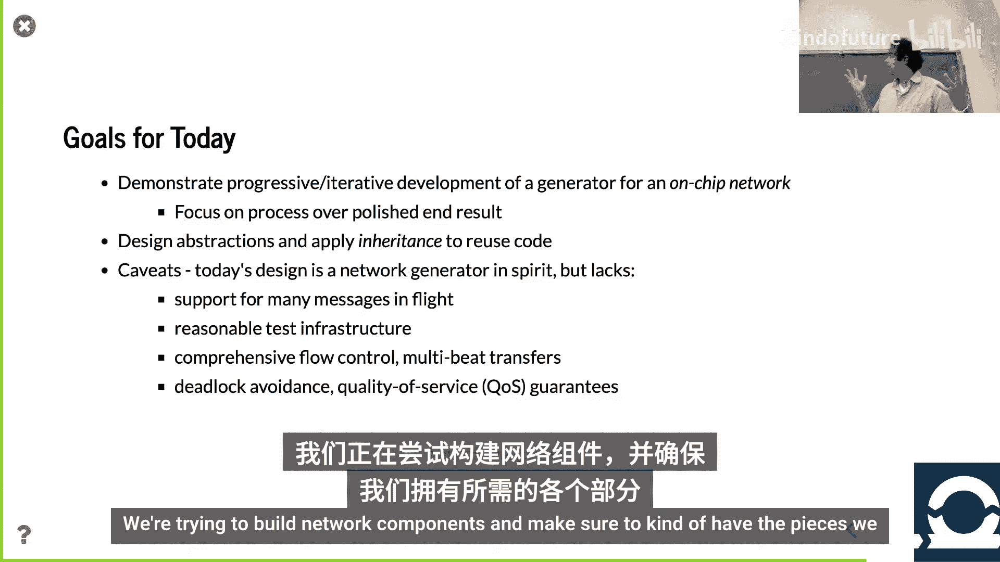

And make sure to kind of cut the pieces we want to put them all together。Okay。

 so we've previously in the prior lecture built a crossbars remember crossbar， having to have。

Sum number of input。Tumb number of outputs as a way for things that go from inputs to outputs。

 And so there is kind of this all to all or all inputs to all outputs kind of connectivity here。

 there's a lot of wires in the middle。But remember。

 if we have multiple inputs trying to write to the same output， with's only one output port， right。

 So the way we handle that we have was called an arbiter right。

 which selects amongst the many inputs requesting there and only lets one of them actually send data and other it told。

You've not been granted this you have to wait till they get a grant and actually send the data。So。

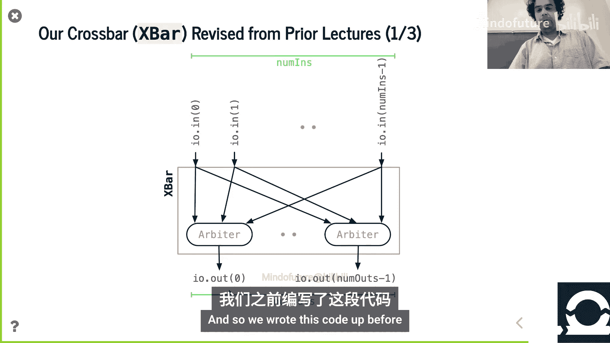

We wrote this code up before？And actually， now I'm going to show this code again。

But we've already revised these functional programming。Starting off， what are we gonna to need， Well。

 we're gonna to need a message type to kind of you know happens because they go across the network。

 So the message isn't just the payload size。 It also needs to know。

How many endpoints to our that way knows I think to big the adding field is， sure。

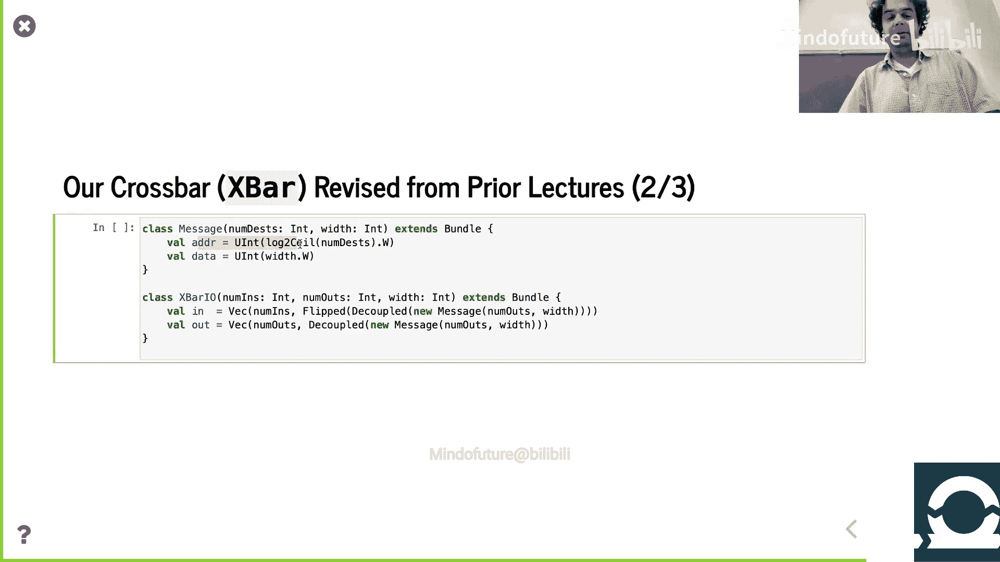

And of course， we have the IO for our crossbar which shakes in number of inputs and number of outputs and the payload size and then。

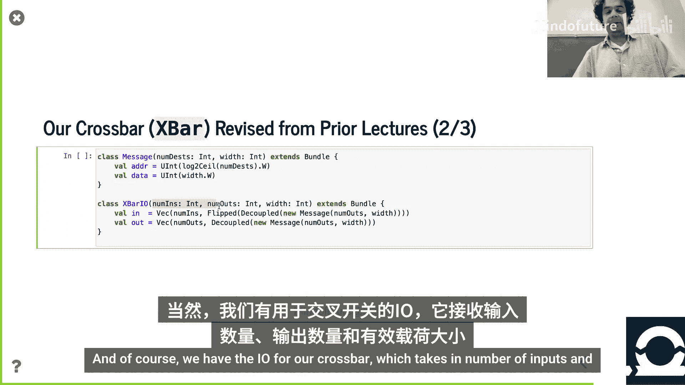

Given that。It figures out。All the stuff for us， right， It has all this， you know IO， which of course。

 going be vectors of these ports。酷。😡，So we have the IO set up。

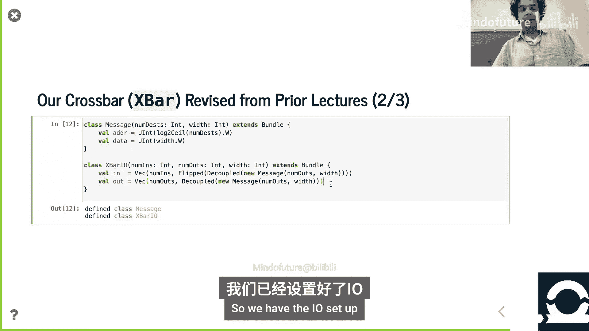

And now here is the crossbar from before， but we've already actually made it more concise with the functional programming and here you can see me kind of blending。

Both the functional programming concepts and for loops。

In the same time and it's kind of way to make it， in my opinion。Le least complicated， right so。

Let's look what we have here。 right， So our cross bar。

 we're going to have one arbiter per output port。 So for number of outputs。

 we're gonna to have to see， you know。Is ancient the arbiter？This is， you know。

 the round Robbin arbiter， but that's not， you know， super important detail。

Look at some of the combinations we have here going here， for example， for all of the input ports。

We're using a for loop because you actually want to have that numerical index in order to kind of index into things because I'm going to go grab into the。

Input port， sure， get the ready signal and then attach that。And look at this。

Complicated bit of code here， but it's some easy we can do all this quickly， right？

So let's kind of talk through through initialize。The ready signals for。

That thing was going to be based on the vector and is going to take all the arbiters。

We're going to grab。All of those ready signals corresponding to it。And then。We're going to。

Connect them to the address， right， Is there something missing here， there we go。

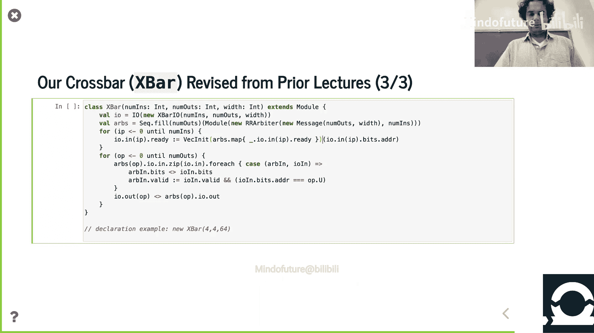

Right， so it aheadt declared all this。嗯。There's a lot going on there。

 but you can see we're kind of able to kind of filter all this in， so we're declaring this V。

Of all these things， right。 And then we're grabbing a field out of thatve。For each one of these。

So yeah， it's a little bit heavy， but this is actually pretty cool we can kind of pull this off。

Then if you see output ports， you know for each arbiter。

I'm not zipping up the arbiter with the input ports。

So we have the arbiter IO and the input IO and then yeah， use some bulk connects。😊。

Another connection here here's that kind of know check to make sure， oh， this actually for me。

Et cetera。 So we've seen this before。嗯。And yeah， if you want to declare it。

 you can say I want a new crossbar， you know， four ins， four out， 64 bit payload， no problem。

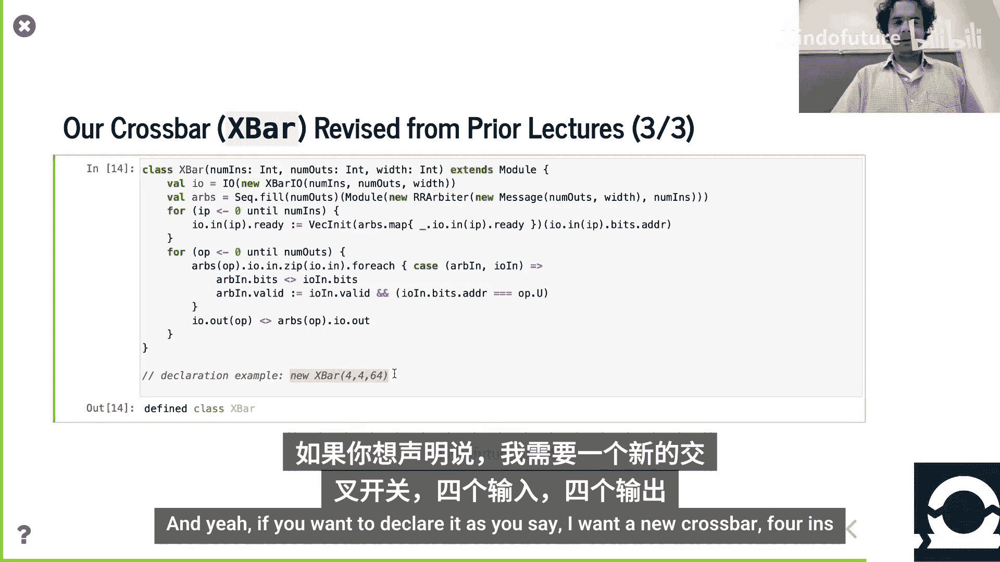

嗯。

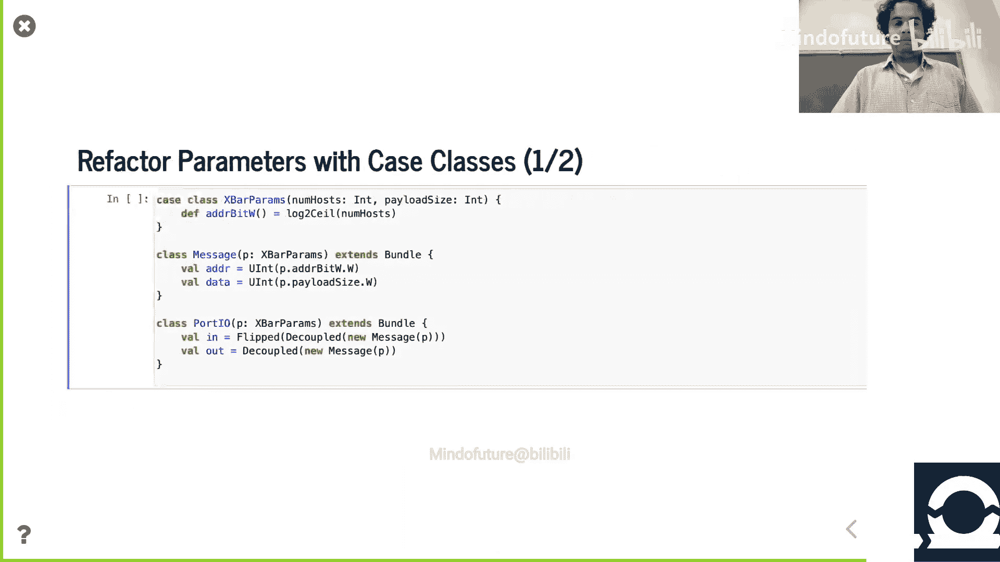

Cool。So。That work。But let's keep improving， so let's say you know what， I want to use case classes。

 so I can use case classes for holding the parameters。

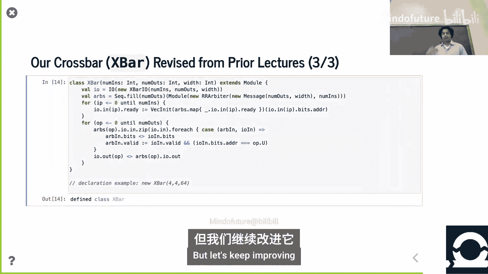

So， for example， have a crossb parameters case class that has the number of hosts in the payload size and then。

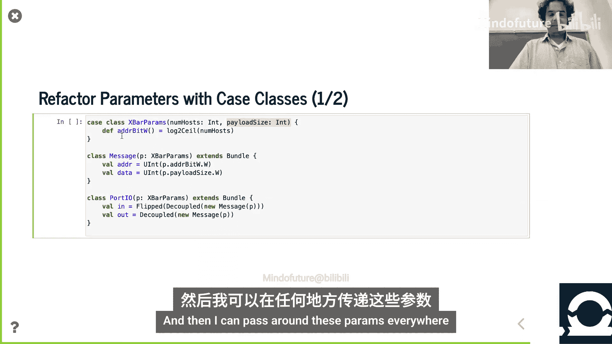

I can pass around these parameters everywhere。 So remember from a few slides ago。

 I kind of had to kind of remember this notion of。

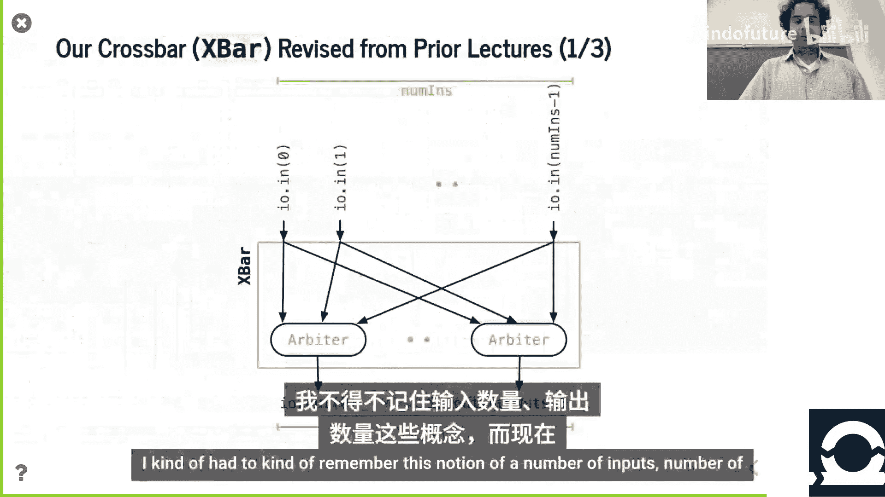

You know， a number of inputs， number of outputs and now。I just need to have this pram。

 and that kind of encap that for me。Not a huge win。

 but it's still something that's kind of nice to have this。

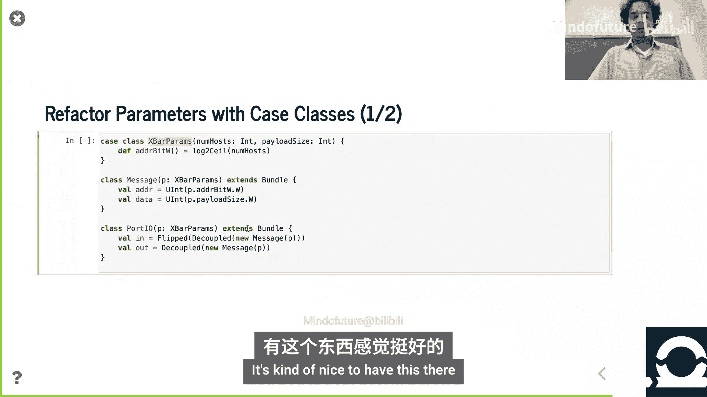

There this shows how I can use that functionality。😊，You can imagine in the real design。

 maybe your case classical parameters becomes really big。

 and the reason why use as you don't want to have， you know。

10 lines of this kind of stuff you want just have parameterss， so in the long run。

 pram is a lot more scalable as your designs gets more sophisticated for holding those kind of fields。

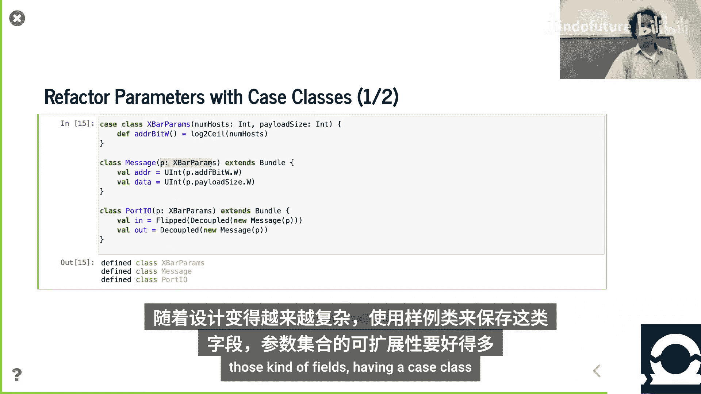

Having a case class， cool then。Actually inside the module， you know。

 using the case class doesn't change things too much。

 you know we have that one case class rather than two arguments。When we need those parameters。

 go ahead and grab those fields。That works just fine。When' we instantiate it？

We not only declare we want a crossbar， we also say we want that case class to be used for the prams。

Not too crazy， it can all be done。Cool。Questions so far。Okay， so yeah， so we've shown。You know。

 we had a cross bar。 we just made a little bit nice survey using K vessel for parameters。

 What else can we do， Well， what if we want to use that we just covered。

And have a template type for the payload。We can do that too， and we can encapsulate that also。

Into the parameters right， so the parameters are going to take the number of hosts in the payload type。

And then you can see everything else kind of comes together where the data is。

 whatever the payo type is。Readen that out the parameters。And then。

We're going to go ahead and define， you know the port for this crossbar。And yeah。

 you can have you this message going in both directions。Cool。So then。

If now I want to build a cross bar， and I'll highlight one more thing we've changed。

 So before Ed's notion of。Fable number inputs， variable number of outputs。 Now we're gonna have。

The same number reports and each port is going to be both in and out。

This is a model we're going to follow the rest of the lecture that kind of have this symmetry there。

Okay， so if we go to the actual design， sure， we can go ahead and santiate effect， you know。

 of those port dis once again using this template。You see。

 the inner code has not changed too much by this。The only distinction is now。

 of course I want to stach this。I need to say I want the case class the parameters。

 and I also need to put in。That type for the unit entries there。Sure， yes。Li。That， that， that is the。

This is the parameter， the parameters。

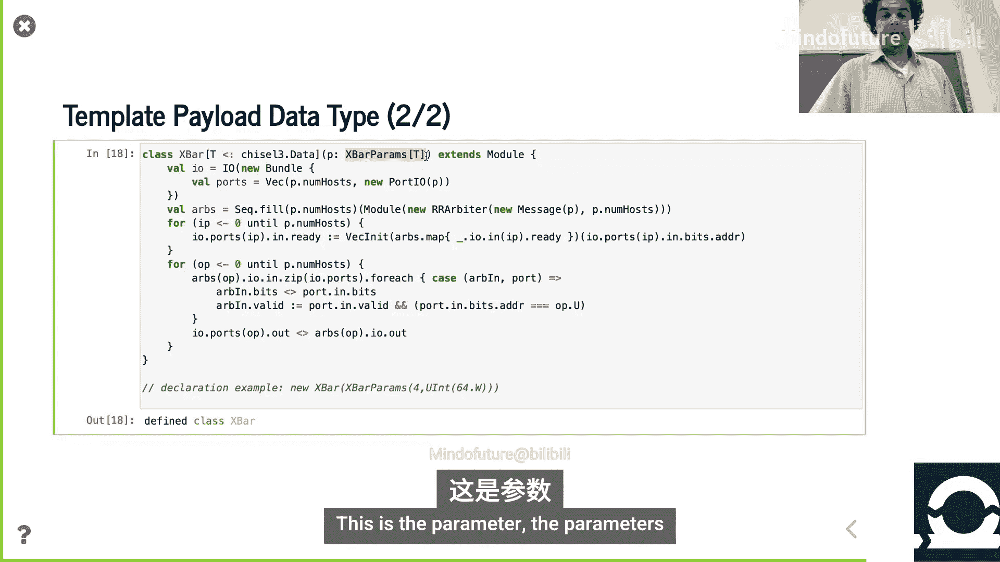

嗯。I would refer to。

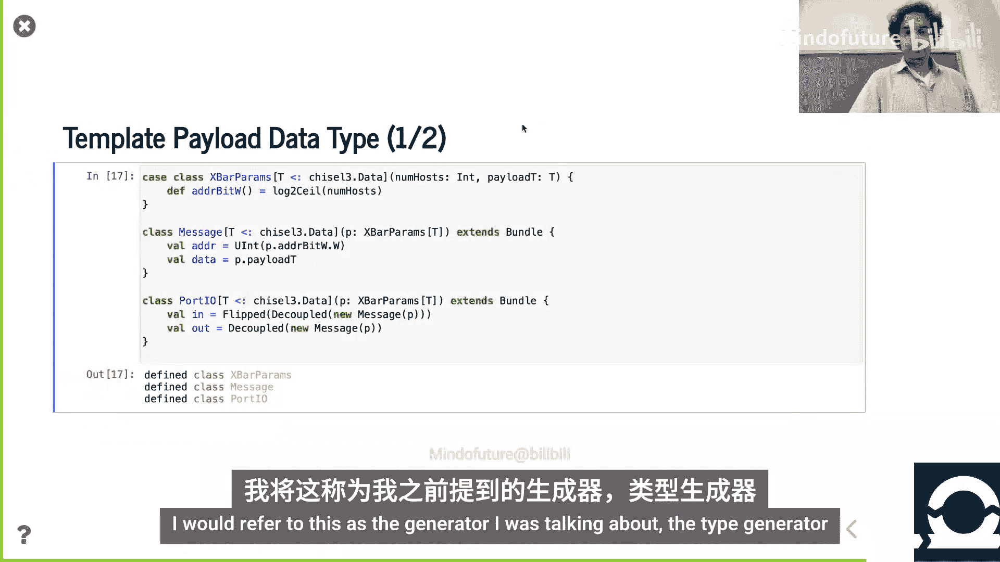

This as the generator is talking about the type generator， yeah。

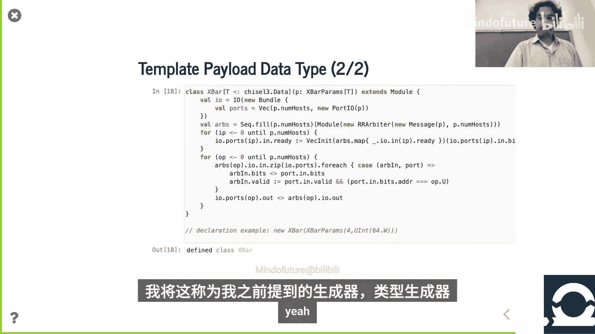

Good question。Cool， so our template0 play class， yes， the codes will touch more。You know。

 syntax full。What you know， the edition of templating but。It little more flexible crossbar right。

 we now can take in the templated type， the parameters and caps， a lot of stuff。

And also appreciate you hear I'm showing a crossbar。This actually is a lot of code you would need。

 and as's you know， fits in a quarter of a slide， which is insane。If you're ready some very long。

 you'll be。UnLline 200 before we get to where we're at lot of load code。

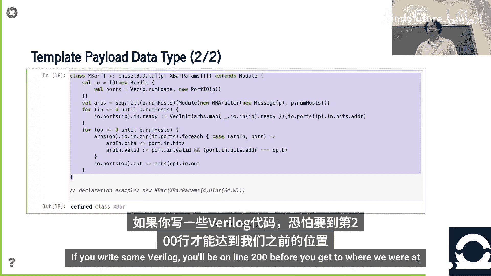

Cool， so let's now go from a crossbar to a multihop network。

 and this is a very typical progression in networking。

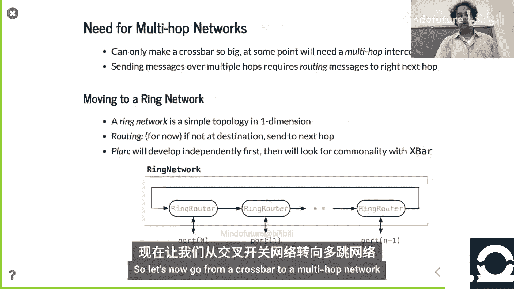

Where。You。啊。As you increase number end points， if we got more scalable。

 you have to kind of change your topology right， So a crossbar is point to point for one hop。

 which is great， But you go bigger， you need to do something else at some point to go multi hop。

 right， And so let go multi hop。 then， of course， the challenge isn't just the hops。

 was's also figure out where to go each hop， right It's called routing， right。

 we make a choice about how to get to your end destinationation along the way。😊。

And so the simplest multiha Ire recently called a ring。Which is， as you can see down below。

Or now these routers。And each router is， you know， in a ring。An router also is a third port。

 which connects to the actual hosts。We're going to do really simple for now。

We're going to send messages around this ring。If it's at the right spot。

 it's going to get pulled out to that port， if it's the wrong spot， just send it forward。

 So the routing choices are triggerled just is this for me pulled off， if it's not for me。

 pass it on and eventually'll get to assassination， it might take n -1 hops。

But it will get there right this is kind of a starting point right once again。

 starting simple and going to incrementally extend yes。Yes， the question is， why。

 why does multihop become a necessity， Yes， So if I have a 64 port crossb the way I was building it。

 it's gonna be a lot of wires one place。 Also a lot of logic in one place。

 It's gonna to be a lot of mus there' a lot your arbiters， a lot of things of hard time scaling。

 And so， yeah， at some point， you're gonna need to go multi hopop and。😊，You know。

 maybe you some clever engineering tricks to increase how they can make a single hop。

 you can always make that a little bit more scalable， but。Whatever number someone says I can do that。

 you cr number up higher at some point， single hops going to break， right？嗯。

If you are going to need that other capability。Co。

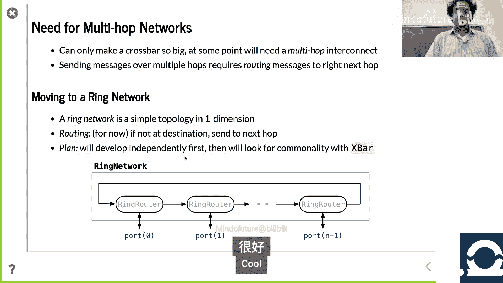

Sudan。Let's try to write this ring router。Right， so what' does it look like， Well。

 we have the actual ports from the prior slide right now， input port。

 output port and into port to the host， right， And so you can see that we have this port I。

 which is both in and out。Talk to the host， however。Inside the actual network。

 which is not visible to the user， we're actually descending around messages directly。

We can see things， for example， coming on the input is something for me， right， Does the address。

Match up。嗯。And of course， you know you fill in the various fields， for example， you know。

 MI take something in， well， is my output ready， you know， is my output valid？Well， is it for me。

 et cetera， right， you have these things filled in。There are some， you know。

 gotchas in yourre kind of lurking。 for example， we tell the input port we're ready for more passages。

 If our output port's ready， sure， or messages for me。And host is ready， but。

For me depends on the message， thats kind of a little bit of a loop there where our blue ticket message coming in isn't just based on how busy I am。

 but also what's in the payload because。The message is not for me。

 all it matters map ports available。 if it is for me， it matters if my local ports available。

But yeah， we sketch this whole thing out and you'll see， yeah， in our output bits either get。

 you know。Pass through from the input or comes from the host。So thiss sketching out right。

 and then the actual ring itself， what do we do Well we need。From our parameters。

 we can know how many ports we need， right， nu hosts。Each port is can to have its own router。

 so we got to instantchiate that many routers。And then here's more to functional programming。

 you know， magic， right， We're going to go through those routers。

Use a fold left pattern to kind of connect them all up so you can see。

 you know the previous and the current and just kind of go through all this is the same pattern you' seen before right use the semico in them。

Pass on the last one， right previous in this case。And then for the ports， once again。

 take all the routers， take all the IOos， zip up， and then yeah， router and port in。

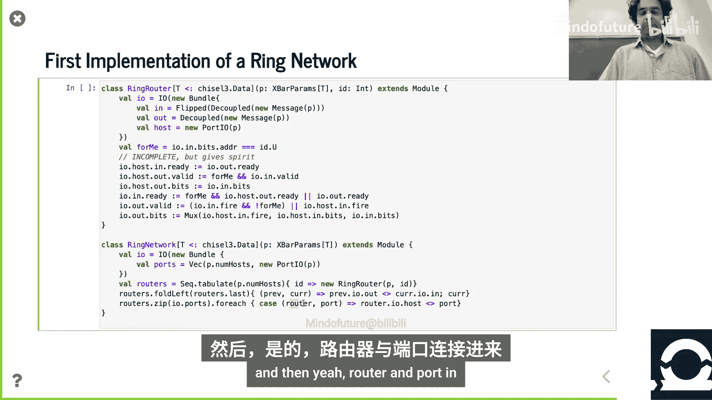

Do a bolt connect So yeah， here's a ring network。That fits in one slide。

 it's still not quite exactly because a few functionality is not here， but。

We're sure getting a lot of benefit from chisel in this case， right。

 We're getting a lot of things quite concisely。 functional programming， abstractions， reuse。

 it's all coming together。Cool， questions。

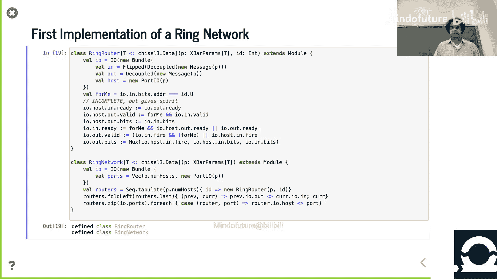

Okay， so then。嗯。We have the crossbar， we have the ring。They're both networks， right。

 so what could we do to。Share code and make things more productive， right？And so。

The high level Bodom have this notion of a network with these bidirectional ports。Right。

 from the host point of view。 And so you can kind see us comes together。 Okay。

 we'll have this notion of a network parameter。And that just takes the number of hosts and they template for the payload。

 sure。

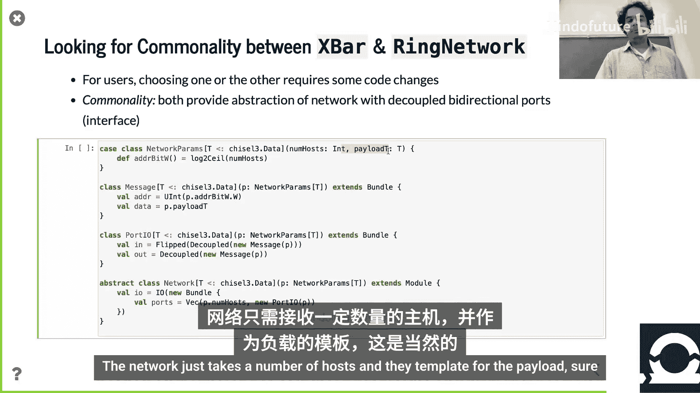

The message， yeah， okay， that checks out the ports we've seen that before。Here's the thing。

 Now we're going to have this abstract class network， which takes a node parametersms。

And it can go ahead and fill in the ports， right？And the parts are the effect of these port is。

 So this is all now shared。And what's cool about this is I can go ahead and redo a crossbar。

And notice how I extend network right， so say instance， you， say subclass sub network。

And you don't see the IO declared here anymore because IO is coming from that parent class。

The cross our body is basically the same otherwise。When it comes time to instantiate it。

 the fact this is a subclass isn't really that apparent to the user， and the user just says， hey。

 I want a new crossbar。It's a new crossbar。We actually happen to get in summary code functionality from this parent class。

 which makes the body of the crossbar shorter， but。That's kind of hidden， so that works cool。

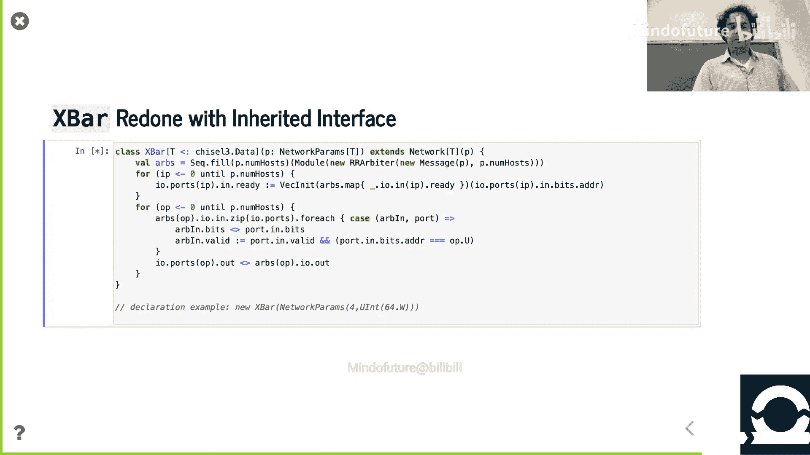

We do something similar with the ring network or the ring network and also extend。Um。

So the router itself is unchanged， right， but the ring network now extends network。 So once again。

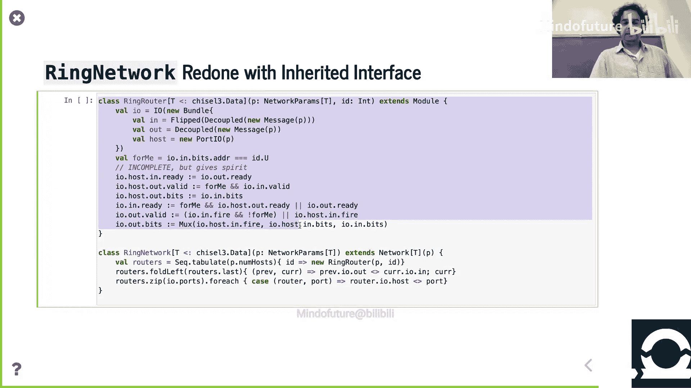

You' see Di IIO declared here because the IO has already comes from the parent class。

And it comes together。

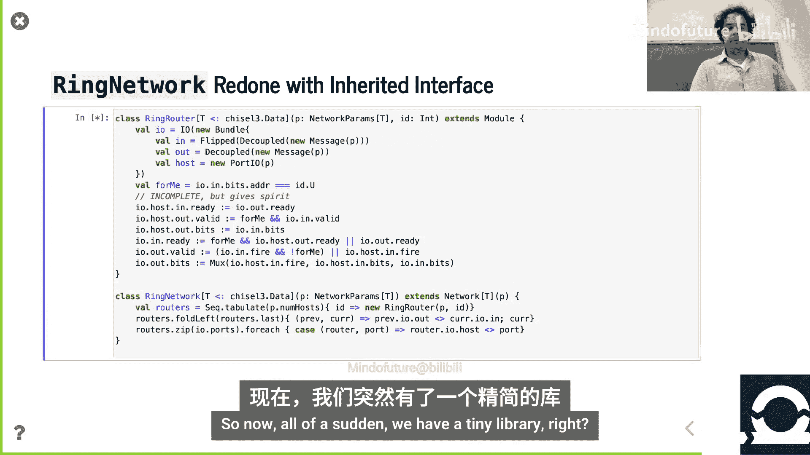

Now， all of a sudden， we have a tiny library， right。

 We have a notion of a network and a network can either to be Sancheed as a ring network or a。

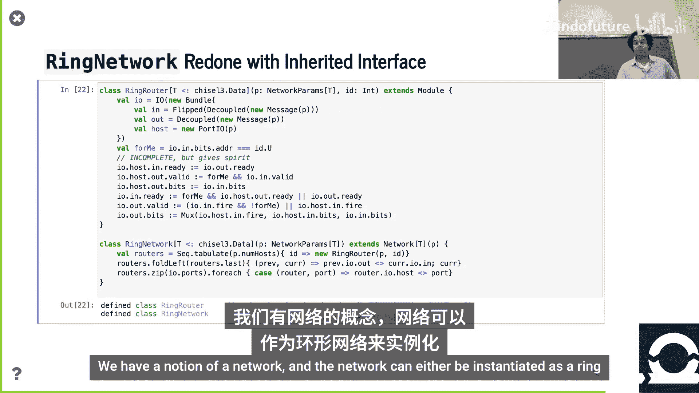

Crossbar。So how are we doing？We've parameterized number our host， cool， parameterized data type cool。

The ring network specifically itself， it not ideal， right？😡。

A one dimensional ring that's undirectional means that messages could have a long la， right。

 takes a lot of hop to get a place where it needs to go。

And it's not very interchangeable to crossbar。 I mean， yes both are networks。

 but you'll see in a second how I can make that more smooth。 But before I go on questions so far。

Let's go ahead and。

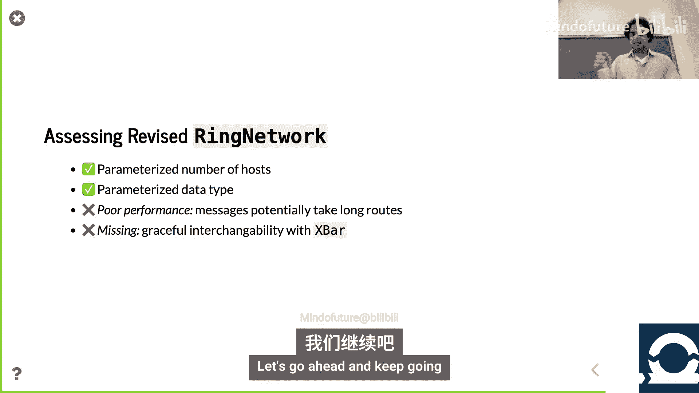

keep going。So。😊，I mentioned second go to ring with you indirectional。

 causing the hop count to be high。We make the ring bidirectional。

We're going to have the number pops on average， right， that's pretty cool。Now。

 if you experience Fl networks， you' would recognize that making broad directional ring makes things a lot trickier because。

One life is about having undirectal ring。Is if something's not for you。

 you just always send it out now。Not only the routing choice if I send it out my left or right ports。

There's also things like deadlocks， right， we can't have people spending at the same time。

There's ways around that with things called virtual channels。That's more complexity。

 right you can see why that's something you build first， we kind of build up to that， right？

We're looking in the details of the deadlock today and thiss kind of showing high level I， Okay。

 we're going go to bidirectional。

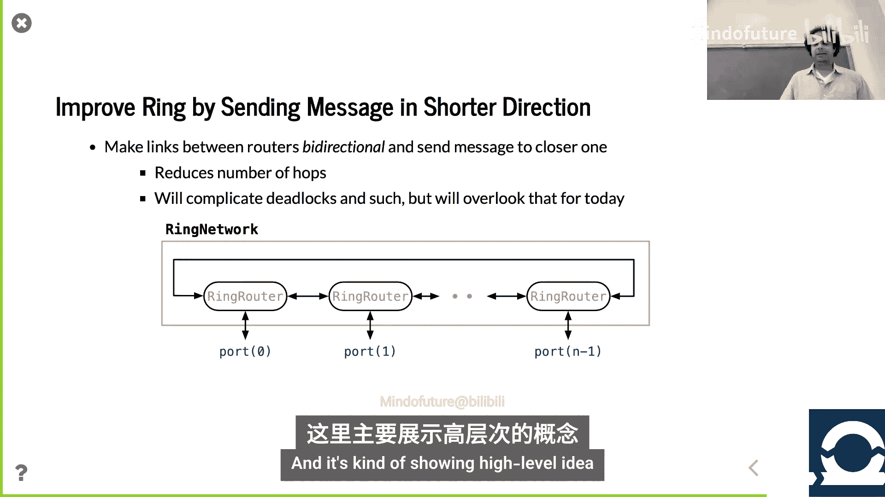

What it look like， okay， going bidirectal？If you actually look inside of Windows those routers。

You can think of it differently， so I drew a ring router before。As you know。

Very specialized here to ring router， one way to think about it。

Is it the router is kind of two things， It's the crossbar。It have to routing logic。

 you put do two things together， right， so face come in the ports。

 use the writing logic for where what's going。 And then the routing logic internally is going to tell it which cross port to use。

Internally， right， I had a whole goal。So we have the crossbar。Messages come in。

 we pull off the address field， use our routing logic。

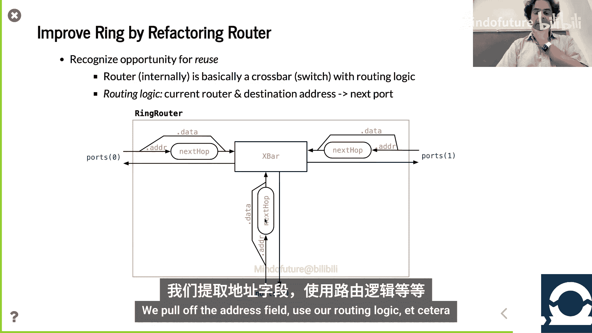

E cetera， right？So let's feed that， right so now。For our router， we're going have three ports， right。

 which is a little bit， you know， peculiar。 Remember。

 we have basically ports for either direction to the network and a port going back to the host。

 I'm kind of for now using a。A。A comment， but you can imagine maybe you'll use an inm to make a coat cleaner in the future。

But how's luck come together？Notice how。We have inside a router now a crossb as paraist， right？And。

If I'm using send node parameters for entire networks using parameters for just this crossbar。

 which we say， yeah， we want stream three port， we got that。Incident。

Here we are connecting up the ports， right， sure we do that。But look at this， right。

 if we go back to where our routing logic is here。 So routing logic is this is a scala function which takess in the u and returns the u。

 right， other words。Given a。Destination address， which is in the larger network。

We're going to return which crossbar port we want to go to。So。We're going to。Make that choice， right？

啊。And you can see there's kind of。Multiple things going on if the thing is for the host。I。e。

 the address matches myself。It was out port to you。Otherwise， I want to go to whichever。

Port is closer。 So there's some math here in this mu about whether you go left or right or going into towards0 versus port1。

But you can see okay at the calculate distances。And then Ba turb1 is less。We。

Select that right if you see it。This is really kind of a pretty intimate blending of Sca and Chisel where。

This is chisel， right， This is a mugs。 These are working on newance。

 This is going to be hardware and designed。 There's gonna be a mug。 There's gonna be compar。

 There's gonna be。I subtract all that good business。But this is also a scholar function。

 which we're going to call。Inside our connections， right。

 have a next loging area you kind of tell us where things go， so。

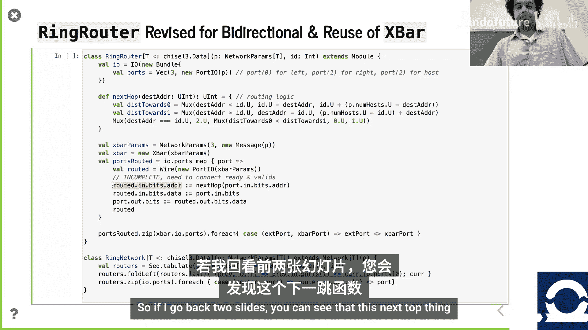

To go back two slides。😡，You can see that， you know， this next top thing。

It's actually being used to modify the address field when it goes into the crossbar。 right。

 In other words， this is a classic networking cr encapsulation， right where。

Even though from the outside the user says， oh， I have a message going to host 14。

Inside here to ride up to sail wait， host 14， I'm posting06。

I'm going to determine it's better to grow out port one。

 so I'm going to put port one on the port here， so the crossb is going to work in that thing and then take it off and then send the right message off to the end destination。

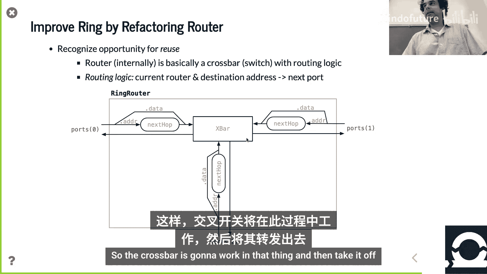

So that's pretty cool。

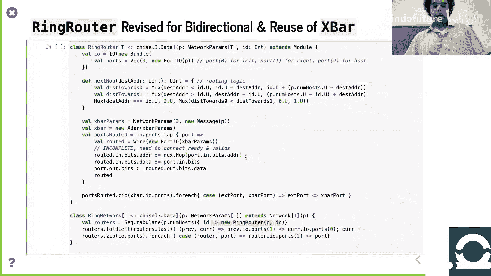

Um， of course， we can wire things up， things like for each were a old hat for us now。

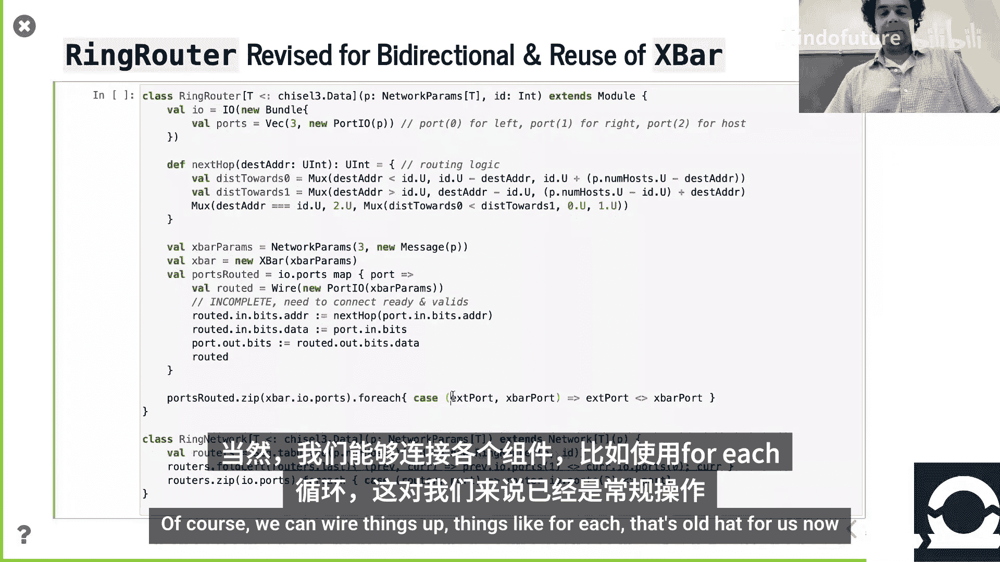

Is it for each combo here to do with some wiring？

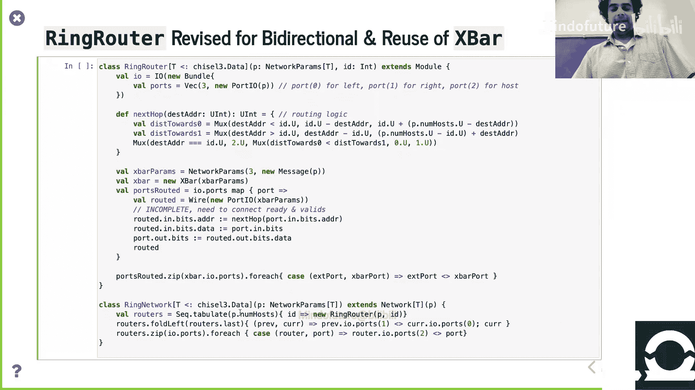

And then the actual network， the actual ring say as before。

 we have the fold left to kind connect up the ring and another zip for each combo to do the bolt connect。

 So yeah。It pretty cool， right， We just built a bidirectal rank。 It's not perfectly complete code。

 right， but a lot of key functionality has been expressed here and quite concisely in this chisle。

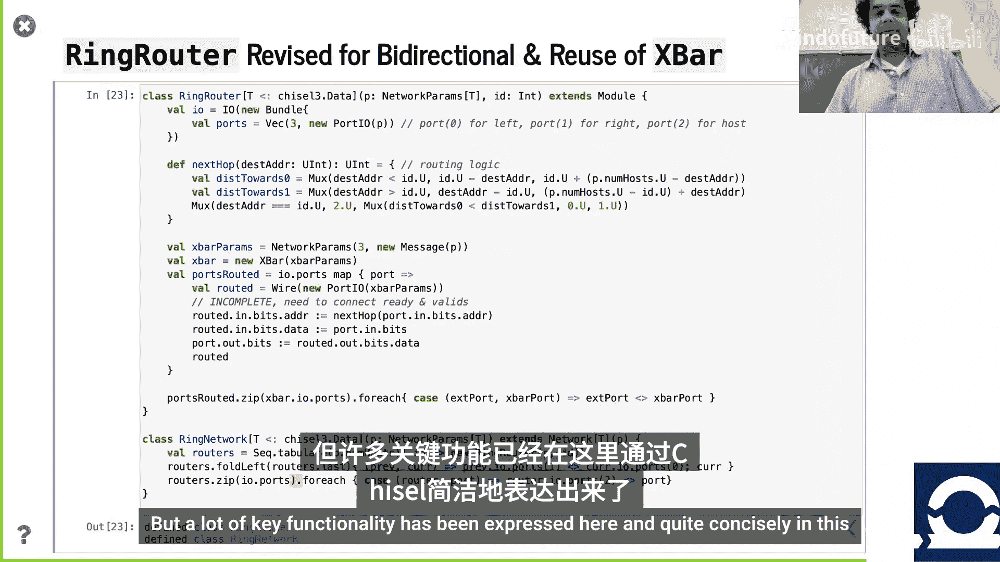

嗯。So how are we doing？Now it in a shorter direction。We have a crossbar used inside of the network。

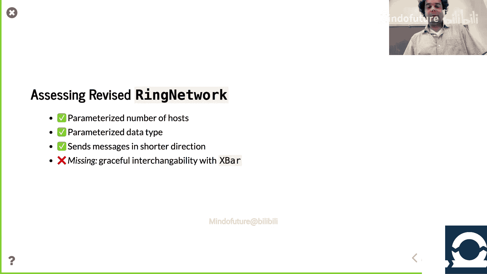

But can make this easier to kind of interchange from a crossbar？

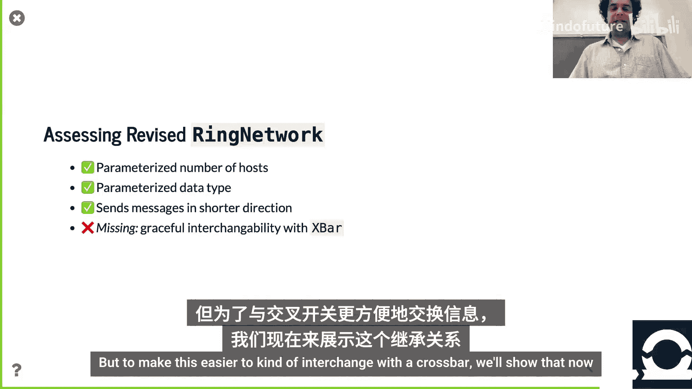

We'll show that now the inheritance。So what if we want to。

 you know use that factory pattern for before， so we have a network？Pararameterters。

 sure number of hosts， payload， notice how given that information。It's the compute number of hosts。

But notice how we now made this an abstract class for parameters。

And then we can have parameters for each of network types， right， So for now。

 both the crossbar and the ring parameters。If both extend this abstract class for parameters。

 they have the same fields。You can imagine， maybe。Making new network topologies that have more specialized fields not at totally be supported。

 right， So you can see how a lot of things take dysinic parameters and it works just fine and doesn't necessarily need to be too you know complicated based on the child classes。

 right。The ports the network itself， takes the network parameters。

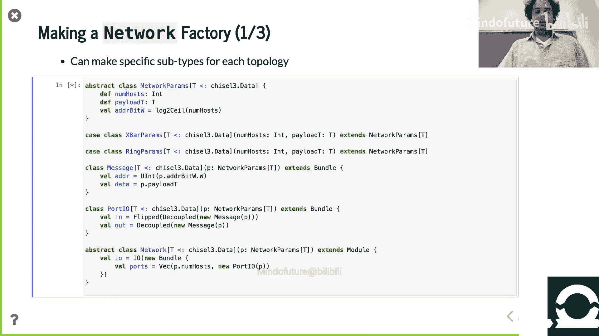

That all come together。Now I can revise both the crossbar in the ring router。

To take in the corresponding parameters for each type。

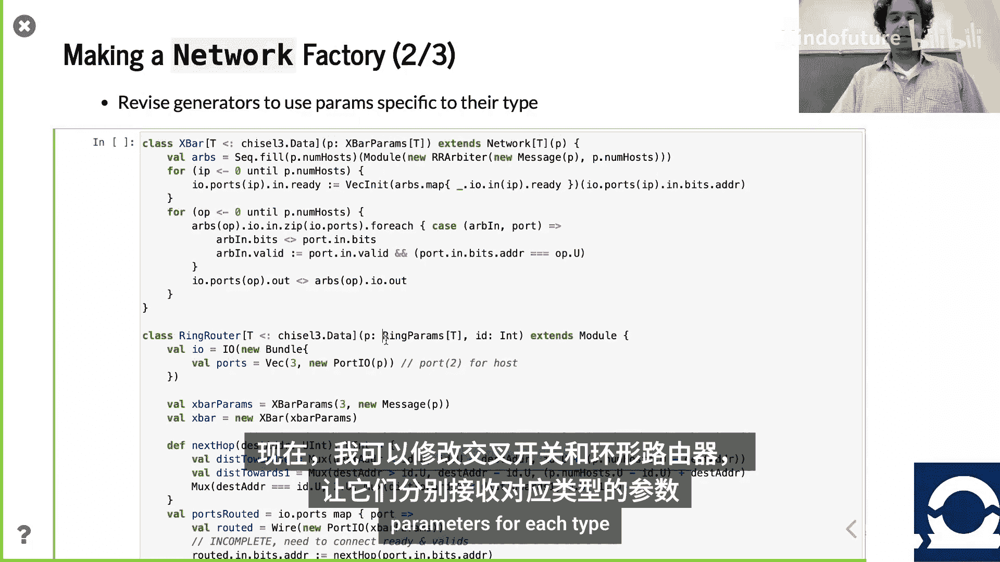

Sir。And then what's interesting is that of course， it can have this factory method。

 right and have this object network。And then。Given these parameters， I can sell you give me crossb。

 Ill give you a crossbar。 You give me a ring parameters。 I'll give you a ring。 Now。

 this code can be a little brittle at times anything implemented。

 and you might get that type ratio warning I was warning you about。 But for now， it's working。

 So yeah。过。Now。What have we done， Well， we've parameteritized everything。

 It's also much more gracefully interchangeable crossbar。 right。

 You can imagine someone in their code。 they can just say I want a network and they can say I want a crossb or a ring。

 it's the parameter type passed in。 so I can make that choice。

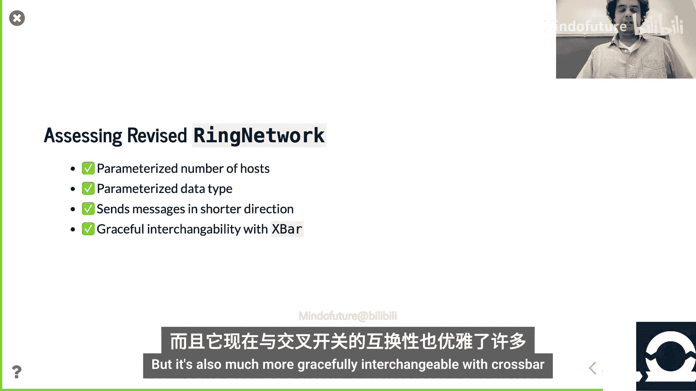

And internally， of course， it does all the right things。

 and so you can see there's a lot of ability to kind of build this whole world of generators using abstractions。

Cool questions so far。So we built a cross bar， we built a ring。

What about a mesh or a toreus the subduor ring right and we can keep sharing things and using abstractions and of course the answer is yes so what are abstractions are're going to be reusing there is a notion of a router。

 you know an idea of a crossb combined with realityuting logic。

There's also the things we want to use tocon these routes， right， You saw how。

Between like the ring and the cross part is the connection to work， you know。

 how do you connect it browser and not ring to apology？

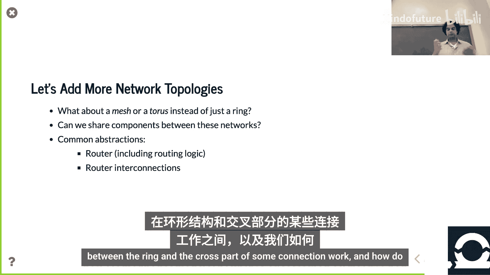

How do we kind of make that welcome together？

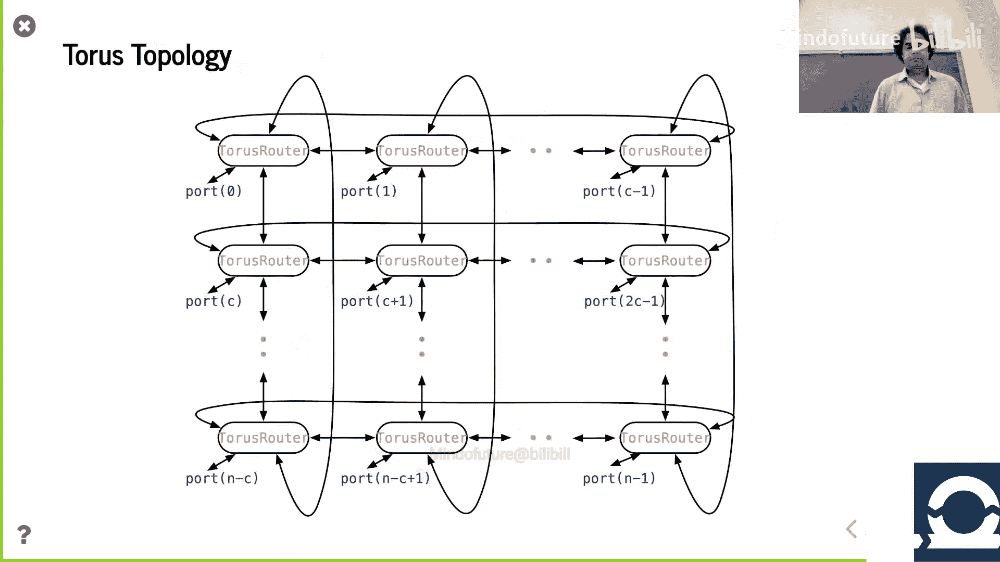

Some those you keep hearing the say this term Taurus Here is a picture of a Taurus right so Taurus is basically a mesh where we also have this link going around to complete it right so this is a 2D torus。

If it was a mesh， it would be a 2D grid built these long links wrapping around。

So you may recognize that a 1D tous is actually just a ring。

 So ring is kind of a degenerate case of a tous。And the more general patterns， yeah。

 dimension is to kind of keep adding on these other dimensions And you can see that you know。

 even in this case of a 2 d torus， each of these routers has to have four ports for the network and a fifth port for the actual host right So you can see basically you know the pattern is two ports per dimension。

Um。And then then plus one port for the actual host。So from the outside， you。

 someone using your module to Cs you know ports zero through n minus1， but inside your you know。

 module is actually just massive network， which has a 2D tourist topology for now。😡。

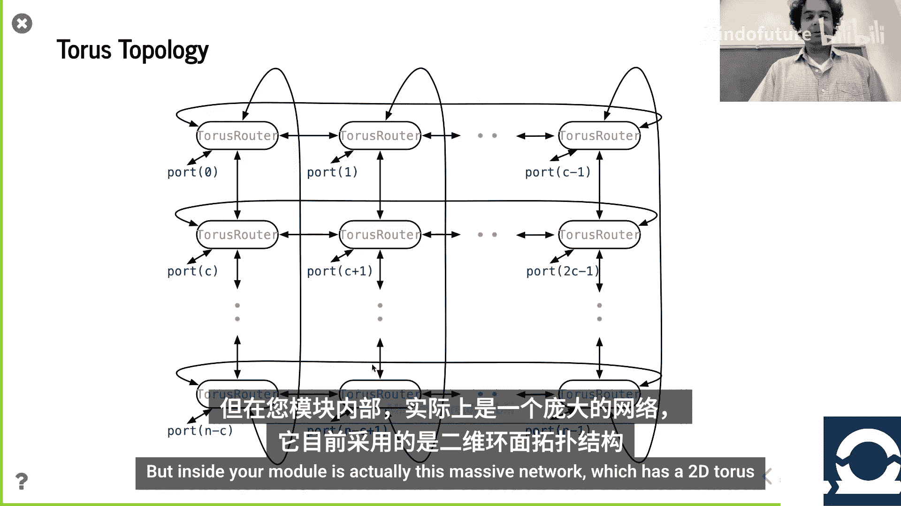

So let's generalize our notion of a router， right？Our router。Take some some number of reports。

It has the last port attach to the host。It has notion of next top logic。And you see。

 we use the next hop logic whenever we instantiate it。嗯。And it collect everything up for us。

And now we of course also make a multihop network。Which extends their network abstraction。

And a multitop network， of course， has a notion of routers。

You're going to have a function to connector routers。And then you said， of course。

 cut the routers up and connect the routers to the outside world。So you can see how。

I only these handful of places with these abstract classes were what child class utilities in。

 they kind of get the rest for us， for example， to make a new router。

Assuming you're using the same internal topology you of a switch。

At least you need to describe in next top functionality。

 and I get the rest of this already kind of reused。Meanwhile， the。Actual network level， same thing。

 Can you describe how these routes are connected。And it's what kind of do the rest for me。

And that's pretty cool it needs to taken the router type to know to grab to write you know。

 route to write routing logic， but we can do that。

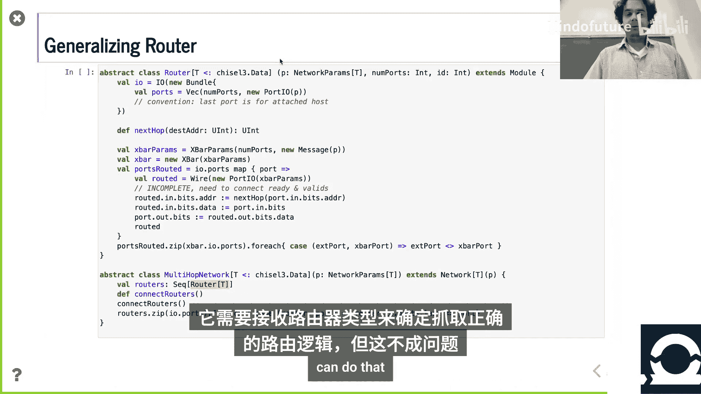

So。Look at this right for a ring router from before。

To reim that same functionality this bidirectional ring。

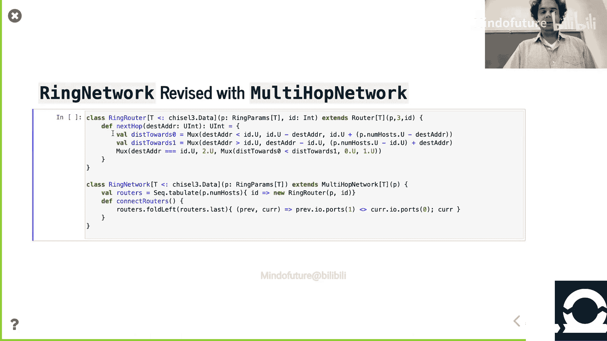

We just need to describe that next top logic and the rest of the stuff。

Carries over for free if I ran this code first。

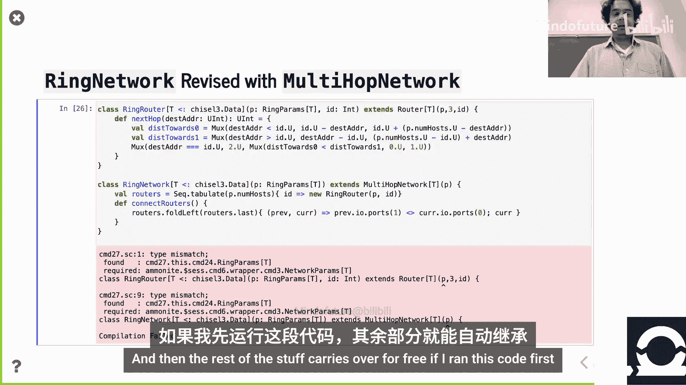

And in the ring network itself， we just got to describe。The connection process， in this case。

re using the fold left pattern。Oh yeah， we sent you to route us too while we're at it。

By signing of all consecutive IDs。

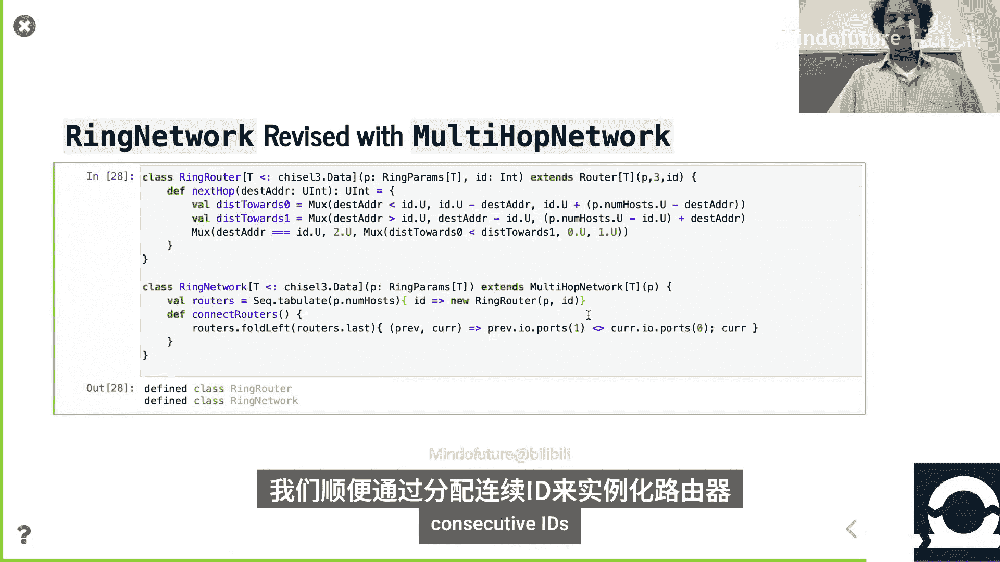

But you can see this is actually surprisingly concise right。

 this is you know capturing the key essence of what this ring router is。

 this ring network in a handful of lines because a lot of stuff that's reused。😡。

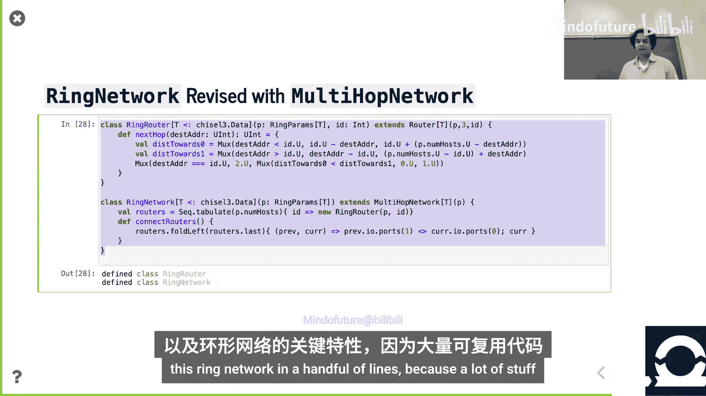

Is all on the prior slide， right， This notion of how kind of wire things up inside a router and having things kind of in conjunction。

 working with the crossbar， as well as even the network itself。 and so。

They've built some pretty cool abstractions and are're reusing them。Like say。

 attractions aren't always obviously a first start project。

 which is why it's helpful to know write things， get them working。

Maybe write another instance and you kind of see it to， and like with similar what's differenting。

 they're going to weigh to kind of。Identifies thetracts pulled together。

 and this is kind of the whole essence of the agile approach is that。

Some of these interactionss are really hard to see from the beginning。

 and it's easy to kind of see some of them along the way。

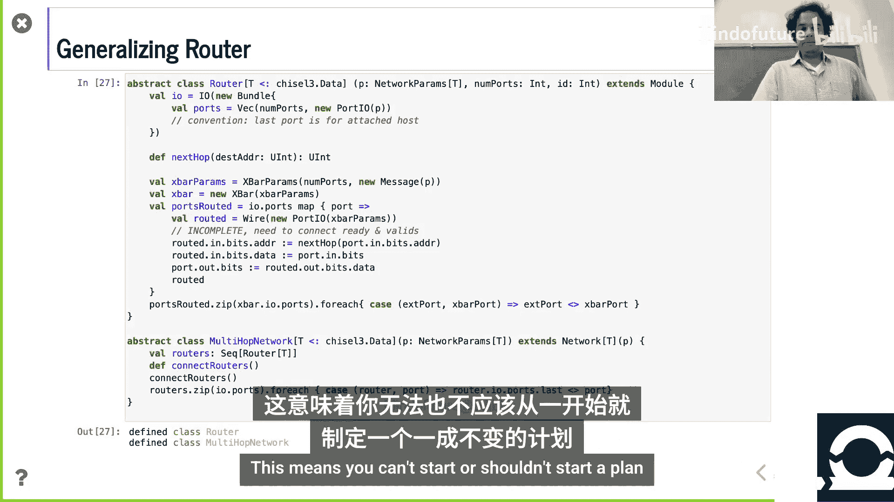

Does't mean you can't start or shouldn't start a plan。

 it just means be ready to kind of keep adapting。

Cool， so then how about that2 deep tours we talked about， right， So maybe。

Our treaty tourists will have flexibility have a number of hosts and number of rows is not required to be square。

But it doesn't evenly divide， of course。So yeah， I mightt care about how making a number of columns we usually only to tell number of rows。

 number of hosts， and we'll figure out a number of columns for them， sure。嗯。

And so as you see of my aggressive comments here， this is not the point functionality。

 but conceptually， we just need to give it the next top logic and we're set。And then 30。

Network level， same thing， we need wire up the connections in 2D that connect routers function。

But we're able to reuse that same functionality， right？

This abstract class has given us a lot of mileage， right。

 We're still able to help network or extending the router。You're getting so much from it。

Oh。So we did it， we built a pretty cool system。We can put this behind a factory method so we can say。

 hey， give me a network， someone gives the right kind of parameters in there and we get the right instance returned back to us。

Notice how in this case， we have a ring network of ring parameters。We could also alternatively。

Recognize if someone。Request。啊。A touristus with one。Dimension。They should have requested a ring。

 right， So we could say， you know what， we did that。 This is kind of cool to about pattern matching。

 right， You， you could recognize that case。 So her， her array for pattern matching can actually say。

 you know what， there's a one dimensional tourus。You probably wandering。There。So the question was。

 okay， if I did or did not have this optimization， how different is a ring generator from our Tarus generator working on one dimension？

😡，The answer is it depends because we've actually shown a body of a to generator in the flex。

But you can imagine maybe your touristrh generator does prove basically the same thing as the ring when it's one dimension。

 or maybe it does not。 Maybe it is different， right that's。

Possible， I include that line as a common here to kind of show the power of pattern matching where sometimes。

This occurs， right， You can imagine normally you you sort if else whatever with pattern match。

 I can say， hey， give me a tourist pram。When there's one dimension。

 I want to know that case and otherwise let it fall into the regulatory parameters case。

 so that's kind of a pretty nice use of pattern matching。嗯。I think it's pretty spy。Cool。

So we saw yet another case design study today。嗯。😊，some general lessons come from this， right。

 with progressive design？😡，Really the goal is to get going right so make something small。

 get something running， get it working with a test bench， get it passing to you know compiling。

 get it you know running。😡，And then keep extending and optimizing it， right。

And then when it comes to finding combos attractions。

 it's easier to generalize when you have more than one instance。

 maybe it's different parameters or maybe it's actually a full on different class， but。

Those opportunities kind of become more apparent right and then he's kind of seeing for reuse right。

 this is a common thing where when you're writing code， if you find yourself saying oh。

 I need to write this code。And start this code and they go copy and paste this code from some other portion of my code。

 the starts portion off。If you find yourself copying and pasting。

 that's probably a sign of opportunity for reuse there right。

 obviously maybe be sure out a way to pull out that more general functionality。

 abstract it and make it reusable。We've shown you inheritance this week。

The last lecture as well as now making this kind of library network generators we've also shown generics and the templating right。

 and so right now you're in pretty good shape for what you can do with chisel So to kind of give an outline for some remaining lectures。

😊，We will be covering memories next week， so some details of memory didn' I cover covers us more depth。

And they we're going to kind of change gears， and we're going to go talking a lot about code。

 talking more about general design phologies and things we wear about physical design。😡，嗯。

And remainder of the course， we will have more design lectures as well as things involved in your project with the project proposal reviews as well as the project presentations at the very end and it of a good fortune for some guest lectures so keep an eye out for dose okay well thank you。

