# 【加州大学】敏捷硬件设计-CSE228A-｜-Agile-Hardware-Design-Spring-2025-p22-P10_第16讲-设计优化入门与存储器--BV1M6ivBzESw_p22-

Hello and welcome to Lec 16。So today we're kind of shifting gears。 So we' meant the first。

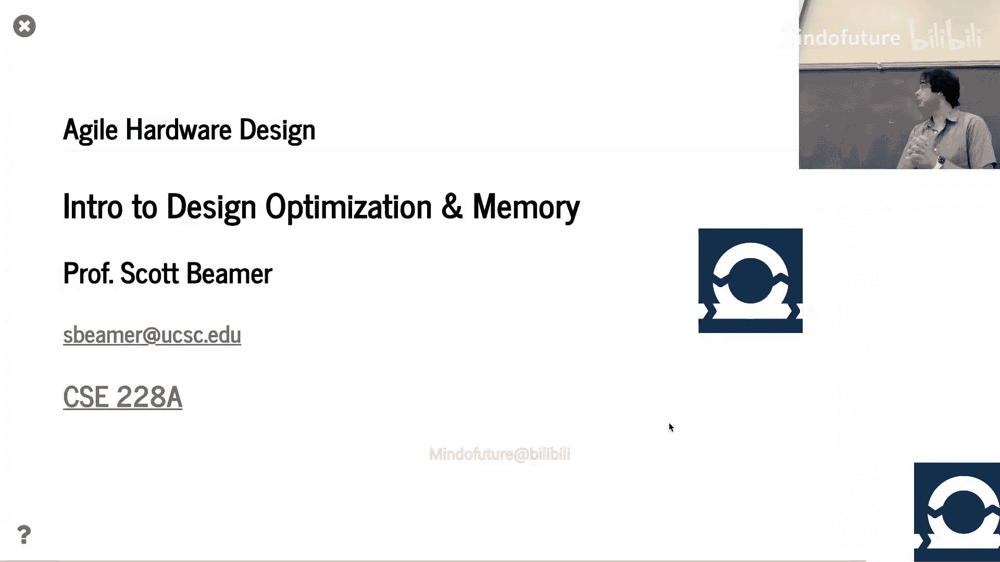

Five this course。Covering hardware design， Slet， chisel and a， you know。

 nice cycle and K game bed at all three of them。And now the congreg for the project。

 we're kind of shifting gears speaking more about how to design more generally。

 So less about exact details of scholara and more about just what happens when you're trying to design hardware。

 wasn't mean to think about physical constraints in hardware。

So we' see that in a few lectures this week， right。

 So today is's gonna to be talking about design optimization， as well as memory。

 which is the really important thing is The first thing should optimize in your design。😊。

And then we'll be moving on to additional topics this week and so the material。

 perhaps are lots some things you've seen before， but I guess what makes it interesting number one。

 including make sure this class is inclusive。You know。

 we are expect everyone to be a EE major in this class right， but number two。

 the high level perspective of some of these physical things may understand deeply may also be insightful right to kind of see how do we think about these deep physical problems from a high level point of view from a architectural point of view from a agile design point of view。

O。So like I said， talking about physical design， that is how do we go from a。

Idea for a chip to an actual chip is theres some steps in between we haven them covering at all this quarter。

Talk about memories and how to actually make memories much more efficient。Okay， so naturally。

 the question is， why should we do this， Well， if you optimize the legal sign。

 the one thing you're probably gonna to improve is efficiency and efficiency relative to what。 Well。

 that depends。 But the real question， of course， is， when is the effort worth it。

 And it's not an issue of， is you design efficient or not efficient。 It's not a binary quantity。

 It's more just how much time and effort can your team put into this project。

 how much time effort should you put into this project， right。

 And as you put additional effort in there。

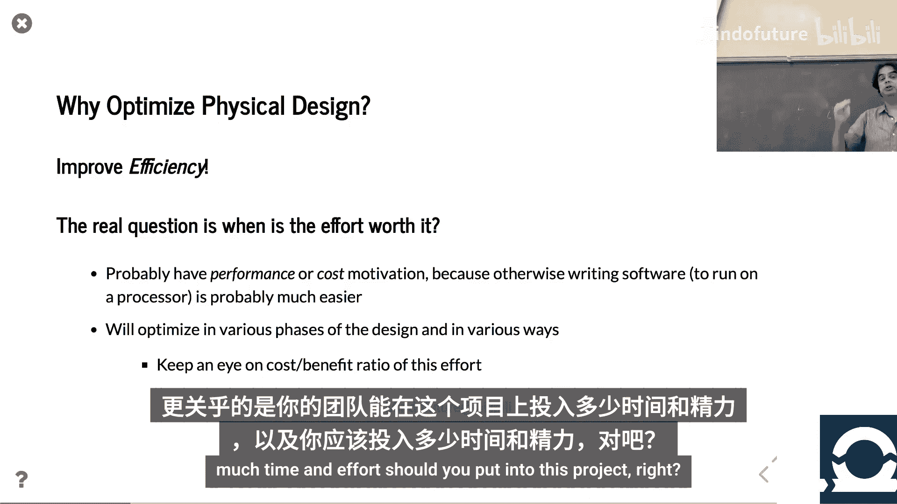

You hope they're getting gains not wasted， but if additional gain worked it right。

 And so take about usage case， right， usually have some sort of performance target or something or some sort of cost target。

 And the question is how are you going to get there Now。

 if you have this absolutely bare minimum performance objectives。Perhaps their answer is just to。

Not design custom power， which I like it sad， but that might be the right answer。

 right answer is simply just biometric controller， put software on there and boom， you're done。

 So building hardware as a， you know， custom design there's be some motivation， right。

 Some reason why do this and usually some efficiency or cost reason for doing that because otherwise you would just put software on a micro controller。

 right， And so。The reason why I to up is that means。

You dot need someone concerned about physical design， or you can't just completely ignore it。

 Can't forget about that for later on。 Should you have some reason why do that。 so。

We're preaching this class is thinking about optimization design in various places in various ways and being very mindful of what benefit you're getting and what you're paying to get that benefit。

Okay， so what can we actually optimize for， Well， it turns out when it comes to hardware is three metrics。

 So software where we see this performance， how long does a program take and hardware is three。

 Theres power performance in area we may have seen PPpas and abbreviation used in this class and elsewhere。

 But all these things have real important consequences， right for example， power。

 as they're all familiar from old devices of very conscious of immuno of course。

 power impacts battery life that design take less power。

 We can have a longer battery life or a smaller battery。But other way the power comes up， right。

 if you can reduce your peak power consumption。You can reduce the course to。Pak heat。

 It produces the thermals， right， as a result， enables a lot of things。

 at the large scale and data center。 Many of those chips are completely power limited， right。

 Those big GPs are， you know， Pu hundreds and even close to a kilowatt。That's a problem。

 right If you they get that power efficiency improved， they would use it to do more， right。

 And so for many people， power is the limiting factor。 Additionally， even in a mobile design。

 not just battery life， but heat power matters。 right。

 You don't want someone to burn your hand holding your handset， right，'s the problem。

 And then of course， things like， you know， power over time， It' energy， which of course。

 what you pay for when you pay for electricity bill。 Yeah， that matters， right。

 You're paying for big data。 you want to of course， reduce that bill if you can't， so。

Powers a lot of consequences。 It also costs a physical device to what kind of powered delivery system you need in your product。

 If should take apart an iPhone a letter device。 You'd be surprised and see how many devices。

 both in terms of volume and。Cost are involved with power supply and delivery Right。

 So if you can reduce your power consumption， you can make those devices smaller and cheaper。

Power really matters white first。嗯。Performance， of course， like I said。

 we're doing this because you have some sort of goal。 right， If you had no performance goals。

 we wouldn't bother mean you cut some chip。 We would just write some code。

 use the CPU and be done with it， right， So you have to have some sort of performance goal。

And the course performance is measured by how fast you complete your application。

 not necessarily by how fast your clock period is， right And so you can have many or greater or few number cycles。

 but really matters how fast your application is accomplished。

 And then finally the area that doesn knows how big is your hardware design in terms of harder resources。

On AsI， of course， that's actual millmeter squared that's you know。

 has a direct cost measurement versus PJ is how big of PJ you need， how many fJ versus you need。

 but area is basically a proxy for cost。Cool。It's very broader now。

 I haven' to any questions along the way。Okay， let's keep going。

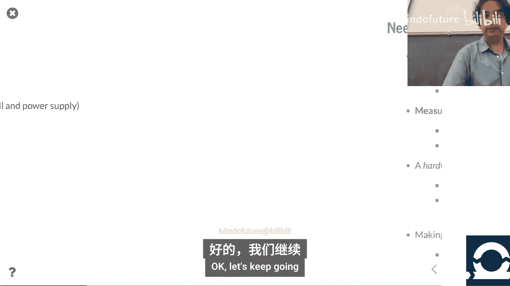

So let's say you decided， you know， upsided you should。

Go about optimizeimizing design for physical design。What do you can do， Well， you have a goal。

 You can't just say make it good， right， What does that mean， It's unspecified， right， So first。

 you need to have what implementation technology you're working with， right， So perhaps， you know。

 you're using a specific。As technology process。 you know。

 I'm gonna to use TsMC 10 nanometer or something right or perhaps you're targeting or FPJ。

 You need to know how you're feeling this right， And so this is really important because this kind of setss the rest of the story。

 So on software， it's like you can write code and you can write it on one platform and for most of the code you write in a high level language usually ports about issue to another And so you can do most of your time and not even knowing what final process you be like and it kind of works out not the case for hardware right when you pick a technology。

 it's the first thing you need to do， that can kind of set the bound for everything else you're thinking about right。

Additionally， when you start trying to optimize it。

 you need to pick metrics matter in terms of things like PPA power performance area， right。

 The tools can't just say make it good， right， You need to say， okay， I want you to give me。😡。

those three variables， got are constrain。 okay， well， given this area limit。

 I want you to get me the best performance you can。 Maybe it will sacrifice power。

 right or something。 So you gotta kind of pick what you're kind of constraining risk optimizing。

 right。It's oftentimes tell tools that go after clock rate or area， but。

There's a third dimension you're going to tell well how to kind of give it up on that。

And so I'm the kind of pitch in this course with agile philosophy， rather than just。

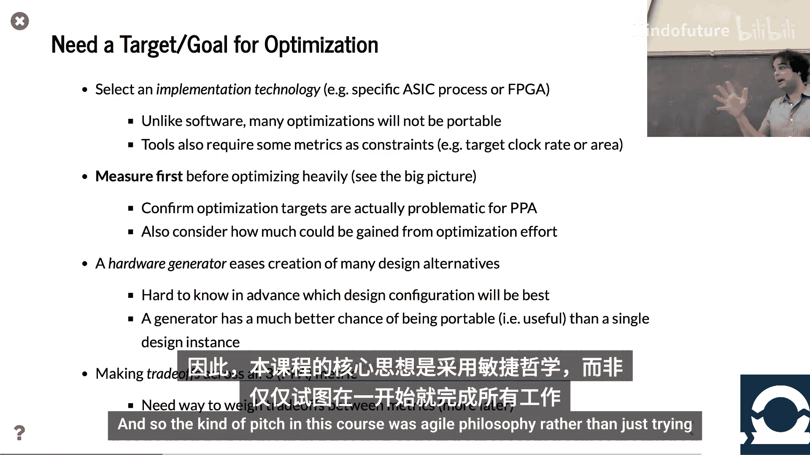

Try to do everything in the beginning。Get a process going， close that loop， see the big picture。

Get some numbers out， right， see， okay， well， here's my initial design I know my design is not done。

But in might as well'll start seeing where the area is going， where the time is going。

 where the power is going。So you can see how you're doing， right。

 And perhaps you have certain targets and you've already reached those targets。 Guess what。

 You can stop early， right， No reason to keep grinding for no reason。

And so then you can kind of start assess， okay， wait， we're not at our target yet。

Or we know got have a lot more functionality and functionality taking a lot of area。

 How are you to make room for it。 Start thinking about， okay， well。

 what's gonna to be us the most bang for a buck， What's the most beneficial， et cetera。

So definitely measure first is kind of one thing bull this entire slide。And so for this course。

 talking about horror generators。 Why this's so exciting。 Well。

 horror generator makes it easy to turn thosenobs。 right。

 If you have it generator rather than rigid design， you can go in and。😊。

Changes that match this thing。 I actually came across just other day。

 This repo is getting shared on LinkedIn is someone always system very repo implements all these great days short system very about tests isn't this wonderful。

 And you go start scrolling through it。 And you see some using things and read like。

 these what I think is the right set of parameters。 But you need change。

 It's really change the code It's like yeah， this is not parameterized's very much rigid locked in。

 There are some parameters It very。 But not the same way we can do generators so this is why we want generator。

 wanted to kind turn to knobs when we need to。 especially if things optimize physical design。

 That's when you really want those knobs to exist。😊，And it fundamentally。

 as simply you need to make some trade offs between those things， right， Oftentimes。

 you're going prove one at the expense of the other。

 If you're going to improve one metric at no cost to the other metrics， that's great。 do it。

Once second。If you're in a situation， that's no brainer， right， Obviously。

 if you can make power better no consequence， no loss performance， no loss of area。

 you should do that， right， Usually you're doing competitive design。

 You're at a point where to improve something and cost something。 And thent you got way to trade off。

 We'll go back to this later this week。 And then what we call design exploration。

 But that's what we bring back to you。 I saw a question。谢谢。

Was there are extreme parameters in chisel versus parameters in ver log。 Good question。

 So in very log， I should say system very log， you can have numeric parameters。

 right that's totally doable。 And for some things and some really clever some very log implementers。

 you can use that。 But for some of the things that we do in our chisel in our generator。

 something much just the parameters is how you use those parameters right you've seen examples already of us doing like recursive things and build topologies internally based on those parameters right versus some very are kind of constrained to things like a Genva and for those of you who are very log experts。

 I know this may aggravate you， but。I'm also constraining this to things that are synthesable。

 plant painting doing system simulation we're not even talking about right now， but more generally。

It's not so much the parameters， it's important language that glues it together in Scala。

 lets you do all of the cool things。Additionally， you can have things that are not just sameic parameters as parameters in chisel。

 right you can have a parameter B literally a function。 You can have a parameter B an object， right。

 You can do things totally typed if you need to。Cool， other questions。

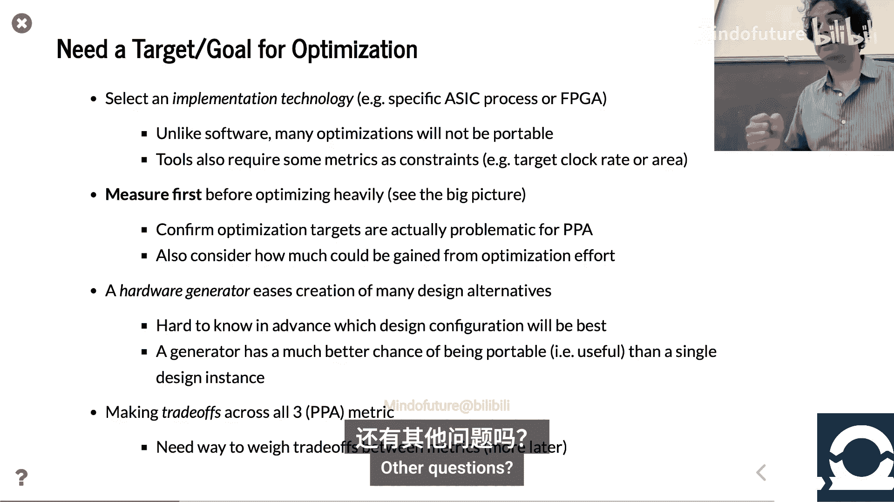

Great， okay。So continuing on this thread of differences between what's going on in the software versus hardware design。

嗯。People may be very useful to this software that's kind of what design this course for。

I'm gonna to call it the easy world。 And I put the quotes on that because of course， it's not easy。

 easy， but it's comparatively easier right And the reason why when you're writing code。

 it's an oldest effort writing the code， getting it correct， you verify it。

 But then you're basically done， right， you might spend some time thinking about performance。

 make sure you don't have any quadratic algorithms。

 You should have linear algorithms and that sort of stuff。 But for the most part， you know。

 things are very portable。 You know， if you look your code faster on one CPU is probably faster on another CPU。

 and you also you have your giant code base and you pan off to your compiler tool flow， you know。

Its churn through it， and。Not only is going to produce correct code。 So you pretty good drop pricing。

 you tell， okay， give me O2， right， And it does a pretty good optimization level。

 You don't say give me O2。 But， you know， trade off this for that。 That's not usually what you do。

 You can't say minimize for size， for example， but usually O2 does that pretty well on the own。嗯。

The key thing is it doesn't really break right if you're writing software and even compile pieces in Cr code。

You should rightly be angry。 I've been programming for a guess a good number of years now。

 I've encountereded only a few times， and a few times I've encountered it's all been a same compiler。

 That compiler is dead to me。 That's ICC dead to me。 I will not use that again because it's just。

 it's hard to get a code right the first time。 The compile is emit incorrect code。It's that painful。

 But the answer is most of you in career probably have have not already or probably will not encounter incorrect compiler。

 right， like it's。They are pretty good at crashing themselves before they produce bad code。

U that is actually not the case of hardware design right so now in the air code， it's hardware world。

 hardware design， right？Getting it functionally correct is just the beginning， right。

 actually getting a working chip。Is a whole other level of complexity and effort， right。

 in terms of optimizing a physical design， verifying it， making it manufacturable。

 These are all large hurdles， requiring a lot of effort。 a lot of people， a lot of stuff， right。

 In addition to just saying optimizing only for performance。

 Now it was Ppa with three metrics optimized for。 And if you're optimizing for these。

 These are very inflation technology specific。 remember earlier。

 I said you all implementation technology early on the project saying I'm going for this asic or E technology。

 The reason why it' realizations are going different， right。

 I optimize for refugee is different how you optimize for an Asic。

 And so you kind't even know what you're targeting right away。 And it's big detailed D N。

The tool flows are much worse， right， you both need。More human effort to get them to run。

And they also oversight， right， They do frequently make mistakes。 right。

 many have heard of things called like L VS or DRC。

 These are additional passess we run because we know the tools are going to make mistakes。

 not just some of the time。In a larger design， it's currentlying make mistake every time you run。

 right。 So you need things like D L to make sure you can find those mistakes。So yeah， it's rough。

 So fortunate in this course， we aren't actually going to run the physical design tools。

 but I want people to be aware of these concerns in this course。

 we are going to talk about optimizing those。 so what would look like in terms of the agile point of view of how would you change your design to optimize that once you get that feedback from these tools。

不。Question， yes。Why is as you see dead to me， So from a minute ago I can play with a compiler。 Yes。

 I just said it produces incorrect assembly。认。No， no， no。

 so I haven't happened to me twice in my career where I plus code。

 do we manage to get down to like an eight line minimal viable thing there's nothing weird that could cause it to produce flat out incorrect assembly。

And so the first time was a diligentian gra student I reported it and they did nothing with it。And。

 you know， many years later， that same code will still cause it the break。 And then years later。

 after I finished with my PhD， I got a bug report from my code base and I went and found out that nope。

 it really was， I can see again。 And I once again pruned this big code base down to a minimal Bible example about 25 lines。

 And it still caused it the break。 And so yeah， it was iss buggy。It shouldn't be buggy， but it is。

 since that's why， you know， I I， I that this is weeks of my time I lost because someone didn't want to make a compiler more robust。

Cool， other questions。

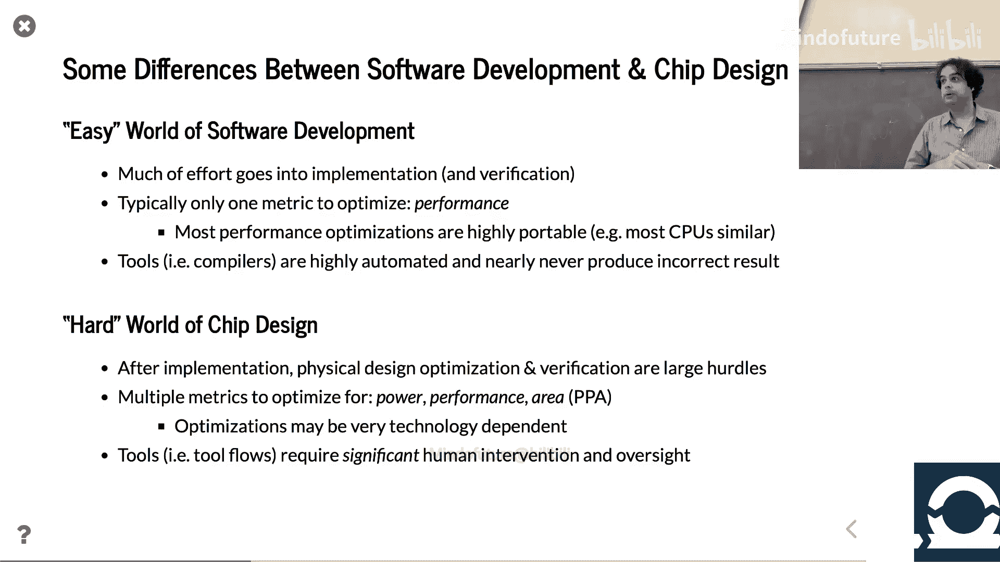

Okay。So we saw this in the very first lecture right talk about two different hardware design philophies and these are extremes。

 these aren't you know exactly what you follow but in the waterfall style you do every step complete before moving on to next steps。

 you have this complete and then design in full detail， think a lot about that。

 you lot of designer reviews， then you specify things in more detail actually implement each piece in isolation。

 you integrate them you optimize and verify it。😡，And the problem with this is that until you get to these later stages。

 like you know， authorization， integration and verification。

 you actually don't know what your total cost is going to be。

 You know what you budgeted your total cost to be。 okay。

 I think this is gonna to take this much area， to much power， to much performance。But。

You up for sure， you can budget it out， Okay， let's say I have， you know， a certain amount of area。

 okay I'll give this much area to this block， much area to this block and you tell you block， okay。

 you got to fill in that area。Var blocks fifth in that area， great。

But maybe some block maybe some team goes back to me and says， you know what。

 we can't quite fit that area we need more area， right so。It's kind of moving target。

 We have this plan and to plan， if it's correct， and sure it works great。

 But something makes are really hard to get right in the dance。

 If you're doing a very incremental change， you have a chip it already works。

 you't make a small 5% change。 Sure， you notice these cost。

But if you writing something completely from scratch has never been built before。

 how can you estimate some these things。 It's actually really hard to do。

 And this is kind of why I want the agile approach where you know what we're going keep having。

Numbers， and it will keep optimizing and verifying these numbers， right， In other words， you know。

 the cost for away because actually pushes through the tools right away。

so you keep going through the float and make my hand matched to circle， but yeah。

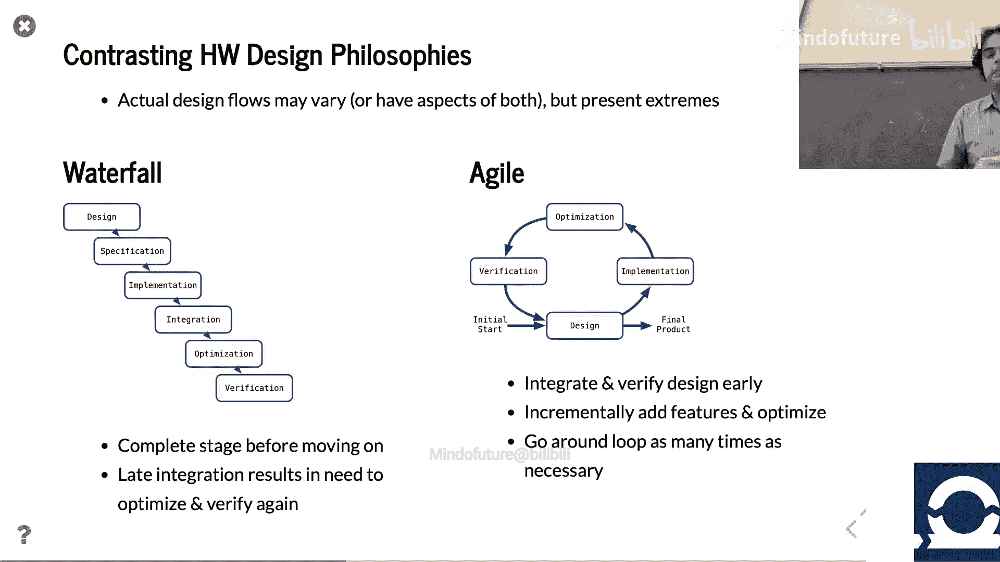

够。Yes。So for those unfamiliar what are main stages in the chip design flow will typically starve RTL。

 So in that case be someone like very log。 not the other end， you have the working chip design。

 So in software you to run a compiler and boom you have a program you' done and hardware is actually a number of different tools and numbers from phases which Ive。

😡。

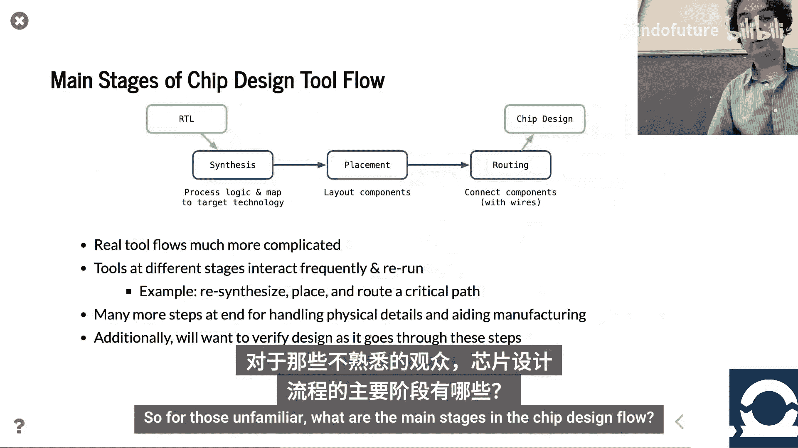

Grossly oversimplified as three phases， you know， synthesis turning your R T L into， you know。

 actual technology devices， placing them on the system。 and then， of course。

 routing the wire between them that is grossy， grossy， grossly oversimplified， but。

And so showing some kind of mind folks there these different stages and you can have issues in various stages and in the real world。

 these tools， if you are just a single linear flow there's often you know phases to repeat themselves。

 have feedback， whatever。And so even just maintain toolflow is actually usually quite a test in itself。

嗯。Very common they let's say you have a very smart tool flow that you you should trying to optimize a certain performance target in terms of clock period。

And you identify as it is certain， it's not making that clock period。

 It goes and finds that critical path。 know， once it's too long in terms of time and tries to do it can to shorten it。

 Right， so maybe you can better place and better route the wires for that。 if need be。

 it can even resythesize some of the gates in that Google path。

 We can logic up shallower or use higher power components that are faster， do whatever it can， right。

And so you can see by doing that， even that tool flow itself was to get a more agile process rather than doing waterfall of synthesis。

 placement， routing， et cetera。 It's actually now。Doing it through all at the end。

 seeing what's wrong， going back and trying to fix it， right。So yeah。

 even the tool flows are kind of going more agile like， you know they don't even realize it。

And of course， there's a lot of steps you unfortunately involve love humans trying to fix things along the way other things don't go quite right。

And one thing I'd even talk about， of course， is verification， making sure it's correct。

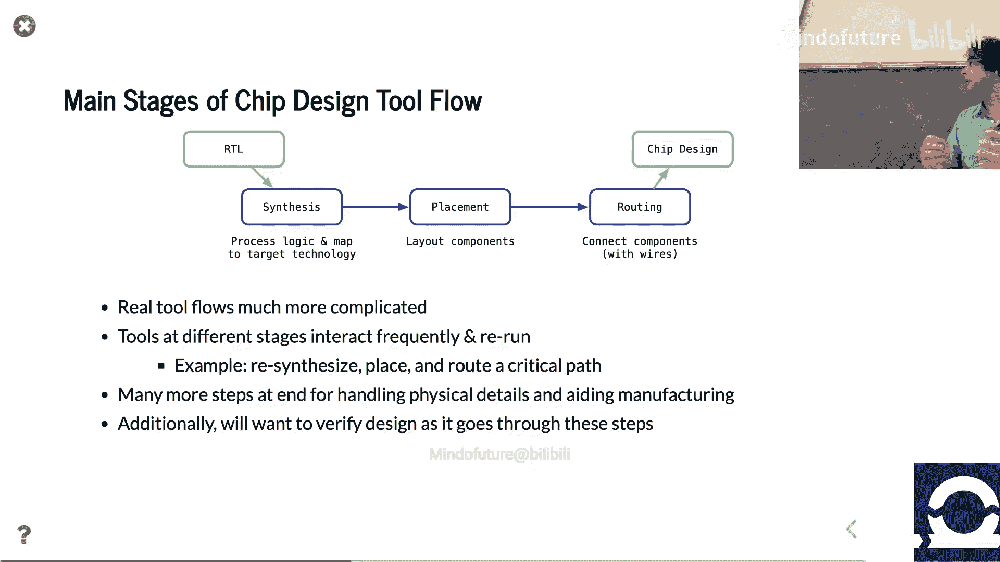

Yeah， building a chip is tricky。Okay。So given that context， let's talk about memory。

 so while I'm talking about memory， it's often one of most significant costs and hardware design。

Other than you Bitcoin mining。Vtually every work that people care about requires a certain amount of data and that data is usually too big to fit entirely on chipI。

So because of that， we have to have memory， both on chip memory and off chip memory。

 and that really impacts cost。Right。And that really know such entire stage， right。 So Austin memory。

 of course， that adds a lot of cost in terms of components and integration。 you may be know。

 familiar with， for example， you know， DDR as you use often are。Laptops and servers。

 But then between like GPUs， Of course， there's GDPDDR and even HM， HM， of course。

 is the highest performance， but also the most expensive to integrate， Right。

 So that's a lot of cost。 If you could get by if using GDPDDR instead of HM。

 that's gonna save you team a lot of money， right。On on chip。

A lot of designs are at least half that areas spent on on chip memory。 Sra， Lily a CPU die。

 Defitely half of your onship area is going to spend on cash， right on even on GPU for doing AI。

 a large fraction of that area actually you look at what it is。I is some effect memory。

 whether it be actual caches， whether it be the scratch pads。

 whether it be register files and so yeah。Memoory is extremely important one the important costing and so。

What can we do about that，It's be worth a few things， right， It also can limit performance， right。

 If you have option memory， of course， latency is a big problem。But also， bandwidth is a big problem。

 I think I said why if people are using H VM because they want that bandwidth。

 the immer technologies aren't sufficient， right， And so。Yeah， and so of course， why we's conundrum。

 well， you need memory to hold the data， the application data inter state everything else。

 and here's one interesting way to think about memory that looks widely appreciated。😡。

Think about memory as a connector。So in this course， we've thinking a lot about hard designs。

 You see me draw schematics that kind of look like graphs， you know。

 as this case attached to disk skate or attached to this component。

 you write your chisel on the San components and connect them together。Its like is very static。

Memory。Allows for much more dynamic connections， right。

 You can have something right something to a memory location。 one cycle。

 something else later on can go read that data。 So it's in a way it's like that thing that produced it。

 the thing that consumed it communicated throughout having a direct wired connection。

They instead wrote to memory， right it back to memory， right。

 And so sometimes people refer to memory as a way to communicate data in time， right。

 You put things in there and a face come back it。 And its kind of all purpose connector， right。

 a sense that， you know， with your normal horror data pass， you have this pre wired to this consumer。

 very clear wired connection versus memory。You chuck things into memory and then you know。

 you pull them out later on right And so as a result。

 you don't know the pre consumer relationship in advance。

 That's an interesting detail that comes as an architect trying to optimize all this。 But the result。

 of course， is the memory there。 we need it and as has as challenges and costs。

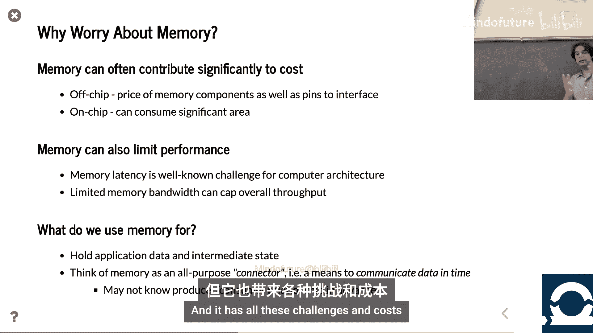

Cool。Okay， so we get ran the same page， let's talk about。Terminology for memory， so of course。

 first off， there's a capacity how many bits or bys it holds。😡。

These days think bytes is the most common unit， but of course people often may use bits and we also use words and of course words got to worry about how big the word is that 3。

2 bits，64 bit word， etc cetera。Lane ses the time to retrieve data or complete a write。

 sure bandwidth in this case talking about the data rate right in terms of bytes per second。嗯。

Talked to enough people of engineering and hear bands they always think of， you know。

 like spectrum is' like， that's not why what we're talking about here were talking about actual data rates。

And so we interact a memory what we call a request right so we can say， hey， memory， give me a read。

 I want to read this location or hey， memory， write this data and such a request。

If requests come in on a port right so you can have a read port or a write port， a read， of course。

 you need to say， hey， this is the address I want to read， you set one to mark， hey。

 I'm performing a read I'm enabling this action and then you get the data back out some late amount amount of time later。

😡，And you know how much data that comes out is the access with， sure？For the right protocol course。

 you also need to hand the right， you give to the address and data right the data goes in。

Now these are it's the read port， it's the right port， you can also have a read slash write port。

 sure。嗯。And this is important to constraint because it actually comes down to certain level of building memory。

 Sometimes the memory technologies have a limit how many ports they can have， right， So for example。

 like in D Ram， you typically have one read flash write port for an entire。

At least Matt this is terminology inside of Dm deep inside there at the higher levels。

 you can definitely make it seem like it' a lot more。 But at a mat level。

 we basically have only one read flashlash right port。 And that's Ram in CPU。

 you can have one read flashlash right two read write port。 you can go higher in two。

 but usually it's pretty expensive。

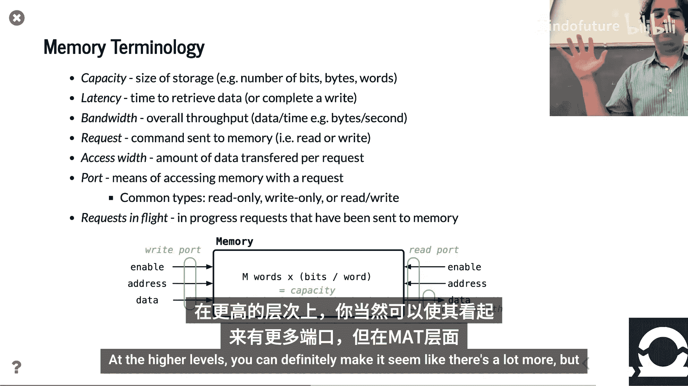

嗯。And so there's various constraints on FJ， is's using B Rams。 you get two read flashlash rights。

et cetera。 And then of course， his other term requests and flight。

 which is if you have a significant amount latency。

You may want to have multiple requests in progress at the same time so these you know I have request A request B。

And yeah， the memory has to kind of differentiate those two requests。做。

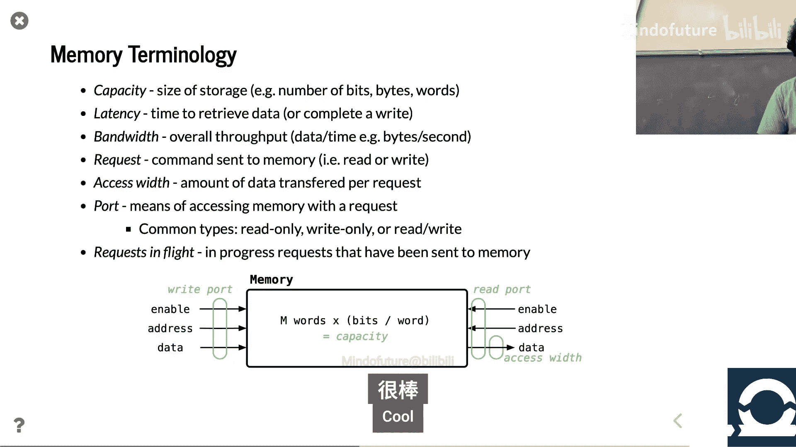

Questions。Okay， so kind of grounding out these fundamentals。

 if you take an architecture class for me you see me ran about little's law and you're not skating into this aile hard design class。

 I love little's Law。 It's a simple， simple equation that explains so freaking much about architecture。

 so what is it。Well， it's the relationship between。Sput la sea perils in particular。

How they're all working together。People may say， oh， well， isn't Lindsey just one over throughput？

And the answer is sometimes， right， Why is that sometimes， well， the parallelism was one。Sure。😡。

But now， if I have two things then flight at a time。Then of course。

 this throughput is twice one over latency， right， because I can doing two things at a time， right。

 And so this is all based on averages， but this helps you understand certain trade offs， right。

 so very commonly。As an architect says said， we're working on a memory， Laty is hard to reduce。

 right， We want it to cicus faster。 Like we get much faster。 So Lay' is fixed。

I'm knocking in the manual if I need， right， in order to get the throughput I need。

 I need to increase peril。 It's a very common consequence， right， or maybe。Let's say， for example。

 figure out a way to reduce latency。And your。Palism is fixed。 Well。

 that means you' twoput jumps right， for example， or you can do these， turn it out various ways。

 So you can always turn this out number ways because can sees the least relationship between them。

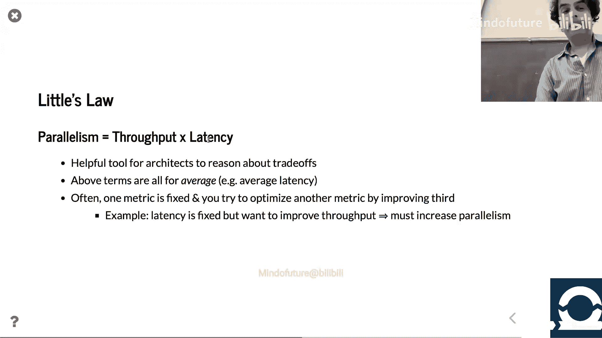

Cool。Okay， so let's start trying to build up a methodology for optimizing memory。嗯。So like I said。

 typically the goal is to reduce costs in a way that is not hurting performance or perhaps even reducing the performance detriment of memory。

 Okay， so we're the pain points normally。Me laency is too high as the biggest one， right。

 If you have off memory we're talking， you know，5000 nanoseconds and your clock frequency on a high speed design may be a gighertz range。

 So in other words， talking hundreds of cycles to get the memory。 that can be a problem。

Another common challenge in memory is the only any port that you want。

 you have let's say 100 units that want to talk to this memory and you only have you know two parts in that memory。

 how do you handle that， right？Another very common consequence is， how do I get the bandwidth I need。

 right， And more bandwidth， I want to get more bytes per second， How do I get there and so。

This is really an architect kind of problem。So what can you do well number one？

Be very clever about using a memory， right， If you can get bio fewer bytes， do that， right。

 because then you can use a。Less memory， less components That cheaper。Also。

 you want to use the cheapest memory you can， right。

 So even though HBM is the fastest memory we often have， it's super expensive。Right。

 so we would love to avoid using that， if we can。And so if you can get bio withsinology。

 that's better， right？Architecturally， you want to like a design that can handle high latency， right。

 So if you a tolerate high memory latency， that's great。 things like caches and CPUs help for that。

 right。And then finally being clever how you use your data right。

 if you reduce the bandwidth you need once again， you can use cheaper memory or less memory。

Reducing your costs。 so these are things you kind of want to do。嗯。At the Civil4。

 a number of remember technologies are kind of constantly looking at the trade offs。And in general。

 kind of follows this hierarchy of the ones that are most expensive。

 is's because they're the least dense you get the fewest bits per thermo millmeter， unit cost。

And they often acquire a lot of energy， but then you at the intersection you get really cheap bits。

 right， So from the fastest， the slowest， you know， yeah， register is of course， very fast。S Ram。

 D Ram， face change memory， which gets honest way out flash。Harge desk and keep going， right？

You know， from the Agile hardware designer point of if you're talking about SM registers off memory right after memory can usually be。

 you know HM or DDR or something。

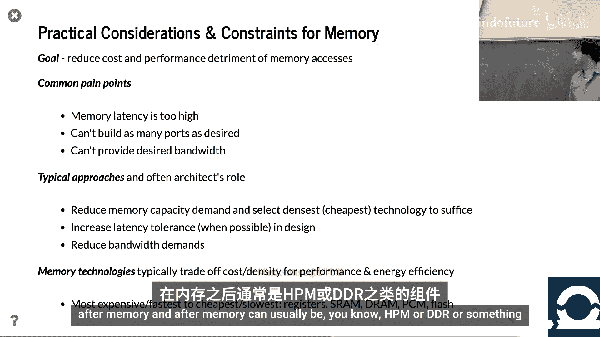

过。咳。

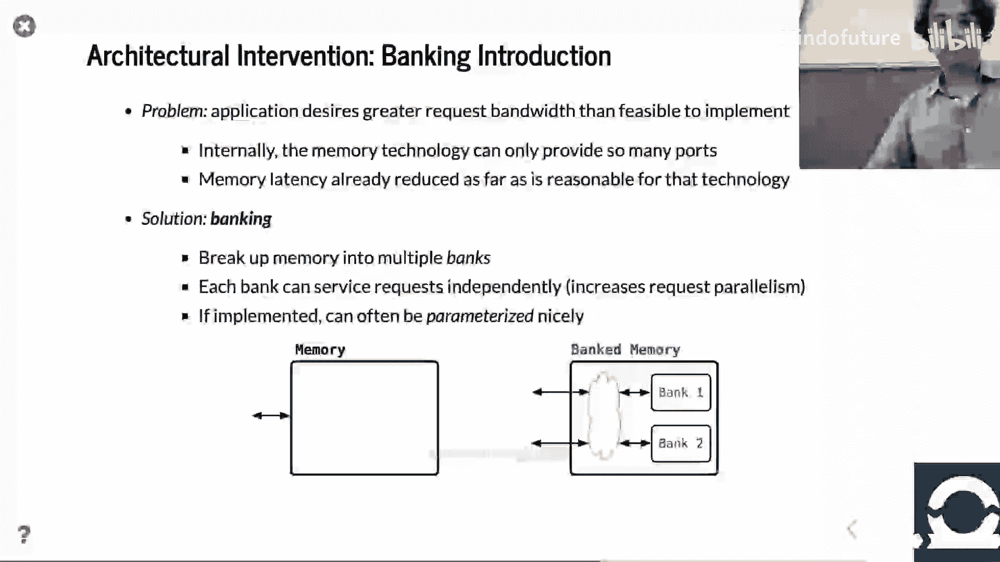

So let's see some tricks we can pull to make maybe workout out better for us。

First up is something called banking。So basically， when you're trying to build something。

 you can seeve chosen im and knowledge I to build lift this foundry process in 10 nanometer。😡。

They'll often provide you with the SstrMs for that process。 Okay。

 so I have their sstrms which are blessed by this foundry。 They have the following properties。

 You check the specs on them and youre realize， oh， wait。

 that's not enough bandwidth what I need to do。嗯。So maybe in this is trivial example is to say I want to use the memory found that has only one port。

 but I have two consumers， and so how can I deliver two ports with a bandwidth to handle this， right？

嗯。

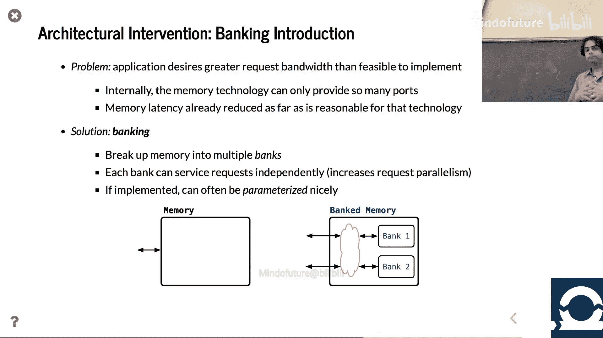

So normally at first， you might say， oh， well， if I need to get double the bandwidth。

 maybe if I can reduce the latency， for example。

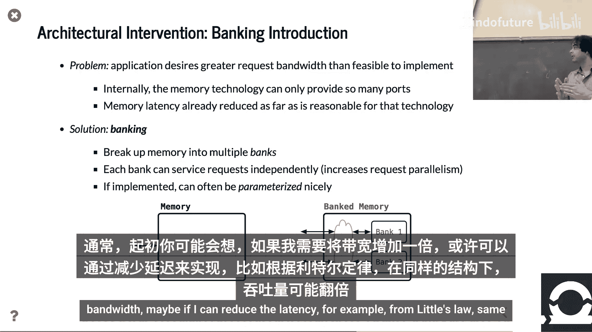

From little's law， same all apparels and might get twice as throughput。

 Let's say for sake of this argument。 you've already minimize as much as you can。

 So now you're going down to what can you do well。Baaning is the trick， right， so with banking。

We're going to make the memory seem like it's still one memory it has hired bandwidth and internally。

 we' going to have multiple memories right so instead of having one big memory which may be the of ports。

 we can have that look like one big memory， but internally， it's perhaps two memory banks。

Each bank provides support， and so the result we can provide twice the request and what could as one monolithic memory。

So in other words， what we're doing is we're not decreasing latency， latency is the same。😡。

But we're increasing parallelism。 And by little， increasing parallelism。

 Saint Lasey means increasing throughput， right。This is the kind of thing that， of course。

 can be parameterized very nicely in chisel and really helpful， right？

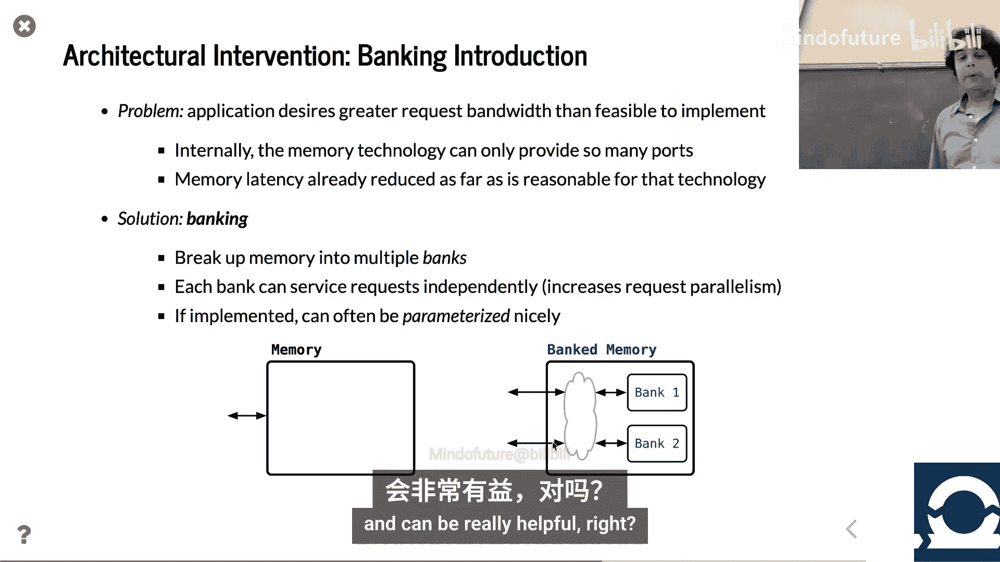

Okay， so let's say we're bringing across banks。 How are you doing this well。

 There's two ways to do it。 Ner one， you can just say， okay， remembering providing。Each bank handles。

 you know， one end of that data。 Sure， And so as long as， you know。

 you have to logic in there to figure out how to get the request to the right bank in the。

Request for data is uniform across all the addresses that way you're not overloading any one of those banks。

 that works out pretty well。Sometimes you may have a situation where you want to have really high read access。

And maybe the access patterns are non uniform， in which case you want to make sure that no bank is overwhelmed。

 you actually have all banks hold the same data， in which case you're replicating， right soplication。

Increases the cost the number of memories you have。 However， you know。

 because this throughput you're getting， perhaps is worthwhile， right。All banks have the same data。

 This works great if you want to get lots of read access。

 if you want to do lots of ride at the same time， it's not going to help you， but。It's a start。

Here's what we can do under hood。You can figure out， you know。

 are these banks going to have their own independently exposed ports might extended ports and be exposed to the outside world。

 or are there going appear to be a single shared port that internal turn these route to the right port。

 So that prior slide。

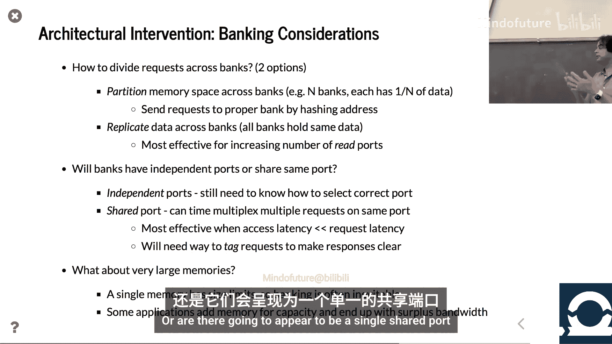

These memories had that port had certainly exposed。

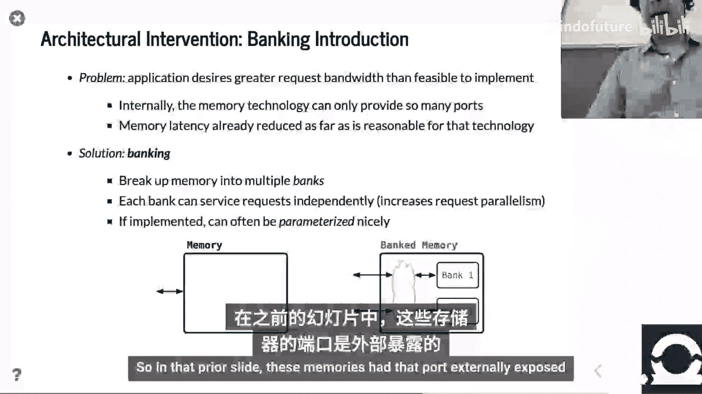

Instead， maybe if the requests are take a longer time relative the transfer。

 you can have it to a single port and internally kind of fans out。

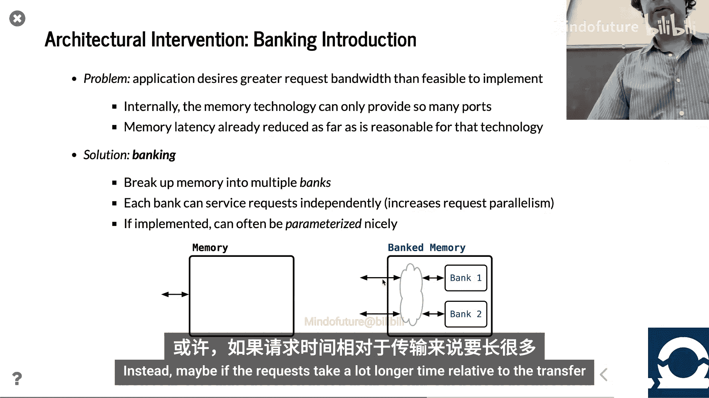

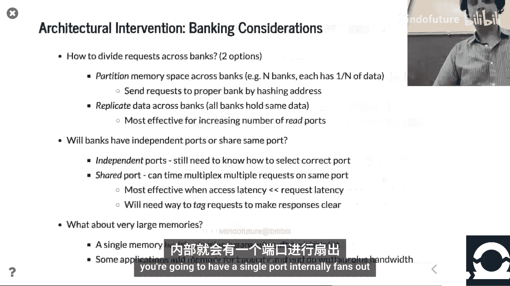

Right， and of course， what about very big memories。

 Sometimes you're forced to use multiple memories just because。You need the capacity， right。

 So it's not because you want performance or latency。

 It's because of the capacity to have all these banks。

There even still a lot of banking insights still apply。And there are some scenarios。

 we actually end up in a situation where in order to the capacity target you actually have surplus bandwidth。

 right you wish you could actually spend less on bandwidth， but you kind of were forced to get there。

If。Look inside a DM chip， you'll find it。あ。The D markets has kind of had to play this game a lot in order to provide the capacity。

 They've made certain trade offs， and they've tried their best and not waste ban internally。

 But if you have it， DMtro has。Did you give write some data on it？And you're accessing 54 bytes。

 512 bits at the time。 most said chip is not doing anything right and so how do you make that work out as an evering architectural challenge？

不。Yes。😊，Yes。I should say it said going to transfer latency yeah。

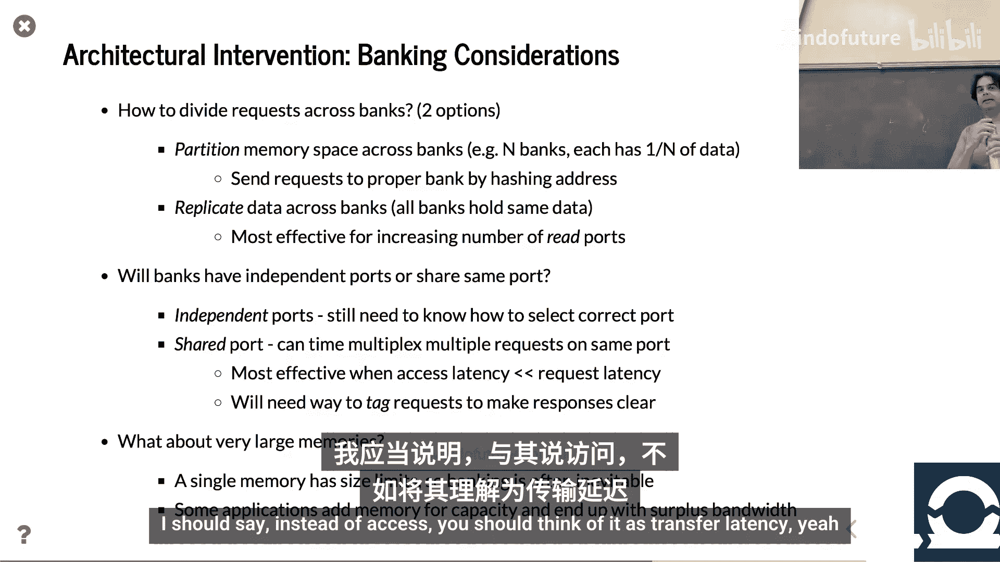

Yeah， basically the situation is， you know if。

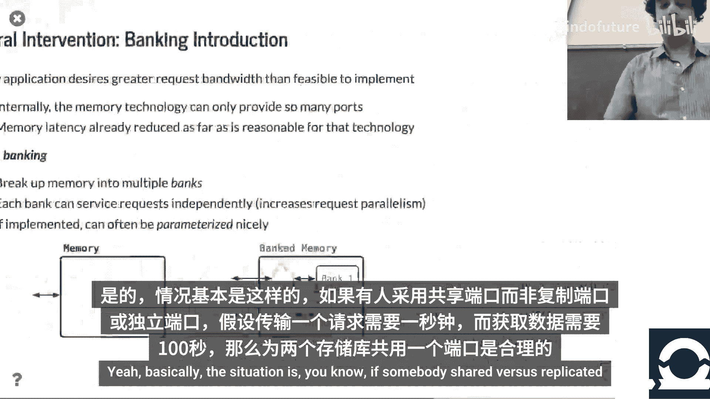

So I'm just sharedverse replicated ports or independent ports， right？If you know。

 takes the say one second to transfer request and 100 second to get the data。

 then sure having one port for both banks makes sense。

 because one and second to transfer and one second to request。

 then they're gonna bump into each other， Right， So that's kind of that's what I comment is。 Yeah。

 this is either access or transfer， whatever you want to call it。

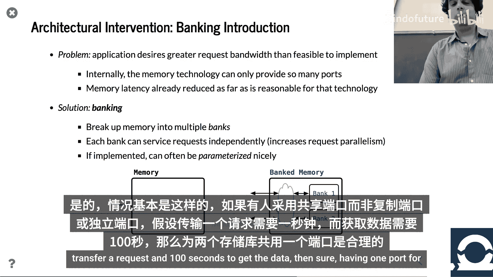

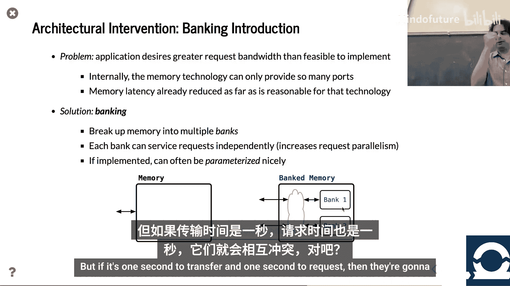

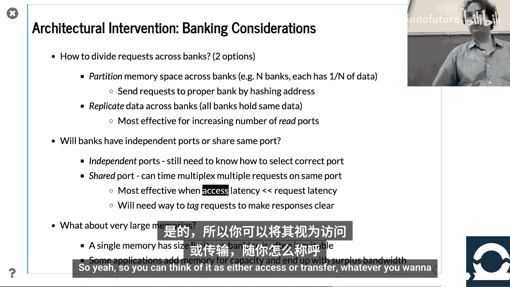

Cool， good questions。Okay， what else can I do to make memory work better？Moving out demand。

 This is actually is a， I pitch it here in terms of my bandwidth。 This is a。

Universal problem engineering， and for example， even here and around campus。

 they've ever run the traffic， you've observed this， right？In the real world。

 we often have very bursty demand such as everybody driving right after class right before class。

 right you go and one of these roads and campuses 3 a。

 there's not a car in sight right And so like you experienced that。

 you experienced both waiting forever a line of traffic taking man， I wish there was more roads here。

 but also if you were here at other times to see this road its not going to see a car for four hours。

Right， and so。嗯。There's that burst instance of traffic， right。

 traffic is non uniform over time when it arrives。 And so as a result。

 you kind of get con situation where if you want to handle these peak demand situations。

 you've got to build a much bigger system， right， more roads， more lanes or in a case of memory。

 more memory bandwidth， right， however。If you have a really burstty traffic there sometimes you're not using it right。

 this is wasted， all this costs you're not using to build four lanes。

 the middle of campus and it's going to be quiet a middle night， iss that worth it， right？😡。

So this gap between the peak versus the average is what？Is commonly a really engineering challenge。

 right， because if you build less than the average demand。Okay， at that point。

 you're just in trouble because under no amount of time， you're gonna get yourself saved。

 But if you have a capacity that's greater than the average， but burst traffic。

 that means sometimes you're gonna see long queues。

 but other times you're gonna be empty they're gonna to drain for example if you travel and be fly look at TSA right。

 they're constantly putting staff on and off shifts to like try to balance the staffing at the security checkpoints in order to make sure that matches what's needed。

 and someone' always aligned。 turns out it's always aligned， that means you're not wasing their time。

 But it means you're wasing your time。 So how do you get the gap between peak versus average to be reduced。

😊，Smooth the traffic， right， You have burstie traffic。

 Try it whatever you can and make it like it smooth in which case you pay for this， in which case。

 much cheaper， right。But in some scenarios we've all dealt with， right， there's a gap。

 we can't move out the gap and they pay for peak and it's a lot， right？

So what can you do to smooth out traffic。 Well， in a controlled world of architecture。

 we can do two things。 We can pipeline and double buffer。

 or youll see both of those in the next few slides。

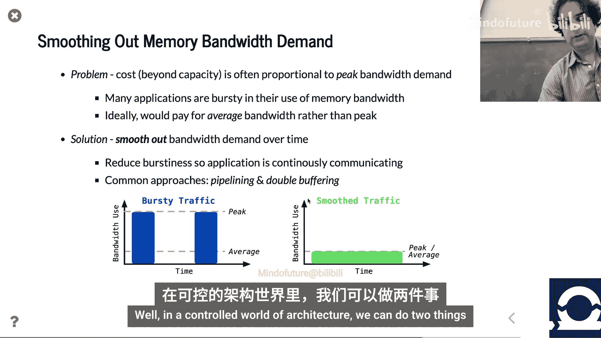

嗯。

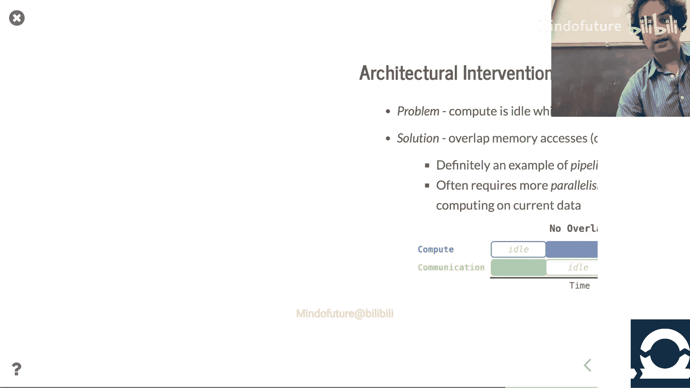

So one idea。Who we call or open communication and computation， right。

 or you can think it almost like pipelinelining away， in other words。U。

 if I have some system where I need to both perform computations and then communicate。

 I move data for next computation。😡，嗯。I do only with the kidney at that time。

Some part things can to be idle， right。 So ideally。

 what I would do is I would overlap the communication with the computation。

At which point there's less idleness right so of course you can see on this diagram here。

You're going to spend less time there。 That's great。Now， what are the caveats， right。

 in order to pull this off？That be communicating one thing and computing on another thing。

 you need two things， at least， right， So there's some amount of app parallelilism here kind of needs to be required。

 right。And so you it up parallelel。 something you can pull this off， right。

 so you can kind of communicate and compute the same time。

 The Z node of maximum speed up possible from optimizationization。

Dist thingc like a limit wise I because I get 10 x this way。I see a no， okay。

 why cant I get1 X this way？Yes， the twos are right answer。 Yes， exactly right。 So2，2 x limit。

And that' that's the best case， right， you might only get 1。2 x， right， But basically。

 so what's the reason why2 x is limit， let's say your computation is 9% of time。

 communication is 10% of time。 Okay， if you overlap that 10% is communication into computation。

 great。You saved 10%。 you still9% the workload there。

 So the extreme case is you have 50% computation， communication。

 you overlap those too perfectly to access the limit。So it's still worth doing。

 but to x rather a huge thing。嗯。

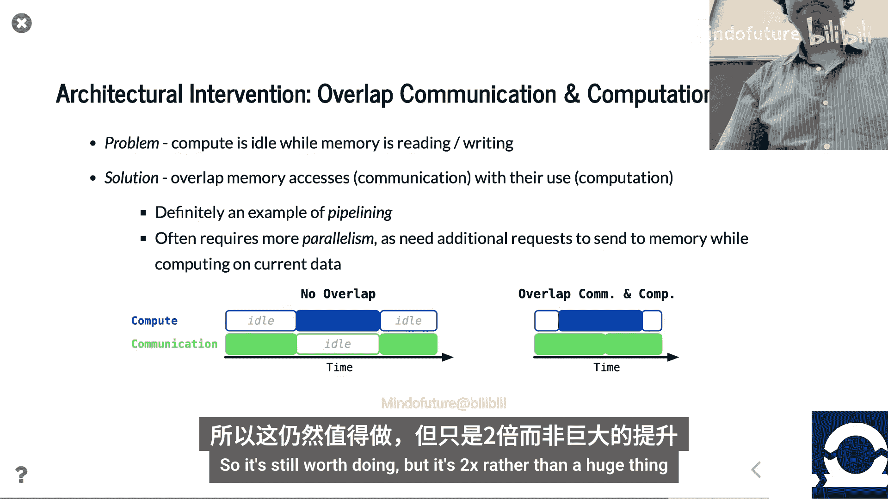

Cool what else you do so one way to implement we're just talking about is something called double buffering right let's say you want overlap communication and computation。

😡，But you talking before， right， Maybe you have a port limit and memory or something。

 So what can you do well。You can actually have two memories， this is like banking。And。

Or it's even gonna be buffers at your software inside of your your memory and you write to one and you work in the other one。

 right， So in other words， you see in phase one， you know， Comps on memory 1。

 communications on memory 2 and phase two Comps on memory 2 and communications on memory1。

 right So basically， you just have two copies。 And that way。

 you kind of can work on one and copy the other。 This is extremely commonly done right is you know pioneered decades ago from things like monitor where you have the buffering for your display where you have one。

This plant iss actually being rendered to the monitor that are buffers being rid to for next frame。

 right？Cool。

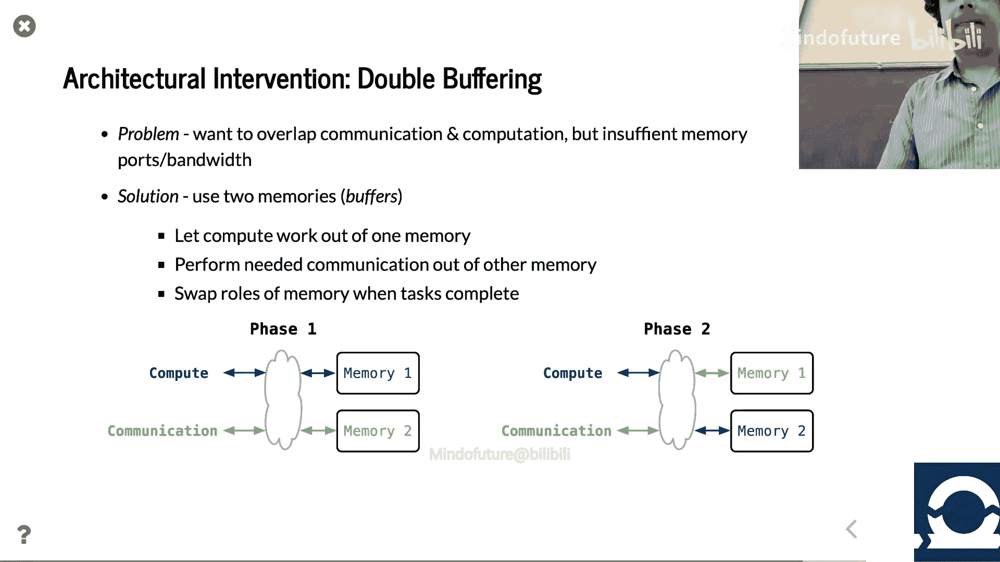

So when it comes time to actually essentially your memories in your architect design。

 what can you do？After remember， like I said。You're gonna really plan those out， right。

 It's not going kind of change late。 You're gonna know from your early modeling as well if they start building it。

What your cost targets are， performance targets， etctera。

 There's so many pins involved that involves so much packaging and taxes design that it is hard to change when things late。

 So you're gonna know ifre using HM， it's a very different experience using HPM and is using。

 let's say LPDDR or DDR right that's a huge change to the rest of the system。

For launch memories you have some choices， right， you know， amazing registers，'m using S Rams。

 youd love to use SRAM when you can because it's denser， I eat cheaper。

 you get more bits per square millimeter。Like I said， you got these usually from here。

Is the component going to get tracked down， so hopefully you get them from the foundry。

Previous you had to get someone called a memory compiler where it had to know you tell what parameters it wanted and you would make a memory for you。

 perhaps students want the banking internally for you automatically some ways。

 if you have a memory compiler as like an OG hardware generator。😡，And either way， you know。

There's some real physical constraints here， right， how you tweak these parameters。

 find the right ones to match。Both find a combination of things that are already available。

 what matches your design， maybe make your design， contort to match them， etcter。😡。

On the PJ you actually have a whole bunch of choices right so on depending on your vendor。

You have registers， sure， great， sometimes you get something called LutRA。

 you can turn those logic elements into Rams， you can have BRA， you have U Ram。

All sorts had some memories， if you're a veteran FPJA developer。

 you might be used to s these manually in V。And if that's something you really want to do in chisel。

 you can， you can， you know， put those sanation codes inside what's called a very like black box and looks like chisel from the outside。

 but of course inside you have that。Ver log is exactly what you want to extension the thing directly。

That works。In the a of philosophy discourse， I really encourage people to avoid doing that， right。

 Try to have your code written away where the tools will correctly infer。

The need to use these memories。 The reason why it's feather is as often it's only more portable。

 It's also going to be better performance， right， So sometimes you have a design has a lot of demand for capacity。

You hope ifj uses B Rams right that way， it's a lot more capacity available。 But at some point。

 maybe it's going to run out of B Rams or some point。

The B Rams that are available was so far away from the rest of your design。

 you actually wish it would do part of that， not a BRA。

 but actually using regries of let red be closer and keep me more dense。If you tell the tools， hey。

 you must use BRAM。😡，That's the optimization parameter you take away from tools。

 It's actually you'd rather have the opportunity。 So， yeah， if you write your v in the right way。

At least Steve Alex tools are pretty good talk and not bad at it andferring when you can use these memories。

 And so its sometimes I a little nudge。But usually they're pretty good。

 And so try to write your code in a way that it inferors and needs for memories rather than essentially them directly。

And then in terms of what does Chisle provide？Chsel describes behavior kill over right。 Okay。

 this is a。Memory， which is read in zero cycles。 A I。e。 A ma。

 This is a memory which is red in one cycle， a sync read mam， right。

 And so you also length to the various of the amounts。 That's sufficient for， you know。

 like you said， red st， B Ram Ram， etc cetera。If you want to use a specific vendor SRAM。

You have a few choices， right you can。Go ahead and stitching together post Verlog generation。

 or you can make a black f to wrap it。She's little to specify。

 I readw writeite reports I believe I was lecture。Stick for talking about that， et cetera。

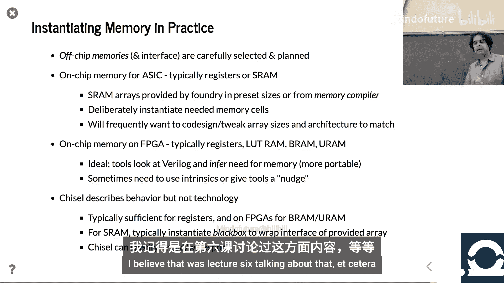

Questions。Cool， so a。

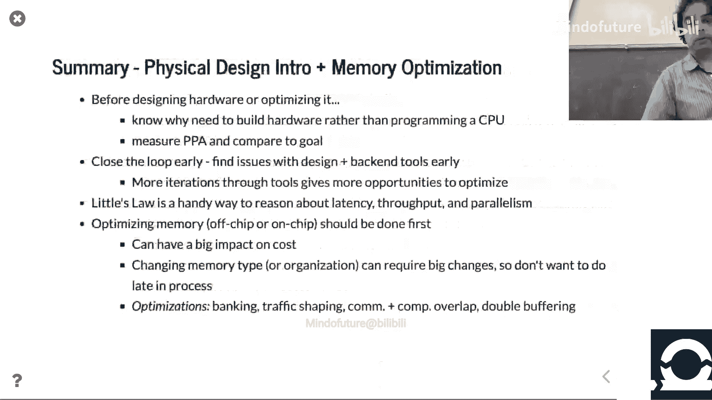

Today， so I was kind of just leap into this new shift for talking about physical design Foundation of this course。

muchuch more high level。I remember outation like you said before。啊。

Designing hardware takes a lot of efforts you all you want to know when you're optimizing。

That you need to optimize and where is this place to be most productive， right。

Understand where you are， this agile process of getting the tools working early， so loop early。

 single your costs early。It helps you kind of identify who spend the most time in effort。

And I've talked a lot of about architecture secondist lecture turnss about Little's law to can understand about how to reason between latency 3 point imp parallelism。

And we talked about memory， which is the first thing to optimize。

 Artally did your memory figured out what technologies you're using， where。

 how can reduce those costs。That's maybe way bigger cost reduction than anything else I'm talking about。

And so then assuming get memory triggerered out and you're very optimized。

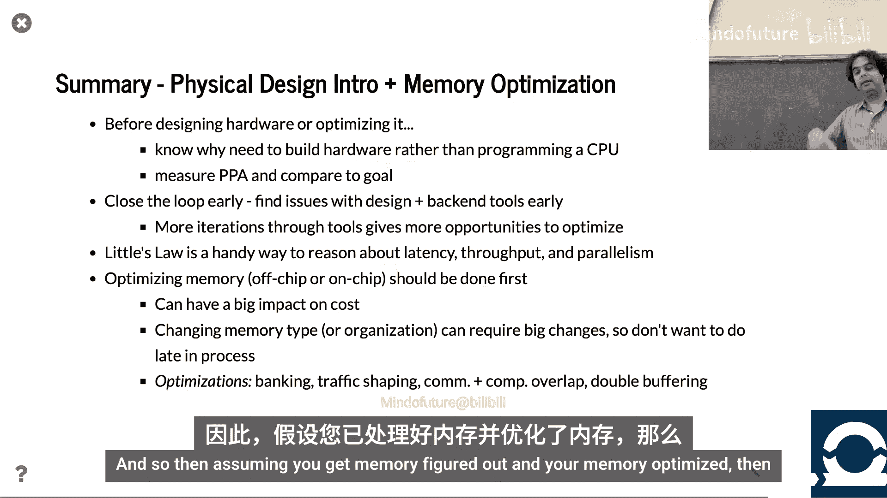

Then we mean next lectures optimizations。不。Any other questions？

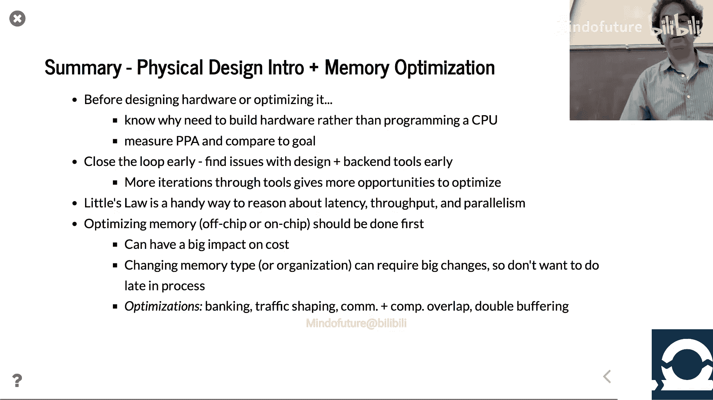

Okay， thanks folks。