# 【加州大学】敏捷硬件设计-CSE228A-｜-Agile-Hardware-Design-Spring-2025-p23-P09_第17讲-开源项目开发_第1部分共2节--BV1M6ivBzESw_p23-

Hello and welcome， this is Lecs 17 part1。So as part of this shift into physical design。

I actually going to take a pause on that and talking about open source project development。

 right other words。What does it mean to develop the project and what does it mean to consider open source both of those things together so。

😡，Take a minute to pause and think about。What would be the ideal code。

 perhaps you have a certain thing in mind and you're switching a web to see if this exists， right？😡。

What would that look like， you know， closing your eye streaming number one is correct， right？

You're hopingping the code you get does the right thing right and let's say hypothetically for this application you're looking for maybe there situations is where the inputs。

 there isn't the right answer fine， you want the tool to tell you that hey。

 these are inlateal inputs you know assertion sales even tells you when they are hey。

 this is not okay。😡，That what we want us is go to be correct and correct isn't just and it actually is correct。

 but somehow you are convinced it's correct， I said perhaps you know。

 produced by a credible organization， perhaps you have a lot of tests you can run。

 you can see a test passing， okay。Additionally， what else makes a code nice to work with it's easy to work with right。

 it's documented rather than mean this giant mass of code。

 you actually can understand what's going on there right easyy to read and modify。😡，Additionally。

 what else you want， you want to be efficient。 And by efficient today。

 we're being a great hand wav we're saying not much room to improve， right， pretty good shape and so。

If you think about all these traits and you think back at the code you've written。

 let's say perhaps in your course projects。For other courses。

 you'll realize you probably didn't reach all of these metrics fully right and that's not anything wrong with you that's everybody right。

 it turns out if you go find high quality source code。

 it may have many or all of these traits and that did not happen on the first draft。Right。

It doesn't just happen instantly， right， Someone doesn't just sit down and type it all out。

 I know largely models make it seem like you just type code like that， right。

 but that's usually not how it happens。 But those you are huge LLM proponents。 You may notice it。

Some more recent advancements have been these reasoning models that run the LM repeatedly， right。

 In other words， the surviving and iterating approach is not just good for humans。

 It's good for AI agents as well。That's what I'm pitching， right， We want to revise and improve。

 right， so。Talking about all quarterly for agile process， you know， get started， revise and improve。

And so today's talk is well spill over across the next lecture。

We're talking about what are these things we can do to improve， whether it be using tools。

Personal pro or pro of other humans to try and get this code to that place we want to be。Cool。

 so how are you going to do that？Talking about a lot of nitty， gritty things that actually exist。

So for example。Coninnuuous integration， a way to keep running tests， code management。

 how do you keep track all this code for big projects？😡，Doockcuation and then finally。

 the nameakeers will let you're oversourcing it。So first off。Is continuous integration。

What does that mean that means we want to keep running tests， right， So if you have a big project。

 not just working by yourself， but many people， even by yourself。As you keep writing stuff。

 despite best efforts， bugs will find a way into your coatat right and sony bugs find a way in。

We want to identify them as soon as we can， the sooner we find them， the easier just to fix。嗯。

As one there's a bug's been lying there dormant for 15 years。

 It's another thing that the bug was introduced last week。 and you find it next week。

 and you remember， oh， wait，' so changes this code for this reason。

 So so still around and can go talk to them。 they can figure out what they change。

 Why and then make the bug fix， right and so。You want to find bugs soon as they happen， ideally。

And you want to be aware about， right， it's often can be caused by integrating thing the sur name comes from。

But sometimes happen even in isolation， right， And so what do you want to do， Well， horse theme。

 right， make tools do to work。If I'm typing on a computer the write code。

That computer is not doing work otherwise， it's not very much demand。How to run tests， right。

 have servers in the cloud， run tests， right， If you have these tests。

 Just keep running Or change the code， run the tests， see if anything is happening。

 So I'll show you in a second house is set up to check every commit of your pull requests They can run those tests stuff you automatically。

 once again， You humans keep going about。 do you don't run tests at all manually。

 you run tests manuallylies are kind of developing and testing things at some point， you know what。

 This is good。And Albert would finds the way up stream。

Keep Brian's test what's happening right and so this is one of the things where I keep saying you know。

Testing isn't just about testing once he's developing it。It can be used so many different times。

 right， So having the continuous integration to C and making it publicly visible lets other people know that you are testing that increases their confidence when they test out your code。

It also examples someone to something like submitting a pull request。By seeing the CI。

 having the C run on it。You can see before you're gonna spend time reviewing this poll request and make sure it didn't break all of your code。

 Right， So the pull request and the C is all read same thing breaks all the code。

 you're gonna say you should fix that first before bother wasting time reviewing it。 Right。

 And so this is really， really helpful for checking， you know， external contributions。

 internal contributions。嗯。Let's say you are trying to do well and you're trying to modify someone this project。

 you know， Im not sure if you're breaking it or not。😡，Test and see how you kind of see that so。

Maybe I'll take a pause for a second。So， if we go to。Saule three on GiHub。是。

Let's see a CI for our beloved language。嗯。So。The few ways to get there。

 one way to go to city actions， right？So yeah， you can see that there's all this stuff going on。

And you can see that so many times how recently all these tests have been run， right？嗯。

This is various reasons why it's been going on， some of them are app pinned。

You can see people have been having a run in response to certain poll requests。This is all running。

 right， So each time as it's happening， it's running， oh， wait someone。You know。

 submitted the patch on how to。Change the Java table。It failed something guess what。

 they fixed it and submitted it again。Right， so now if you're coming in to review this。

 that's a much better sign， right？嗯。And you see theres various steps， right， Ma tools that work。

 This is not human work。 You set the continuous integration up， and then you go about your life。

 and you come on and check it back and and see how it's happening， right， so。

What do we need to get this going？When you you things number one， you need tests。

 I've been pitching tests from the beginning right underr tests of the ads a little detail。

 you write tests during development， you write tests before you start development。

 they're really helpful and CI gets you more value out of those tests right you might share already tests worth it CI gets you more value do it right test。

😡，m，Some people may push back on my testing that easy after saying， oh， well。

 I could write something that would pass test maybe buggy， and it's like that's totally true。

Sounds like your tests are complete， right， make better tests。Cy test coverage。

 right if someone can be passive a test and be buggy， it' sounds like you need more tests， right？

Or maybe you change testing methodology or something So when you need tests。

 then you need some way to kind of script things and autoimate things。Don't evenvent the wheel here。

 a lot of things already exist for this。嗯。And so definitely take whatever you can。

And terms a running it。You can run it locally， maybe your organization is worried about running in the clouds。

 you run in local summer for this， sure。But a lot of things are available in the cloud and they're easier free。

 for example， you know， GitHub actions are， you know。

 depending depending on your GitHub account free really easy to set up。Just a second ago。

 we were looking at all these things here。 Do a could to have actions here for a chisel。嗯。

And that' when they running。Yeah， and you can see， right。 So how do you set up that kind of stuff。

 Well， if you go back to the code base。Os。And then we go digging in here。So no， Gitthubs did massive。

 you know， project， right， we got 147 contributors。 So this isn't quite same for your project。

 But yeah， you can see。You know， depending on what workflow you're running。

Uually when these dot YMl file， the Yal file， this one's really long。

 You can probably set with like 20 lines for thiscourse， But basically。

 you kind of describe you know what it is。The VM to run it on any details。

 And then you have steps for what you actually want to do， right in this case there some reason。

Echoing process in there， but sure I don't know quite what's going on because see what's going on in this case。

 you're doing two things and so。嗯。Setting up the continuous integration might be a few hours in afternoon。

 but once it's running， it's really useful。There's a lots of that they help you out that。

 right like I said， Gitthub actions is makes us a lot really easy from this something called Jenkins is really popular。

 etcter。Cool。Um， so what kind of tests can you have？Inside your C I， all sorts of tests。

 And you curve kind of tossed around。 People have side different meetings for to say them but。

I covered them。 number one unit test， right， Test the modeling component isolation。

 This is the key building block。 And you've seen that already in this entire course。

 right those times when I show you to the component in lecture。

 it usually do a test to show that module isolation， right And so you test the starting point。

Then you have integration tests combined。Multiple tests together。 multiple components。

 it will't inhabit your tests kind of capture all these。

 So can be multiple models working together and be the entire system working together， sure。

Those are kind of the baseline types， so you did test for integration tests， sure。

Then there's called regression tests， which are tests that are checking things。

 You don't check as often and maybe things like。Trying your code on olderbergs the tool。

 maybe really， really exhaust just to check， really， really esoteric things。

 But you still want to regretess to make sure that your code is not breaking。

 These are things you expect to work。 But there some reason， these， these stop working。

 you want to know right away。You may hear the term smoke tests。

 these are tests that are really short and fast running。And so basically， yeah。

 you can definitely pass smoke test and be buggy but the smoke tests fail。

 you know you're in trouble right noticing it's really not working right now。嗯。Additionally。

 you may have performance tests， which for software performance testing is actually a little bit tricky becauseuse you have a kind of quiet machine due to measurements for hardware is easier。

 right you can。Push just through your flow and be like， oh， wait， all of a sudden' design。

Had a3 clock period and now we're 20% slower。 What will we w to know that right。

 And so that may not be obvious because you know here you are running RtL code and you know。

 you pushed it and your teammate proved they got merge into the code base And then guess what that nightly into integration run ran and then detective。

 oh wait， you know， our clock period got 20% worse。 We got go fix this。

 And you wan to know that right away rather than finding out weeks or months later。

Like I said to make tools do to work， right， have servers running。Router humans， the bugging， right。

 kind of idea， right， and。Turns out with C， much the time。

 most of the time all these tests are going to pass， great。The few times they fail。

 that's really vibe。Because that means you found something right and you want to act on that。

 I don't why if you spend a lot of time as a human debugging it and later these bugs get found。

The more more human time it is the fix， right， You have a regression in your critical path。

And you don't find until two months later。That's a big problem。

 Are you rather know about that right away。 Change your tissue if you need to and that kind of stuff。

 You wna notice early， right， something about pregnancy It also me performance。 And so。

Have tools doing the work， keep running， keep checking stuff。

And realize when you have this kind of automation to make CI run。

 you can choose which tests are running or which cases， right， maybe for every commit。

 you have to do a smoke test， make sure that doesn't break the bill。

 so to speak because then do your biggest regression test every only once a night or something or your performance test only once a week or something。

 right， but。You can kind of turn these kns。Cool， any questions on continuous integration ST high？

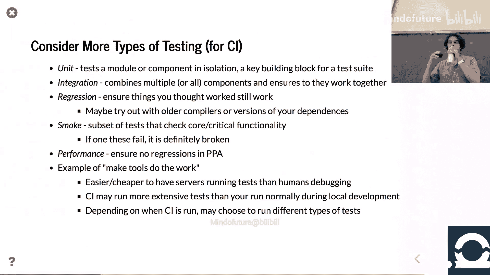

And next we's talk about code management so。In this course。

 we've used Git and I haven even talked about Gits， I'm sure you all are。

Appreciative of get or things like it。 Obviously， using version control is really， really important。

 You'd be surprised to find how many hardware companies。

Don't fully embrace all of the gi style things that aren using Git。嗯。And so yeah。

 it's good to have version control。And using not just the hold of code， but actually like。

Collaborrate well， track changes， document changes。Is really， really important， right？

It's one thing to have， you know， your entire code checked in the again。 So yeah。

 my code checked in the gi and have like two commits for your entire project， right， you know。

 first version， second version， boom done two commits。I like doing a lot of gi commits， right。

 which I make a significant change。Labeled that and someone else can go through your history later on。

 They can see scrolling through what changes is required for this thing that makes it much more intelligible。

 right If you find yourself unsure of what to say and they get command message。

 it probably sign a commit too big right， It's like if you can described and see what it's supposed to be doing because it changes like 10 things at once。

It was 10 things are somehow hour related。Probably shouldn't be one commit。嗯。So that being said。

 how about some opinion and advice on how do you get in practice？

There's some features that are really helpful。And it can be great if you swell and it can be disaster if you use not greatly。

 So things like a sub module。 Sub module allows you to put a gi repo。

 a reference to a certain repo and a certain commit into your repo。So why the helpful。 Well。

 imagine for its projects and people have asked me， oh， well， there's already this existing code。

 Can I use that It's like， yes， Yes， you can， You can build on top of that。

 And so wouldn't it be great if your code management tracks that dependence of which version you want。

 Yes， that's the modules for， right， You can definitely say， hey， you know。

 I want to include this repo at this commit。Good thing for sub moduleule。嗯。However。

 let's say you yourself are building a big project and you are kind of finding away a big project with a lot of things going on。

 Should I have multiple directories in one repo or make multiple reos and to submods and stuff。嗯。

I would push back and getting too going home sub module of things you can control for things you don't control。

 they need to be submods。 for things you can control those kind of philosophy of having more things in the same repo。

 So it take it to an extreme。 It's called the mono repo， of course， but。

Only have separate repos there really are separate use cases， and it can be used independently。

But yeah， it's really good for tracking things。 Co。 What else is there Bra， right。

 We've all seen branches and get。I recommend very few long lived branches。

 otherwise really painful to maintained。I also remember many years ago getting excited about branches and having like 400 branches in the same project。

 I also recommend against that。So be afraid to use。Different files and folders， et cetera。

 But branches are great for through short lived， right， You maybe make a branch to do a pull request。

 And then once it gets merged， you can delete it， etc cetera。So I said a term pull request。

 What is that That's a way with Git or I guess should say Gitthub specifically to kind of track things。

 In other words， there's a repo， you point to another branch and say， hey。

 I want this to merge into that repo and I guess some of a very clear proposition。 Okay。

 here's the codes someone wants to have there。😡，It's much more controlled， right。

 They'll turn into to a pull request as someone just having right access to your repo and they can push commits there。

And if they' doing good work， perhaps it's okay。But maybe not。

 and so Pocr makes a lot more structure， it gives you a chance to do reviews。😡。

Also to do multiple commits， let's see you one person A doing task A， person B doing task B。

 each them does five commits， and then they're kind of pushing into the re at the same time。😡。

The code is kind of changing， you know， knee jerk way back and forth。opposedposed to pull request A。

 pull request B， you can see those five commits， you do all the things to reach those tasks。

 you agree to them and they kind of come together all at once right and so yeah even for a project pair。

 you may consider having people work you know you're kind of that sweet spot where if you really want to trust each other and talk to shit a lot you can both push them to Ma that can work or。

😡，I recommend maybe trying out some pull requests and you do a pull requests and you have all things you're writing into the project and you kind of merge them in bulk。

ho。Um， so。What about code reviews， the memoryator begins like show us saying how， you know。

 we've had deals for what we want。 So it' code to be。

 and I mentioned this like certain amount of polish is hard to get on the first draft。

One it needs we do to improve that code quality is a code review， right。

 Another one we talked about a second ago， which， of course， like integration， keep testing。

 trying to find those bugs， but。What's the code of view， Code of views a way where。

You can get feedback of your code。 And you think about it。

 Much of the code you've probably written or maybe all the code you've written is basically rough draft。

 right once you had it。Working and passing tests， once you submit to this courses out of grade or you got 100 points。

 you're probably like， oh， great， done。And moved on right。

 And the question is if you go back to that code and say， okay， that make this better。

 Maybe when we write it need be right？ And so the code is a way where you get someone else to look at your code and give you structured feedback。

 try and make it better。And so think about like writing， right。

If I'm trying to write something whatever it be maybe a journal article。

 or like like a paper for academic publication or maybe like a。

Art for like a periodical it like a news source， you probably can't just write it start to finish correct since day one right we know you can't right you're gonna write the rough draft。

 you're gonna revise it， you're gonna revise it。You're going rewrote this portion。

 write that portion， rearrange it， right same true for code， right？嗯。When you get it working。

 the first time great， that's the rough drafts。Then you got to go in there and， you know。

 improve clarity， however you can right， and so use code we're still focused on functionality。

But trust me， thinking about rebuiling clarityly help。 and you can make your code。

Simpler and easy to read and often shorter。Months years later， you come back working in that code。

It makes life a lot easier， right， And so this code is a way to kind of get that feedback， right。

 you're trying to write a， you know， human readable article in English or something。 they said。

 you're probably gonna do best you can on your own。 And you show other people， hey， give me feedback。

 give me feedback， give me feedback。That's the code of view， give me feedback， right？So。

All sorts of ways doing code reviews， you're going to do code reviews in this course you're going to do do two。

 you're going to do one where you're going to use some as Co5。

And then second one' is gonna to be to review some of this project as a chance to kind of get you this experience。

 And you'll see that like。Sometimes， you know， they're as helpful as you would like。

 they kind of see things you kind of would know like I should have done that on my own anyways。

 other times it shows me new and it's helpful。 You kind of get that that a little bit of help。

For those of you that are becoming very attached and having your AI coding assistance in the way it's kind of code review。

 right， the AI is looking at your code and telling you， hey， wait。

 could you have done this alternatively， right， And so。I think at least for a couple years。

 code of reviews but makes sense。 Maybe in 10 years， I don't know if A I gonna do it， but。

It's still helpful right， you know， and I get that feedback we'll make this more clear well make what consideration should be aware of right and so。

It can be things just about readability。 It can also be things about correctness。

 for like you it past tests as they' written， at least us see。And this you didn't think of， right？

So reviewed code tends to be a lot better or at least more consistent than something else that may say。

 you know， this is the way we have a coding status organization。 You need to be more like this。

 that way it kind of makes things。You know， more uniform。Also。

 the notion that your colleagues ought't spend time reading it often makes you do better job at writing your code。

So I may telling you， for example， your homework five and code reviewed。

 maybe you're all gonna be worried， oh， I might homework five look prettier So maybe that kind of split a little bit。

 but yeah， it helps right， times that motivation。And off looking at code， talking about alternatives。

Reading people's code and learning from what they're doing。

 These are all ways to kind you get better as a developer， right， both improving your own code。

 C's code， getting feedback。K of this really help。 It's one of these things that， like。

It's done the standard practice industry and we don't really do it all teaching right and so that's why I have it a little tasted out in this course hopefully you're aware of that and you see some benefit to it when you finish this course and then when you go off to a job。

 you'll not be surprised until you got do a code review。嗯。Cool。

 so what happens in the code of view typically。The person creating the code， you know。

 as finish the code， they've done the best to polish it as best they can。

 but then then somehow I' initiate the review process right so maybe a common way of doing that is you perhaps open a pull request and also request someone to review the code right okay。

Sometimes even's mandatory， some projects say you can't merge a pull request into the code base until it's actually been approved。

 right， actually ask them have a code review in order to be merged。嗯。

The sort of view looks over your code does a code review。U。And once again， making tools of the work。

Someh tools can help run。Makes easier for them， right， for example。

 maybe the revenue integration runs， they see does this pass the test before you even look at it。

 Maybe you have a style check or a Linting tool checking the code for formatting consistency before you even look at it。

 right， So by time human looks at it， they know at least it passes the test than perhaps its properly formatted。

 Great， and they can start focusing on what they want to do if software is part of the code review process it's easier to kind of annotate where in the code you're talking about things。

And then the perhaps， you know。Very commonly， you're not going to prove the code the first time。

 right， You can get feedback submitted to go ahead and revises their code according to the requests。

And then eventually after multiple rounds of reviewing and revision。The reviewer says， you know what？

LGTM， which's good to me， thumbs up。And you get approved and then went from' approved and the code can be pulled in。

😡，嗯。I had a pull request here， right， so this is the pull request that the's replay pulled out a year ago。

 so someone。Was doing， for example， you can see this very formulaic form。

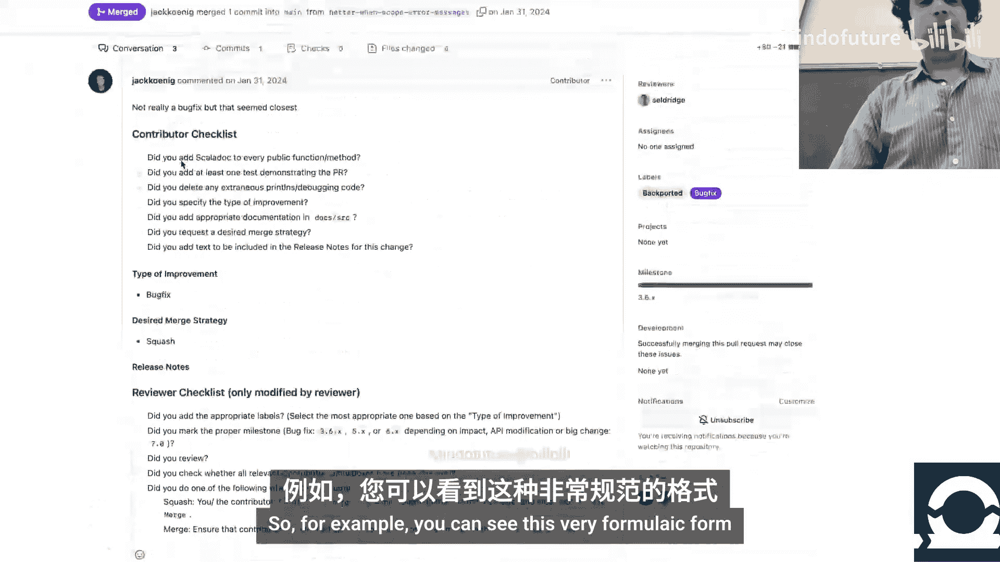

They have a four minutes repo template the kind of guy you only do a pull request。

 and someone did a pull request or as the title suggests。

 they're trying to report or creator when Scpy messages right so you can see that this is a very detailed esoteric thing。

 you know， this is this pull request 3804。 so they've been doing this for a while。

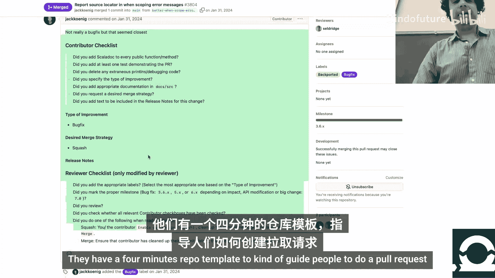

And thing can see this kind of these checklists， making sure that they。

That fight certain criteria for example， do you have a test that demonstrates functionality you're adding is actually there right did you make sure to delete any bugging print testss。

 right？嗯。Are you telling people why we're doing this like was this actually there right。

 How should this be merged So all these kind of details are kind of living here right。

 but then ultimately you know。This person requested review by someone else。Now。If I actually。

Look at the changes， right， So here are。The changes that this poll request brought in， great。

And then there's some conversation back in forth between two of them， right？And eventually。

 you know after this， it was merged in。And you can see now once again， making tools into the work。

 there's actually various other bobs here that will go ahead and backport thiss of various other branches。

 etc。So yeah， this is dis and practice。Cool， so what kind of things you look at if you have to do a code review。

Every organization has their own policies， you can kind of see from that thing we're just looking at。

You can kind of see before it even got to the beginning， there kind of inru to their due diligence。

And then the reviewer also there some kind of verymin diligence that I do。嗯。

With a lot busy check for number one， correctness， right making sure。

This is not going to break stuff。You know， checking to make sure they add a test。

Should it be running new tests for dysfunction functionality， et cetera。

 think they read a building Cotel sound trivial， but they really add up for big project， right。

 like the thing you don't want to have happen ist a big project。

 this test open up a file And without looking at the version history or looking at the comments。

 nobody who wrote this code。That's not what you want to happen。

 You want to have this code as kind of。Nameless because it's all kind of very similar。

That's make easier everybody to read， but if you have someone has a very unique coding cell and that's allowed to persist in the repo。

That just increases the content to load of everyone else trying to read it later on。嗯。

So readability is extremely important。that's the big part of code reviews in the course complete is for making sure you know that said they have tests they have documentation。

 etc cetera。 when you do code reviews for risk course。

 I'm going to give you a suggest list of questions to make sure to check for。Cool。All right。

 let's just keep rolling then Okay， so。We've covered disintegration。You know。

 I was making tools into to work， run lot tests。 We've talked about how to manage your code。

 things like get things like pull requests， things like code review。嗯。Were also helpful。

Documentation， right？Explaining what is there。And little we know all we've done for the last。

 you know， a few decades has been great father they all now experts in our code because of documentation。

So。What does ducation do， right？It has multiple roles and you appreciate different parts of the document。

Do different things right， number one， summarize what the project does。

 That sounds like a really low bar。 You'd be surprised how many projects fail to meet this bar going around on Github。

 you come find some repo and someone linked to or something。 You're like great。 And you get there。

 It has some sort of name。 Like this is the you know， food bar project。 Okay， great。

 you scroll down to the Readme what is foodbar project does。 And it's like， for c。

 this is the repo for the food bar project， Great， It's like we depend on this compile version。

 What is it freaking do， Like I live up the food bar project is like， what is this freaking， like。

 no， summarize what it does a really important task。

Ss how to use it sure details the internal structure and functionality。 Yes， that's also important。

And' thing about documentation， right， the people who make code are the ones sometimes the least concerned about it because they know what the code does。

 right？And so persons most hurt by lacking notation are the ones that are actually are users or contributors。

Right， in other words， if your team knows how it works， you guys don't care， but。

People on the outside trying to use it， they will care。

 and dark can be the difference between somebody being adopted or not being adopted or somebody between somebody contributing externally to your project or not because they can get the foothold。

 right？😡，So a good organization can really help， it can help get your users。

 help get your contributors。😡，I you want to go absorb projects take off， right？

 And so in order to get dation right， you got to think about a few things。 So you got to think about。

Somebody coming from the outside。How are they can perceive this， like I said。

 you're that person scrolling through on Gitthub and you're trying to figure out what the food bar project is。

 right。Tell them when is， okay， we're doing a certain thing。

And taking about his interfaces and features in that sort of way。Cool， okay。

How can you document all just a ways to document， but really can think of it as three different level dations are possible？

Number one is the read meat， like if that's a bare， bare minimum。

Not only does live inside your code repo， but on sites like GitHub， that's also rendered。

And so that's really easy to see， right， I mean， if we go back。We were just at the chisel。You know。

 repo。We've seen chi lacs all throughout this course。

 but there's also the chisel read me right and it tells me right away。

It's a open source power description language， right？Tells you not right away。

 let's say this is the chisel project and then not tell you what it does。

 you know tells you what it does in the very first sentence that is good do that。Right？

And to read me， of course， we'll cover everything。The covers a good amount of stuff， right？

And it links to a lot of other documentation， which is great。Do that。

So number one is the readme right and for this course that's probably what you can do for documentation right cool make nice read me use markdown and make it formatted。

Cool， number two is actual code documentation。 So you've seen this before。

 look at the chisel features， right， a scala doc and a chisel doc， right。It's really nice， right。

 You can write documentation in the same file as the code。So that way， you。

 they' easy to keep synchronized。 And together， some very smart Is actually recognize the comments for Schd and render them as。

Pre documentation in line， that's pretty cool。Of course。

 you use another code tool to actually have it get rendered。 and you've seen it all quarters。

 I believe if I。嗯。Worre w。Porter we had same docks open。I will sheet by going to the course homepage。

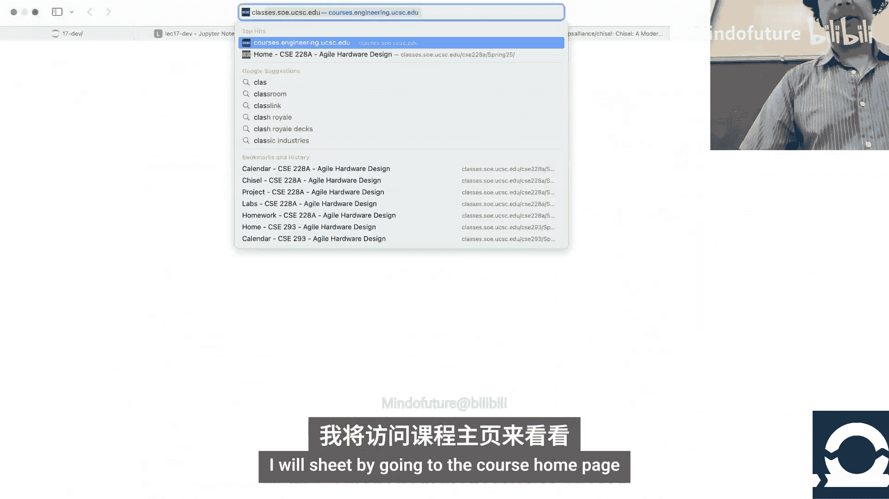

But yeah， if we go to like the API documentationation right， this is generated by Sca Doc， right？

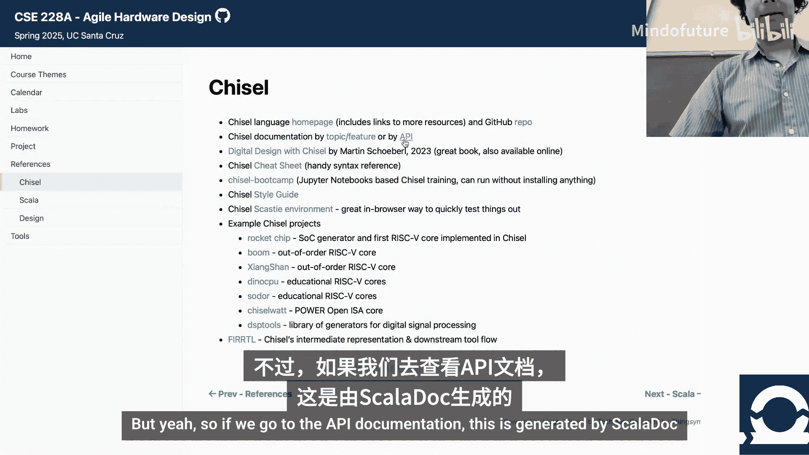

And so yeah， I mean， is this is helpful， right， And so someone inside these pieces of code。嗯。

I had to a side side。 we go go look at the deck， right， There's some documentationation here。

 We look at the V code。

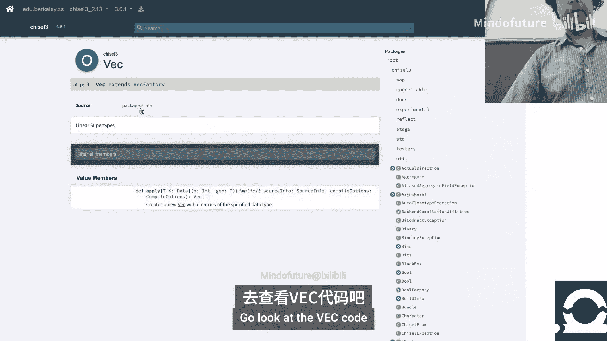

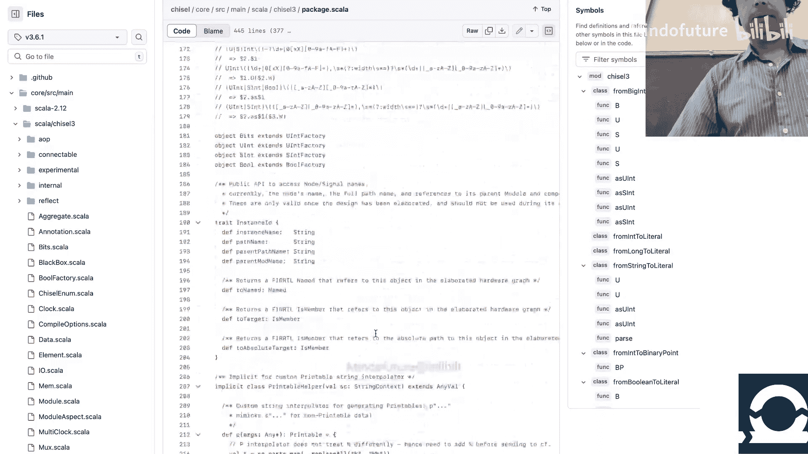

Oops， scroll back。Sing to find a sc dog。 Maybe that's not the best example。 Let's go find。

I go to Utah。Oh okay， yeah， fine。 It's good find some electrical components we recognize in u。

How about something like an arbiter？So here we see some naration on from the fields。

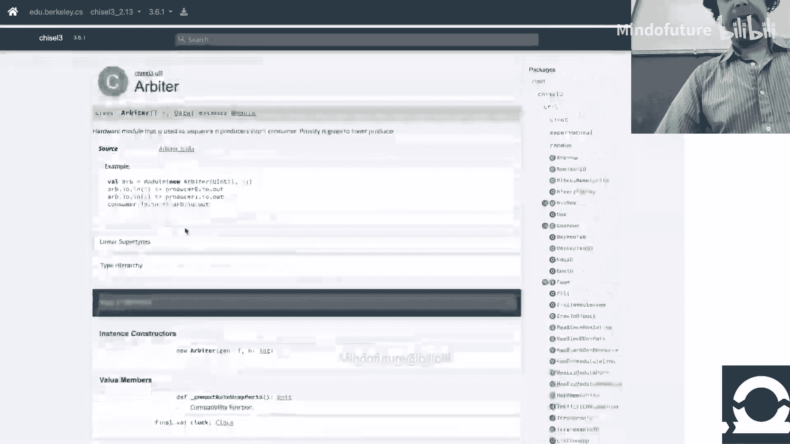

Go' read Arbiter Dcalala。And you can see some of the sca doc stuff associated with it。

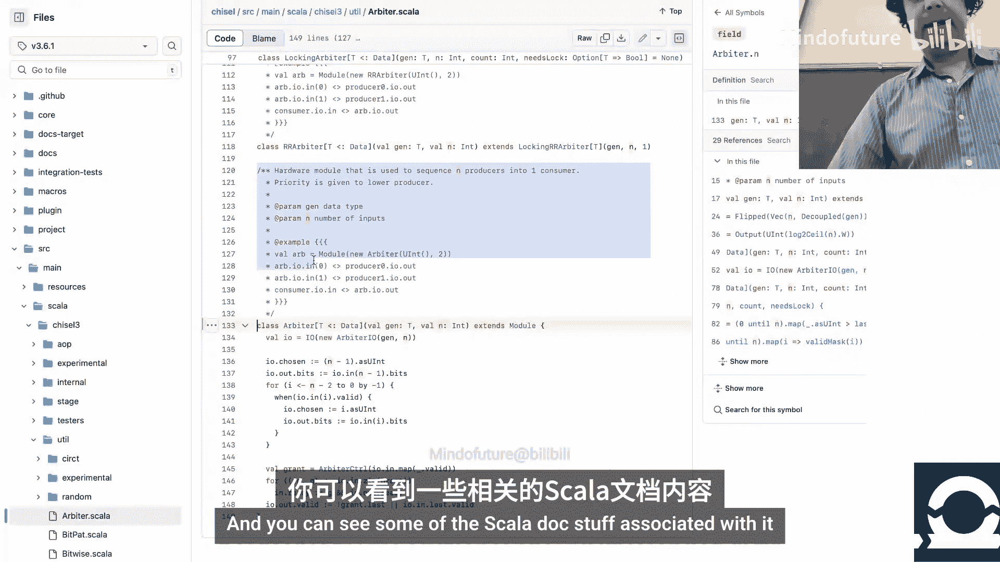

不。嗯。

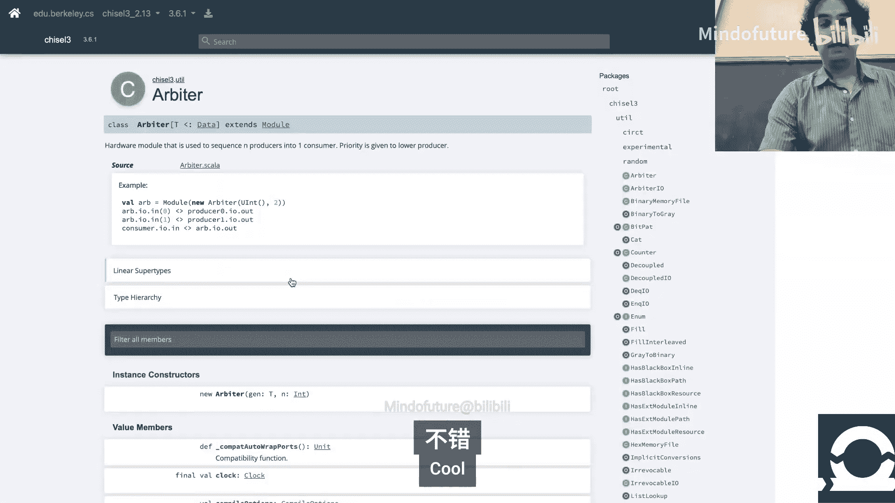

But that's not all。 There's another kind of documentation was just a static web page， right。

 which people also can do right， and there's a log to write these， there's a site read the docs。

 which are like some really pretty helpful ways of hosting it。 the course web page for this course。

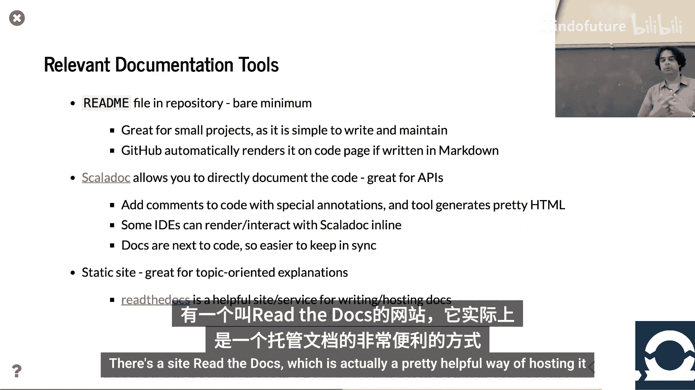

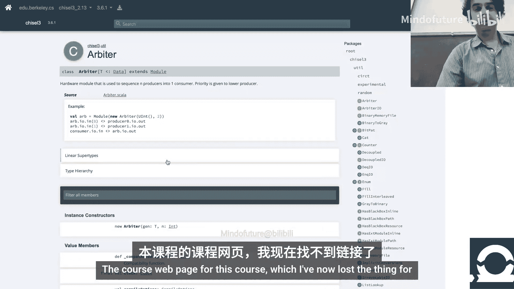

Which I've now lost the。Think for this actually is a static site generator designed to write documentation。

 right， you can see down here。呃。Tech do， right so。Tucation discourse is the cases the course material Yeah。

 so these are also the wing document your project it's really worth doing it's not just nagging detail。

 it makes it all difference in terms of scanning dots that it or not。😡。

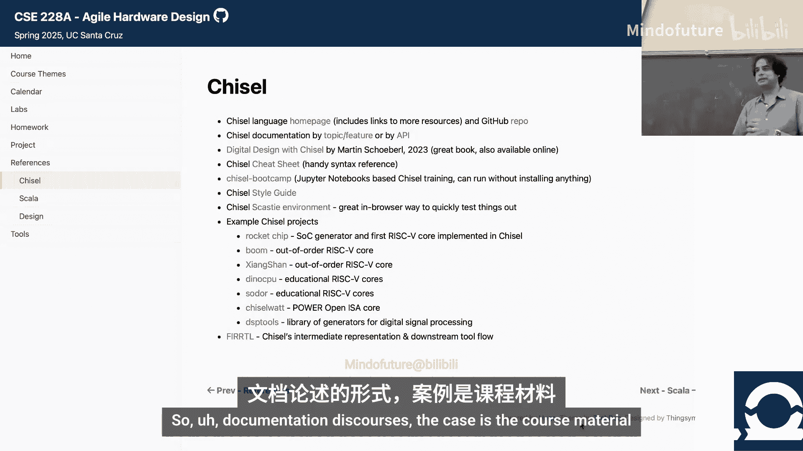

嗯。Okay， so more opinion opinions Okay， so I comes through my documentation in a set number one。

 please， please， please， please please include a summary of what it does I said you're surprised my projects fail this test I'm not going to name names during lecture but you will come across this going around GitHub。

If I you really polish read me， it's like you know five00 words a lot of stuff in there somebody I forget to mention the most important things what the thing actually does so don't forget to include the brief summary of overall function and purpose。

😡，Ephasize the purpose of things， right， It's really easy programs。

 which if you've written something to think about， oh， how does it work？😡。

That makes a really confusing reading， De what it is for， what it does from the outside。

And if you've designed it correctly， people shouldn't need to know what is inside， right。

 All they need to know is what it does on the outside it works， right。

 They shouldn't care about the inside， right， So emphasized the purpose of implementation。

Emphasize the， you know interactions is what the' saying over the details on the side of it， right？

A lot of times on documentation， its like， oh， yeah， first introduce this concept。

 They when who this concept。 you either understand what this kind of object is。 It's like。

 I don't want to know what all these things are。 I just want to how to use this thing， right。

 Take those abstractions and get that right。 And you may find the right documentation。

 You may find something that's really hard to explain。That may be a suggestion。

 necessarily you're not going to the right not may actually be a sign that the way you've structured your project and you've structured your abstractions。

😡，mIts confusing and you make sure reconsider that。Co。

I think that's a great place to stop any last questions。

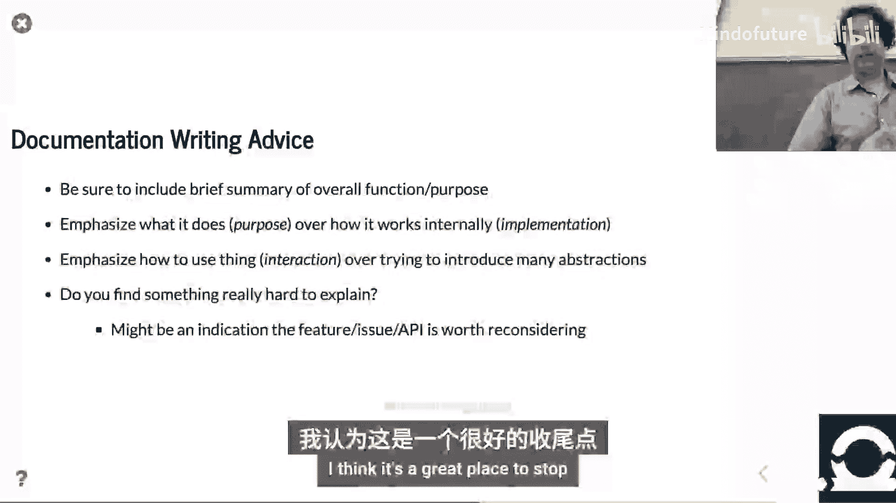

Okay。