# 敏捷硬件设计：17：开源项目开发（第一部分）

在本节课中，我们将学习如何开发高质量的开源项目。我们将探讨一系列能够提升代码质量、可维护性和协作效率的实践与工具。

---

## 概述

开发一个理想的代码项目意味着什么？理想的代码应该是**正确**的、**易于使用**的、**文档齐全**的，并且**高效**的。然而，高质量的代码很少是第一次写就成功的。它通常需要经过反复的修订和改进，无论是通过工具、个人努力还是团队协作。本节课，我们将深入探讨实现这一目标的几个关键方面：持续集成、代码管理、代码审查和文档编写。

---

## 持续集成：让工具为你工作

上一节我们讨论了理想代码的特性，本节中我们来看看如何通过自动化流程来维护这些特性。持续集成是一种通过自动化测试来尽早发现代码错误的实践。

其核心思想是：当项目规模变大，或者有多人协作时，尽管我们尽力避免，错误仍会悄悄潜入代码。我们希望**尽快**发现这些错误，因为发现得越早，修复起来就越容易。持续集成通过自动化工具，在每次代码变更（如提交或合并请求）时自动运行测试套件，从而实现这一目标。

以下是持续集成带来的主要好处：
*   **尽早发现错误**：错误在引入后很快就能被发现，而不是潜伏数周或数月。
*   **提升信心**：公开的CI状态能让其他用户或贡献者对你的代码质量更有信心。
*   **自动化审查**：在人工审查合并请求之前，CI可以自动检查该请求是否破坏了现有功能。

### 如何设置持续集成

要设置CI，你需要两样东西：
1.  **测试**：这是CI的基础。你需要在开发过程中编写测试。
2.  **自动化脚本**：利用现有的CI/CD工具（如GitHub Actions、Jenkins）来配置自动化流程。

例如，在GitHub上，你可以通过项目仓库的“Actions”标签页查看CI运行状态。配置通常通过一个YAML文件（如 `.github/workflows/ci.yml`）完成，其中定义了运行环境、步骤和要执行的测试命令。

### 测试的类型

在CI中，你可以运行多种类型的测试：
*   **单元测试**：测试单个模块或组件在隔离环境下的功能。这是构建高质量代码的基石。
*   **集成测试**：测试多个模块组合在一起是否能正常工作。
*   **回归测试**：确保新的更改没有破坏之前正常工作的功能。
*   **冒烟测试**：一组快速运行的基础测试，用于快速验证核心功能是否正常。
*   **性能测试**：确保代码更改没有导致性能下降。对于硬件设计，这可能意味着检查时序是否恶化。

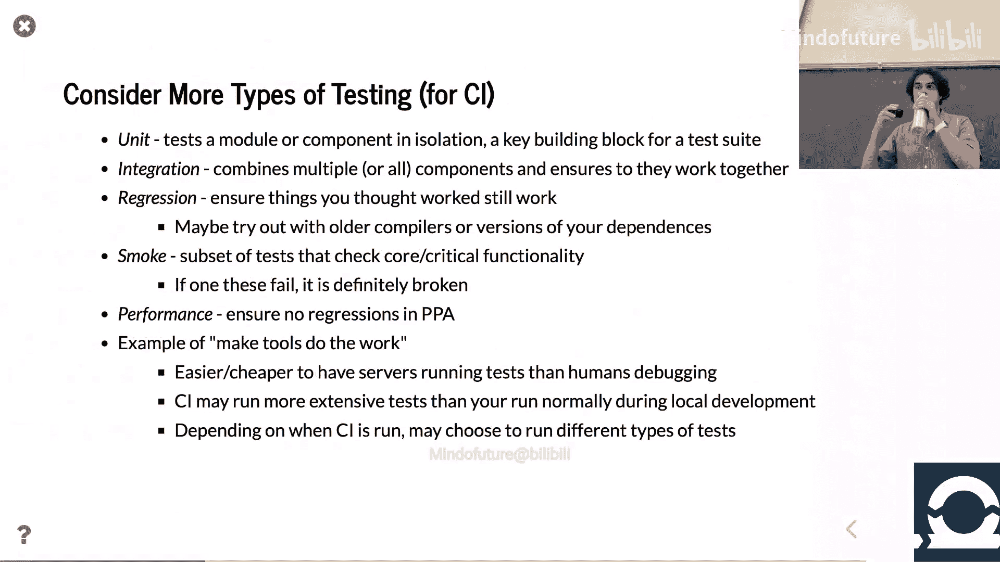

你可以根据测试的耗时和重要性来配置CI策略。例如，每次提交都运行冒烟测试，而全面的回归测试或性能测试可以每晚或每周运行一次。

---

## 代码管理：使用Git进行高效协作

在讨论了自动化测试之后，我们来看看如何有效地管理代码本身。版本控制系统，特别是Git，是现代软件开发（包括硬件设计）的基石。

使用Git不仅仅是把代码存放到服务器上。它关乎**协作**、**追踪变更**和**记录历史**。一个良好的提交历史应该清晰、原子化。这意味着每次提交都应该代表一个逻辑上独立且完整的更改，并附有清晰的提交信息。如果一条提交信息难以描述，那通常意味着这次提交包含的更改过多。

### Git的高级功能与实践

以下是Git中一些有用的功能及使用建议：
*   **子模块**：允许你将一个Git仓库的特定提交作为依赖引入到你的主仓库中。这对于引用你无法控制的第三方代码库非常有用。然而，对于你自己控制的大型项目，通常更推荐使用单一仓库（monorepo）模式，除非子项目确实有独立的用途。
*   **分支**：分支非常适合短期开发任务。例如，你可以为每个新功能或错误修复创建一个分支，完成后通过合并请求将其合并回主分支。应避免创建大量长期存在的分支，这会导致合并变得复杂。
*   **合并请求**：这是GitHub等平台提供的一种协作机制。贡献者不是直接向主仓库推送代码，而是创建一个合并请求，请求维护者审查并合并他们的更改。这为**代码审查**提供了结构化的机会。

---

## 代码审查：借助他人之力提升代码质量

在设置了自动化测试和代码管理流程后，我们还需要一个关键步骤来提升代码质量：代码审查。代码审查是获取他人对你代码的反馈的过程。

可以将其类比为写作：你很少能一次性写出完美的文章。初稿完成后，你需要反复修改、重写、调整结构。代码也是如此。第一次能让代码运行通过，这只是完成了“初稿”。接下来需要改进其清晰度、简洁性和可读性。

### 代码审查的好处

*   **发现盲点**：审查者可能发现你未考虑到的逻辑错误或边界情况。
*   **提升可读性与一致性**：确保代码符合团队的编码规范，使项目代码风格统一，便于后人阅读。
*   **知识共享**：审查过程本身就是一个学习机会，审查者和被审查者都能从中受益。
*   **内在激励**：知道自己的代码将被同事审查，会促使你在提交前进行更仔细的检查和优化。

### 代码审查的流程

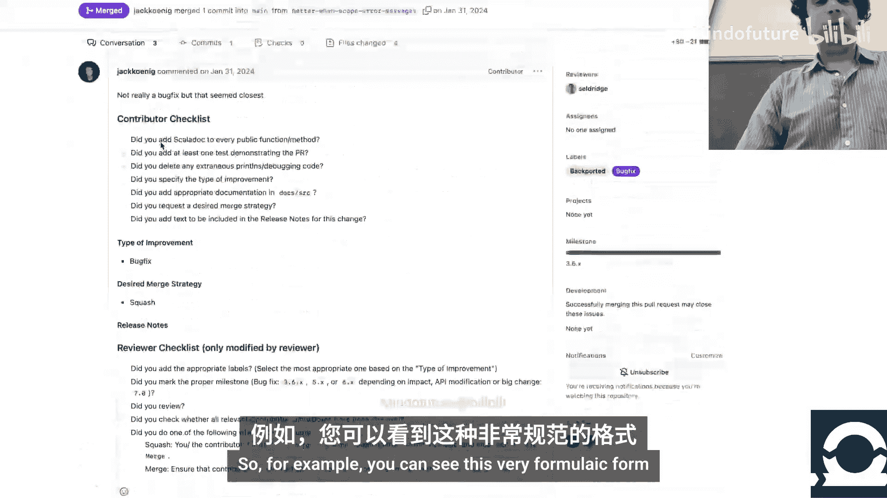

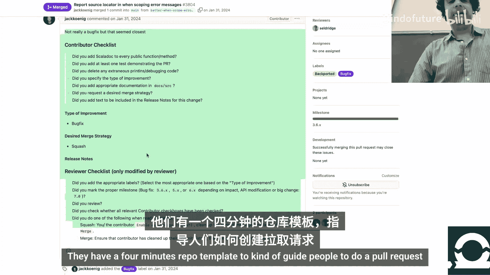

典型的流程如下：
1.  开发者完成代码并自我检查后，发起审查请求（例如，在GitHub上创建一个合并请求并指定审查者）。
2.  工具先行：CI自动运行测试，代码风格检查工具（Linter）自动检查格式。这为人工审查扫清了基础障碍。
3.  审查者仔细阅读代码，提出修改建议或疑问。这些讨论通常直接在代码变更的行上进行。
4.  开发者根据反馈修改代码，并更新审查请求。
5.  经过可能的多轮迭代后，审查者批准合并（常用“LGTM”表示通过）。
6.  代码被合并到主分支。

在审查时，审查者通常会关注：
*   **正确性**：更改是否引入了错误？是否添加了相应的测试？
*   **可读性**：代码是否清晰易懂？命名是否恰当？
*   **设计**：实现方式是否合理？是否有更简单或更高效的方法？
*   **文档**：是否更新了相关的注释或文档？

---

## 文档：让项目易于理解和使用

最后，我们来谈谈项目的门面：文档。优秀的文档对于项目的采用和外部贡献至关重要。编写代码的人可能最不关心文档，因为他们知道代码如何工作。但受缺乏文档影响最大的，恰恰是**用户**和**潜在的贡献者**。

### 文档的层次

文档可以分为三个层次：
1.  **README文件**：这是项目的“首页”，是绝对的最低要求。它应该在第一段就清晰地概括**项目是做什么的**。一个好的README还应包含快速入门指南、安装说明和基本用法示例。
2.  **代码内文档**：直接在源代码中编写的文档，用于解释模块、类、函数的功能和参数。例如，在Scala/Chisel中可以使用Scaladoc注释，这些注释可以被工具提取并生成漂亮的API文档网站。
3.  **独立文档网站**：对于复杂的项目，可以构建一个独立的文档网站，提供教程、深入的概念解释、设计决策等。可以使用如Sphinx、Docusaurus、GitBook等静态网站生成器。

### 编写优秀文档的建议

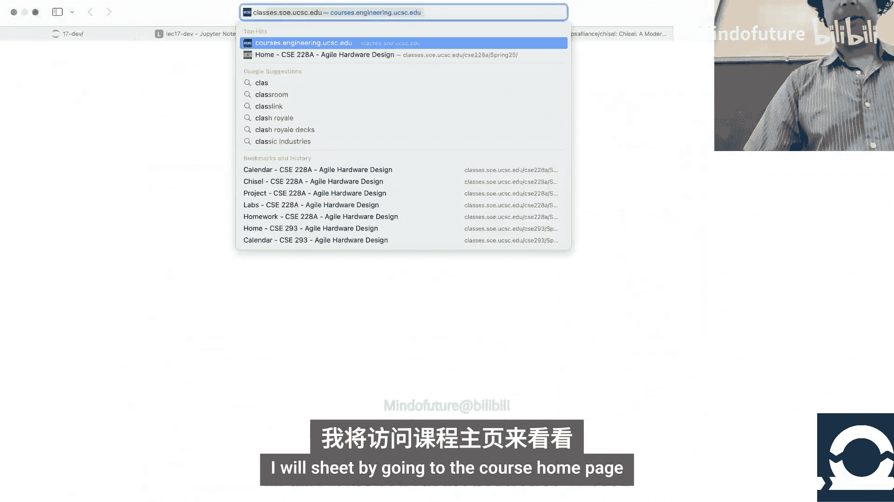

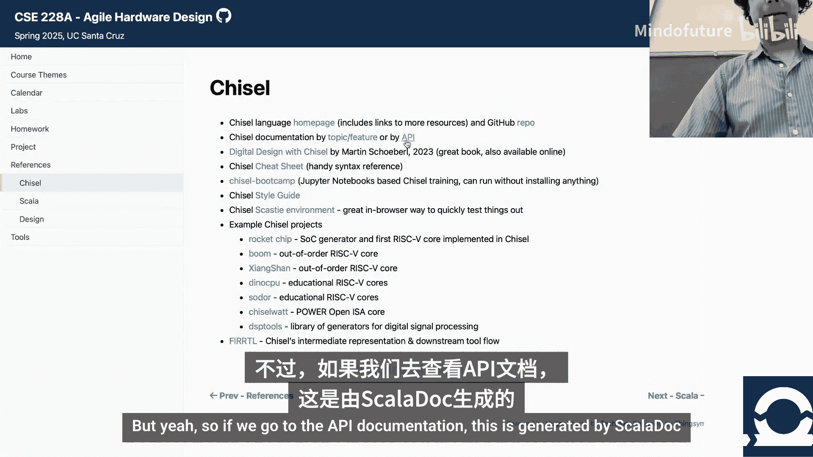

*   **首要任务：说明用途**：确保文档（尤其是README）开篇明义地说明项目的整体功能和目的。
*   **强调“做什么”，而非“怎么做”**：对于用户文档，应着重描述接口、功能和使用方法，而不是过早深入内部实现细节。
*   **保持同步**：过时的文档比没有文档更糟糕。尽量将文档靠近代码（如代码内文档），并建立更新文档的流程。

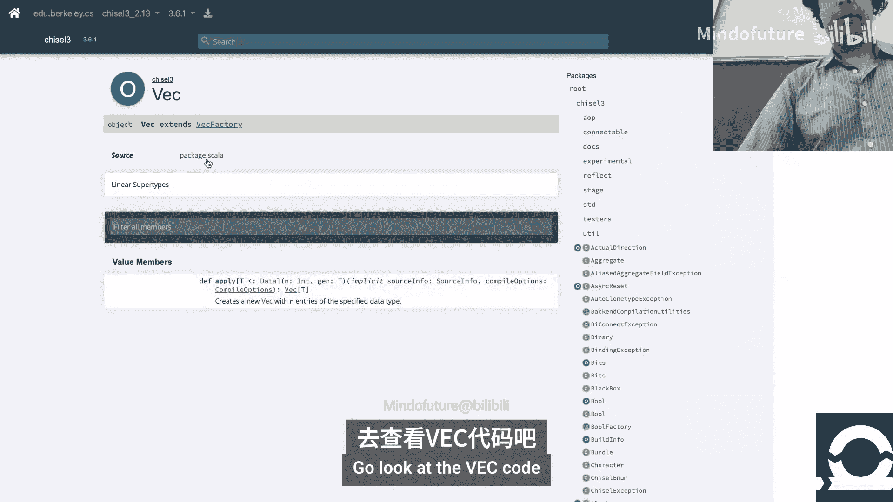

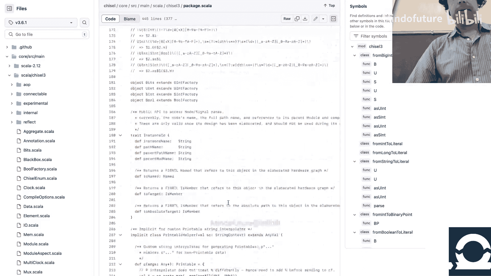

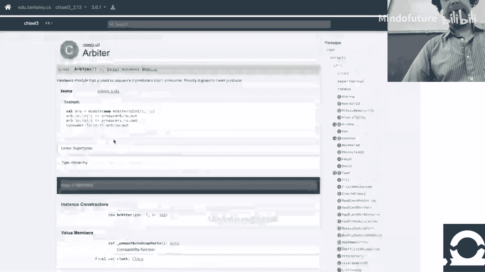

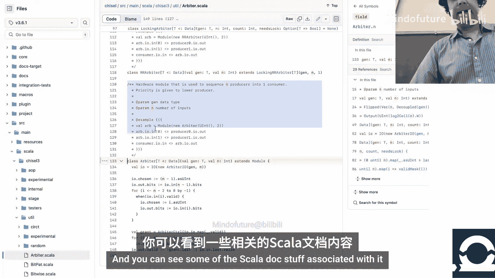

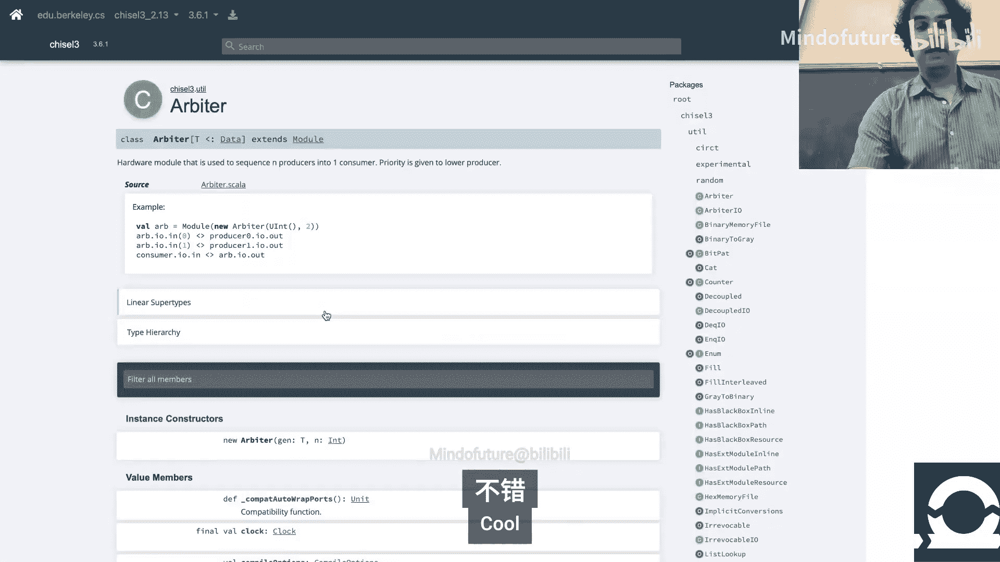

---

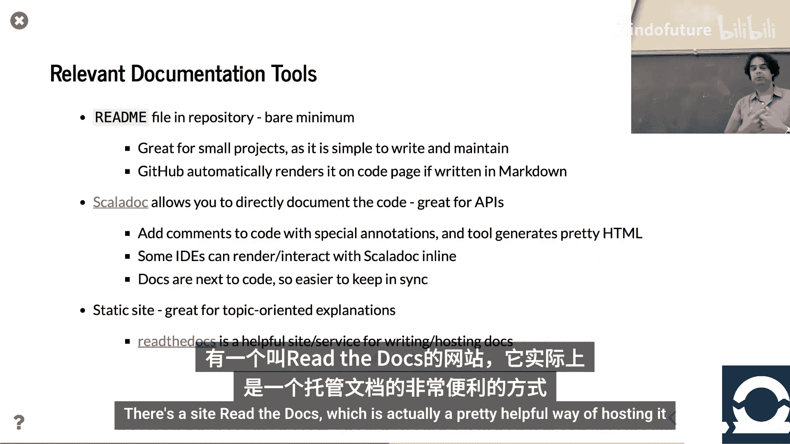

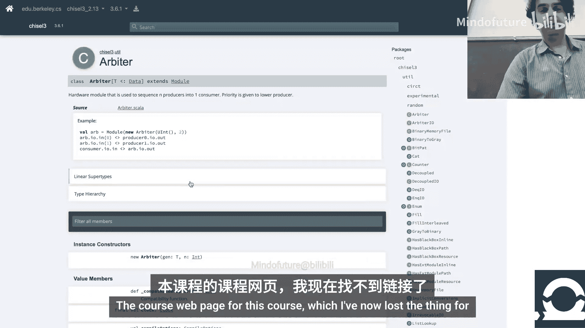

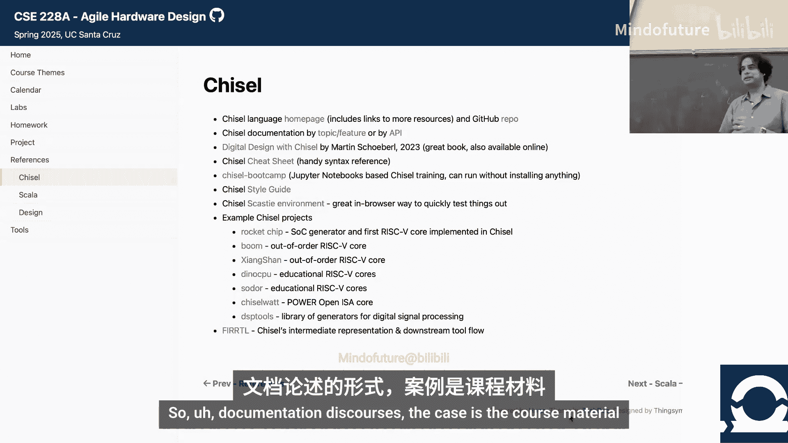

## 总结

本节课我们一起学习了开源项目开发中的四个核心实践。
1.  **持续集成**：通过自动化测试尽早发现错误，让工具承担重复的检查工作。
2.  **代码管理**：使用Git等工具进行有效的版本控制和团队协作，善用分支和合并请求。
3.  **代码审查**：通过同行反馈来提升代码的正确性、可读性和一致性，将“初稿”代码打磨成高质量成品。
4.  **文档编写**：创建清晰、全面的文档来帮助用户理解和使用你的项目，并吸引外部贡献者。

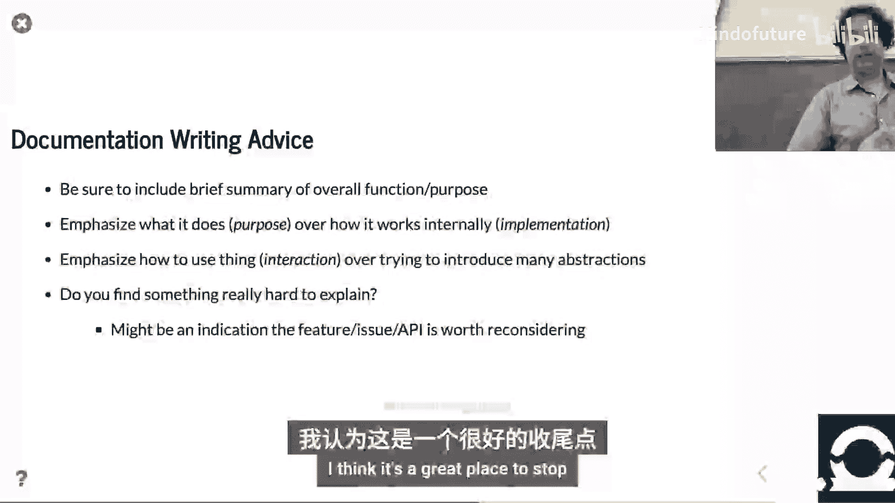

这些实践共同构成了一个迭代和改进的敏捷开发循环，能够显著提升任何软件或硬件设计项目的质量与可持续性。在下一部分，我们将继续探讨开源许可、社区建设等相关主题。