# 【加州大学】敏捷硬件设计-CSE228A-｜-Agile-Hardware-Design-Spring-2025-p24-P08_第17讲-开源项目开发_第2部分共2节--BV1M6ivBzESw_p24-

Lan welcome to Le 17， part  two。So we saw in part one。

 we were talking about open source project development。

 at that part was mostly just the project development。

 things about things like continuous integration， code reviews。

How do use version control productivityly。嗯。😊。

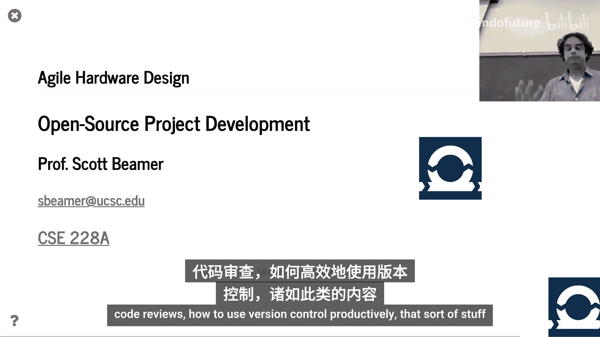

That set of stuff today we're actually talking about open source。

 So let's go ahead and zoom to those slides。

And so yeah， so。啊。We talked about authentication in the last lecture as well。

 so I'm not going to to the key point， why open source right， why is that what we should do？

As you can see， here's a my opinion of some reasons why you should show source your work。

 This is not， of course， exhaustive。 a couple have other reasons they're also incompling。

But number one is you actually help the world of your work， right， You spent the time making this。I。

e。 your expandingending effort to somehow make the world of some other person's experience better so wouldn't you want that to be exposed to more people？

So here we are universities as researchers often， so we want to help us make those as we can。

Even if you're in a company。You can still off an open source code， right。

 A lot of times where look at their portfolio and realize， you know what， this technology。

Is not our key secret sauce， you can open a sources and actually open a source will get additional benefits such as'll see the rest of the slide。

For example， the community can improve your code， right， You release it。

 It's actually interesting and good。 People may have ways to make it better。

 And that's now all of a sudden effort you're gaining benefit from that you do not exp yourself。

 right， So， yes， you want external contributions that help fix bugs， improve performance。

 add functionality， etc cetera。😊，Face it for career， it's also a great way to raise your profile。

I'm always amused by students to get told by recruiters that should have a Github。 it's， oh。

 I got to a Github。 I'm to go ahead and upload my homework to my Github。 And that's like。😊。

And he recruits any good， though， it's not very compelling。

 But if you actually have legitimate other stuff， you' written to up some source。 Yeah， that's great。

Especially if it's commonly used or adopted。 that's even better， right。 So yeah。

 if you do a good job with thesourcing stuff， you definitely can raise your profile。

 That's not just posting homework 4。 that's， you know， actually doing something worthwhile and。😊。

Last bullet point is kind of a silly one， but I'm also kind of mean it seriously。 that is。Why not。

 right， everyone's like， oh no， I got to hang onto this like， why， what are you hanging on to？

Especial in this course， but also in other things， you've benefited greatly open source， right。

 you have to work hard。

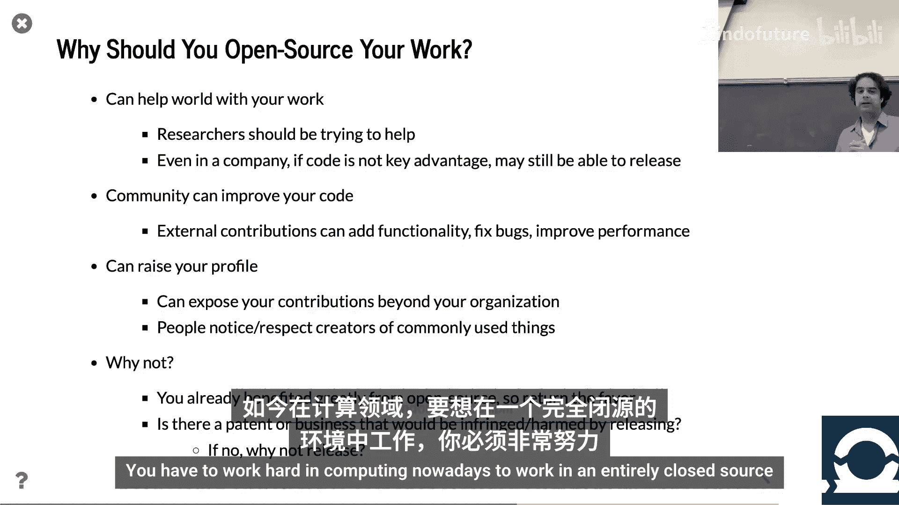

And computing nowadays to work in the entirely closed source world， right， Even this， you know。

 Apple computer I'mlecturing from although it has plenty of closed source code on it。

 It also has plenty of open source code on it。 And， of course。

 the stack I use for this course is primarily open source， right， so。😊。

You might as well pay back into what you've already been hanging from and the reality is like even if you want to do a business or patent something。

That doesn't mean you can't open source it。Right， so。

Most time you write code or even thinking about patents or businesses。 So in that case。

 you definitely show open source it。 But if you are thinking about those things。

 that this means you have certain considerations and you pick a license doesn' mean you can open source it。

 So you show open them source a lot of things。 And fortunately。

 that's the trend industry is taking remember years ago。

 Google were surprised here you know people like Facebook。

 then Facebook now meta was using a lot of their key technologies。

 the reason why they said very bluntly is know our advantage isn their technology advantages their network we might as well get technology out there you can help us with it。

 for example， they release the open compute platform OCP or hard respects。

That's to become widely adopted， and they've benefited from that wide adoption to helped reduce their data center costs by open sourcing net so。

Yeah， you should really associate work。Okay。So what makes first project interesting or good。 Well。

 here's my personal take on that。 numberumb one， need to do something useful。

 useful courses made definitions， interpretations， but。Fundamentally。

 does this solve a problem people have？They may not see the use， right。That that that's underreci。

 also of people built various， very specific things。

 And then they get to the point when no one uses it。 And it's like， well， you get a very。

Unique problems to the cuU。 And it's good to open source it， but it was very much unique to you。

Of course， being correct is helpful。 We talked about testing and why testing isn't just for you to make it correct。

 but we also avoid for people to make sure your finger is correct from the outside and in it back documentation。

 We've just talked about that。A little busy doesn't hurt。So whether it be social media。

 you put some know buzz out there， whether it be putting on a site like Gitthub。

 which naturally is designed to kind of have things get shown around and and displayed。

And then of course， the key last bullet point is it need to be available with an open source license。

 and so that's kind of the thing of because underreciated publicurcing。

 it's not as simple as checking your code online。

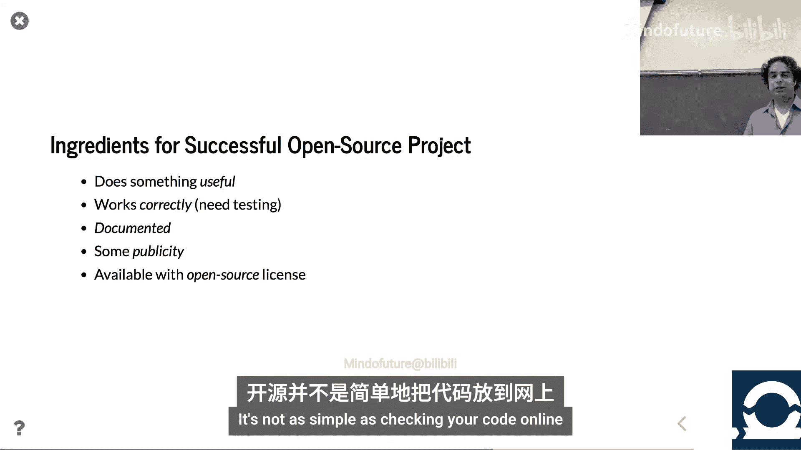

You need to have the license， let's talk about that。嗯。So you write something。

 that's novel much as you copy versus's code。You can get to copyright for it。

 and it's not something to go apply for yes， you can apply to make it extra clear， but by default。

 if you really created something， it is copyrighter to you。😡，And so that's， if you check it online。

I people can see it sure， they can download it， but legally。

They would be risk risking harm to themselves to actually use that code because it's copyright by you and so thus。

 you know by using code is copyrighterated by you。😡，They would be potentially violating copyright。

 And note， of course， when you create code in the scope of your employment。

 your employer may get that copyright。 not somebody you， may go to your employer。 For example。

 for me as a university of California employee， I had assign。A IP agreement when I took physician。

And so yeah， when I create things， you think。You know。

 quote unquote company time come to resources guess what company gets to share the copyright right so I want to do something that UC has no claim to。

 Well I need to prove that I is on my own time and use my own hardware for no resources from UC。

 right。嗯。And okay， so by default， you have the copyright。

So thus other people that want to use it actually need permission right so a licenses for license grants people permission to use your code under certain conditions。

😡，And so there license of different permissions and restrictions。

 but that's kind of the key points so putting code online doesn't quite make you fully up to source people who read it for sure。

 but they can't really use it that license is what you need to really rip permission do things right。

And thus gives you a little power to do things and license is very explicit about。

 know what they can and can't do。

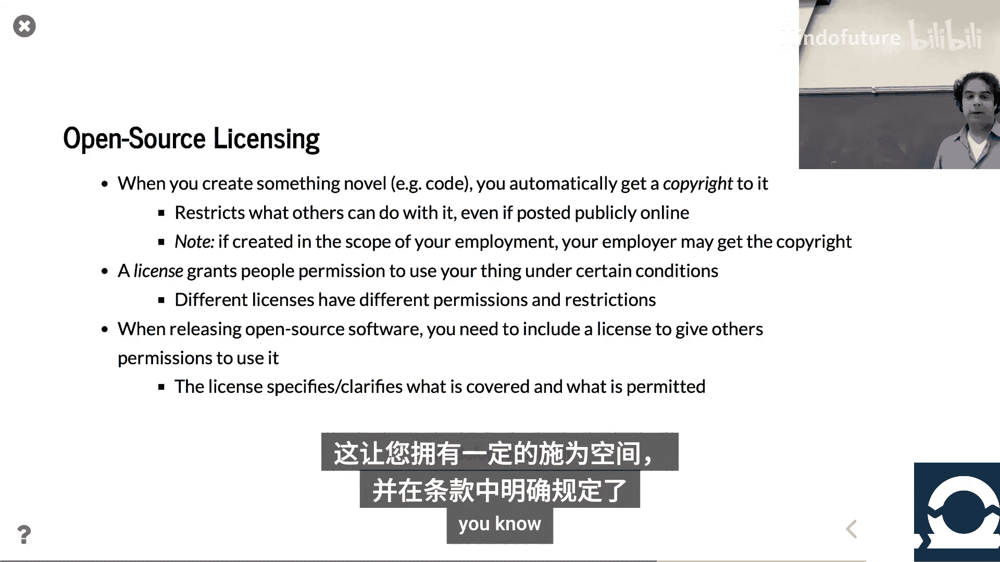

So。Given that， what do you actually see one of these documents， right。

 the good news is you don't need to invent this and actually better net， you shouldn't invent this。

 There are existing sizeences that have been written by people who are very attuned to legal constraints。

 and you should use one of these standard ones。I think it's actually a disaster when a lot of companies。

Only go departments to say， you know what。 We don't want use one these stand ones on like our own。

That caused the more heart and it helps so please please please use the standard one so what did you license this have？

😡，Most of them crucially lets you use the code， which is a key thing。

 otherwise you can't use it and modify it， which is also interesting right。

 sometimes there are some constraints on that， but first order you can both use it and modify it。😡。

But they start differing in their traits。 right， There's also why relations is out there。

 for example。Can you use this code via the licenseense for a commercial purpose。

 Some folks that are true believers say， no， no， no。

 I made this free and it needs to be used for free reasons。Others are okay with that。For the license。

 are you allowed to change it and then are you required to distribute those changes？Can you include。

 this is part of a bigger project Do you have anything to consider。Also， interestingly。

 sometimes the source you're using is actually very。Popular。

 the special institution that createates it are you allowed to use any of the trademarks， perhaps。

You know， these things。 And sometimes this can come up， right， years ago。

 there was a situation where， you know， someone blamed。Risk 5 or something， but it wasn't risk 5。

 It was actually a person using risk 5。 So you kind of using this rest F trademark in that way was really kind of。

 trying to glom onto a big。Crade market wasn't only theirs。 So these things matter。

And then this is a very subtle point， the last one。

Are you allowed to use patented functionalities in the code So this is maybe it's worth for the explainlening for a second。

 So you can think of code like writing a novel or a movie or something right so like。Da is pros。

 and you know， in its original format， you know， like modified is still the same thing。

So that's why it's copyright is。 So if you use that inappropately， you breaking copyright。

 a patent does allow you to patent an idea， right or a method。And so。As a result。

 someone can patent something。You can write code on your own from scratch， but if it。

Falls into the under the it's covered by that patent， you could be infringing on that patent so。

When you have open the source code being checkeded out there。

There's actually two vulnerabilities for someone trying to use it。

 There is the thing to license grant you， which says， hey。

 I am giving you open source permission to use this code。

 And thus you're not going to be charged with copyright infringement。 However， if that code。

Influence functionalities that are patented。You could be liable for patent infringement。

And does some licenses have this additional clause in there to say， hey， guess what？

If you use this code in the ways we specify。You will not be charged of patent infringement for patents and for the code included in here。

There mean you can use patents for anything you want。 and then enter a project。

 this means if you use this library the way it's intended the way we specify any patents include within。

 you're safe。 And so it's something at least subtle point。 but this is something that you know。

 Laura Mon I'm thinking about and sometimes these big code bases and this comes up。😡。

So we'll show some examples in a second， but any questions so far？

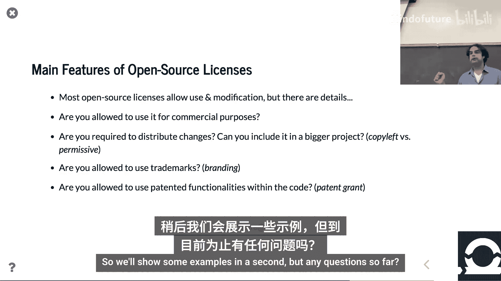

Okay， so what are some power licenses， the most common ones you may see for a lot of projects that are very permissive。

 meaning you can do a lot of things。A BSD and MI T。 So these originally came from universities。

 So BD stands for Berkeley standard distributionbut。 It came for from the original open source Uni。

MitT corresponds from MIT。 these are great fact projects， right， They're very permissive。

Like people do best whatever they want， they can download the code， they can modify it。

 they can use in commercial projects。They are not necessarily required to distribute any changes。嗯。

It's really good。 And I recommend this hardly because， you know。

 the other ones are more restrict in some ways and so why please yourself in that position。嗯。

GPL has gone a few feed versions。Today I'm talking about GPL of V3， which。

Is one of the more shock ones， actually so。As a result， because of the restrictions， in other words。

 because you use GPL V3， its copy left meaning other code gets pulled into it inadvertently。

 a lot of large companies actually don't allow GPL V3 codes into their projects because they're afraid of tainting their projects。

And so there's all sorts of interesting workarounds people figured out， well， you know what。

 if we want to use the GPL33 code， we don't want to include the code instead like link against the library when it's compiled unmodified。

 Sometimes there's a way to use workarounds like that。 that's a headache。As a result。

 most companies will just steer clear of these three。 It stuff you want to your code adopted。

 which is part of why you' be sourcing it。I highly recommend BFT and MIT。

The other exception to that is something called Apache E V2。

 which has a lot of the same features with PSC and I T。

 But it has this key additional feature is that patent grant。 So I was talking about a second ago。

 right， where。If you use code and use it under the right constraints of beta license。

 this also allows you to not be sued for patents that happen to be held by also the code holder。 Now。

 if that code itself breaks someone else's patent。That's a whole other story， but this way。

 if the patent holder is also the copyright holder。

Your leaf will not be sued for patent you know infringement so Apache V2 has been very much appreciative industry if industry is a choice。

 they would love you to use patchache V2 a lot of the chillle stuff we've been working with is all Apv2。

Some universities are a little reluctant like people use K TV too because it a patent grant。

 but remember a patent grant is that for all patents for all time it's just four patents contained within that code used within the bounds of the license right even still。

😡，Lawyers are reluctant to give power if they can keep it。 And then last ones are kind of funny。

 So these are ones that basically counts a license。 And you remember， you need this。

 right you put code on line file license。 It's actually maximally restricted， right。

 you need license to actually make it。Permissive， its both the unlicensed as is called or the WTF permissive license。

 as you can imagine what it stands for。Extremely permissive and yeah。

 basically just like give this thing away like you're not putting any restrictions on it。

 like just put it out there， get it out there and sometimes just， you know， fair a game。😡。

Sol there's a lot more this is you know， I would say， you know。

 maybe the top five they wouldn't have any questions， comments。Yes。😊，That's interesting feedback。

 And I don't have enough information to answer that question。 So to repeat it for the recording。

 The suggestion was that some have said light license is too broad and underspec。

 and other result companies are afraid of it because they don't feel they've been granted enough power。

 That's a good concern。 I'vet actually read it myself。 So that's a good question to bring up。

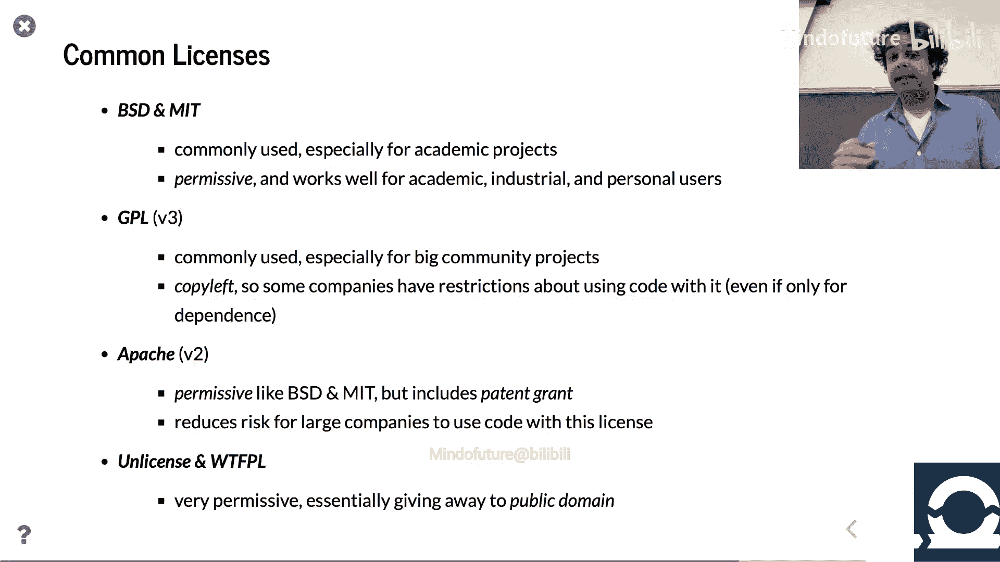

And double check， like I said， historically BMT are very。

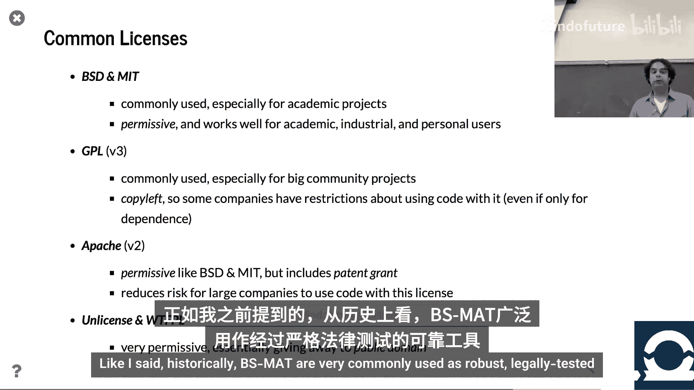

Commonly used as， you know， robust， legally tested things， even BSD， there's like a three clause。

 BC versus four clause BSD。嗯。But it's like the reason why people archives still continue to innovate。

 A lot of projects have some wrinkle they want， and their legal team writes a new license。

 which everybody else causes。The overhead of having to read understand what the differences。

 what the implications are， a lot of things you can write down in a contract until it gets into a court case that actually is tested。

 you don't know how it's going to hold up right so。

BMT have both been around long enough they've been banged on quite a bit。

 Apache B to is used by a lot of problem protest people are pretty。

Please whip the up patent Gr is that kind of that key differentiator for it。To be honest。

 these unlicensed and WTFPL are usually feel like for personal projects people to kind of just try and check it out there。

 I'd be surprised that'll be really industrial policy。Cool， other questions， comments。Oh， okay。

 so then。

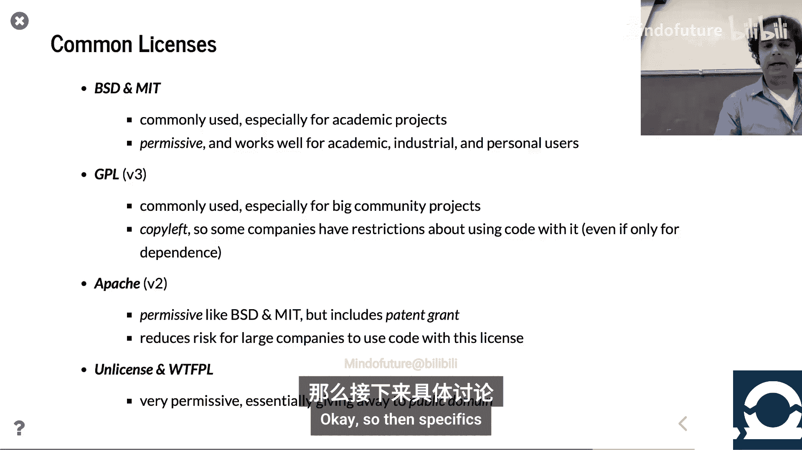

specifics， where do you put the license， So a comma convention have a file called license， you know。

 all caps in the root directory， you know， we can even show， hey， let's go to our favorite。

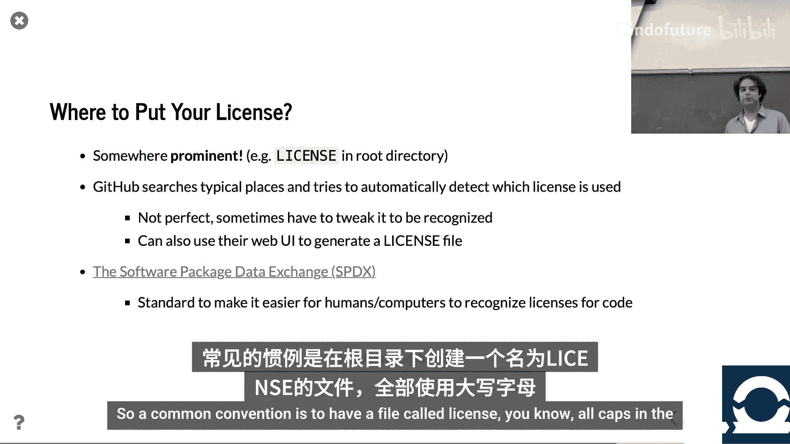

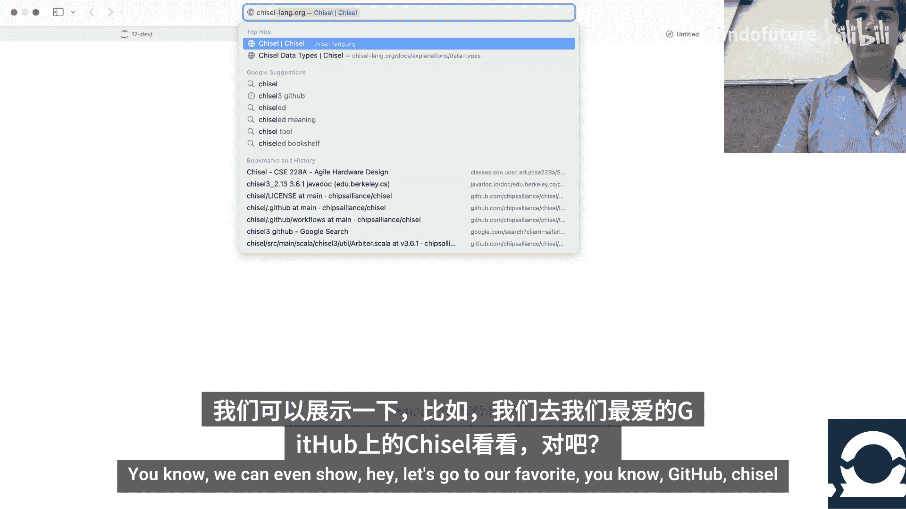

You know， GiHub。Chisel， right？And guess what？ We scroll down。 There is a file called license。

And guess what， it is attachy V2。And Github is far enough to recognize that and even tells you， oh。

 yeah， this is what you can do。

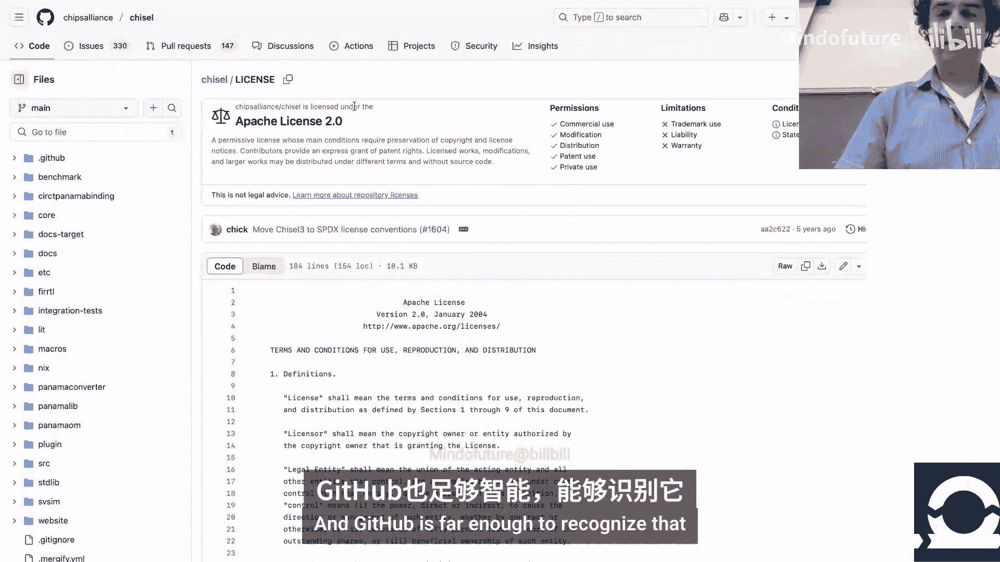

Here it is' summarize， you actually can even。

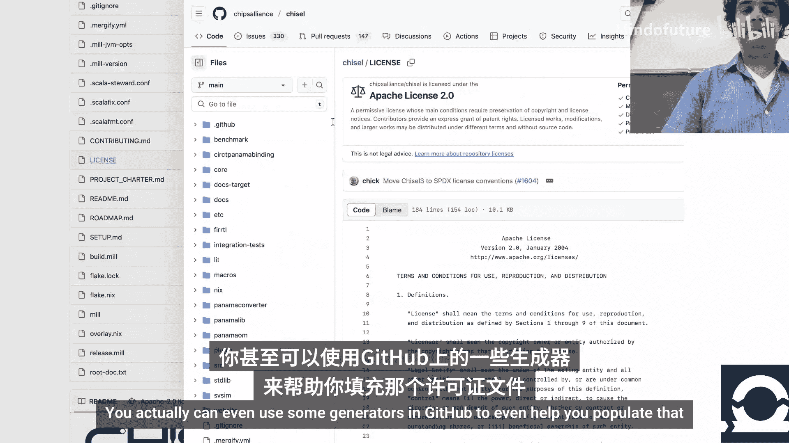

Use some generators within Gitthub even help you populate that license file。

It even tells you right away from the top appear if you're switch to reap over the first time。

 what it is。And so that works great for most projects for something like this course。 That's perfect。

 single license file， put it in there。 you're done， easy。嗯。Now。That works for a small project。

 but as again have a bigger and bigger project。Things are gonna tricky。

 You're gonna have multiple contributors。 Those contributors gonna to go along with them。

 And that code may have different licenses。 You to have different portions of your project under different licenses。

And so you can put license files within source subies to make it more clear。嗯。

That can help the help of this challenge is actually something called the SPDX standard。

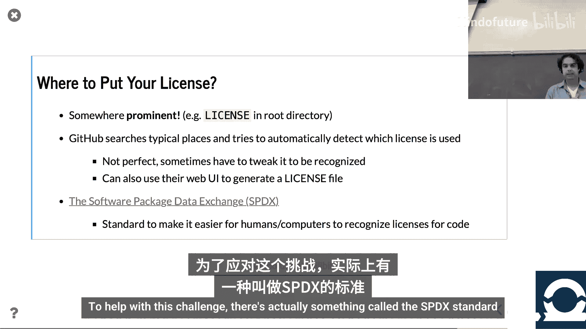

And it's a way to annotate your source files。😡，To mark which license they fall under。

 So if I go diving into one of these source files in here。

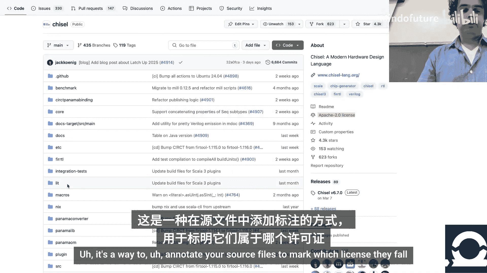

Let's go look at some legit chisel 3。Okay， fine， very longgged at scala。

 there should be an SPD X in here。 And the fact that' not seeing that is actually surprising。

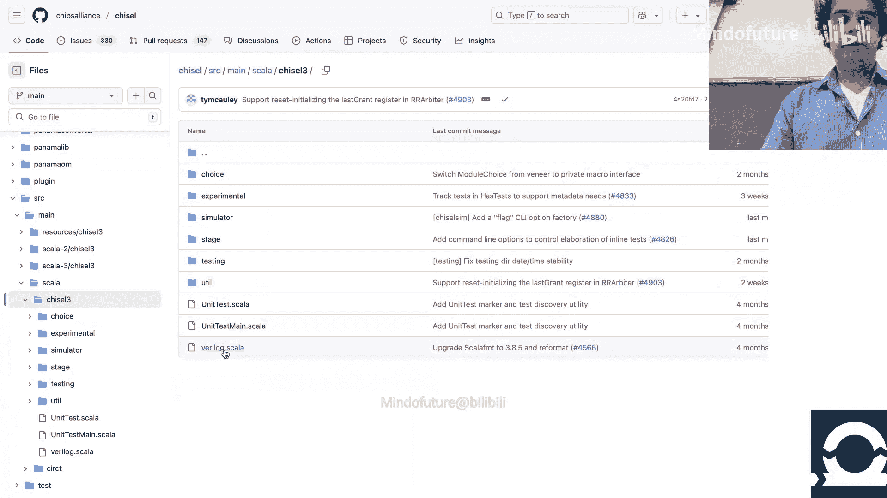

So I'm now going to sheet。And search for it。

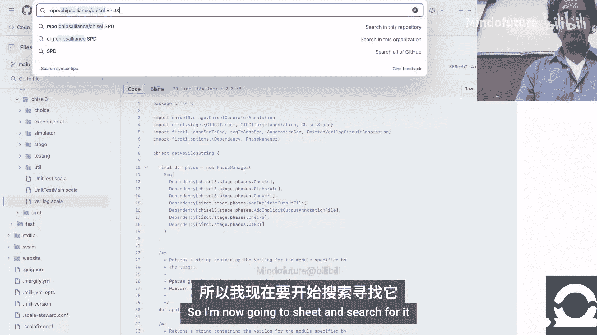

And there it is， and why it's not every file， I can't tell you， it's supposed to be every file。

This is what you're supposed to see on the top of the file it's a certain format and idea of this format is a machine readable but in other words you tag the file。

 hey， this file is given this license and that way some of those automated tools to crawl through it can tell you what's going on because like I said。

 you have a large project。You're gonna depend on a lot of different other projects。

 You have a lot of dependencies， right， You cross oil dependencies and make sure your intended usage scenario is compatible with。

Those licenses right and so you actually need these tools like crawling dependencies。

 crawl all their sources to make sure it's all going to come together in a way that makes sense。

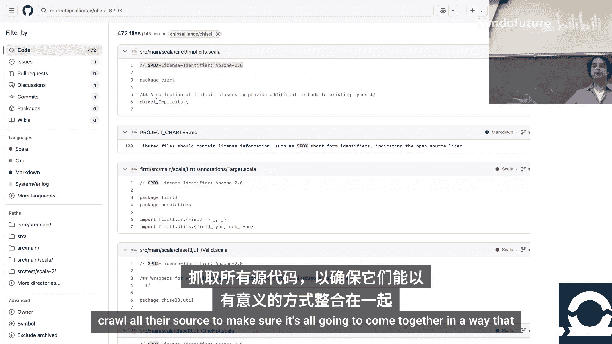

So the people are mostly checking make sure it's not GPLV3， but。

Whatever a constraints you might have。 But this matters， right， So， for example。

 if you're like me using a Mac。A lot of the。Command line utilities kind of got frozen in time of 2006。

 right， things like bash。 And you're like， why would I be getting 2006 bash in 2025。

 The reason why is that's I changed from GL V2， G V 3 and Apple is not want to take that leap。

 And so as a result， they kept under the old license and use the old code and。

After a certain amount of time， that leaves it's created vulnerability。 So guess what。

 a couple years ago， you know what。We're not doing bash anymore。 We're doing Z show。

 and that's what we're going to do。 If you really want bash or Mac， you can install bash yourself。

 but Apple's commercial company buy can't distribute GL code the way they want to。

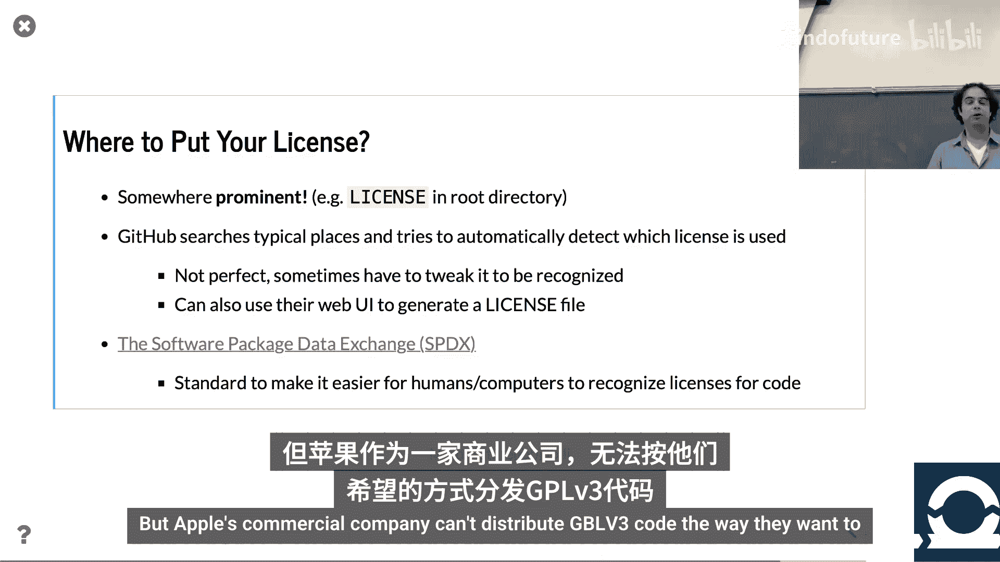

So it doest have consequences。嗯。扣。😡。

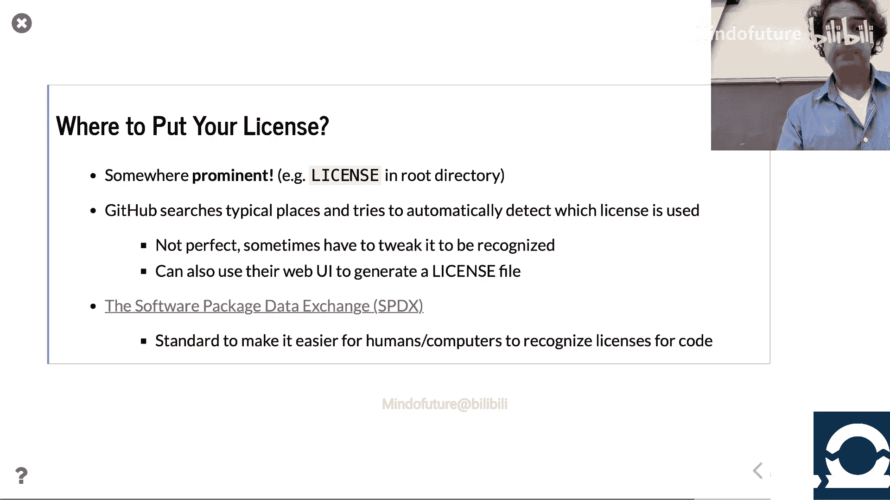

And then， all right， let's say you've stopped licensing into your project， put your projects online。

At that point you could call it done， let's say you really want to take off。

 so how do you get contributors？To help you know， not happens to be your project and a community thing。

 numberumb one needs to be interesting and useful for group of people， right， if it's just you。

 why someone else going to be interested right very basically。Giving free time。

 So why would they give free time， right， They need to see the valueing what you're doing and believe other people also value from it。

 This sort of testing goes from a nice to have to like an absolute necessity， right。

 by having testing。Other people who believe this project seems more robust。

 but also allows you to vet countries and someone is giving some back to you。

 You want to make sure didn't break stuff。 you want that test， right， So testing is really。

 really helpful。 Of course， Inotation isn't just for you。 You wrote the code。

 You probably know how it works。 Notations for other people。

 but other people could be things like future contributors。 they could really benefit from it。

This is another one of underappreciated responsiveness。So。Hey。

 if someone opens up an issue or pull request on your repo， how fast you respond。

Doesn't need to be minutes or hours， but you know， within a couple of days is much better than never or months or years。

 right because people are trying to help and you're not respond， that's not there。 A lot of projects。

 for example， our beloved chisel projects to be more available。

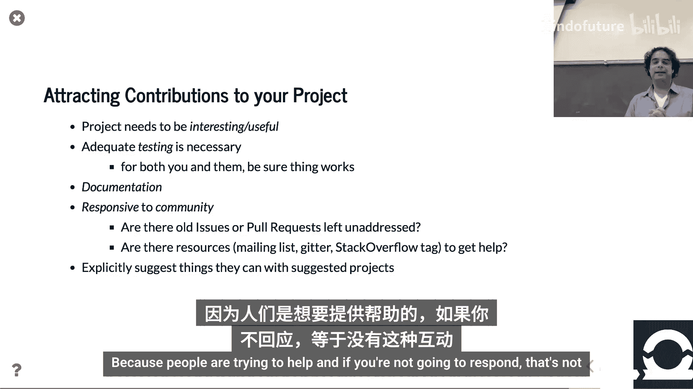

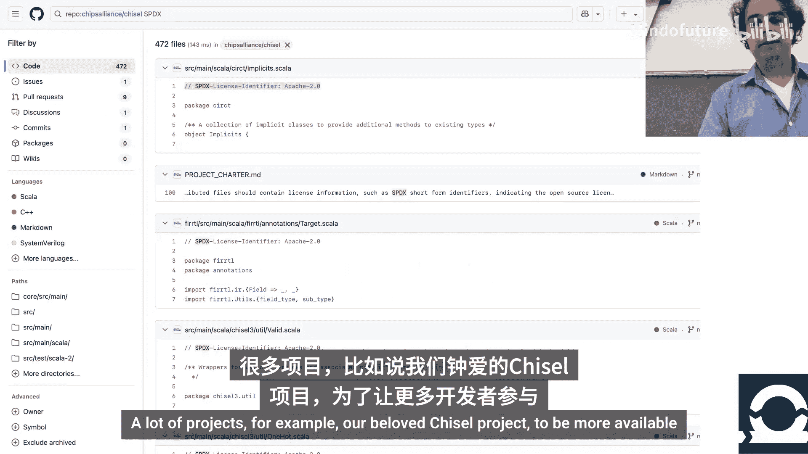

Actually has other means of being engaged， right so I was mentioning some of those on that slide。

You scroll down。 There should be some of the other opportunities。 So for example。

 matrix actually is a。Chat system。 So if I click on it， we'll see what happens。

 I believe it's gonna launch another window。 And then might asking me for screen name or something。

 but。

It's kind of like， you know， another slackck alternative and。

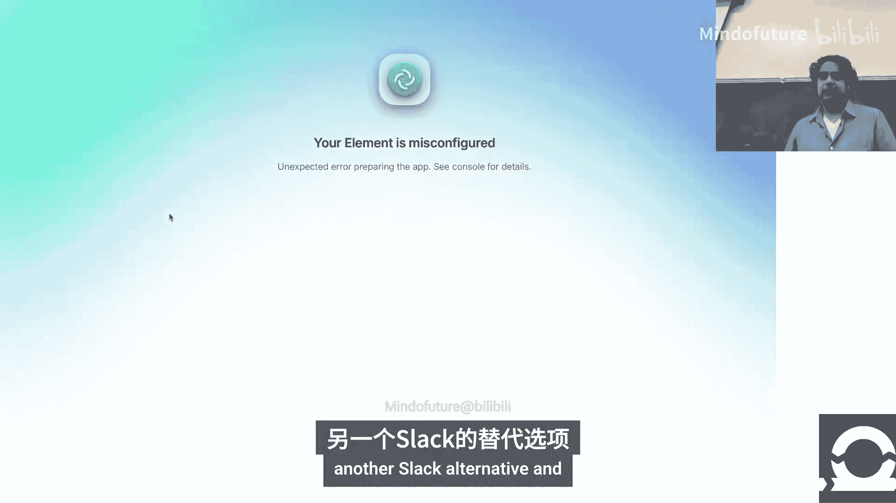

It's not me running today。 So today， it's not working。 But other days it does work。

 So's kind of point。 It's not a way to get help from people having your stack orload tags and a way to do it。

 This slide mentions Gitter， because that's what they used to formally use for Chi to get community help。

 So having the way people do the response helps， right。

And another way to helps is actually suggesting people can contribute。

 sometimes people will find a project。And like it， and they find that contributionstri。

 suggest contributionstri list and like， oh， wait， I could do that and they go off and do that。Great。

 some of you as students are thinking， gee， how can I get myself up to source crayon on a Gitthub？

How about finding products you find interesting。 And if you see when those suggested contributions sink and actually do to sensitive contributions。

 Hey， youve just helped out。 You can do total open source thing， right， You contributed。

 make a pull request。And you can point to that work， right， so this's how you kind of get involved。

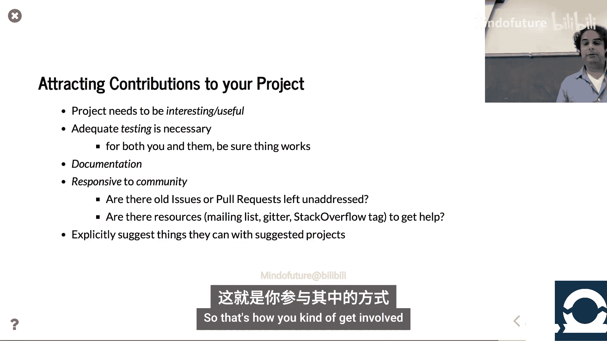

So。By today， I mean today， in part1， which was two days ago， we code a few things right。

 we talked about integration， talked about code reviews and code management。

 we talked about documentation。 And today it was about leasing and open source right So hopefully all these pieces kind of come together to make you think about。

 yeah， you know what I really could run a project， not just worry about hard details for a second and share with the world。

😊，And of course， I also provide some links of things we've talked about。

Any other questions on all that。Great。😊。

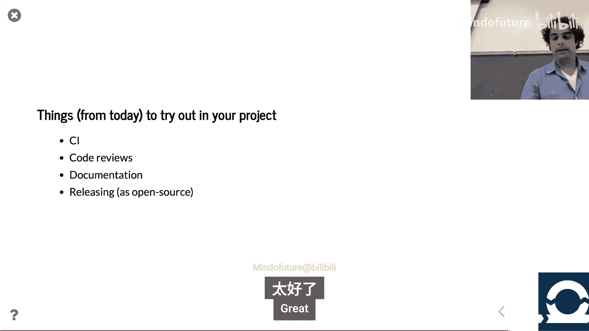