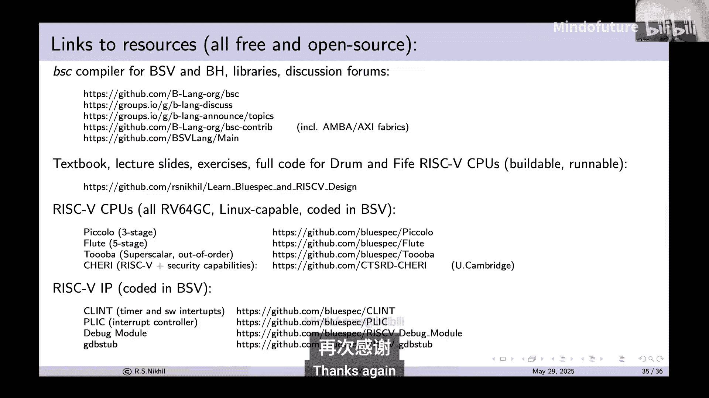

# 【加州大学】敏捷硬件设计-CSE228A-｜-Agile-Hardware-Design-Spring-2025-p25-P01_嘉宾讲座-Bluespec_概述_Rishiyur_Nikhil--BV1M6ivBzESw_p25-

Hello and welcome to CSE 228 Today we have a special guest lecture。So our speaker today。

 Nkil the CTO at Bluesbeck and was formerly faculty at MIT， so Bsbeck。

 for those who are unfamiliar with it， has been you know。

It's an interesting language so in this course course we've used chisel chisel originally as the grad student language has some additional enhancements from S5。

 but。Have a certain level of robustness blueback by being both older and much more。

Supported and adopted by industry has another level of robust bus。

 it's kind of fun to see what that's like。Number two， that's a new abstractions。

 that's the thing we'm kind excited to hear about is some of these new abstractions are not just very log plus plus。

 but how do you actually do some cool things and they get more productive or more correct and so if that'll let Nikkil take it away。

Okay， thank you very much， Scott。😡，Let me share my screen。Okay。

 good morning to everybody and greetings。I'm going to talk to you about Blue Speck today。

 which is actually a pair of hardware design languages。And。One of them is called BS3。

 one of them called BH， but I'll tell you more about that in more detail as we go along。Okay。

 so here are the key points on one slide， and I'll just repeat this at the end also just to reinforce it。

It's a general purpose， high level hardware design language。

 it's general purpose in the same sense that chisel or very log。

 system very log are not application specific， therefore designing any kind of digital circuit you want。

There are two alternative synaxes， which is there for historical reasons， one called BSV。

 which is system Ver logggish and BH， which is like Haskell。In this talk。

 I'll stick to the BV like syntax， but both of them are available and in use by various people。

As Scott said， it's been in the field as a commercial product。Or since the since about 2004，2005。

 almost lower 20 years in about five years ago in 2020， we。

Stopped offering it as a commercial product and just made it free and open source。

 so for the last five years it's a free and open source tool and language。

I'm far of interrupt right now， the screen sharing we're seeing maybe your terminal。

 I don't know if you're sharing the right desktop， ah I'm not。Sorry。My mistake。

Let's try that again。啊。Sorry， just hang on one sec。 Let me stop all this sharing for a second。

Oh， I'm。Okay， let me go into screen sharing again。Sorry。Aarn me for being a clutch on this。啊。

Pray this again。

Thestop number two， share。 I have two screens， and I think I shared the wrong one。Are you seeing a。

Window with some slides on it now。 Yeah， we either the window。 Okay， great。 You' zooing in perfect。

 Thank you。

Look's good。Okay， my apologies for that。Yeah， so these key points I would to make。

 I've said some of these things just now。It's been open source for about five years since about 2020 and you'll see in more detail it uses ideas from Haskell for what I call circuit description or structural correctness and it uses ideas from guarded atomic actions for what I call circuit description so it's like semantics or behavior I'll be saying more about this as we go along。

Okay， so they。Actually， maybe I will go into slideshow or just hang on。Side show。

There's a bunch of resources， compilers， libraries， I， textbooks， tutorials， et cetera。

 which I'll give you URLs as we go along towards the。End of the end of the dock。Okay。

 so let me start by， first of all， giving you sort of very high level。

 the first question I everybody ask is。So what's different about blue spec。

 how does it compare with chisel or HLS or Sp log or system error log， etc？

So let me first set the stage using this slide anytime we're using a hardware description language you can think of engaging in two activities one of them is circuit description what are the pieces of the circuit。

 how did they connect together so you can think of this as a static structural description of the overall circuit which could be a complex system but how everything fits together so that's the circuit description part and the second part is once you describe a circuit。

 then how does it evolve over time， how does it behave。

 what happens over time so in PSV you can think of these two parts as shown on this slide for the circuit description part we borrow ideas lock stock and barrel from Hakell。

For one of the two languages， BH， the syntax is actually exactly hasskell。

But it has the full power of Haskell， pure functional programming。

 powerful type system with algebraic types， polymorphic types。

 type classes for overloading monic types， the works， it's really everything you see in Haskell 98。

 although it's not Hakell。But all the ideas are taken from there。

We borrow a little bit from system B law， which is basically syntax for the BV variant of the language。

 which basically specifies things like packages and name visibility and notation for parameterized types and notations for parameterized modules and things like that。

New things that were in blue spec that were not in either Hake system where log is one is that the type system was enhanced to do very precise bit width specification and matching so when we're designing with hardware of course we're using all kinds of different bit widths etc and we use just enough bits to keep to hold whatever state we want want to hold we have to be very careful about tranccades and shifts and overflows and things like that so we capture all of these in static types in the type system and make sure that we don't silently。

Drop bits or ad bits and things like that The other thing we do is that which is new also compared to the earlier Hacal system where lot is that we we support multiple clock domains。

 multiple clock and reset domains， but we also do static domain checking so that it's impossible to have signals crossing clock domain boundaries without going through a synchronizer etcter。

So all of that is structural， how you fit together circuits。

 and I'm going to show you examples so that it all becomes a little more concreteetized in your habit。

For circuit behavior， we use something called guarded atomic actions and that's not a new idea。

 it's been around since at least the 1950s or 1960s， and I've mentioned on the slide there TRSs。

 TLA+ Unity EvenB， etc cetera， as some of the languages usually in the software space that have used the same idea for concurrent atomic state changes。

And to that。The innovations within blue spec， the languages are that we can build these atomic actions in a modular way。

 that is we can structure our circuits with modules just like you do in very log system air log。

And we can have these atomomicity properties， which are global properties built up incrementally as modules are connected to modules so that they still are atomic with respect to global state。

 which might be spread across multiple modules。In addition， we can also do for practical use。

 we can import very log， can so we can interoperate with very log， we can import C。

 so for simulation， you can write pieces that happen to be implemented in C， if you like。

So these two major flows flow into the languages， PSV and pH。The original ideas on。

Using guarded atomic actions。Started off in a PhD thesis at MIT in the late 1990s。

 James Hoe was the PhD student， Professor Arvin was his advisor。

 and James Hoe right now is a professor at Carnegie Valley University Arvin unfortunately passed away last year。

 but until then he was a professor at MIT。The original ideas on circuit description that is structurally how you piece things together were due to Leonard Augustine who worked with us at Sand Burrst initially and Bluespek after that。

 way back in the early 2000s。Okay， so let me just quickly compare at you know， 30，000 foot level。

What is different in what I just described compared to how chisel works， right？

Again I'm not an expert on chisel， you folks are expert on chisel， so if I say something wrong。

 please feel free to correct me on that。For circuit description your chisel uses Scala right it's basically it's an embedded language within Scala and you're using the Scala engine to do static aration to connect things together。

 etc cetera， so the Scala execution is about plugging things together in disciplined ways so that you can describe your circuit and you can use all the power Scals。

 it's syn functional programming type system etctera as you go along there。

When you describe a circuit， ultimately the circuit behavior is in some sense no different from say very log system very log it's standard clocked digital logic。

 so these are the two ways in which you can see BVs a little different from Scala so on the circuit description side it's kind of accidental we happen to use Hakell Scala I mean and chisel happens to use scala。

 you could flip those if they would be just both languages would be fine if you did that but this idea is basically the same to use modern functional programming language and its type system to do this。

The lower thing about circuit behavior is going to be very different。

 so I'm going to be focusing a little bit on that as we move forward in the stock。

The other minor distance， a technical difference is simply that we don't actually use ASkell。

In implementing BV， in other words， the compiler that we have for compiling DSV or BH into very log is a standalone purpose built compiler for BSV and BH it's not embedding it within an existing Haco system or anything like that。

We're just borrowing the ideas from HaSkell， we're not using any Haskell system directly for that。

Okay， I'm not sure I can clearly see any questions or something。

 so please speak up if you have any question at any point you like。Well do。Okay。

Another quick little comparison， I'm sure you get asked this question。

 what's the difference between chisel and HLS， et cea。

 and this is sort of my take on these things on at least two aspects about it。

Which is if you think of the computation model， what is the program of're thinking about what's the mental model in your head about how circuits execute in BSV and BH it's guarded atomic actions in chisel。

 Belog verylog itss clock digital logic。In HLS， you're not thinking in terms of hardware at all。

 you're thinking in terms of C or C+ plus execution， a very different computational model in HLS。

And then when you think in terms of microarchitecture， BSV， BH and chisel。

 very log system available these are all what I call hardware description languages， in other words。

 in your code， you're actually describing the circuit that you want exactly the circuit you want no more no less。

😊，So there's no sort of surprises about what microarchitecture you might get or what state you might get or anything like that。

 whereas in HLS， the microarchitecture is something that is created by the compiler and actually the user may not have much knowledge about the details of what what's going on in the microarchitecture at all。

So this is a very quick high level view of where I think BV。

 BH and Chisel and HLS and very log and system very log， et cetera fit。Did you have a question， Yeah。

 So I'm looking at this chart。 can H do both gardenatomic actions and clock digital logic。

 or is it exclusive to the computation model。CouldS， could you repeat that。

 I can't hear very clearly from so if I'm understanding the question correctly that you know。

Are those both things Verrlog can't do for the computation model Yeah。

 so basically I guess the notion easy saying you know， looking at HDL as ver log。The question is。

 you know， can it do clock digital logic and guard atomic actions。嗯。Well。

 the abstract view and you'll see it in the examples I'm going to be showing you。

 the designer or the hardware designer is thinking in terms of guarded atomic actions。Right。

 so first of all， let me first separate out。The computation model of the vehicle you're using versus what you're trying to。

 the computation model or what you're describing。 even in Chisel， Scala has its computation model。

 right， and that's not the computation model of the hardware。

 That's just the computation model for how the hardware is elaborated for you and the hardware then is just a standard clock digital circuit。

 Similarlyly in VSV， everything to do with Hakell is not the computation model of the algorithm you're implementing in hardware。

 It's that's the computation model of how hardware is elaborated and described。

Once you describe the hardware， then the behavior of that hardware in standard clock， digital logic。

 itchiable in very log， et cetera， you think in terms of clocks and or processes around clocks and within clocks。

 you're updating state， etc， that way of thinking is replaced by thinking of in terms of guarded atomic actions in BSV and BH。

I'm going to be showing an some examples in a fair amount of detail。

 so hopefully it should become clear， but please reraise the question if it's not clear。Okay。

 so let me go Guide at atomic actions and as I mentioned before， it's not a new idea。

 it's a very common choice amongst people in the community that do formal specification of concurrent systems。

Going way back to Edka Dyextra in the 1960s， he had something called guarded commands。

 term rewriting systems is a general mathematical concept that has been around for a long time。

Specific languages like TLA plus from Leslie Laport Unity from moneyney Chandi and Mira event B。

 et cetera。 So we're not inventing a new idea。 Most of these previous。

Applications of garden atomic actions has been in the software space for concurrent software and the innovation in those spec is to apply to hardware。

 but the basic semantic ideas are exactly the same。Okay。

 so what is what do I mean by atomic actionss， So you can think of a system as some collection of state elements。

 registers， fiveOs， sRAs， memories， things like that。And the behavior is given by a set of rules。😡。

Where every rule has two parts， one is a boolean expression。

 which is called the condition of the rule or the guard of the rule， and a body of the rule。

 which is called the action， which is what can update state。

And the overall execution semantics of a guarded atomic action system。

Is what's shown on the box on the bottom left， it's extremely simple。

 it just says pick any rule whose condition is true。

And perform the actions in the body and just repeat this over and over again， of course。

 and you do that action。Some conditions that were true may have gone false。

 some conditions that were false may have gone through et cetera。

 so next time around you may have a different set of rules from which to pick， but doesn't matter。

 just pick any rule you want and then perform the action。

It's extremely simple and it's very powerful。And and like I said。

 all these previous languages have been you can see some wonderful papers and textbooks and proving formal properties of correct when you have this system。

 and I'll explain a little more why it's powerful in just one second。😊，Before I go into that。

 first of all， what I've described to you is extremely sequential。Right， it's one rule at a time。Um。

Equivalently， you can execute it concurrently， many rules at a time。As long as you。

Execute all the any action for any rule atomically， right， so basically the idea is that。

The action of a rule may perform many state updates on many state elements。

And if you take two different rules， they may overlap in the state elements that they examine or which they update。

And by atomically， what you mean is that the actions of this rule must entirely precede the actions of that rule or vice versa so that you never have to worry about interleaving of the actions of rules。

So as long as you do things atomically， you can execute it concurrently。

 but it's for reasoning about correctness， it's fine to think of it even sequentially as one rule at a time。

Okay， so why， why， why is this useful well in in general for reasoning about correctness。

 about concurrent state updates。Whether it's in software or hardware。

 atomic transactions are really extremely powerful。

 perhaps the most powerful tool for reasoning about correctness。And why is it powerful it's because。

The呃。Without atomicity， you get a kind of a cross product of all the different processes that are trying to。

Access the shared state。 and you have to think of all possible interleavings and your head starts hurting very quickly and very difficult dealing with it。

 The moment you say that the transactions are atomic。

 then you can think of them one transaction at a time。 That is。

 you don't have to worry about interleavings anymore。

 So you can look at individual rules and ask about individual rules。

 are they preserving the correctness before the rule and after the rule。

 if I was in a correct state Will I remain in in a correct state at the end of it。

 So this is the extremely powerful nature of atomic transactions。

 And this is what we're exploiting in Gs。The other aspect of a G。

 which is very interesting is that the same language。

 the same vocabulary can be used at different levels of abstraction。

You can write big fat rules that you can think of as a specification of the system you want to implement and you can write much smaller fine grain rules that are more realistic for hardware that actually represents the implementation of the hardware that you want to do and because you're working in the same vocabulary it facilitates the idea that you can now ask about equivalence between specifications and implementations and can do proofs of correctness you can do informal reasoning。

 but you can also use formal tools for that process and you can think of design then as a refinement process。

 often a inference where you can start with an approximate specification level view of rules and then you can replace them with more finer graining things。

I'm going to give you a very specific example to give you a sense of why this happens。Okay。

 so the comments at the bottom of the slide are basically saying we think of these in this way informally all the time while we're designing hardware。

 but some researchers have also taken it into the formal verification and formal correctness space by embedding these ideas in proof assistance like Co and leanan and so on and doing exactly what I' said here on the slide in a formal sense and there prove correctness of pretty complex systems out of order CPUs distributed core and caches and so on。

Okay， so let me give you an idea of what this looks like。

I'm going to describe a very small toy cache coherent system。

 it's toy because it has only one location limit it one memory location。

 so we're not going to worry about addresses here， just think of having two CPUs A and B。

 each of which can send memory requests and get memory responses to a local level1 cache L1 cache。

And behind the L1 caches which are private to each CPU。

 imagine that there's a shared L2 cache behind it。And imagine that it's in the following in the state as shown out here where。

There is a for the L1A has the cache location in exclusive more presumably because it wants to write it and let's say it has written a value recently。

 so that value is x。啊。Before it got there， it must have received the value from the L2 cache。

 but by this time the L2 cache value may be stale， so as I call it Y it's the old value。

 but in L2 I also have a tag which says which remembers the fact that I have given this out in exclusive mode to L1 a。

And the cash for L1b is invalid because。The location is currently being busily used by L1a for reads and rights。

 so it's an exclusive mode。But just imagine that's the starting state。

AndNow imagine that I get a read request on L1 B。What do I want to do well here's a one shot transition that explains what I want to do。

 which is what Id like to do is to downgrade the exclusive L1 a to a shared state。

Ud it update the L2 to the new value X and so that it also knows that it's the shared state and update L1 B now to the shared state with X and now that I have it available in L1 B。

 I can respond that X to the CPU request。So that's a steep transition at a very high level that we would like to bring about。

Now this can be expressed directly in BSV code as shown in this rule out here。

 this is actual BSV code that I'm showing on the right here。

 so you can think of the this part of the rule as the rule condition。

 it says is this rule is enabled whenever this condition is true。

And the condition says if at this rule， just imagine it's what it's saying is if the requests。

The first element of the request， its request type， is a read request。And。L1 B's tag is invalid。

 and L2 tag is exclusive。Then perform the actions shown in the body of the rule， which is over here。

 So x is the value in L1 A。I replace L1 A with shared， I replace L1 B with shared。

 I replace L2 with shared and the fact that it's available at both A and B。

And I in queue the response back to the CPU with the value X saying here's a value x。

So in a single rule， I express the overall state transition that I'd like to bring about。

Using this idea of a guarded atomic action here。Okay， and。

The entire behavior of the cache can be expressed using such rules。

 so I've given you one such rule I needA of course， a symmetric rule on the on A side。

 I will also need other rules that express what happens if I get a right request if I get a right request I already have it exclusive。

 I have a right request but I have it shared if I have a right request but I have it invalid each of these situations we can write a rule for the different conditions there and specify what transition we want on the rule。

So。U。It basically is a very high level specification of。

The transitions that I would like in my cash learn system。

The interlaving is not very interesting in the following sense that I mean the external triggering events are these read and write requests from the CPU and because we choose one at a time。

 it doesn't matter so you have imagine I have requests here from a and I have requests here from B they both are sending in reads and write and some non-trans whatever doesn't matter whichever one I can pick the rule that matches that do the transition and I can start proving properties of correctness of this of this cache system at this level of abstraction and what do I mean by correctness。

 you can imagine correctness properties along the lines of well if it's exclusive in one of the L1s it must be invalid in all the other L1 if it's exclusive in one of the L1s then L2 must be in the state exclusive pointing at me and so on and so forth right you can imagine writing a bunch of properties like that and you can ask for every such rule。

If this state was correct before this rule， does it remain correct after the rule and in that way。

 you can prove the overall correctness of your your。Protocol at this level with rules at this level。

So。This code as written。It's a little stylized to fit on a slide and make it clear。

 but it can be I can compile this with the BSE compiler into very log and simulate and synthesize an entire system like this。

But it's although it's fine as a specification， it's not very realistic as an implementation because I'm doing sort of instant reads and writes of states that might be distributed quite widely on the silicon or even across different chips right I'm looking at the L1 cache and looking at the L2 cache and looking at the other L1 cache and changing all their states simultaneously。

😊，In reality， you can only do things locally and you can communicate with the other elements in the system。

 but you can't really instantly change them。So we can write rules at a finer grain。

hi is a lower level of abstraction using only locally interactions and sending received messages through an interconnect to the other players in the game。

So let me show you that view of the world。So again， we started the same initial state。

Shown on the top left picture， and we get a rere from CPUB。

And what we're going to do is we're going to do a local transition at the L1 B cache。

 which simply says I'm going to go into a pending state and I'm going to send a message。To the L 2。

 saying I request this please and shared more。And that's expressed using this rule out here。

 which is a rule that's entirely local now to L1 B。 I'm only looking at things。

In or near or adjacent to to L1 B。If I'm in invalid or I got a re request。

 go to pending and send a message to the L2。Okay， once we're in this state。

 I'm going to move this in my next slide， the bottom picture is going to move up and I'm going to be going to take the next state transition。

Okay， so here we are in this state and now what we want to do is on L2。

 if we get a shared request and we are on exclusive。

 what we want to do is to do we want to go L2 wants to go to L pending and we send a request to L1 a saying please downgrade yourself to from exclusive to share。

So that's again， expressed using this rule。The rule condition is the condition on the fact that I've got a shared request and I'm in exclusive mode。

 which is the situation over here and these actions basically say。

 I go to pending and I send a shared request over to the L1A。So let's keep going。Now， in L 1， a。

 when I have a shared request coming in here， what I want to do is downgrade myself to shared。

 and I want want to send a response back to L2 saying， yes， O。 you're shared。

 And here's the new value X。And that's expressed in this rule here。Move forward。

In L2 now when we get the shared X here from pending， we can go to shared Oh， I have a typo here。

 this should be X over here sorry in L2， I've updated my value and I'm sending a response back to L1 saying okay。

 you can go back you can go from pending to share and here's the value X for you。

And then we go forward one more。When we get the shared here， the L1b can say， oh， okay。

 I can now from pending go to shared and I can get the value x， have my value x over here。

Once I have reached this state。Then we are in a cash hit situation， right。

 which is I'm shared I have a read request， so I have a hit and I can respond back with X。

 and that can be expressed with another rule out here。So you can see how the。

I've written using the same language， both at the specification level and at the implementation level。

And it's it's a spectrum， it's not as if there are two levels。

 you can refine it through multiple levels， but there you can reach a certain point where you can get a sense that the rules are entirely local to a module they only talk about things inside the module and they send and receive messages etctera to through interconnects of unknown latency。

 so another thing you can kind of thing you can do is first level of proof of correctness ought to be that does do these rules implement。

The cash current protocol correctly as given by the other rule that was given at a high level spec。

 So there's a whole proof methodology on showing so calledled by simulations between implementation level rules and specification level rules and you can you can ask about additional questions like does it matter what the latency is through these5Os here。

 because it's an interconnect I'm modeling as a 5O but。We don't know exactly what the latencies。

 there could be congestion in the network， et cetera， candidate deadlock， et cetera。

Further complication at the lower level， which is not there in the upper level is that。Both CPUs。

 for example， might give a request at the same time one to L1 the CPU A L1 a and C and both of them may start their engine for updating their caches and these messages may collide so to speak when when they get to L2 for example。

 and there has to be some way of resolving it etc， so you not only these rules more fine grain。

 but you also have to have worry about rules that are doing that kind of management of interleaving of messages that come out here so。

All of which to say it's not trivial to do all of this， but we have a language to do this。

 we have a methodology and there's loads of theory behind these systems in by the people who worked on term writing systems and all before to help us reason about correctness in this way。

は。A different example here would be。Let's say I want to prove the correctness of a pipeline CPU。Well。

 you might write one version of the CPU， which you think of as the specification of the CPU。

 which just literally does one instruction at a time's no pipe planning at all in it it' it's almost like the spike simulator or something like that right but written with rules in this language and the implementation level will have multiple stages you know the decocode stage will receive messages from the F stage and from the imM it will decode it and send a message across to the register read stage and so on and so forth。

 and you have a similar kind of question are these rules expressed at the implementation level。

Doing the same thing， quote unquote as the single rule。

 single set of rules that was done at the spec level。

 So there's a vast literature and methodology behind all of this。

 But this should give you a flavor of。How we think in terms of behavior and actions in the circuitry and how we crucially rely on atomicity of rules。

 atomicity is very central to these rules。And the other thing about atomyity it's not a local property here Atomyity is a potentially global global property so for example。

 even amongst the rules that I。Specified here。😡，You see some rules， for example。

 in L1b that are inqueuing into this PIO and you see some rules in L2 that are dequeuing from that P4。

They're both going into the same PIFO that is the shared state inside that PIFO between these two things is that going to work properly。

 therere going to be some problem over there， et ce。

 so the idea of guarded atomic actions is that you guarantee in the language semantics that rules are going to be atomic always。

 and then it's the obligation on the compiler when you produce code for this to make sure that you respect that atomomicity so that any properties you reason about at the rule level also hold in the actual hardware that is created from this。

Yes， somebody has question question。Hi， I have a question。 So it sounds like the blueback has define。

 can define a set of rules that describes the certain behaviors。 supposeuppose we have some。

Bugs like race condition in the cash on the micro architecture level。And can Uda detect this kind of。

嗯Race condition或 other types of box呃。In what level it the when we are compiling were how can can find that or not good question。

 So first observation I want to make is that。The risk conditions can。呃。Occur at。呃。

Different levels of abstraction， right， So for example， just imagine that I have two registers and。

No let's let's lets let's let's imagine a single register and two rules that are both implementingcrement that register right so there's a read each rule is doing a read of the register and a write of that register。

The atomity here will guarantee that those two things can never interleave。

 so the register reads and rights will be completely atomic。

So at that level of abstraction where you're talking directly about hardware element state， etter。

There is no chance of getting a race condition by definition from MV。

But race conditions can of course also occur at a higher level of abstraction that is beyond the level of what the rules are directly saying right so in my cash code example。

李。The you know rule is just sending or receiving messages。

 but now if you look at the trace of messages。You might see that the messages coming from two different sources are perhaps getting interleaved in some way。

 So now you're going above the level of the rules and all。 And at that level。

 there's no defense against it。 And this is true of any any such system， right， which is that。

Whenever you're talking about avoidance of race conditions you're talking about a particular level of abstraction and what this is saying is that on all the hardware elements that I have here whether it's registers or POs or SRAs。

 etc ceter， a rule that may touch many registers， many POs。

 many ras etc at that level everything said in the rule is guaranteed to be atomic so at that level of abstraction。

 everything is guaranteed to be atomic so in general when you're doing in design all levels are of interest。

 you want to avoid race conditions， whatever the level of abstraction so the difference between doing an RTL level thing is that at the RtL level。

 even that lower level thing you have to be very careful of and manages the atomicity there and then you also have to worry about the higher level in BSV what you're doing is you're eliminating the lower level of abstraction where those race conditions can happen such as what you're seeing over here so let me show you another。

Example where。A little later on where you'll see how。

Aomity can mess you up and how rules will help you avoid that。I have a question。Kind of interject。

 So for the issue a data race。 I can imagine a scenario。

 Maybe it's not quite a data race is more of a scheduling question。 If very simply。

 if I have one register in two rules with the same guards and then one writes 0， one writes 1。

How do I reason about the value to register is it okay。

 that that'll come up in just a moment Okay right， yeah， Che give me a question Oh yeah。

 I think I I can。We I can say my question in another way is that can we do the。

Because we have set rules， can we do reasoning where。Just like the formal。

 just like other civil provers like Co。 can we do that in。

 in the rulesback since you have a set of rules。啊。We don't have an automatic way of doing that。

 So there is a。Professor at MIT Adam Shepaa and students like Morley Vjaaraguan。

And they have done a model of blue spec within Cock。 So in other words。

 everything I've shown you as a rule here is almost directly translable into Cock， right。

 These are just simple expressions and data structures with rules and so on。 and you can。

And they have invented a language called Cmi KMI， which is actually just if you like a syntactic transliteration of this in' sort of various technical reasons why they're not using BV itself as their source language。

 it has to do with the way the compiler structure and the difficulty of getting abstract syntax trees etc So what they've done is they've taken what they do is they manually take a rule like I've written here and write the same rule in their notation and Co and within that they do their reasoning so all their proofs of correctness about CPUs and caches and all that have been done within that framework but in principle absolutely it's possible to take something like this and directly feed it into tools like Cock and so on which know how to reason about term systems。

Yes， thank you。Okay， so to summarize the kind of code I've written is is is not pseudocode it's I mean。

 it might be pseudocode in the sense that because it's a toy example， I haven't actually coded it。

 so I may have made some mistakes in my code， but that is really。

Actual BSV code and that kind of code can directly be taken by the PSV compiler and compiled into very log and that is all the behavior in BSV there is no separate notion of processes or clocks or anything everything in BSV is expressed using just using rules。

And once the BSC compiler generates RTL， of course。

 you can then take that that it becomes standard RTL so you can take it towards simulation or FPGs or Ass or anything like that。

So two syntaxes for that， I've shown you the BV syntax that is exactly the same thing can be written with a more Hakeish syntax and there are some people who prefer that and theres no explaining why people like Haskell versus Melock syntax so you find passionate people on both sides of that fence but we say choose your weapon you can you choose either one you like。

And you can intermix them in a similar design， some modules can be written in BH。

 some can be written in BSV and because it's just a front end thing。

 they freely interoperate with each other。Okay， so let me now talk a little bit more about module interfaces。

 so you've already seen some use of module interfaces in the example， for example， in this code。

I this here I'm looking at a 50 Fcv requests。bq Dq is a method that I'm invoking on the 50 which says please。

You know， perform some action Similarlyly， Greg L1 is a register and the dot value is a method I'm using to to pull out the value value from that。

 So the the。Interaction between modules is just the standard kind of object oriented view of the world。

 the additional thing we have with beyond just methods that you see in any software programming language。

Are these two things， One is something which we call implicit conditions。

 which regulates when a method can be legally invoked。

And the second is something called scheduling constraints。

 regulating how they can be called concurrently with the same clock。

whichch will speak to the question that I think Scott just now asked but will say a little bit more about in a second and so note that up to this point I haven't even mentioned clocks and now I'm starting to mention clocks in this。

Okay， so let me describe what I mean by this so this is an example of a interface in BSV。

 it's an interface of a 50。And you can see the sort of system very logggish notation that we use here that is that a type hash parenthesesis is the parameterized type just like its system error log and so in this case T is a type variable so this whole interface is polymorphic it's a fiFO of things of type T。

 whatever t may happen to be， and it has three methods in this case。

 Nq method which takes an argument x of type T and its type is of type action。

 which means it performs something in the PFO has some kind of side effect similarly Dq takes no parameters and it's of type actions。

 it performs something on the PIFO and similarly first is a method that is just a pure value method。

 it returns something of type T which is the first element in the PIFO。Okay。

 so let's talk about what do we mean by implicit conditions？Implicit conditions are。

The the idea that every method in BSV。Potentially comes with a。An implicit booleion。

 which determines whether it's legal to invoke that method or not。

Typical use of that is what you can see in these two bullets here。

 which is that NQ should not be invocable if the 50 is full。

 you can't en queue anything more into it when it's full。 Similarlyly。

 DQ and first should not be invocable。When the 5IO is empty。

 there should be something in the 5O before you can look at the first or deit from the5O。

So what does cannot be invoked mean， right， That's an English phrase I'm using specifically technically。

 it means a following that ultimately every method is called from some rule， right？ I mean。

 you've seen that example。Here， right， here's， here's a method call。 Here's a method call。

 Here's here's a method call。 and so methods can may be called in conditions。

 They may be called in the bodies of rules itself。 So ultimately， a method is called from some rule。

Or transitly from another method。 So you can have a rule in one module that calls a method in another module。

 and that method may， in turn call a method in a third module and so on。

 So you can almost think of a rule like this giant spider。 It's in the middle is the rule。

 and it's all these methods that it calls。Initially to adjacent modules and those the methods in those adjacent modules may call further modules and so on。

 but ultimately every rule is every method in vocation is tied up to some specific rule。

And all these implicit conditions in the rule are。Are govern whether that rule is enabled to fire or not to fire meaning can it can it be executed is the rule condition true the kind of boolean expressions you saw in the example I gave what we call the explicit rule condition that is a condition that the programmer has specified as part of the rule。

 but in addition to that we conjoin the conditions of methods that might be invoke and the rules overall condition whether it can fire or not is determined by the conjunction of all of these things。

 and it simply does not fire if the methodist not if the。50 is not if the method is not enabled。

 so as an example in this picture here， you know the 5O might be called by the NQ method may be called from a rule over here and the first in DQ methods may be called by a rule from here that's consuming thing in the 5 the rule condition simply doesn't fire if either the first or the DQ is not enabled and similarly this rule condition will not be enabled when the Nq and all of this is internals we call it implicit conditions because the compiler takes care of all of this you don't need to explicitly say any of this So going back to the the。

The this example that I had here， if you think of this rule， you can see that。

 you know it's looking at first over here， it's looking at DQ over here on one PIO on a different PIO。

 it is enqueuing something and it may be doing more method and other things， etc ceter。

🤧And so this rule will will will will will not be enabled if， for example。

 if there was nothing in the。Requests FiO， this part of the condition would be false。

It would also be false if there is something in the50， but。eitherith of these is not true。

It's also wooden fire if the output fire into which it's decoing does not allow it。

 so there is no chance。In this rule， that。I might deque something from this 50 and then discover that this 50 is full and therefore I had to drop something on the floor because I took something out the cube。

 but I can't put it anywhere。 So the atomic transaction transaction make sure that everything is okay in firing firing this rule。

 including all these implicit conditions。So that's what implicit conditions are。And。

And typically the net result you'll see is that BSV programs look like a lot like this they're almost like data flow graphs where rules are。

Consuming things from registers and fiveOs and things and producing things into registers and POs and Rams and things like that。

And there。And everything gets sort of because of these implicit conditions。

 we rarely sort of think about explicit flow control except at higher levels of abstraction right so for example。

 the normal in the rules that I showed you， I never worried about whether 50s are full or empty or anything it just all comes for free from the implicit conditions at higher levels of abstraction。

 you might think of explicit flow control like for example。

 if you have a long pipeline and you have some notion of a credit based flow control that is span now now it's now you're spanning multiple modules。

 multiple rules across multiple you know physical things like that that kind of flow control like a credit based flow control scheme would be something you'd have to code up explicitly。

 but at this level， it all comes for free。The second kind of thing we have on methods in addition to imp condition is scheduling constraints。

 right so。So let me explain what I mean by scheduling constraints right， So let's look at a PO again。

 let's look at a PIO that's being produced from this rule and consumed from this rule。

With exactly this interface， I can describe to you two different kinds of Pfos with two different kinds of semantics。

 right？One， one kind of semantic is that。What we call the pipeline 54。

 where conceptually in the rule based view of the world， youre doing first N DQ before Nq。

What does that mean， What that means is that suppose the 54 is full。Well。

 you could N queue on it because it's full， but you can do first in DQ。If you do a first N DQ on it。

Then you opened up some space and then the N queue can happen。So I can give you a fifold。

Wwhich has those semantics in the rule-based view of the world that DQ happens before NQ such that in a single clock。

 I'm able to move advanced things through the PO。 that is simultaneously take out something from the54 on the right hand side and put in something from from the left hand side。

 This is the typical kind of Pfo you'd have in a standard pipeline in the CPU， for example。

 where you're trying to advance every state of the CPU simultaneously as you go from left to right from fetch to decode to register read。

 etcter。Right so that's one semantic， the logical view。

 the rule based view is you did a DQ so even though it was full。

 you could move things because you're didn a DQ before the end queue。

The duall of that is what we call a bypass 54， which is imagine that the 54 is empty。

 well you couldn't do a first DQ normally on it。But you can do an NQ。If you do an NQ。

 now there is something in it。 So now you can do a first and DQ on it right and and carry the we will follow。

 So if you think of a scheduling constraint as。NQ before Dq。

 this54 has the property that Nq logically comes before Dq and first and conceptually in the hardware。

 if you think of it as a clock thing， the value sort of flies through the pO in the same clock and that's why we call it a bypass54 so。

What we are saying here is that。😡，Com。The interface types are not enough to say what are the semantics of the 50 but the interface is the same。

 The interface are shown on the picture here is exactly the same for both of them。

 It's the scheduling annotations on the schedule which you can think of as a different kind of thing like a type is is is basically is telling you which kind of PO this is being used and these I'm only giving you two examples I can come up with more examples of different kinds of50s。

Other kinds of scheduling constraints and in queue can be invoked only once in a clock or a DQ can be invoked only once in a clock and Scott going back to your question。

 if I had two different rules that were both trying to read and write a register they would collide because of a scheduling constraint that says you can't do two rights into a register in the same clock and that will be taken care of by the compiler to arbitrate between those two rules to make sure that that never happens。

Another kind of thing is that two rules can never be invoked concurrently， they always collectllide。

 so in other words， they must occur on different clocks。

So these constraints are something you do think about all the time when you're designing hardware when I say you do。

 that is somebody has to think about it。And。Typically。

 when you're working with just with clock digital logic。

You have to work out what you want to happen in each of these cases and you have to produce the circuitry for it to do the right thing and further。

This detail， is it a bypass 50 or is it a pipeline 50 is's not something that's formalized in the code anymore。

 it's formalized in the sense that it's represented in the code you created for it。

 but for somebody who's using your 50 and who may not want to look through your code nothing in the interface tells you about that and what you might find is some documentation on the side that says by the way。

 if you try to do a DQ and NQ on the same plug this is what happens。Alright， and that's。

 and so it might be in some ad hoc documentation。 What scheduling constraints do for you here is that they formalize this。

In。Constraints are unknown to the compiler and respected by the compiler while it is producing the code for this。

 so it starts by with whatever primitives we have in the BSC library come with the scheduling constraints。

 So these primitives are like all primitives implemented by magic。

And then any user level module that you define on top of that with its own interface and methods。

 the compiler systematically infers what scheduling constraint that implies on its methods and recursively up through the module hierarchy and it takes care of all of these things to make sure that all of these constraints are respected when we produce the very log。

So let me now get， yes， somebody had question。Hi， so I like this idea of formalizing the constraints so what if you suppose you when you run the verification and you find that theres there are some corner cases or there are other constraints that should be met。

And when you are designing it， you didn't imagine that you didn't expect that。 So in that case。

 will you add these constraints or corner cases into your program or not。

 or can blues spec automatically infer these hidden hidden constraints。Okay。

 so that's a good question in the as I just mentioned， the constraints start with the primitives。

 right and so like in any language。The properties of the primitives are given by magic， right。

 So you have a plus symbol in your language。 Does it really do addition。 Well， that's the primitive。

 You have to make sure that the primitive does the right thing。

 But let's assume all our primitives have been given these constraints。

 and those are all correct for the primitives。 what the blue spec compiler is saying is that when you build a system。

😊，Using these primitives， no matter how deep your module hierarchy。

 we will guarantee that we will never violate any one of those constraints in in the final system。

 right， So it's， it's making sure that that that constraint is preserved all the way through。 Now。

 you may have。Kind of additional。Additional constraints that you might be thinking of。

 So one example is in the example that Scott mentioned earlier。

 I have two rules that are both trying to increment a register。 Well。

 they both can't do it in the same in the same clock。So what happens， Well。

 when you run it through the compiler， it will recognize the fact that the scheduling constraint is violated and will introduce arbitration logic。

To suppress one of those rules， if both those rules are simultaneously enabled if only one of those rules is enabled in any one particular clock。

 you can let it go， but if both are enabled in some particular clock。

 you have to suppress one of them delay okay which one do you delay and what the compiler will do is because the rule selection choices nondetermin the compiler is free to pick any one of them So and it will tell you that that I have a conflict between these two rules and I'm prioritizing this one over this one because of this conflict of both trying to write into this register now you may decide that for your application that you would actually like it the other way around so one one way to add constraints is to we have basically attributes you can add to a rule which says no make this rule more higher priority than that rule etc so you can adjust priorities like that there are other ways by which also you can add additional constraint on top of it。

 but all the language is doing is it's guarantee。Seeing that the minimal set of constraints。

 which is that no constraint on any primitive should ever be violated。

 that is guaranteed by the compiler。Thank you。😊，Okay。

 so now let me show you an example that I hope will put together a lot of these different pieces that we have been alluding to hascal level types。

 Hacal level parameterization Hacal level static aration。

 which you can think of as generate on steroids， which you also do in chisel right you're using scala which is generate on steroids basically and and and also I'm going to talk about rules for complex flow control behavior So the example I'm going to give you is a butterfly switch。

 which is illustrated on the picture on the right。And。

Many of you might have seen such a picture before or even designed such a gadget before what's illustrated in this diagram is a four input for output switch。

So you can think of。Each of the inputs and outputs has a stream of packets。

 so a packet can come in on any of these input input ports。

And leave on any one of these output ports。 And if you follow these black lines。

 you will see that there is a part from every input port to every output port。

 so a packet can be routed to from any input port to any particular output port。

Second observation to look at in this picture is that it's recursive。

 so what I've shown you is a4 by4 switch， but internally over here you can see that I have2 by two switches that have exactly the same recursive structure as the 4 by 4 switch so you can go in the other direction make an 8 by 8 switch or a 16 by 16 switch just following the same print recursive principle that you see out here。

When you get down to the base case， which is a one by one switch， those are the green boxes here。

 think of that just as a P4， one by one switch， you have one input， one output。

 just think of that as a P4。You can think of these yellow things as the routing functions that decide when a packet comes in here。

 whether it should go straight or it should go into which of its two outputs should it go out on？

And you can think of these blue boxes as merge boxes， which basically have two incoming streams。

 and they somehow interleave those packets to produce a single interleaved outgoing stream on its outputs。

So first of all， let's think about the interface for such a switch。

 and that's basically shown over here。On the left the interface of the crossbar and I'm parameterizing it by T。

 so I'm not committing to what the type of the packet is that is actually flowing through the switch because the general principles are the same。

 no matter what the type of the packet is。And you can think of interfaces can be nested。

 So what you see here is that I have a nested interface called input ports， which is a list of。

Put interfaces， the put interface you can think of as just like the NQ side of a file4。That is。

 you can put something into the module using a put interface。 Similarlyly。

 the output ports is a list of get interfaces， which is。The list of these output ports。Okay。

 now here on this slide， you're seeing the entire code on the left hand side for the whole butterfly switch。

And we're going to go through little pieces of it so that I can show you how to parse the code in your head as you go through it on the left。

 but this is actually the full full code compilable and synthesizable as is。😊，Okay， so let's。

 let's look at the pieces1 by one。 So starting at the top， you have the module parameters。

The n is just the size of the switch you're looking for， you want to create an n by n switch， right？

And like I said， you could do two by two， four by four， eight by eight， et cetera。

The second parameter is a function， so I'm passinging a function a higher order function。

 if you like。As a parameter to the module。Whi is the function that takes a packet that is an x of type T。

 that's a packet， and it tells you it gives you a number which says which output4 is it supposed to go out of。

So remember， I'm making the switch polymorphic on packet type。

But the routing function needs to look inside the packet to decide。

How the package should move through the switch。 So that's encapsulated in this function called destination of。

The third thing I'm parameterizing by is another modules， I'm parameterizing one module。

 which is the X module by another module， which is the merge2 by one module and that corresponds to these blue boxes and why might I want to do that well you can imagine that you have different blue boxes with different policies on how you merge you might have a fair merge or a merge that always favors the left or merge that always favors the right or something that does run Robbin least recently used。

 you can imagine different kinds of merge boxes and rather than committing to that beforehand。

 I'm passing that in that module itself as a parameter so you can see very powerful parameter of modules are possible which is again no surprise if you're used to Scala or Haske skillll。

 but it is a big surprise for people who are not used to such languages。Okay。

 the next thing let's look at is the recursive module instantation elaboration。

 so what we're seeing here is this is the base case if n equals one and this is the recursive case else。

If n equals one， then we simply instant a50。And then the input port is just the singleton list。

Of the put side of that54 and the output portion is just the singleleton list。

 which is the get side of the P4。If we look at the recursive case。

 what we see here in these two lines is we are instantiating the two sub switches that are of half the size and over two sides。

Right？So in other words， we're instantiating here exactly the module that we're defining here。

 so this is a recursive instantiation。Once we have that， then we can collect then then this line。

Basically， it says。The merge module that you passed in as a parameter I'm going to replicate it n times in other words。

 I'm going to make an n instances of this and I'm going to collect them in a list so that corresponds to this column of merge modules out here Here are the two half size switches So those are the sub modules of the overall module。

And then I can， you know， just using list of pens and so on。

 I can collect all the input ports and output ports by appending together the appropriate things out here。

So。Again， we are doing recursive module in staiation。

 you can write loops for module instant staiation， basically you're seeing is exactly the full power of Hakell being used to do circuit elaboration。

Relicate N。Is a library function because it's so useful。

 but it's something you can write within DSV itself。 Like I said。

 it's the full par of Haskell so you can write replicate em yourself if if you don't have a higher order function that's suitable for your purpose。

 you can write it yourself。Then let's look finally let's look at the behavior right so here what I have is a loop which is a generate loop basically。

And what I'm trying to do is I'm trying to generate all these yellow。

Blobs that you see in the picture here， this column of four yellow blobs。

 Each one is a rule that does a get from its input 50 uses the routing function to decide which of its outputs it should go on and then does either put on one output or a put on on the other output。

So that's basically what it's doing。It， it， it doesn't get。Then it applies the destination of。

 then it uses ascal like pattern matching to decide what the outcome is。

 and then it does put on one of its two output fis。

So you can see how in a very little bit of piece of code， you can express quite。

A complex piece of hardware out here within BSV again， no surprise if you're familiar with Haskell。

 et cetera， but it is unusual in hardware design languages， not you can do this in chisel of course。

 but most of hardware design languages you cannot do this。

Also the whole thing is flow control right and because I'm starting with primitives that happen to be flow control in this case of  PO and inside the merge module assuming that flow control then the whole thing becomes automatically flow control so I don't have any extra noise in my code about testing for emptiness。

 presence of packets and things like that。Inside the merge volume。

 I might actually test things like that because if you want to do things like fair merges， et cetera。

 you may actually have to look at what's on your inputs， et ceter。Right。

 so you have an in person question if you don't mind yeah yeah I'm curious what the you mentioned like using the full power of possible for generating high order functions and things like that。

 I guess how expressive is。That kind of software generation within Bosbe considering that it's not a embedded DSSL like jsel and sola。

一。I Scott， could you repeat that again。 Yeah， I， I can repeat that。 So you mentioned， you know。

 using the power of Haskell to， you know， express how functions to do useful things。 But earlier。

 you said bluebeck is not embedded in Haskell。 So， you know。

 how limited or not or how fully capable is that。Yeah。

 so the ASkell has of course evolved over the last several decades and if you think of ASkell 98。

 which was one of the milestones in Hakell's evolution。

What we have here is from the Lambda ccuus point of view and the types point of view。

Everything that was in Haskell 98 it's a separate language by itself。

 but essentially the ideas are carried across exactly as is now in Haskell per se。

 since that time there have been further evolutions including type generics and dependent types and those kinds of things we don't have those in two。

 but essentially you can think of it as roughly equivalent to what was in the Haskell 98 spec。

 which is itself a very powerful language。😊，U。We've in a different dimension。

 we've added things that aren't in Hakells， which I mentioned a little bit earlier before。

 which is that we've added the idea of numeric types in the type system with numeric type matching and type checking so for example。

 you can precisely express the idea。Of concatenation of an Mbit type and an nbit type producing an m plus Mbit type that's something that is statically type checked in the system。

 So that's an addition beyond what was in Haskell 98。

 I think you can do it in modern Haskell using things like multiple multiple kinds socalled kinds。

 which is another layer of above the type level is a layer called kinds。

 You have something called numeric kinds。 I think you can do it in modern Haskell。

 but you couldn't do it in Haskell 98。可以。😊，Okay。So let me。

 so I hope you've got a flavor of what it looks like to write what code looks like as written in due respect to recap your using。

Asll ideas for static collaborationlaration for circuit description as in this butterfly switch。

 the first level of code， if I go back to my overall code here。啊。Much of this is circuit description。

 the one place where we're talking about behavior is this piece which is the rule which corresponds to these yellow blobs out here and so you can think of the static elaboration of this。

Just like static collaboration in chile or very log， or system A log。

 except now you can do recursion， you can do very powerful parameterization， et ce。

And at the end of this， what you get just like in。Very log system， very log chisel。

 you get a module hierarchy and the one difference between this and those is in those languages。

Inside those modules in very long and system very long。

 you have always blocks which expresses behavior right always at Po edge do this or do that if this condition is true。

 do this do that instead of those we have rules sitting in exactly those places where where you would have those always Po edge。

Constructs in para system Para。 You have rules instead。 And the thing about rules is they will have。

 like I said， there's global atomicity guarantee。Okay so let me tell you a little bit about bill flows how do you compile and run PSV programs so this picture shows you the kinds of different things you can do with it so right at the top first of all your source code can be in BSV or in BH food。

t BSV Ba。t bS BS here does not stand for bullshit it stands for blue spec unfortunately and。

Those two， you can take individual packages and run it through the BSC compiler。

 which is just a standard like CC or any of your favorite compilers。

 it's just a command line called to call BSC with the names or files you want to compile。

Flags and things like that。And there are two ways you can go with that compile。

One way is shown on the far left here and let me first talk you through that which is that it produces some intermediate files。

 we call them dobo and dovaA files， its just some intermediate form and then we can take it through a second pass of BSC which is a link pass which will take that and then produce it actually goes VRC and C+ plus into native machine code so that produces for you a simulation executable。

Now one of the things you can do in both BSC Bh is you can import C or C plus plus files so you can so you can provide your othercc plus plus files along with the Bsc link and it will compile them all together into into the executable so that's one part。

Which is basically simulation through our own compiler and linker I should say our own linker。

 we compile into C plus plus and then use the standard Gcc like linkers for producing the final executable So this is just standard C plus plus you can import very easily with a one liner you can import the C function into BSV as a C function and so we often use that either for test benches。

The C code can do whatever it likes and produce stimulus test outputs， etcter。

 or we might do it even for design elements before we have refined them in other words we decided the interface of the thing we haven't yet filled in the BSV for its internals。

 but for the moment we'll just import a C function to do whatever function it needs to do。

So that's on the left。On the right here， it we produce very long。 And this is very vanilla。

 not even system very。 It's just vanilla very log that's produced out here。

Which is within the synthesizable subset of error。And that very log。

 you can either take it to simulation or FPJ or ASI if you're going into simulation， once again。

 you can bring it in with other C++ files and other very long files that were existing IP or your handwritten very long files。

 and if you're going in for synthesis etc， then you take your very log and the other very long files。

Now， the thing I should say is that。The BC compile step at the top has already taken into account everything to do with scheduling constraints。

 etc cetera and made all the decisions about what is going to happen simultaneously within a clock so that scheduling has all been done at this level so by the time you get down here there's no nothing along of none of that changes So whether you run in。

So called blue sim simulation or very log simulation or in actual hardware。

 you should get exactly the same cycle accuratecur behavior， there's no variation in that。Okay。

 so what are the main tasks that the BSC compiler actually does？Again。

 part of it should not be surprising for people who know chisel。

The microarchitectural state remains as in the source right in other words， which registers you have。

 what POs， what register files， what SRAMs， et cetera， is whatever you said was in the source。

 no no unpredictability out there plus local optimization。

 you know if PSC finds that you never write into a register it and you just initialize it might convert that into a constant or if you never re a register might just take it away etc cea。

 etc ce。But there's a small local things。Computal computation that you had in your source。

 you know a plus B or you know left shift despite so much et cea。

 those remain exactly the same all the way through once again we might do some local optimizations。

 comments of expression emination， those kinds of things。Okay。And the more serious。

 the most serious thing it does is the conversion of rules into pay artL and this is。

If you think of a single rule， it's very straightforward， right。

 which is if you think of an always block。😊，Think of an always block and then think of an if then else where if has the rule condition in it and the body of the if has the actions being performed by things so in that sense it's very straightforward。

 The big issue comes when you have multiple rules and those rules are sharing state and you have to preserve it atity So this is where most of the work of the compiler is in generating code。

 which is maximizing the concurrency of rules while preserving atmissity In other words。

 it must look at all these rules， it must look at all the different。

Speed elements that what are the scheduling constraints， et cetera？And insert arbitration logic。

🤧To make sure that we don't have either nonsensical logic like double rights into a register in the same plot or unwanted logic because of the basics rules scheduling conditions。

 so this is logic that。If you did not have atomicity and you were writing directly in RtL。

 or I think， presumably in chisel as well is something you have to think about， you know。

 if there are two guys who are both trying to en the 50 who gets to who wins on that。

 you have to think about that。 And and you have to express that somehow in in the logic directly in the source itself。

 So this is the kind of logic that is。Produced by the compiler。

 it's all combination logic only there's no new state added in this and and it does a lot of work in trying to optimize that logic in particular it uses an S&T solver internally to look at these rule bullolean conditions to be able to recognize for example。

 these two boolean conditions， for example， are never true together or they're always true together or you know you know properties like that。

 which when you know that information you can you can produce better and less expensive arbitration logic than if you didn't know those things So that's basically the work of the BSc compiler and the quality of the code。

Is。You know， and any such claim always is heard with and must be taken with a pinch of salt comparable to ham code or RTL and what do I mean by that you can get an intuitive sense of what I mean by that because。

Unlike。HlS， for example， where。Initially you have no idea what RTL you're going to get out of out of out of the copilation process that here most of it is not a surprise right the microarchitecture in terms of what are the state elements is not a surprise。

 the basic combinational logic that you express in the source that's not a surprise the arbitration logic is the only thing that's being added by the compiler and that is logic that you would have written by hand anyway and the only question is whether you would have written better lot that arbitration logic would have been better had it been handwritten versus what the BSC is provided but that should give you a flavor of why generally speaking we not concerned about。

The quality， we are we writing the same thing by hand。Okay。

 so that's basically the end of my presentation per se I'll。

I want to conclude by saying there's a lot of topics that we don't have time to go into today。

 we barely scratched the surface。We've talked a little we've talked about some of the things on the left in a little bit of detail and there are other things that I haven't mentioned here in any level of detail。

 like exactly how does this numeric types and bitbit checking works。

 we've talked about rules and guardomic actions and the object or interfaces。

 there is a sub languagegu within PSV called statement FSM which allows you to express structured processes So for example。

If you're writing a test bench， the stimulus might be。

A loop that says do this do this do this then read this and check that right so that's you can think of that like almost like a sequential piece of code that just has to wait for the appropriate results to be available etc so that's what i'm calling a structured process it might it may be a linear piece of code it might have a conditional it might do conditional branching it may have while loops it may have for joint parallelism in it those things。

Ultimately everything can be expressed using rules， but when you have a structured process like that。

 you can automate some of the bookkeeping you have to do in terms of the state that sequences those rules and have that automatically generated for you。

We import CRTL interface with CRTL there' an extensive set of libraries that are available which are highly parameterized for reusability we produce。

 as I mentioned， cycle accurate code even in bs Sim， even in bluesim。

 you can generate VCDs from very long， of course you can generate VCDs。

There's a dollar display statement， so for those of you who prefer debugging using printfs。

 you can do that in BSV。Now also everything I've shown you is synthesizable， in other words。

 there's no concept of a synthesizable subset in PSV modullo certain things， of course。

 things like dollar display and all which are not synthesizable in very low either。

Are not synthesable into real hardware。You don't have to restrict the set of the language you use when you're using DSV。

 which is something you have to be very careful of typically in HLS in HLS。

 certain stylized things are allowed in your CNC+ plus code， but not arbitrary stuff。

I say readable RTL in court。 we've done a lot of engineering work to。To do this。But。It's partly true。

 in other words， the modules and module hierarchies are exactly what you would expect in the RTL from the source PSV。

 the interfaces look exactly like what you expect on the source PSV， the state element。

 the submodule ini， exactly what you'd expect from the source。

 the only part which can get a little inscrutable is the place where the compiler has put in this arbitration logic to manage atity of rules。

 that admittedly is not that read。The other interesting tool that was produced actually at the University of Cambridge was is a tool called Blueche for those of you who know Haskell and know about Quick check and the general field of property based testing。

 the exact analogous tool can be written and has been written in bluepek itself。

 by people in Cambridge and the nice thing about this blue check is that it's also synthesizable so it actually can be run on an FPG along with the design design that you're testing。

And it has all this usual features that you see in Quickche， which is random generation of stimulus。

 perhaps from a breadth first generation of that and when it finds and then it' testing a property on each run。

 when it finds a counterexle on a property， it does shrinking so it can then start shrinking the stimulus so that it tries to produce a minimal stimulus that exhibits the same failure。

 etc。So all of this is what。We think contributes to what we think of agile hardware design。

 which I believe is the title of your course in BSV， which is that you can mix and match modules。

 you can define modules if you're into formal methods。

 you can go towards formal methods or rules and garden atomic actions。

You can do fast react refactoring because of the expressive part of the language and because of rural atimity。

 you can do safe refactoring again because of strong static type checks。

 atity clock domains and so on so we don't we're not intimidated by taking a large piece of code and。

Refactoring it quite heavily I shudder to do this in a language like Python because I never remember my constraints and I find the bugs when I tried running it。

 but in in a strongly type language。And with the language of atity。

 you can be quite bearing in the changes that you're willing to undertake。

So repeating what I said earlier， these are the key points。And。

There's a slide here which has all the various links to compilers， online discussion topics。

 I have a textbook that Ive written on BSV and designing a simple pipeline risk5 CPU called FiF you can find that on。

On this website。There's lots of IP available all free and open source on the web。

 bunch of risk5 CPUs Cambridge University took our actually we took。MITs risk risky 000。

 which is a super scale order design。Made some fairly small changes in it， which we call tubba。

With a O00 in the tuber and Cambridge took that and they have added。

Theirre cherry security capabilities in that and they they're pretty active in the field doing Cheerry research on that Cheerrry is now being standardized by Ri5 international as part of the risk5 standard itself you'll also find various kinds of Is as shown out here。

Okay。That's the end of my talk。啊。I was noting with the newsman that I use Beamer to make my slides。

No pun intended。I'll stop there leaving these things I think these slides will be available for you so you can get the links later on and try them on and I'll stop there。

Great， thank you。 Let's thank the speaker。😊，嗯。Open up for more questions yes we have one so I'm curious I think you mentioned that there is a SMT solve reduced for generating the arbitration logic is that consistent from compilation run to compilation really is that normally deterministic or is there some degree of nonterminism that comes up with using the SMT solve to generate the arration logic？

I'm not sure I fully heard the question asking whether the SMT solve itself introduces some nondeminism or where come from？

We're using the SMT solver basically to compare rule conditions。

 so when we have a different set of rules。呃。Certain level of filtering happens in the sense that's you know。

Because of general natural locality of designs。Rules only small sets of rules typically interfere with each other。

 even though they may be across different modules etc and then when we have that set of modules we look at the boolean conditions that represent the conditions of those rules and getting additional information about those boolean conditions such as something is always true something is always false these two conditions are never simultaneously true。

 they can sometimes be simultaneously true， they can you know things like that those are the questions we ask the SMT solver to do and we take whatever its resulted and we use that for。

Improving the arbitration code that we produce。We have I think the SMT solver itself is parameterizable。

 I think you know I think Yikes is one of them and Z。

 whatever from Microsoft that's another one of them you can plug in different SMT solvers into the compiler。

嗯。Great， one other question I had so。😊，If you're worried about frequency for your design。

 hopefully you have some help from CAD toolsol of things like register retiming。

From the point of view of Blue spec， how can you assist to that process or how do you go about frequency？

So I think at the top level， it's it's manual just like it might be in say system error in the sense that。

啊。If I'm designing a CPU pipeline， et cetera。下。How do I know it's going to meet？

You know all its measures， how do I know it's going to meet its area budget。

 How do I know it's going to meet its timing budget et cetera。

 and you don't right so area you can sort of。It's not that。

That different from very long system very long in the sense that you're specifying the state。

 So you have some sense of that。 But timing is something you don't。

 So what what we will So that's a unfortunate along and。Somewhat painful feedback loop。

 which is you you build your design， you run it， you run it through your synthesis tool and you get your timing report and and the first level of unfortunateness is that the timing report will be on the very log。

 not on your BV source code， so but we've done a pretty good job of。

Name not doing unnecessary name mangling， etc cetera。

Usually fairly clear from the timing report where that critical problem is in your BSV source code So when you know what the issue is from that level of analysis then you have to refactor and we don't have any automatic tools at the moment for that in principle it's again the nice thing about the whole rule mechanism is' possible when we haven't had the resources of the time to be able to produce such a tool like that but we're not doing automatic reting or refactoring on it's a manual process or say okay this stage has too much work in it I have to split it into two stages for example and that's a manual process right now the only thing that the language helps you there is that because of the types and the atity etc that refactoring is often。

You know， it's done manually， but it's not difficult to get it done correctly。Great， great。

 That sounds good。 Well， thank you。 I think we're out of time here。 So we're going to close it down。

 thanks again。😊。

嗯。We'll stop the recording。