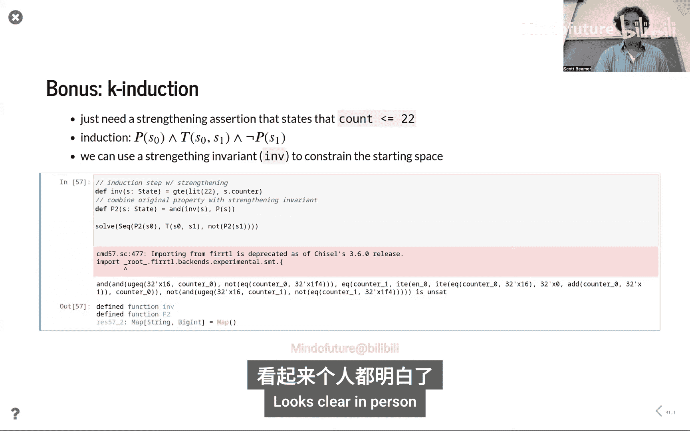

# 【加州大学】敏捷硬件设计-CSE228A-｜-Agile-Hardware-Design-Spring-2025-p26-P02_嘉宾讲座-使用Chisel进行形式验证_Kevin_Laeufer--BV1M6ivBzESw_p26-

Hello and welcome to CSE 228 today we have a special guest lecture from Kevin Liper on formal verifications。

 so give you brief background Don Kevin， he did his PhD recently at UC Berkeley， completed it。

 he's now research associate at Correial University。

 continuing to work on open source Har tools in making that process more agile and efficient。

Much of his PhD work involves some form of testing and verification of hardware and so for today it tell us about his work on making formal verification available in chisel that's a really cool thing he's done he's created his lecture now given I believe three maybe four times in this course so I'm really grateful for his contribution to this course and this community and you can see that can get a lecture Sw course this is a live Jupyter notebook he's in the running code today and received course Caey forgot we do have a lab six based on this that I'll be posted later today and do in a few days。

Also Kevin amongst the duties of the grad students spent some time maintaining chill tests of course that library were so enamored away from the penton for this course。

 so with that I'mre happy to welcome Kevin to give this guest lecture。

Thank you so much for introduction Yeah I think almost everything has been said so I made these slides like a couple of years back because I was like。

 hey， I had a formal verification to chisel test and we it would be nice for students to get you know get some hands on experience with that because formal verification has kind of had this little it's kind of been like a niche subject in some ways because well it was like a pretty big research subject like 20 years ago and then people went into industry made commercial tools and all those commercial tools that were just really expensive。

😊，And so unless you work at one of those big companies， it's really hard to get your hands on。

 even like the tool that you would need to do formal verification， but that has changed recently。

 there's been some work to enable formal verification for Verlock designs with a symbiosis。

 which is like an open source tool that you can use to to verify Verlock designs and inspired of that database he added some of this similar support of a similar approach to the Chisel test library。

So this essentially makes it like super easy to get started on phoneification。

 of course potentially the commercial tools can handle bigger design。

 can handle like larger problems， but all of the principles kind of remain the same。And so yeah。

 if you want to， you can follow along those slides at home。

 it should if you have been able to run all the other sites that should just work。

 the only major difference is that you should also have this Z3 SMT solver installed and we'll learn in a minute what SMT means and what an SMT solver does。

 not exactly how it works but kind of the tasks that it's solving。

 but yeah this SMT solver is pretty available so whatever your package manager or whatever your system you can probably install it。

Yeah so what's the plan for today so basically the idea is I want you all to go away with a decent understanding of what formal verification for circuits entails at least the kind of formal verification that I've been working on which is verification based onbuoolean satisfiability in SMT and we'll also learn what those two terms mean and then we'll learn sort of what are the differences between combination of a combinatorial circuits and sequential circuits then how does the verification for those differ。

 what are sort of the guarantees that we get after formally verifying and we'll also like look at some practical examples just to see what the difficult parts are and like what the power is of formal verification。

Okay， so let's start with the basics and the basics are， well， first of all。

 we need to import a lot of code， which I've already done here。

So all of this code you can look at it if you want to， but you don't really need to look at it。

 it's mostly there to allow me to write more like shorter expressions that actually fit on my slides so if you want to see what the magic is in the background you can look at that code but it shouldn't be necessary to understand spture。

So the first thing I want to talk about is the bullolean satisfiability problem。😊。

And so what does that problem mean so the problem says that we have some formula。

 some Boolean formula that means that all the inputs to this formula。

 all the variables are Boolean themselves， so x1 through xn is each each one of those can be assigned to either true or false and also evaluating that formula will give us a Boolean result。

 so either true or false。And so now the Boolean satisifiability problem， it asks。

 can F ever evaluate to true？Or another way of framing this or phrasing this is does there exist an assignment to the variables x1 to xn。

 such that F evaluates to true？And if that exists， then we say the F is satisfiable or for short sat。

Or the other possibility is that there is no possible assignment to x1 to XN such that F evaluate that F values to true or to phrase it the other way around there all possible assignments for x1 to XN make f value to false so you could root force basically all possible combinations of true and falses for x1 to XN and every time you plug those in evaluate F you get falses and that means it's unsatisfiable and so every bulloleyan formula is either satisifiable or unsatisfiable。

Now we have this little helper function here， which we'll call the SMT solver in a background and we'll get more about what SMT means later。

 but basically what it will do is it will take a bullet of formula and it will tell you whether it's satisfiable or not。

And so we have here to formula B0 and not b0 now think about it。

 what are the possible assignments to the variables in this formula or what are even the variables。

 the variables are B0， there's no other variable in here。And so if you only have one variable。

 there are only two possible assignments， it's either true or false。

 and so now you could prove forces you could say okay， what if p0 is true once's the result。

 the result is zero。What if P0 is one well the result will also be zero and so that means for all possible assignments the formula evaluates to zero。

 which in our case means false and so that means that the formula is unsatisfiable so let's try to run this。

And we'll see that yeah okay， there's a deprecation warning which is fine， but anyways。

 so this is the actual result that we want which says that this formula is unsatisfiable okay that's exactly what we thought right。

😊，So now let's look at the next formula。This one has two variables right so the variables are B0 and B1 so now how many different assignments are there？

There are four different assignments right two to the power of two。

 meaning that either be0 and be one could both be false， they could both be true。

 one of them could be0 and the other one could be one so basically there are four different assignments。

And now we can think about is there any assignment for which this formula evaluated so true？And well。

 if you think about it， there is right， if p0 is one and b1 is one。

 then the ending together those two values becomes one。Just as a side note。

 I'm like using true and one kind of interchangeably here and zero and false just because that's kind of how it also works and if you verifying hardware is basically the same thing there。

And so in this case we'll see that oh yeah， our function actually says that this formula is satisfiable and it will provide us with an example。

 so if a formula is satisfiable you can always have one example that's sort of prove that is satisfiable because we only need one example to show that a formula is satisfiable for a formula to be unsatisfiable。

 you actually need to say something about all possible assignments so there's not just a single example that you can show in order to prove that it's unsatisfiable。

😊，Now we have one more formula here。Which also has two variables and you can think about sort of a little bit on your own what are possible assignments that would make this formula true。

 Does there exist such an assignment。And you might have come up with this。

 well there's like actually three different assignments and now we'll see which one we get and so we get the one where B0 is1 and B1 is0 because the solver basically has some freedom to choose which one it wants to pick and in this case it chooses this one。

😊，So that's the buoyant satisifiability problem I kind of just want you to understand right now because of what is this problem。

 what are we trying to determine， what are the possible answers， right？

And now we can think a little bit about how is the solve function actually implemented。

 what do we need to do to determine satisfiability？

Now one thing we can do is we can write down a truth table right so if we have this formula saying be zero and not be zero that was the first one that we're looking at。

 we can write down the truth table， it has two entries and then we see all the right all the column on the right hand side is always zero so that means this formula is unsatisfiable。

For the next formula， which is the same formula we had before where it B0 and p1 we can also write down a truth table and we can see that there is one row where it results in one and so that means that there exists an assignment for which this formula is true and so it's satisifiable and because we found a row for which this is true we can just like look into this row and see what assignments are and we already have our example to prove that it is satisfiable。

Now some of you might have noticed what the big problem with this right like think about what's the problem with always writing down a roof table。

Just take 10 seconds and then I'll tell you。Yes， it like scales。Right。

 it scales very poorly so it scales with like two to the number of variables essentially。

 so you get like a huge truth table if you even have like a couple of bit。😊。

And now if you think about your circuit。You can think of it like as a first order approximation you can say like oh we need one bit for every input bit to our circuit so if our circuit has like you know2 32 bit inputs then that means we need 64 bits。

 64 input variables and that already is a humongous truth table that won't ever fit into the memory of your computer。

😊，U。So as you've noticed this fully satisfiability problem it can be solved with a truth table。

 but the problem is that the truth table size grows exponentially with the number of variables and so this problem has actually been was identified as the first NP complete problem meaning that it has this sort of worst case complexity that's really bad but one thing that happened after it was identified well the thing that happened after it was identified as like a really hard problem is people kind of were giving up on it we're saying like okay。

 this's impossible to solve algorithmically we should just never attempt。😊。

But then a couple of decades later， researchers actually started being like， okay。

 but we know a lot about the worst case complexity。

 but what about the average case like the cases that we actually care about and so one thing they did is they just like generated a whole bunch of random brilliant formulas and just tried out an algorithm that they came up with and saw how long it would take and it turns out well there are cases where the algorithm just takes forever essentially。

 but there are also a lot of cases where it finishes within an reasonableable amount of time。

And so what this tells us is only because something has like a really bad worst case。

 complexity doesn't mean that it's impossible to solve。

 and it actually turns out that there are a lot of interesting cases where this particular problem can be solved relatively quickly and ever since like the 1990s people have basically been working on better heuristics to more quickly solve a lot of common problems with employee sisfiability。

Now this is full in satifi， so you have a formula that takes basically one bit variables as input and it evaluates to one bit。

Now SMT means it's a satisfiability module of theories。

 so essentially we add a more expressive language essentially to our Boolean satisfiability problem。

😊，And why would we want to do that Well we want to do that because if we think about our hardware designs in chisel。

 we don't just work on individual bits we don't like build our adders directly from Nand gates even though it might end up as something like that on the actual circuit but we actually like talk about more high levelvel things like addition and subtraction and module operator shifts and things like that and so SMT basically provides a rich language to express some of these high level ideas and so the things that we're actually most interested in for hardware verification are bit vectors which is modeling fixed bit width integers so you can think about it like in C for example your intosunami 32 bits and so you might represent it as a 32 bit bit vector and in Chisel you and then Scent can be any bit width that you wanted to be and so this also then maps to like a bit vector of this particular bit width that you chose the other thing is kind of interesting to us are as which allow us to。

Moel storing and loading from memory so basically is kind of a map from index to data where we can basically insert things and then retrieve things later。

 And so this basically means SMt to us is just like a high levelve language in which we can kind of express these ideas from circuits more directly and then the solver can sort of do its magic to try to solve a formula that involves these more richer data types and so here I have an example where're basically trying to solve a plus a is equal to 8 So we have this variable a and we say okay add a and a together and it should equal and the result equal to8 And the question is is there a solution for a that satisfies this formula So you see here a。

Is a wider bit vector I don't actually write down what it is here。

 but I think it's fairly too bit or something like that it's defined somewhere somewhere earlier in that big code s snapppet I skipped but then basically。

You see the result of this formula is still boolean so we have richer input variables but we still result we still want to have something that is a statement a propositional statement and so now if we execute this the solver will actually say yes this is satisifiable and a should equal to four and we can think about this right four plus four is equal to8 so it's great。

😊，Now， the next thing I want to know is， is there a way to choose a such that you could said a plus a is equal to9？

Now think about this a little bit。And then I'll tell you what's going on here。

The basic question is like right like if you if you think about it。

 you know from like a math vector you say like okay a plus a is equal to9。

 so two times a is equal to9， so a is equal to9 over two， however。

 a is supposed to be a bit vector meaning like an integer， right？😊。

And then if you think about it that way you realize that there is no integer solution to this problem and so basically So we'll say that it's unsatisfiable。

Now the last little thing that I want to do here is I want to like try to come up with this standardner compiler optimization。

 which is where we're saying now okay， we have some variable C that's multiplied by four and we should be able to do a strength reduction where we turn the multiplication into a shift and now we're just searching for this A because we want to basically know what is is there an A for which this is equivalent？

And so we can actually put this into this S&T formula。

 basically just transcribing this thing and it will say， oh yeah， if you choose a to B2。

 then if you multiply this constant that we chose this random constant by four。

 then its the same as shifting that constant by two， and that makes a lot of sense here right？Now。

 the next question is， can we do the same thing if we're multiplying by five？

So you can think about it for a second or two in your head， and then I'll run it。

And you'll see no it's unsatisfiable right basically there is no constant such that we could do this shift and that makes sense because you know or you might know that this strength reduction only works for power if you multiply with a power of two so four is22 to two five is not two to anything if you want to or at least if we're looking only in integers what's the next power of two the next power two would be eight so we could put an eight here。

And lo and behold， we'll actually get a equal to three， so in that case， it works again。😊，Okay。

So that's it for bit vectors and SMT or SMT and Boolean satisifiability。

 are there any questions at this point？Any questions？ Okay， I'm getting nods。 we're good。

Okay that's great now now you might be asking okay。

 you've told me about all this like ST and Boolean satisfiability stuff。

 but what about circuits where're like an agile hardware design class well now we're going to try to bridge the gap between circuit and this whole like SMT and Boolean sisfiability business what's the connection right？

😊，First of all， we're going to look at combinatorial or combinational circuits。

 meaning circuits that don't have any state elements， so no registers and no memories， okay？

And so those circuits， if they have an assertion in them that can be directly mapped to an SM&T formula。

 So what does an assertion mean assertion basically there's like this assert statement。

In in chisel and what basicallys does it just says like okay。

 this should always be true and if during simulation， for example。

 you somehow manage that B is not greater than a， then the simulation will stop and say， hey。

 this assertion was violated。😊，And these assertions can also be used for formal verification。

So what is the circuit that we're describing here this is just a snippet it's not a full chisle circuit It's saying that there is some a which is an input so this means it's basically like a free variable like earlier we' were saying oh there's like B0 and B1 that are inputs to this formula and it's kind of what we're doing here we're saying there's an input to the circuit becomes an input to the formula and now we're saying there's a B that's equivalent to a plus1 so B is not actually just a free variable it's just like it's just like a+ one。

😊，And now we're saying B should be greater than a， mean which means if you just plug a B here。

 it means that a plus1 is greater than a， okay？And now we want to verify that using an SMT solver so what do we have to do for that well as an SMT solver basically gives us an assignment and so we're thinking like what kind of assignment are we interested in。

And the kind of assignment that we're interested in is an assignment that shows us that this is false right because if such an assignment exists。

 then we know that there is a bug， if no such assignment exists or no assignment that exists that will make the assertion false。

 then we know that the assertion will always be true。😊，Okay， so how can we how can we encode that。

 we can say， okay， there is a B that's equal to a plus1。

And now find us a thing where B is not greater than a。

 so we're inverting it here because we're trying to see if the assertion can be violated。

And now we can try to ask a solveer and you can also think about it for a second or two。

And then I'll start it and what does the solver say， a solvers is there is actually such a situation。

 there is a situation which B A is equal to this big number and then B is equal to zero。😊，Now。

 why is that？Those of you familiar sort of with the computer arithmetic might have realized already that well。

 we are running into an overflow problem。And to see that a little better。

 we can like use these two prints。 So what I'm doing here is basically I'm converting these this big number that a is supposed to be to a binary string and then I'm converting the a plus one to a binary string and here you'll see that a is basically like。

All one of all 32 ones and the B is basically plus one and you know in chisel。

 if you do an addition of two things that are 32 bits。

 then the result will also be 32 bits and the highest bit will be discarded。

There's a there's a8% plus if you actually want to keep the highestt bit， but in this case。

 it gets discarded and so basically B ends up eating just this。

 which is zero and zero is obviously not greater than this number。

And so that's what's happening here。Okay。Now this is the same example that we have before just now with actual chisel。

 so before showing you how can you transcribe manually this circuit idea into an SP formula and now here is basically just a chisel circuit and we're using this verify command which is imported from chisel test and so what this does now is it will actually generate the fertile from chisel and then from the fertile it will generate an SMT formula。

That then gets handed off to an S&P solver and then we get the result and we see that in a chisel assertion we can actually also print out the values of A and B when this assertion fails so we don't need to do any special here and so now we're running this it takes a little bit more time and we see here we found in an assertion violation and it will actually print out what happened it says 1111111 is not greater than0 and basically it finds the exact same situation that we found earlier。

So just B here makes it be formatted in binary。And so yeah， this is how you can do it with chiselm。

 Now there is this whole issue of like why are we doing bounded check one here？😊。

And we'll get internet later， the Bo check thing is only really important for circuits that have state that have a memory or register。

 but we need to always supply it， but for combinational circuits or combatorial circuits。

 Boun check one is always sufficient。Okay， now I do have like one example for a combinational circuit that we could that might actually be interesting to verify and so here this is a gray code circuit let me try to make this a little bit bigger so what is gray code used for gray code a lot of times is used for crossing from one clock domain to another if you need a counter。

And so now I'm not a physical design person， so I cannot tell you all the physics that goes on when you're crossing from one clock domain into another。

 but basically one of the design principles that you have to follow as a digital designer is that you should never have more than one bit flip at the same time。

 because if you flip multiple bits， they might。You know the other side might see them at different times。

 so actually like causality might be averted in some sense and so basically you need to only ever flip one bit at a time。

And now if you have a counter， if you think about it， if you're counting up in binary。

 actually multiple bits flip right if you go from three to four。

 then you have three bits that flip like the bit0 and1 go from one to0 and bit two goes from zero to one and so that would not be good now gray code is basically a way to represent binary values such that if you increment only ever one bit will flip。

😊，Okay， and the other nice property is that it's you can convert from binary to gray code and from gray code back to binary and you will always get the correct result so there's no loss of data here so that's the that's the first basically the invariant that we want to encode is saying that if we have an input value。

And we convert it from binary into gray code and then back from gray code to binary。

 then the input should always be equal to the output。

 meaning right there's no input value for which we lose information and so here we can do a check you see this property is actually like parameterized because chisel is a generator language this is basically a chisel module just when it has an assertion in it and so we can parameterized it on the width of this gray code and we can actually run this check for different width of gray codes if we wanted to。

U I did choose like 64 here because 64 is like a， you know it's a big value and so so meaning that we couldn't just write a test that tries out。

All possible inputs， because if you think about it again。

 we would need to try out 2 to 64 different inputs to be sure that there isn't an input which violates this property。

 Now， this is pretty boring here because the property actually hold。 So you don't only。

 you don't actually get like any error message or anything interesting。

 So we could always like say something okay input is not equal to output， which of course won't hold。

 And then we could get something where it saying like oh if I a 0， it becomes zero and gray code。

 and I becomes0 again in the output and that's actually the same。

 So so here you see the property is violated。 I fix it again and it all works。 okay。

Now the more interesting thing about grayco is what we said is that only ever one bit flips when incrementing。

 so now how can we encode this property？😊，Well so here is the solution。

 basically we take a to be some input。And then we say Bd is just that input plus one。

 so we're incrementing by one， right， we just have a counter increment by one。😊。

Now we convert both A and B to gray code and then we check how many bits flipped。

And so how do you check how many bits flipped， you basically calculate the heming distance and so this is a way to calculate the heming distance versus popcor function in chisel and you just take the x order of these two values。

😊，If you're not familiar with having distance， try to read it up at some point it basically just says how many bits flip between these two values。

And now we're saying， okay， this havingm distance always has to be one because we only ever want to have one bit flipping between converting from between two binary values that are just honest increment of the other so now we can run the same thing again random again for 64 bits and it doesn't it's always correct Now we could mess up this whole thing you could say okay B is a plus two and of course it probably doesn't hold and we'll get a counterex where they'll say like okay there are these two values which are the great codes of these inputs but they having distance is actually two which makes sense right if you like incr by two then there could be then there would be two bit flips you can turn this back to one and then the property holds no problem。

Okay， so to recap， if we want to verify our combinatorial circuit。

 we need to write an assertion that defines a property you want to check。

 so if you don't have an assert the solver or the verify command is always going to say yes。

 everything is great because there's nothing to verify。

This SMT solver actually helps us prove this is something I haven't really gotten into yet。

 but it actually helps us prove for all possible inputs that assertion cannot be violated。

 remember if we get unset that means there's no assignment such as the property can be violated。😊。

And with the chisel interface， if you have a equial circuit， just say Bo check one。

 and it will give you a fullproof meaning there's no possible input that could violate the property。

😊，Why that's important or why you know it will ever be different we will see when we get to the next chapter about stateful circuits。

 but for now this might be a good time to pause if there are any questions。Any questions？Okay。

 I think everybody's on board， this is great。Okay， cool。 So yeah。

 now we're going to talk about sequential circuits。 So these are circuits that do have state。

 They have some register or some memory。😊，And so here is a sequential circuit called my counter What does it do。

 it has some input called enable it has a register called count it's just 32 bit by just you know so that you didn't have to worry about overflow so much and what does it do it's okay if it's enable and the account is equal to 22 it will go to zero if it's enabled and account is not equal to 22 it will increment account so basically it should be a counter that counts up to 22 and then counts back from zero。

And here we're asserting that the count never reaches 10 Now a question is like can it reach 10？😊。

It should be able to right so now we can say， okay， verify my new counter。And for now。

 let's say like， okay， go to check one。And see if the assertion can ever be violated。

And we see there's no error message， so I guess this assertion always holds。

But that should be true right like you kind of expect this con to be able to reach 10 you just enable it for 10 cycles and then should reach 10 because this whole overflow check only happens at 22。

Well so the problem here is we actually did the bound check for one。

 but need we need to actually execute a counter for like 10 cycles to reach this span state or this assertion violation so let's try to actually like give it 10 cycles oh wow now we actually reach this assertion violation and you can see here you'll actually given a trace this trace is just comes from this print up here so we have this print of account the print out values and that's one of the nice things also about the formal verification integration with chisel test is that you can actually use prints and it will basically once it finds an example of how the property can be violated it will replay the circuit with all you prints enabled and so you'll actually be able to see all the values printed out。

😊，But so in this case， we can see， okay， we just enable all the time and at some point count be just 10 and that makes a lot of sense here。

 right now we could change the circuit to like only to only go up to 9， right。😊，Something like that。

And now if we run this， it will actually not find any assertion violation because we cannot ever get to 10。

😊，And I can change it back。And if we run it， it will find the same violation。

 I can change this count to 20 and it will not actually find a bug just because we only set the limit here to 10 if we actually send it to like 25 or something like that。

 then it will find a violation， it just won't fit on my slide。Okay。

 so this is just a counter and we've just been playing around a little bit with this assertion with when it overflows and also with this verify command and the bound right so you get the notion that somehow this bound is important if you are verifying things that have state and the reason for that is because the state evolves over time so we're looking at multiple cycles。

 not just one cycle and that's like the key difference between the combinatorial and the sequential circuits is that for the combinatorial circuits。

 all properties can be reasoned about within only a single cycle for a sequential circuit you might have to look at like an arbitrary amount of cycles potentially。

Now， how do we reason about these sequential circuits because I showed you the chisel circuit。

 but you can the chisel circuit is not an SMP formula and it's not like directly straightforward how you would even derive an S formula。

So one of the things that basically all formal verification tools do is they kind of abstract these circuits into what's called a transition system。

Transition system essentially is kind of a state machine that has some states and you know some transitions that describe how to go from one state to another so now let's try to define a transition system for our counter from the previous slide。

So here's just like a small example of how the state could evolve and you see。

Here's basically like the example state， this whole enable thing， you would say， oh。

 it is actually an input， right？😊，But you can also treat it as a state and we'll see in a minute why。

Basically， we could say， okay and S0 count is0 and enables 0， that means an S1。

 the count will still be0 because we know when enable is0。

 the counter doesn't count up and let's maybe say like enable is actually one then and that means that in the next state count will be one and a could be something new arbitrary right。

Now what is the goal of verifying this circuit well the goal is to reach a state in which an assertion is violated and in our case an assertion is violated if the count reaches 10 so we could say。

 okay， there's this error state where count is equal to 10 and we just kind of have to think about is there a way to reach this error state？

If we're sure that there's no way to reach this error state。

 then we know that the assertion can never be violated。If we can find a way to reach this air state。

 we can actually show all those states and the evolution of those states and say， okay。

 if you get these inputs， then you will get to this assertion violation。😊，Now。

 over the next couple of slides， I want to try to basically implement our own model checking meaning like our own verification algorithm to try to verify this particular circuit。

 so we're trying to do the thing that Chisel test does under the hood that we looked at in the previous slide。

 but we try to do it only for this one particular system， not for any circuit。

 but just for this one particular circuit。Now what do we need to define me to define some sort of state so here we have a state that's just a counter and an enable we have a function to make a new state so the new state will basically just contain two symbols so symbol is just like a variable essentially and one is the counter value and the other one is the enable value we have I which is a predicate that says that is true when we're an initial state so basically what this does is it just constrains the counter to start at zero so we're saying okay if this is the initial state then that means the counter value is zero。

You see that there's no constraint on the enable and the reason for that is that it enables an input。

 so it's always unconstrained， it can always be freely chosen every step。😊。

The other predicatet that we're encoding is this T， which is called a transition relation。

what that does is it basically says like， oh， what has to be true about two states such that one state follows the other？

And so here we're basically encoding that and what do we need Well so here we're basically is saying like the next counter state is so basically we're making an SMT formula that tells us whether what the next value of the counter should be so we're basically translating from the previous slide this code this chisel code into an SMT formula and so how does that work well we say okay ITE is basically a max so basically we're doing a case split we're looking at different cases。

 we're saying okay if the countervalue in the current state is equal to 22。

 then the next value and if it's enabled and the countervalue is equal to 22。

 then the next value will be0 if it's enabled and the countervalue is sorry if it's enabled and the countervalue is not equal to 22。

 then we add one to the counter if it's not enabled then we just use the old counter So this is how we can determine the new countervalue from the old countervalue and the enable value now we're saying okay。

If S1 is actually a state that follows as0， then that means that the counter value in that state is equal to the counter value that we derive from the previous state。

Okay。Now there's one more predicate at me， which is called P and P is describing the。

Basically the bad state so the bad state is when or or sorry it's describing whether the property holds so whether we're in a good state。

 And so basically we're just inverting the the。You know， the the thing that we're looking for。

 we're looking for a state where count is equal to 10 we're saying like okay。

 the state the count is not equal to 10 so that means that's we're in a good state now we can create like two states here which you know creates theses。

😊，Now， what do we do with all of this？Well， I guess okay what do we do with all this。

 but also like the first question here is what happened to our clock and reset values because you know at Chisel。

 we do have like like a account that gets reset to zero and there's like a reset pin that controls that there's also a clock that will advance the register and the answer is that when we went to the transition system we actually kind of like handwave weight to clock and reset So this conversion here that we're doing it assumes that your circuit has only a single reset pin and only a single clock。

😊，Which is normally true。Or which is true for a lot of circuits and in our circuits that this handles a lot of cases there are special things you can do if you have multiple clocks or if you have multiple resets but for now what we basically did is we assume that the system always starts in the reset state so that's why we basically made this constraint to the counter is zero so we're kind of ignoring the reset pin but we're saying like oh the reset pen sets this counter registergister to zero so let's just say initially we start at zero in this transition system and the clock we' basically saying like oh any like clock tick represents a step in this transition system。

That's kind of what happened to o'clock and hour reset。

Now with these predcateates that we define the initial state predicate。

 the next state predicate and the assertion， we can then try to do bounded model。

 what does bound model checkingck mean？Well， so we saw earlier that if we have a combinatorial circuit。

 we can turn that whole circuit into an SMT formula。

 and SMT so will tell us whether it's satisfiable or unsatisfiable。

 whether a bad input exists or not。For a system that evolves。

 we can't easily do that because we don't know how many cycles is going to execute。

 So the next best thing we can do is we can just start and assume like oh maybe we can reach the bug after one cycle so we just encode the system for one cycle and then we'll encode it for two cycles and we'll encode it for three cycles and so on that's what's called bounded model checking because we check up to n or up to K cycles basically。

Now how do we do that well we start with the initial state we say， okay。

 assume there's a state zero which is an initial state。

And then check that the assertion is not violated。And then we say， okay， if that's true。

 then say there's initial state S0 and the state S1 which follows S0。

 check if the assertion can be violated in state1。And so if you look at this right we know that our counter does not exhibit any bad behavior for the first nine cycle。

 so of course we won't get to a bad state this case now for the next state we can just say okay。

 make another state and now we're saying okay we have this initial state we have this state that follows S1 which follows as zero。

 we have S2 that follows as one and now can we can we reach the bad state right and so the interesting thing here is right this is kind of like each one of these states is symbolic so it is encompassing any possible state you can reach one or two cycles right so it is pretty powerful but it is still constrained if like。

U， if like there is no， if you need to like， you know， take three steps in order to get to this bug。

 then this will not find it because we're only looking at two steps。And yeah。

 here we won't find anything。So instead of like continuing and making new states manually and everything here I actually wrote a small routine here that does bounded model checking for this particular circuit So the thing that we're doing here。

 the reason why this is kind of small enough fit and slide is because we encoded these predicates like IT and P for one particular circuit the hard part that makes like the actual like implementation for chisel test much more complex is that it actually works for any chisel circuit so for any chisel circuit we basically had to write a compiler pass that then derives all of these conditions in order to check them but here we hardcoded the condition so that makes things a lot easier and now we have this BC routine。

 what does it do it like starts with a state zero。😊。

And it keeps a list of all the conditions that we're looking at and so it basically just says like。

 okay， state zero is the initial state。And now we go from zero2 k so we're doing up toK cycles that we're looking at and then in each cycle we check whether given our current list of conditions the previous state can reach an assertion failure if that is true then we should print out oh bug found and we return otherwise we create a new state we add to the conditions that this state follows the previous state and we make that new state the new previous state and that way it will basically keep on keep on doing the thing that we were doing manually earlier so here were like like basically adding things here and like checking for each state whether we can reach an assertion failure and we're just doing that automatically here now so we can do a BC for five cycles and we won't find anything because we know that counter only goes bad after10 cycles so now we can up into10 cycles run it and it say oh yeah we found a bug and it will try to print out some counterexamp but it's not as nice as the actual chisel implementation because we're doing this in just a couple lines of code。

But so this might be something that's useful for you to run at home because it is actually implementing boundary model checking for one particular circuit。

 not for all circuits in general， but for one particular circuit is the full implementation of boundary model checking。

Now here is like a visualization that might help some people so in this case we're actually just saying the counter the bad state is the counter is equal to 500。

 you know we're just doing 10 earlier， but you know 500 or 10 same thing。

 but so the way you can think about it is there is like this state right that you're in some point a counter zero and you want to know dust can counter error become 500。

And one thing we can tell about the counter is there are only like 22 to 32 different values that it could take on because it is a 32 variable。

 so there is this finite space which is represented by this green box that contains all possible values of counter。

And now if we're doing boom checking， we're basically looking at all possible states after one step and so we know after one step the counters either zero or1 depending on whether the enable was two or not。

 after two steps the counters either zero one or two depending on whether when the enable was on and so basically boom checking is like sort of expanding slowly expanding the state space and you know trying to see sort of like trying to you know see if this any of the state space that we can reach overlaps with this bad state。

And you know like in this case because a counter only ever increment by one at a time。

 if we wanted to get to 500， we'd have to do 500 steps basically so what does this teach us。

 it basically teaches us that one model checking is pretty powerful assuming that there is a way to quickly get to your bug like meaning like a few few enough cycles but you could always come up with an example where you just need so many cycles that it's infeasible to go that many cycles because the other thing to note and I don't really have a good demonstration of that here。

 but one thing to keep in mind is that the more cycles you do the slower it gets and it gets like a lot slower it doesn't just get linearly slower it normally gets like exponentially slower So if you like start saying oh。

 I want to look at the circuit and make sure that it doesn't have a bug after 1000 cycles it probably won't ever finish bottom ball checking unless the circuit is super simple so that's something to keep in mind。

Now that's the basic explanation of about it model checking， are there any questions at that point？😊。

Oh， yes。Yep。I have a question。 can you。I can you apply infinite steps in Chiso me if I'm able to check it。

Um。No， not at the moment。 So basically， there is， so there's ways to like。

Prove things about your system such that they hold for unbounded number of steps。

 but then you normally sacrifice this nice property here that so in this case here。

 if if your verification fails， it will always give you an example of why it fails。

 there are ways to try to prove。Things for any number of steps， but then if it fails。

 it might just be because some assertions aren't strong enough and you might you will probably not get a real counterex that demonstrates you。

What where the bug is so this bottom model checking is very useful for like bug finding but yeah it doesn't give you a full proof but if you have time at the end there are some bonus slides about k induction which is not implemented right now but k induction you can use that to prove that no matter how many steps you execute your counter can never reach 500。

Does that answer your question？Yeah， yeah， yeah。 Okay And this us at the end。 Thank you。Cool。

 so we do have an application example here， so this is a Q from， I think an old queue lecture。

And this is just like an implementation of this queue。Now let's see if this example will work Okay。

 so we have the queue and we want to write a property about it。

And so one thing that I feel like makes formal verification always hard is， well， for one。

 it's just kind of a little bit niche， as I mentioned earlier。

 because it is sometimes hard to get your hands on a tool that can actually do formal verification for you。

😊，The other thing is that it is sometimes really hard to find the right thing to express so there are certain things that you know you have like a lot of experience with testing and writing tests and you kind of know like how to write your tests so that you can catch a lot of bugs but with form verification sometimes it's really hard to know just what kind of property to specify such that it will be you know it will be like useful for finding bugs。

And I think the answer to this is just that you need like some experience with phone verification。

 you will get better and better at sort of finding the right property。

And so I want to show you like interesting property that I actually like learn from someone else's code。

 which is this data integrity property for cubes and the basic idea here is just that when data goes into a queue。

 it should exit again at some point and it should be in the correct order so you know if you put one。

2 three into a queue， it should come out as one，2 three and not as three to one or something like that。

So there shouldn't be any reordering within the queue and you know you should eventually get the value back out of the queue。

Now， how can we express this in chisel？Because yeah。

 as you might have noticed like all these properties that we're expressing for formalification have to be actual like real chisel circuits that's like one of the other differences between testing and this like in testing you can just write your scholara code for these properties in order for them to be alyzable and like for us to be able to discharge them to the SMT solver。

 they need to actually be chisel circuits with these added assertions。😊。

And so what we do here is we basically make a module that encapsulates a queue。

It has a new input for the queue and just hooks that input up directly to the queue so basically just like it has a queue inside and just like exposeos it all the inputs and then in addition to that it like counts how many elements are in the queue。

And it has some facilities of printing what happens with the queue And so this is kind of interesting to us because we are going to look at the queue。

 we're going to try to find a bug and if we find a bug we need to get some counter examples So I just want to demonstrate to you right now how this works Well right now it doesn't do anything but we have to special fail after and you can look into the code is here it's implemented but essentially what it does it will just like include a counter and assertion that makes the verification fail after three cycles and this means that then we can see what the output is of these this trace that we made here and so you see basically it will print out the cycle that we're in So it comes from here。

And then it will print sort of what does the element count in the Q from 0 to 00 to1 and1 to22 to three and it will print what happens with the Q so here we're seeing like oh0 gets in cube。

0 gets in cube， zero gets in and that's why like the count element count is going up。Okay， so just。

 this is just for you to understand sort of this trace capability because we're going to use that in order to study the property that we're trying to write。

Now this is the first attempt at writing a property and we're trying to basically just we're basically trying to say that you know the first element that goes into the queue。

 we want to make sure it comes out correctly so what do we need to do for that well we we have we basically extend our queue trace to like add this property and we need some registers to trace to to keep some information for our property The first one is we want to see whether there is a package that we're tracking is there did something go into the queue already that we're tracking and if we're tracking something then we want to have the packet value so that we can later check when it comes back out of the queue we want to check that the value is the same thing that went into the queue so how can we how do we we use these well let's say we're not actively tracking something and the in queue of the queue fire so something was in and is being in queueed then we go into active mode and we remember a packet value and we're just printing out oh we're tracking this value now。

Um if we are tracking a value and something comes out of the queue， then we say okay。

 we're done tracking and now let's check to make sure that whatever came out of the queue is what entered the queue initially。

😊，And now we can verify our queue with that。But what happens， well。

 what happens is we actually get an error， now a question is like why do we get an error？

What is happening here， Okay， so if you look at our choice， we see something goes into the queue。

1 goes into the Q， then 128 goes into the Q，1 comes out of the Q， then0 goes into the Q。

 and then zero， another0 goes in and 128 comes out and then we're saying， oh。

 but 128 is not equal to zero。So what is going on here Well we initially we see there's this tracking thing right so initially we get Cta one and we're saying okay。

 we're tracking the one now that's great because now the one comes out in the next cycle and we're saying okay。

 this is great a one came out and the property holds。😊。

But now what happens is we also like in 128 in here。

 but we didn't write it down because we're still tracking something。

But now a0 enters the Q and now we're like， okay， let's track the zero。

 but then the next time we're getting something out of the queue。

 of course 128 count up because that was in here and now we're saying oh， but we expected a0。😊。

So that's a problem right but this doesn't seem to be a problem with the queue。

 this seems to be a problem with our property because we are only tracking one thing at a time and we don't notice if there's something else sneaking into the queue and so that's a bit of a problem。

How can we work around this？Well， so this is our second attempt and it basically adds this new thing which is the packet count what does the packet count do well now if the something enters the the queue。

 we will actually remember what the number of elements in the queue was at that time。

And now if something comes out of the cube we'll actually start counting， we'll say okay。

 if if this basically will decrement this counter and only if the counter reaches one will we check the element so now we can we can look at this and you'll see that。

There's like another thing he complains about。But at least we seem to be you know。

 we seem to be like not doing not having the same problem as last time。

 so now let's look at the tracer we're getting and see what's going on so we see a 64 is entering the queue。

And we're tracking it。Then it comes out of the queue and it's okay。Now a nine exits the cube。

And then a zero goes into the queue and we're starting to track it。

And and then like there's a bunch of other going into the queue and at some point we're saying like。

 oh， the thing that came out is kind of what we wanted to be。

And the reason why like so many things have to come out of the queue is because we're tracking at three elements and then it takes a while to like de that。

😊，But now you might be saying oh this is kind of weird right， Why are we at three elements here。

 And that's actually the problem that we're seeing here。

 which is that something enters the queue something exits the queue。

 even though the Q should be empty here。 So we're getting a9 out of the queue and but we but and an account goes from  zero to three because it underflows。

And that is actually a real bug that was in this queue when I first made these lecture slides Now the big question is whether I remember how to fix it。

And oh， the nice thing is that I do have this in here where I can't just fix it magically。

 So what happened here is the way that the maybe full was assigned was not correct。😊。

And this is actually a very tricky thing to find so I did start with these cues and I actually I already had a property written down because I was using it for some other cues but so then I basically ran my existing property and all the cues for this lecture or for this class and I found one where there was a problem but then even after finding that and getting a similar trace to what you saw just now it took me another hour or so to actually find out what was going on and the way that I found it was just by comparing the logic for the maybe full to some other existing queuee that I had access to and I found that there is like another there basically you should like calculate like like this and not like this。

Now。You know the formal stuff helped me find this bug and this queue have been used in the run of this class and people haven't found this bug so I feel like this demonstrates a little bit how useful it can be。

 but of course it didn't quite point me directly to where I should look to fix it but you know other methods helped namely like comparing this to an existing working implementation of a queue and now but now that we fix this we can like we run our code。

诶。And let's。Comment this one out。嗯。This one is still going to fail because our property is bad。

 But now we can rerun this one。And we'll see what happens。This is taking a little while now Okay。

 so now it basically doesn't find any assertion violation within the first10 cycle， so that's great。

😊，So that means we did fix our queue， and it seems to be working。

 There is one small thing that we can add to this， this tracker。

 which is currently the problem is basically while it's tracking a packet。

It it's not it cannot track another packet。 It can only track one packet at a time and it will always detertriministically track the first one it sees and then the next one it sees。

 but there is a way to give the solver a little bit more freedom meaning that we can add this enable pin and then we can say okay we only start tracking if we're not active and also the enable is true and what this means is basically if there is a bug that that only turns up if you track the second packet instead of the first one then the solver can automatically decide to do that and that means you might potentially be able to find the bug in fewer cycles So if we run this。

 it's kind of boring because we just fix the queue so we'll just end up saying like oh theres nothing wrong with it that just for completeness sake just kind of like what full probably should look like this enable that basically allows you to pick any packet instead of picking like always the first one。

But yeah that basically back example， yeah， we go back one slide。

 so this is really interesting this notion of you track only one packet。

And then you give it the freedom to choose which packet to try to get more coverage and so。You know。

 a naive alternative might be to try to track all packets。

 Is that making the safe space too much bigger this way more efficient。

 Is that why you did this way or。It's slightly worse。

 I do actually have if you look at my thesis there's actually a chapter where I am actually looking at cubes and I do do both So so the thing here is like this enable thing basically adds sort of like if you wanted to actually use this checker with random testing you would actually then't have to randomize the enable and it kind of gets a little hair there is a version where you can just track everything and it's easier if you to want to combine it with random testing and so my thesis actually has a graph where it shows this this property expressed like this way and then also the way where we basically just instantiate a known good cue and then just compare the inputs and outputs。

And it is like slightly faster to do this version here。嗯。But but yeah。

 you could also do it the other way， basically， you just instantiate a chisel queue and every time something goes into the queue that you're checking。

 you also put it into a chisle queuee every time something comes out。

 you also the queue from chisel queue and just make sure the guy use the same that also works。Cool。

 cool， great other questions。No， okay， please continue。

Al so this is the end of the main part of the lecture so to summarize form verification can exhaustively verify a circuit which is kind of cool so for a combination of circuit you can basically prove things about it if you want to use it with chisel you need to write your checker in chisel so your property needs to be written as a chisel circuit with an assert it is not software like chisel normal chisel test tests。

It's not scala， it's really all chisel。One thing that's kind of neat is that sometimes the checker can actually be smaller than a test if you find a good property to check。

 but it can be really hard to figure out what is a good property to check。

It can find interesting corner case bug， so this queue bug for example。

 you know of course like it's not as well tested as like a real queue would be， but like， you know。

 people were using it or like you know it wasn't the lecture and like a lot of people looked at it。

 but you know this property found very quickly that there is a corner case bug in it。

There here are some links I hope they still work there are some examples here for formal verification you can send me an email this is my hack I think has my Berkeley email but you can also find Mc criminalial email if you want to email me this is the Chisel' library unfortunately it's now longer being developed just because a lot of the chisel ecosystem moved on to a different infrastructure and there's no one there to spend a lot of time porting Chisel tested a new infrastructure and there's a chisel community chat if you want to get involved in the community。

😊，So I do have a couple of bonus slides， I don't actually know how long the lecture is and also I want to give people the opportunity to ask questions first。

 but if there aren't any questions then I would go to the bonus slides I just need to know how many minutes I have。

Sure， well， first let's thank you for the main talk this was fantastic。嗯。So yeah。

 we actually do have time so I don't if you notice this quarter i'm teaching Tuesday Thursday router and Monday Wednesday Friday so it's a 95 minutes slot so。

There's definitely time， but maybe I'll be quiet and see any questions from the audience first。Yeah。

 that's the questions。Yes， is there any room to。I just kind of reconfigured this so that you something like census going from。

Sping some。Properties not a circuit that you want to have and then from there。

Like it's like reorienting the problem。Yeah， that's a really cool question。

 We actually kind of had a cism example in here。😊，佢个咪 go away。It's a very boring synthesis example。

 but this was kind of a synthesis example here。Where we're solving this question here。

And so you could kind of express that which， but it's not built in。😊。

I guess like the important difference here is like here we're asking， so。

 so normally what we ask with this with the solver is basically we like asked does your exist。😊。

And a。That。Right。That's what we're asking。Now， synthesis will actually ask， Duer exists and。

And a such that。For all C。Blah， blah blah right， and I actually cheated here a little bit because I chose a fixed C I said。

 okay， C is just 145， but in reality， our cynicus actually does ask like。

 is there an A such that for all C this rewrite is correct？😊。

And so if you actually wanted to do that， you'd have to。

You basically are stuck with the problem that this your solver can only do existential queries。

 And so what you could do is you could basically do what I did here saying like， okay， we just have。

 we just pick some C like 145 and we get an A。 And so in this case you would get the A being two。

 And so now you can ask a different question。 You can say， okay。嗯。😊。

Is there a C for which this doesn't work， right？ Like， so you could say， okay。

 is there a C such that this is not equivalent。 So we， I would have to create。

The promise I don't actually have like a C here， but use I will just reuse A。

 so we use A in place of C now。😊，嗯。And we basically will have this。Left shift off a by。

 And now we use the the a that we found as the literal。Let's see if it's works。Yeah。嗯，不。Oh yeah。

 and we need to we need to we need to invert this because we're looking for a for a C for which this rewrite is not valid。

And so in this case we will say uns so that means you're done with your synthesis。

 but it could be that the A that you chose is actually like only works for the special case of C being 145 and you would get a different C and then you would say。

 oh， is there actually an A that works for both Cs and so this way you actually get into a CIS loop which is how one of the ways that you can do synthesis but yeah none of this is actually implement interest or tests so you would have to kind of do that yourself。

 but yeah you can kind of like you could do you could in theory like implement synthesis using very similar ideas to this just that you then have to basically do this iteration between like exists you know between these two different kinds of queries because you have like an exists for all query not just an exists query。

Does that answer the question？Great， I guess relatedly is I assume there's some sort of way to specify。

Constraints or properties on inputs。Oh yeah， yeah， if you want to like sort of constrained the inputs that are viable。

 you can use a Zoom， which works basically like a third just that it will prevent this all from considering any inputs that violate the assumption。

So you could say like， oh， assume this input is greater than one and then it won't consider zero。

Like， for example， if your for your overflow example， you know， you could say， you know， assume。

That input is less than you know that max value。Yeah， that's， let's actually try that。

 Of course I don't know what the max value is but oh， no， actually。

 we do have a copy right the question becomes。Now the question becomes。

 how do you actually spell that in？In chisel well let's just say like we know that the overflow when overflow cures b will be zero so we'll just say b is not equal to0 it's much easier to write down and now let's see and it passes okay。

 so we restricted B to not be0， we can restrict B to not B1 and then it will still find the kind of example okay。

😊，And here we actually just， you know， we constrained something that is actually derived from the input。

 but you can also do that， that's no problem。ok。Great， great。

 Do we have other questions from the room。😊，Yes。So suppose you run B mono checking for。

A very large number of cycles， like 1000100000 time cycles。 And you can't find any violation。 So。

 and that means the property is assertive。 Is that right。No， no， no。

 so there are like ways to determine a bound at which you have a full proof。

But they are not that easy。So there are like some ways that you can check that there is no that you explored essentially the whole state space that you can reach。

 but in reality it don't really work super well。But yeah。

 if you just give it an arbitrary circuit and you tell me I ran phom for 100，00 cycles。

 it doesn't mean anything in terms of guarantees。But one thing we do observe a lot of times is that a lot of bugs can be triggered pretty quickly。

Okay， so so basically， there are no guarantees if you if you with bottom all checking。

 but there is this experience that a lot of times you will actually find a lot of interesting things。

嗯。And so in Chisel， if we write Chisel， what kind of tools can we use like and like jaware or uses for the formal verification。

Well so there is this like just like part of chisel test that you can use to do bottom line checking okay right。

 yeah but of course， if you generate barrellock from your chisel you can use any of the very tools as well。

呃。🤢，It has， it has its support。 I， I see there is a thispror。

 So does Chisel test support serial prover。So little test basically just supports like button wall checking essentially。

嗯。It doesn't support like unbounded proofs。Okay。And the， the， the problem of the queue。

 verifying the queue， Can we use uninterpreted functions to verify that。Like。

 you can verify the order of the memory read right。 So I think that's similar to the cube operations。

诶。So you don't really need uninterpreted functions for this because the queue is using a memory in chisel。

 it will actually be translated into the theory of as。

 which is somewhat similar to the theory of uninterpreted functions， but not 100%。

 but all of that will basically be done in the background for you。

You don't need to do anything specific there， uninterpreted functions in hardware verification。

The place where they are used sometimes explicitly。

 like where you actually kind of do it intentionally is because。

SMT solvers are really bad at reasoning about a lot of data path circuits， so for example。

 if you were going to ask an SMT solver whether let's say you have like a gate level optimized multiplier。

And you want to ask SMT solver whether that one is equivalent to just writing the multiplication in Chisel there is a good chance it will just never give you an answer just because that ends up being a really hard satisfiability problem and it just won't be able to solve it automatically in a reasonable amount of time assuming that multiplier is larger than like8 bit or something like that for smaller things it can still give you an answer but if you have like a 64 bit multiplier and you ask an SMT solver is this gate level version equivalent to the just a high-level multiplication it will never give you an answer and so sometimes what people do is they say okay I know this particular component implements multiplication but I want to know whether the control logic is correct and so then they might actually replace this low-lel multiplier implementation with just an uninterpreted function and in a specification just say like oh this uninterpreted function has to be applied to the inputs and then it you can basically like separate verifying the data patterns verifying the control logic and so that's where uninterpreted functions can be very useful。

Okay， thank you。Yeah。Great， I think there is time for a couple bonus slides， if you would like。😊。

Yeah how long are we going just to know I mean， we obviously have a hard stop for the room in I guess 20 minutes。

 but I think you know， no need to do everything right if you'll ever think it feels natural to that Now I think last time we did the slides like 15 minutes so I think this should be fine。

Okay， so the thing I want to talk about Nebonnaides first thing actually is not proving things。

 but it's temporal assertions， which I feel like are little little less in the weeds than the whole proving stuff so what are temporal assertions Well right now all the assertions we wrote were about a particular input or a particular state in one particular cycle。

😊，Now， of course our peew property was kind of talking about multiple cycles because we're talking about andqueing something and later dequeing something so we kind of already wrote an assertion that spans multiple cycles but we。

😊，Kind of wrote it manually using just chisel hardware to be basically keep track of everything。

Now in hardware designs there are a lot of things where we have to sort of reason about multiple cycles at once。

 and so normally there is some library support or some language support that allows you to express properties that talk about not just one cycle but about multiple cycles and so an example of like you know like an English language specification that is temporal is this little snippet of the axy4 specification。

 so axy4 is like this interconnect protocol and it's specified basically by R or like some arm related consortium and they have these ready valid interfaces and add some restrictions to them。

And so the restrict here is that。Basically， after the valid signal is asserted。

 the information has to be kept stable until we get ready and the transaction actually happens so basically for ready valid interface the transaction happens when valid and ready are true in the same cycle and here basically what what this property is saying is like when you start saying that your information is valid。

 you cannot just go ahead and change it， you have to keep it the same until the transaction cures and so now I want to use this construct we have a digital test called past to implement this property and what does past do well。

You know， the easiest way to think about it is the pass will basically you just access the value of the signal in the previous cycle。

It will do some other things because there's a certain problem where like if you're verifying things in the first cycle of your check there's no previous cycle and so we'll actually delay your assertions by one cycle but that's an implementation detail the important part here is that it allows us to like somewhat more easily allows us to express this property without having to resort to creating our own registers or creating our own chisel chisel logic and so what we can write here is you can say okay in the previous cycle valid was true but ready was false so this kind of this situation here what valid is true but is false then that means valid should still be true because you cannot deasert valid without without a transaction happening this is another restriction that didn't mention earlier once you say valid is true you can't just say no now it's not true unless a transaction actually has happened and then we're also saying that the bits should be stable and so stable actually uses past in the background to say okay the previous。

Value of the information should be the same as the current value。

And the bits shouldn't change and so this is basically then this property that we implemented here。

And the Chisel test library in the background will actually automatically turn all of this into chissel circuitry that can then be converted with the usual compiler to a format that the SMT solver can understand。

But it's not only good for the SP software it can also be these assertions with past and stable and things like that can also be used in testing。

 So this example that I have here is actually with testing。

 So we're actually like we're basically instantiating this check。

 So we're not actually instantiating any axy hardware we're just instantiating the property that we wrote and then we just use this standard like chisel test to basically drive this hardware。

 So initially we say okay valid is true。 These are this is information Read is false。 we take a step。

 then we say okay ready is true meaning a transaction happens and so now we can change the value。

 and then we say， okay but now ready is false so we don't have a transaction。

AndBut then we're not allowed to change the value again because basically valuables will be true。

So I can run this。And we'll actually see something will change something will go bad what does it say it says valid may not be deaserted without already ready and so this is whats happening here we're basically saying okay valid is false but there's no ready that we're setting so if I dis this thing then now it all works but here's the second part of the property where basically we cannot change information unless there is already。

So we change information here and then they're like， oh， you're not allowed to change it。

Now if we actually leave already true here then we are allowed to change it and you see that that's all fine also if we leave already true then we are also allowed to like revoke the ballot because the transaction happens basically every cycle because already is true and so here you can see basically play around with it a little bit at home you can see how these temporal assertions work and how they are also useful for tests so like that's one of the nice things about writing all these assertions in。

In Chissel， a lot of them actually can also work for just normal tests。

 you just didn't have to like decide the inputs yourself and you cannot just rely on the solver to find the inputs for you。

Yeah and so here this is for you to look at at home， so it just a V log and BHDL。

 those like standard industry languages they have a much richer language for complicated temporal assertions and so here are a couple of examples you can look at like some open source code that shows you some more complicated temporal assertions。

And that's some temporal assertions， are there any questions about temporal assertions？

Geting positive nods， ready to go on。Okay cool， so now we're getting to this part that we've alluded to earlier where we are trying to reason about more than just K steps。

 we're trying to reason about all possible steps that the circuit could take and so in this case we're actually kind of using the same counter system and the same stuff that we did for the bounded checking example just that now we actually say the bad state is reaching 500 because you know the counter only counts up to 22 and so that means we can never reach 500 so this k induction technique we're basically trying to prove property do be true but if the property is not false it is not actually true。

 it doesn't actually help us so much so like BMc bottomm is good for finding bugs and only if you are if you have some confidence that your assertions actually always holds would I recommend that you try to prove it because if your proof fails。

 there's always two options it could be that your proof just isn't strong enough or it could be that the property is actually not true so always try to first do like some testing。

I boming before you go to proving your property。And so now this is a property that we are prettyity certain both hold so we can try to prove it。

Now if we go back to Bo model checking right and we're thinking about this property。

 a problem was that we have this state base which we know because the counters have 32 bit counters so we only have two to the 32 different states which is a lot of states right and we know that every time we take a step in our Bo model checking we actually only advanced by one and so getting to 500 require a bound of like 500 which is really high。

嗯。However。With K induction， we don't necessarily have to do that。We can basically define。诶诶。

A different state space we can basically define like a state space that might be an over approximation of the actual reach space state space and then we use that to prove the property so how does that work。

Well， let's say that basically we say that the counter can only ever be in the space where it's not equal to 500。

 right？Like we say so basically were trying to and。

And we're trying to prove that basically for the base case。

 but just the same thing that we've done before。but now instead of instead of saying okay。

 we have this state， which is the initial state and then we have another state and then let's check whether the property holds in another state。

 we say， okay， we assuming we start from a state what a property holds and then we have a next state and then the property shouldn't hold。

So we're saying like， is there a way to get from a state where the property does hold to a state where the property doesn't hold？

And the problem is that there is right so you could say oh the counter is 4 and99 and then if we increment it goes to 500 so maybe we can actually get to 500 we don't really know right but this is basically why I'm saying like if you get a failure in can action you don't always know if it's actually because your circuit is wrong or because you proof this isn't good enough。

But now we actually know that we cannot get to 500 right basically what is happening is that we know that we basically know that the counter can never be greater than 22 so what we could say is you could say okay。

 the counter can only ever be within the circle。The circle that is smaller than 22 and then we may think you have to show that every step from a particular point in the circle will land in the circle and you can think about it for a counter that makes a lot of sense because counter we can go from  zero to 1 to 2 to 3 to 4 to 5 to 6 to 7 to 8。

9101112 1340 56 1718 1920 2122 then if for 22 the next step would only be 22 again or 0 and so we are actually stuck in this like smaller circle and we know that 500 is outside of that circle。

So now how do we actually implement this？So we basically have this we have to add the strengthening bearing to our oh sorry。

 this is actually about strengthening。 Okay so this is like the way that we do this this inductive step。

 basically if we if we just did the simple thing where we're just saying okay counter is not equal to 500 and we're trying to show that if the counter is not equal to 500 it can never become 500 So this is what we're doing here。

 we're saying okay the property holds in state zero。

 state1 follow state zero and now does the property not hold in state1 and it will actually tell us the thing that I illustrated earlier where basically if the counter is 499。

 it can be 500 and the next cycle and the property is violated。Now we add this strengthening thing。

 so we're basically saying like， oh we have this additional assertion and in the chisel design you could basically just write another assert。

 we have this additional additional assertion that the counter value is always greater than or equal to 22 sorry。

😊，22 is always greater than or equal to the countervalue。

And so so that means now we take both assertion together the assertion that the counter is not equal the assertion the counter is not equal to 500 and this assertion that the counter is smaller or equal to 22。

 and now if we do the inductive step with that， it would actually be uns， so we're saying like， okay。

 if this property holds in a step。And then we take one another step。

 then that means that property cannot be violated in the other step。

 So basically it means we're always staying within that circle and now the only other thing we have to do is we have to show that the first state。

 the initial state of the counter is also within the circle because we're saying like if you're in a circle you always stay in a circle so going back to the picture if you're in a circle you always stay in a circle that's what we just proved now we just need to prove that we start in a circle and the way you do it is you just say like okay if I0 if as zero is the initial state then this new stronger property holds。

 then it's in the circle and so that way we then sort of proof by induction with our base case and our inductive step that we can never reach this value 500。

in this case， it's just normal like one induction， but the reason this is called K induction is because for some other properties you might actually have to reason about multiple steps so you can say。

 oh the first three steps this property holds and if we assume that for three steps this property holds。

 then in the next step the property will also hold。

And that's then a three induction basically where you do three steps。 Yeah。

 that's basically then a way that you can circumvent this limit where we're saying like oh with bo you can only reason about k steps in this case if your K induction passes you actually have proven your property for all possible number of steps of execution of the circuit but as I said the problem is if this induction that fails it can be because there is a bug in the circuit because your original assertion can actually be violated or it could be because you need new and stronger assertions to then prove your initial assertion So in this case right we had to add this assertion that count is smaller or equal to 22 so that we can prove it in one step that this original property the account will never be 500 holds and so that's why I'm saying。

First do some testing， then do some formal verification with bound model checking because Bo model checking will always give you a good counter example。

 it will always give you like something you can actually execute in a test if it can find something and only bond model checking says like I can't find any violation for your assertion in reasonable time。

Then try to prove your circuit correct。Okay。😊，嗯。Are there any questions？I don't see any。Okay。

 yeah this kind action thing can be a lot so you know you can look at it at home at some point or like you know read somewhere about it。

 I think it's definitely a lot to wrap your head around so if you didn't quite get it it's also fine。

A smallkership。 How about the performance of this key induction， Like if we。If we have 100000 steps。

Yeah， also bad。 I mean， you saw like basically the thing is the stronger your assertions。

 the fewer steps you need for your induction。And the fewer steps you have your the induction。

 the more realistic that it will finish。Basically right。

 but you can have even like a one step thing that never finishes just because there is something in the circuit that's really complicated for an S&T solve bunch to reason about because in the end。

 even for a circuit that has no state we still have the problem that this question of whether there is a certain violation input is essentially reducing down to the satisifiifiability problem which is NP complete so you can always be in a situation where it will just never give you an answer。

 but it turns out in a lot of realistic cases it actually does work and it's really nice when it works。

Thank you。😊，Okay。😊，No more questions。Looks clear in person。

Com go。Well， great， let's thank Kevin again， this is a fantastic guest lecture。Yeah， I mean。

 I think that connection is kind a really fun way that kind of showed us keep building I think。

One being into this course that he tried to tell students thinking about how to use software to make hardware better。

 You know， we talk about agile in this course， but just in your case， correctness， right。

 Like how can we make programs help us do things， right， And so that's really cool。😊，Yeah。

 I think also the chisel spin to this a little bit is that these properties， for example。

 this Q property that I wrote， you can think of it as a generator so there is actually like a library function now in chisel test where you can just give it your cu ports and will instantiate the trace and like the property and everything so that it's kind of package up for you to use and so that's also a way to like sort of leverage these like capabilities from chisel with formal verification to make it easier to like package up properties for people because as we discussed like finding the right properties is actually like one of the harder parts of using it。

Sure， that sounds， that sounds good。 Well， thanks again， I'm going to stop the recording。

