# 【加州大学】敏捷硬件设计-CSE228A-｜-Agile-Hardware-Design-Spring-2025-p27-P07_第18讲-延迟--BV1M6ivBzESw_p27-

Hone， welcome to Lec 18。😡，Back to physical design。So we got interlude of the source hardware project management and now we're going to do。

m one more physical design lecture so as T tells you authorizing for delay and so we mean by does is what can I do to my design to improve delay。

 which is usually quote for performance， right？😡。

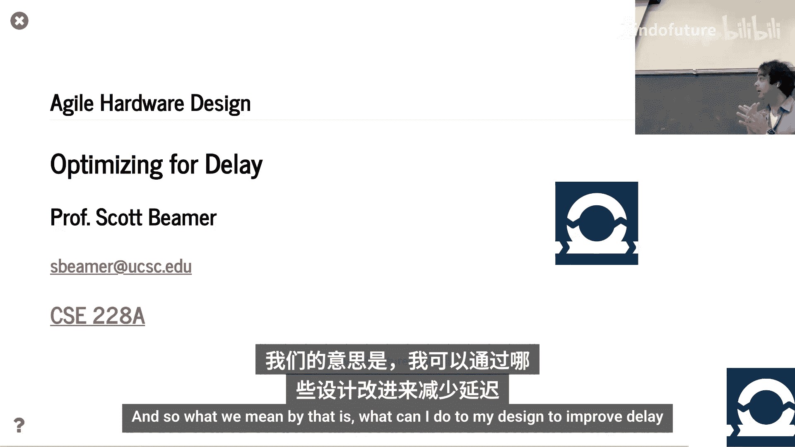

So。They cover that right for a few things。 we're gonna cover a little bit of physical details。

 understand why there's delay in hardware and what are kind of sources of that。

 And then talk about ways to reduce it。So。If actually once again are back to our suite data having a little bit of code to show。

 so let's have a little bit of code set up for later on。

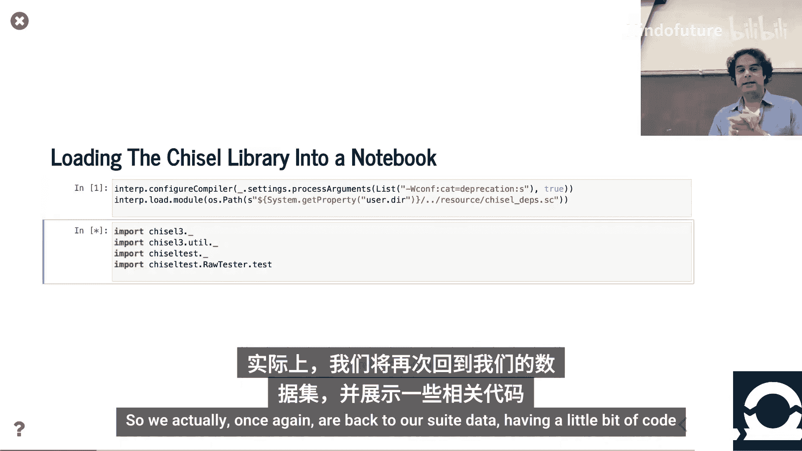

嗯。So in a combinational circuit。There are two types of delay， there's gate delay。

 which is you know delay to go through the logic gates， which of course the transistors。

And then there's the wirelay that delay takes for that same to travel between gates。

And both of these la Earth isn't significant， depending on im technology， they can vary。

 right in an AsI。The gate delay may be your primary delay and the wire delay。

 assuming your placement the ro is good may not be as painful。Versus an FPJ is completely opposite。

 And FPG。The wire delay may be easily 70 to 80% of your delay。

And so it's important to keep under control。So let's talk about what can I cause and delay for both of them。

 Right， Sogate delay， of course。These are physical things。

 it takes time for physical things to actually switch， sure。But other things that make get worse。

 right， for example， the bigger the gate is， the the the more inputs it has。

 the more complicated the function it performs。That can cause more delay。

 So the term for number of inputs is fan in。 So I hire fannon gate can' increase delay。 So。

 for example， new was a。Coder may have a reason why you want a。10 input and。

Rest assured the Cad tools will not to do with that。

 but they will not build a tenant put angate in one hop， right。

 They will bring it up into multiple two or three input an gates because they' are gonna be faster。

Combined together in one tenant put end date。嗯。You offered it wirely？You know。

 it takes time to be old to propagate。It has to go a long way that causes problems。

 Refes has to go a long way in the means of going through it themselves a kind of slow。

What else make wire worse fan out， meaning that Ra just going to one location。

 it goes to multiple locations。That basically increases the load that is in the number places you need to receive that signal and thusA requires more current to satisfy them and thus so takes more time to fill it up。

And once again， F now is also really painful of PJ。 So S PJ。

 is if you spent time optimizing for them。Youll find that yeah。

 you kind of want to have limited fan in， limited fan out， limited wire delay。

 you really got to get it。Very optimize designed to really minimize your。Your delay versus on AsIic。

Sometimes you really can just kind of do a decent job in。Modern visitorss are very， very fast。

And you know， if as long as your design is not poorly made， you know。

 you can get a decent delay if you don't have a very aggressive clock period。Okay。

 so how do we measure delay， Well， we can measure it in time， right。

 So things like nanoseconds or pico secondsconds， usually。Tker sex is more color right。

 you a gigahertz。Frequency， that means you have a one millisecond。Here， its a thus。

 the things you make up that one clock period are gonna be less than nanoconds。

 So nanoiseconds is a kind of historical term， but really， you're talking picoconds， normally， right。

On a FPJ， of course， you aret talking nanoiseconds。In fact， it a really interesting term。

 which I've spent a time in the covering people case I haven't seen it before。

 something called F04 or fan out of 4。 This is interesting。Unit for delay so。

You can think of delay as it takes， you know， similar seconds。

 say 200 pcon they get from point A to point B。😡，Or you to get at in terms of fan out of4。

And the reason why this's helpful is as technology keeps getting better and better and getting smaller and smaller from sisterors。

 they're also getting faster and faster。So at faster and faster transistors， you know。

 what is one year， a reasonable clock period is not good in next year， right， You know。

 there was a time period where in span about 10 or 20 years。

 clock periods went from 10 to MgaHtz to GahHz。 It was this kind of boom was a really def leap。

 Nowadays， clock periods improving much more slowly。

 Sur people don't appreciate the importance of this， but。

Those the time period clock periods improve dramatically。So the way to kind of capture。

How much intrinsicnity later is there's F O4。 So F O4 is designed to be somewhat technology agnostic。

 right， so。What you do is you find for your implementation analog。

 what is the delay for one inverter to drive four inverters， right， so since there's four inverters。

 that's a fan out of four。Whatever that delay is your technology。

You then divide the lane andency you have to get the number of fan out of forest that would take。

 right， so in order to get the equivalent delay in the technology would be， you know。

 some number level。 So， for example， it's see on the slide， you know。Back with the penium4， which。

 of course， you know， is more than 20 years ago， the Phan of 4 latency was 18 picoconds。

 which is pretty fast， right， That's pretty quick。 And so that entire processor， its critical path。

Was a 16。3 F of4。Delay。Which I never may not mean a lot the folks， but if you can be architect。

If your FO4， if your processor is below 20， that's a highly， highly optimized design。

Someone may be able to look up what is the fastest ever FO4 for computer processor。

 which may not be the fastest ever con frequency， but it turns the logic depth the shortest。h。

 I would be surprised if when got too far below 14， like 12 maybe possible， but like， you know。

 eight or nine， no， at that point， it's， it's rough。And so yeah， so at 16 FO4， that's a really。

 really， really short。Critical path。 understand today's processors we using again our iPhones。

 whatever or probably in the 25 ish range or Ferishh range， Re force。You just write random logic。

 you probably be in 40 or 50 FF4 range， not meaning to。And see yeah， so 16。3 F of4 is really fast。

 So you tell some talk about delays。Sometimes I' talk in terms of FO4 is the way to kind of make it more technology agnostic。

 yes。

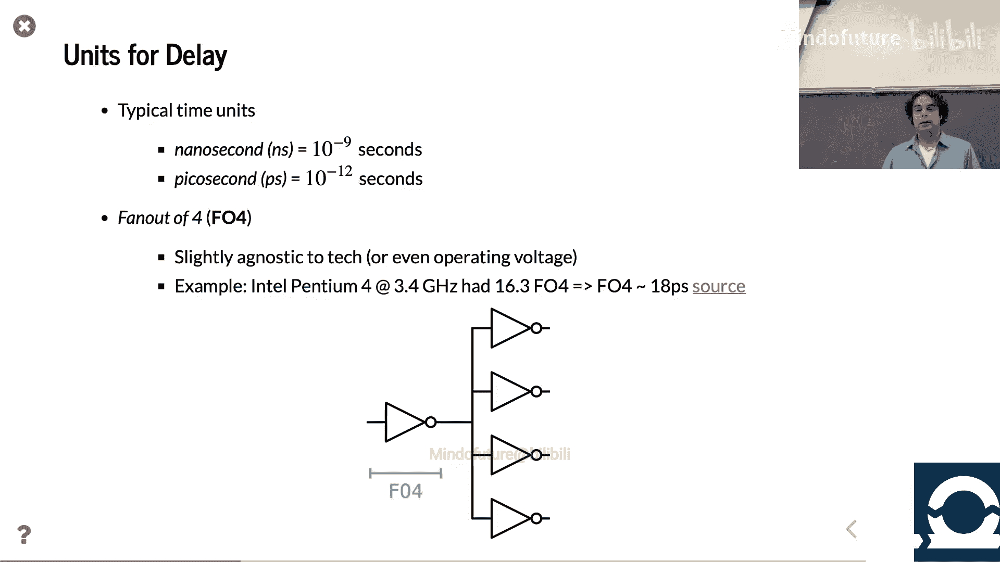

I forgot that I believe Wikipedia links to a source links to Wikipedia。

 Let's see if my helmet my link is。

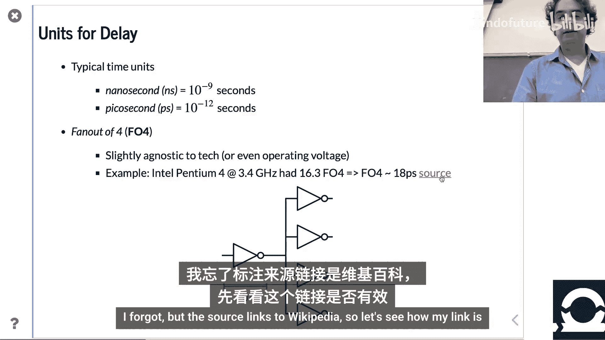

ITRS from 2003。

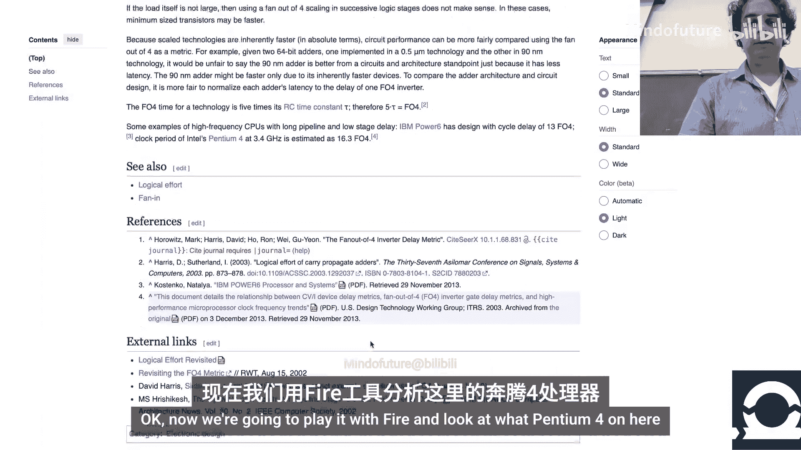

F of4。Okay， now we're gonna。Play it with fire and look at a penium 4 on here。

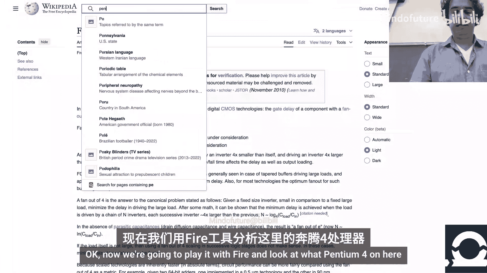

90 I saw here 90 m from the audience。 Yeah， so 9 nm。 Oh my gosh。 Yeah。 So for those counting at home。

 right， So they go from 90 to 65， that's one shrink，65 to 45。 That's two shrinks，45 to 22，3 shrinks。

😊，22 to 14。For strength。14 is kind of play for Intel's technology fill off the rail。So。You know。

 14 to 10， sure， we can do one more string， 14 to 10， that's five。

Then add 10 until change your naming。

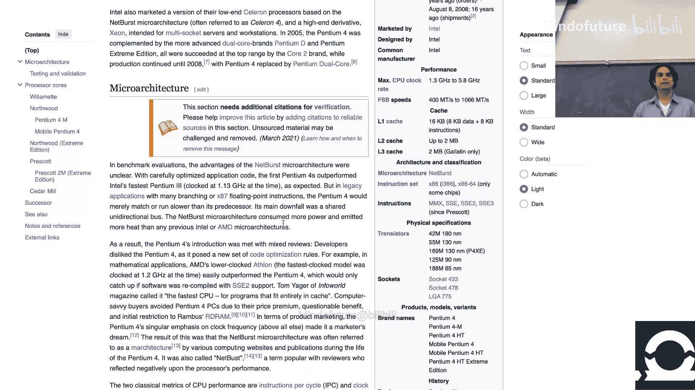

And so heaven knows。 But we're talking at least five shrinks， in other words。

I'm not talking to speed terms， terms your this terms。

 you're talking at least two the five I 3G times。More transistors。

 the reality is actually modern shifts are also bigger。

So it's even more than32 times more transistors。So yeah， interesting detail。Cool， okay。

 so that critical path I alluded to。 what is Google path。 Get ever at the same page。

 That is the longest delay path through your circuit。 So under worst case conditionss。

 the sixth longest to toggle。 And this is important because your clock needs to be longer than the longest。

 the critical path delay。 If your clock period is shorter in your critical path delay。

 That means theres a scenario which a bit can change and it won't be captured and you'll get the wrong answer。

 So whatever this delay is， it is kind of the key limiter。😊，And so people often may say， oh， yeah。

 I'm trying to shorten a quick path。It may be physically shorter。

 but more importantly needs to be left delay， right？

And so what's interesting with the critical path is that whatever your Google path delay is。

 that's gonna to limit your design， Every path that is shorter， less delay in the Google path。

 you actually kind of almost don't care about right You're like。

 you know what that's on my critical path。I don't care about it。 smart cad tools do things。

 you know what。 This is not the Google path。 I can use slower logic8 here to save power and it won't hurt me。

 for example So it's a common optimization。嗯。So if you have an opportunity to reduce your Google path。

Delay to help you in two ways。 number one， of course， short Google path。

 you can run or use your clock period， which in turn。

 let you crank up your clock frequency and go faster。Or this is an interesting one。

If you use your critical path lay。Keep the same clock frequency you can see。

You can turn down the voltage to your chip。So。As you decrease the voltage。

 your circuit is going to run slower。But it's going to take less power and you're going to save energy。

So when you reduce that voltage and you save powered that way。As a result。

 you're going to save power right so with the same performance。

 you can now take less energy as a win so either way。

 if reducing critical path is really desirable what you can do it。😡。

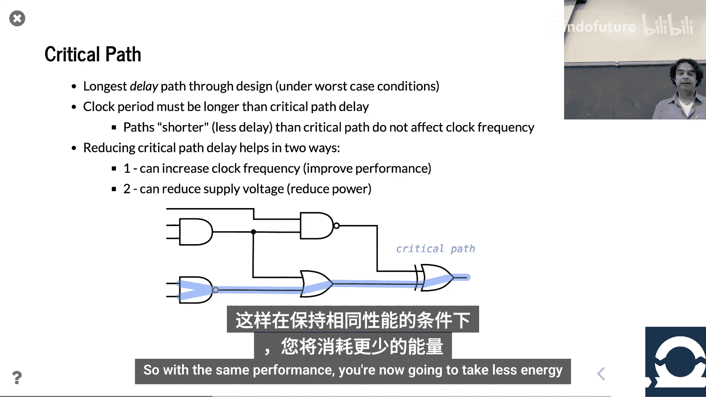

And so。The question is， how do we go about doing all that stuff？Well。

 tools perform something called static timing analysis。

 F T A to try to figure out where that path is。 So this is a oversimplified example showing。

 you know。When S looked like 40 years ago， of course。

 the modern SA tools are much more clever and have much more detailed models。

 but you can think of it as。You know， assigning a delay to each component。And then starting， okay。

 they all arrive at a certain point。And he stepped it away kind of tracking。

As signals arrive and then considering the worst case one， right， for example。

 a just na gate with one input arriving at 10 units a time， one unit arriving at three units a time。

And so we worried about the worst case so're going to think about 10。This gate takes two。

So of course， the outputs can change at latest 121 minutes later。And， of course。

 Grand Cross is why I're going to say it takes。Two union a time。

 So then it arrives over here at 14 units and once again。This changes earlier than this one。

 in the worst case， we care about this one。So you can imagine kind of doing this in a two pass algorithm。

 basically， you propagate the delays from the outputs the outputs。

 and then you trace backwards to find that pass。 So， for example。

 if we could have that on last shown， I'll draw it out my mouse。 Okay， starting from the the output。

Finding the last arriving thing。 Okay， so this inputs the problem。

To that input to then either one of here。 So Google path is through here like this， right。

 Now it's actually de slide， I guess， right。Cool， so。In fact。

 I'm also can use for a number of things。Oftentimes。

 you it for a worst cases if you try to find what this critical path to。

And herere running different times， you can run it early on in your design process and so after just under synthesis of words it' taking your design。

 turn to logic gates， but doesn't only have accurate models for wireless？

Or you can run SDA after you're doing your postpl and routing。

 you really can make sure it's gonna be more accurate， right。

 I say SM models can get a lot more precise where they can have distributions for these various latencies that can consider process variation。

 temperature， voltage， eta。

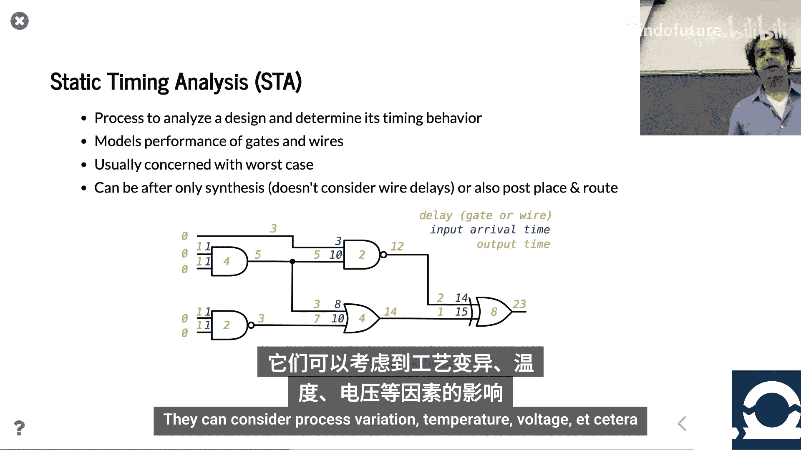

嗯。过。So let's say your SA tool has told you you have a critical path and you need to go in and fix it。

This is actually where a lot of time can be sunk if you're designed if you're not careful。So。

Getting your design function correct， you know， takes time， obviously。

 but optimizing the Google path can sync a lot of personal hours if you're not careful。

And so what happens， well basically it happens is you have a target period and if you're there。

 you're done。If you catch to target period， you have some number of paths that take too long。

 for example， look at the lay across all the paths that you design。😡。

Most paths are really short and delay is good。 This is a kind of histogram。 you're fine。

 but a handful of paths are longer than your target period。 Shoot。

 You got to go 1 by one through these paths and then figure out a way to break them up and make them shorter。

So as you start fixing all these， eventually， you're Nik keep making these paths reach the target period。

 in which case。After a lot of optimization， your distribution might look like this。

 We have a lot of paths just barely being the ti target。 and at this point。

You reach your time target， that's great。If your boss comes over and tells you now。

 I want to go 5% faster。You should give that person a understandably angry response because。

You already optimize for a certain target， and now you actually have a lot of paths at that target latency and it does moving them all down on5% be painful。

😡，And so yeah， so it's really worth。

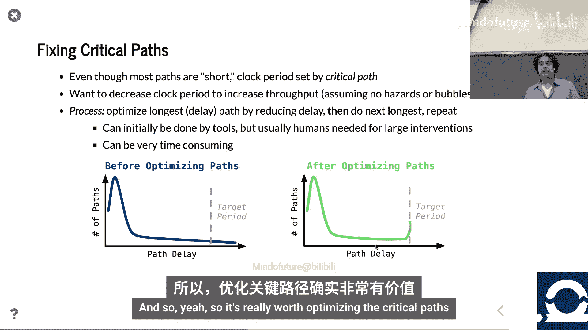

Oimizing Google path， sometimes architecturally， when you reduce these Google paths。

 you introduce pipeline hazards we talked about in architecture classes， in which case。

The periods improve， but maybe not the truthput if you're not careful。

But typically what you do is yeah， you find the longest delay path， the critical path， lookcus delay。

 figure out ways to break it up， and then keep going until you get all your pass flow at。

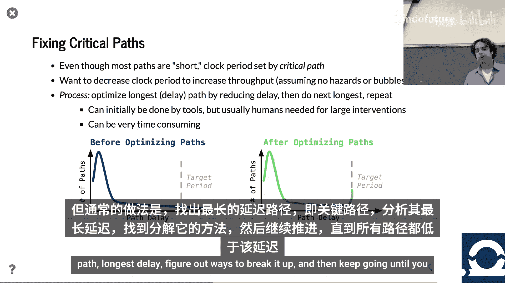

Period now the tools do this on their own。 So to some extent， before you even look at it。

 the tools has already tried to recognize， oh， you told me target period of this。

 this path is longer in a critical path delay。 I'm making too I can use a tool。

 This tool can do things like using faster logic gates。

 It can do things like resythesizing the logic and try and make it shallower。

 It can use higher power gates that are faster。 It can try to place some closer to the wire delays。

 It can do a variety of things。 But at some point， tools may tell you you know what for design you've given me。

 I can't do better。 You got to fix yourself。 gives me very time with sewing， but。Do you have a need。

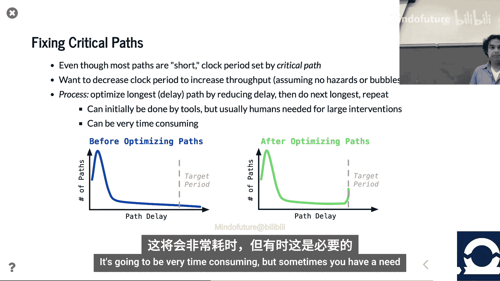

Cool so like I said， how can you fix some delay the tools can do a lot and you want tools to a lot remember one of the themes of this course is make tools do the work right and there's you know decades of work in EA to try and improve this。

😡，They can do a lot， but the key thing the tools can't do。Is change the semantics of the design。

 So if you were specified in your RTL a certain behavior。They can't change that behavior， right。

 So some people in this class are asking me all quarter about what about H L S high level synthesis。

 right， High level synthesis， as name implies， you are specifying the behavior redesign。

At a higher abstraction level， thus， in some ways， it gets the tools more leeway。

To optimize because they aren't breaking the semantics， right， In the Hl S， for example。

 you might say functionally。 Oh， yes， this component does this operation in R T L。

 youre supposed to find not just the operation， but the exact cycle level timing of the operation。

 right， And so does the tools。Or have their hands tied what they actually can do in that case， right？

So tools are everything they can， but at some point。

There's many things they can't do because I would change Y Hill semantics。

And so what can a designer do， Well， I guess what？ You could recognize those spots we' being held back by the design semantics and actually change design So that。

It's now able to fix this thing， right， Of course， major architect changes， the tools right now。

 don't do those。 Maybe in a few years， LLM is essential do that for us。 Who knows。 But for now。

 major architect changes come from humans。 And then finally。Really。

 the kind of goal is to make tools do to work so recognizing what do I need to do to enable these tools to do more so sometimes you got to change design and make the Sammanhas kind of let it do more sometimes you' got to read the tool documentation to kind of turn on more flags sometimes you got to antite parts of your code to really suggest to do certain optimization in certain places。

😡，Whatever it takes。 But I recommend this is really kind of a。Work with the tools。

 use the tool situation rather than a distrust the tools and try to develop manually because guess what you can'。

 right， for design。An 80 billion train to through a chip with a big team， even if you're a big team。

 you need to do these a lot of tools。

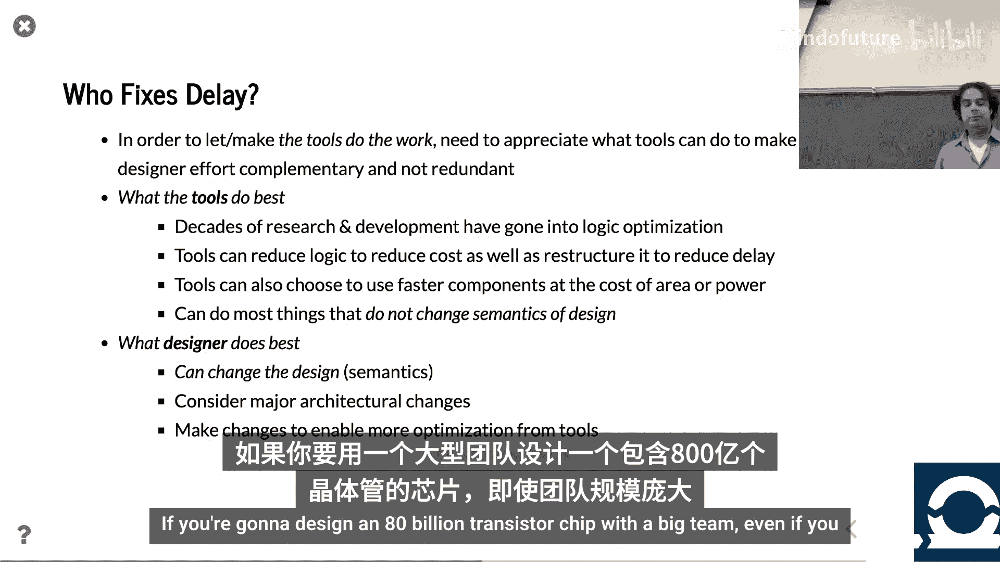

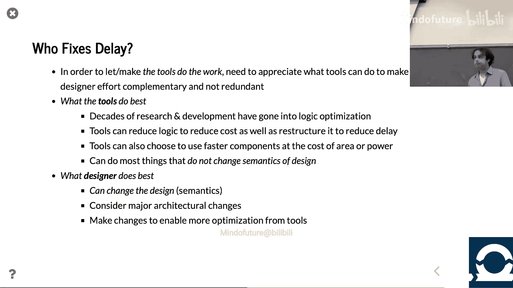

Questions。Okay， so then。The most classic way to reduce delay， of course。

 is pipeline right So given a long combinational path which change your register is right。

 the critical path is basically。The maximum time path between the register outputs and the registers inputs。

 so let's say run， static timing analysis， STA， and you found this is the critical path。

And it's a long path。 And the tools are try to optimize that you can't。 So what do you want to do。

 Well， you maybe you want to put rest through in the middle of that path。 Thus path is shorter。

 great。Easier said than done sometimes， right， Was it require。 Well， notice count original of  thin。

 there is one unit of data in this critical path。 Now that I've pipelined it。

I need to have data here and date here， so in other words， you need parallelism。Fortunately。

 most harder problems do have parallelilism。Basically。

 I would argue a lot of applications at perism and one of app parallel applications does any hint of friction of parallelism is actually trying to build a jump purpose CPU。

 So we taking arch classes probably spent。A lot of times studying pipeline， the pipelines hazards。

The nature of our essay As is very sequential in some ways。 And so thus we have limited parallelism。

 But for most realloc， you tend to have abundant parallelism， So usually pipelining。

Its very much an available technique， you have a lot of data。And thus， you can pipeline。And so yeah。

 when you're pipelining， of course， you want to balance the delay， right。

 if you have you know this long blade path here and you put 80% here and 2% here。

That's not going to be good。You rather to be closer to 50，50 to that way。

 the critical path isn't that long。And so when it comes to placing these registers as a human designer。

 usually you kind can place in places that make semantic sense。 We've kind of seen in this course。

 for example， maybe you have the couple interfaces between modules and at the boundaries。

 there' a couple interfaces you have registers， right， that makes sense。

 That's easy to kind of understand semantically。However， when it comes to time。

 that may not correspond to what's the best place for the logically， right？😡。

And mainly moving registers through your design before after certain commission onance。

 that can be very labor intensive so what can do about that。😡，What's the course forme？

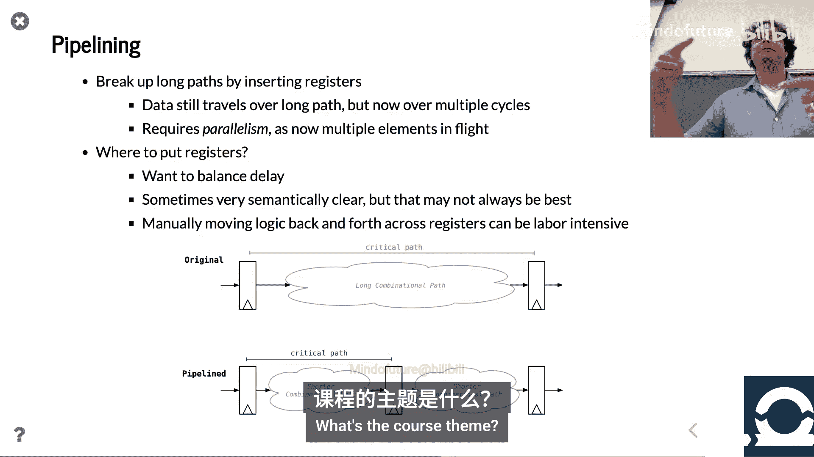

The other one。Make tools do to work right so make tools do to work is this next one so yeah figure out where studentss need to go for bouncing laneme things tricky make tools due to work right。

😡。

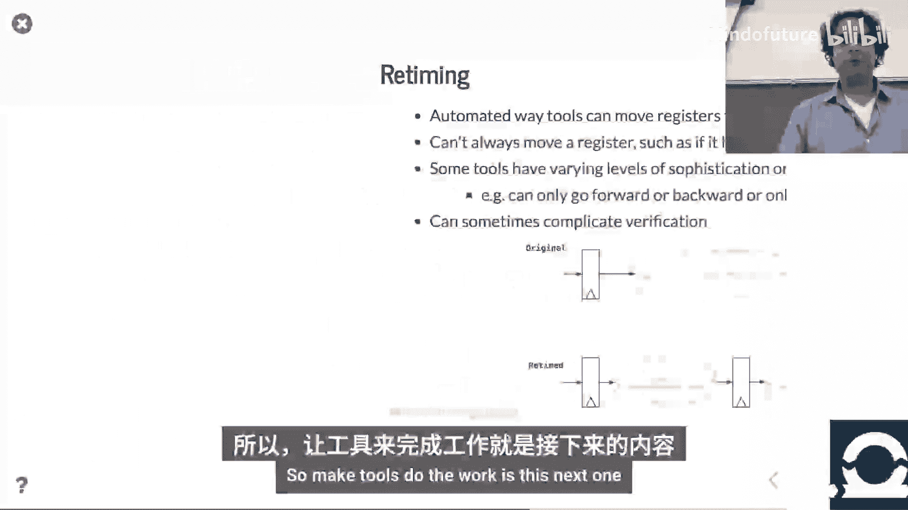

Din啊。Called re timinging or register re timinging， which will move registers forward and backwards through the combinational logic。

To try to battle these paths。So this is not a trivial transformation。

 but a lot of cat tools support it。If you've heard me talk about research。

 I complain about how finicky to Retimer is and the violence of theva tool chain is really not what robust you would like。

 but you use any competitive commercial As Cadflow tool， oh my gosh。

 they are so good at reiming and they've been at re timinging for decades。

So as long as there's enough registers。They actually can movies。

 registers backwards and forwards through the logic， right？嗯。Now。

 sometimes there situations were topologically， if it moves the register。

 it't cause certain challenges。 for example， maybe you have I say。

 like a four bit bus here and moved back too far in his path。

 What was a forward surnai to come an 8 or a1 trouble register。The tools can figure it out。

 They'll do it。 Other times， you top logical constraints where it really can't be register。

 And there's some sort of tight feedback path and moving it there as it break it up。It's best it can。

 but obviously sometimes there's constraints， right。

Some toolflows are certificate we only move registers forward or backward， but not both ways。

 and so as a designer， you kind of need to put these exit registers。On never side it ass。

 you put everys to the front or the back， and it's going to move them the other way。

Another interesting challenge with re timinging。Is。

It's a minute that go I told you one of the challenges for CAD tools is when you。

Change the observable semantics of your design。 That's gonna make it， you know， you know。

 you're breaking the contract。 guesss what。 You mean， register is around。

 You are breaking the contract， right， Someone wonder what R TL。

 R TL course stands for register transfer language。

Saying this register around the cycle has this value。You move virtuals around the logic。

The meaning of the register is going to change。 So you actually are bringing a semantics。

 So R T L res timing actually is a。RtL semantics breaking transformation。

 but we tolerate it because it's so damn helpful， but also。

But now someone come to verification right now verification。

Maybe verification is based on the values the registers and now the registers have different values because you moves around design。

So what do you do， that's something that's been kind of cutting at your last 10 plus years is， okay。

 you do register re timingiming now the register semantics have been changed if you change where it is in a design。

You can use things called logical equivalent， checking or lack。

To figure out how to transform the values in the registers and be verifying to make sure it matches what it should have been。

 So in other words。You move registered to the round， you change what these registers represent。

 but there is a logical transformation to get from what you have to what it should be and you can still kind of do verification with it。

😡，嗯。Re timinging is really， really important。 it， And so as a designer。

 our goal is to kind of enable reting to happen。 And guess what is， is easy as just。

Placing extra your registers and making sure your CA supports reting tools。

 move them forward or backwards to paying what the tools require。Questions， comments， yes。啊，是的。对呀。

Yeah， the question about the verification and elect， logical cl check is that automated It can be。

 So a logical clven check or elect is a key part of a lot of verification flows because basically what you want to do is you're gonna to somehow out a transform design in some way and you want to convince yourself that it's still the same design。

And so。Yeah， with alect， can you put in design A， modify that design a prime。

 and you compare it to two and you can yourself they're still equivalent。Oh for sure， yes。

 the question is web re timingiming？Perhaps make this a little tricky for designers to I what's going on definitely。

 So the good news is， as a designer， right。😊，If you're going for functional correctness。

 you can do that before re timinging is applied right， You can just get design functionally correct。

 Retiiming is part of the physical design process where you are trying to minimize the critical path with the health of tools。

 And hopefully at that point， you are not chasing functional bugs。 guesss what。In the real world。

 even though you're not supposed to be chasing functional bugs， they may occur， right。

 The tools may have a bug。 you have a bug that slips through。 And then what do you do。

 Then you got lean heavily on your like tools to try to figure out。

How you're going to verify and above this？Yeah， if you can。

 you'd rather debug on the unretimed circuit。Get that function correct。

 And then the re time is a way to get high performance。 when we actually make it the physical。Co。

So let's say I want to re timingiming and Pizzbble， what do I do？Like I said。

 it's as simple as putting the registers on and having a catch all supports it。

 And the commercial basic tools。OrF reiming。Some of the open source CaD tools are okay。

 getting better at it， and really I'm going to give my market shame to Z Savado for being poor every timing。

So in the best case what you supposed to do we just got to put on extra registers and then let it move them around through design and in the spirit of a generator。

 this is easy to parameterize right you can imagine Ive seen this example as some sort of pipeline module。

😡，I have the pipeline depth， as a parameter。I write the functionality for the module combinationally。

 however it need to be done。 So that's very easy for me to designer write write functional。 you know。

 take this thing， do aesthetic operation to it， do a mod， do an ad， whatever you need to do is shift。

 multiply is expensive。I can go that stuff。It's very easy to write like that。

 Are you not wearing roads， right Just writing logic as you'd like to write the logic。And then。

At the end， you put this pipe in there。Ppe is going to give you that that we had earlier in a quarter。

 Some earlier in a quarter， we showed like， oh， we want to end registers in sequence。 you know。

 we can call that ship register or delay line。It's actually shows the standard library as a pipe。

 So it's just gonna be pipeline depth and the registers one thing into next。 It's not a 5。

 wrote a 50 before was very smart about， you know， has a couple of interfaces。

 maybe have that flow parameter to kind of bypass。 You you have to pipe on up。

 The pipe is really simple。 the pipe It's just and registers in sequence。 It always goes through it。

 There's no stalling。 There's none of that stuff there。 It's just registers in sequence。

But the design is easy， right， you just write the commercial logic。

You can even test the commission logic and then later on you can check on this pipe here。

 now you have pipeline depth registers following your design。

And then the CAD tools can go in and do degree timinging。嗯。

Now this is for a design where the tool does backwards reing。

 maybe working on a tool that does forward retime， which case you put the extra registers at the front of the sign on the inputs and spread any outputs。

 but you can do that。Cool， questions。

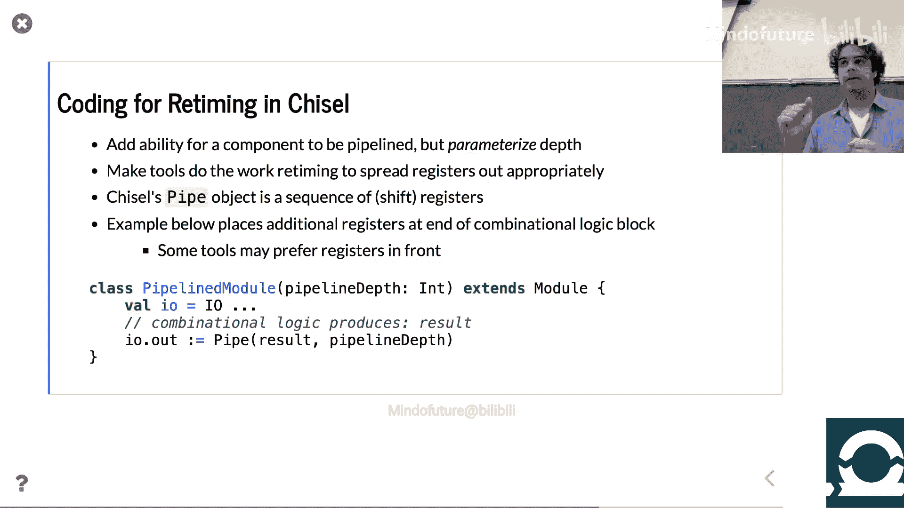

Okay， so。Step one is usually to kind of avoid these horrible coa paths， usually pipeline solution。

 retiming works great for the catchules， making tools that work。

 but that require us registers to be there So the human designer。

 a lot of what you need to do is kind of trying to figure out where might you need more pipe landinging and actually put rests in or at least close so that we can betimed or where we need to be。

The other way can improve delay。It's recognized you actually just have a logic depth that's。

I it's very right sometimes。There's a lot logic depth。

 You can fine the logic to actually make it more balanced， right， And so， like I said。

 the tools are really good doing this on their own。

And then when they can't do this it's because you inadvertently usually。

Specify things in the way the constraints have no need to do。😡。

And so what are some examples of things you might be doing that might not be very？😡，Good。

 for example， all quarter I've shown you example of these things like recursion， for loops。

 even for fold left。Or build these generators lineararily， right， And guess what linear。

Works until it doesn't work， right at some point。Maybe。That delays me too big， we should do a treat。

 we'll show down in a minute。So nothing can put a pipeing in there， as always， when optimizing。

Before going off and doing all these things。You need to make sure this is the critical path， right。

 you may have code that that's a linear instruction of something。But guess what。

 It's not the critical path， Don't worry about it， right。

 It's the only the critical path that you to fix it。Other times， something might look bad to you。

And you think， oh， yeah， This' gotta be it。 This is gotta be it。 But guess what。

 It may not be a cripple path， right， And the tools may figured out。 I shared anecdote before of how。

 you know， in Chisel， use a Vec in the very log， at least the old version， Chi。

 the new version with chisel 7 and。F tool does better with the symbolic output。 But the older ones。

 you're gonna see like a 500 element V is going lead to 500 mugxes， right， Li checking。

 iss this element 0。 Is this element 1。 Is this element 2， Is this element 3， If it is。

 it gives you the element otherwise it passes down this mugs。

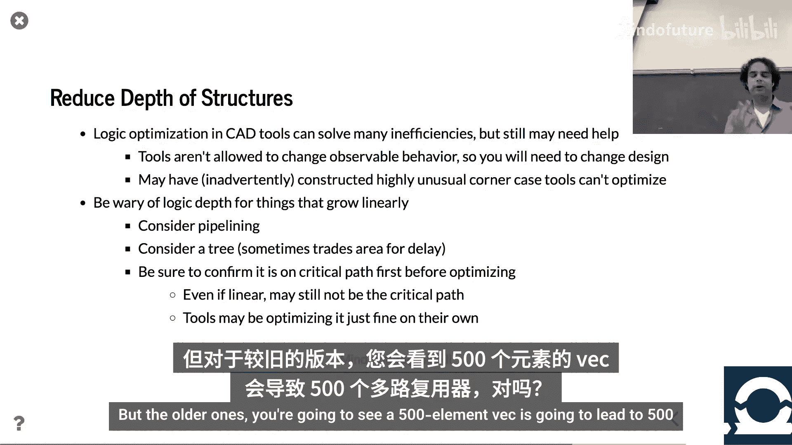

That sounds really bad， that looks really bad。Every cat I've seen in my career so far。

As Pol stood that bent and did the right thing。It's turned that you know 5002 to1 mues into the appropriate deeper mues and some sort of tree and so the cat doesn't figure it out and so maybe handling it just fine so really make sure before you dive into optimizing stuff too heavily to make sure it's needed。

Cool。

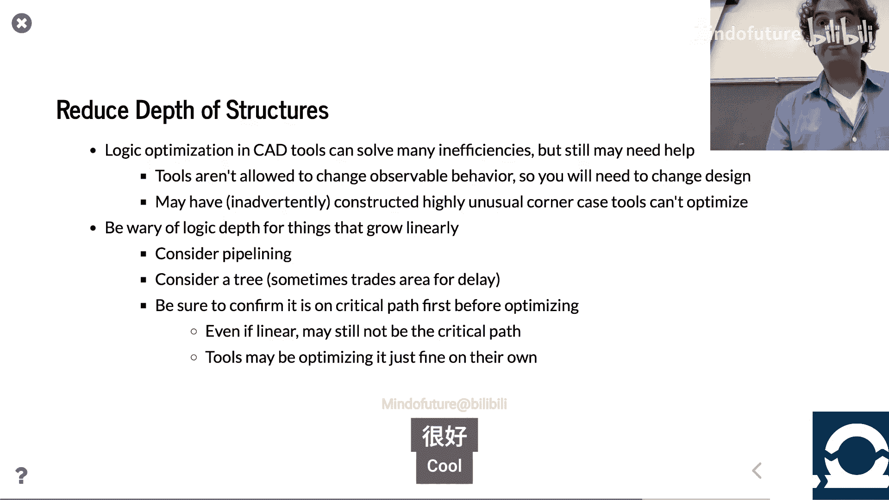

So the thing we're just talking about， let's say you're trying to add up n numbers。

Using some of the reduces techniques retro we talking about earlier， you might， you know。

 just keep calling reduce n minus-1 times。 I guess what。

 you have n minus-1 adds in a linear sequence。 That's a really deep depth。

 That's the delay of one adder times n minus1 times right， a lot of logic depth。

You put them into a tree where you kind of， you know fanning in better。嗯。

Instead of being linear depth， it's s logarmic depth， right that that's going to be good。

s the number of add， it's just going to be rearranged to be more efficient in terms of delay。

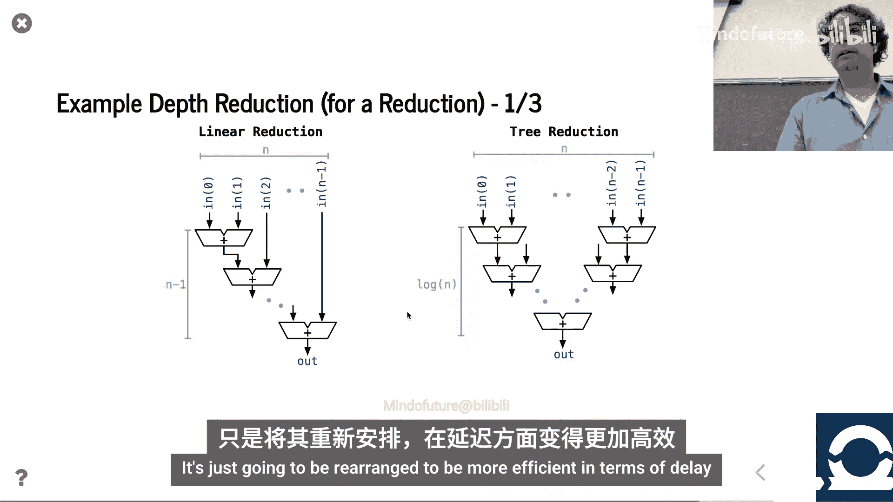

Cool， how might I code that， let's see an example。So， let's say we're this one called pop count。

 so pop count is。Counting number of ones in a multi bit signal。 So in this case。

 rather having a Uent or a V for simplicity and using。A seek of bulls。 Some of Si is a sc collection。

 bull is a chisel1 bit type。So I want to， you know， given this， I want to return to Uent。

 which is how many those bits are currently one。 So this is definitely hardware that， you know。

 is going to change based on the value of the input is's given。So how might I do this well。

 if you're doing this recurively， here's one way of doing it。I could say， hey。

 if you give me an anti collection， well， there's zero one there because there's no， it could be one。

Otherwise， take the first element。Which is going to be a single bit quantity。01， and then add that。

On to the remainder of this collection。 So that's the dot tail。 So when you have a Se and scala。

 dot head is one element and dot tail is n-1 elements。 Right， Okay， so you see how recursion。

Sos through one by one and put together n minus1 adders， right， So if I go back a slide。

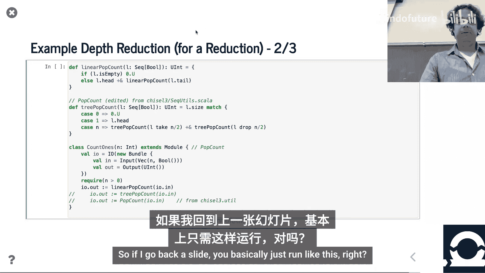

You basically something like this， right？Okay。

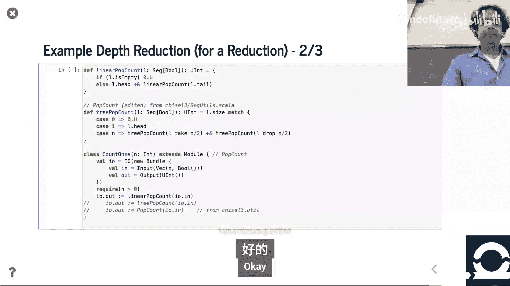

How is that that work， So let's say actually take this function。

 Chuck it into my module and actually run it and then。

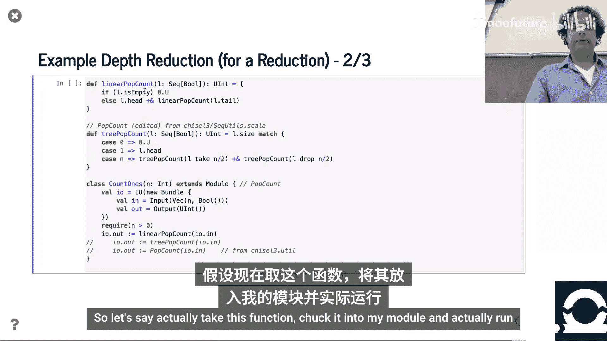

Print the v。Yeah， you can see it it's not pretty。But basically。You know。

 it is doing the ads each level。A lot of the。Cutter。

 are you seeing here iss incnating on zeros and that kind of does this growing addition。

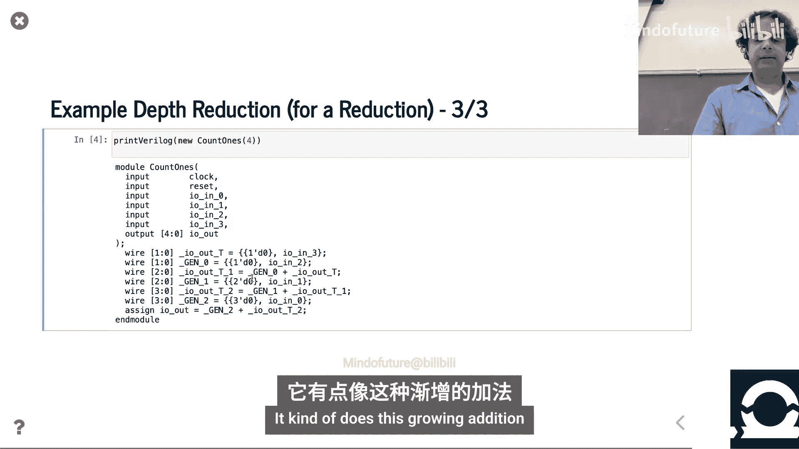

Um， but it does it， okay？

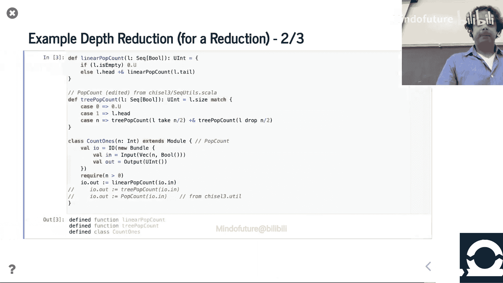

What if we tried to do it treetyle？And you can see here。

 I'm kind of giving away the fact this is copied from the Chile standard Library。 Well。

 the tree style， which you're gonna to do is okay， given 0 elements， obviously， that's gonna be 0。

 given one element。 Sure， I have to you know， return that one element。

But now if I have more than an element， I can speak in half， right。Left half。Right half and recur。

 right？is divide and conquer。 And yeah， this is using that。Scholar syntax would take。

We'll take N-2 elements the first N minus2 elements and drop the second half of them。 And meanwhile。

 drop drops the first N minus-2 and keeps the second。 So with take plus drop。

 you get all the elements covered。You kind of split in half。 And， yes， you know。

 I like the Bill scholara to have the space and no pres， but this is。Equivalent to doing。This。

 of course。Which is in the more modern air recommended style。

 but I thought this stuff was kind of very elegant。And let's actually turn that on in the code。

And yeah， you can see now。We just add the bits up so this looks a lot more intuitive the output is not isn garly。

嗯。😊，The other one， the tools maybe optimize on their own， but。

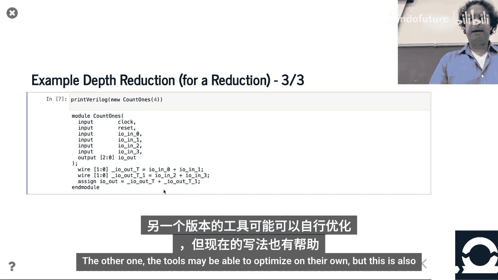

This is倒是 help。And then of course， we may wonder， well， gee。

 what does the library do I already told you？It's tree based and you're going to get the same code。

Cool， questions。So that taps that。 So let's talk about what we talk about this week。

 right we talked about。Getting ourselves aware of what it means optimize physical design。

 when that talks about our level， I kind of focused a lot on the first lecture on memory memory is a really expensive very important item。

We then went on details on what was was project management and what it means to run a projects。

 and today we talked about delay。Before we close， I remind folks that on Monday。

 your project proposals are due。And they'll be using lectures time slots next week on Tuesday and Thursday at project group meetings。

😡，So basically the way it works if I get the。on Monday and my job Monday night is to read through room and prepare feedback for Tuesday and Thursday。

 and I'm also going to send out what they have the project sent to me。

The schedule for which groups are on which day。 So that way you know she come in。

 So you need to come in on the date that your project proposals discussed。

 You are invited to come to both date。 And I recommend sticking around for other groups。

 especially on the same day as you， because you can learn a lot Be hearing this conversation I'll suggestinging certain things。

 You say， oh wait， I have a some concern。 You can kind of hear that feedback and kind of gain from that feedback。

It's been a handful of undergrads who were taking the conflicted course。But the capstone。

 make sure to either message me or mention that in proposal that a schedule in the correct data to avoid the conflict。

Any questions， yeah？Oh good question so what about other assignments so yeah。

 we are shifting gears folks so we have homework five due tomorrow。

There will be both a homework 6 and lab 6。 However， they are not going to be what you think they are。

 So we're kind of moving in the project direction。So the project proposal is your next thing after homework 5。

 and that's do on Monday。After that， therell be a homework six。It's not a massive coding assignments。

's actually the deco coder view assignment。 we're talking about。

 and we to kind of get experience in encode coder review。Really starting after homework5。

 the majority of works for this class would be all projects related in a few weeks。

 we are going to have a lab s， which is based on chisel full verification。At that point。

 you are to be in the middle of your project， But it'll become of fun aside。

 we're doing it later this term， because that's when we had the good fortune to have a good guest speaker coming and talk about the Chisla Form。

 The person who created it。 So we have a few guest lectures coming up。 They're all gonna be great。

 We have other languages being discussed。 We have chisla formal。

 I'll be optpt more about that in this lectures we helpful people to come and ask exciting questions that are happening live。

😊，Cool。Other questions。That sounds good， okay。

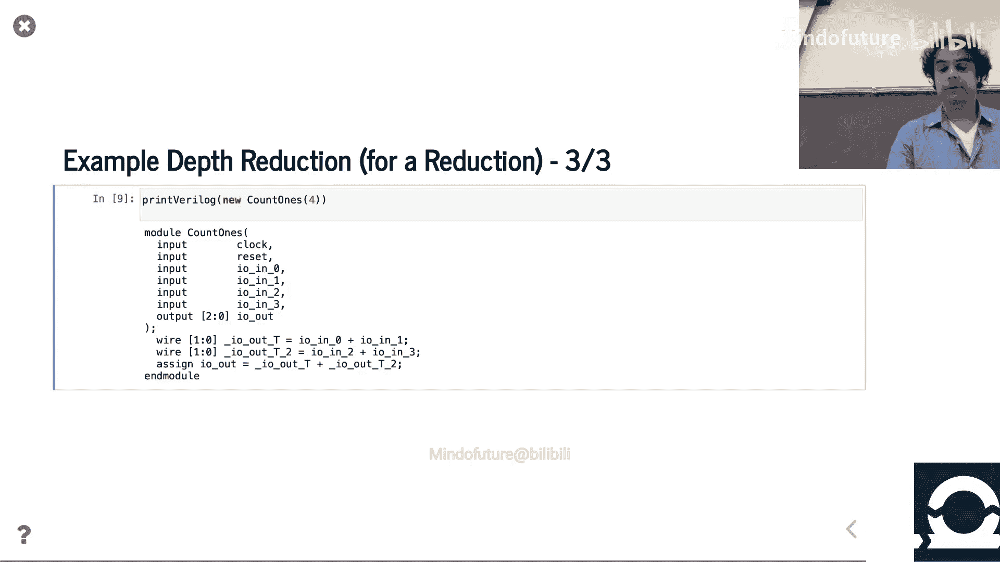