# 【加州大学】敏捷硬件设计-CSE228A-｜-Agile-Hardware-Design-Spring-2025-p28-P06_第19讲-功耗与设计空间探索_第1部分共2节--BV1M6ivBzESw_p28-

Lone， welcome to Le 19， part one。😡，We're breaking up things in class。

 We've been having our project discussion meetings。

 but we're still covering details about lecture content。 And for example。

 this is very timely talking about projects。The second half this lecture is actually about the design space exploration。

 Was you have your parameterized generator， How are you going to go about encouraging users to set those parameters appropriately。

 It's a reasonable thing to think about。 And， of course， power， which obviously is that， you know。

 third part of Ppa。 So on this part 1， we're going try and cover power。

 And then how much time we have make sense for design space exploration， so。

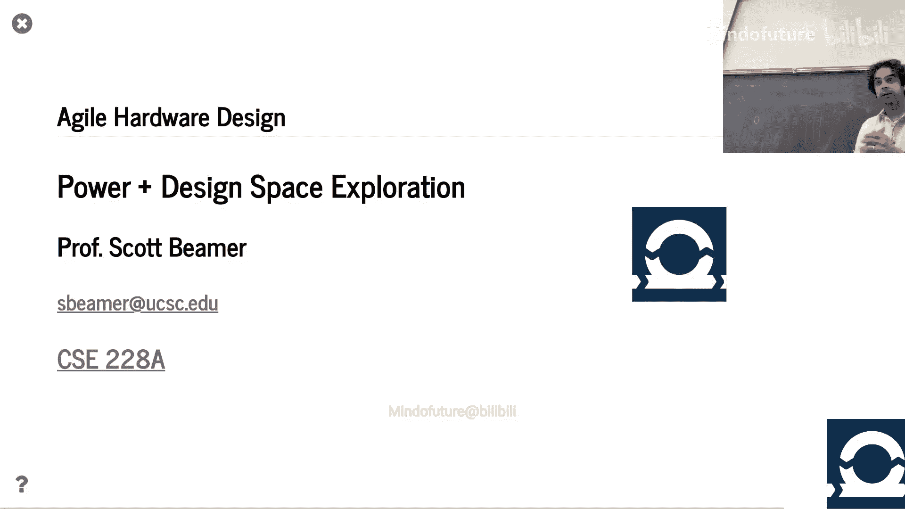

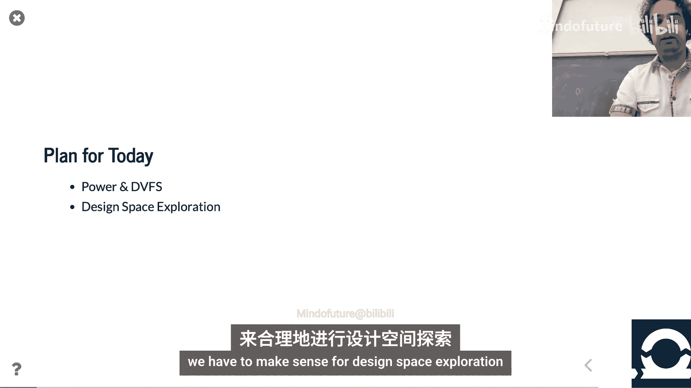

When it comes down to it， power is maybe the most important metric for any chip designers。

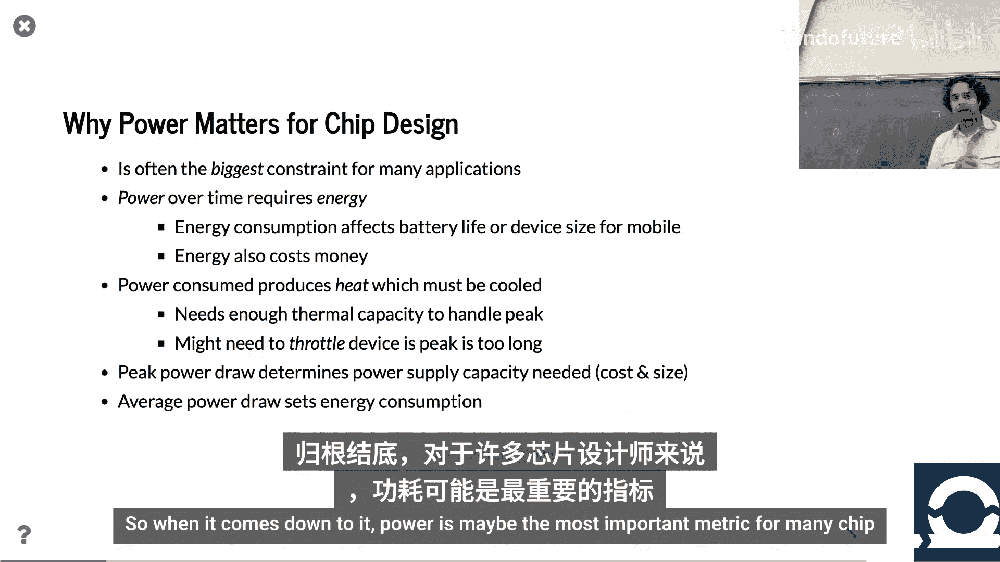

Is the limiting factor for most the， right？You know you can imagine for mobile of course。

 the more energy vision your chip is， the longer battery life can be and you want to do more and the reason why you can't do more is not because enough hardware to do is because you're going to run out of juice you're run out of power in a data center。

 of course， power are extremely important have you seen some the news about' some of the newest data centers。

😡，Not only you're talking about building nuclear reactors just for the data center。

 the numbers are astronomical right so power is the biggest concern。So。

I already said both power and energy。 Let's remind ourselves what distinction between those things is。

 right， So power is the rate of exp energy expenditure， Right In other words。

 power over time is energy or is derivative of energy is power， right。

So depending what you care about， you care about re more so energy and power。 So for example。

 things like battery life。It's more about energy， right。

 you know how much energy consuming over a period of time。Now。You can do things like， say， oh， well。

 I want to run for X hours at this average power。 Well those two things combined together will tell you how much energy you need。

 right？ And so， yeah， energy， of course， matters。 Energy is way to pay for。At， at the utility。

 it's also what you pay when you think about battery sizing and how long your battery life is。

 But power also has concerns， like said it is。Power takes generate heat when you spend that。

 And so you can make handsets are too hot。 you can have data and earth are too hot。

And deliver power requires a lot of infrastructure to supply that power at a certain voltage and certain characteristics。

 and so。That infrastructure has a cost if you can make your design have a lower peak power。

That actually makes the infrastructure cheaper。嗯。And so that's important， not just for heat reasons。

 but also just powered liver reasons， right？You may or now experience the smartphone that gets too hot in your hand。

 usually these phone designers prevent that and so let your phone run really fast for a little bit of time and it starts to heat up then it slows it down so it throttles it to a common technique。

Additionally to as a hardware designer， of course， think about things like like peak power draw。

 deter， you know， the power supply is set， that's cost and size of your device。

And the average power as the kind of your your average energy assumptions。

 These are very broad basic things。 I always include these in the course。

 make sure you're all on the same page。Questions so far。Okay。

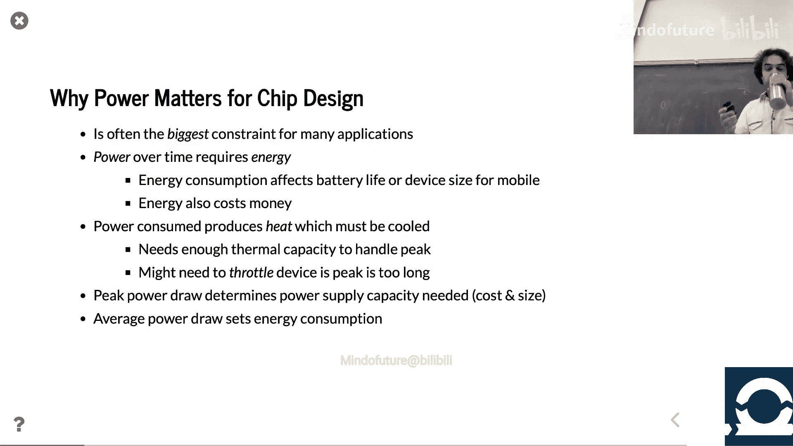

So。嗯。What can I do as a hardware designer to impact my power consumption right that it's the person's job。

 no， you actually can get involved。So to first order， as far as an approximate sign。

Dynamic power P of your design is proportional to this product of four things。Also。

 the activity factor。That is what fraction of design is toggling。😡，The capacitance。

 the voltage and the frequency， Right， In other words， think about it。 forgetget about， you know。

 logic operations。 really， what your hardware design is doing is。

It is charging and discharging capacitors， right， That's what it's doing as the power goes。

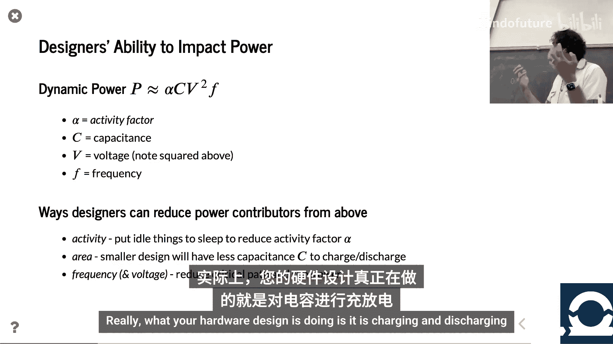

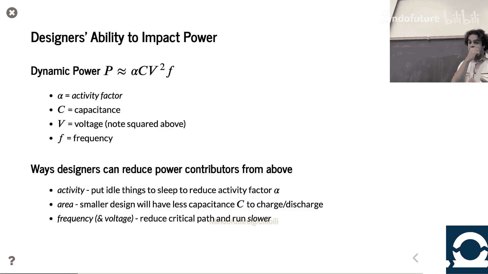

And so you can imagine， yes， if I have more capacitance， Ie a bigger design。😡。

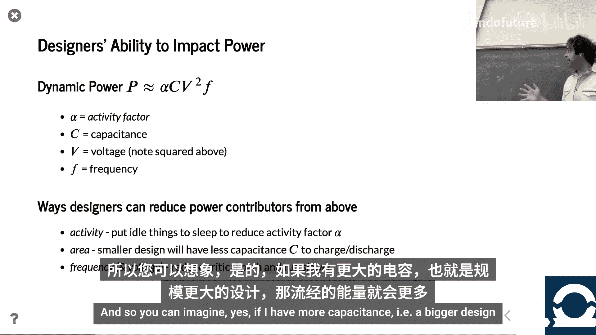

Definitely more energy flowung around， right？If I do it at a higher voltage。

That's also going to take more power。 You know， this's how the voltage is squared。

 So we here book talking about， can I figure out ways use the voltage in my design。 If you can。

 you can really reduce the power consumption because of voltage square。

 So it's a really big bang buck in that one。The activity factor。

 that's something we actually control a lot as a designer。 right。

 That's what fraction of design is toggling right， if your design is clever。

It doesn't toggle every piece of design， every cycle， right， Some parts are inactive。

 you put to sleep， you do whatever you need to do。 So you shrink down the activity factor。

Well finally， it's a frequency what cloth frequency you're running at， right。

 If you don't need to go super fast， you can run out of slower frequency。

Sure a say is energy right if you need to go fast and you do more things per second。

 of course it's going to increase your power consumption too and so。😡，There's a lot of knobs here。

 right？And they kind of scale differently over time， you know， in general， people make。

Bigger designs in terms of transistor count。Normally， life is good of Moore's law and stuff。

Even though the transferter count increases， transfers get smaller， their capacness reduces。

 so your average， your net to pathogens might be similar。You know， my， you know， emphasis。

Your voltage might slightly go down over time， but as an architect。

 you're trying really hard to reduce activity factor to save energy。

but lot of things hold true in the modern era， sometimes in the modern designs。

Capacsitance isn't shrinking that much， et cetera。Like I said， so what can you do activity。

 put things sleep？Make design smaller， more efficient， obviouslys take less energy， great。And yeah。

 of course， being very deliberate about your critical paths and your frequency and voltage helps to adjust those other parts too。

Cool， questions。

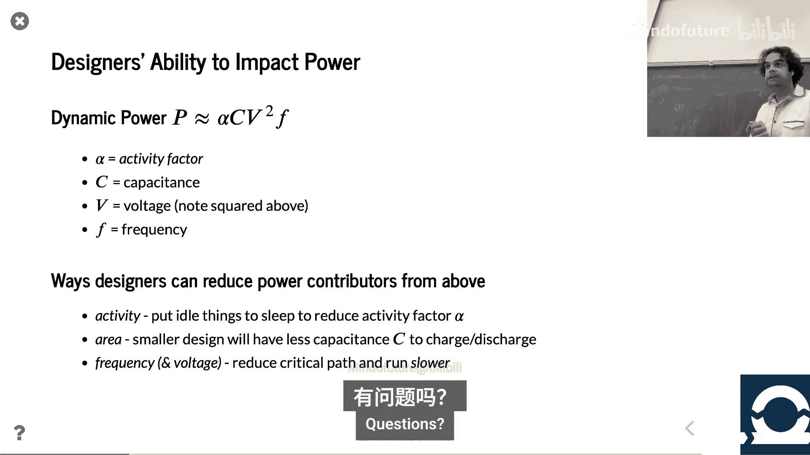

O。嗯。So when it comes to turning things off， what can you do？

There's two kinds of ways of turning things off。 The big one is literally turning them off fully。

 It's called powergating。 where're say， you know what， this entire modules entire component。

 I know I'm not going to need it。Turn it off at the voltage power supply level， right。

 So you really turn this thing off。Saavs a lot of power。 That's great。

But the course it cost is it takes time to turn it back on right when you say。

 you know what I want this piece again。It takes time to re initialitialize it。

 And so the pengulet piece you're talking about powergating me or may not make sense， right。

You'd be surprised how some architects and designers are very clever。 So even in your smartphone。

 for example， because of things like the protocols for your data transition and the cell radios。

 it knows what times you're supposed to be sending what times you're not supposed to be sending。

 So in those idle times it knows going be idle。 You can actually powergate part of that circuitry because it knows it's not going to used。

 And that case， because it's very predictable in those， okay。

 Im to send on this time and receiving this time then not doing anything in between。

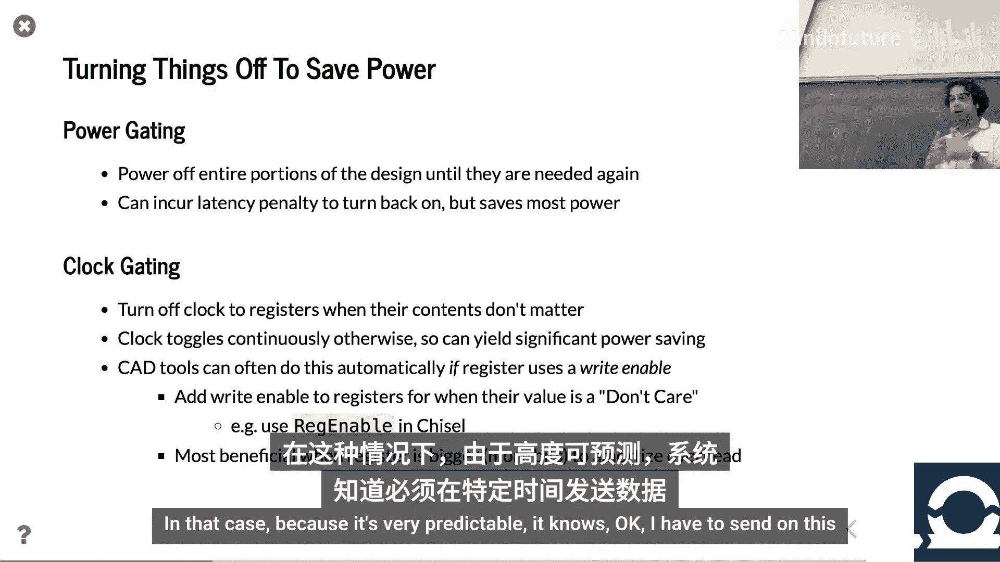

They can put the sleep safelyly knowing when they have time to wake it up。嗯。Additionally。

 there is something called clockcaating， which is much more fine grained and that is recognizing that。

So on your components of your system。You expend power toggling them when you change values on wires and logics and such registers。

 however。If those signals don't change。They won't。Expend additional dynamic power， right。

 They may have leakage power， static power， but the dynamic power will't be that that。 However。

 there's one thing on your design。That's always freaking flipping。 and flip twice per second。

 freaking slot， right？Talking all the time。And so。As a result， actually cutting off the clock。

Can be a really good power saver。 So it's called clock gating。

 And that is basically you have components specifically components to receive the clock。

 which usually are things like registers。And you cut off the connection to the clock temporarily。

saveve power。 So you maybe have a clock tunnel coming in feeding's say 16 registers。 You know。

 you're not going to use his registers to turn the clock off higher up。

 and that 16 end points should not being lit up。 right realize it adds up right If you have like a 64 register。

That 64 endpoints returning off，64 times 16。 That could be， you know。

 basically 1000s returning returning off， so。You can save a lot of power。

What's interesting about the clock aiding is that modern CAD tools do to really freaking will。

And so they can go in and do this and always what I mention in today's lecture is there's a little less helping to give them as a designer so you might think when you're writing chisel if you use Regdge versus Reg and Abel so Regdge of course the register Reg and Abel。

😊，Allows you to have an explicit enable signaling register， right。

 So you think the one to rush enable would be more hardware。 In some ways。

 it is a little more hardware has a na signal。 But because you have。

the enable that makes it easier to do clockcing right because basically clockading is you need both to tell the CAD tools。

For this time period， I don't care what。The value of this register is。

 and that allows it to do clock you can turn it register off。Mearn make that possible。嗯。

You need to have a rest a right enable， and you need to mark the value during certain time periods。

 don't care if you do those things。The casualules autorap can go in there and do clock aing and does really great things。

The bigger register to more of these this helps since this sounds really subtle， but。

If you're priorizing your design， the stuff really helps。Cool。Questions。Yes。

There's a way to write that in chisel， so it's not the same as the X and very log because the X and very log great question。

 so questionual was， how do you indicate don't care in chisel？嗯。The X and ver log is kind of。

Annoying because it both indicates as a designer， I don't care what the value of something is。

 as well as in hardware due to nature simulation。Somehow there's a value I can't determine， right。

 instead that that don't care propagation somehow like， you know。

Those two different concepts are map the same construct， right。

 And so Chisel has worked really hard to eliminate。Both。

 but really they care more about eliminating thes simulation， don't care。

So the simulation no character doesn't really exist in chisel， like all values are initialized。

 there's no notion of undefined in simulation they' random initialized。嗯。

Theologic behavior don't care， it's allowed tools to optimize。

 does exist under constraintsstrain circumstances， this is one of them。Here I'm using， you know。

 saying you use rein Na technically， if you have a regular red and you have one statement。

 you can get the same behavior， right？U。不。Good questions。

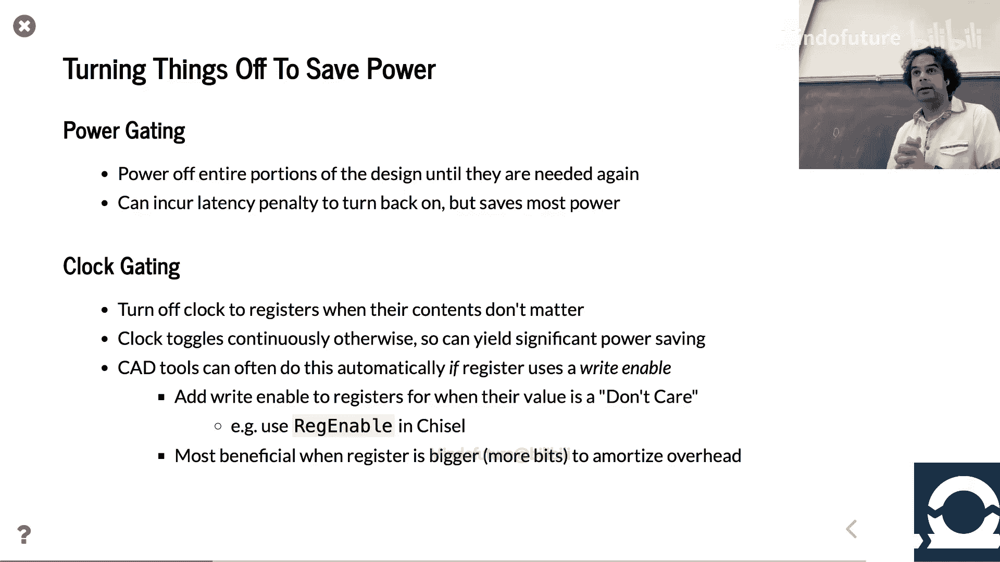

Okay。So when it comes to as an architect managing the power， use some choices。Right。

 so let's say you know what you need to do， like I want to play this video on my phone at 60 frames per second。

So you know， okay， I need to。Decode a frame of video。

Get that information into the frame buffer to go into the display。

And I know I need to do know a frame every 15 millisecon I whenever it is for frame rate， so I have。

 you know a task and a timeline that needs to occur。Now。

 if you're trying to do out the most energy efficient way in order to maximize battery life。

 there's multiple strategies。And depending on your situation。

 a different strategy may up may be most effective。 So one strategy is called Raa Hall， which is。

 you know what， I know I have a task needs to be done。I'm going to do it as fast as I can。

 so I'm like crank up the power， you know， go in a boost， go in a turbo， go fast。

And whose task is done， Put the whole thing to sleep， turn everything off。

And then get woke up in next time for next deadline。 next frame。 Right， So that way， you know。

 you're maximizing the time you're off。Yes。あれよ。A little bit like driving on a hill will be a better analogy。

Yeah actually， better analog might be if you're in traffic， if you're driving and。

You've all been topic about traffic， you know。Cars get close。 Cars get farther apart。

 And you feel like you're kind of constantly starting We starting to see a choice， right。

 You can basically。Try to closely follow the person in front of you。 And， you know， when they stop。

 you stop。 And when they go， you go right away and then you stop right away。 or you do。

 you know what， I'm some mellow out。 And it's like， try to go to same speed all the time。

 So is kind of that trade off， right so。Which one's more energy efficient is actually going to depend right。

 So race to haul as he goes fast too can and the benefit is the fact that you turned off right That's where the energy savings even though you're bringing more power here。

 you turned off here and that's where the win is。Crawl to deadlines。 You know what。

 I'm going to go just as fast I need to go to get there。And。That can help。

 And so you can kind of see how this trade off boils down to is this notion of what your dynamic power versus your static power。

That's going to tell you the difference， right？Usually in hard designs， the first order。

 you can say static power is constant issue when it's on。

It's the static power of that you pay whenever you're on。

Regardless of how much dynamic power you're burning， right in other words。By turning fully off。

 you get to save the static power。Now， the price of going fast isn't just you go shorter。

You burn that power， right， And like I said， you increase the voltage， you increase the frequency。

 you crank it。嗯。😊，That's to require more power。 of course， the question is。Which one's less energy。

 right？ And you're kind of comparing the extradynamic energy you paid to go faster。

Cause the theory by going slower， are you going to burn not just lower absolute power。

 maybe less energy and dynamic power because， you know， lower voltage。

PV squared F right in the V squared load of voltage you get a real benefit。So yeah。

 so the question is， is this additional dynamic power。

 energy dynamic energy greater or less than the amount of static energy I saved by turning off。

 right， So it's going to depend。 So both strategies are commonly used in different systems。😊。

So you have these kinds two different approaches。

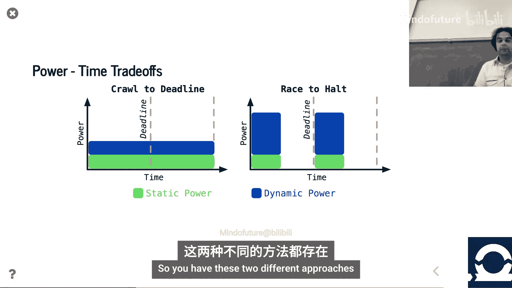

Cool。嗯所以啊。Going slow， the same energy in addition of the race to harbor call a deadline。

It's something you kind of want to think about a lot， right。

 So thinking about just what needs to happen and taking advantage of that， right， And so。As always。

 try a start perfect circuit before we' optimizeizing performance right And then as a designer。

 you kind of， you know， especially working your process design team。

 you're going to figure out how do I set a voltage frequency and the kind of。

Efficly meet that target right so the crawl deadline is why we're doing that。And like I said。

 you reduce the voltage。It makes the circuit slower， but also saves power。 right。

 Remember V squared in that term， right， That's what youre trying to get。 And so。You know。

For much of your lives these' in computing devices you've already taken for granted called DVFS。

 or themic voltage or frequency scaling。Your circuits you operate with， you know， your phone。

 your computer。 They don't just run out want frequency in one voltage， right。

 They're constantly changing。Which frequency fee voltage is running again。

 That's the thing when they change your frequency。They can change the voltage2 to match， right。

 in other words， let's say a situation where you know you're doing less。I need less performance。

 like in lower frequency， because the frequency is lower。 That means the clock period is longer。

 So I have more time to get things done。 I can still circuit down turn down the voltage。 And so。

 yeah， usually have these DFF points。 You kind of someone figures out for your chip。

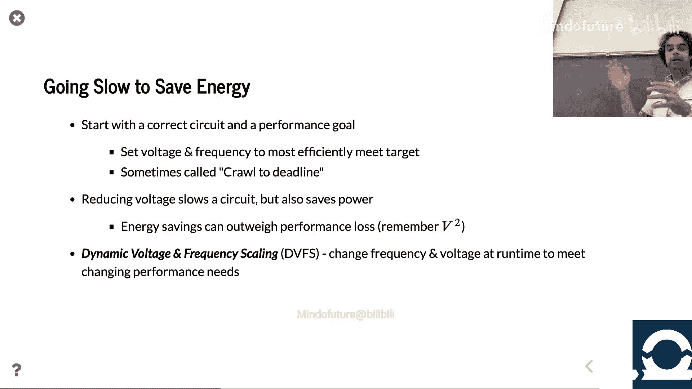

What is the right voltage if frequency can see for certain points you can at as curves figure out where you want to be at a certain time？

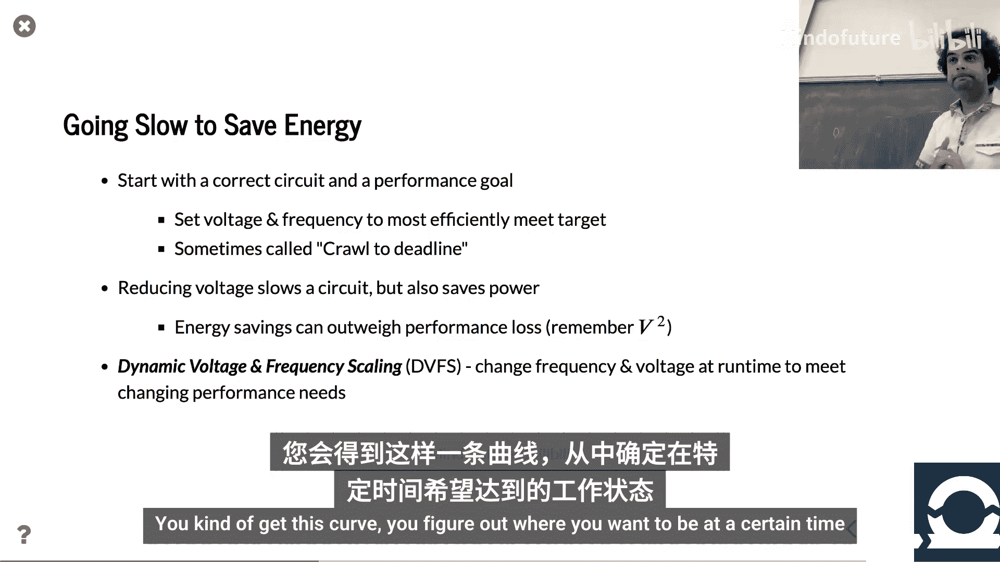

Co。And then， you know， the race to halt is the alternative， right， you know you know what let's。

Go fast， let'll sprint through it and then turn off。Right。

 and so if you look through hard design that both techniques are common and you may see both techniques in the same chip。

Like I said， so you have these periodic operations very commonly in your smartphones。

 things like transmitting things on a cell radio， where you have your certain time slot coming up every so many microseconds。

 You have things like displaying video frames。 you'll be amazed how even like on a smartphone when you think。

 oh， the screen is on and ring a web page。😊，It's going to sleep。Like even the human scale， like。

 you know， things are happening。 even if you're like scrolling your finger in a screens moving。

 it's scrolling 100 hertz。Hund Htz，10 milliseconds， right， That's an eternity in hardware。

 Bcing can put sleep in that time period。嗯。And so yes。

 you always trying of figure out ways to put things to sleep。Cool。Other questions。So you know。

 I'm going to stop right here。

