# 敏捷硬件设计：CSE228A：功耗与设计空间探索（第1部分）

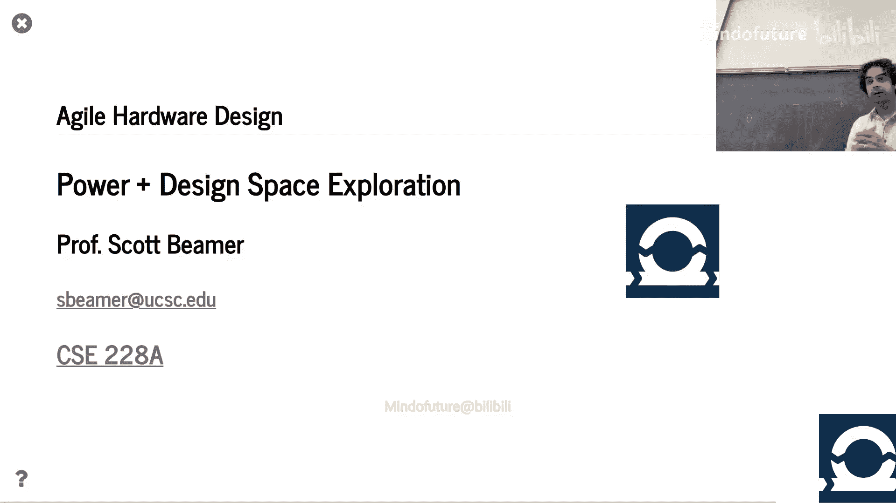

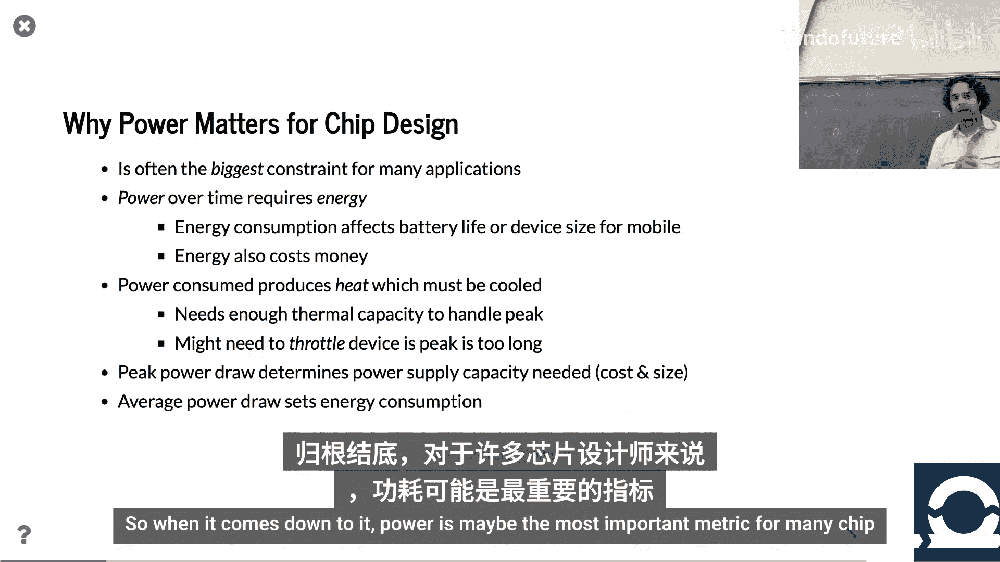

在本节课中，我们将要学习芯片设计中的功耗概念。功耗是衡量芯片性能、面积和功耗（PPA）三大指标中的关键一环，对于移动设备和数据中心都至关重要。我们将探讨功耗与能量的区别，分析影响动态功耗的主要因素，并介绍几种降低功耗的常用技术。

## 功耗与能量

上一节我们介绍了课程背景，本节中我们来看看功耗的基本概念。

功耗是能量消耗的速率。换句话说，能量是功率对时间的积分，功率是能量对时间的导数。

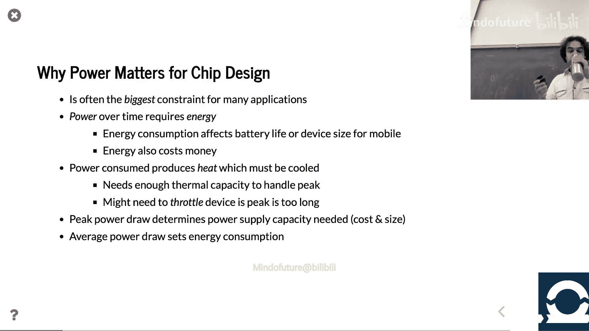

*   **能量**：电池寿命和电费账单主要与总消耗的能量相关。
*   **功率**：峰值功率决定了散热需求和供电基础设施的成本。设备过热时，系统会通过降频来限制功率，这是一种常见的技术。

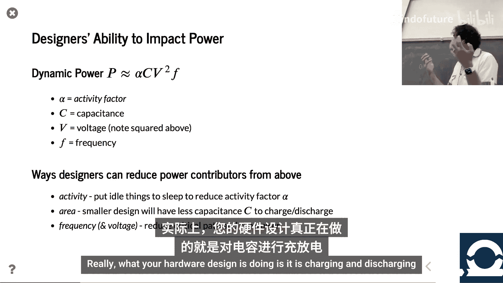

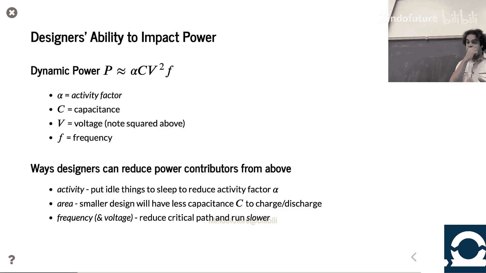

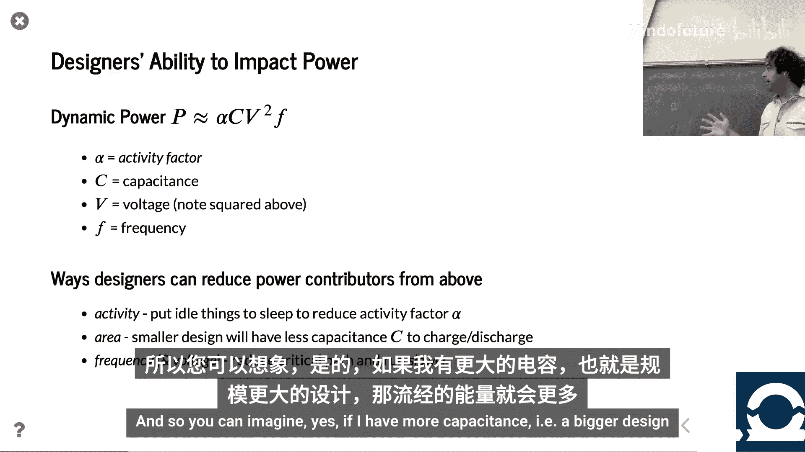

## 动态功耗公式

理解了功耗的重要性后，我们来看看作为硬件设计师，如何影响设计的功耗。

动态功耗的一阶近似公式如下：

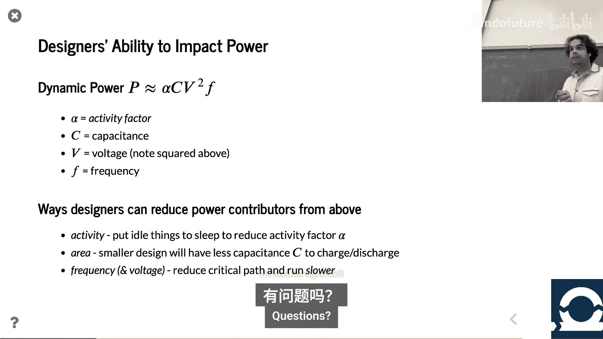

**P_dynamic ∝ α * C * V² * f**

以下是公式中各项的含义：
*   **α (活动因子)**：设计中信号发生翻转的比例。
*   **C (电容)**：电路节点的总电容，通常与设计规模相关。
*   **V (电压)**：供电电压。由于与电压平方成正比，降低电压对减少功耗效果显著。
*   **f (频率)**：时钟频率。

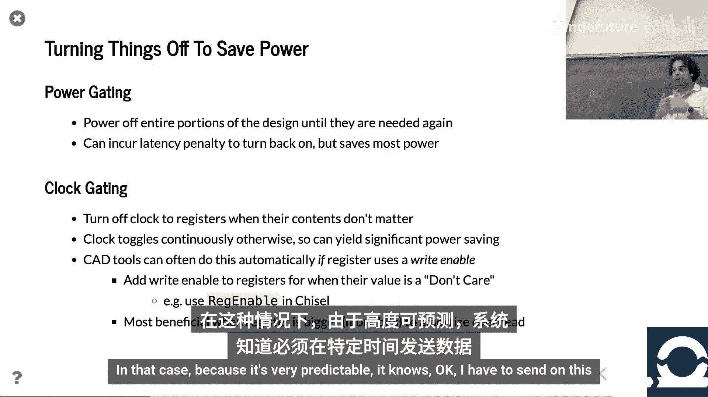

因此，降低功耗的主要手段包括：减小设计规模（降低C）、降低工作电压（V）、减少不必要的信号翻转（降低α）以及在满足性能要求的前提下降低时钟频率（f）。

## 降低功耗的技术

了解了动态功耗的构成后，本节我们来看看两种具体的降低功耗技术。

### 电源门控

电源门控是指完全关闭整个模块或组件的电源。这种方法可以节省大量功耗，但代价是重新唤醒模块需要时间。因此，它适用于可以预测空闲时间的场景，例如手机蜂窝射频模块在协议规定的空闲时隙进入睡眠。

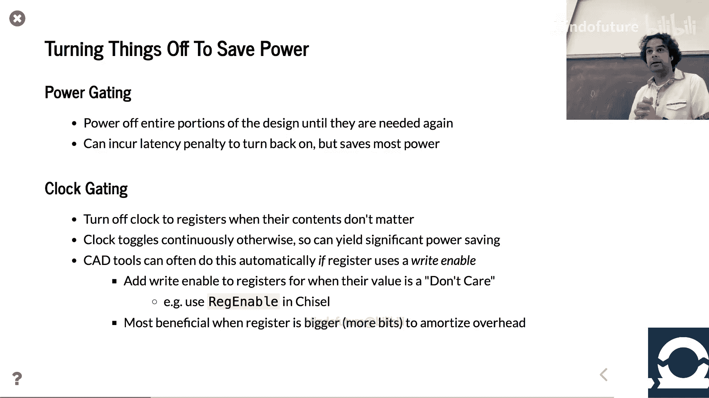

### 时钟门控

时钟门控是一种更细粒度的技术，通过切断暂时不用的寄存器或模块的时钟信号来节省功耗。现代CAD工具可以自动进行时钟门控优化。

作为设计师，我们可以通过使用带有明确使能端的寄存器（例如Chisel中的`RegEnable`）来辅助工具进行优化。这向工具表明，在使能信号无效的周期内，寄存器的值可以是“无关”状态，从而为时钟门控创造了条件。

## 功耗管理策略

介绍了具体技术后，我们来看看在系统层面管理功耗的两种策略。

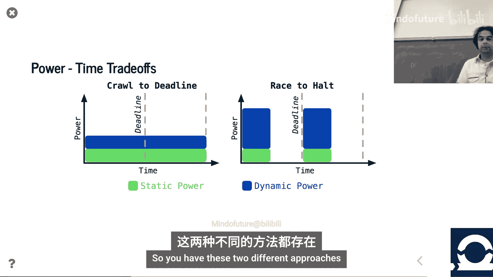

假设有一个周期性任务（如解码视频帧），需要在截止时间前完成。为了最大化能效，有两种策略：

1.  **冲刺后休眠**：以最高性能（高电压、高频率）快速完成任务，然后让系统进入深度睡眠，直到下一个任务开始。这种策略节省了睡眠期间的静态功耗，但冲刺阶段消耗了更高的动态功耗。
2.  **匀速爬行**：以刚好满足截止时间要求的最低性能（低电压、低频率）匀速执行任务，并始终保持活动状态。这种策略避免了高动态功耗，但需要持续支付静态功耗。

最佳策略取决于动态功耗与静态功耗的权衡。现代设备普遍采用的**动态电压频率调节**（DVFS）技术，就是根据实时负载在多个预设的电压-频率工作点之间切换，本质上是“匀速爬行”策略的自动化实现。而“冲刺后休眠”策略也广泛应用于智能手机等设备中对周期性任务的处理。

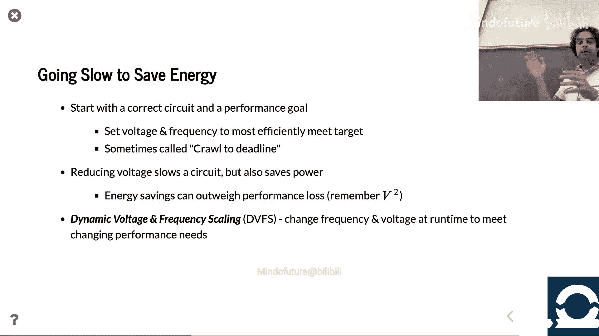

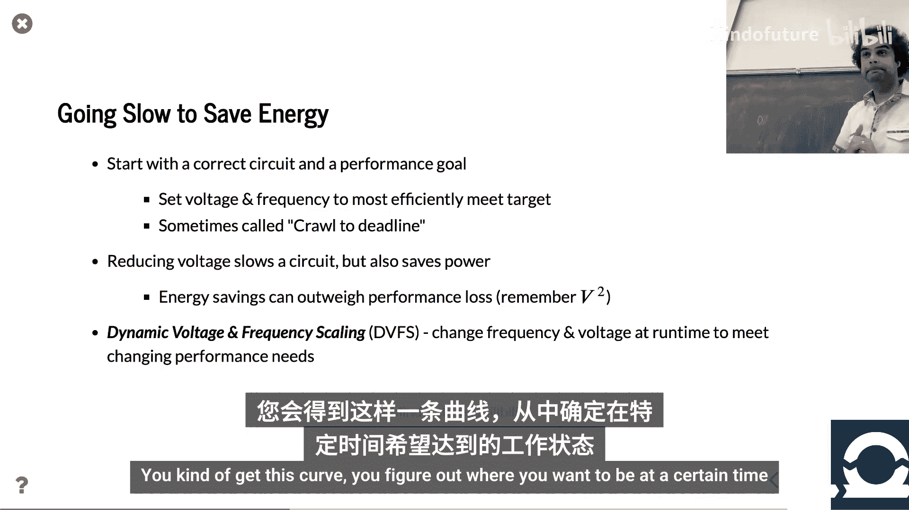

## 总结

本节课中我们一起学习了芯片功耗的基础知识。我们区分了功耗与能量的概念，掌握了动态功耗的近似计算公式 **P ∝ αCV²f**，并了解了通过降低电压、减少活动因子和门控时钟/电源来优化功耗的方法。最后，我们探讨了“冲刺后休眠”和“匀速爬行”两种系统级功耗管理策略及其应用场景。理解这些概念对于进行高效的硬件设计空间探索至关重要。