# 【加州大学】敏捷硬件设计-CSE228A-｜-Agile-Hardware-Design-Spring-2025-p29-P05_第19讲-功耗与设计空间探索_第2部分共2节--BV1M6ivBzESw_p29-

Hello and welcome to Le 19， part 2。So if remember we started this lecture on Tuesday。

 we talked about。Power device exploration， so we manage to get through the power portion。

So' what design for exploration， right？So imagine you've built your SPiffy generator or perhaps you're still developing a generator。

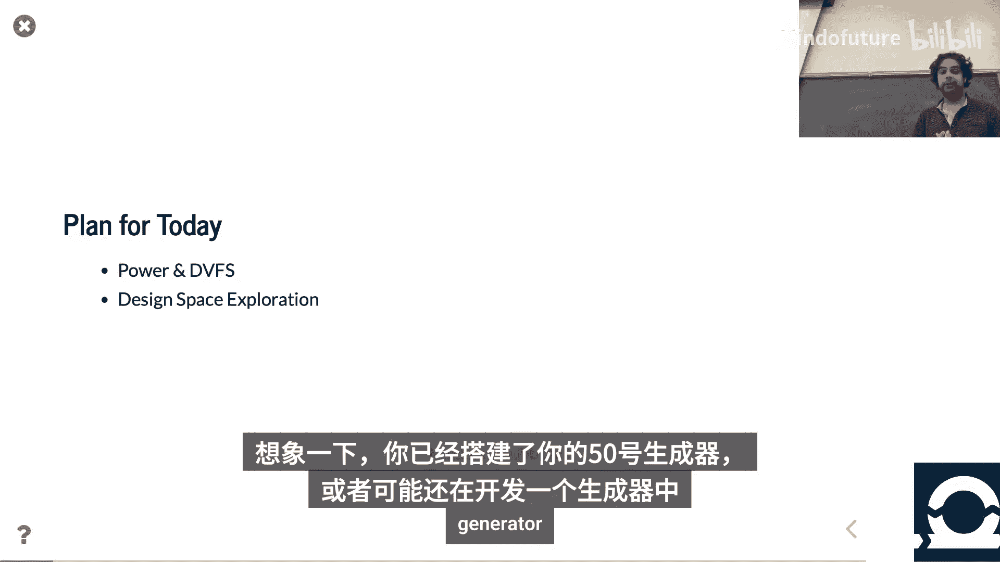

How are you going to go about？啊。Navga his face， so particular。How do you pick the right design？

What metrics do you use to define what is the right design？And then at some point。

 as you're going through all this process， you're going to realize。Shoot， we're doing trade off。

I need two。Consider multiple metrics at the same time。How do I optimize multimetric。

 So I'm going to cover all these things today。 so it's a little bit abstract。

 a little bit concrete and show some examples。

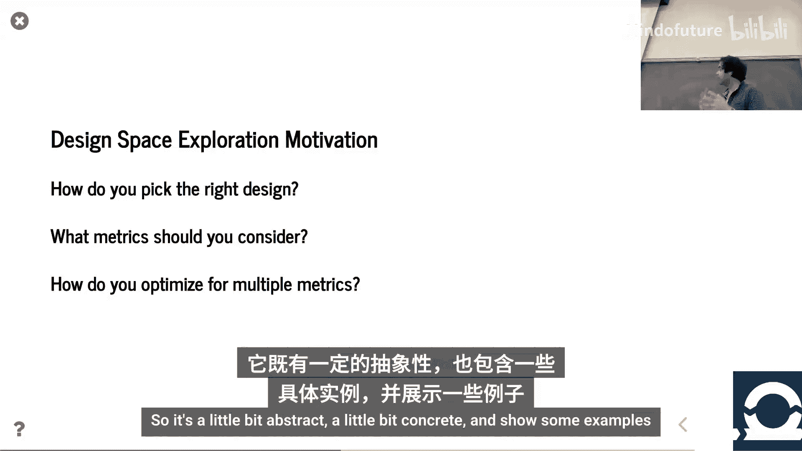

Cool， so I might to evaluate different designs well。You can imagine all sorts of metrics right。

 you know， in the prior your lecture， you talked a lot about PPA power performance area。So obviously。

 those are all really important， but even those metrics on their own aren't just a single number。

 right for power， depending on your design， Are you worried about your average power， the peak power。

 energy efficiency in general。WhatWhat is the issue you're worried about。

 maybe about peak thermal in some location， delivery constraints， delivery jitter。

 what exactly are you worried about。Her performance。

You worried about the lane theory thing to compute one operation。 you were about to throughput。

Obviously， Ma do want to the performance？In an area which is kind of where you know。

 our notion of the cost right talking about the silicon area on a die。

 talking about the number of Iop pins， other components， perhaps。

 you know off memory components you require。 So there's many metrics you consider there。

You can see in this slide at this' all sorts of other metrics， right。

 and somebody's a little bit harder to quantify。 For example， maybe usability。

 like what fraction of cases can your design handle security， which， of course。

 also is hard to quantify at times。 You know， you can check for specific attacks and civic robustness。

 but still how do you kind of quantify and measure that。

And then things we don't talk about much in this course， but matter a lot in the real world。

 things like manufacturability。How is he to make this designed？

How test is designed not only when you're developing it。

 but also actually when you' manufactured it before you put it into a product， you want to test it。

 Designing for tests or DFT is a really important thing in the real world and。

How is that your design choices here impact that？What about fault tolerance？What about reusability。

 So these are all things that kind of， you know， put down as a lift。 You may have even more metrics。

 but I'm kind of showing us to realize， yes， in the real world you have designs。

There's so many ways to evaluate them。 so many different metrics to consider。

 And throughout these metrics， you may figure out some of these are things that are nice to have。

Absolutely critical or have some sort of constraint。

 like you need to reach a certain threshold on one of these metrics。

Are there any metrics people can think of that maybe we forgot to put on this list？

I can think of at least one newer one。Yes。Yeah， I think an interesting point。 Okay。

 so as you're optimizing for a certain target technology。That's a good point。

 And you kind of have these things。 Yeah， it' right， this， this， these set of metrics coming away。

 implicitly assumed a certain technology target。 But you can imagine it。It's a two way street， right。

 how does impact？Other possible metrics or considerations。はい。Marketability might be below or know。

 above the pay grade of engineers， I guess， but you know， that's the reasonable thing to consider。

How about， you know， in 2025， what are we worried about a lot involving the world？Climate， tariff。

 not a whole other metric， right which I don't even know how to get into that one。

 but what about climate？对以。Yeah， so so usually you're thinking about the climate sustainability。

 So I'll put it as sustainability。But you can imagine。

Things like what is the embodied cost of manufacturing this， right， embodied carbon right。

 how much carbons can make your chip， and if you change the design chip design。

 actually you can change your amount carbonbon requires to make your chip， right。是 yeah。😊，能喜欢。Yes。

 yes， the supply chain tariffs。 Yes， I think you're right。 The state doesn a go manufacturability。

 Those are real concerns， right。When someone talks about， you know， like。Where is an iPhone from。

 right？If you track down every part in that phone and every material that win every part。

 it'll be a lot of countries， right？It's not just one country， right？And so。Yeah。

 these are important concerns in the modern era。But today we focus in the more quantifiable。

 more engineering controlled metrics。 But yeah， this kind of gets people aware of the fact of the lobby is considering evaluating your design。

And so then so， see， on one hand， you have the metrics。 So we have you score how good a design is。

 right， On the other hand， is what are your knobs you can turn to explore the design space， right。

 you know， or generators， you can now more easily generate different design variances， right。

 This whole point of generators。 So you have external parameters like。😊，You know。

 what interface with my？Module have， you know what kind of things These are things visible from the outside of your generator of your generator。

 It also parameters that users give to your generator。

 but the generator's external appearance does not change。

 but it does change internal things like the microconure， right， things like。

How much parallelils would you have internally or what approachre using， you know。

 what routing algorithm you use internally， whatever， right。

 So these internal parametersal parameters， they both are parameters。

 But the result is that there's a lot of enoughs， right。

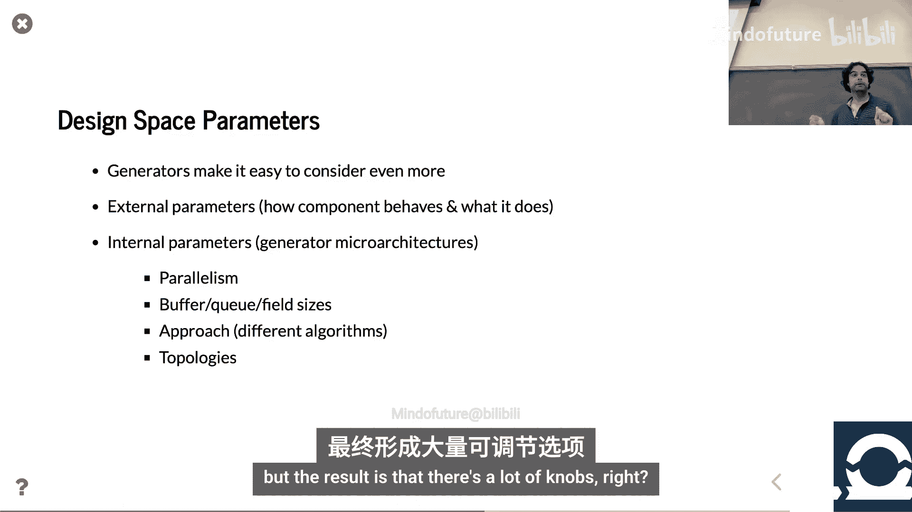

That's the challenge you want to talk about is given you have a lot knobs。

How do you turn them correctly， So number one， do you have metrics， right。

 if someone just says turn them obviously a good design。

 you're going say I need know what good looks like。 that's what your metrics come in。

But then this also matter， you turn knobs all the way。 There could be too many combinations， right。

 So how do we go about turning knobs in intelligent manners。

 So let's talk about both of those things to try to。Tammes design space。 So first， for the metrics。

 like they said， I listed， you know，10 plus metrics on the prior slide。

You should ask yourself for your application。Which metrics are truly necessary？Right。

 or to some you can just， you know it for now， we're going to ignore it， we're going remove it。

 We're gonna， you know， not pay attention to it。嗯。And the metrics， let's say you determine， you know。

 Ab 12， maybe 7 are necessary。Is there a single one。

 a metric you need to maximally optimize or are some of them So you can just say it's a constraint。

 You know， keep the power under 1 wt。 And then we're happy， right， You know， beyond that。

 it's not needed。 just make sure it's low 1 w。 or you make sure。You know， has some other constraint。

 right， and so。You can start off with these lots of metrics。Startting symmetric and the constraints。

And then。AndTo get to a point of， you know， maybe only a handful of metricss say 2，3。

 maybe hopefully not more than4 metrics you're trying to optimize。

Is there still some sort of way you can。Ranked them。

 right because you have four metrics you try and optimize at the same time。😡。

You can make progress that way。 but's also tricky， right， And so it's easier if you can say。

 you know what， I want to optimize this metric first。

 and then if any remaining ability optimize that a metric second。It makes feel life so much easier。

And sometimes when you optimize the multimetrics simultaneously。 know there's no precedents。

 There' eating something called tradeoffs， which are comments beyond engineering。

 We'll come back to them in a few minutes。 It's a really common key thing to think about， but。

Even though we're good at trade off of engineers， we would love to do if we can to。

Reduce number of things we were doing trade offs a month， right， rather than doing a8 way trade off。

 We want to do a two way trade offs。 And so we'll see it looks like in a few slides。But yeah。

 so number one， try to that does not trick the metric space， right。

 which metrics are really important。 psimetric between turn into constrain throughout things to optimize。

 And then even the ones you're optimizing are some more important than others that can get that precede order。

Okay， then for the actual designer itself self。Armed。Like I said。

 the problem is there's so many combinations of parameters。That you end up。

With the design space you can't afford fully， right， and so how do you do intelligently？

So sometimes with some。Expertise on the problem in your generator， you can recognize certain things。

 For example， let's say you have two parameters。They have end settings。😡。

Are they really fully independent， if so， that means you have n squared combinations。

 you got check all n squared combinations， that's rough。But maybe you know， you know what。

 I changed this thing。The other thing is going to directly depend on it。

 and so really they aren't truly independent actually are a coupled parameter。

You can imagine a of them like you know Q depths， right I have a Q depth in one location of my design and then another location of the design and those queuees are coupled in the way that this Q depths better be similar otherwise it's not going to make any sense right that's the kind of thing I'm talking about。

😡，嗯。😊，A lot of times parameters aren't truly free variables， right。

 where one parameter needs to be greater than another parameter or equal to another parameter。

 So recognizing these relations between parameters。It help you greatly shrink that their space。

 right。And like I said， things like throughputs， right， you know。

 if I double the consumption throughput as the producing throughput， that's not gonna to make sense。

 right， They should be matched， right。And also once again， you'll find some parameters。

Are more impactful than others right， Some parameters really change the design in a hurry。

 really change the resource costs in a hurry， really change the performance very quickly。嗯。

And so as the result， those are the ones you want to。嗯。Make sure you。Address， right。

 and to be able to do a big ones first， small one a second， if you can。Oh， questions so far。Okay。

 so let's say you've done your best， right， you've。

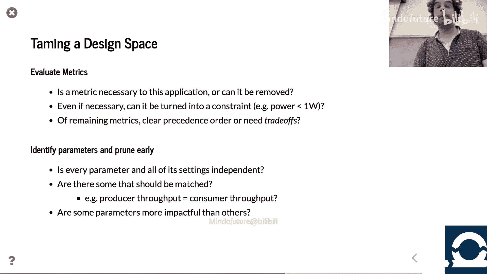

Shut our metrics down so you know what's the reasonable set。 You've identified the parameters and。

What the relations are， but even still。You have too many。Tmination is the full Exper。

What can you do Well， this is the entire research area， right。

 like the design States aspiration or DSC。People have entire papers and theses on how can you support us。

 right？I't think it this problem more formally， it's a non conve optimization problem。

 in other words。

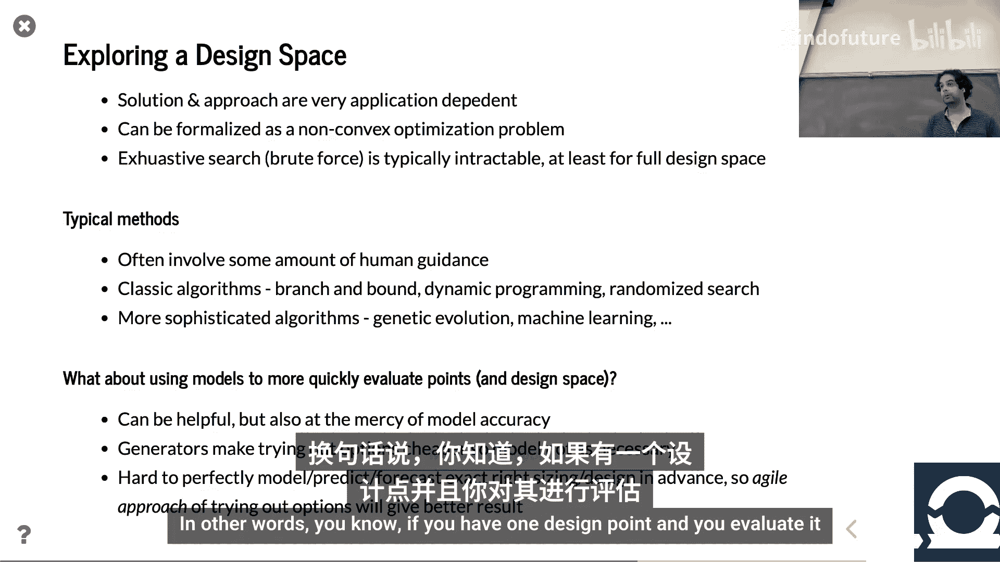

You know， if you have one design point and you evaluate it。

And then you try to go to a better design point adjacent to it， you can improve。

And you can keep following， you know， Jason design points， you get the better design points。

 you'll do some something of like hill climbing。Or effectively gradient to upon what you want to think of it as。

 but you're not guaranteed to reach a Google maximum， you can reach a local maximum。Right。

 it's not the challenge， right。Normally only brute force is not tractable if it is。

 you can just do that and not worry about it。 And so the question is what can you do？嗯。

So there's a variety of choices， one is of course， take advantage of your knowledge of a problem and use some human guidance。

You can think about how they best explore design space。

 so perhaps you know which parameters mosts impactful and you want to solve those high impactful parameters first。

And then you can solve those and then kind of procedurally then solve less important parameters and kind of hope that that leads to a pretty good thing。

There are some classic algorithms， things like branch and bound， programming， randomized search。

These are all exist。 If all out there， you can use other famous to help you duties。

 you'll need to write these yourself。 one advantage is having something like chisel as you can。

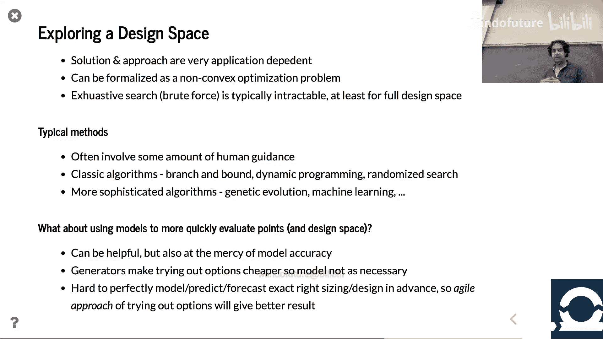

Ping this in to not just more sclet code， even another code all the jet altogether。

 another code could call your sclet code to generate various design copies。

 So those are classic algorithms， but actually more sophisticated algorithms in research things like genetic evolution。

 Of course， machine learning is really huge。 I wouldn't be surprised a few years if a lot of DSC is done by machine learning。

😊。

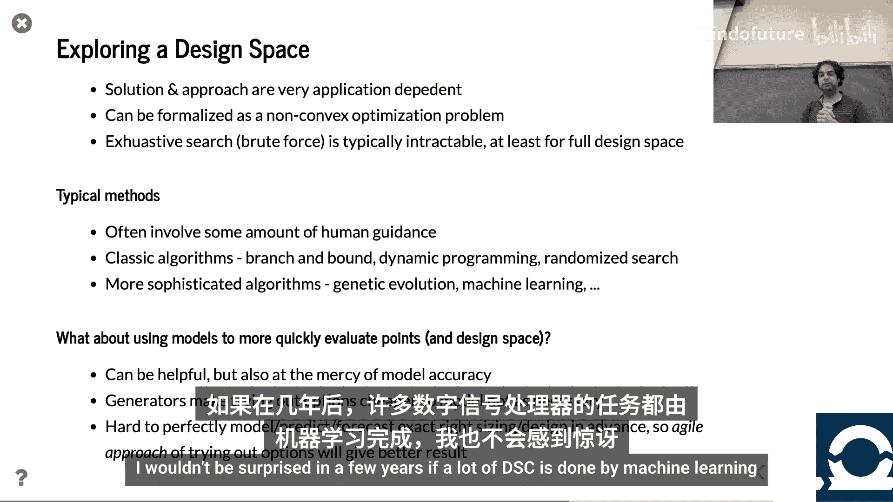

Um， et cetera。

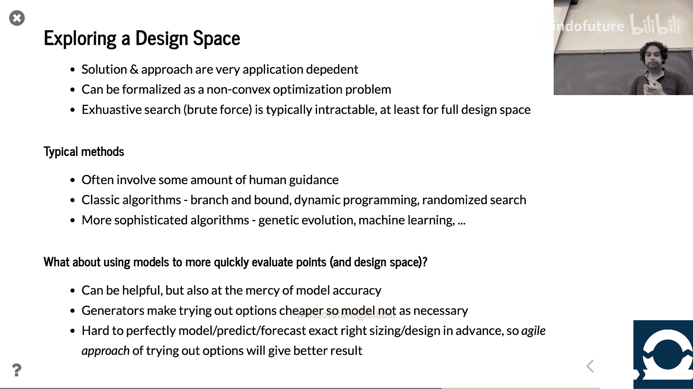

So a。A natural question some might ask is gee， if it takes much effort to generate a design point。

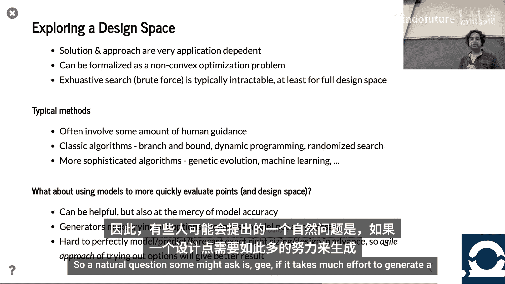

And then evaluate it。Could I somehow avoid that answer is maybe。

So this is a whole bunch of research in science deper。

 and how can I make some sort of lightweight model。And a model so lightweight， I can， you know。

 quickly for a design space and then perhaps get close to the right design and then maybe use the heavyweight full designs to do to actual work。

 This approach of having this lightweight model and a bound hole design space quickly and then trying to like zoom in。

That's a more common classical approach。 And I don't think it's totally wrong， right。

 Part of what I did in the past is because before you got someone like a generator in chisel。

You couldn't write very design variance， right， writingt each design variant took a lot of frequenting effort。

 with chisel the knobs and the parameters， we can more easily generate variance。

 But even still this problem exploring design space still exists。When're using these models。

It can be helpful。 And really， the utility's approach is how accurate is that model， right。

 If the model is reasonable representative， then great。 You're doing this much more productively。

 much more cheaply。The model is not very accurate， then you're not getting very much， right。

 And so part of the challenge is that。When you use these modeling， right。

 you may not know how accurate it is。

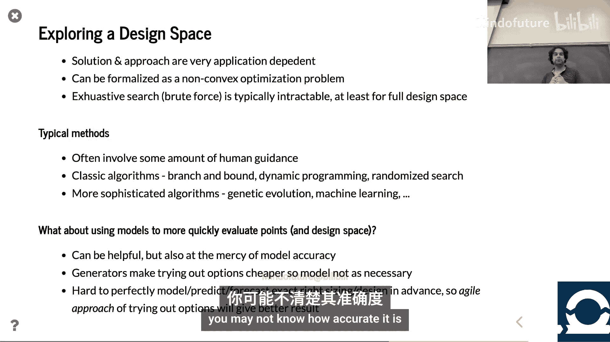

And so how do you know how？Well， how well your model's doing and how well it could do。

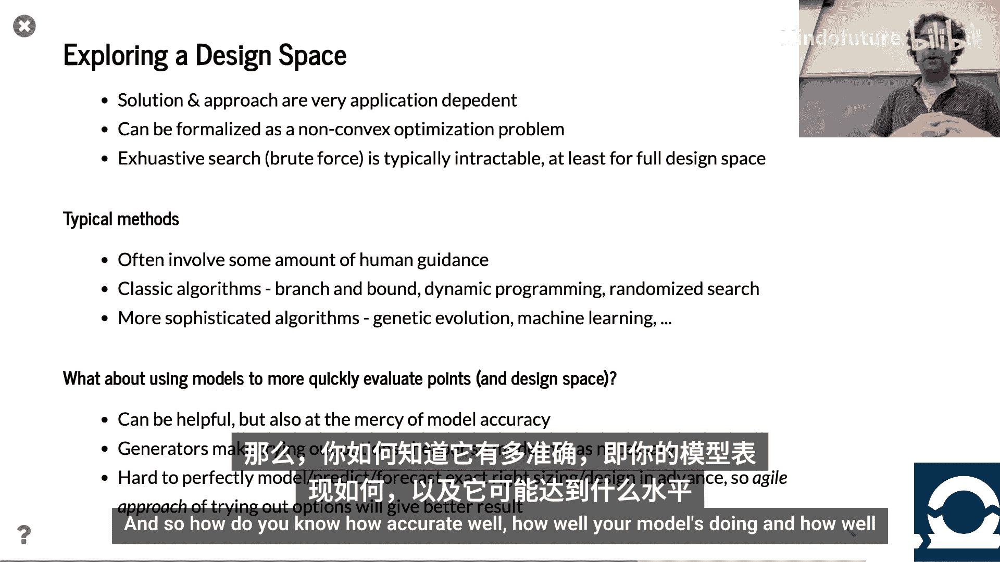

So you often do a little bit of column A， a little bit of column B， right， you try out the model。

 see what it tells you， try out your real designs with your generator and evaluate them。

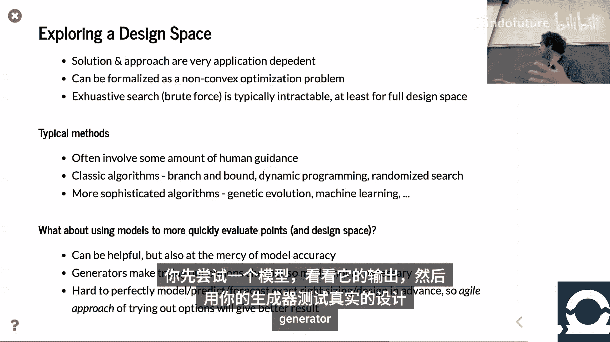

And then go back and forth and then see how kind comes together。

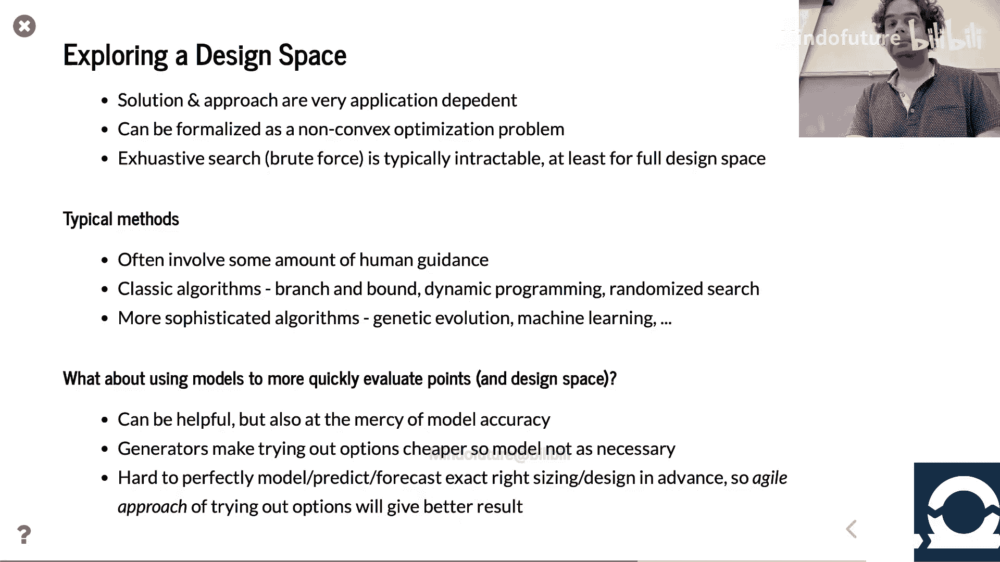

Cool， questions。

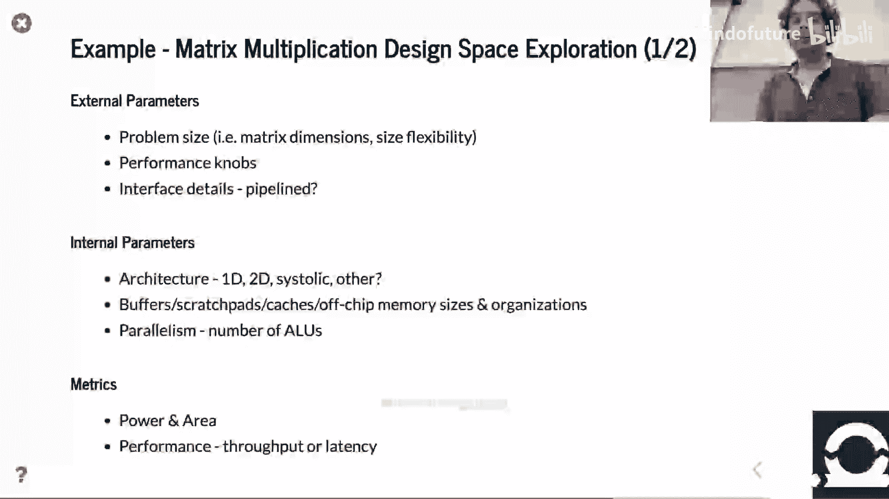

Okay， so let's say， as you know you've already heard in this class。

 you want to write a invent multiplication unit， we did this for homework for if people doing this for their projects。

So if you're on a image multiification unit。You're doing a DSD design inspiration。

 and what' you consider well。Is't as we just talked about， right。

 what parameters have' available to us， We have things like。Visible externally。

 like what problem size matrix we take and how flexible that problem size is。

 things like performance， like， you know， how fast it's supposed to go， How is the interface set up。

But then the courserus of internal parameters which aren't fully visible from the outside。

 things like architectureshire， I doing a 1D operation at a time。

 two decors of thestolics and other technology。How ammrranging my buffers， scratch pads， caches。

 et cetera， perils and su Cai already。Was externally visible versus internally？Poplyiness。

 they're all still parameters。 just a zoom parameters， even this。Seemingly straightforward。

 linear algebra kernel。And then for metrics， of course。You know， we have PPA。

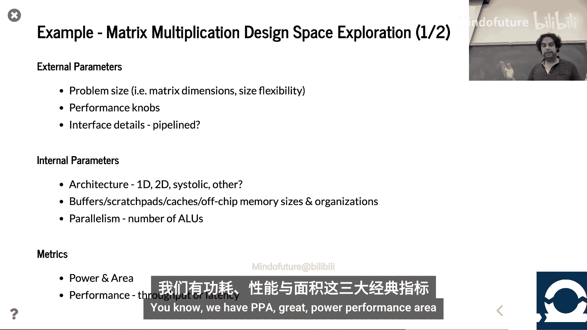

Great power performance area。So Dan how might you go about this well？First。

 you might specify the problem and make sure if your application makes sense。 Okay。

 like whether the constraints of having stone parameters。

 I know you solve matrices of a certain size。 I have a certain flexibility in terms of。

How does sizes can change？Figure out how to implement this my targeting AsIic FPGA。

Based on the problem size and resource I' have available， they need offtrit memory。

 what kind of offtt memory？Et cetera。Then。You know。

 maybe you willll use analog models to try to help you with the modeling a little bit， right。

 You can kind of do things like。Back in vote math， C， okay。I want to reach a certain throughput。

 I know how many math abras I need to do to reach that throughput。

Can I fit enough of those hardware components on the chip， right， You'll need to write chips。

 little'll figure it out。 You need to do some backing little math。

 maybe with a spreadsheet and see wait a second。 am I going filter everything on chip。

 Ill hold enough S Ram to hold the matrix on chip。 If yes， great， if not。Doing after memory。

 So you're kind of already getting some corear green intuition about your problem as you're kind of going through procedurally。

De put the most promising design。😡，Get a working simple way to evaluate。 In other words。

 turn the knobs and be able to get metrics out of it。 in other words to get， you know。

 what is the PPpa for particular design thing。 And then you start changing parameters。

 starts being parameters and。We talked about last step about， you know？How do you pick。

 how you sweet these parameters， There's some， you know， various sos， branch and bounds。You know。

 machine learning， et cetera， right？And then as you kind of do these processes。

 you might start learning。About which types of things are looking more or less promising。

 maybe you're going to change our that actually get new parameters or change our altogether。

Learn from these things and keep repeating。 So this kind of iterative。

 agile process that we took on this entire course。How can you go about doing that？Cool， questions。So。

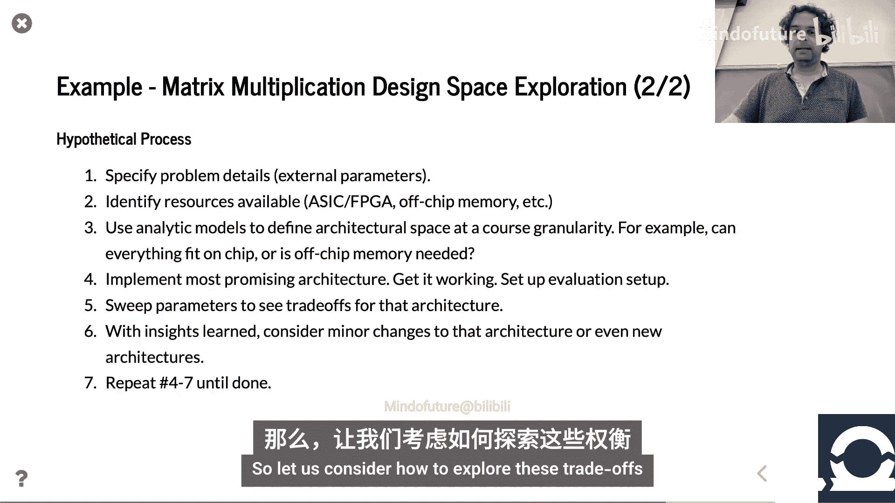

Let us。Yes。Consider。How to explore these trade offs， right。

 I talked about what happens when you want to optimize more to one metric at the same time？😡。

Let's call a trade off， right， where you have。change in metric A versus metric B。

 one really important concept， which I'm saying I'm trained teach this course。

 something called the Pareto frontier。Let's say we have two metrics。X and Y may be area power。

 for example。And in this case， we want these metrics lower is better。

And so we define something to be preto optimal。If in order improve one metric。

I need to make another metric worth， so for example。The point I've highlighted。

I can do better in metric X。If if we do better at metric X， I'm now going to do worse at metric Y。

Likewise， to do better E metric Y， I'm going to do worse at x， right， in other words。

A point is pretty optimal if getting better in one metric。Requires。

Do bit worse than other metrics in this case， you can imagine you。Pad design。

 you ran through your toolflow and you。Took all various design variants and plotted them based on these metrics。

 And you can see that there's this preto frontier。 and that is。

These are the set points that are Pato optimal meaning that。If you're one these points。

You can't do better on a metric without'll do worse than another metric。

 If you're no nere or frontier。A figure over here， or actually maybe here。

If you pick a better design， you can do better at X， add no consequence to Y， right。

 so you should do that。 There's no brainer。It turns out when you get more familiar with a problem。

 you're start better at it。Eventually， you'd better find your way to this Prato frontier。 right。

 If you're an engineer。 And so it Prato frontier， you're in a situation though， you know。

 your boss tells they want you to prove this。 You're like， sure， I cant improve this。

 but it's going to cost you this， right， If you can get told by your boss， I need you do better on X。

 and there's no cost to Y。 That means you were not。On the frontier。

 that means you were just had a design point。嗯。So these prato frontier in this kind of analysis is very common。

 and this is the one these advantage of having a generator basis of phology。

If you only are able to generate a few points。Right。

 you don't know where the frontier is how close you are to it if you can generate 30 points。

They're start to see these shapes。And you can start to see how you're doing relativetitude and you want to make sure you're on that frontier。

And you can figure out what do I want to be here or here， right。

 You can figure out between these two metrics， would it'd rather be quite where I want to be。

 But the point is you want to be at a place where。You know， if trade offs， right。

 if you're not doing trade offs， then mean you're not the at the edge。Cool， questions。

Let's see some examples， so I took some pictures from papers。

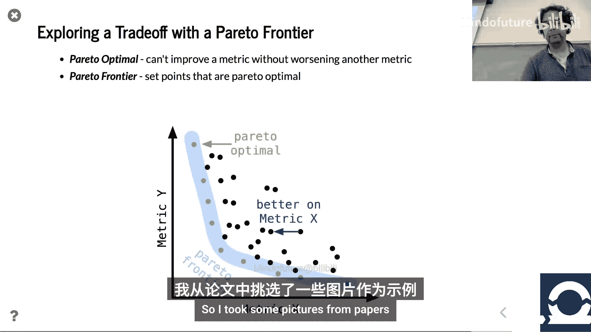

And so here's one， I think it's one the pretty have seen in a while。😊。

And so this is a person that used a Windows model to it， so they made a lightweight model。

To do majors multi。And then they generate a zillion variance and evaluated them。

And so you can see heres that same shape we were talking about right， where in this case。

 they have performance as time and power is a geometric of both the Ps of PPA。

 lower is better for both。And you can see that， yeah， there's a prata frontier。Right。

 has that curved shape， for some reason in practice， it's often that curved shape。

But can see that you know most design points。Are not on that curve， right， Theyre in the middle。

Right， and so。Assuming these e metrics you care the most about， you don't want one of these points。

 You want to be on the freaking frontier， right。And so yeah， you can see that， you know， for a given。

 you know， design point if over here somewhere。 Yeah。

 you can find a better one It's improving both metrics at the same time or one metric at the time。

 But once you're over here， then you got to trade it， you know。So particular plot is colored by。

You know the level  one cache panel， you can see that， you know。

In the case of having very low bandwidth， you can see some these that are automation to kind of provide benefit。

 but。

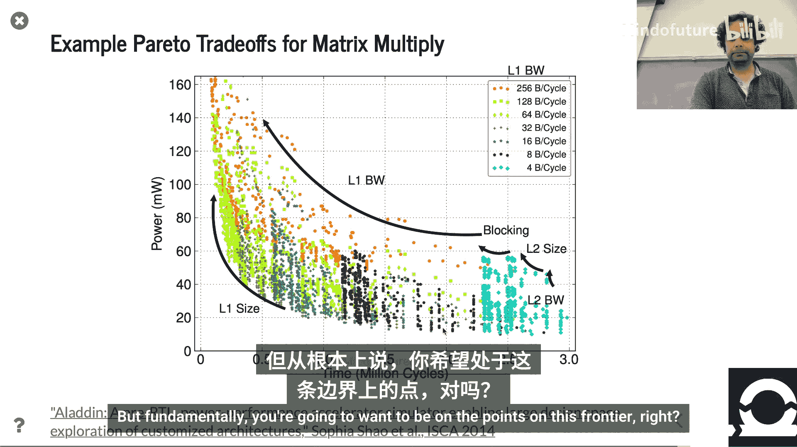

Fundamentally， you're going tot want to be on the points on this frontier， right。

 you don't want to be over here。

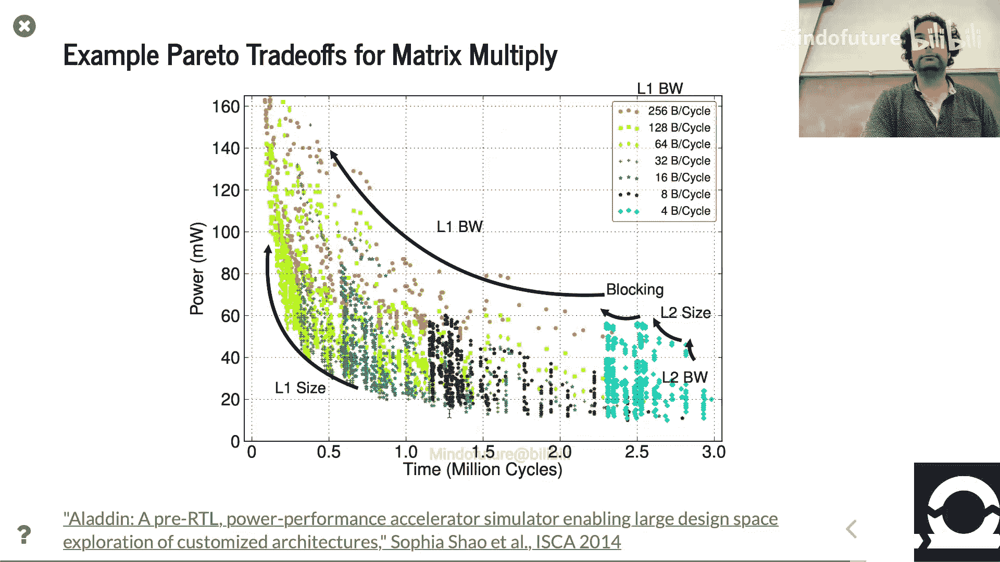

Cool。And here's another example。This is another academic paper。

And they're showing for different pro architectures。How are doing。 So in this case。

 the curved shapes are different because the metrics are a little different。In this case。

 performance is better going to the right， so higher is better。

Because they did the inverse of latency。 So million instructionss per second。 and then energy。

 you know， lower is better。 So you have lower is better this way， higher is better this way。

 So you get the curve now。Slip around the horizontal axis， right。And what's interesting in this case。

 you can see。These lines trace。If you particular pro architecture， know in order of one wide。

 out of order two wide。 and then they sweep different frequency scales。 So for given processor。

 they do DVFS and show， okay， if I change frequency， it can change performance。 Of course。

 if you change frequency， you can also change the voltage as a result changes energy cost， right。

 so you can see。For any given processor。It sweeps that curve。And what's interesting is。

Depending on what your performance target is， for example， the most efficient processor changes。

 right， and the progression actually here is very satisfying Artly makes sense， right。

If I have a very low performance target， a one wide in order is going to be the most efficient。

 right， That makes sense。 It's the simplest of design。 It's not nothing。

 And then if any little bit more performance， a two wide in order is pretty good。

Then you can see that increased performance more is the resting regime。 There's a small regime here。

Orre actually four wide in order to make sense。Additionally。You know。

 if you want more performance still， then of course， want two wide out of order。

 finally four wide out of order。You might notice that， for example， one white out of order。

Doesn't win against in scenario， right， at no point for its curve。 as that makes sense， right。

And you can kind of take insight from that。 Okay， yeah。

 that makes sense if I'm going to spend the resources for out of border。嗯。

I would probably rather actually build either a smaller in order core or even a two wide in order core or something。

 right。As like I said， these prereto curves come up throughout an engineering。

 and you have to make these trade offs， right， Like where am I going， I'm improving one at the other。

 expensive of the other。And so unfortunately， if a project is a little bit hard to explore this so we don't have a cost model for your designs。

 but even for performance， you can still play with this， right。

 you can still kind of turn knobs a little bit。

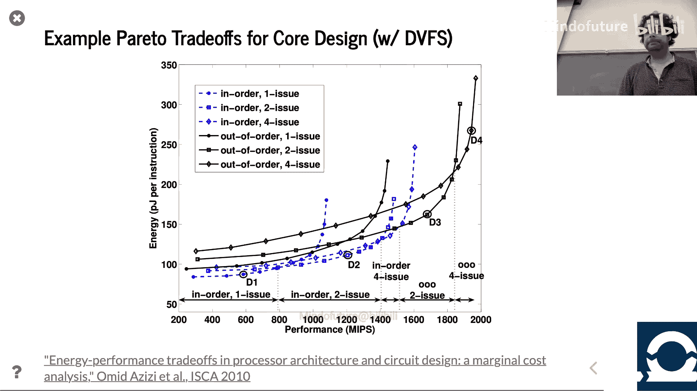

And it's also more as good for your career， you'll be seeing this for sharing the new real designs in industry。

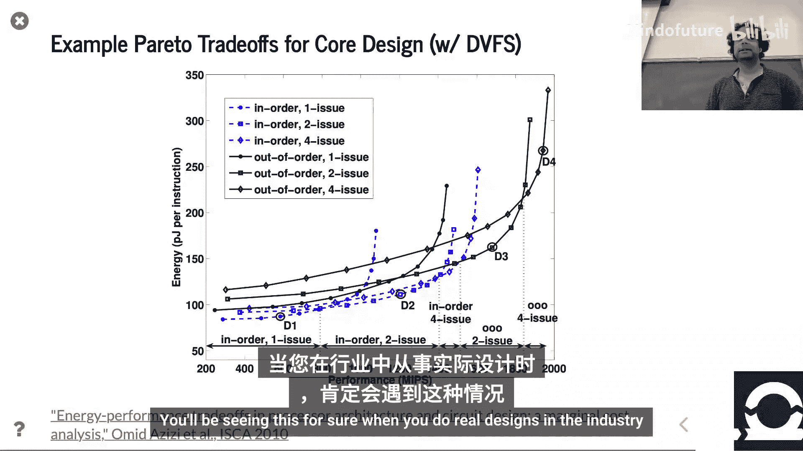

Great， any other questions？Okay， let's。

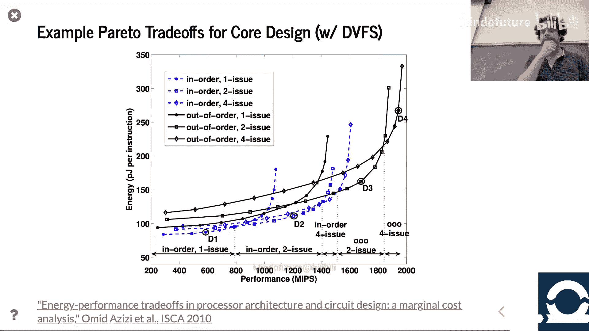