# 敏捷硬件设计：CSE228A：功耗与设计空间探索（第2部分）🎯

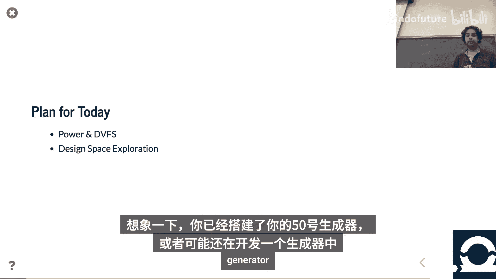

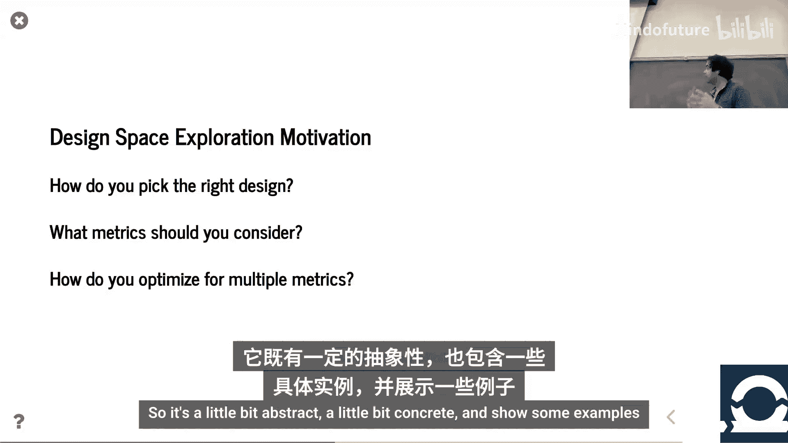

在本节课中，我们将继续学习设计空间探索。上一节我们介绍了功耗分析，本节中我们来看看如何系统地探索设计空间，评估不同设计方案的优劣，并理解其中的权衡。

## 设计评估指标 📊

要探索设计空间，首先需要知道如何评估一个设计的好坏。以下是评估设计时需要考虑的各类指标：

*   **PPA（性能、功耗、面积）**：这是硬件设计的核心指标。
    *   **性能**：可能关注单次操作的延迟或系统的整体吞吐量。
    *   **功耗**：可能关注平均功耗、峰值功耗、能效或热约束。
    *   **面积**：指芯片上的硅面积、I/O引脚数量或所需的外部存储器组件。
*   **其他量化指标**：
    *   **可用性**：设计能处理的应用场景比例。
    *   **安全性**：抵御特定攻击的能力。
    *   **可测试性**：设计在制造前后进行测试的难易程度。
*   **非量化但重要的考量**：
    *   **可制造性**：将设计投入生产的难易程度。
    *   **容错性**：系统在部分故障时继续运行的能力。
    *   **可重用性**：设计模块在不同项目中复用的潜力。
    *   **可持续性**：制造芯片所蕴含的碳成本等环境影响。

在现实世界中，你需要考虑众多指标。但作为工程师，我们通常首先关注那些更可量化、更受工程控制的指标。

## 设计参数与探索挑战 ⚙️

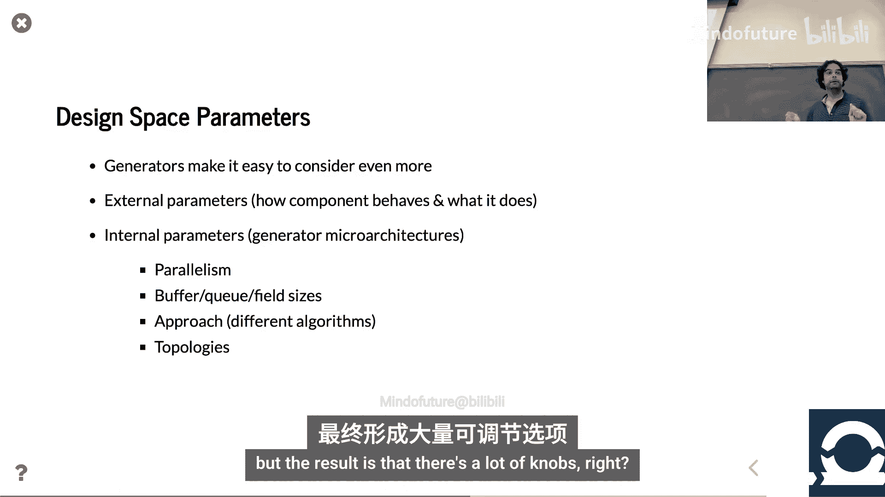

评估指标告诉我们什么是“好设计”，而设计参数则是我们可以调整以生成不同设计变体的“旋钮”。

以下是设计参数的类型：

*   **外部参数**：从生成器外部可见的接口定义，例如模块的接口类型。
*   **内部参数**：生成器内部实现细节，用户通过参数调整，但外部接口不变，例如微架构、并行度或内部路由算法。

面临的挑战是，参数组合的数量可能非常庞大。如何智能地调整这些旋钮？首先，你需要明确哪些指标是真正必要的。其次，尝试将一些指标转化为约束条件（例如“功耗必须低于1瓦”），而不是同时优化所有指标。最后，如果仍需优化多个指标，尝试为它们建立优先级顺序。

对于参数本身，可以采取以下策略来缩小搜索空间：

*   **识别参数间的依赖关系**：许多参数并非完全独立。例如，一个队列的深度可能需要与另一个队列的深度相匹配，或者一个参数必须大于另一个参数。识别这些关系可以极大地减少需要探索的组合。
*   **识别高影响力参数**：有些参数对设计性能、资源成本的影响远大于其他参数。应优先探索这些关键参数。

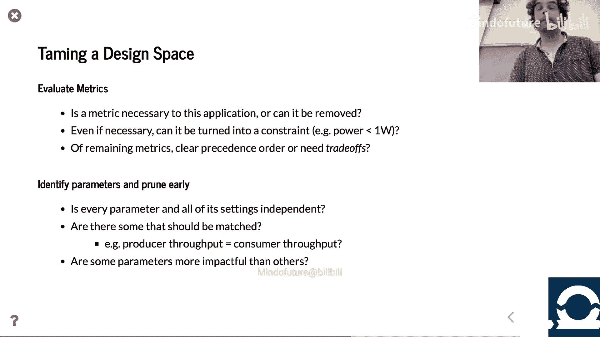

## 设计空间探索策略 🧭

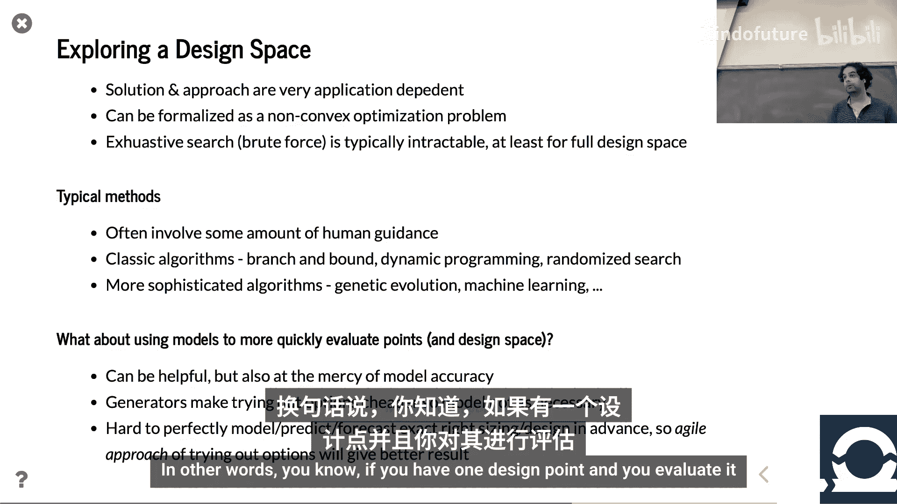

即使经过简化，设计空间探索仍然是一个复杂的优化问题。这本质上是一个**非凸优化问题**，意味着简单的“爬山”算法可能会陷入局部最优解，而无法找到全局最优。

以下是几种常见的探索策略：

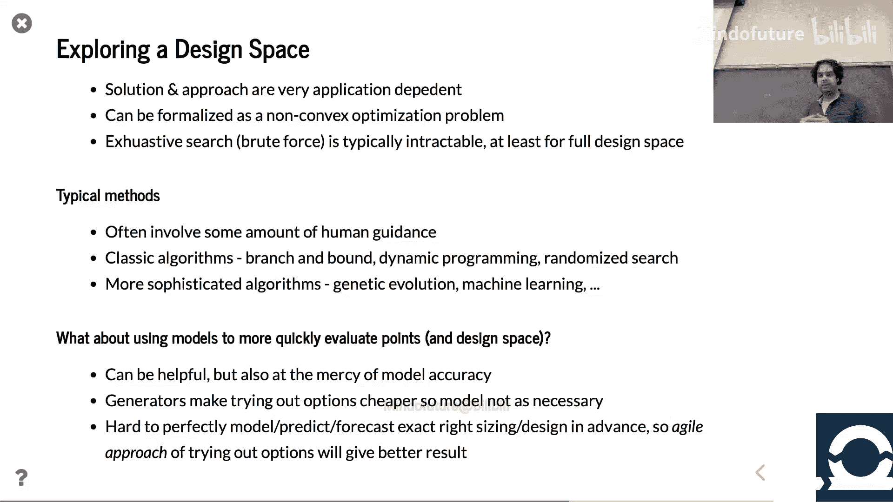

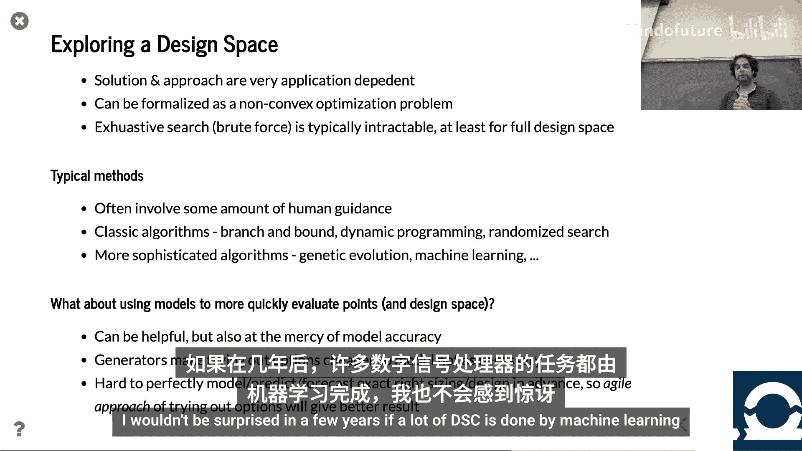

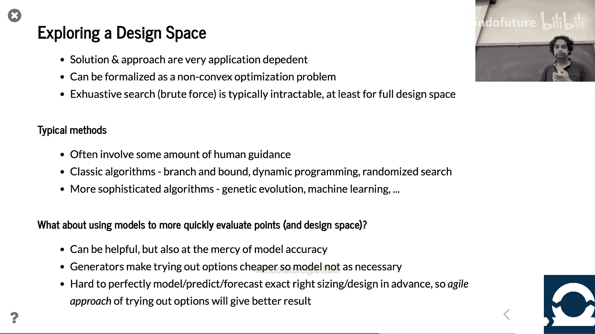

*   **基于知识的引导搜索**：利用你对问题的理解，手动指导搜索过程，例如先调整高影响力参数。
*   **经典算法**：可以使用分支定界、线性规划或随机搜索等算法。使用Chisel等生成器框架，可以方便地将这些算法与设计生成代码集成。
*   **高级算法**：包括遗传算法、进化计算，以及近年来非常热门的**机器学习**方法。机器学习有望在未来成为设计空间探索的主流工具。

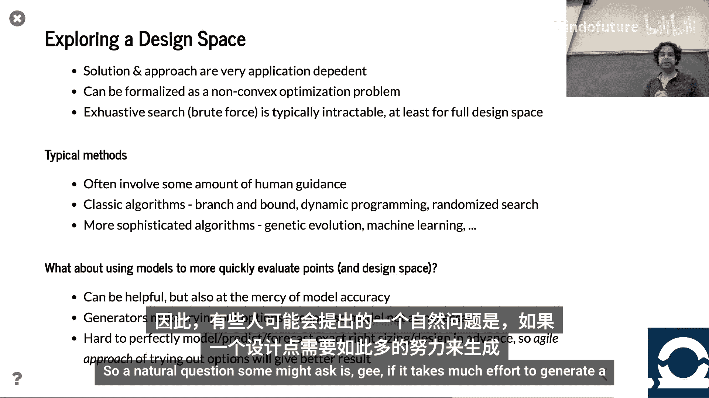

一个常见的方法是使用**轻量级模型**进行快速探索。你可以构建一个能快速评估设计点近似性能的模型，用它来扫描整个设计空间，找到有希望的区域，然后再使用精确但耗时的“重量级”工具（如完整的RTL综合）进行详细评估。这种方法的关键在于模型的准确性。

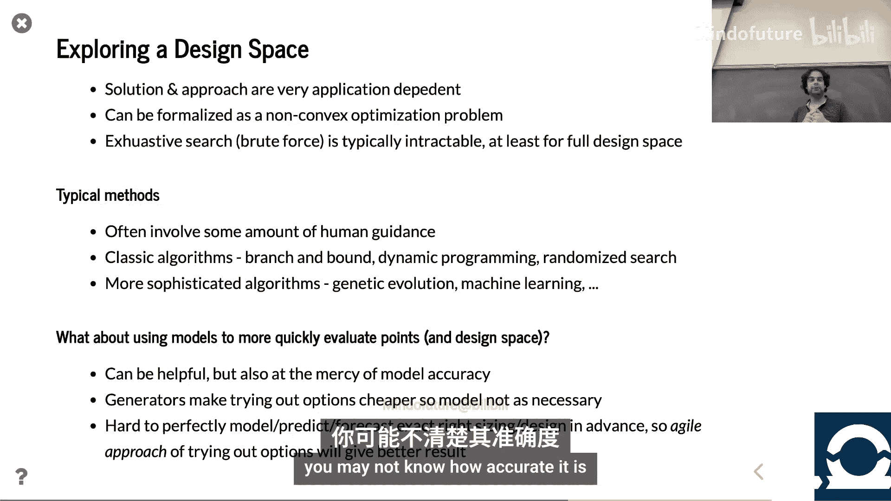

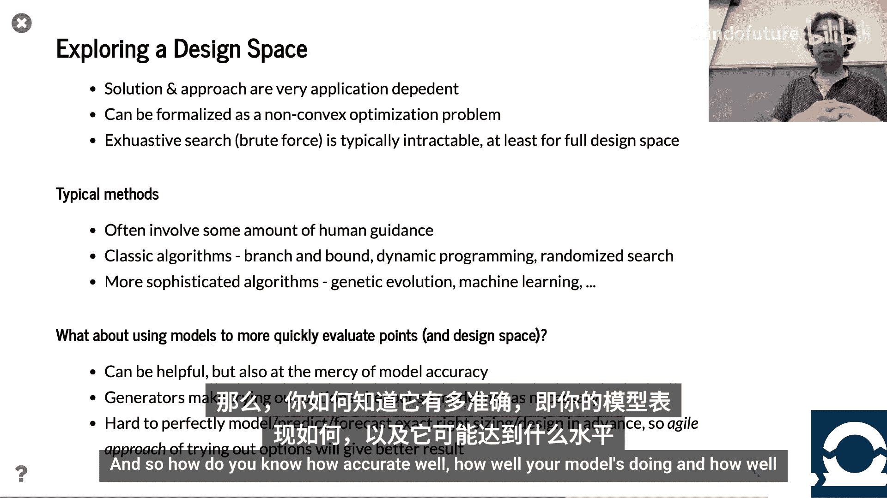

## 实例：矩阵乘法单元设计 🔢

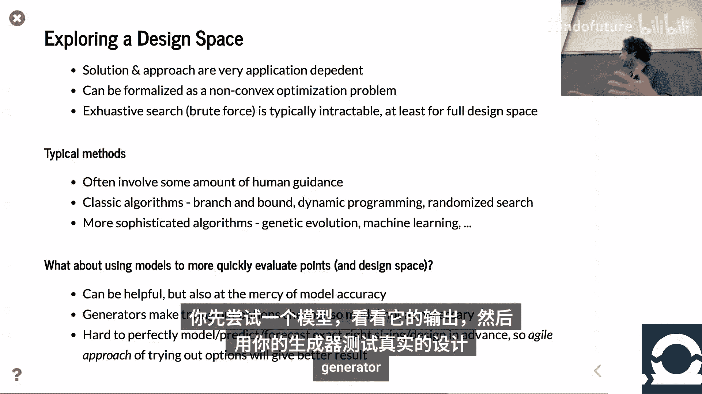

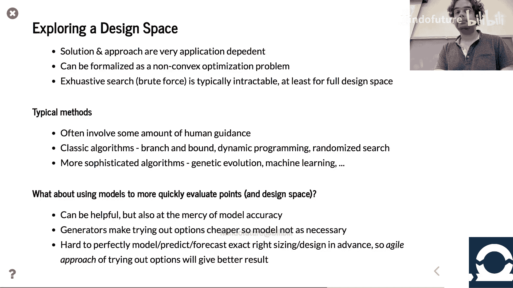

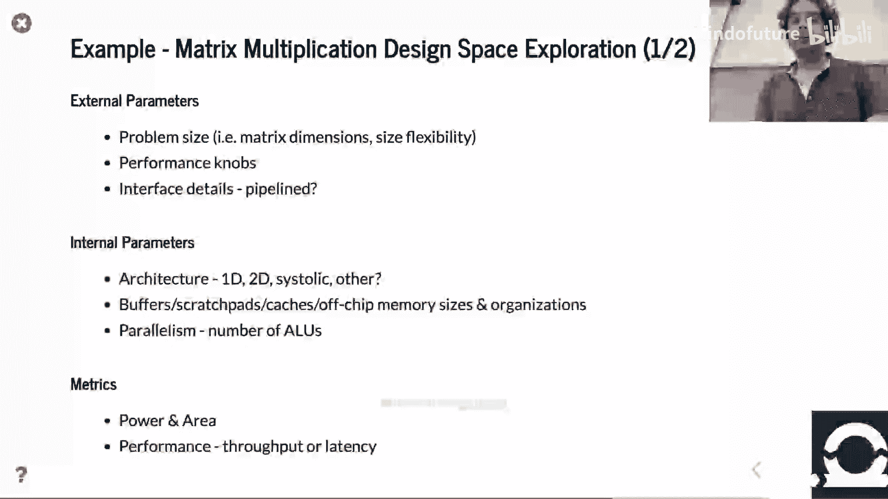

让我们以设计一个矩阵乘法单元为例，应用上述概念。

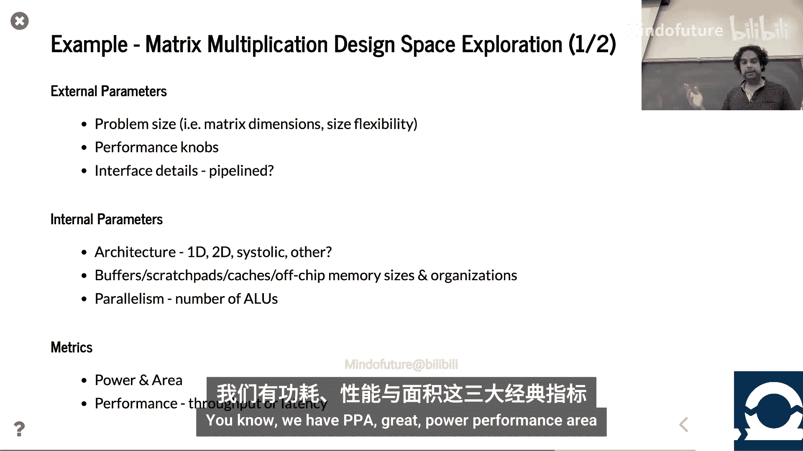

以下是设计矩阵乘法单元时需要考虑的参数和步骤：

1.  **明确问题与约束**：确定矩阵的尺寸、灵活性要求，以及目标是ASIC还是FPGA。
2.  **初步建模与估算**：使用电子表格或简单模型进行“信封背面”计算。估算达到目标吞吐量所需的计算单元数量，判断片上资源（如SRAM）是否足够存储矩阵数据。
3.  **实现与评估**：使用Chisel实现一个基础设计，并建立能输出PPA指标的工作流。
4.  **参数化与探索**：将设计参数化，然后运用前述策略（如引导搜索、算法搜索）来调整参数，生成并评估不同变体。
5.  **迭代与学习**：根据探索结果，你可能会发现新的有希望的参数组合，甚至需要调整架构。这是一个**敏捷的、迭代式的**学习与优化过程。

## 理解权衡与帕累托前沿 ⚖️

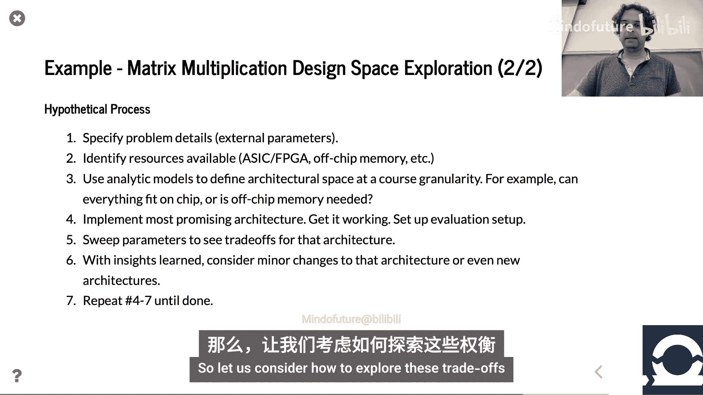

当你试图同时优化多个指标时，就会遇到**权衡**。一个核心概念是**帕累托前沿**。

假设我们有两个指标X和Y（例如面积和功耗），且都是数值越低越好。一个设计点被称为**帕累托最优**，是指：**为了改进其中一个指标（使其更优），就不得不使另一个指标变差**。

将所有设计变体根据这两个指标绘制成图，那些帕累托最优的点会形成一条边界线，即**帕累托前沿**。位于前沿上的点意味着设计已经达到了在当前技术下的最佳权衡状态。如果某个点不在前沿上，则意味着存在一个设计能在不损害任一指标的情况下至少改进一个指标，这是一个无需动脑的优化选择。

拥有设计生成器的优势在于，你可以生成大量设计点，从而清晰地描绘出帕累托前沿，并确保你的最终选择位于这条前沿上，这意味着你已为所关心的指标做出了最佳可能的权衡。

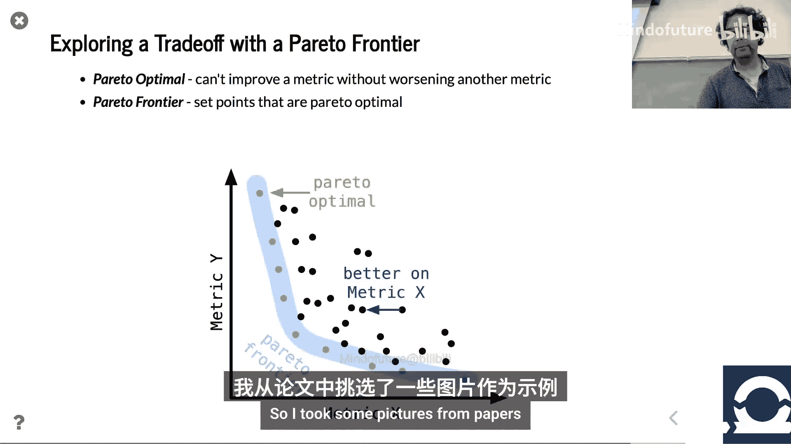

## 帕累托前沿实例 📈

以下是来自学术论文的两个帕累托前沿实例：

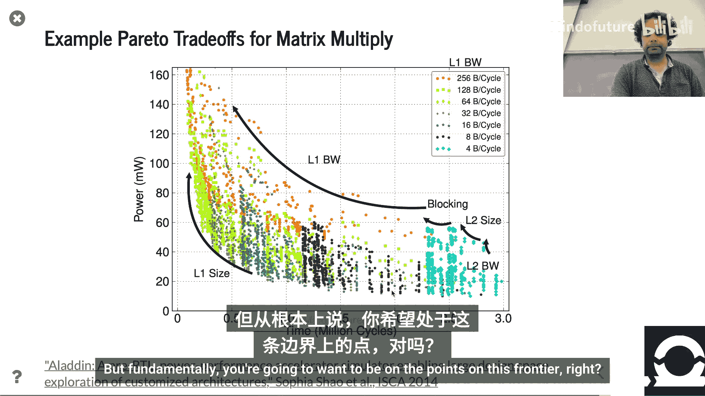

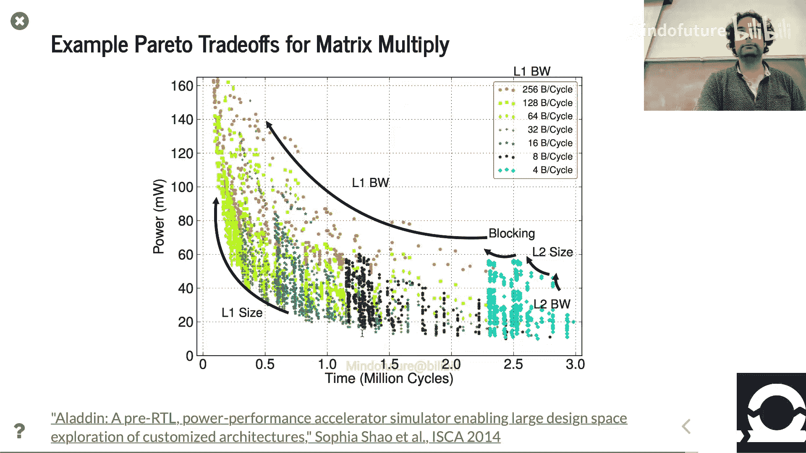

*   **实例一**：展示了性能（时间，越低越好）与功耗（几何平均值，越低越好）的权衡。图中可以清晰地看到一条曲线状的帕累托前沿，大多数设计点都位于前沿内部，只有前沿上的点才是需要认真考虑的最佳权衡选择。
*   **实例二**：展示了不同处理器架构（顺序/乱序，单发射/多发射）在不同频率下的性能（每秒百万指令，越高越好）与能效（能耗，越低越好）权衡。每条曲线代表一种处理器架构在动态电压频率调节下的表现。该图清晰地揭示：对于不同的性能目标，最节能的处理器架构是不同的（例如，低性能时单发射顺序核心最节能，高性能时则需要多发射乱序核心）。

这些图表在工程实践中非常常见，能帮助你直观地理解不同设计选择带来的权衡，并做出明智的决策。

---

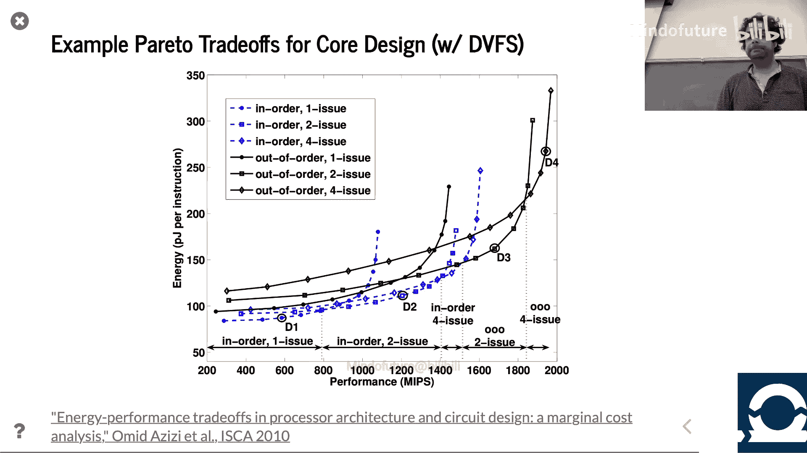

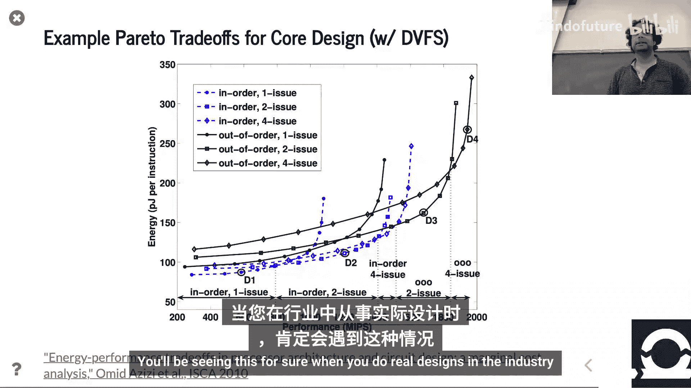

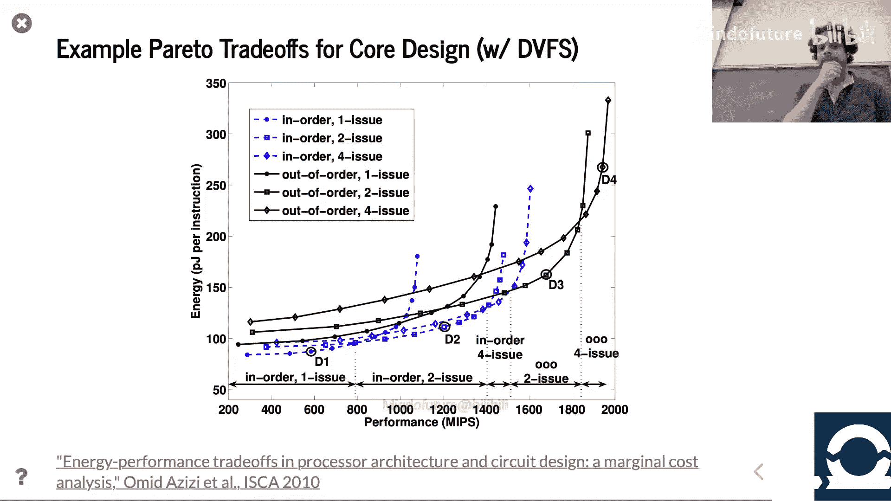

**本节课总结**：本节课我们一起学习了设计空间探索的系统方法。我们首先了解了评估设计所需的各种指标，然后探讨了如何通过参数调整来生成设计变体，并面对组合爆炸的挑战。我们介绍了几种探索策略，从基于知识的引导到使用算法和机器学习。通过矩阵乘法单元的实例，我们看到了如何将理论应用于实践。最后，我们深入理解了多目标优化中的核心概念——权衡与帕累托前沿，并通过实例图表直观地认识了这一重要工具。掌握这些方法，将帮助你在未来的硬件设计项目中更高效地找到最优解决方案。