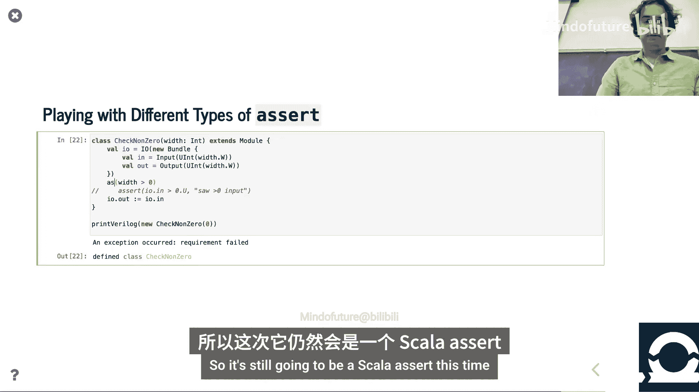
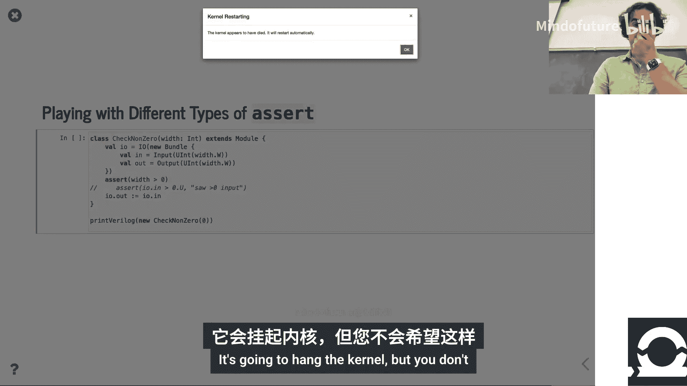
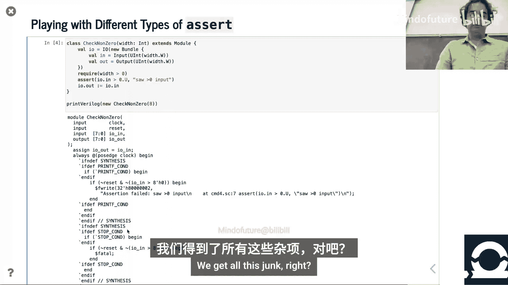
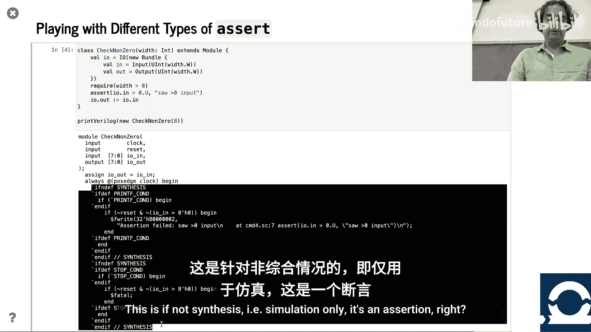
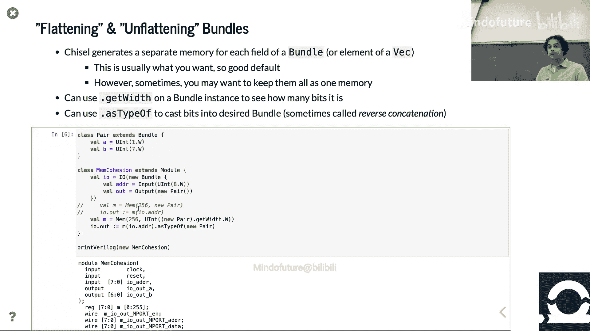

# 【加州大学】敏捷硬件设计-CSE228A-｜-Agile-Hardware-Design-Spring-2025-p30-P04_第20讲-Chisel_工具包概览--BV1M6ivBzESw_p30-

H and welcome to Le 20。😡，Today we're going to see if it's possible we might try a new double header two full lectures。

 they're not full length， but we'll see what's possible。 So in its first lecture。

I I cover what I called the Chisel Grab bag， this is something I kind of accumulate over multiple opera of this course。

 this is the variety of tips of specific aspects about the chisel language， how to use it。As well as。

 you know， common misunderstandings。 And so after having gone through his entire quarter。

You've learned La this course about Sca， about Chisel。

 and so when we talk about some of these issues， you'll have a lot more depth to kind of understand these conversations。

start off， actually remind folks about how does chisel work and now he've been using it for know seven to eight weeks。

This is't a mystery。 And so yeah， we actually have code again today。 So remember what Chisel does。

 right， So Chisel will keep acting with his own language。 Of course。

 it's actually just a valid scholar program right， You've been writing scholar programs all year。

 So you know if you after this term， we wont put a scholar on your resume， that's your choice， right。

😊，And you know， as you've learned， right， if you have a mistake in the scholar level。

You're in a compile error， right， it's going to have a compile issue。The scholar， you know。

 is very good at catching this。 And so Chi scholar library， right。

 particularly it's a embedded domain specific language or embedded DSL。So then well， what is chisel。

 Well children to this library， just running aside your scholar program。And really。

 when your program's running， you just。Are instantiating chisful objects， right。

 These are hardware work components。 They includingncluding things as simple as a literal。

 like a four。And duub type you went， even something like negating。

a reference right now like I out in。 negating that is an operation， right， So each of these things。

Represents hardware。 Those hardwares become chisel objects in the program of this running。

Every object， of course， internally has inputs and outputs representing input and outputs of the hardware itself。

And all of this is being done kind of under hood。 right， So remember we do things like。

When we write your a module， we say extends module。

 Now we know that that's a form of class inheritance。

 And that module we're extending comes from a Chisel library。 And that's。

We was doing all this stuff with kind of hook curls kind get in there right and so under hood。

 chisel libraries tracking all these objects， all the inputs， all the outputs。So like I said。

 our code boils on two things。 either are instantiating things or connecting things， right。

 So connections， you know， we do the connection operator or the bulk connection operator to two symbols。

 They are introducing side effects into these chiel objects， right。

 They are making connection between inputs and outputs or other things， right。😊，So really。

 like I said， your chisel design is a scholar program that Sanchez chisel things and connects them。

And so really， all the parameters I keep talking about and flexibility。

 That's actually a scholar program。 The chisel itself is very simple。

 A chisel itself is instantiating and connecting。 and all the stuff around it is a scholar we can have all the fun。

😊，And so really， as you're making your hardware designs。

 you're thinking about just how do I want to instantiate connect things appropriately， right。

And as you've seen also， of course， if you don't collect things properly。

 the tools may prune it away， but。That's kind of that。

 So we'll keep going I'm going to pause for any questions so far。Okay。嗯。

This is something that comes up in some terms of this course。

 I want to kind of be very clear about this， right so hardware designs。😡。

Our static structurally meaning， you know， it's the same physical hardware， it's the same wiring。

 same connections that doesn't change。However。You know。

 the values on the wires in the hardware can change when it's you know。

 existing in both the real world as well as in the simulation， right， So I said。

 So as we build up hardware， the hardware is static， right， you know。

 we're not going to change the connections。 We're not going to you know， and a new hardware midway。

 All the hardware is going be in place and fixed before we start stimulating or after we finish manufacturing。

 right。He was sort like a mux， which you think of as。Choosing between inputs， right？

The Mus always has the connection to both inputs right。

 just no matter which one is' reading from right so the connections are static this connections are not changing。

😡，嗯。Meanwhile。Why are these cells compared to values over different cycles right so you know it could be value of two this cycle。

 value of four next cycle。But the point is even though the wire is changing its values。

 the endpoints aren't changing。😡，And the water itself actually has no internal state， right。

 It just propagates from the input to the output。 Of course， a rule is some， you know。

Amount of delay。 But the point of view of discourse， when we do cycle level simulation。

 it's instantaneous。So yeah， wire I can change。Value， but really sometimes just a wire has value。

 it's more really just the input it's attached to is changing right because it wire itself propagates that value instantaneously。

 at least in the point of view of as simulationimil this course。😡，And then a by course。

 you have state elements， things like a register or memory， they have internal state。

 and they only change at the rising edge of the clock。At the risingrith edge。

 input becomes the new output and changes internal state。 Otherwise， they do not change。

 And so sudden， chisel， we don't even show the clock most the time。 It's kind of implicit。

 So the result， you know， people sometimes maybe lose track of this， right。 But remember。

 for the most part。Things that change your design。😡，Are gonna change in the clock it。 right。

 The reason why it's gonna to be when input changes。

 It' gonna be register changes and everything else kind of， you know， holds the value， Right。

 It's gonna to be continuous， right， The wire has lot of values given。Stuff like that， cool。

 any questions on that？Great， okay， so once again， Romanmani folks about this， you know。

 sta of hardware， right？ Remember we talked about this notion in chisel of last connect semantics。

 meaning that if there's multiple connections to the same input。😊，Chsel much choose a winner， right。

 Its one of these things where it seems kind of like a runtime behavior， but really it's a static。

 remember， hardware is static， right？ So what does this mean well。

It's the last connection performed in the scholar program I in the generator。

 that's the one that wins， right and。That's going to be encoded into a design does not change。

 right so once that generators run， you know it elaborates and emits that design。

 that design is static is not going to change。And so。As an example of Eos。

 talking about things like when statements， right， So when statements。

Sman think people got a good handle on when they think about them， but remember under the hood。

 they're being done with Muxus， right？And so the mus。

 even though it has the ability to choose between you know way zero， way one。At the end of the day。

 static connections， connections aren't changing。 It's just which one it's reading from。

So here in this example。We connect the output to the input， right。 So， of course。

 if I comment this out temporarily， it's just a simple pass through。We've seen this all corridor。

 can zoom out so we can actually fit on the screen， Sure， it passes through。Now。

Let's say I want to do a thresholding effect like i。e。 clipping。Sure， I can do that， too， right， so。

Hey， you can see here这。The admitted veryo pretty clever， right， there's a condition。

If Ita n is greater than3， I'll put  three。Otherwise， this passes this through。

 and so if you can see this kind of originates， right， where the default is we pass this through。

And then when this condition is true， dont use something else。 right。

 And so you see how the Ch compiler turned into a muux， right， the kind of make that come play out。

If I， for example， o this default。It would yell at me， right， you know。

 not fully initialize what do I do when that condition is not true。 We， of course， know we could。

Do a dot otherwise？For the kind equivalent of an elf， Im sure that works as well。U。

But sometimes the default way of phraing is a little bit more clear， right？You know。

 what do you do statement and if or if else， depending what you're doing。

 sometimes one makes more sense than the other but。The point is that。Yes， you know。

 it seems like this i out seems to win over this I out。 But the answer is it doesn't always win。

 It only wins。When this commission is true， and so that to kind of captured that possibility。

She like compiler used the month。Questions。Yeah。Yes。Okay。

 the question is if chisel targeted and output language uttered in Ver log。What else could you do？

T out it before and hopefully we talk about that again later today。

 so Chisel technically emits something called fertile， which is an IR。

In the toolflow using this course， that fertile is turned into V log。

In the cutting edge version of Chisel， that fertile is turned into a different IR call so it goes to chisel to fertile。

 there's another IR called circuit and then from there in the system Fair log。And so， yeah。

 it doesn't always have to go， you know， straight chisel to error log。 The original chisel 1。

 chisel 2 did kind of go。Chissel a verlog and start with Chisel3 to introduce IR。

 so the possibility of having multiple backends became of thing I'll talk about that a little bit in the following lecture。

Good question。嗯。Cool， okay， so。And the children power is pretty clever。 So for example。

 let's say we have。Nested wind。So this condition is only gonna be true。

 not just when I O dot n is true。 in 2 is true。 Also in one and in 0。' guess what。 Yeah。

 the compiler knows that It can do the end for us。 Let'll figure it that out。嗯。

I'm going to show it to kind of mind folks， you know。All these ones。

 steam's kind of very conditional， very transitory， but no， it's static。m right， in this case。

 it recognizes the output is actually going to be， you know。A one hot is's going to be true。

 And this comes to do that it's an an to get there， right and so。Yeah， the hardware static， right。

 We have all these things in the program that the generator are running。

 but the hardware itself that produces aesthetic static。

This is when it comes up a lot talking to students when they have trouble to bug in their code is how do they have the right kind of mutability。

So I've been encouraging folks especially card functional programming and other techniques。

 you really need mutability IER。Tretty rarely， right。Um。

 and what's interesting about this is a chisel， the librarian scholar。

 can't really tell a you's vel or vr。Right， that's how way youre writing your scholar programs。

 And as I've kind of encouraged， you can write your scholar programs more correctly and easier to the bug if you use mostly about。

嗯。So I want to kind of be very， very clear about don't confuse having mutability in Scala I。e。

 Bavers far。With your hardware design having different values in the wire， right。

 I've had students some years say， oh， well I。Don't want to have this wire be a Val because the can change values。

 It needs to be a v。 So it can change。 It needs to be mutable。 And it's like， remember。

 the val and the v are referring to the references on scala to the richchisel objects。

 It's not at all describing。The mutability， the chisel， the chiselobs。 like I said。

 they're all going be。Incenting harder is harder， of course。

 can change value every time on as simulationimil。嗯。So for example。

 there's some things you can do when you use var at it。Not only can lead to incorrect behavior。

 but can be sometimes hard to debug or surprising， right， Let's say， for example， you know。

 you try to write a counter and you say， oh， I have。You know。Of our counter。

 And then I say counter equals counter plus one。 And then look at the output。

 And you see that it's always one， right， It's always 0 plus one。 And you realize why。

 And the reason why， of course， is that you've assigned counter to be。0。 u plus1。 U right。

 notice how it's the wrong connection operation here。And there's no re here， it's just， you know。

 literals but。The compilers won't tell this is wrong， right for all it knows。

 you wanted to add0 plus one。Right。So。A better way of course， as you know is yes。

 counters you never register sure， but also by using a value。

 you prevent this accidental overriding because if you try to assign counter down here it's going to be an error。

 you need these connection operators。 So yeah， please， please， please use Val。嗯。As an example of how。

 yeah that example of Y Var can convert you。Reasignments can do weird things， right。

 and var is allowed it， vowels do not。And so。Sometimes， you know。

 recognize the common source of errors， such as the librarys attempt to do some cleverness to recognize if you've。

Use Vr this went weird。It is v in a correct way and it doesn't do anything weird。

 technically you can't tell and it'll be fine， but I said you're going to make a mistake。

 humans are fallible。This is gonna happen。 So a common bug that I've seen every operating course。

 but this opera a little surprise， especially my head right now。

 thinking back over the course slackla is this air Association students keep run into。

 which is source to escape the scope of the when in which it was constructed。

 I don't think anyone posted at on the slack this term。 This is a very common error。

 And it usually is caused by someone using a v。嗯。So。😊。

The exactly I down below is not quite going cause that error。

 but it'll show you where we're facing it wrong。 So for now， it's good， this code is correct。

 Just like C， if you're right。 C code is't this not buggy technically safe， right。

 But make a mistake。 You're gonna hurt yourself， right？ So here we have a wire。

We are going to initialize it to， you know， I in。And then we're going to connect it to zero if it's less than zero。

Otherwise， I past。 in other words， this is kind of like。嗯。You actually value， right。 So you can see。

 oh yeah， if it's less than 0， we're going to。Pass0 otherwise the same thing。Okay， so。

This works if I make this a vow。Which is what I should have done。It works。 Now let's go back to Vr。

And if I do this。No airs， no warnings。Absolutely wrong behavior， right？

 So we now we now we know what happened， right， that。Here we have。W， which is a wire。

It points to that wire object。As the scholara is executing。It now makes w。20 do S。

So that wire in that object is floating， it's not going to be garbage like by a garbage collector。

 so now w points to zero。😡，And even that notion that this is a conditional operation is lost because of the way we did this。

 It didn't connect to it properly because it wasn't captured。 And so as a result， like I said。

 you see， this turns into0， right， We just lost all this。 And so， yeah， if I had a vow here。

 it would tell us this is dangerous when I'm reassigning。Because yeah， when you have chisel objects。

 you usually don't want to reassign。 Usually you want to connect them。 And so。Once again， please。

 please， please use Valel Rar and V when you can。Cool questions。Okay。So。嗯。

In a few places in this course， I've encouraged people to use mutable collections since just like var。

 I haven't outright， you know prohibited them， but I think you know， use them sparingly。

We' use a lot， for example， in the game of life in homework 3 because we hadn't covered functional programming yet。

 But now you know functional programming， you know ways to kind of work on collections and rather than mutating collection。

 you can kind of generate a new collection of the new values you want with things like map。

Or dot tablet to pop a new C and that kind of stuff。 You some sort of loop carry dependence。

 You see like a fold left or recursion。 We've seen that， right， So in both phase examples below。

We're trying to have a seek。Or collection of values， you know， zero to 5。

 and then we're going to try and increment it this。

 So one way would be to have okay mutable array buffer populate with dot tabulate and then this iters to a for loop。

 This is the kind of problem which you're used to in a lot of classic languages。嗯。It uses mutation。

hi you don't like， it also has iteration which is just kind of a distraction you thinking a whole lot about。

Why is 0 to 5 and what does that mean， or does that 5 come from。Versus using functional programming。

You can populate the seek， it's immutable， you can make a new seek。

Which takes us to can just add one， right， notice how， you know， way less chance。

' not worry about making this five the same as that fives。There's no notion of iteration。

 It's just a map， right， We're saying， hey， take all the elements other thing and add one to them so。

Both the notion of mutation and durationeration aren't even shown are not necessary in this case。

 and this is much better。 So hopefully kind of you know soldierist material on all quarter and you're excited about that。

Great。Cool， questions so far。Okay， Dan。One more style， list's if anything it comes up。

Is my encouraging people to reduce homo official cases， right。

 So I look at some the code for some homeworks。People sometimes have， you know。

 like if this parameter equals this or if this parameter equals that。 And sometimes that's。

 that's okay。 Maybe the parameter is like a binary thing， right， that makes sense。 Okay， you know。

 it could be a boolean。But it's a totally numeric thing。

It can kind of be tricky because sometimes we're thinking a little bit about how can you make do code less special Ky more purpose that has that generality And one of the things is's actually surprising is you might think that making code super general makes it really complicated in some cases。

 making it more parameterized and more general actually makes it simpler。AndIf you don't believe me。

 go read you know Oster book I recommend a link to in the course and he has one of his things in one of his chapter he talks about this right this comes up sometimes in veteran programming And so for example。

 like you think constructly fold left， which has that in it value can work really gracefully those zero elements right handles that case very well and yet it can also handle a case of you know having nonzero number of elements or which which you want。

If you have a special case， which sometimes occurs， try to keep it to this one。 like， you know。

 if special case do something else， regular case。 But yeah， sometimes you have as， you know， if this。

 if Elsth， Elsth， Els if， you love Elsth。See if you can't， you know。Just talking about that。

 So I people just use this term of， you know code smell to kind of describe something seems a little bit off in the code you aren't quite sure what a lot of L stepss on the parameter is one of the things I'm talking about where it seems a little bit often as we're thinking about what you can do about that。

酷。嗯。So。Sometimes students ask this question， well we learn both four and for each？

You can do a lot of things to those in Sca， but specifically how it does impact。

What you're doing with chisel。 And the answer is， actually。Both can be used in a lot of scenarios。

 they're both very flexible operators the way they're design the language。

Technically for is a proper。Operator in a scholar language versus4 each is a。

Method implemented on many scholarala objects that we happen to be using。

 but that distinction is pretty minor。嗯。So， really。

It's good to think about the use case and realize tendatively you probably force one both in every case。

 but。Stylist view reasons why it's good to use one or the other， right。And so。

For both four and for which， we're actually writing chisel。😡。

Usually the goal is to have the sort of iteration。And the benefit is some sort of side effect， right？

If your goal is to produce something directly。Then map is probably a better， right。

 So4 and4 each or both when you kind of want iteration or a side effect， right， for me personally。

 I think4H is great when the collection range already exists。

 you maybe have a V or a seek or something。 Yeah，4 H is great。 You kind of iterates through it。

If you need to create the range。Then4 makes a lot of sense。 I think we're kind of used to that。

 technicalically， you can create the range。And then call for each on that。That's true。

 you can also iterate on a collection with four。😡，Both are possible。

 this is come a little bit to personal opinion style wise。Yeah。

 I feel like I when I create the range of like four and when I have a collection already exists four。

 each tends to work for me， but you know， there's some room for there。Now， of course。

 there are things like Z with index with4 each。 I made you use effort homework。

 And I think there's some cases where it makes sense。

 I think some cases you may scene a little bit cumbersome right。

 I think if you're doing4 each on its own with Z with index。That's to me kind of cumbersome。

 I would just do a four of to range。The times I would use it with index of four reaches is。

 perhaps somehow maybe map or folds can get the mix without an additional functional operator。

 I probably would not use that。Cool， questions。This is another one where in this course。

 for most part， we great un correctness， not really performance， but。

The computer engineer inside of me can't always stay silent。

Think about what you're doing with the logic elements， right？Catules are pretty smart。

 just like compilers， if you do certain things， they will optimizeize away certain inefficiencies。

 however， theres certain things that you can do。They're not to make the casualule's job easier。

It makes it easier people to read your code， understand it so you having really inefficient code that you're trusting a compiler optimize。

Well， hopefully it's better or easy to read if it's harder to read。That's helping anybody。

Other times when you use certain operators。The CAD tools can't necessarily optimize them。

 So for example， in the game of life the comes like I see some years is people use。

 you know the mod operation or division operation to get growing column inices from a single number。

嗯。And。You know， mathematically， I can check out， but， you know， in hardware。

 divide and modular and the remainder of mod are extremely expensive， right。

 extremely extremely expensive so。You'd want to avoid that。 So for example。

 if you're redoing homework  three。And you did that and you wanted know。

 how could you avoid that in a few ways， number one。Use two counters， right。

 have one counter for row， one counter for column。Some people have， you know。

 a single counter and take the mod division to kind of get their own column municipalacies out of it。

 just have two counters。That's why we're doing it。Other folks also had reverse。

 they had two counters and they turned it back into a single number to use some like multiplication。

Which once again， maybe if you're kind of clever to set things up， you can avoid that。😡，Multiply。

 divide， remainder， These are all expensive and hardware。 We want to use them。

As sparingly or perhaps not at all。Additionally， when it comes time to accessing bits from numbers。啊。

When you're writing software， perhaps in C， you're something you used to doing bit shifts or adss to kind of get the bits you want。

We don't do that in chisel， right， We can do bits selection， right， We can say， hey。

 I want bit 6 to 4。Or dot head or dot tail。 if you want to get a certain bit is also delayed to kind of combine things with cats。

 So between using。Bit selection and cat， always kinds of bit manipulationbllations are easier in chills than they are in a language like。

 see， you don't need to use。Siffts and ans， too often。

Le least on the way you used students for masking and pulling out bits。过。Questions。Okay。

This is a style point rather than the correctness point。

 but I think it's worth thinking about both today and also you kind of writing your code。

That said horror is static， right， like you design the thing， it runs inside the generator。

 once that generator finishes， that design is static， it's not going to change。

So if you put a hardware s inside of a wind block。That hardware always exists， right。

 It's not going to suddenly vanish from that Wednesday statement is not true。 The hardware exists。

 It's static， although one is going to control。Is when those connections are active， right。

 those connections are always damaged just the mus， which I'm just choosingthing between。

So for example， here we have。A counter。And you know， connecting the output to the counter。

And we're using the enable and this when to decide when to count。A files that go zoom out。

 and you can see the code。 You can see that， yeah， there's some notion of。

Only counting when enables on right， So I think this particular usage。Is totally fine。However。

 there are some times where people， I think put large things decide when blocks that I kind of think of I think the hardware。

Go away or something。 and no it doesn't， right， The hardware always exists。 And so。

At the style point， sometimes it's helpful to declare a large box of hardware。

Outside of the one block。Which in this case， we can just simply move that line。

And this is one of the thing that helps people out when they're reading， right。

 It's not necessarily any correct， Both are perfectly functional。

 except this counter is always going to exist。But by declaring it on the outside。

We can now kind of make people aware as counters here。

 maybe they may not remember that new Har is always sent instead winds。

 and then the connection is there now。What I just did is not quite correct， right， actually。Oh。

 it is correct。 apparently， I'm surprised。 Im follows me a buggy。

 I wouldnt say notice how we aren't using。The enabled the way we expect。

I don'll make that more explicit， I would just toss and enable here。And that it'll work fine。

 But yeah， I guess that's what he's saying where you put a large block and have a one statement。

 largerge hardware instants have a one statement， the hardware is always going to exist sometimes putting on the outside makes it clear to someone reading top of the module。

 What's against style points， you know。Putting large module sensations at the top of your module kind of clear that this is where the main structure of this module is going to be。

 and then you can kind of can fill in the details as you go through it。Cool， other questions。Okay。

 small， small point， Merrickanki pointing out Chisel not Chis S Sca has a zillion like， you know。

 features a rich language is not a minimal language right， And so for example。

 when it comes to bounds and ranges， it has until which is exclusive and2。

 which is inclus right so you know， it's a reminder right if I do from zero until exclusive4。

 it get 0 and23。Right， now let's say I realized， oh， shootll off I one near my bug。

You might think to， you know。Do this。I should get four。But I encourage you to。

 know embrace what Sca provide。And do that， right， take advantage of the other keyword。

So roting n plus one and the minus one， you often can。You know。

 use two or until appropriately to avoid the need to do that。This is one that。

 I don't think I have too many questions here in the term， but I'll set the record straight now。

 So you see my examples I use sometimes require， sometimes assert。And actually。

 it turns out there's two kinds of asserts。 and we've kind of glossed over that。

 So let's let's address that right now。 So first of all， wide or two asserts， There's a in Scala。

 which has， you know， always been there。And then there's an insert that chisel adds on top of that。

And so what are they the chiivval assert？Is something that's for your hardware design。

 So the way two asserts are differentiated is what is the type of the thing being given as the argument to call If a type is something that is a chisel chisel bo。

 you get the chisel assert if the type is a scala bully in you get the sca assert so yeah a chisel assert。

It's something。 remember， this is not synthesal ver， right， This is only gonna to be in simulation。

And yeah， it's going to see， hey， is this chisel bull true？If a chisel bull is true。

 nothing happens if that chisel bull ever becomes false。

Dly cause simulation to fail because assertion was fail， right you can of course， also give。

TheF message are researchions。It's a common practice。We surprised how industrial uses a chisel I。

e S5。 They make so much usage of a third feature， right， so they'll often make a large module。

And then for really testing it， rather than writing just a giant test bench。

 should actually write a test module in chisel with lots of asserts。

And those things will then be used to kind of interact that throughout having a different language。

 It's the test has written itself into the line into the test but chisel。

 and asserts to make sure it's behaving the way it expected is to be。Now the scholar assertt。

It's going to not exist in the hard work， right， It's going to exist。

In the scholar program is's running during construction during generation。

 it's not going to be round by time you doing simulation。instead。

 you're going to invoke the sca assertt if you have a Boolean the scala type inside those arguments。

 Now that's the two types of asserts。 So the question of course is what tags required Requi is a Scala feature。

 Once again， Scala and all this richness。 There's always another feature another knob。

 So both require an assert are built in the scala。And they're valid a run time when your programs run running。

 There aren't static assertions。 These are dynamic assertions right there。 your programs running。

 They check that condition when that statement is called。嗯。So what's the difference？

The difference is that require。There's a way sorry。

 there's a way to disable asserts for a compiled version of scholars， you can say， hey。

 I want to build my super fast production binary。In Sca doesn't have asserts， I need to fly tous。

Requires， will not。U， be pulled。And so， yeah， it's a way to kind of have removable versus not removable assertions stylistically。

Requires typically art for checking input sanity。In other words。

 is this the right bound or range and it just sales there's like absolutely no chance going to work？

Versus assert is protecting internal consistency， right， in other words。

 has some and very program it maintains。 Sometimes asserts are more of the compute。

 which is why I said you have this option as scholar of having asserts deactivating looking powerlor flag。

So。As a chiselheler， where a leave you？Chisel asserts are great。Both in a testing module。

 even in the module itself， I said， you can put them in your design your hearts content because they aren't going to be in the final hardware。

 They'll be in simulation。 And so we have tons of them， It might slow down simulation a little bit。

 But if they're checking useful things。In ifpher of anything is correct。

 you're probably happy to have them。For your generator and just your scholar code in general。

 you will want to have some sort of assertions to make sure your inputs makes sense and that sort stuff。

Technically， news require assert or both。 And yeah。

 I argue it requires great for input sanity versus asserts more for invariance。

 but that's a style choice。Cool。Okay。So then let's go around the third。So。First。

Why don't I leave just the require remember require is going to be。A scholar thing。

Has to be at least zero if I give it zero。You know， requirement got failed， Okay。

 make this an assertion。

So it's still going to be a scala threat at this time。It's going to hang the kernelel， but you know。

So now the helpful of error message came out of this， but same thing。 And now they broke everything。

 I got a。Restar my notebook。Okay。So that's goofing round of theses。Now。Note that， okay， let's say。

I make this back to a require。And I don't fail the assertion。So now we actually get verylog， right。

 okay， and she's a pass through module， nothing crazy。If we put on this assert。

 which is a chisel assert， the type here is a chisel bo。Comparing chisel objects。嗯。

We get all this junk， right， what is all this junk？

These are all special directives， you know。

This is， know， if not c I。e simulation only。😡，It's an assertion， right， So's a very long assertion。

 Yeah， is gross， right， but basically， what it do， It does two things if this condition is true and you see it's not just about。

This being true， but also that you no nonre mode。 it prints out insertions failed。

 That what youre to see if you write a very long same later。It also。Heill simulation。Like you know。

 a dision was failed， it' a kill simulation。So yeah。

 this is what a chilist looks like when comes a error。 like I said， this is gnarly a very log。

 you're happy the tools around this and not you。嗯。But the impact is the same， right。

 I as a designer could say know what， Id better not be passing through anything less than zero。

 and I can kind of check that。Cool。Questions。Okay， so then。啊。You know。

 we've had this completion a few times as worth're kind of coming back to it。

How do we think about abstractions， Right， What should go in a module versus a function versus a class。

 Ive see these different mechanisms for kind of containing and encapsulating。Our components， right？

And。You might be thinking， oh， what's， what's the fish or whatever。 No， no。

 Was to make it most clear and easy for humans to understand what's going on and easiest to reuse the pieces you've built and these attractions you built。

 The other aspect are secondary， even things like， you know， you might think of efficiency。

 There are slides give catd tools to worry about that kind of stuff， right。

 You for worry about that later。 Get the abstractions in encapss such that。

U humans can reason about it and you have to reuse that you want possible。😡，For starters。

 and thiss works vast array the cases。Just using a module per component， that's great。嗯。

That that that that' would be fine So what are the other things that come up right。

 we talked about things like classes that are not also a module。

There are some scenarios that comes up。 Those are pretty specific， right， but common cases， yeah。

 just make a new module， no problem。 When you think about what goes into one of these entities。

 they said number want to think about res。 Okay， what is the。

Functionality want it can put together where。People are going to use this right people only want half of this。

 I should make the modules for half of the thing right people want two modules and two modules always used together perhaps there's one way you should make a bigger mod in Catholicpodose right So think about number one。

 what's to reuse。😡，Also about testing， right， Like if you have this massive model you think。

 oh my gosh， I can't figure out how to write a test bench or I'm gonna have to do so many combinations of things。

That should be once again in those code smells。 You should be worried about wait a second。

 That's probably assigned to something weird here。 How can I break these models up into smaller pieces and make it easy to do testing。

 especially unit testing。嗯。One phrase you Ctostrod's book。

 which I'm going to repeat here is full complexity downwards， right？To every extent possible。

Any kind of complexity in your design is somehow how complexity is necessary to over to build things。

Pull it down， bur it even inside modules and prevent people have to understand it right。

 hopefully have a generator works great becausetan generator， give it the parameters。

 plug it in and they're happy。 they don't need to worry about how it works。

 right that's what you want。Puoldling complexity down， hide it inside his entities。嗯。

So what are reasons where you know？I'm saying not to use a module。

 sometimes a function that returns just opponent rather than。

A class or a module is easier and the reason why is you。

 imagine like functional construction using you functional programming。That kind of stuff。

Other times。Some people like to。Kind of merge things together without these modules。

 whether it be classes or functions？😡，So that the hierarchy to see in the various downstream tools。

 would it be the very long hierarchy， you know on waveforms， et ce。Kind of matches what they expect。

 So some of these lowest little entities， which could be modules。 And so that can be dissolved as。

 you know， pieces within the module。 That's a style thing。

 I would do that only if you realize that's necessary and something you decide you want to do。

 But for version 0， version 1。Just like everything a module。Yes。空。Other questions。

This is a really specific point that comes up where some students are really trying to optimize efficiency their code。

So if you。Take chisel。And you make a， I'll say， a mem。Which a man represents eram。

It could be a collection of registers。As you know， asynchronous reads。You do that for a bundle。

 Chssel' is going to make a memory， her feels the bundle。And sometimes for some reasons。

 you may want。To have。A single thing， some example， if I look at this down here。You know。

 we have this bundle， which is a  one bit a field and a seven bit。You know， B field。

 so what do we get， well I want 26 of this bundle type， like get 236， one bit things and236。

 seven bit things。Which， you know， perfectly functional， correct hardware。嗯。

Let's say you talk to your physical design team to come back to you and say， yeah。

 I don't want to build。It trigger six bit。One bit wide memory Wack， right？And hey， gee。

 you put these two fields together。As 8 bits。That would be way more useful， right？ And so， yeah。

 this is a。Kind of a hack to get there。Basically， what you do is you。

Say I want a memory of a un of the widthiff you want， you get the width。Of that bundle。

And then when you access it。You have to kind of cast。That you went back to the bundle tag。

But that works， so we get if you know。2 to6 entry。Eight bit wide thing。不。Any other questions？

Before we sign off， I want to kind of put a couple announcements out there for folks who are all on the same page。

So yeah， this week we have both。Two deadlines or one。

 a initial project checkpoints so making sure you have a working prototype type in the weekca repo doesn't need to be perfectly complete。

 just get something in there working and running， have both some chisville。

 some sca and a test to kind of drive it and make sure you read me。

 you document what you expect to work in not and make sure you I have access to as I can see it。

La the grade it， the other thing is we had that code review something I pointed out to you you go log into canvas you can see the details。

Basically， it's a handful of questions you're looking at。

 you're going to share code with a classmate。And then let me see what you guys discussed。

 usually assigned to your project partner， if you're working alone。

 I tried to make pairings across that， there was one group of three， if I had one group of three。

I did like a cycle。Cool， the other announcement is starting Thursday we have a series of guest speakers。

 so we're excited about them have the guest speaker Thursday as well as next Tuesday and the following Thursday。

 so we have three guest speakers we're lucky to have them。😊，They will be remote。

 but having folks come in in person so we can ask questions live would be great。So yeah。

 we're having speakers talking about a language called spade， which is basically chisel and rust。

 it's in the bed of Ho DSL and R， we'll have someone talking about bluebe， a long running。

Hard description language has a lot of cool capabilities that very unique and actually has some very different distractions from we see in Chid。

 it's kind of fun to see the other side。And then we also have。

This of chisel formal verification which is pretty cool。Great， any other administrative questions？

Okay。😊，So yeah， oops。