# 【加州大学】容错计算-｜-Fault-Tolerant-Computing-Ucsb-Ece-257A-p01-P01_第1讲_第1章_背景与动机--BV19cFyz8EPV_p1-

Greetings and welcome to the first lecture for the graduate course ECE 257A。

A fault tolerant for dependable computing。I'm recording the lectures for this course because instruction during fall 2020 will be。

Inducted remotely。So there are no in person classes。However。

 these lectures I plan to use in future for the same course。In a model called inverted classroom。

 meaning that students will。Watch the lectures before。

dateate of the class and then the class session。When it's possible to hold it in person。

Will be devoted to discussions and questions。So this quarter， the normal class time。

 the first hour of the normal class time。Twice a week。And will be converted to Zoom office hours。

you can。Basically ask any questions regarding the lectures or any other matter related to course。

Also to make this lecture independent of the current quarter。And。

I will not say anything about the specific requirements of the course this quarter。诶。Instead。

 I will communicate that information through the course webage。

And also occasional email messages sent through Gaucho space。So Gaucho space。

 I will not use much except to send messages to。Everyone enrolled in class。There are two excuse me。

 there are two web pages that you need to consult regularly in order to manage this course throughout the quarter。

One is the course web page。ECE257 a。Webage and the other one is the textbook web page。

 I'm using my own textbook， which is in draft form。诶。Available freely online。

In order to get to these two web pages， all you need to do is to go to any of my。ECE is ESB。

PagesAnd no matter which page you end up on， so you can easily do that through Google search。

There is a menu bar on the left side， the screen。That has various sections。

 the two sections you want to look at。Our teaching section。The courses I teach are listed。

 including ECE257A， if you click on the ECE 257A button in that menu。

It will take you to the course or what page and there you see the requirements for the course。

A lecture by lecture schedule， meaning， you know， it's indicated。

What will be covered in each lecture in terms of chapters in the textbook？And a bunch of deadlines。

 including when homework will be posted， there will be four homework。And when each one is due。And。

Also， the various deadlines associated with your research project。

 so there are two components to the course evaluation。Four homework assignments。

And a research paper and its presentation in the form of a poster。So as I said。

 all these details are given on the course website。

And I'll communicate with you through email messages throughout the quarter to supply more detail。

But make sure you look at the。Course calendar on the course webpage。

And sort of make a note of all the various deadlines。

 homework will be due on a certain date and no extension is possible for whatever reason。

Because I want to provide。嗯。Solutions to the homework under due date。

So that you can check your own work。And that the im is necessitated by the fact that I won't do detailed grading。

After homework， I'll just assign ABC， D， letter grade。Do each homework assignment based on。

An overall check。Of the quality of work。And also occasional checks of the details。

 but there will not be detailed grading。Or feedback。Okay。

 so the solutions I provide are sort of feedback because you will know。

Whether you got the right answer， the right solution。On the course are the textbook web page。Again。

 there's another section in that menu menu bar。Entitled textexbooks were the textbooks that I've written。

Pear。You want to look for the textbook on dependable computing。And you see on this slide。

That is up now， We cover。Image of that textbook， this is a temporary cover that I've designed。

 it may change when the book is published。And on the textbook web page。

There are two things that you will get one is PDF copies of the various parts。

 each of the seven parts。In the textbook。Is available as a PDFdf document that you can download。

 but before you download， make sure that the。Last update that you see there is 2020。

Because I'm updating as we go along the quarter these parts。So make sure you download the textbook。

Chapts or parts。呃。After they've been updated for 2020。嗯。

And you also have their copies of the slide that I use for my lectures。

And these slides appear both in PowerPoint format。And Pf。Okay。

 I don't use any animation in these slides， so the PDF is just as good as the PowerPoint。

It's usually a smaller file and also。诶。Easier to navigate on different types of computers or even tablets。

 so I recommend that you use the PDF version of the slide。Okay。

 so let's get started with this introductory lecture that actually has two parts。There is a。系。

Where's the end of the lecture， I will discuss chapter one in the textbook。

And in the beginning is what you may call chapter zero， some material that precede。And。

Preceed chapter one， just some generalities about the field of dependable computing and so on。

And the textbook has been written。And the normal expectation is that each chapter will be covered in one lecture that that's one of the。

Design criteria for the textbook。Lecture size chapters there 28 chapters and there is an appendix that is almost like a chapter。

And。There's simply not enough lectures in a 10 week quarter。

To sort of follow that recommendation a lecture per chapter， so the way I do it during。

The 10 week quarter at UCSB is that I will cover the first four chapters in four separate lectures。

Because those are fundamental background materials， the tools that we need to。

Be able to design and evaluate penable systems。So the first four chapters will be four lectures。

But after that， I will combine two chapters into one lecture。And the way I do that is that each part。

 for example， this part labeled part two defects。This is the structure of the textbook。

 always has two chapters and methods。Associated with that part and two chapters containing examples of the use of those methods。

Some of the most prominent examples and the way I do it is that I will devote one lecture。

 for example， chapter five。Effect avoidance。Combined with chapter seven。

 which discusses shielding and hardening of circuits。As methods of defect avoidance。

 so five and7 will be one lecture， then defect circum convention chapter 6 will be combined with chapter8 yield enhancement in integrated circuits through。

Methods of defect circumvention， okay， so this pattern will continue chapters 9 and 11， one lecture。

 chapters 10 and 12， one lecture and so on。So that's the plan。

 that's how we can reduce the number of lectures to about 16 or 17。And of course。

 we need some other like some other time that there will be a holiday and so on。

normalormal quarters will have a midterm exam。16， 17 lectures is all you normally get during the quarter。

Now， let me say a few words about this image or the two images under cover the textbook。

They are important。Ideas。Related to dependable computing。

The chain here with one of the links nearly broken and coming off。Is intended to。Oh， like me。

Advanced the slide。It's intended to convey the fact that dependability is a weakest link attribute of a system。

 a weakest link phenomenon。Meaning that this chain。Is as strong as its weakest link。

The same applies to dependability if you design a computer system。With various parts， the CPU。

 some memories， some。Bus system to connect them。Some external interface to the network and so on。

And if all of these various subsystems are needed for the system to function properly。

The weakest of those in terms of dependability dictates how dependable the system is。

So you want to invest your money and time in improving that weakest link in order to improve overall system dependability。

The second part of this image。It presents two key ideas in designing dependable systems and those two key ideas。

Our modularity。And redundancy。Modularity means the system is designed in modules。

And these modules are hopefully。Isolated from each other。

 so if something goes wrong within one module。It is not spread， the problem is not spread。

And infect the other modules。This is important because then any problem or failure can be confined to one part of the system。

And hopefully the other parts can tolerate。Or proceed。To function as normal。呃。

Despite one part of the system having failed。Of course。

 the assumption is that failed part is not critical to the functioning of the system and we can set it aside。

Ignore it。 So that's the idea of modularity。A redundancy means the system has more resources than it absolutely needs。

 so if part of the set of resources become unavailable。

The system can still function with reasonable performance。And do at least do its critical task。

 if not all of the tasks that it was supposed to perform。嗯。

And this example rises and say this is a typical cable。That used the。To hold up。

 say suspension bridges。And you see that this cable is modular， there are multiple cables。

Woven together form this sticker cable。 So if one of these cables fails snaps， we still have plenty。

For other cables that are functioning properly and hopefully there is enough redundancy here that we don't really need。

All of the seven cables。To be fully functional。At peak strength in order to hold up the bridge。

Maybe only three of these cables are sufficient。And therefore， if some other cables snap fail。

 or maybe they started with some defects。There are some defects inside these cables that we don't see。

But make the cable less than full strength。

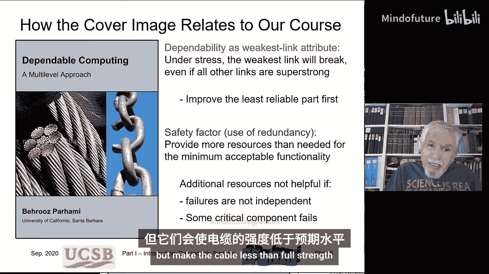

These can be， for example， if these are metal wires forming the cables， they can be air bubbles。

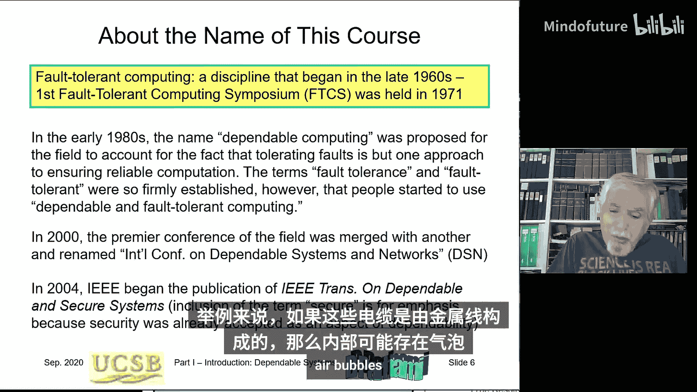

And the metal， so that the metal is not really as strong as it looks from the outside。ok。

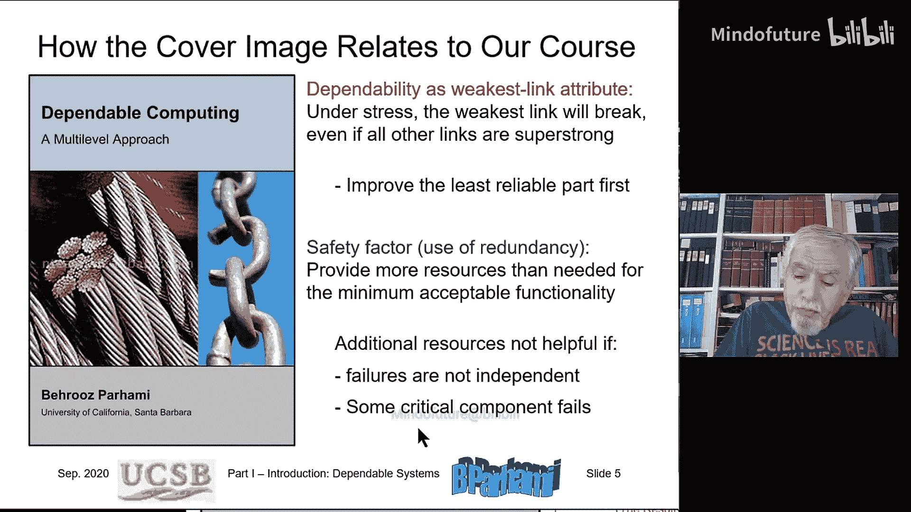

So。The name of this course is fault tolerant computing officially。

 this is a discipline that began in the 1960s。呃。And。A US space agency， NASA。

 was one of the main driving forces。Behind this field。

 because they needed to put computers on spacecraft。Whether unmanned missions or manned missions。

 and these computers had be highly reliable。Because once the spacecraft leaves the Earth。

 there is no maintenance crew that can visit the computer and take care of problems。In some cases。

 these missions， space missions were hit long。Up to 10 years say。

And the computer had to survive for that period of time for that 10 years。Without failing。

 so they needed highly reliable。Computers， that level of reliability that was not available in normal computers that you can buy off the shelf。

 therefore they had to develop。Special。Architectures and designs for。The spacecraft computers。

In the early 1980s， the name dependable computinging was proposed for the field。

Because fault tolerant computing is really a bit。Restrictive。 as we will see in this course。

 I use fault in a specific technical。Technical sense。And。

Although you know fault has been used to describe anything that can go wrong。

 I use it in a specific sense at the logic level。And I also use other terms such as defect the physical level error。

At the informational level， and so on malfunction at the system level。So。

Falult tolerant means those specific kinds of problems that we call fault in dis course are tolerated。

There are other kinds of problems that we will see， so we need error tolerance。

We need defect tolerance， we need malfunction tolerance。

There's one sense in which fault tolerant is quite limited。

And the second sense is that while tolerating faults。It's good。No。

 but why don't we try to just avoid faults altogether？It's called fault prevention。

 So fault prevention techniques and then。Porspondingly， error prevention， defects prevention。

 malfunction prevention。In our terminology， those are also parts of techniques that are used and available to designers of computers。

So dependable computing avoids this problem， basically all the techniques that allow us to design computers to be。

Dependable， more dependable than they normally would if we don't have any special provisions。

The field of dependable computing has a flagship conference。It's called DSN。

International conference in dependable systems and networks there's a long history。

 so this is the latest version。The name of the conference。And it has a journal published by Ipoee。

 Ipoee Transa， on dependable and secure systemss。Of course。

 researchers in this field also publish in other conferences dealing with hardware design。

 software reliability， and so on。And they also publish in other journal， so for example。

 Iroppy transactions on computers occasionally has dependable computing papers these are the two main。

Sources of information， places to start if you are trying to research some idea or technique。

DSN conference and IEpoee transactions and dependable and secure systems。

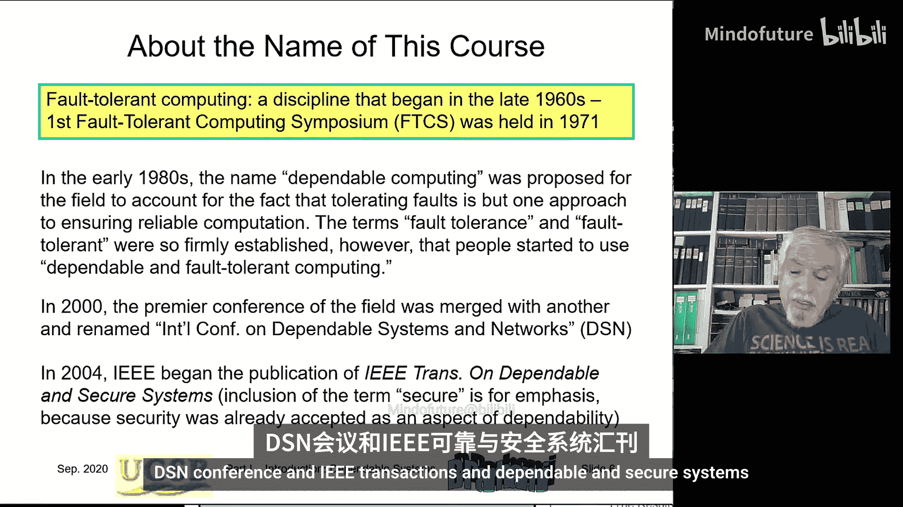

Now， here。Theres something strange， usually when one teaches a course。呃。

He or she would say all of this course is very important， it indispensable。Everybody should take it。

So they've tried to sell the course as important， I'm arguing in this slide that this course should not be needed。

 in other words it should really be removed。From the curriculum。And here is my reasoning。Okay。

 use this analogy。If you think about structural engineering。

 we don't teach people how to design bridges。And then have a separate course。

But some people may not take， it may be an optional course in which we teach how to design bridges so that they don't collapse。

Okay， that's insane。Part of the process of designing and building bridges is ensuring that they don't collapse。

 they're strong enough， they're reliable， they can do their function。Properly。Unfortunately。

 in computer engineering， that's not yet the case， we teach programming。

Often ignoring a lot of methods。在注意。Mentioned in this course。To make programs。More reliable。

Les error prone。Things like bound checking， checkpointing and so on。

 we'll see some examples of these in this course。In logic design。

 we often do not teach techniques of fault testing。And self checking design。

 these are techniques that we'll talk about in this course。So ideally。

 all these techniques should migrate， be merged into regular computer engineering courses。

So that we don't need to teach these techniques in a separate course at the graduate level that very few people will take。

不啦。🤧嗯。But now， given the current situation， we have no other option。But to proceed with this method。

 so I'll teach you a collection of techniques that you can apply。

what you have learned in other courses in order to make whatever you're building or designing。

 whether it's a program。Whether it's a parallel computer， whether it's a circuit， a logic circuit。

To make it more dependable。We're using the older term to make it fault tolerant。

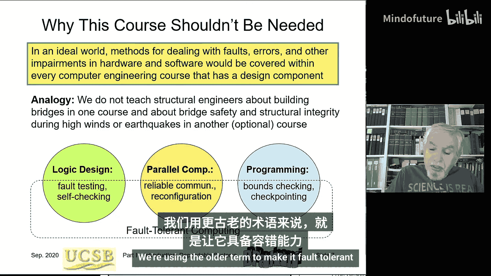

Okay， I'm going to skip， especially in today's lecture。

 a lot of slides because I have quite a few of them。And let you read them， and close this slide。

It sort of in a few words， describes each of the eight decades from the 1940s。To the 2010s。

The decade that we just concluded。诶。What happened in this field， what new ideas emerged and so on？

So it's a historical overview。And then a preview of the decade。2020s decade。

Depending on your definition of a decade， sometimes 2020 is viewed as the last year。

Of the previous decade。Or as the first year of the new decade， so it doesn't matter。

What can we expect？In the coming 10 years， let's say， in the field of dependable computing。Well。

 we still have a lot of ambitious big projects。We have a lot of work to do， so to speak。

Ambitious projects include harsh environments as we go deeper and deeper into space。

The environment that computers on board spacecrafts or computers on board rovers that land on different。

Planets。They must endure harsher environments。There are a lot of life and death situations in which computers are involved。

Including in high speed transportation， self driving cars and so on， so that's one set of challenges。

These ambitious project。The need for computers of expanding and increasingly people who are not really trained。

In computing or using computers。A smartphones everybody uses no matter what they're training。

So we have to make these systems more dependable and more easily usable。

For the increasing set of users that come in contact with them。And maintenance costs are increasing。

 continue to increase。And therefore， the less maintenance these systems need。呃。The lower。

The overall cost。Data is increasingly generated in digital format and kept in digital format。

If we have a digital journal， technical journal。There's no longer a fallback position where you can go into the library and check out the printed copies。

 some journals don't even have printed copies anymore and therefore protecting data and ensuring。

On lives for。Data files that we create is becoming increasingly important。

And then the emphasis in design is also shifting， we no longer put large teams of hardware software developers to build a dependable system。

Harrdware development， including。Designing and building new chips。It is now extremely expensive。

You really can't afford to do that。So we take this known as commercial off the shelf cots。

Hardboard components。CPUs， GPUs， memory chips， and so on， things that are built。For general use。

And then we somehow put these components together in a way。Yeah， it gave more。Depenably。

The primary mechanism for doing that is to sort of。嗯。

Wrarap that hardware in layers and layers of software。

To protect it against various external elements and influences。Of course。

 software itself is prone to failure， so it's a tricky situation to do this。

But we have developed techniques。To。诶。Develop software that is more reliable。

 and therefore we'll talk about some of those techniques。And of course。

 like everything else in today's society。Considerations of fairness， equity and social justice。呃。

Have been brought to the forefront。For example， you probably have heard about artificial intelligence being criticized。

For not being fair， for being biased。And researchers are working to。Remove these problems。

 build artificial intelligence systems that do not exhibit any bias。And social justice， of course。

 especially in the United States， given recent。Development， social developments。

Has become very important， how do we ensure that all these computer systems， whether。

Particularly dependable or not。Are applied。In a way that honors social justice and in fact helps us。

Create a socially just society。Okay， the next three slides。Something I call a B test。

I used to give this pretesting class and then have students。

Write their answers and then spend a few minutes go over the solutions and basically self grade。

Their pretest to see how they did， wasn't part of the formal course requirement。

 sort of something that gives you an idea about how prepared you are for this course。

And how much you really need this course？So these are four questions。

 the questions are mostly about probability。And that's a subject that you need to be comfortable with in this course。

 we refer to probabilistic。Oces quite often in the course。Because dependability， of course。

 is itself ensured in a probabilistic sense。You can't say a system is 100% dependable。

 there's no such thing as a perfectly dependable system。So we assign probabilities to。

The level of confidence。That we have in the system being dependable。

So these are some questions about probability， including questiontion four。

 which is the famous Monty Hall。

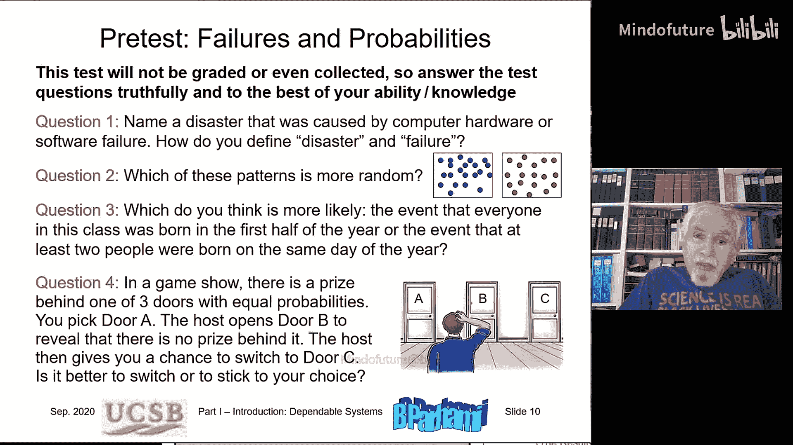

Problem。Make sure you read these and answer them and a lot of times you can find。

Answers on the internet to these problems。That you can check to see how you did。Now this one。

 question five I put on a separate slide。It's a key observation here that。Obviously。

 you see from the photo that something has gone wrong here。It's forklift and it's low。

 they're not supposed to be there， but they are， something happened。

I want you to speculate discuss scar for this mishap that you see in this photo。

Wasas due to some design flaw。And the forklift。Some implementation bug。Maybe the design was okay。

 but it was implemented incorrectly。Procedural inadequacies and using how to use the forklift。

Or human error。And of course I give you a spoiler， we really can't tell which one it is。

 so I want you to sort of do your best to guess you know what went wrong here。What happened。

 why is it that the forklift is in the position it is？So there is no one correct answer。

 but basically discuss。What's happening here？And here are five more questions。呃。

And at the end of the slide， you see if you have trouble with three or more questions。

 you really need this course。Okay， if you have any problems or you want to discuss any of these。

 you can do it during our office hours。Which basically the first hour of the two scheduled course session on Monday。

And Wednesday beginning at 10， so 10 to 11 Monday， Wednesday will be my Zoom office hours。

Where I will provide you with a Zoom link through messages。And then you can come discuss these。

me if you want。

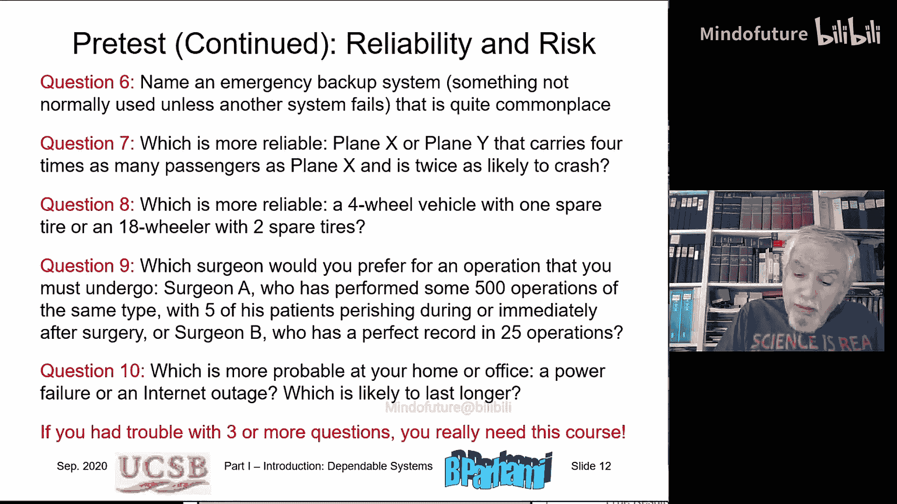

Now this is a picture of a collapsed bridge from 2007。诶。13 years ago now。

 So I don't know how many of you remember this。It was a bridge in Minneapolis over the Mississippi River。

That collapse。诶。And people died due to that collapse。Although not very many， luckily。And then。

Life basically was disrupted in that region。Because this was a very important bridge it was over and it was connected an interstate highway so a lot of traffic。

Business and。Just personal traffic went over the bridge。

 so when it came unavailable people who say lived on one side of the bridge and working on the other side。

Had to take much longer paths。The interstate highway was disconnected until the bridge was replaced and so on。

So it has major consequences。Lives were lost and also there was significant economic disruption。

So the thing is bridges， of course， we expect them to collapse once in a while， just as we expect。

Airlineers。To crash once in a while。There is some non zero probability of an airliner crashing or a bridge collapsing。

 of course we。Hope that doesn't happen often。But that's part of the cost of using these technologies。

However， this collapse， you know， in the case of bridges， we build them。

 make sure that they're reliable at the outset。And then they usually have a useful life。

F they get two。呃。Unreliable， we simply stop using them and replace them with new bridges。To hope。

 to avoid such incidents。Well， you may say， well， how do we know that the bridge is about to collapse？

Well， in the case of this bridge， we knew。It collapsed in 2007 as early as 1990。

 17 years prior to its collapse。Experts inspecting this bridge had warned that it was structurally deficient。

Meaning that it was in danger of collapsing。Okay， that was basically nothing was done for that except increasing the inspection frequency。

Which I obviously did not stop the。Disaster from happening。Then in 2001。

 six years before the bridges collapsed。Again， the team of engineers declared the bridge structurally deficient。

呃。It had developed fatigue in those various parts。And again。

 they simply improve the inspection plan rather than doing something about it。

 the right thing would have been to just say， let's stop using this bridge or let's start building a new parallel bridge。

Say it takes a year or two under normal conditions and then what's the new bridge。

Is available and can be used just just demolish this bridge， they didn't do that。

 they continued using the bridge。They continueded spending money on what was really cosmetic improvements。

 road repairs， adding lights。Doing something to the joints， etca。Which obviously wasn't enough。

 so there were plenty of warnings that this pitch could collapse。So it was a case of basically。

People not doing their jobs， people who were in charge of safety of that bridge， not doing their job。

So one of the things that I emphasize in my course on dependable computing is that we as experts have。

Moral responsibility。To stay informed about the status of systems。And。So to speak up when something。

You see something that is wrong and。Does the potential of creating dangers。Dangerous with to。

5 or two。The dangerer of causing serious economic harm and so on， we have to speak out。

And that's part of the moral responsibility of a design engineer。

To bring these matters to the attention of higher ups。And if they don't listen。

 if they don't follow the technical advice。Then to go and inform the general public of potential problems。

 this is known as whistlebing whistleblowing is aval。Job。Okay。This is the Titanic， the ship that。

Was built with a lot of fanfare it was。Sort of labeled this unsinkable and this unsinkable ship。

Actually。Thank， during its first。Ocean trip。and。This story has been well documented and you can read about it。

 why it sank。What were the problems and so on？This is a high speed train。

That wasn't in use yet for passengers。 This is a test track on which。

They were testing this high speed train in Germany。And。

This train actually crashed into some barriers on the test track。Killing 23 people。

And those 23 people were basically engineers and some observers that were taking a test ride。

This train。Imagine if this had happened after the train went into operation and there were many hundreds of。

Passengers， the outcome would have been even more disastrous。So basically。

 when you build a high speed train， you can't assume that everything will be fine。

And that the train will be operating normally， you have to。Think of。Abuse。User errors， sabotage。

 terrorism， and so on， all of these have to be taken into account。

In assessing the risk of using such a system。Okay， I'm going to skip a lot of slides in the rest of this part of the presentation and this slide examples of design flaws and computer systems。

Including a hardware example。A software example。And a user interface example。

These are all very interesting stories and I urge you to spend some time following up to see。

What they were， and。What kind of harm they cost？On this slide you see causes of human errors。

 human errors are actually a major cause of problems in computer systems。And therefore。

 much time has been spent。诶。Trying to assess。You know the severity of human errors， the frequency。

 and so on。And in this slide， you see some of the causes。

Of human errors and the percentage assigned to them。诶。In all the cases that have been observed。

 so you see personal factors as the same cause。ACocting for more than a third of human errors and personal factors include lack of skill。

In operating the system， lack of interest or motivation。Fatigue。The poor memory。

Age of the operator or disability。

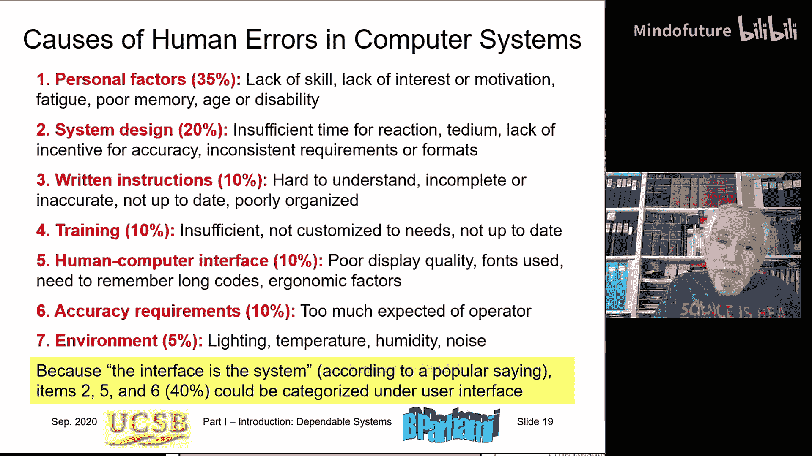

Okay， when something goes wrong and assists them。We often get messages from the system that tell us something went wrong。

 and these messages have to be clear， unambiguous and helpful。In other words。

 they have to tell you exactly what happens and be helpful in the sense of guiding you。

On what to do about it。Now this is a place where we need much improvement。

 so sometimes you run the program and comes back and tells you fatal error without。

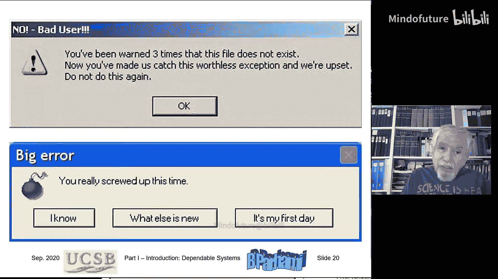

Specifying exactly what went wrong and what you can do about it。It's not specific。

It's not unambiguous and it's not helpful。Its very important that messages coming from the system with regard to things that。

Have gone wrong， B。They are unambiguous and helpful。User interfaces are。

Basically one of the major causes of problems and errors。

 and these are some properties of a user interface。That I let you read on your own， it's a checklist。

 basically。If you ever design a user interface， you have to consult this list to make sure that you have followed the。

Advice， the recommendations。

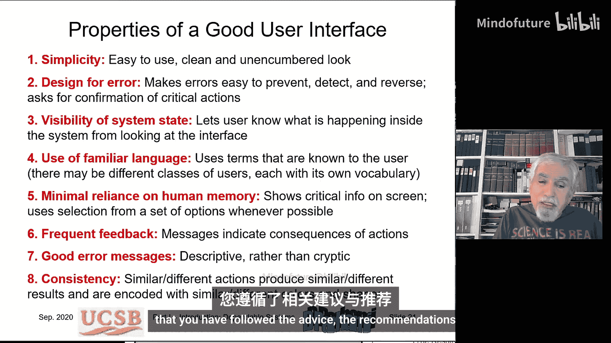

There is this forum called Ri Digest。Moderated by Peter G。 Neyman。

And the web side is given on this slide。I highly recommend that you consult this risk digest periodically。

 go to that website， they have a newsletter， you can subscribe to the newsletter so that they will send you。

Occasional。Emails were news stories posted to the forum and the forum consists of stories that people contribute about things that went wrong。

And it's not only things that went wrong in computer systems， but generally technology in general。

 okay， and technology of course is。Nowadays， indistinguishable from computer technology because computers appear everywhere。

Inside all other technological systems。And this particular example you see on this slide is very there's a very important lesson。

 it's about the nuclear reactor in the US。That almost experienced meltdown。

Meltown is what happened in Chernobyl and the former Soviet Union。诶。

Where a nuclear reactor melted down， there was。Eadly level of radiation。

 the area had to be evacuated and it's still not。People are still not allowed in that area because of the dangers of radiation。

This almost happened in the US， we got lucky that it didn't actually happen。

So what happened there was that this nuclear reactors have control systems。

 computerized control systems。And have safety provisions。So if something happens， that is fishy。

Let's say temperature in a part of the reactor goes too high。The pressure builds up。

Or radiation leak is detected。Does the safety procedures shut down the reactors so that at least nothing more will happen。

And then there's also an emergency backup system for power because if power goes out in the area of this reactor。

 we want to be able to run all these safety systems。Unm back of power。Okay。

 so each of these were tested individually， the safety system was tested exhaustively and it operated。

Correctly， in all the tested cases。And the backup generator was tested under various conditions to see that it will kick in when power goes。

好。However， the combination of these two apparently was not tested， in other words， what happened？

When you are a backup power， one of these safety。Issues arises so that the safety system has to operate。

Oh you may say why is the safety system even dependent on what kind of power you have。

 but that you have regular power backup power， it turns out that in。Complex systems。

 the types of systems that we have nowadays。There are interaction。Problems。

That do not show up when you test the various subsystems individually。So even though theoretically。

 the backup power should be just like regular power so that the safety system can use this backup power。

Opererate normally。That's usually not the case。So there may be some aspect of this backup power that is sufficiently different from regular power。

That sort of。Throws off the safety routines and makes them behave a little bit differently。

So this is very important。You know， a lot of times the problems that arise in modern systems is due to different parts。

Interacting rather than any one part actually failing or malfunctioning。

The interaction between these complex subsystems。Is one of the sources of problems。

And I have a lot of examples here words stock market， computer failure in the year 2000。

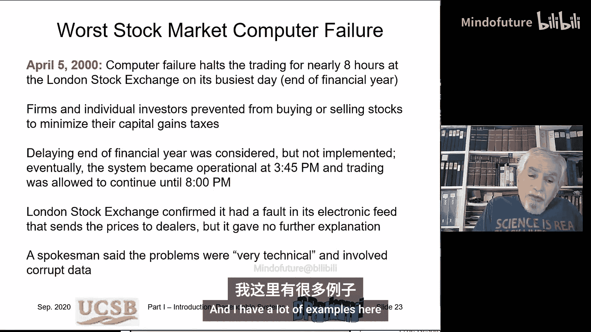

A few items from the years 2012 and 2013。In the risk。Rrisks， digest。

 these are just examples of course I've summarized the item the details can be found。

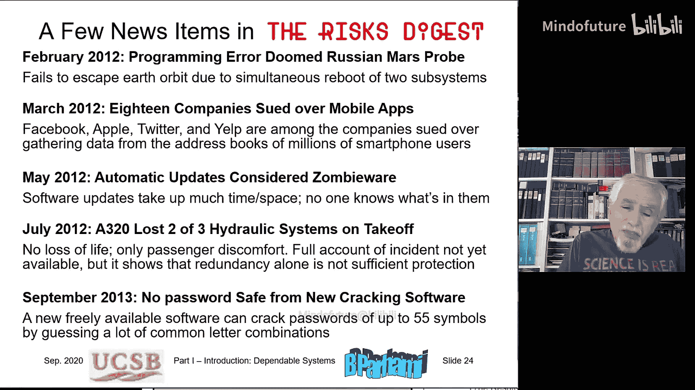

And the archives of the risk digest。Actually， failures are things that benefit us。

 we learn from failures。According to Henry Pattrosky， who is an engineer who studies。Failures and。

Issues and designs， he has multiple books and he writes columns。So on。诶。In his book。

 successucs Through Failure， the Paradox of Design。Published in 2006， he said this。

 which is one of my favorite codes when the complex system succeeds that success masks。

It's proximity to failure。Does the failure of the Titanic？

Contributed much more to the design of safe ocean liners than would have her success。

That is the paradox of engineering and design。So the Titanic could have encountered maybe a smaller iceberg。

Or you know， less damage could have been done to it， and it could have survived that particular。

Incident。But we would have never known how close it came to photo failure thinkinging。

Because it actually sank， we studied the problem a lot more carefully。

And discovered in great detail what went wrong， what was wrong in the design that led to that disaster and its。

First， voyage across the ocean。Similarly， bridge collapses， high speed train。Accidents and so on。

 each of them teaches us something about how to do things better in subsequent projects。Okay。

 this page has a few questions that I ask you to please answer in an email。

You can do it in the body of the email， you don't need to attach anything just。

Answer these questions and email me the answers。This is for me to learn a little bit about you。诶。

Outside what I know。From the class list， I know your name。

 I know a little bit about your major and so on。So this gives me a little bit more idea。

 about if you have an advisor who he or she is and so on。嗯。What is your GPA？And in fact。

 one of the things that is。Quite important， given our mode of operation。In remote teaching。

It's for me to have sort of an idea about how you look so that if I run into you on campus。

Or elsewhere I recognize you as my student。And this is not happening because we don't have classes。

So either Gaucher space， if you don't have a picture， please put up a picture。In your profile there。

 or just email me a photo with the answers to these questions， whichever is easier for you。

So that I have an idea of。How you look。

Okay。So that was sort of chapter zero， some general ideas about。

But the course is about what the field of dependable computing is about。

 so this is chapter one in the textbook。嗯。Background and motivation I keep checking here to make sure that recording is continuing because I。

Previously recorded or thought had recorded this lecture almost。To the end。

 and I noticed that recording had stopped after a few minutes after seven minutes。

So I'm basically repeating。Most parts of this lecture in this new video。

 that's why I keep checking to make sure that the recording is still continuing。Okay。

 there are some cartoons for us to break the monotony。诶。

So this is part one of the textbook here in chapter one， background and motivation。

And we'll have three more lectures on this part。Dependability attribute in lecture2。

Combinational modeling and state space modeling in chapter3 and four。

 these are basically methods that allow us to model the reliability or dependability。

 other aspects of dependability in a computer system using probabilistic combinational model。

AndUsing state space models， which are basically。Various forms of Markov chains。

So those are tools that we use throughout the course to。Assess。The dependability of systems that we。

We design， talk about。Okay， here are some more examples of。诶。Problems in computer systems。

 hardware problems， software problems。Interestingly。When I started studying this field。

 hardware problems。Where。Actually， very serious， because hardware。It's very expensive。

So we couldn't afford to put a lot of redundancy in。And。But were tended to be unreliable， under。

Conditions that were not predictable were not predicted well enough。

So a good part of the field dealt with hardware problems。But hardware was easy。

In the sense that hardware was not very complex in those days so you could。Basically。

 spend a lot of time on hardware， test it rigorously， and be pretty confident that。

There are no problems in the hardware that you have designed。Software has been complex for ages now。

 hardware is catching up modern CPUs， for example。Have billions of transistors in them。

They're very complex。Maybe still not as complex as the most complex software systems。

 but they're really comparable。At least in terms of order of magnitude。

 so there are a lot of parts in this hardware system。Exhausive testing is。Almost。Imractical。

Therefore， we face the same problems nowadays in both hardware and software。

 the problem of complexity。And this the two examples that you see at the bottom of the slide。

 I urge you to read them， the yellow box。诶。And both are examples of。

In retrospect we can call them silly problems， we laugh at the designers not to have foreseen these problems。

 but this is pretty common， you know， in hindsight a lot of things that go wrong。

Could have been fixed very easily if someone actually。Paying attention。

And therefore that that's the lesson for us， we have to really do our job。Study the system carefully。

 consider all the special cases， the so called it cases that can arise and can throw out the system。

And。We are not good designers if we don't anticipate these problems with each cases。Nevertheless。

 we still see， not these examples are from 2004 and 1996 are pretty old。

 but we still see instances of these silly problems。Therisising in computer systems and causing。

Difficulties。These are a couple of examples of rising complexity from 1992 to 2002 in a decade。

 Microsoft Windows。Rose in complexity from 4 million lines of code to 40 million lines of code。

And it's even higher these days。The Intel Pentium processor rose in complexity from 4 million for the original version to 40 million for Pentium4。

And to 500 million transistors or a successor， ittanium2。Process。

So you see that hardware is also increases in complexity。Over the years。

This is one of the major challenges in designing dependable systems。In fact， one of the。Surest。

Techniques。To make system do。Pable is to make them simple， make them as simple as possible。

As few features as possible。Don't add features unless they are absolutely needed for proper functioning of the system。

 the simpler the system， the more likely it is that。You can make it dependable and insured and test。

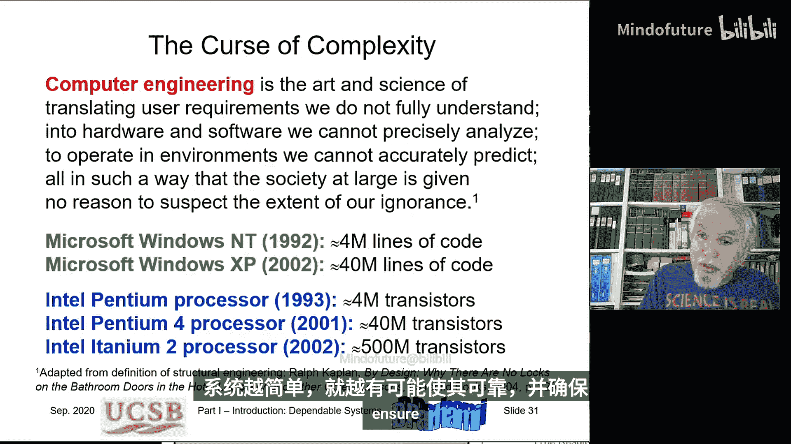

It's dependability。So what is failure？At a very high level。

 failure is defined as an unacceptable difference。Between expected and observed performance。

Sometimes we use the word behavior in performance。So between expected and observed behavior。

Now structure or buildings such as building or bridge need not collapse catastrophically to be deemed a failure。

 I'll give you a good example of that。So anytime it is not performing its function as expected。Aspec。

And it has failed。So failure is not always。嗯。An extreme event such as the system exploding or crashing completely。

It can be running smoothly except that it produces the number four as the answer。

Instead of the correct answer too。No， it didn't crash。Didn't burn。It just。

Spit it out the answer foreign stuff too。Which is a failure。Okay。

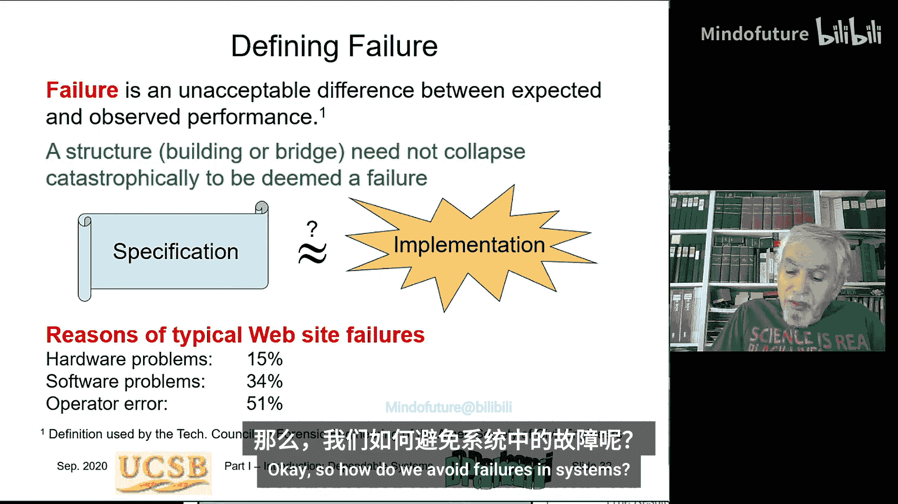

就。How do we。Avoid failures and systems。 Well， in structural engineering， there is this。

Very commonly used technique。Ald safety factor。That we use when we build a bridge。

 we do calculations to see how thick those bars and ems should be。

In order to be able to bear the expected load on the bridge。When we do the calculations and come up。

 for example， over the beam。That has a cross section of say， five square inches。We just say okay。

 five square inches is enough according to these calculations， let's make it 20 square inches。

A safety factor of four interviews。The reason we need the safety factor is that。

We are unsure about the strength of these material because they can have hidden。

Imerfections or defects that one aspect。We are not sure that we have considered all the different loads and forces that will affect this bridge。

For example。Have we considered the strongest wins？Be considered。

The worst earthquake that can arise in this region。The biggest truck that can cross the bridge。

 of course， in the case of bridges is' common to put a sign in front of it to prevent trucks。

 for example， that are heavier than。5 tons to cross the bridge。

But there's nobody there to enforce this。It is possible that the bigger track。

 heavier track actually crosses the bridge。And of course， we can say， well。

 that's the driver's fault。Because the driver knew that。The spread is not designed for a big truck。

But we really don't want to punish people who violate these。Regulations with death， you know。

 its sort of。Provide additional strength in the system to be able to tolerate。

These abuses that may arise。But unfortunately， in computer systems， we do not have a corresponding。嗯。

You know， we can't just say， okay， I wrote this program。

 it has a thousand lines of code let me throw in 3，000 additional lines to make it stronger。

 to make it less likely to fail， that doesn't work。

Actually putting more lines of code is likely to make it less reliable。

So we have different techniques， but the idea is the same， we have redundancy。

 we introduce redundancy into our system so that redundant resources。

Allow us to tolerate some things that can go wrong。Okay。

 so the picture you see at the bottom right of the slide is an example of a subtle failure。

 this is the Disney concertcer hall in Los Angeles。It opened with fanfare。

It's architecturally very interesting。Depending on your taste in architecture， you know。

 you can say it's a very。Good looking building。 Some people will say it's。

AMons is not really that interesting， but a taste aside this building was built。And。

It prettyretty much did the function that was designed to do much of it anyway。

It provided a space for concerts and other facilities for。Different kinds of arts endeavors project。

However， when it actually opened。Occupants of an office building across the street。

Started getting reflections of sunlight through。The curved shiny surfaces of this building。

And sunshine was reflected into their buildings， raising the temperature。By a few degrees。

To the extent that it became。Comfortable。For them to work in that office building。

So this is a kind of failure that I said， you know， it's not catastrophic。

But the architects and engineers who built this building should have predicted that these shiny surfaces would reflect sunlight and should have。

So the foreseen and which direction they reflect and whether it can cause。

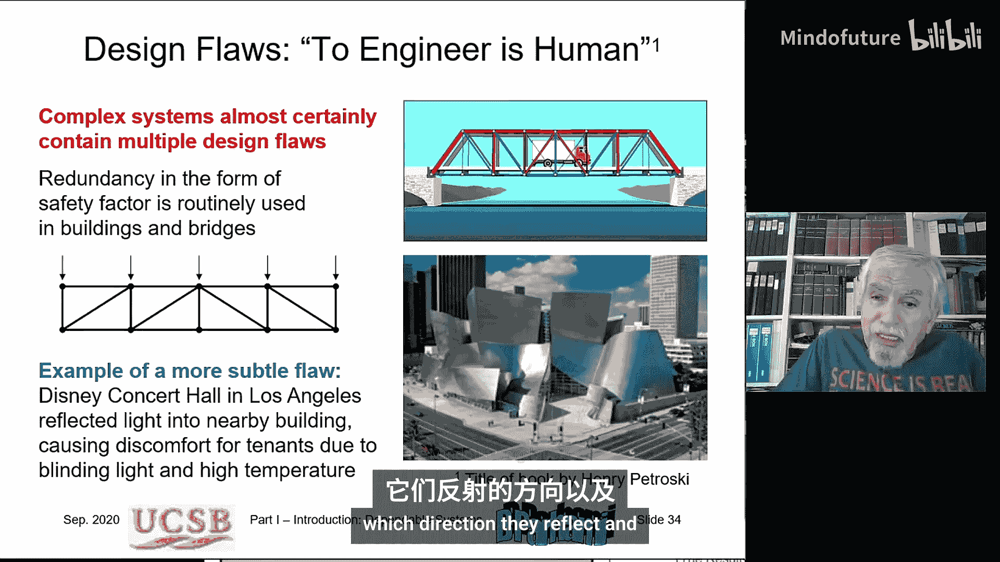

Inconvenience for people living in those areas。An example of the types of failures that they talked about earlier。

So you can say this was a failed building project in that sense because it created。problemsblems。

Okay， why？Is dependability a concern？As I said， you know， systems。Or growing in complexity。

And I will justify this equation later。没有呀。In the next lecture。

The reliability of a system over time T。Is given by this exponential function。

E to the minus n lambda t T is the time the system operates。

N is the number of elements of components。And Lada is the failure rate of each of those components。

 I'm assuming n identical component。Each of which has a failure rate lambda。For example。

 lambda can be 10 to the minus9 per hour， it's usually a small number。

Each component fails with probability 10 to the minus9 over one hour。So lambmbda is a small number。

 T is basically how long the system is supposed to run， and n is the number of components。

So if I want to make this system more reliable， increase r of T。

There are only three parameters that I can play with。Reduce Lada。Reduce n。Reduce T。

But there are limits within which I can play with these parameters。So T。

 if the system is supposed to operate for 10 days without maintenance， then I can't do much about it。

If my computer is put on a spacecraft that is going to be in space for one year before it reaches its destination。

 it needs to operate reliably for that one year。So that it's still functional when it gets to the destination and tries to do maneuvers or other things at the destination。

Of course， I can reduce T。拜e。Sort of doing what is known as periodic maintenance。

 so if this system is supposed to run for a year。After each month， maybe。

I do a complete test of the system。Preemptively replace some of the components that I think might be getting old。

 and this is routinely done on airplanes， by the way。So an airplane has various parts。In its body。

 the engines。And these parts are actually replaced periodically before they actually fail in order to reduce this parameter T。

Reduce n。Okay this is basically one of the maxims of dependable computing。

 make the system as simple as possible， use as few components， as few parts。

 as few features as possible。Of course， you can't reduce n。Beyond a certain point。

Need a certain number of transistors or gates to build a processor， okay？

You can work hard in reducing that， but you can't go below。A certain minimum number。

So simpler systems tend to be more reliable。Reduce lambda， reduce the failure rate。In other words。

 use components that are more reliable。I may have components that have Lambda。

Equal to 10 to the minus9 per hour。If there exist components would lambda equal to 10 to the minus 10 per hour。

 much more reliable。And use them。诶。The downside is that such more reliable components are often extremely。

Expensive， way more expensive。So。You know， your project may not be able to afford。

 so basically parts manufacturer actually sell parts。Of different reabilities。

 you can get typical parts pretty cheap。But those highly reliable parts。

That have undergone a lot more testing， they've gone through special manufacturing processes。

 are way more expensive。Of course， if you are working at NASA and you want to build a couple of computers for spacecraft。

 you may be able to afford。Those were expensive parts。

But if you're working at the cell phone manufacturer wants to build millions of cell phones。

 then those expensive parts will raise the price of the cell phone and therefore may not be。

approvedroved for use if they make the cell phone twice as expensive。

Compared to what the competitors offer。So as long as the reliability equation has shown there。

 these are my only three options， the alternative that we pursue in this course is to change the reliability formula altogether。

By introducing redundancy。So notice that this equation is based on a non redundant system in other words。

All n components must be functional。Over time T。In order for the system to remain functional。

If I build the system so that it has a redundancy。So that know， there are 10，000 components in it。

But only 9，000 of them are required the system to function。

Then the reliability equation changes and that's basically one of the main techniques that we use。诶。

But designing penable system。So here you see the curve of reliability according to that equation。

N T is on the。Psonal access。Lambda is taken to be a constant 10 to the minus9。So as Nt changes。

 the reliability changes according to this curve。When NT。Is fairly small。Resliability is high。

AsNT increases beyond a certain point reliability noseives。So reliability at 0。3679 is useless。

 therefore we don't want to run this system。Up to nt equal to 10 to the9。

So if n is equal to 10 to the9， you don't want to。Run it for one hour。It gaveave n as 10 to the 8。

 you don't want to run it for 10 hours and so on。And reliability 。

9048 is maybe acceptable if you are sending。As an unmanned spacecraft to Mars。

 the success probability of 0。9 may be acceptable in other words with 10% probability doesn't succeed and you lose your time and investment in that spacecraft。

But if this is'tend， you， pretty soon we'll be sending astronauts to Mars。

And the reliability or success probability cannot be 0。9 in that case， it has to be much higher。Okay。

 so if suppose I'm aiming for a reliability 0。999。This level of reliability。

That means n times t should be 10 to the6。Okay， n is measured in unit component T in hours。

And lambda， remember， I said it's 10 to the minus nine。Okay， so this means if I have。

One million components and equal to 10 to the6。Then one hour is the maximum amount of time it can run the system。

If the reliability is expected to be this。Okay， if I have， let's say 10 million components。

 then t should be 0。1 at most， 0。1 hour。If I make the system simpler so that it has only 10。

000 components。Then it can run for 100 hours before reliability goes below。999， okay？

So the simpler I make the system。The better it is from a reliability viewpoint。Okay。

 so if that equation is what we have e to the minus n lambda T。Then。

If you want to ensure reliability， you need some other measures。 You need to。

Have special design techniques for introducing redundancy。So here for example， I suppose。

Lambda is 10 to the minus9。The onboard computer of a 10 year unmanned space mission。So 10 years。

 if you convert it to our， is a certain number。And that means that the number of transistors in this computer can be no more than about a thousand0。

But a few thousand。If the mission is to have a 90% success probability。Of course。

 there isn't much you can do with a thousand transistors， therefore。

You are forced to use other techniques。The safety argument goes like this。

 suppose you have an airline company。That has thousands of planes。Each plane has hundreds of flights。

P year。And the probability of a computer failure in a 10 hour flight。Is about 1%。

And not every computer failure is catastrophic， I suppose。0。

1% of computer failures result in a crash these are just you know made up numbers。

 but they're not far from reality。Each crash causes hundreds of deaths。And for each death。

 the airline。Company should pay。But that's the going rate。

 about $10 million dollars to the survivors of each victim of the crash。

And this amounts to billions of dollars per year， so the airline should budget。

Billions of dollars to pay off。These damages to。Families of crash victims。Okay。

 so the other side of this is that the airline is。We prefer to spend billions。

To make these computers more reliable， experience fewer failures。During a 10 hour flight。

Because then the budget will be。The required budget for these compensations would be much lower。

And then we have the availability argument for doing something about our designs to increase their dependability。

Cent phone facilities downtime should not exceed a few minutes per year。

Central phone facilities basically things like the central switching centers of companies like AT&T。

 Verizon， Big phone companies。Economically and from the viewpoint of reputation。

 they cannot afford to have more than a few minutes of down time per year。Meantime to failure。

 what we'll establish later for such a system with this reliability。

Equation is 1 divided by n lambda。So from this figure here， we can compute the mean to failure。

Assuming that we need 20 to 30 minutes for a diagnosis and repair。

And that lead us to the conclusion that this central switching facilities of the big phone company cannot have more than about 10 to the four transistors in it。

Which is way， way under what we need to have in such a huge。Switching center， okay。

 so all these three arguments point to the need。We're doing something to change this equation because of this equation。

Exponential reliability equation rules， then we are stuck。We can't send。诶。

Spacecraft on long space missions。safetyfety will be compromised， safety of course。

 is in terms of human lives。At from the。诶。Sor of selfish view of this airline company。

 safety is equated with a certain amount of money。That they have to pay。And availability of。

Critical systems such as phone company switching centers also dictates that。We changed that equation。

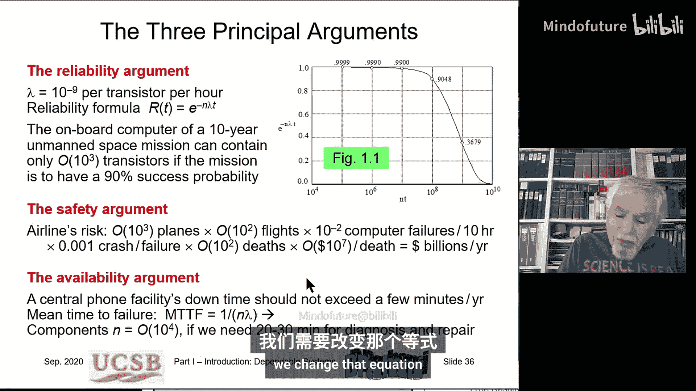

I'm going to skip this one。Skip this one。Okay， so let's look at case study。In which we have users。

And we have files that they need to access in a distributed system。So this is highly simplified。

 but it will do for。诶。The types of things that we want to do。So suppose the user the site one。

Wants to access a file。And this site three。And let's assume that we。

Access that file through this direct link between the site。In other words。

 the user sitting here will have access to this file。If and only if。

This link is operational and this site is operational。

So I'm simplifying because I'm assuming if this link is not operational。

 then perhaps the user can access that file indirectly through site zero。

 I'm going to ignore that to make things simple， okay。But let's say the link availability is L。

And the site availability is S， so S times L， the site available， the link available。

 assuming independence failures。Is the single copy availability？If S is 0。99 and L is 0。95。

Then the unavailability of the data to this user will be around 6%， so 6% of the time。

The user cannot get the data he or she needs。Which means 94% of the time。

Data is available so availability is 94%。Unavailability is around 6%。So what do we do about this。

 6% is a high unavailability rate？We can。Duplicate the files， in other words。

 the file will have a copy here and a copy here。Can tripliccate the file with redundancy。

And we have a third method that we will discuss。So here's the applicationplication， so each file。

Has a home site。And it has a mirror site。Or the file escape and the identical copy of the file gap。

And of course that copy has to be really identical。

 so if this file changes that change should be reflected in the mirrors side。

 and that creates a whole bunch of challenges that we are not dealing with in this simple example。

So we assume that the mirror site is magically updated every time the home site is updated。

So the user can now get to the data of interest either through link L6。And site S 3。

Or through link L0 and site S0。And this is the availability equation。Okay， the file is available。

If the primary site is accessible。Or if the primary side is not accessible，1 minus SL。

But the secondary or mirror site is。So this is now the reliability equation。Remember。

 in the previous example， we needed both this link， the site be operational。

And the availability was low。And now the reliability equation has changed。

 the availability equation has changed。And this leads to 0。

35% with the same numbers that they used in the previous slide。Po35%。So 99。65% available。

 which is much better。Okay， so this involves 100% redundancy for each file。

I have an identical copy occupying the same amount of space。On a different side。

So we went from 94% availability to 99。65%。What's simplifying assumptions， okay？Now。

 suppose we tripate the file so the user wanting。File。And go to the primary or home site。

Or to back one。Or to backup2。 And this is now the reliability equation。

 If the primary site is available， then find。Otherwise， if the primary site is not available。

And backup one is available。And we are okay。If the primary site and backup site are both unavailable。

Then the second backup site。And this is the new reliability equation。

And this one gives you an unavailability of 0。02%。So this time we went from 94% availability。To 99。

98% availability again， with simplifying assumption。

 So the idea here is that we can do something about。

Changing the shape of the reliability or in this case， availability expression。

In order to improve the situation。Both of the methods that I discuss entail high redundancy。

 100% for duplication。And 200% for tripplication。 so a natural question is that can we do。

Almost as good。With less redundancy。And this is where。You know。

 I make the point that techniques that we use in this course on independentable computing in general are not all trivial。

 of course， duplication can occur to anybody。Tropplication， everybody can think of it。

 they're simple methods。You know， in a car， you have four tires that are being used and you have one spare tire that's redundancy。

If you want to improve the reliability， maybe you can use two spare tires。So that the two。

Have to get two flat tires。 You can still。Continue driving the car。

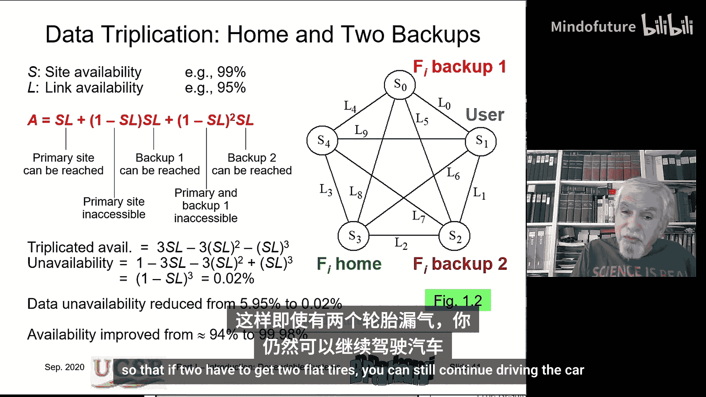

So， here is。A more sophisticated example that entails less redundancy。

So each file is divided into five pieces， I'll show you an example of how this might be done。

And in order to。Reconstruct the file， you need any three of these five pieces。Okay。

 it's a special type of coding。I'll give you an example of in a minute。诶。

So you divide the file into five pieces。And。Any three of those pieces are sufficient for you to reconstruct the original content of the file。

 Let's see what happens now So the user is sitting here。 These are the five pieces of the file。

 Well one piece of。Of those five pieces is right here on the side。If the user is using the site。

 presumably the site is available and therefore piece1 can be accessed。

So the user needs two of the remaining four pieces in order to。Reconstruct the file。Okay。

 and this is the shape of the。Reliability equation of those four pieces， if all four are available。

 then obviously that's more than enough。If three pieces are available and one piece is not available。

 and that can happen in four different ways depending on which of the four pieces is not available。

You're still okay。If two pieces are available and two pieces are not available。

 that can happen in six different ways。For choose，2。Okay， so this is the reliability equation。

 the availability equation。And if you plug in these numbers。Into this equation。

You get an availability of 0。08%。What is the redundancy。

 it turns out that the redundancy is only 67% in this case。Okay， so non redundant。Z% redundancy。

 you got 6% on availability duplication。0。35% with 100% redundancy dripplication， 0。02%。

Withre 200% redundancy in this scheme。0。08%， not quite as good as duplication。

 but definitely better than duplication。What 67% tend？Okay， of course this is just an example。

 you can reduce the redundancy even below 67% and still get reasonable availability。

So where does that number 67% come from， okay？

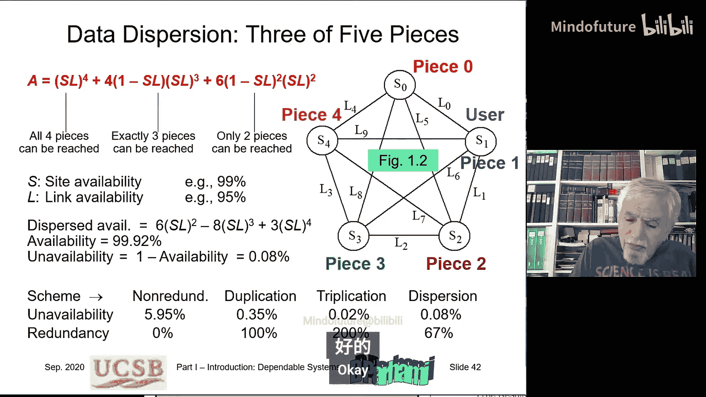

Let me show you just one way of doing it。Suppose the file that you're trying to encode consists of just three numbers。

 A， B and C。Okay，3， 32 bit numbers。This is a highly simplified example。Okay。

 so the file has three numbers。You use those three numbers as coefficient of this second degree polynomial。

 AX squared plus Bx plus C。And evaluate that polynomial for x equal to  zero， x equal to1。

 x equal to 2， x equal to 3 and x equal to 4， you get five numbers。So， the original。

File with three numbers is represented as this file with five numbers。

 so that's where 67% redundancy comes from。So these are five points。Any three of which。

Would be sufficient to reconstruct the numbers A， B， and C。So here are， for example， F of1。

Ass this value。F of3 has this value， F of4 has this value。

If you fit a second degree curve through the three points。

 and there's a unique such curve that goes through all three of those points。

And that curve will give you the numbers aBency。Okay， if you have only two of these points。

 let's say F of3 and F of4， they are inadequate to reconstruct A。

 B and C because many different curve of these dotted。Ps can go through。Plus two points。And in fact。

 this method was developed originally by Michael Robin， a computer science researcher。

For secret sharing。So for example， if you have。The combination to a bank safe。And you have five。

Managers in that bank。And you want to arrange the situation so that you need at least three of those managers to cooperate in order to be able to open the safe。

Okay， you want to guard against fraud， you don't want a single manager to be able to do that or even two managers。

A collllude to take money and run。You need at least three managers。

 so this is the way you would do it。So this is the combination。

You give these five numbers to the five managers。AndThree of them can get together。Using the numbers。

 the information that they have， reconstruct。The combination and open the safe。Okay。

 so it was a basically computer security。Trick or method。Okay， let me skip this。

 so impairments to dependability have variously been described by words such as fault， bug， defect。

 malfunction， crash， failure， and so on。And these words have been used historically， haphazardly。

AndWith no。Well known definition of each or distinction between what's different between a fault and a bug。

A bug and a defect and so on。 So one of the things I've done in my multi level view of dependable computing。

And the textbook that I've written is to give these terms precise meanings and able to use them in a more or less precise manner to describe events that occur in a computer system。

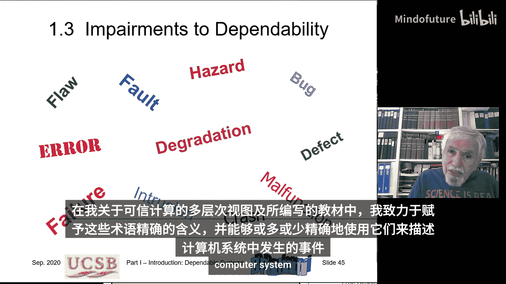

I'm going to skip these background slides and go directly to this model that I've developed。

Over the years。For dependable computing， it's a seven level model that says a system is。

Hopefully idealde doesn't have any problems， it runs perfectly and everything and it is okay。

This is wishy washi for modern systems， modern systems will have some。Lant problems。

 built in problems that may not always be visible， but they're there。The system。The device level。

Can have defects， these devices can have defects and the system is called defective at that level。

At the logic level， we can have fault， logic faults， and the system may be faulty。

At the system state level， it can be errors， we call the system erroneous。

At the system or architecture level， various components or subsystems can be malfunctioning。

At the service level， the service of the system can be decoratedgrade。Can be less than ideal。

And finally， at the result level， the system。Faiils。Now the model postulates that we move。

Downwards through this model。As things go wrong。Until eventually we get to the failed state。

So these are basically things that cat can happen over time due to the system wearing。

We're out of the system or some intruder doing something to the system to make it go downward。

 but we also have these upward transitions that we build into the system。

So when the system becomes faulty， we can detect and remove the fault and move it upwards further away from failure。

When a system starts the starting state can be any of these， which is kind of weird。

 you would think that the system should start in the ideal state and then later go， that's not true。

 there have been examples of systems that have started。In the failed state， in other words。

 they never actually ran as expected， they were failed to begin with。

So the system can start in any of these states。And then it can sort of remain in these states。

So it may be defective。That effect really doesn't take it。Furtherther down， make it faulty。

For example， we may have built in defect tolerance methods。

And those defect toleranceance methods allow the system to remain in the defective state without going further down。

So these are basically tolerance methods。These are undesirable events， the downward transition。

And these are desirable effects of remedies that we built into the system in order to move it。

Back up toward the ideal state， if not completely to ideal， at least further away from failure。

Of course， it's a simplified feature of this model that we say a defective system can become faulty。

In practice is possible for a defective state to go directly into the failed state。

Something happens that。Fact， basically。Bes a problem that the system fails。Those are possible。

But much less likely if we have designed the system according to some design principles。

 so defects generate faults and they don't go directly into the failed state。

So this is the model on which。The structure of my textbook is based。嗯。So basically。

 I have a part dealing with defects。I have a part dealing with faults。And errors， malfunctions。

Degradations。And failures。 and there's a part at the beginning that is the introduction。

 so those are the seven parts。Seven parts of my textbook or my view of the field of dependable computing。

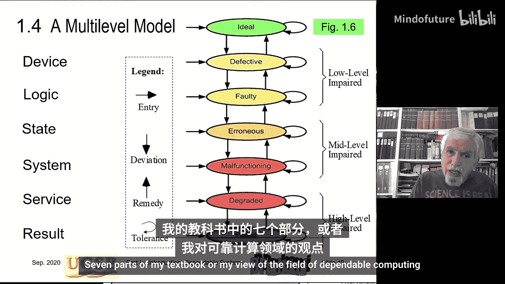

So here is a nice analogy these seven models can be viewed as。Concentric reservoirs。

So this is the innermost is the defect level， then default error。Mfunction， degradation， failure。

And water flowing into these tanks， reservoirs。It's basically the undesirable events that are occurring if we let water flow。

Into say the defect， there are more and more defect。

 then eventually this level will overflow and then eventually this level will overflow and then water will go out and that constitutes failure。

The entire system has failed。So we can reduce the flow of water， this is an analogy。

Oing inlet mouth represents avoidance techniques， we have a bunch of techniques to avoid defects。

Avoid fault。Avoid errors。Avoid malfunctions， avoid degradations， and avoid failures。

So if you close these valves。Then either water will not flow in or will flow at a slower pace。

 therefore extending the system life。

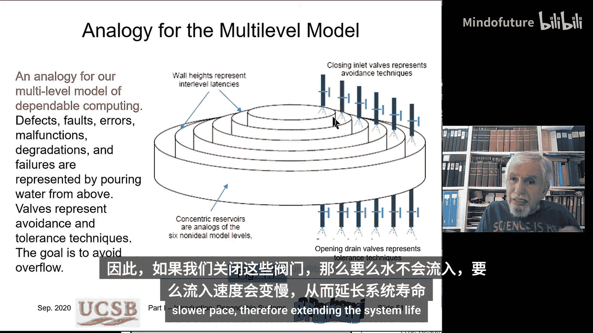

Oops。

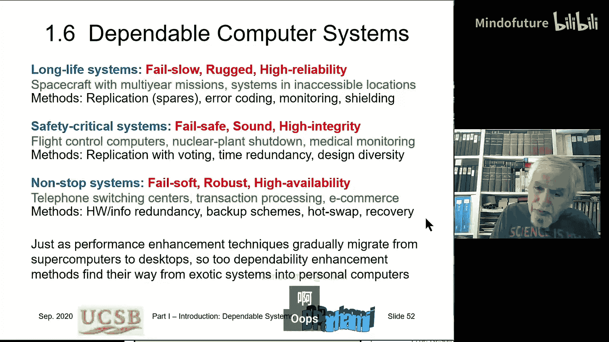

A tolerance techniques。Corresponds in this analogy to these drain valves。

We can have a lot of defects。But if we have defect fact tolerance， in other words。

 we drain water from that innermost tank。At a high enough rate。

 then water perhaps does not get into the next tank and so on So I think this is a nice analogy that says。

As long as you have a bunch of avoidance techniques to restrict the flow of water into these tank。

You have a bunch of tolerance techniques。To remove water at a high enough rate。

 water will never overflow into the outside world and therefore causing。System failure。

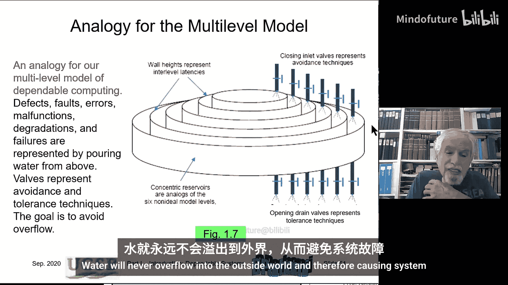

Depenable computer systems are。Categorized into three classes。Long life systems。

These are typically the systems that you put on spacecrafts。

 they have to live for a long life without maintenance。These are known as high reliability systems。

Or fail slow systems。Oh rug assistance。For safety critical applications。

 we need systems that are fail safe。In other words， they either don't fail or if they fail。

 they fail in a safe mode so that they don't endanger human lives or other cause other serious problems。

These are high integrity systems。And finally， nontop systems， these are high availability systems。

 these are the systems that， for example， e commerce site places like。Amazon and eBay use。

Because if their system becomes unavailable， even for a few minutes。They lose a lot of revenue。

It's in millions of dollars for each minute of unavailability。

So these are basically high availability， robust or fail soft。System。So parts of the system can fail。

 you know， a few servers here and there can fail。At Google or in Amazon。

 but the system is built so that that does not have a big impact on the overall system operation。

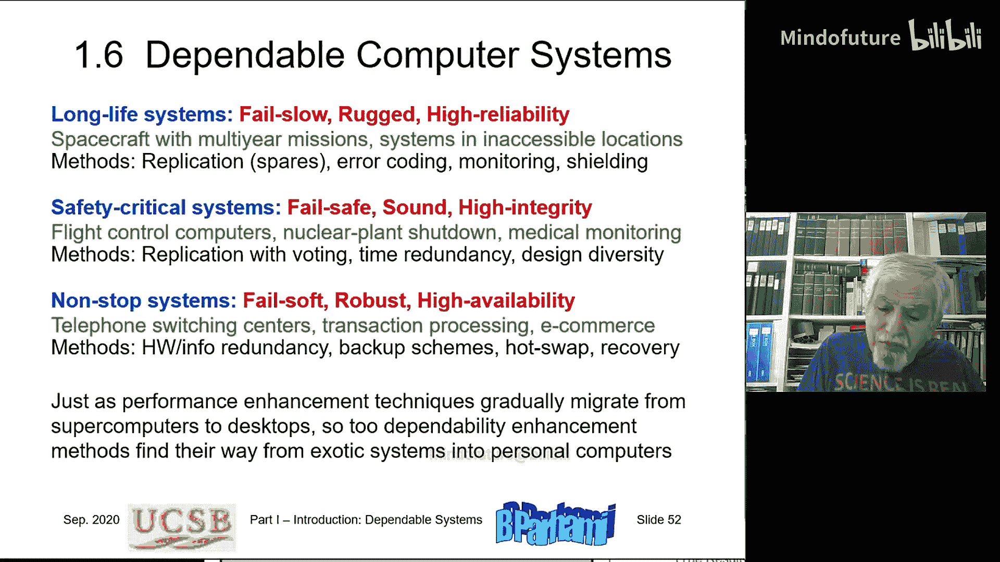

Okay， so I'll stop at this point next time next lecture。

 we'll talk about dependability attributes chapter four。Okay， bye bye and stay safe。

