# 容错计算：1：背景与动机 📚

## 概述
在本节课中，我们将学习容错计算的基本背景与核心动机。课程将介绍为什么我们需要设计高可靠的计算系统，并概述实现这一目标的主要方法。

## 课程介绍与结构
欢迎来到研究生课程 ECE 257A——可靠计算的容错技术。由于2020年秋季学期采用远程教学，我将录制本课程的讲座。这些讲座也计划用于未来的“翻转课堂”模式，即学生在课前观看讲座，课堂时间则用于讨论和答疑。

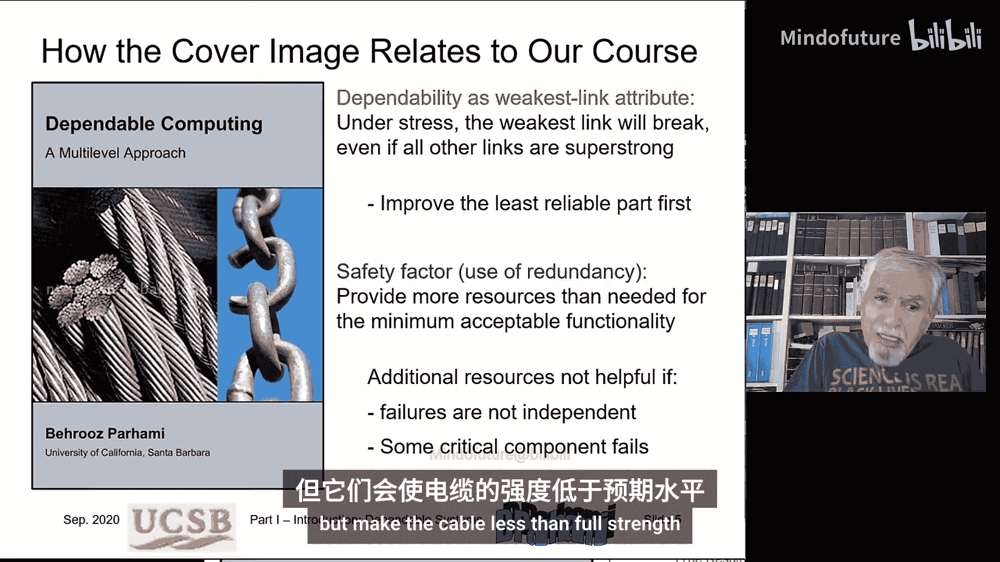

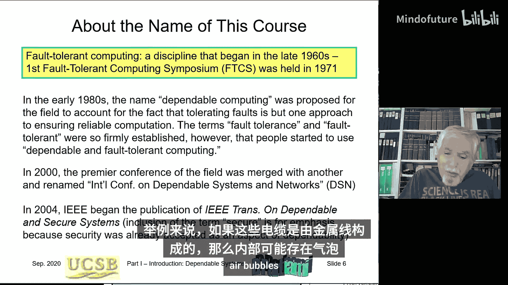

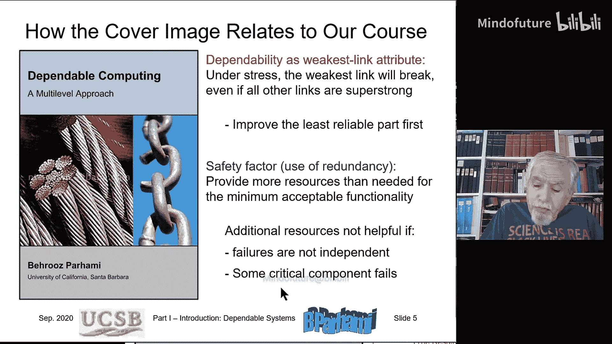

本学期，原定的每周两次课程的第一个小时将改为Zoom线上答疑时间，您可以就讲座内容或课程相关问题进行提问。关于本学期的具体课程要求，我将通过课程网站和GauchoSpace邮件进行通知，不会在讲座中详述。

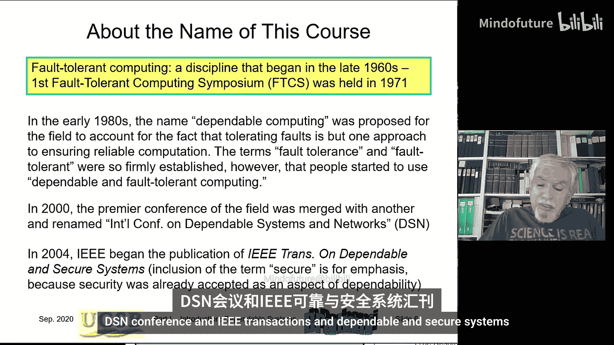

您需要定期查阅两个网站来跟进课程：
1.  **课程网站**：ECE257A网页，包含课程要求、讲座日程、作业截止日期和研究项目信息。
2.  **教材网站**：我编写的教材草稿可免费在线获取，包含各章节PDF和讲座幻灯片。

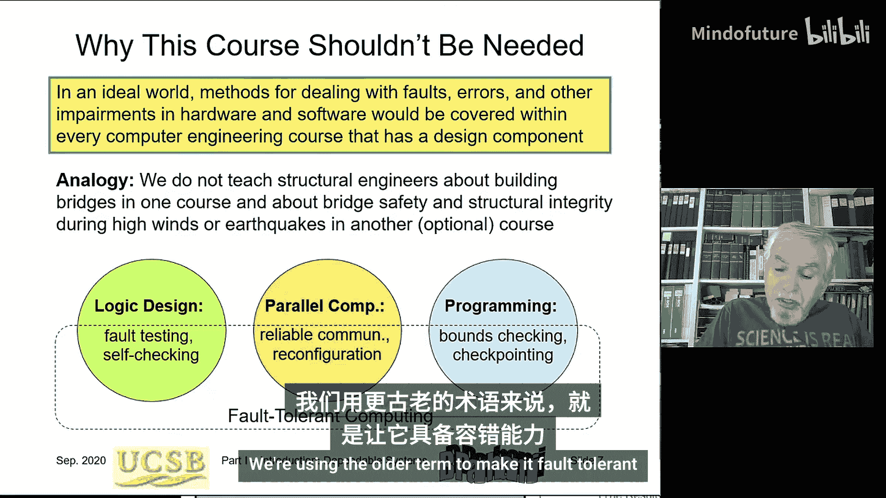

课程评估包含两部分：四次作业，以及一篇研究论文及其海报展示。作业有严格截止日期，逾期不候，以便我能及时提供参考答案供您自查。

## 可靠计算的核心思想
上一节我们介绍了课程的基本信息，本节中我们来看看可靠计算领域的核心思想。

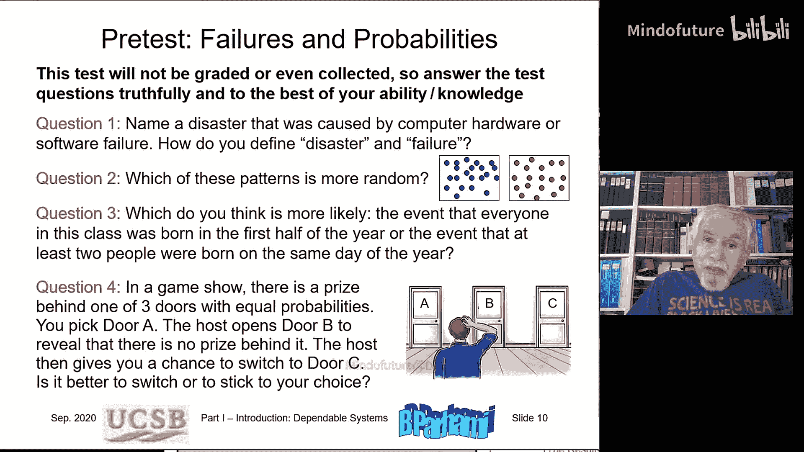

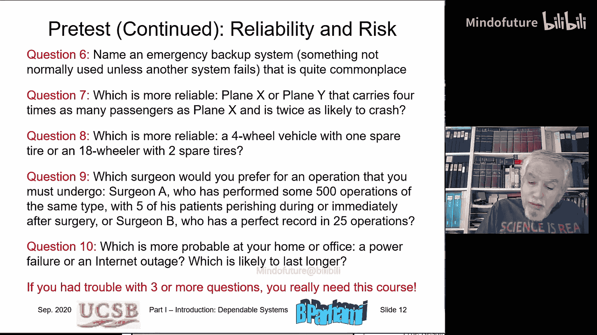

可靠计算领域始于20世纪60年代，由美国宇航局（NASA）等机构推动，旨在为航天器设计能在恶劣环境下长期无维护运行的高可靠性计算机。到了80年代，“可靠计算”这一更广泛的术语被提出，因为它不仅涵盖“容错”，还包括故障预防、错误预防等技术。

可靠系统的设计有两个关键理念：**模块化**和**冗余**。
*   **模块化**：系统由相互隔离的模块组成。当一个模块出现问题时，问题不会扩散到其他模块，从而将故障影响限制在局部。
*   **冗余**：系统拥有超出其绝对必要需求的资源。当部分资源失效时，系统仍能利用剩余资源维持关键功能的运行。

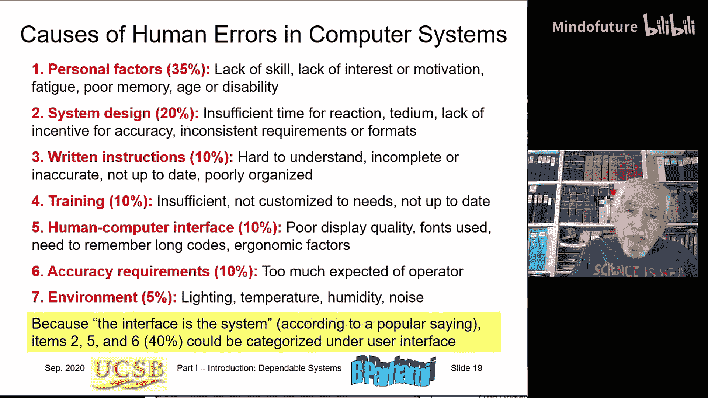

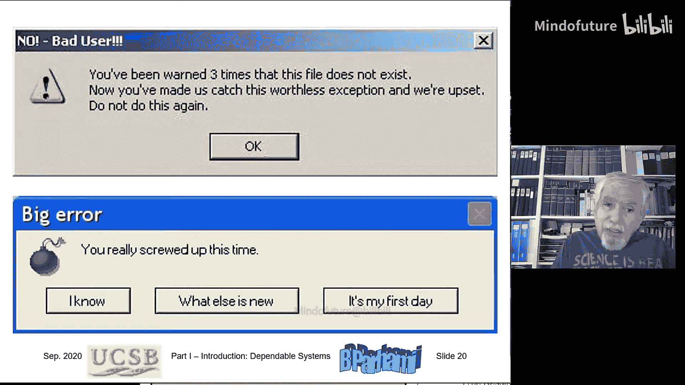

一个形象的比喻是悬索桥的缆绳：它由多股钢丝（模块）绞合而成（冗余）。即使其中几股钢丝存在缺陷或断裂，只要剩余钢丝的强度足够，整座桥依然安全。

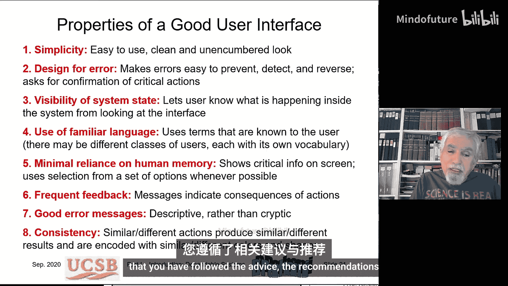

## 可靠计算的重要性与挑战
理想情况下，可靠设计的技术应融入所有计算机工程课程，而非单独开设。但现状是，许多编程和逻辑设计课程并未系统讲授提高系统可靠性的方法。因此，本课程将集中介绍一系列技术，使您能够将所学应用于构建更可靠的系统——无论是软件、并行计算机还是逻辑电路。

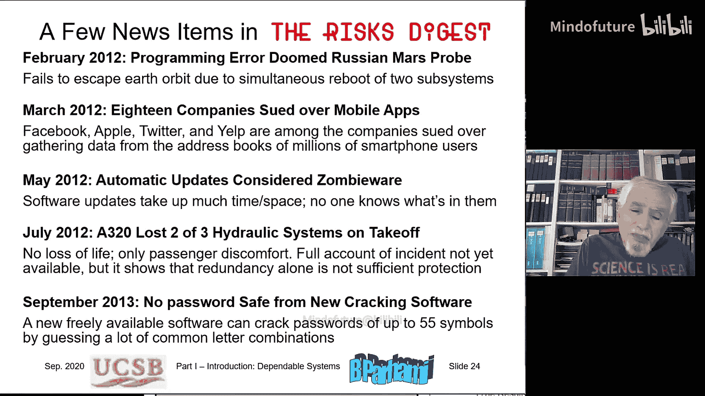

然而，设计可靠系统面临巨大挑战，主要源于系统日益增长的**复杂性**。无论是软件（如操作系统代码行数激增）还是硬件（如处理器晶体管数量爆炸式增长），复杂性都使得彻底测试和确保无误变得几乎不可能。因此，最可靠的方法之一是尽可能保持系统**简单**，只包含绝对必要的功能。

## 故障与可靠性模型
当系统表现与预期不符时，我们就说发生了**故障**。故障不一定是灾难性的崩溃，也可能是输出一个错误结果这样的细微错误。

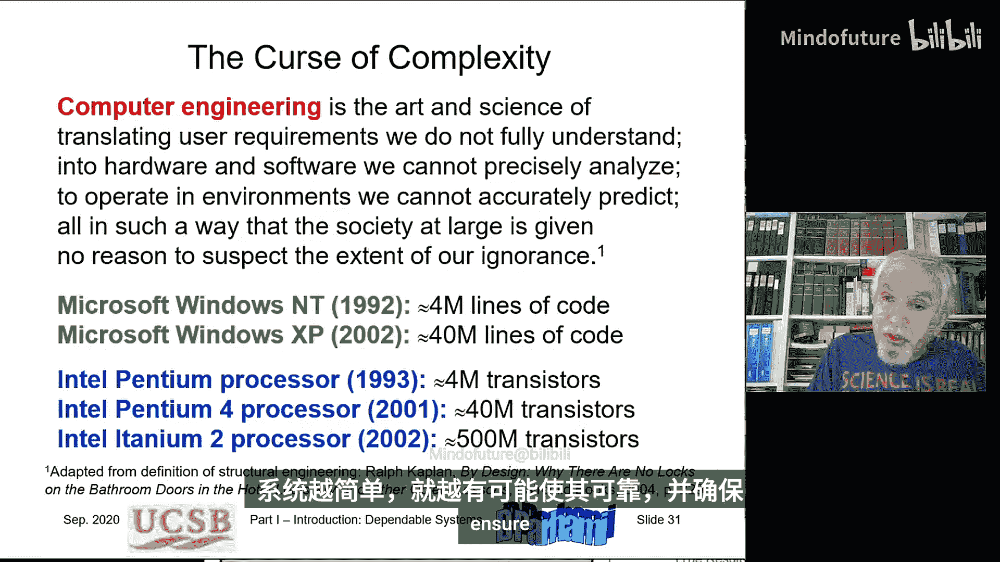

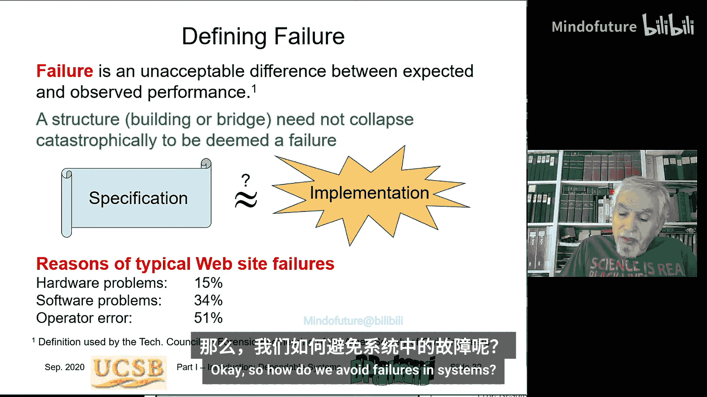

在结构工程中，我们通过引入**安全系数**（例如，计算需要5平方英寸截面的梁，实际使用20平方英寸）来应对不确定性和潜在缺陷。在计算机系统中，我们无法简单地“增加代码行数”来提高可靠性，而是需要通过**冗余**来改变系统的可靠性模型。

对于一个由n个相同组件构成的非冗余系统，其在一段时间T内的可靠性`R(T)`可以用以下公式描述：
`R(T) = e^(-n * λ * T)`
其中，`λ`是每个组件的失效率。

为了提高`R(T)`，我们只能尝试减少组件数量`n`、缩短运行时间`T`或使用失效率`λ`更低的（更昂贵的）组件。但这些调整空间往往有限。因此，根本的解决方案是通过引入冗余来**改变这个可靠性公式本身**。例如，系统有10,000个组件，但只需9,000个即可运行，那么其可靠性将显著不同。

## 案例研究：分布式文件可用性
让我们通过一个简化案例来理解冗余如何提升可用性。假设用户从站点1访问存储在站点3的文件，需要连接链路和站点本身都正常。设站点可用性为`S=0.99`，链路可用性为`L=0.95`，则单副本可用性为`S * L = 0.9405`，即大约有6%的时间无法访问。

为了提高可用性，我们可以采用以下策略：
1.  **文件复制（100%冗余）**：在另一个站点（如站点0）保存文件的完整副本。用户可通过任一副本访问文件。新可用性公式为：`1 - (1 - S*L)^2`。计算可得可用性提升至约99.65%。
2.  **文件三副本（200%冗余）**：保存两个额外副本。可用性公式更复杂，但可提升至约99.98%。
3.  **纠删码（67%冗余）**：将文件分割成5个编码块，其中任意3块即可重构原文件。这种方法能以更低的冗余度（仅67%）实现很高的可用性（约99.92%）。

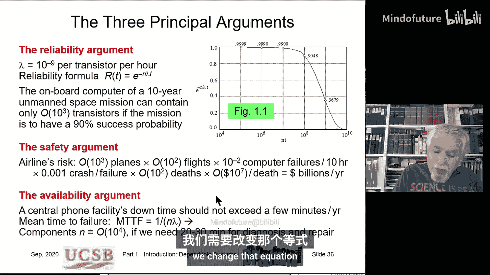

以下是纠删码的一个简单示例：假设文件包含三个数字A, B, C。我们构造一个二次多项式`f(x) = A*x^2 + B*x + C`，并计算`f(0), f(1), f(2), f(3), f(4)`得到五个值。任意三个值都足以通过插值唯一确定多项式系数A, B, C，从而恢复原文件。

## 可靠计算的多层模型
为了精确描述系统中的问题，我们引入一个七层模型。系统从理想状态开始，可能因各种原因向下层状态退化，直至最终故障。同时，我们也可以通过内置的容错机制使其向上层状态恢复。

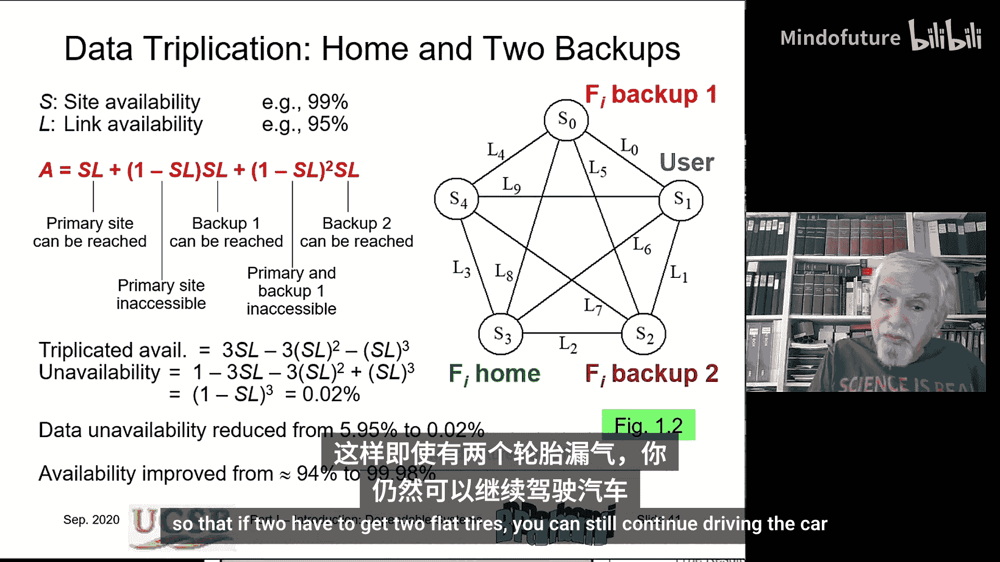

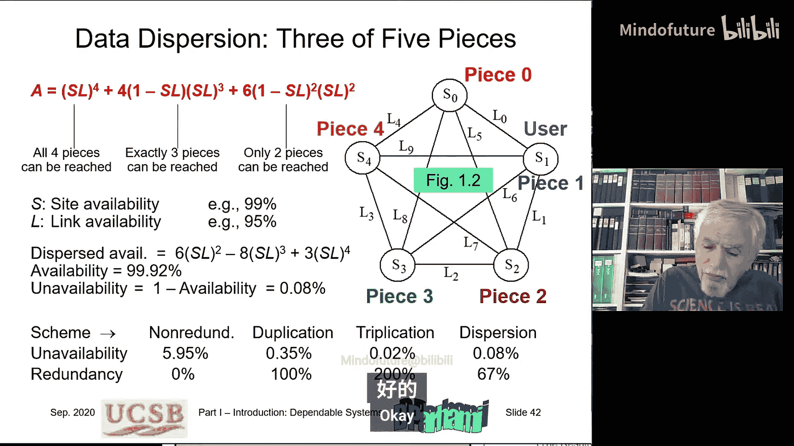

以下是各层状态的定义：
*   **缺陷**：物理层面的不完善。
*   **故障**：逻辑层面的偏差。
*   **错误**：信息或系统状态层面的不正确。
*   **功能失常**：子系统或架构层面的异常行为。
*   **服务降级**：服务质量低于预期。
*   **故障**：系统无法交付预期服务。

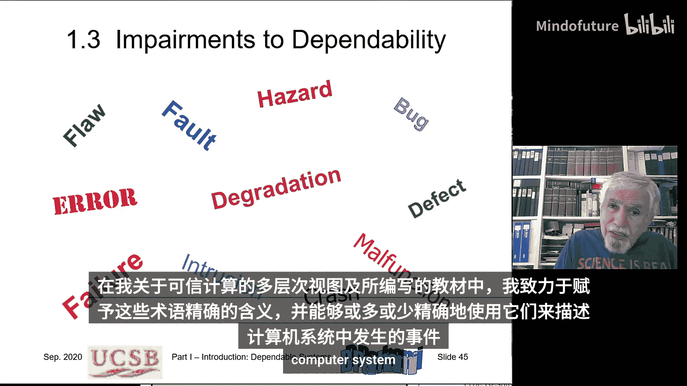

这个模型是理解本课程结构的基础，教材也相应分为处理缺陷、故障、错误、功能失常、降级和故障等不同部分的七个板块。

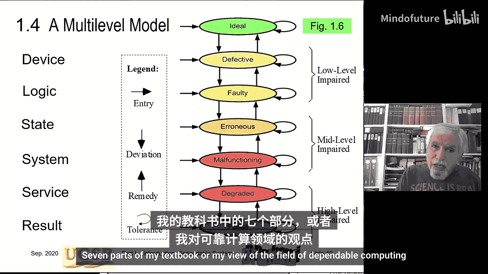

## 可靠系统的分类
根据应用需求，可靠计算机系统主要分为三类：
1.  **长寿命系统**：如航天器计算机，要求极高的可靠性，在无维护条件下长期运行。
2.  **高完整性系统**：用于安全关键应用，如航空电子或医疗设备，必须保证故障安全，即发生故障时不会导致灾难性后果。
3.  **高可用性系统**：如电子商务网站或云服务平台，需要极高的可用性（如99.999%），即使部分组件失效，整体服务也不能中断。

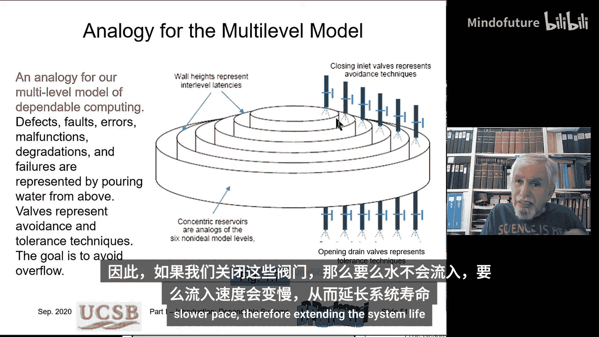

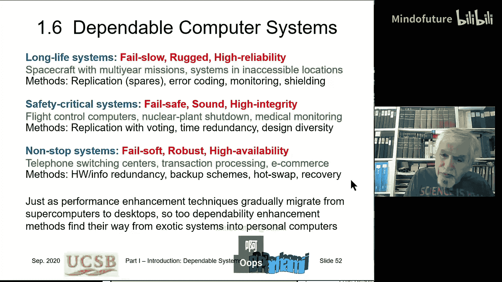

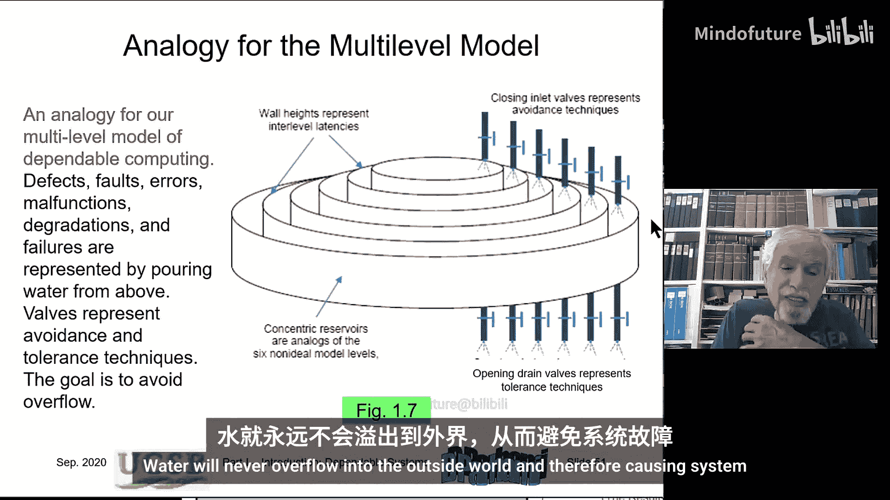

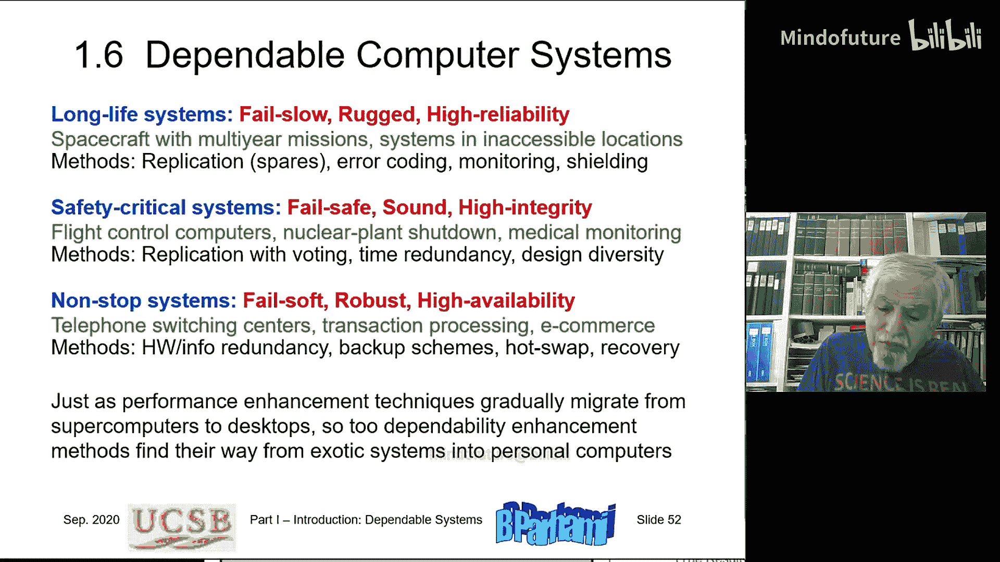

## 总结
本节课中我们一起学习了容错计算的背景与核心动机。我们了解了为什么需要专门的技术来设计可靠系统，探讨了通过模块化和冗余提升可靠性的基本思想，分析了系统复杂性带来的挑战，并通过分布式文件案例看到了冗余技术的实际效果。最后，我们介绍了描述系统问题的多层模型和可靠系统的不同分类，为后续深入学习具体技术奠定了基础。下一讲，我们将详细探讨可靠性的各种属性。