# 【加州大学】容错计算-｜-Fault-Tolerant-Computing-Ucsb-Ece-257A-p02-P02_第2讲_第2章_可靠性属性--BV19cFyz8EPV_p2-

Hello， this is lecture 2 for。USB course。BCE257 a。Entitled fault Tolerant computing。

 dependable computing。This lecture dealss with chapter two。In my textbook。

Pendndaable computing multi level approach。Which is available online in draft form。

Is being developed at this point， not yet published。

The title of the chapter is dependability attributetri。Basically， we are concerned in this chapter。

With。Quantifying dependability。 How do we measure dependability， What does it mean？

If we say one system is more dependable than another one， in what sense is it more dependable？

Some cartoons for your enjoyment， you can look at them。

Later。So we are now in chapter2。Partt one of the textbook。

So aspects of dependability or attributes that we use to measure and compare dependability。

Are various。Some of them are listed here。For example， reliability。There's one of the better known。

Aspects。Availability。There's another well known aspect。Testability。Safety， security。Performability。

 it's unlikely that you have heard this term before。I will define it before the end of the lecture。

Integrity。And maintainability and so on。Now the terms that you see inside this yellow blob。

Have the common feature that they all end。Letters IL。ITYility。And for this reason。

 sometimes they are referred to as the illlits。So the illities are features or attributes。

That are described by words。That end in LT， so serviceability， reliability availability。

 there are examples of Ls。The other terms are also important， but they don't end in Lity。

 so they're not included。Inside this pop。So we will define most of these terms in this lecture。

I just wanted to put all of them on one slide so that you know there are many different terms and concepts。

That we use to define and compare。Dependability。

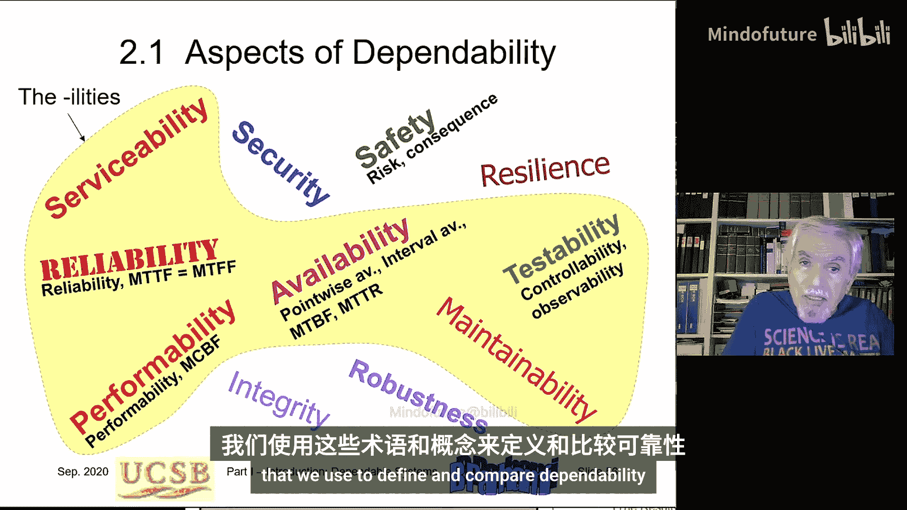

First review of some key concept from probability theory， as I mentioned before in lecture  one。

We do make use of probability。So。If you have not taken the probability course。Recently。

 it may be a good idea to brush up on your knowledge of probability。

By reviewing a basic probability textbook。You don't need to review the entire textbook as。

The concepts that we need are generally。Found in the first few chapters before five chapters if any。

Probability textbooks。I review some of the concepts here， but not all of them。First。

 we have something called probability density function。F of T， small F of T。

That's the probability that some random variable x。Is in the range T and T plus dt。

 so random variables basically。诶。A number， random number。It's in the range T and T plus Dt。

Divided by Dt。Cmulative distribution function。Is basically the integral of that density function from0 to t。

So the namePulative comes from the faculty that。Accumulate this density over the range0 t and call it cumulative distribution function。

Now， these two concepts can be illustrated by a simple example。

Suppose I observed 20 identical systems。Until they fail， so I basically measure their lifetimes。

And this lifetime is measured in some unit。但是 matter的我的 unit但是。Let's view these as individuals。

And then we observe their lifetimes。How many years they live and those dots。Heavy dots are basically。

The point at which the persons died or the system failed。So there's some distribution。

 you see that one of those individuals died very early。As a baby or infant？And。

The rightmost one died after 48 years in this particular population。

So that's the longest living person or system。And if I plot。TheNumb of systems that failed。

 the number of people who died up to a certain point。

I get that CDf curve cumulative distribution function。It starts at zero。

Nobody has died at that point。And then eventually gets to one 100% there。

All the systems failed or all the people died。And the shape of this curve basically。

Indicates the distribution。In this case， for example， you see that the slope of the curve。

ItHighest near the middle。So that means， you there's a large density of system failures or deaths。

In that middle range。The derivative of the cumulative distribution function is the probability density function。

Sn in the second curve。And here you see that the density of failures or density of deaths is largest near the middle。

Okay， expect value of。A random variable x。As defined as the integral。

Minus infinity to plus infinity x times f ofx oops。So the density function times the value x。

So we basically。诶。Multiply the density by the value x to find the expected value of x and we integrate over the entire range。

The discrete version of this formula。In discrete distributions。

 always the integrals are replaced by summations。So。XK。Is one of possible values。

 discrete values that the random variable can assume。

Probability of that discrete value multiplied by。That value summed over all possible k。Ind is。

 it's the。Expected value。Varariance effects。Is basically the expected value of。诶。

As they integral from minus infinity to plus infinity。X minus expected value of x squared。

Times F of x times dx。So basically， this is the expected value of this term。

The expected value of the square of the difference between x and its expected value。

Integrated over the entire range or the discrete version again as summation rather than。Integral。

And covariance。Of two。Random variables， X and Y。Is the expected value of x minus Ex。Times y minus Ey。

 and this can be proven to be expected value of x times y。

Minus expected value of x times expected value of y。

These are some basic probability notions on this slide。

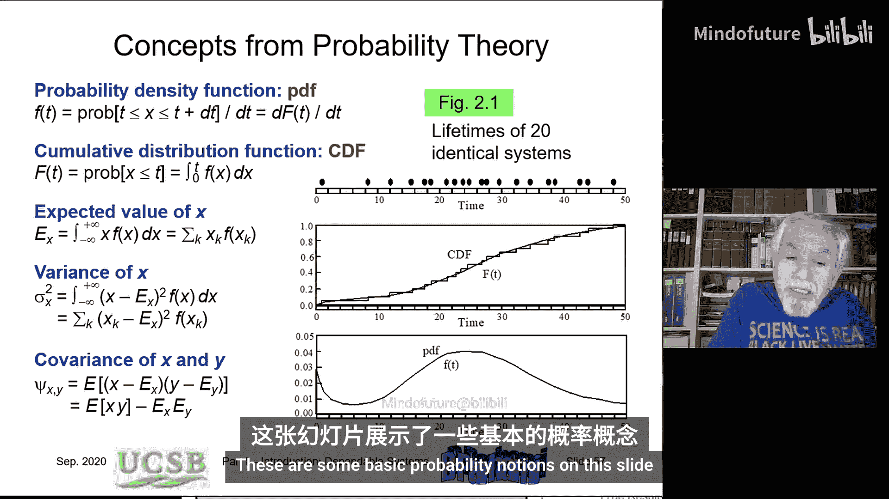

These are some probability distribution， some simple ones。

That we may encounter starting with the uniform distribution。In the uniform distribution。

 the density function is constant over some interval， the range。

 that this is a possible range of values。And then the cumulative distribution function is basically linear。

Up to the end of that range， and then it's horizontal after that。Exponential。

The PDF is exponentially declining。The CDf cumulative distribution function is this shape。

Normal distribution， the PDF has the bell curve shape。

And the CDf cumulative distribution function has this shape。

And the discrete version of the normal distribution is known as the binomial distribution。

So it's basically the same thing except it。Has discrete set of values。

And the CDf is basically the discrete version of this curve。So these are some common。

Distributions that we encounter。

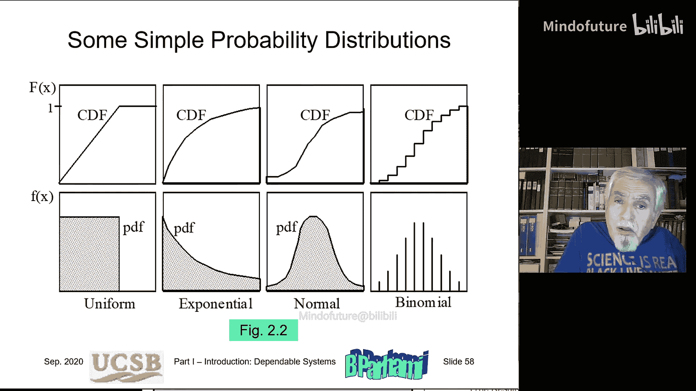

The next notion that I want to discuss is this concept of layers of safeguard。

And there are some misconceptions about these layers of safeguards。Discuss this in some detail。诶。

Now imagine that you want to make a bulletproof vest。

Using some type of sturdy fabric in multiple layers。that fabric， if it's perfect。

 maybe it can stop a bullet。For a certain kind。A the fabric has imperfections。

 such as the holes that you see in this diagram。So these are sort of cheese slices with holes。

Representing that fabric and those holes are basically imperfections in the fabric。

That could allow bullets to go through。Where there are no holes， the fabric。Of course。

 this does not have to be a cloth fabric it can be sort of。Chained metal。嗯。sheetet of metal。

Made of chains。So some parts of this fabric are imperfect， so they let the bullet through。

If you put four layers of this fabric。Then it's unlikely that all these holes will be lined up as shown in thenaogram。

And a bullet comess and goes through all of those lined up holes and gets to the other side。

Killing the person。these holes are random。Then it's extremely unlikely for them to line up the way shown in this diagram。

So this is sometimes。Moodeled or analyzed in the following way。

 Suppose we say that each of these sheets。Has a 1% probability。Of not stopping。Bullet。Okay。

 now if these holes， locations of these holes are completely random。And therefore。

 these sheets are statistically independent from each other。

And the probability that the four layers will not stop split。

be 1% times 1% times 1% times 1% independent random variables。

You simply multiply the probabilities together。Itll be 10 to minus 8。

So it's extremely unlikely probability 10 to the minus8。

And the bullet will go through and will kill the person。

But this assumption of independence is a big assumption。

 how can we be sure that that's a valid assumption？In fact， in many practical cases。

When you have problems in multiple subsystems。Those problems may not be statistically independent。

There are what we call common cause failures， common cause problems。

That may lead to multiple failures simultaneously。So such failures are no longer statistically independent。

But they're actually dependent。So for example， if these are four subsystems that we are trying to analyze。

But they're all connected to the same power supply。And that power supply fails。

 then all four subsystems will fail。They do their job， their function。

So they are not statistically independent。We want them to be independent or more independent。

Then we have to provide independent power sources to these four subsystems。But to make it。

Nearly impossible or less likely。For them to fail at the same time。

So these common cause failures sometimes refer to as a single point of failure。

So a system that has a single point of failure。This susceptible failure when one thing can go wrong。

Okay， we aim to remove these single points of failures or causes of。Depenent， multiple failures。

And if we can manage to do that， then this assumption of independence multiplying probabilities by each other。

Will be valid and we can use it。So this is really one of the。Major。

Sources of errors in modeling dependable systems。Assuming independence。

Where independence actually does not exist。So this example is intended to bring this to your attention whenever you assume independence。

 you better。Work hard and try to verify that assumption。Make sure that it holds。So that your results。

Results are valid。So a very good example at the bottom of this slide is this situation。

 it's an old one from 1986。Before the internet， there was something called ARPt。

 a precursor to the internet。And this ARPpanet connected various centers to each other and people could send files and emails and stuff like that to each other。

嗯， so。Two major hubbbs of this network were Boston and New York。And therefore。

 the designers of the work decided to have seven channels。

Seven dedicated lines between New York City and Boston。

So that traffic can flow smoothly between those two points。Are these seven channels。

ARPpa basically lease these channels from different companies that offered。Connections。

 digital connections。And they sort of assume that these will be independent in other words。

 it will be extremely unlikely。For all seven channels。To suddenly become unavailable。And therefore。

 at least， you know， critical traffic between the two cities can could flow uninterrupted。

 even if several of the channels fail。Of course， the common case was that all seven or six of the seven channels were working。

And。Affic flow was smooth， even if multiple channels failed。

This is similar to the example and the figure。So if you say each of these seven channels has probability 10 to the minus2。

Of not being available。欢。1% or 0。01。Then if they are truly independent。

10 to the minus2 to the power 7 will be 10 to the minus- 14。

It an extremely small probability that all seven channels become unavailable。However。

 unbeknownst to the designers of this network。Those seven supposedly independent dedicated channels。

All happened to go through the same physical cable。

 so these different companies actually had leased their connections。

They didn't own their own cables between the two cities had。Their connections。

From companies that did offer these connections。And it so happened at all seven channels。

Went through the same physical cable between the two cities。

So when a construction company operating it backho accidentally cut that cable。All seven channels。

Became。Unavailable and traffic flow ceased between the two cities。Okay， very。Good example that。

There's assumption of independence。 You have to really。

Examine carefully before you use it in your analysis。So that 10 to the minus 14 probability。

 which is extremely small。Was actually not that small in practice because of these dependent。

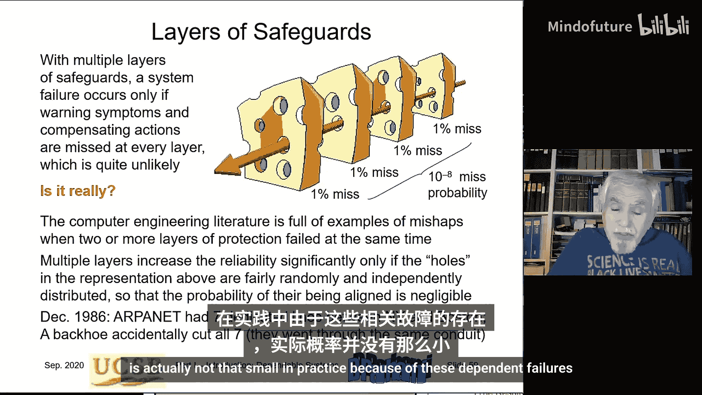

Failures。Okay， so let's start。Looking at。All these different measures of dependability。

The best known and perhaps the most important measure is reliability。

Reliability is the probability that the system remains。An operational state。Through some intervals。

0 Tt。And it's applied to systems that have two states up and down。

So the system starts in the upstate。Operational state， and at some point it may fail。

That's a probabilistic process。Sometimes it fails quickly， sometimes it fails after a long time。

 and it goes to the downstate that becomes unavailable。And this is known as a non repairable system。

 in other words， once the system fails， goes to the downstate。It's finished。

 you can't do anything about it， you can't repair it。Later， we will see repairable systems。Okay。

 so how do we model the system？Here is basically an equation。

reliabilityli is the probability that the system remains in the good state through the interval0 t。

So re for the interval T plus Dt， a slightly longer interval than this T。

So the system survives to the end of this time period T plus Dt。If it has survived up to time T。

Which is the definition of reliability to time T。And then it does not fail in the small time interval DT。

It doesn't fail basically one minus the probability that it fails。Okay。

 so it survives up to time T and it doesn't fail。The interval， short interval BT。

Ast fail is1 minus the probability that it fails。And the probability that it fails， we basically say。

It's proportional to both the width of that interval， the longer that interval。

The more likely it is for the system to fail in that interval。So it's linearly proportional to DT。

And it's also proportional to something called the hazard function。

Hazard function is basically the rate of the failure。So for example。

 the hazard function Z is a function of T。So for example， as a system gets older。

The failure rate may increase， so z of T can be an increasing function of T。In the simplest case。

 ZFT is a constant。Which we call the constant failure rate of the system。

This actually is true for electronic systems because electronic systems generally do not。Age。

So if a system is functional at time zero。And it both remain functional。

And then at with some constant rate， it fails。So we don't have wear out in electronics and in fact。

 most electronic systems become obsolete before they become too old to function correctly as a result of aging。

So for electronic systems， digital systems， this assumption of a constant failure rate。

 Lambda is not unreasonable。So r of T plus dt is r of T1 minus lambda T。

So I can say RF of T plus Dt minus RF of T take that to the other side and divide by Dt。

So that's the derivative of RF ofT。Is equal to r of T。Times land。Okay。

 this is a simple differential equation whose solution is r of T equal to e to the minus lambdaity。

 remember we use this exponential reliability equation。In the first lecture。

 here is its justification。The reliability of a system having failure rate。

 constant failure rate Lada。Operating for a time period， T。Is given by this equation。Of course。

 in the equation that we saw before， there was this factor n。Here in the exponent in Lambda T。

 that's because。There we had n components and Lada was per component failure rate， so N lambda。

That we had there is actually the sda， which is the overall。System failure rate。Okay。

 so this is known as the exponential reliability law。We have something called mean time to failure。

Because failure occurs at random。We may be interested to see on average。

 how long does it take the system to fail that's measured by this。Nummericical E mean to failure。

And that's defined as the integral。From time0 to infinity， T times F of TDT。And it's provable。

 I won't prove itll leave it up to you if you're interested。

It's the integral of the reliability of the system。Over time。Zero to infinity。

 So this is the area under reliability curve。The area under the reliability curve is the mean time。

就费力了。Okay， so for example。For this exponential reliability function。

Meantime to failure is one over lambda。Which makes sense because if I say this system has a lambmbda。

Of 10 to the minus4。in닝。There is on average 10 to the minus four failures per unit time。

That means that the mean the failure will be 10 to the4， the inverse of that。So for exponential。

Reliability law， meantime， the failure is easily obtained。 is's just the inverse of。Lambda。

So these are some distributions。Exponential， I dimension dimension。The hazard function。Is a constant。

Reliability equation is e to the minus lambda t meantimeantime to failure is 1 over lambda。

And some of these distributions have discrete versions。So the exponential distribution。

 the discrete version， is the geometric distribution。So reliability over K time units。Sre time unit。

Is reliability over one time units to the power key。Rilly distribution。Has this hazard function？

The reliability equation is E the minus lambda T squared。Okay。

 the mean to failure can be obtained to be 1 over lambda times squared W over 2。This is not you know。

 intuitively obvious why that's the case， but it can be computed by applying。

The formula for MTTF to this particular distribution。Then we have wable distribution。

Which the hazard function is given here。And reliability equation is e to the minus lambda T。

A quantity to the power alpha。So basically this is a special case of wable。

 really is a special case of wable for alpha equal to2。Okay。

 an exponential is a special case of wave for alpha equal to1。

And this is the mean time to failure for wable distribution。And that is one over lambmbda times。

 this is the gamma function。And there's also a discrete label corresponding to that。

 a bit more detail about these distributions are provided in the textbook。

I don't go over all the details in the slide。It's much harder to describe these verbally。

Thenhan to read about them in the textbook。We also have gamma distribution。

Oh we have airline distribution is general exponential。Gamma distribution。And normal distribution。

 the discrete version of normal is called the binomial distribution。Which I referred to earlier。So。

 these are some。Well known distributions that you should be familiar with。

 although you really don't use any of these other than exponential and。Sometimes really and。

Very few occasions wl。So that's why I describe those with a little bit more detail。

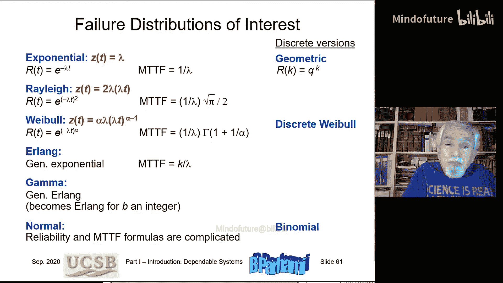

So this is an example where labelL distribution comes into play。

It's an experiment performed with paper clips， the old style。Paper clips made of。Metal wires。

So take a paper clip and you sort of。嗯。Open up and make it into this shape。

And then repeatedly straighten this part to look like this and bend it back。

It's intuitively obvious that after a few times that you bend and straighten this part。

 the paper clip will break。At this point。And if you。But。

Maybe 100 fold to workwick doing this on different paper clips。The number of cycles。

 the number of times that they straighten and bend the paperclip before it breaks will show distributions such as this one。

So here we see there was a paper clip that broke after， let's say， about 12 times。

 another one after about 14 times， but there were some paper clips that lasted。for。Maybe 80。

90 cycles， okay？And this distribution is a wable distribution with alpha equal to 2。6。

So the special cases of wbel alpha equal 1。That's the exponential constant hazard rate。

Alpha less than one。This is when the failure rate actually decreases。

It's knownnown as infant mortality。In analogy with infants， you know。

 occasionally dying right after birth。But then if they survive the first few days of life。

Then it's much less likely for them to die as small child， small children。

Alpha between one and four is corresponds to rising hazard rate。For example， due to fatigue， aging。

 corrosion， and so on。Alpha greater than4 is a very rapidly rising hazard rate。

Where you have rapid wear due to some unusual。Conditions。

So this is the nice thing about Weable because it can model different things by playing with this parameter alpha and this example。

You notice that the data。Fits well with a wable distribution。Having alpha equal to 2。6。

Of course it's not the perfect fit that the fit isn't perfect in this part and in the latter part。

 but for the most part， it's a good fit。By the way， this is a log log scale。Pot。

It's not a linear plot， so that's why the straight line is really an exponential function。

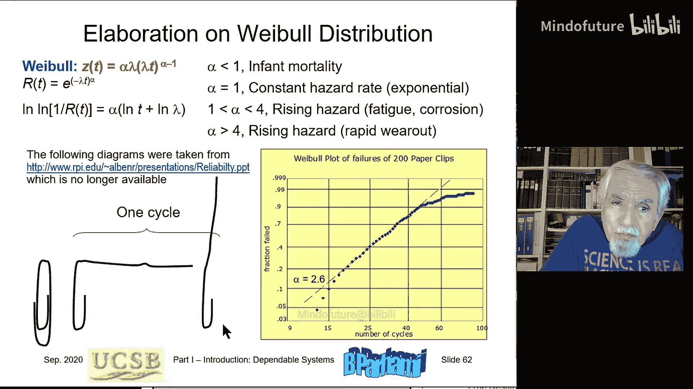

Okay， when we compare reabilities， we encounter an interesting problem that we need to resolve。

So here I've shown on this chart。The reliability curves for two hypothetical systems。System 1。

Has this reliability curve or1 T。System 2 is this reliability curve。Our2ity。Okay。

 you notice that the shapes are different， the system2 is highly reliable in the beginning。

But then at some point， the reliability drops。And goes close to zero。Quickly after that。System one。

Reliability drops， so it's not very reliable anywhere。

But then at some point it becomes more reliable than that system too。

Meantime to failure for system one。Happens to be larger than mean to failure for system2。 remember。

 meantime to failure was the area under the reliability curve。So this curve has a smaller area。

Underneath it， then this curve， because this curve extends。Further to the right。With non zero values。

 whereas this one goes quickly to zero， so the area is really just the part that you see on this diagram。

So this is one of the。Os that one has to。Be aware of meantime to failure is a helpful figure to have。

 but it can be。Misleading。Because this system that is not very reliable， even at the very beginning。

Exhibits a large mean to failure， larger mean to failure than this system， which is highly reliable。

Now， if we use this highly reliable system up to this point。Up to this time TM。

 then reliability is pretty high throughout that period。

So the fact that meantime the failure is small really doesn't matter if we don't use the system beyond this point。

Okay， so we tend to use。Computer systems or any system for that matter only。

In the parts of this curve where reliability is high。Okay， so this system。

 we probably use it for very short periods of time in this region。Where reliability is close to one。

 but not beyond that。Okay， so how do we compare reabilities well。

 we take a particular mission time TM。That's basically the time the system is going to operate and notice that reliability is。

This value for system2。And it is this value for system one。And this difference。

Reliability difference。Is a measure of how much more reliable system2 is compared to system1。

The reliability ratio， reliability gain of art system 2 over system 1 is the ratio of these two numbers。

Now the problem with reliability difference and reliability gain is that systems that we compare often have very close reabilities。

 the difference is not as significant as you see on this diagram。And therefore。

 r2 minus r1 is a very small number， pretty close to zero。

 and r2 over r1 is a number that is pretty close to 1。So it really doesn't provide sufficient。

It doesn't have sufficient distinguishing power because one of them is almost always close to zero。

And the other one is almost always close to one。So we come up with other ways of comparing reabilities。

 for example， reliability improvement factor。Is the ratio of unrelibilities。Okay。

 so if the reliability of one system is 0。9 and the other one is 0。99。This difference is 0。

09 it's a fairly small number。And this ratio。Will be 1。1。Whereas the ratio of unrelibilities is 10。

So this provides better distinction。Between systems， so the unreliability。

Rio of unrelibilities is what we compute rather than the ratio of reabilities。

Each are be close to each other。So that's one measure Diability improvement index has been defined as。

The ratio of the logs of reliability。😔，Okay， a time extension basically says。If。

We have a certain reliability goal， R G。Reliability called this green line。Then system one provides。

This much time。We can operate it for this much time before reliability drops below the acceptable level。

System two， we can use it for this。This period before its reliability drops below that。

Agreed upon level R G。The ratio of these two mission times。

Well the difference will be mission time extension。

 how much longer can this system operate compare with this one？

And the ratio of the two mission times is called the mission time improvement factor。

So it seemed in this diagramm that this system can operate four times as long。

As this system for the same。In liabilityability level。

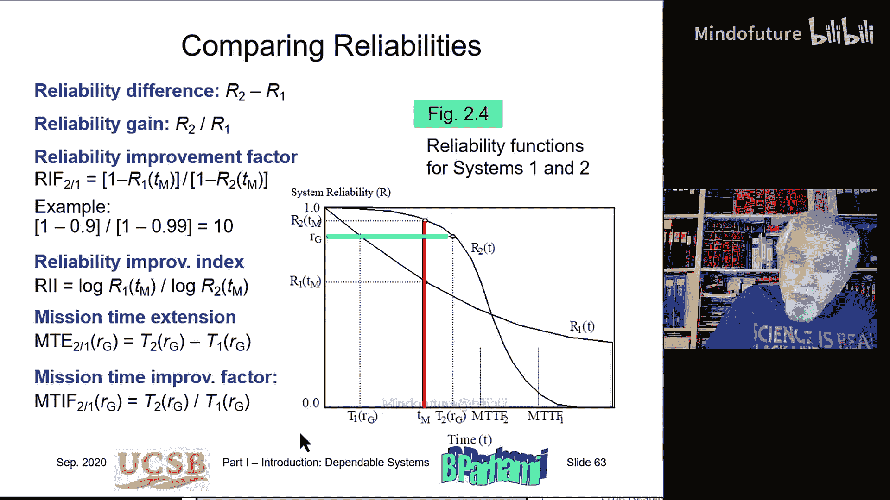

Okay， a few years ago， I published this paper in IEpoee Computer magazine where I。

So that brought the attention of。The journal's readers that there there's an analog to am those' law。

for。You probably know what Amel's law is， it's basically something to do with performance improvement in systems and it says that if you have。

诶。An application， a program running。And you take an aspect of that application and improve it by a certain factor。

The overall improvement in performance will not be。As large， so for example。

 if you have an application that does both floating point arithmetic and fixed point arithmetic。

And then you。诶。Redesign your floating point unit to become twice as fast for floating point operations。

Depending on the fraction of operations that were floating point versus fixed point。

 so let's say they were equal， half of the operations were floating point half were fixed point。Okay。

 so the running time was 0。5 units for fixed point and 0。5 units for floatinging point。

Now you make your floating point in it twice as fast， so that 0。5 becomes 0。25。And therefore。

 running time becomes 0。75。So you improve the floating point performance by a factor of two。

 whereas the overall performance went from one， overall latency of the computations went from one。

int75。It's a much less pronounced improvement。So the same thing is true with reliability。

 if you have a system that has， let's say， two parts。One has failure rate fee。

 one part and the other part。Has the remaining failure rate， so the overall failure rate is lambda。

 one part has failure rate fee。The other part has failure rate lambda minus phi。

And suppose you take this part and improve it， use better components so that the failure rate is divided by a factor P。

So the failure rate is divided by 2， for example， p can be 2。

So you improve the failure rate for this part， but not for this part。Well， if you do the math。

 you see that。Reliability improvementmpement index will look very similar to the amds。

Formula basically says。The fraction that was not improved。

And this is the fraction that was improved by a factor of P。

Dictates this reliability improvement index in particular if P is infinity， in other words。

 you make this part of the system infinitely more reliable。Of course， you can do that in practice。

 but for the sake of argument， let's say P is infinity。And the reliability improvement index。

 so this term basically becomes zero， will be 1 over f。

If the fraction of the system that you left unchanged did not improve。As let's say 20% F is 0。2。

The maximum you can hope for for reliability improvement index is5。One divided by 0。2。

No matter how much you improve this remaining part， it's very similar to Amel's law。

 that's why I call it。诶。Analoggue of Amdo's law for reliability。

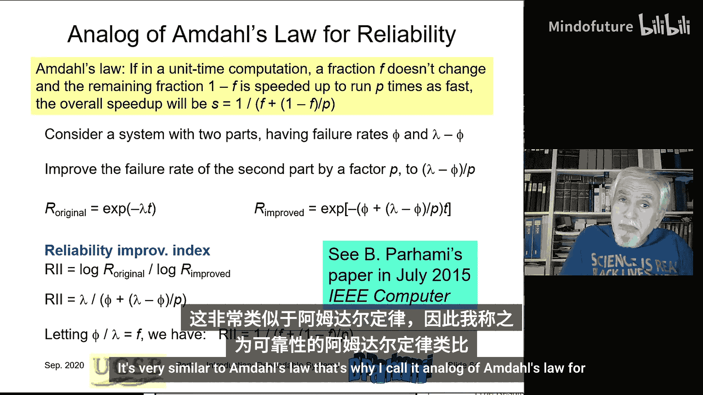

Very recently， a couple of months ago， I published another paper in IEPoE Comp。

Dealing with reliability inversion。So this is basically something， a concept that。

Came to me as a result of。A lot of decades， five decades working in。Dependable computing。

And reliability evaluation。So what is reliability inversion？You look at the diagram on the left。

The system has a particular reliability， that reliability is unknowable。

 there's no way to find the exact value of that reliability。

The only shorefire way of determining the reliability of an airplane。

Is if you have millions of copies of that airplane and then you fly those for many， many years。

And just observe how many of them crash， but that's impractical。

So there's a level of reliability that is unknowable。

What we do through analytical models is establish lower bounds。Using some simplifying assumptions。

 some pessimistic assumptions about things that can go wrong。And we say， okay。

 the reliability of this system is no less than this， this is a lower bound。For reliability。

 we don't know the exact reliability， but we know it's better than this。

With some high level of confidence depending on what models we use。Okay。

 and if this distance is large， then we are basically losing here。

We think the system is only disreliable， whereas it is much more reliable and if you have two systems。

One of them has a lower reliability， again， this is unknowable。

We can establish a bound to lower bound for it。That is closer to the actual value。

Now look at these two systems， this is more reliable than this one in actuality。

The bound that we obtained for this one is lower than this one。And therefore， if we were to judge。

Which one of these two systems is better to use？We will have to pick this one because the lower bound is larger。

 remember we don't know the actual reabilities。All we know is that for this system。

 reliability is at least as much。For this system the reliabilityities at least this much。

 we have the lower bound。Therefore， we have to say， okay， this。It's better to use this system。

Even though。The first system is more reliable， this is what I call reliability inversion。

The reabilities are inverted due to these imperfections。In our models that don't give us。

Tight mounts for reliability don't give us exact values。

And here is basically reliability changes with time， so here I've shown system one。

 its actual reliability。Which is unknowable and a model that we use to establish lower bound for it。

This is system2， its actual reliability and the model we use。Okay， so in this example。

 we see that system one is more reliable。Up to this point。In time。

 then system2 becomes more reliable after that point。Whereas the modeled reliability。

 the lower bound is uniformly higher。Or system two compared with system one。So again。

 we prefer system two because its guaranteed reliability is better than。Ath up system one。

So this is an important distinction， so we want to develop models。

That are as accurate as close to actual values as possible。

 but sometimes that's not an easy task to do。Okay， the second concept。

 so reliability I mentioned is the most important notion。In today's。Pture。

Availability is probably the second most important notion。So what is availability。

 this is for repairable system， so a system can have an operating state and a down state。

 but when it goes into the down state， we can repair it。And bring it back up。

The more quickly we do this， the faster the repair。

 the more time the system will end up spending in this up。State。

So let's say it's in the upstate for two hours， then it fails。

Then 15 minutes later we bring it back up， so it's spent two hours here， 15 minutes here。

 and then a few more hours here。So the probability of the system being in the upstate in the long run is its availability。

So for example， if the availability is 95% means that the system is in the upstate。

 95% of the time in the long run。Okay。How do we compute availability？

Quoliability is given by this equation。Is1 over t？Availability for。

The system being available at time T。Is1 over T？Integral of the。嗯。Basically， availability function。

 point wise availability function。Over the period0 T T。Okay， in steady state， so initially。

If the system is in the upstate。Let's say for two hours， for those two hours， availability is 100%。

But then it fails， it goes into the noun state stays there availability， which is the average。

Time spending this upstate declines。And then it can go up and down as the system moves back and forth between these two states。

 but in the long run， it the system will spend some fraction of its time in the upstate。

And that's called the steady state availability。So the steady state availability。

Is given by this formula， mean to failure。Divided by mean to failure plus mean to repair。

So repair doesn't usually take a constant amount of time because some failures are easier to fix。

 others take longer time。So to model the situation。

We define the parameter just as we have failure rate。Lambda， we have something called repair ba mu。

So for example， we say we have 10 to the minus9 failures per hour， that's the failure rate， lambda。

The repair rate we can have four repairs per hour， meaning that repairs take on average 15 minutes。

So this mu is generally a much larger number four repairs per hour versus 10 to the minus 9 failures per hour。

 therefore this availability will be very close to one because mu is much larger than lamb。

Which is as it's supposed to be， you know， we hope that the availability is pretty close to one。Okay。

 so meantime。To failure divided by mean to failure plus mean to repair。

 the sum of mean to failure and mean to repair。Sometimes called mean between failures。And therefore。

 meantime。To failure is one over lambmbda。Int to failure is one over lambmbda。

Meantime to repair is one over mu if you substitute， then simplify。ToGet this。So that's availability。

 steady state availability。So this is the situation for such a system that has two states up and down。

So the systems starts in the upstate， works for a while， then suddenly it crashes。

 does's just two states， if it's not up， then it's down。

Then it stays down while we figure out how to repair it， how to fix it， then it is fixed。

 goes back up， and so on if I plot the availability of this system。Availability is one。

For this period of time。Then suddenly start declining and it goes lower and lower as this time。

More time elapses in the repair state。And then it starts going up again。

For this period of time and so on。NFDE。Expected number of failures are known and the repair of course。

 is statistically distributed in the long run， we have the steady state availability。

Which is the probability of being in the upstate。

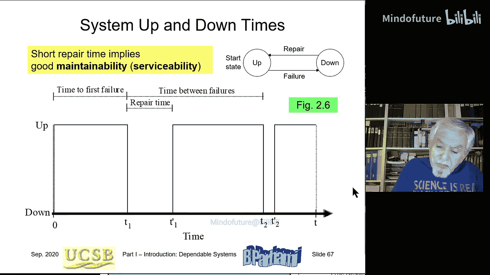

The third measure， now these measures that I'm going to define are not as commonly used as。

Reliability and availability。 This one is known as Perability。 So what does this mean？

This applies to systems at。嗯，呃。Do not fail abruptly。They're sometimes called fail soft。

So in this particular system， there are two upstate。And one downstate。

So the systems start here in up to state。And then perhaps something happens。

 let's say it has two processors that they're working。

One of those two processors fails and the system goes into。

A degraded mode of operation with just one processor。And then sometimes later。

 that one processor may also fail。And the system goes into。嗯。Into the downstate。

 or we may get lucky before that second failure occurs。

Finish repairing that first processor that that failed。

And go back to this state so this system can go back and forth between these two。

And not fail for a long period of time， and eventually it will fail， but then we can still repair it。

Okay， so this system， let's say， has higher performance by a factor of two。In this state。

Compared with this state。So we define performability。Or average performance of this system。As。

Two times probability of being in this up to state。

Plus one time the probability of being in this up one state。So here's a numerical example。

 let's say the probability of being in the up to state is 0。92。Probability of up one state is 0。06。

And probability of being in the down state is 0。02。The performability of this system will be 1。90。

Two times win92 plus 1 times 0。06。1。90。Meaning on average， the performance of this system is 1。90。

Performance is two units in this state， it's one unit in this state and zero unit in this state。

On average is pretty close to high performance， that's because the probability of being in the state is quite large 0。

92。Okay， we can also define a performability improvement factor similar to。

What we had for reliability。Improvement factors。 so this is performability。

 what is the availability of this system？Okay。Well， it depends on how we define availability。

 we can define， for example， the system is available whenever is in either one of these two states。

Although it has let。Lower performance here， we may still consider it， oh excuse me。

We may still consider it available。And the steady state availability will be the probability of being in this state plus the probability of being in this state。

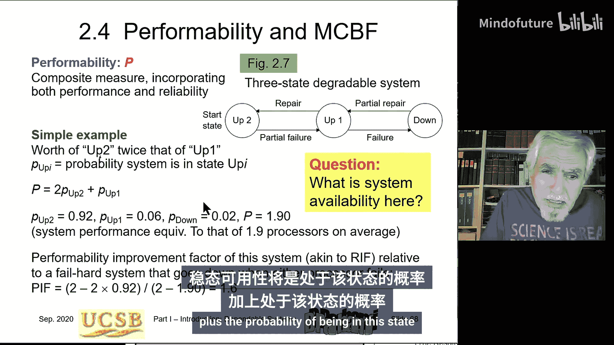

Which is this numerical example， is 0。92 plus 0。06， which is。

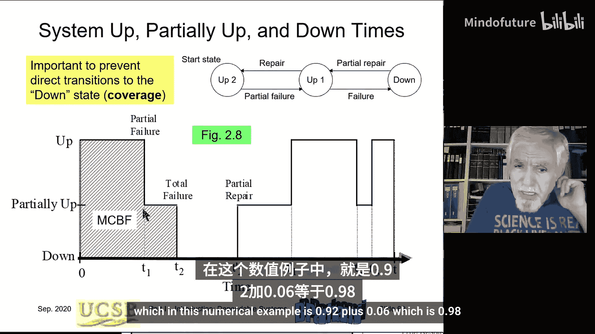

098。

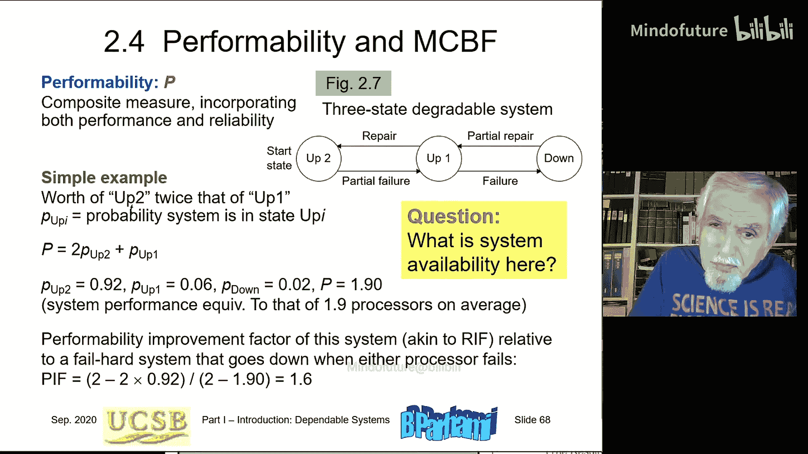

Okay， so this is basically variations in performance in such a fail soft system。

So the system starts in the upstate。Then it experiences some partial failure。Those in fact they're。

It doesnn't have to be just one intermediate say that can be many other。Partially operational states。

 but let's say just take that one state it goes into that state partially up。It stays in that state。

 perhaps at some point it fails。And goes into the downstate。Then we repair it， bring it partially up。

 and then totally up and so on。So performance fluctuates。

And we define something called mean computation before failure。

 that' how much computation the system performs before it fails。In the case of availability。

 he said how much time the system spends。Before it goes down。Okay， here， because that we distinguish。

The behavior of the system in this high performance state versus low performance state is the area of this。

And there's this curve that is important to us how much computation？As the system perform。

Before it fails， that's called mean computation， on average， mean computation between。

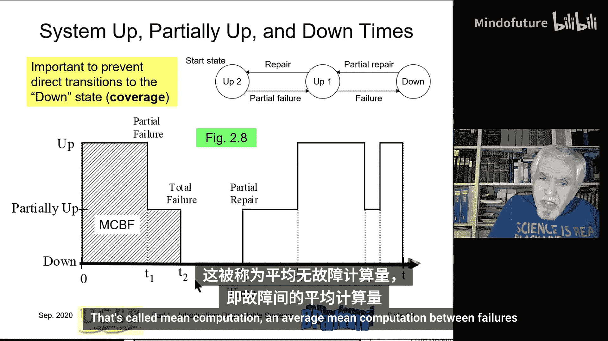

Failures。Okay。We then have the notions of integrity and safety。They're similar。

 integrity is inward looking。Meaning it's the capacity to protect system resources， for example。

 data。Safety is outward looking。Because we deal with consequences of incorrect actions to users。

This will become clear， I'll show you。The next field slide。A high integrity system we call robust。

Because data is not corrupted。low severity causes。Something really must go。

Bong for data to be corrupted， so it has built in capabilities for protecting the data。

So that if something goes wrong and it's not a severe problem。Data is not corrupt， data survives。

Okay， safety is distinct from reliability。Because we can design a system to be fail safe。

Even though it's not very reliable。Fail save simply it fails in a manner that is safe。

 so for example it totally shuts down。And it doesn't do anything。

 and it suspects that something is wrong。In order to avoid doing wrong things and causing further damage。

So we'll talk about fail safefe systems towards the end of the course。

 one of the last topics that we cover。So we can make a system fail safe， for example。

 if human lives can be in danger。Because a system that fails safely and we know that it has failed and it's in a particular state that we can。

Detect。Then， of course， we won't rely on that system and therefore we won't endanger any human lives So for example。

 if the flight。Control computer is a faila system， and when it fails。

 the pilot knows immediately that it has failed。And it no longer controls anything in the aircraft。

Then the pilot can take over due manual procedures。And land the plane safely。

So this particular computer may not be reliable because it actually fails quite often。

it fails in a safe mode， okay， that's the distinction。

So a fail safe system may not be actually very reliable， there are two different things。Okay。

 so for safety assessment in order to quantify safety the way we did for reliability。

 availability and performability。We need some basic definitions。So we have a system。

 let's say it has an upstate where the system is working perfectly well。

And it has a bunch of downstates， one or more of which are safe downstates， in this case。

 I have shown just one safe。And there are multiple unsafe， one or more unsafe downstate。

So the system as it's operating， it can fail if it fails in a safe mode， it goes into this state。

If it fails in an unsafe mode， it goes into one of these unsafe。States。Okay。

 so this safe downstate is actually a desirable state if the system is going to fail。

 would rather it fail in this state。So from the point of view of safety。

The safe downstate is really as good as the upstate。

Because there are no safety issues in either case。Whereas the unsafe town states。There's unsafety。

 there are consequences。Okay， now。The reason I distinguish multiple unsafe downstate is that the consequences of the system going into different unsafe states can be different。

And the consequence is basically what happens， the penalty that we have to pay。

 either financial penalty。When the system fails and we have to。嗯。You know。

 pay money to compensate for damages， whether the damage is to life or to property and so on。

So there may be different consequences， different costs associated。So basically the total cost。

Safety cost of the system will be the probability of being in this state。

Times the cost consequence of being in that state。What's the probability of being in this state times the cost or consequence and so on that's why it's helpful to have these multiple states because。

Consequences may be different。Okay， now let's say we have just one unsafe downstate。

Then risk assessment。Of course， you know， risk assessment is。A big discipline。

 there are courses offered， you know？Safety engineering。

So I'm going to present a very simplified view of risk assessment。So the risk of something。

Is the product of two factors， the frequency of that thing happening？

The frequency is sort of like probability。Times the magnitude。Of the consequence。

So how many events per unit time are we expecting and what is the consequence financially or otherwise of each of these events？

So risk is the product of probability。And a severity。Okay。

 so if something happens with probability 1 percent 0。01。And the consequence is that we lose $1，000。

The risk will be the product of 001。And1 thousand with is $10。

So if I can lose$1000 with probability 0。011%。The risk to me is $10， I'm risking $10。

And given that human beings are risk adverse， this is one of the interesting。

Observations about human being studied in psychology， we are risk averse。And。

If there is even a small probability that we lose $1，000， we usually do not view it as okay。

 on average， I'm going to lose only $10。That's not a big deal。

I get worried about that small possibilities of losing $1，000。

And this is basically where insurance companies operate。The insurance company comes to me and say。

 okay， you are worried about this losing 10 dollars。With 0。01 probability。

 I'm going to ensure you're against that loss if you pay me $30。

So you pay an insurance premium of $30。And then。You will never lose that $1，000。

Although the average loss was $10 and you're actually paying more in insurance premium than that average loss。

You're still satisfied and comfortable that your maximum loss is that $30 that you paid。Okay。

 and by paying that $30， those $30， you avoided the possibility small as it might be of losing$10 dollars。

Okay， so this is a very simple view of frisk。It's a product of a probability and severity。

The magnitude of severity is often measured in some suitable units， say dollars。

And this is one of the。诶。I don't know regrettable things that we do in safety engineering。

If the risk is too human life。Lives and we have to quantify that risk。

You have to assign the dollar value。So for example， when a plane crashes。

 we have some financial losses。planee itself crashing and so on， and there are also loss of life。

In order to sort of evaluate the total risk。We know the cost of the plane， so that's those。

Direct dollar loss。But we also lose some people and we have to assign dollar values to those lives in order to be able to compare losses。

Of course， some people illil， you cant put any value on human lives， but that's。

It is not a reasonable thing to say you can't say human life costs infinite dollars because then you can't。

Fly any airplane。Because if human life is worth an infinite number of dollars。

Then even a tiny risk of plane crash basically parallellyizes you and you won't fly。On any plane。

So in practice， we actually do assign those dollar values。

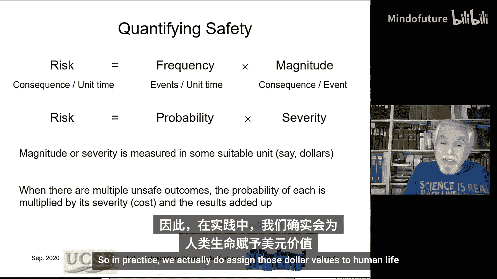

Throughho human lives。Okay， so here is safety assessment with more transitions。

 so here I have an updatestate。And I have a safe downstate， the system goes there and stays there。

 it's safe。If it goes to an unsafe state， I may try to repair it and take it back。To the upstate。

Or maybe push it into the safe state。Sometimes when the system goes into the safe downstate。

Something happens and it actually transitions into an unsafe state from there。

We have to watch out for these transitions。So we can make this model as complex as we care to。

In order to more accurately model the system。

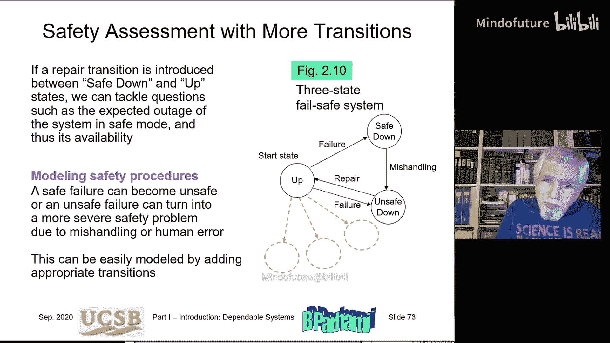

Okay， this slide I'm going to let you read on your own。Facies of risk。

I'll just mention item one on the slide。So one of the fallacies of risk。Is the fallacy of sheer size。

If the risk X is accepted。And Y is a smaller risk than X。And why should be accepted also？

This makes sense logically， know if I accept risk X and there's another risk y that is smaller。

Then I see no reason why I shouldn't accept that smaller risk。However， consider this example。

Let's say X is the risk of。Driving a car。Why is the risk of？Flying on a plane。

And for the same distance， traveled。Flying on a plane is much less risky。

It entails much lower risk than driving a car。If you want to go a thousand miles。

Poing on the plane is much， much less risky。In terms of， you the possibility of dying。

Then driving a car for a thousand0 miles。That many people。You know， accept the risk of driving a car。

Whereas they're just too scared to fly， even though they know there's data to suggest that risk of flying is much less。

And risk of driving a car。So there are some psychological factors that are at play here。

That make that logical conclusion not valid。So one of the psychological factors is familiarity if you have。

You know， driven a car。Since you're a young person， so you have driven a car for many， many years。

 you're familiar with driving a car， you have done it on a daily basis。So。

We don't think much about the risks。And as flying， it's something that you do occasionally。

So you do worry about the risk， so these 10 fallacies are very interesting。

And if you find them interesting， you can refer to the original reference cited on this slide。

To get more detail about these fallacies。

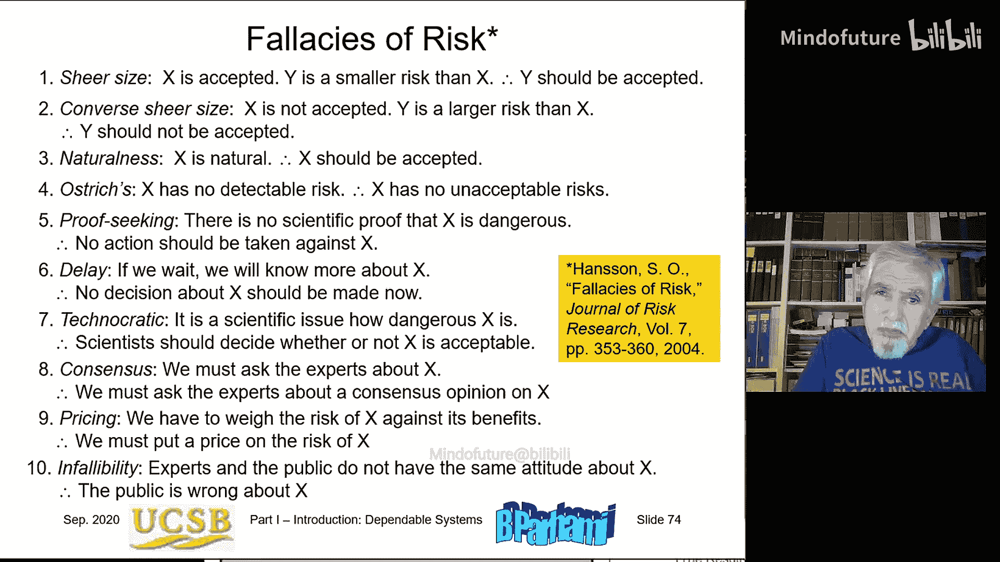

The final topic that I'll discuss today。嗯。Rlates to privacy and security。Privacy。

Is compromised when confidential or personal data are disclosed。To unauthorized parties。

Security is breached when account information， for example， in a bank is improperly modified。

 someone goes and modifies your account。Balance， for example， reduces it。There。

Security has been compromised。Privacy is when the person goes into the banks。

Computer and grabs your account number， various information about you， the Social Security number。

 and so on。Of course， both of these are important， but they're different， different concepts。

Now security is distinct from both reliability and safety。

A system that automatically locks up when a security breach is suspected。

May not be very reliable or safe。But it's secure。So if the system detects。

The possibility of a security compromise， and it just shuts down， doesn't allow access to anybody。

It will be secure。But it will not be reliable because it's not working。When it's locked up。

And it may not even be safe because that lockup state may not be a safe state。

So these are distinct concepts now how do you model privacy and security？But for security。

 it has been suggested that we should model it just like risk。You know。

 security breaches have some frequency， some probability。And some consequence。Okay。

 so if you multiply the probability by。The consequence， again， quantified in some way in dollar。

In terms of dollars。But theoretically， you should be able to do this， there's just one problem。

Whereas for safety event that cause。The lack of safety are really probabilistic and you can assign probabilities to them。

Things like hacking intrusion into systems are not really probabilistic events。You know。

 somebody is sitting there looking for an opportunity to infiltrate the system。

It doesn't just do randomly probabilistically。Now， if you consider many， many systems， you know。

 millions of systems across the world。Then you can say that there is some probability involved。

 you know， a certain number of these will be。Will be hacked， be compromised。

 so in that sense you can assign probabilities。Through large numbers of systems。

 but for any given systems， for example in your computer， you're trying to do security assessment。

 you really cannot assign a probability。That your computer will be hacked and therefore there will be a security。

So this is still work in progress， in other words， we still don't quite know。

How to quantify security。But the simple idea to treat it like。Safety risk。

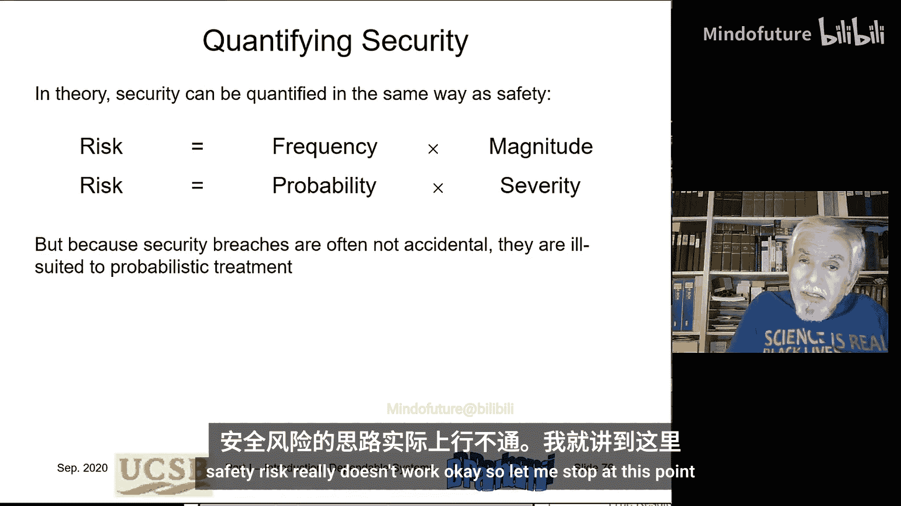

Re doesn't work。Okay， so let me stop at this point that's the end of chapter2。嗯。

Chapters three and four also will have individual lecture， one lecture per chapter。

And then after that， I will start， as I mentioned in the first。

Lecture combining two chapters into one lecture in order to。

Have an opportunity to finish the entire textbook by the end of the court。Bye for now。

 stay safe and see you in lecture three or during one of my office hours。

