# 容错计算：第2讲：可靠性属性 📊

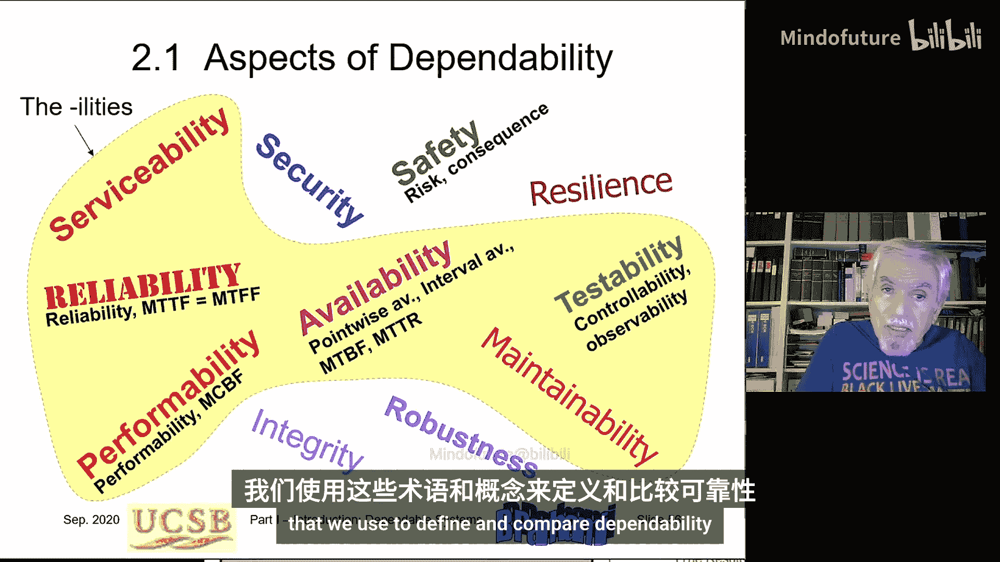

在本节课中，我们将学习如何量化和比较系统的可靠性。我们将探讨一系列用于衡量系统可靠性的关键属性和指标，包括可靠性、可用性、可执行性、安全性等。课程将从概率论基础概念回顾开始，逐步深入到各种可靠性模型和评估方法。

## 概率论基础概念回顾 🔍

上一节我们介绍了课程概述，本节中我们来看看理解可靠性属性所需的一些基本概率论概念。这些概念是后续量化分析的基础。

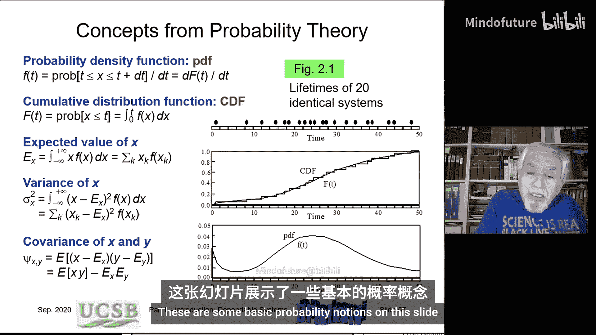

**概率密度函数** `f(t)` 定义为随机变量 `X` 在区间 `[t, t+dt]` 内取值的概率除以 `dt`。其公式为：
`f(t) = P(t ≤ X < t+dt) / dt`

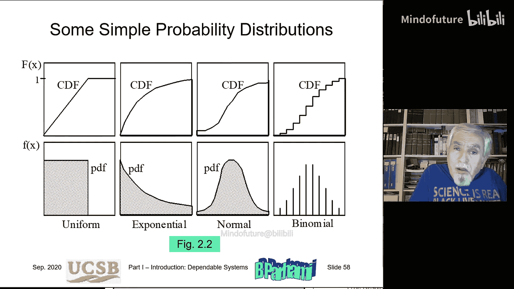

**累积分布函数** `F(t)` 是概率密度函数从0到t的积分，表示随机变量 `X` 小于或等于 `t` 的概率。其公式为：
`F(t) = ∫₀ᵗ f(x) dx`

**期望值** `E[X]` 是随机变量 `X` 的加权平均值。对于连续变量，其公式为：
`E[X] = ∫_{-∞}^{∞} x * f(x) dx`
对于离散变量，其公式为：
`E[X] = Σ_k x_k * P(X = x_k)`

**方差** `Var(X)` 衡量随机变量与其期望值的偏离程度。其公式为：
`Var(X) = E[(X - E[X])²] = E[X²] - (E[X])²`

**协方差** `Cov(X, Y)` 衡量两个随机变量之间的线性关系。其公式为：
`Cov(X, Y) = E[(X - E[X])(Y - E[Y])] = E[XY] - E[X]E[Y]`

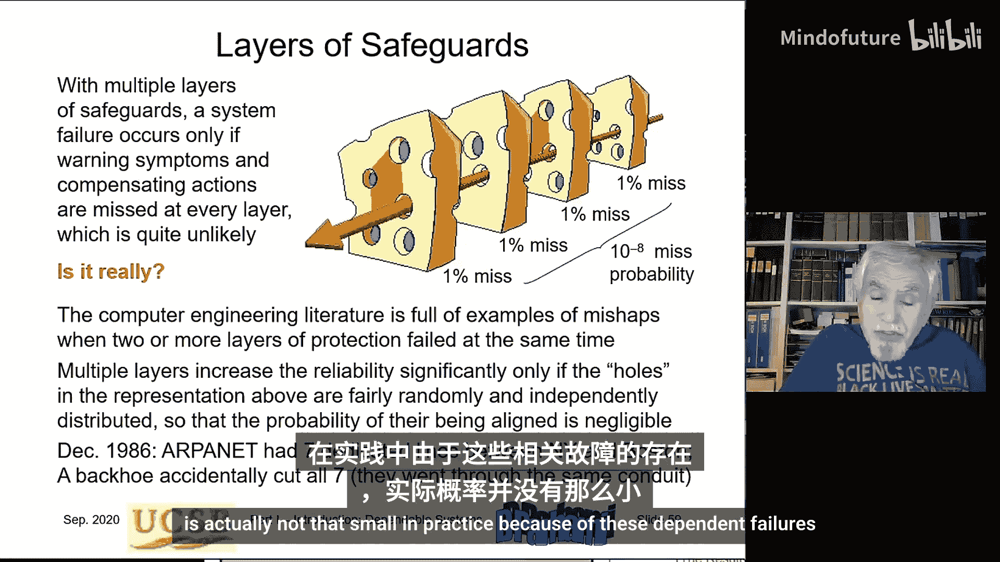

以下是几种常见的概率分布：
*   **均匀分布**：密度函数在某个区间内为常数。
*   **指数分布**：密度函数呈指数衰减，常用于模拟无老化现象的电子系统故障。
*   **正态分布**：密度函数呈钟形曲线。
*   **二项分布**：正态分布的离散版本。

## 保护层与独立性假设 🛡️

在构建高可靠性系统时，常采用多层保护的设计思想。然而，关于这些保护层存在一个常见的误解。

设想使用多层坚固织物制作防弹背心。每层织物都有一些代表缺陷的孔洞。如果这些孔洞的位置完全随机且各层独立，那么子弹恰好穿过所有层对齐孔洞的概率极低。例如，若每层有1%的概率无法阻挡子弹，且各层独立，则四层都无法阻挡子弹的概率为 `0.01⁴ = 10⁻⁸`。

然而，**独立性假设**是一个很强的假设。在实际系统中，子系统故障可能并非统计独立，而是存在**共因故障**。例如，所有子系统连接至同一个电源，电源故障会导致所有子系统同时失效，这就是一个**单点故障**。

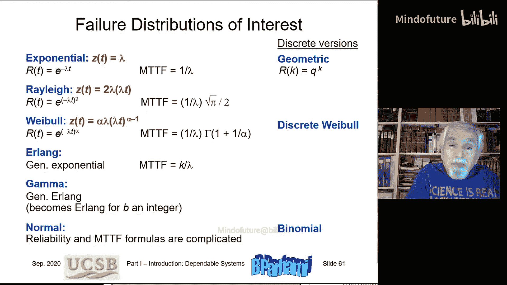

一个著名的例子是1986年的ARPANET网络。它在纽约和波士顿之间铺设了7条独立的租用线路，假设它们同时失效的概率极低。但实际上，这7条线路都经过同一条物理光缆。当一台挖掘机意外挖断这条光缆时，所有7条线路同时中断。这个例子警示我们，在使用独立性假设进行概率计算前，必须仔细验证其有效性。

## 可靠性及其度量 ⏳

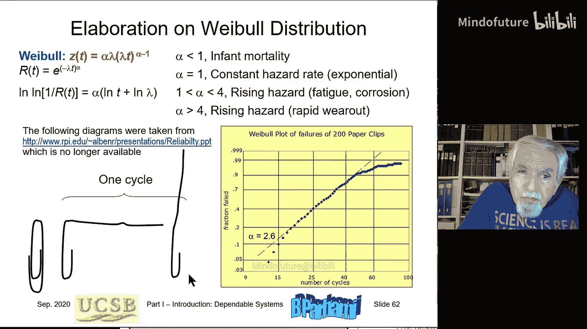

可靠性是系统在时间区间 `[0, t]` 内保持正常运行状态的概率，适用于不可修复的双态（正常/故障）系统。

系统在时间 `t+dt` 仍然正常的条件是：它在时间 `t` 正常（概率为 `R(t)`），并且在接下来的短时间 `dt` 内不发生故障（概率为 `1 - λ dt`）。由此可得微分方程：
`dR(t)/dt = -λ R(t)`
解此方程，得到**指数可靠性定律**：
`R(t) = e^{-λt}`
其中 `λ` 是常数故障率。对于由 `n` 个相同组件构成的系统，系统故障率为 `nλ`。

**平均无故障时间** 是系统发生故障前平均运行的时间，定义为可靠性函数曲线下的面积：
`MTTF = ∫₀^∞ R(t) dt`
对于指数分布，`MTTF = 1/λ`。

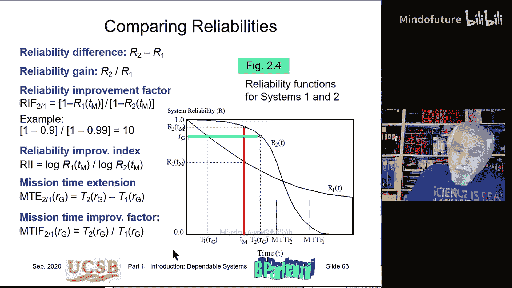

除了指数分布，还有其他用于建模可靠性的分布：
*   **瑞利分布**：故障率随时间线性增加。
*   **威布尔分布**：一个更通用的分布，通过参数 `α` 可以模拟不同类型的故障率变化（`α<1` 对应早期故障率下降，`α=1` 对应指数分布，`α>1` 对应故障率上升）。

一个使用威布尔分布的例子是回形针弯曲实验。记录回形针在断裂前能承受的弯曲次数，其分布符合威布尔分布，参数 `α ≈ 2.6`，表明故障率随使用次数增加而上升。

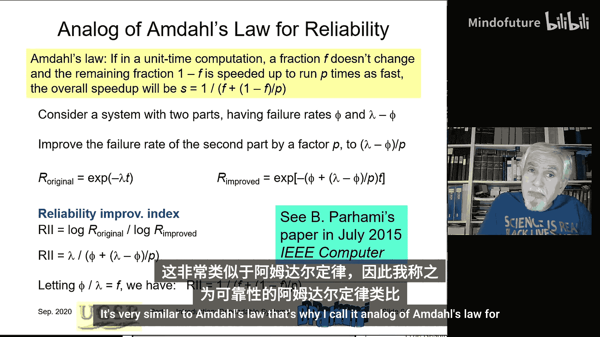

## 可靠性比较与相关定律 📈

比较两个系统的可靠性时，仅看MTTF可能产生误导。如下图所示，系统1的MTTF可能大于系统2，但在关键的任务时间 `T_M` 内，系统2的可靠性 `R₂(T_M)` 却高于系统1的可靠性 `R₁(T_M)`。

因此，我们需要更精细的比较指标：
*   **可靠性差异**：`R₂(T_M) - R₁(T_M)`
*   **可靠性增益**：`R₂(T_M) / R₁(T_M)`
*   **可靠性改善因子**：`(1 - R₁(T_M)) / (1 - R₂(T_M))` （即不可靠性之比）
*   **任务时间改善因子**：对于给定的可靠性目标 `R_G`，系统2能达到 `R_G` 的任务时间与系统1相应任务时间之比。

可靠性改善也存在一个类似于计算机体系结构中**阿姆达尔定律**的现象。假设系统总故障率为 `λ`，其中一部分 `φ` 的故障率被改善了 `p` 倍（即降低为 `φ/p`），而剩余部分 `(λ - φ)` 未改善。那么，系统整体的可靠性改善指数存在一个上限，最大改善倍数为 `1 / (φ/λ)`。这意味着，无论对可改善部分做多大改进，整体可靠性受限于未改善部分的比例。

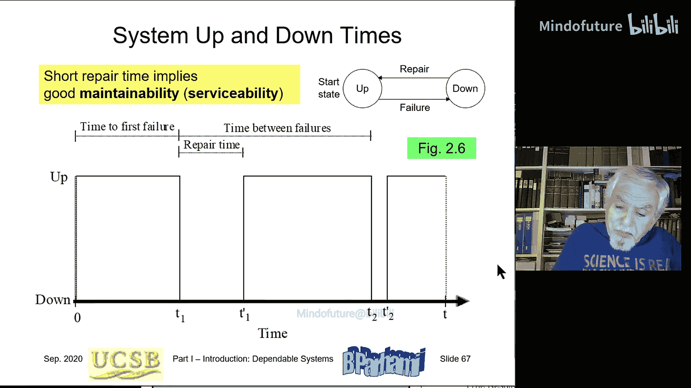

此外，在可靠性评估中还存在**可靠性反转**现象。由于我们无法精确获知系统的真实可靠性，只能通过模型计算出一个可靠性的**下界**。可能出现的情况是：系统A的真实可靠性高于系统B，但模型计算出的系统A可靠性下界却低于系统B的下界。这可能导致我们根据模型错误地选择了实际可靠性较低的系统。因此，开发更精确、更接近真实值的模型至关重要。

## 可用性 ♻️

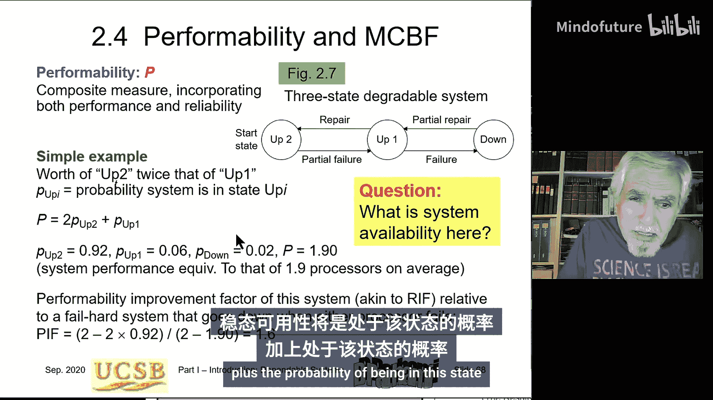

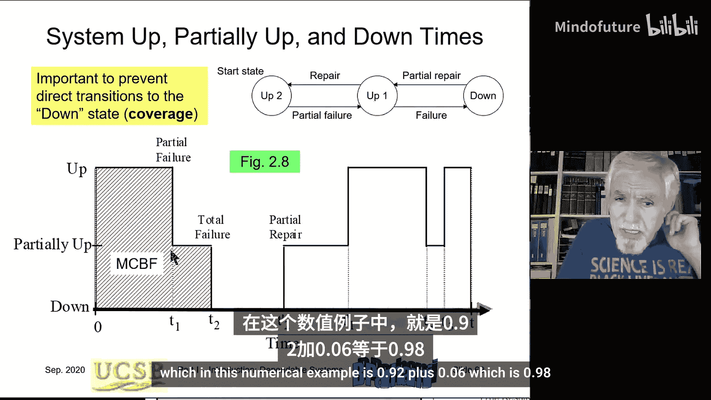

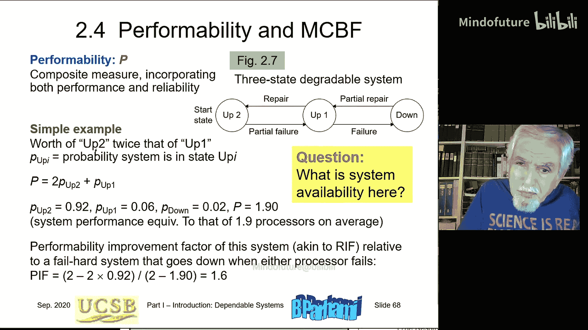

可用性适用于**可修复系统**。系统在运行和故障状态之间切换，故障后可以被修复。

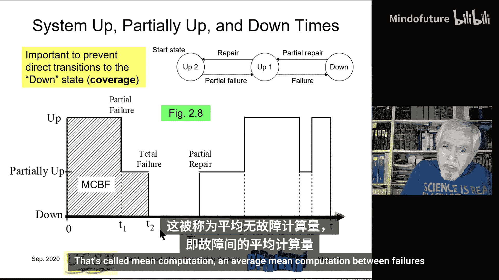

**稳态可用性** `A` 定义为系统长期处于正常运行状态的时间比例。其计算公式为：
`A = MTTF / (MTTF + MTTR)`
其中，`MTTF` 是平均无故障时间，`MTTR` 是平均修复时间。
若故障率为 `λ`，修复率为 `μ`，则 `MTTF = 1/λ`，`MTTR = 1/μ`，代入公式可得：
`A = μ / (λ + μ)`
通常 `μ >> λ`，因此可用性接近1。

## 可执行性与安全性 ⚖️

**可执行性** 适用于性能可降级的“故障软化”系统。例如，一个双处理器系统，双处理器都正常时性能为2，一个故障时性能降为1，全部故障时性能为0。
系统的平均可执行性 `P` 是各状态性能与其稳态概率的加权和：
`P = 2 * P(up2) + 1 * P(up1) + 0 * P(down)`
例如，若 `P(up2)=0.92`, `P(up1)=0.06`, `P(down)=0.02`，则 `P = 1.90`。

**安全性** 关注系统故障对外部（尤其是人员）造成的后果，与可靠性不同。一个系统可以设计成**故障安全**的，即一旦检测到故障，就进入一个已知的、不会造成危害的状态（如完全关机），尽管这可能意味着它并不“可靠”。

为了量化安全风险，我们引入**风险评估**概念。风险 `R` 是事件发生概率 `P` 与其后果严重程度 `C` 的乘积：
`R = P * C`
后果通常用金钱衡量。人类通常是**风险厌恶**的，即人们更关注小概率的重大损失，而非其期望值，这为保险业提供了基础。

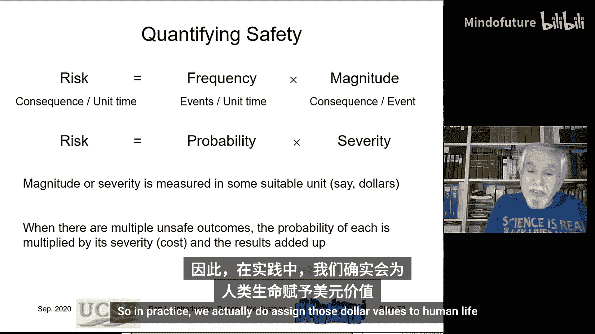

安全模型比可靠性模型更复杂，可能包含正常状态、多个不同危险程度的故障安全状态和不安全状态，以及这些状态之间的各种转换概率。

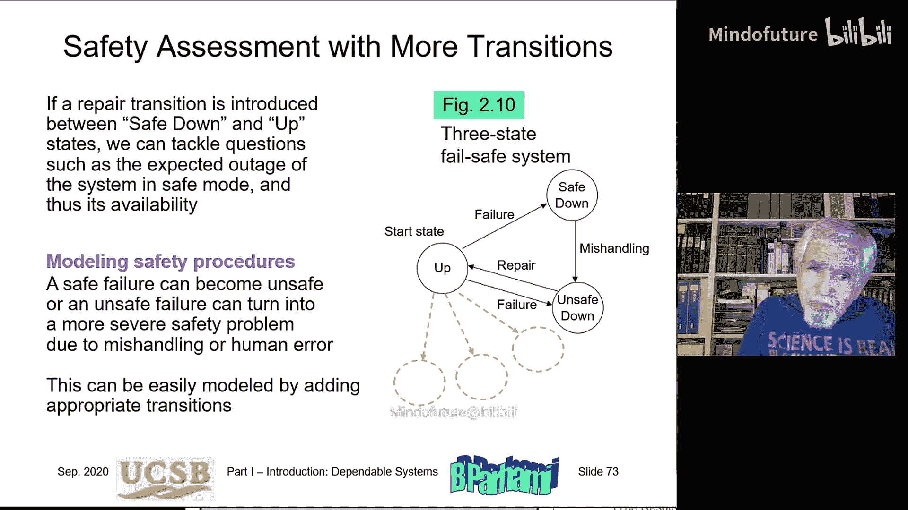

## 隐私、安全与总结 🔐

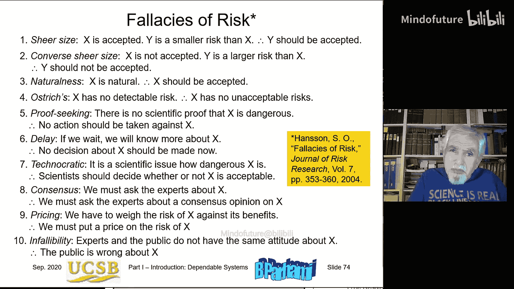

**隐私** 指防止未经授权披露机密或个人数据。
**安全** 指防止未经授权修改数据或系统状态（如银行账户信息）。
安全与可靠性、安全性都不同。一个在怀疑被入侵时自动锁定的系统可能是安全的，但不可靠（无法使用），也可能不安全（锁定状态本身有风险）。

量化安全面临挑战。虽然可以像风险评估一样尝试用 `概率 × 后果` 来建模，但安全威胁（如黑客攻击）往往不是随机的概率事件，而是有目的的恶意行为，这使得为单个系统分配准确的被攻击概率非常困难。如何有效量化安全仍是当前的研究课题。

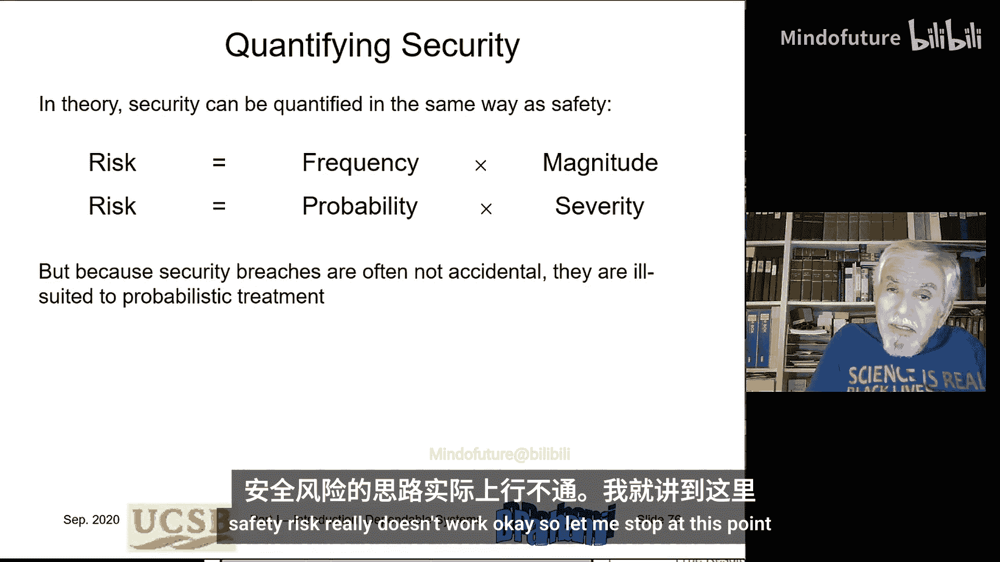

本节课中我们一起学习了量化系统可靠性的核心属性。我们从概率基础出发，探讨了可靠性、可用性、可执行性和安全性的定义、计算模型及比较方法。关键点包括：理解指数可靠性定律及其适用范围，认识到独立性假设和共因故障的重要性，掌握比较不同系统可靠性的多种指标，了解可用性对于可修复系统的意义，以及区分可靠性、安全性和安全等不同但相关的概念。这些概念和工具为设计和评估高可信赖的计算系统奠定了理论基础。