# 【加州大学】容错计算-｜-Fault-Tolerant-Computing-Ucsb-Ece-257A-p03-P03_第3讲_第3章_组合建模--BV19cFyz8EPV_p3-

Hello and welcome to Le 3。For the UCSB course ECE257A。Falult， tolerant computing。

This lecture deals with chapter three。In the textbook。Enitled Combinal Modeling。

So we will discuss a number of models that are combinational in nature。

To evaluate the reliability and other attributes of a dependable system。Okay。

 so here this is where we are， we are in part one of the textbook， chapter three。

 combinational modeling， the next lecture， state space modeling introduced as another category of models。

That we find useful。In evaluating systems with regard to dependability attributes。Now。

 combinational models， if a system has only a few components。

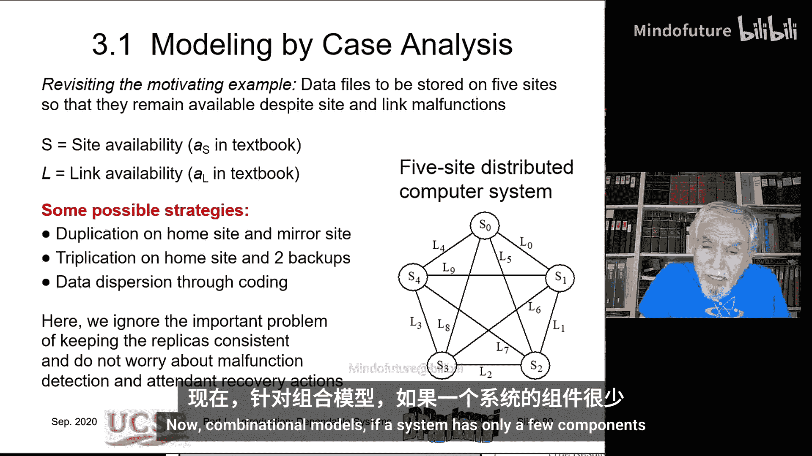

very simple connections between them。Can just directly write the reliability equations。

So for example， if a system consists of。诶。Let's say three components。

A processor and memory and a bus connecting them。Then if you know the reliability of each of these three components。

 you can just multiply those reabilities。And find the reliability of the overall system。

When systems get more complicated， we need a more systematic way of doing it。

 we may not be able to write。The reliability equation directly。But we may need some help。

So in order to demonstrate。These methods known as case analysis methods。

I'll take the example we covered earlier。诶。That was when you had five sites。

With connections between them。A user being at one of these sites and data。

Being at a different site or maybe two other sites or three other sites。

 and then in each case we wrote。The availability equation。

 probability that data will be accessible with the simple non redundant data one side。

With two copies of the data。A home site and a mirror site。With three copies of the data， home site。

 Mi1 and Mi2。And also a data distribution scheme that we discussed。

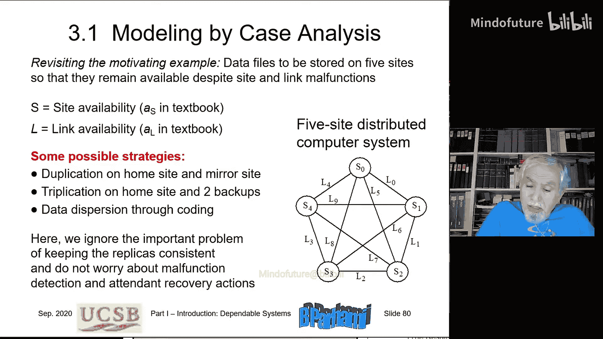

Okay， so let's take one of these and。This is when you have the home site。😔，And a mirror site。

 so two copies duplicated data。And then the requester always first。😔。

Triesries to go to the home site to get the data。And if data is not available on the home site。

 then the mirror site。Will be access。Continue with the assumptions we had last time。

The assumptions being that in order to get data from a particular site。

 you need to access that site directly。So the requester are in this diagram。

Goes to the home site to get the data in order to be able to do that。This link to the home site。

And the home site itself。Must be available， link reliability。😔，We。Wrote as L。

And site reliability as S， so S times L is the probability that this unit the requester here can get the data from the home site。

 in other words， when both the link to the home site，And the home site itself are available。Okay。

 if that's not the case， that has probability1 minus Sl， so Sl means both of those are available。

 one minus Sl means that the complementary event。And at least one of them is not available。

In that case， you have to go to mirror site to the mirror site。And that's。

Our ability of success going there is S times L。Okay， so suppose this is simple still。

 you can write the equation directly， but suppose you somehow have trouble coming up with this equation。

Here is what you can do。You say， okay， here is the situation I am facing。

Dashshed lines and dashed sites means that we don't know anything about their status。Solid means。

They are available。Okay， so the solid circle here means the requesting site is available。😔。

And a solid line like this one means that that particular link is available。😔，So start here， say。

 okay， I consider two cases。First。When both。This link。To the home site and the home site。

Are available that has probability as times L。And so this is the situation this link is available。

 this site is available。And then I'm done then with probability one。I can access the date。

If this link is not available， that has probability 1 minus L。

 so you see here that it's not available is missing。So this is a subcase that I need to analyze。Well。

 the only way I can get to the data is if I can get it through the mirror side。

 so that has probability s times L。And now suppose this link is available。

 but this site is not available。The situation， that link is available， this site is not available。

Then again， I can't get the data from the home site， I have to get it from the mirror side。

 so that has probability SL。And the total availability is just the product of these1 times SL。

Plus SL times 1 minus L plus SL times 1 minus L S times L。Okay， so these these are three cases。

 the important thing is that they must be。Mutually exclusive in order for me to be able to add these probabilities。

In this case， there are either both of these are available。

The link is not available and it doesn't matter whether the site is available or not。

And the link is not available。Sorry， the link is available， but the site is not available。In fact。

 in this case， I could have merged these two branches。Because with respect to data accessibility。

 it doesn't matter whether the link is not available at the site。Is not available。

 So the sum of these two probabilities， one minus L。Plus L minus SL。Becomes 1 minus SL。So basically。

 this reduces to that equation。😔，So 1 minus Sl， these two are merged。Times SL plus1 times SL。

 which has the same equation。就。I already mentioned that this is a simple example。

 you probably don't use case analysis in this case in this for this problem， but just。

Gives you the basics of the idea you divide。The problem that you're trying to analyze into。

Mutually exclusive subcases， and then in this subcase for example， given that this link is missing。

 it's a smaller system。If needed， you can continue decomposing this into mutually exclusive subcases until you get to a point where the subcases are simple enough for you to write the reliability equation directly。

Okay， now I can use the same method。

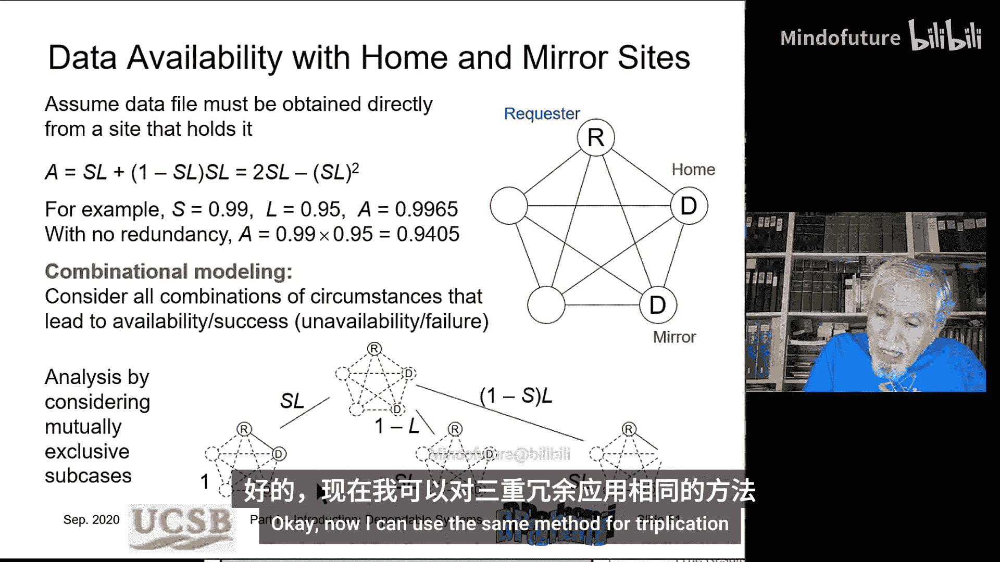

For Triplication。Again， I say。Liinnk to primary site and primary site are available as shown here。

The solid limit are solid。Elements means they are available。😔，Again， this link is not available。

That's missing。Or this link is available， but the site is not available link available site。

And then again， in this case， for example。I do a similar decomposition。This link。

And this site backup one site available。And so on and so forth， again， I can merge。

These two subcases here and these two subcases here because they're really the same with respect to probability calculations。

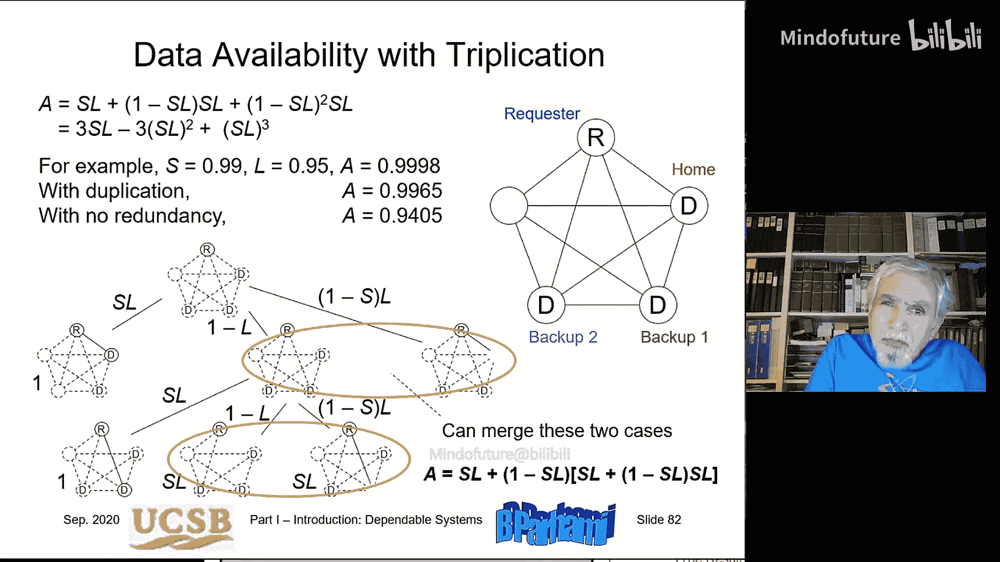

Now，'m in the case of the。Data dispersion scheme where we have five pieces。Any three of which。

Are sufficient to reconstruct the data that we are interested in。

This is basically a two out of four system， we don't need to do case analysis here because two out of four are more generally k out of n systems。

It occur frequently enough that we know how to write equations for them， so two out of four system。

At least two out of four。unitss。A available is characterized by this equation。All four are available。

 that's one instance， in which case， obviously we have more than the two that we need。诶。

One is unavailable， three are available。And that can happen in fourth。Four different ways。

 depending on which site is unavailable， for that these are mutually exclusive。

This one says all four are available， this one says one is unavailable。

 so it doesn't overlap with that。And then but the three others are available。

 this one says two are unavailable。Two are available that can happen in six ways。Okay。

 so in this case， we use。The K out of n formula to directly write。A reliabilityli equation。

 availability in this case。

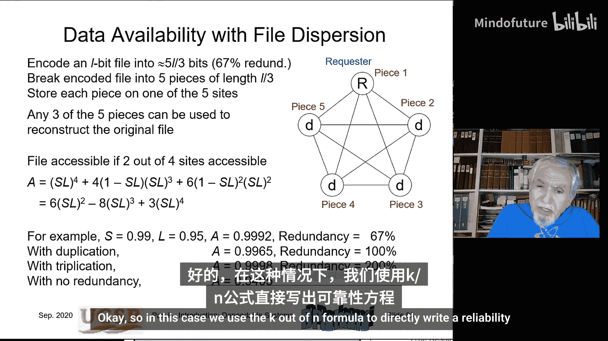

Okay。The next set of notions are those of series and parallel systems。These are very useful。

In our modeling activities。So what is a series system？A series system is composed of n units。

 all of which must be healthy for the system to function properly。

So this is known as the reliability block tag for such a system。There are four modules are unit。

They're connected in series。Meaning that so going from one side of this diagram to the other side。

Through good units。Is known as a success path， so for us to have a success path。

From the left side of this diagram to the right side of the diagram， all four units must be working。

So the reliability of a series system is simply the product。Of the reabilities of its。

Individual units。Of course， the units can be different and therefore they can have different reliabilities。

But we assume independent failures， in other words。

 things that cause this unit to fail do not overlap things that cause this unit to fail。

 in other words they fail independently of each other， that's why we can multiply the reabilities。

So here's an example of a series system， there is a pipe。There are four valves。

And suppose I'm interested in being able。To。嗯。Allow。Liquid， let's say oil。

 whatever it goes into this pipe to flow from one side to the other side。

In order for the liquid to flow from this side to the other side。All four of these must be open。

So if one of the。Ws。This stuck shut means meaning it is shut and I can't open it。Then I'm in trouble。

Then I can't control， I can't allow。They quit to flow from one side yet。

So all four of these must be non shut， not they must not have failed。In the stackshot mode。

For the system to be able to operate。On the other hand， if they fail to stuck an open mode。

So let's say one of these。It's open and I can't shut it。

And I can still control the flow of the liquid using the other three valves。

So this is a series system。With respect to stuck shut failures。This is also a series system。

 and this is the surprising part because this looks like a parallel system。

It is a series system if I'm worried about stuck on open failures。

So if one of these valves in this diagram is stuck and open。It's open and I can't shut it。

Then the liquid will flow to the other side。And I have no control over it。

So if stuck and open is the dominant failure mode。Then this is a series system with respect to that particular。

Ty of failure。

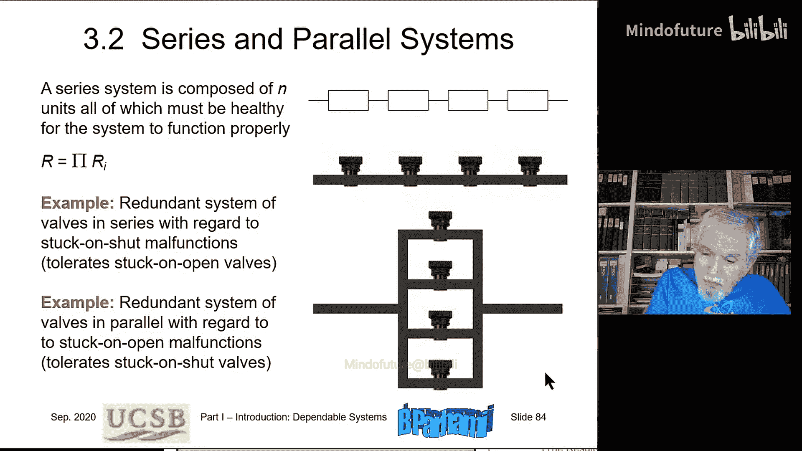

Okay。Now implications of series system to design are as follows。

The reliability of a series system is the product。Of。The reliabilityabilities of the component。

Of the system。If the reliability equation is exponential。

 which we talked about earlier and justified it。Then the product of reabilities。

Will be E to the power sum of the failure rates times0。In other words。

 the failure rates in a series system add up。If this fails once every 10 to the nine hours。

This one fails twice every 10 to the nine hours。Then one and two。So one times 10 to the minus 9。

 two times 10 to the minus 9，1 times。And two times。

 then I add these one plus two plus one plus two is6。

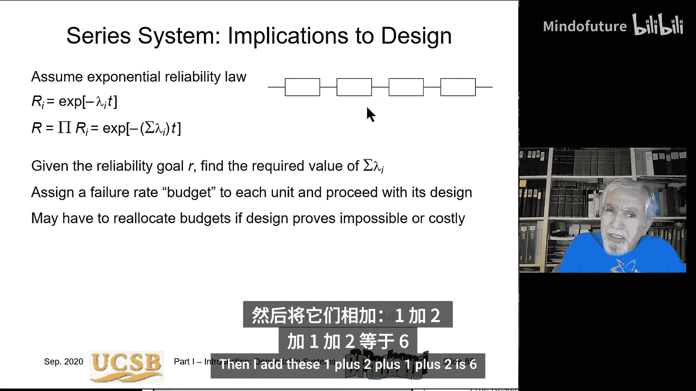

So the overall failure rate will be six times 10 to the minus9。

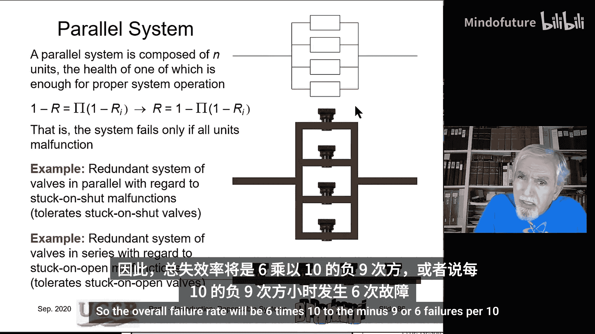

Six failures per10 to the minus， so failure rates add up。

If we have an exponential reliability equation。Going the other way。

 if we want to design the system composed of four components。

 all of which are critical to the systems。Functiontioning。In other words。

 all four must be working properly for the system to work properly。And if we have a reliability goal。

 R。Little R for the overall system。That reliability goal R。Translates to some。Total failure rate。

So from the reliability goal R， we find the total failure rate？

And then we do something called failure rate budget allocation。

So suppose these four units are being built by four different design teams and suppose six。

And 10 to the minus9 is the failure rate that I allow for the total overall system。

Then the design manager can go to the teams and say， okay， your team here。

Should aim for one failure every 10 to the minus9。This unit， let's aim for two times。

10 to the minus1， so a bigger failure rate budget is given to this unit。

And may because it's a more complex unit。For some reason， okay。

 so the total failure rate is divided up。Between these teams designing various components and each team。

Basically aims to design the unit with that。Would that limit on the failure rate？

Sometimes as happens in design， designs are iterative。

One of these teams may come back to the manager and say， okay， we tried。

But we can't design this unit with a failure rate。1 times 10 to the minus 9。

Then perhaps the budget is reallocated。And a higher failure rate budget is given to this team。

So that they can complete their design。Okay so the key observation here is that failure rate add up。

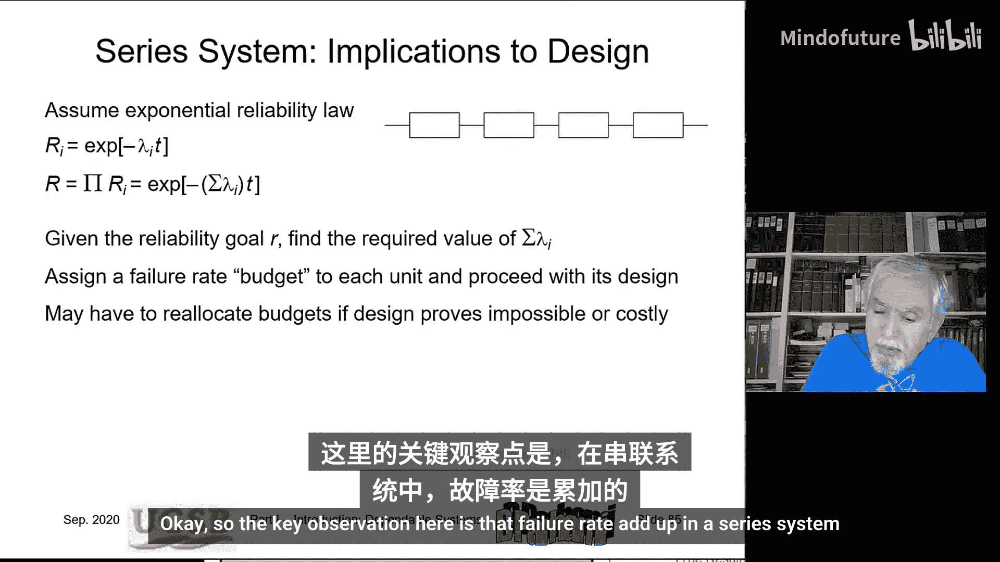

In a series system。So parallel system。Its a system which is composed of n units。

The health of one of which is enough。For proper system operation。So here I've shown。

Four units in parallel， so this is the reliability block diagrams and a success path exists from the left side to the right side。

 if any of these， any one。At least one of these units is。嗯。

Functioning so the path can go through that。Okay， now in a parallel system because。

All four of these units must fail for the system to fail。It's easier to write the equation for。

Unreli。So the unreliability of this system。Is the product of the unreliabbilities of the components。

In other words， this system fails。If all four of these units or n or generally fail。Okay。

 so from this， I derive r to be 1 minus the product of1 minus R。That is。

 the system fails only if all units malfunction。So this is an example of a parallel system with polys and valves。

If。I'm interested。If the valves。And failed to st shut。In other words。

 if three of these valves even are stuck shut and I can't open them。

 I can still allow liquid to go to the other side through the for valve。

 so three malfunctions are tolerable here。4 malfunctions are not。

But if I'm interested in stuck and open valves， valves can sometimes get stuck and open and I can't shut them。

Then this is a series system。Because in this case， if one of these is open。Well， water will flow。

 and I have no control。So not even one stuck and open is allowed。

 the airport which is expect to stuckuc in open valves。This is a series system。

 so series and parallel。Do not imply that things are connected in series or parallel。

 you see that both parallel connection of bows and series connection of mouses can give you a parallel system depending on the failure mode that you're considering。

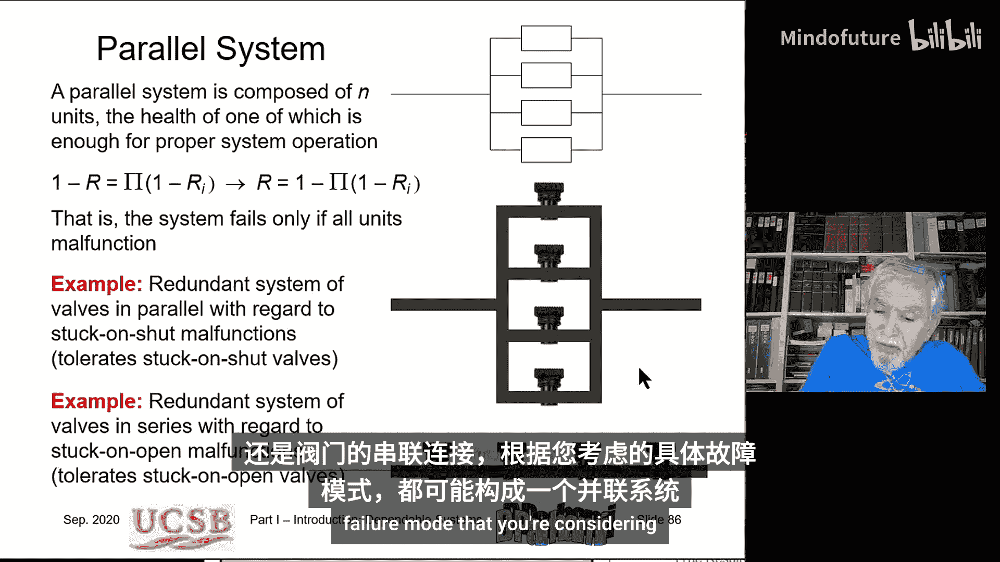

Similarly。呃 boat。

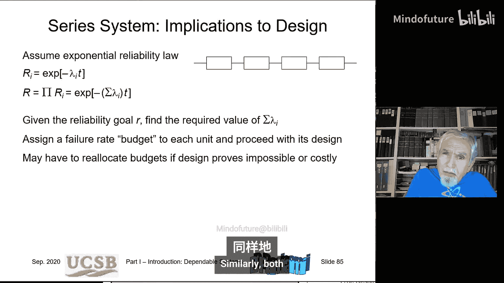

Series connection of mouth and parallel connection of mouth can give you a series system with respect to reliability。

 so this is something that you have to be careful about。

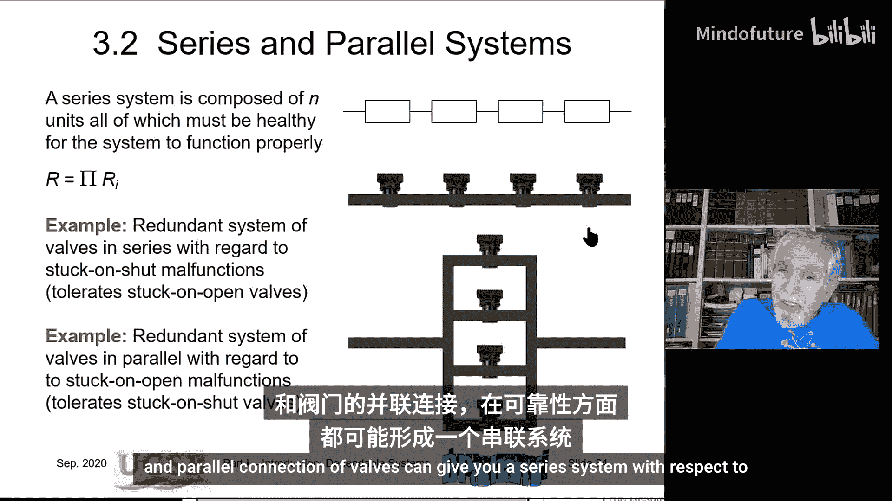

I parallel systems。Similarly， once we have set a reliability goal。啊玩儿。Then of course。

 we have the unreliability goal。Whi should be the product of unreliabbilities。安典为伊。

Budget on rebilities to the various units if these units are identical。

And the unreliability assigned to each of the identical units。Basically， the end root。1 minus r。

Here's an example， suppose I'm aiming for reliability。9999。Or unreliability 0。000110 to the minus4。

And I have four units。Then each of them can have unreliability 10 to the minus1。

And I will still meet。The overall reliability goal。

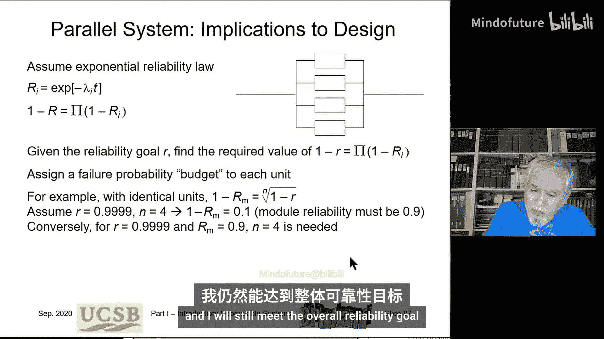

Okay， so。

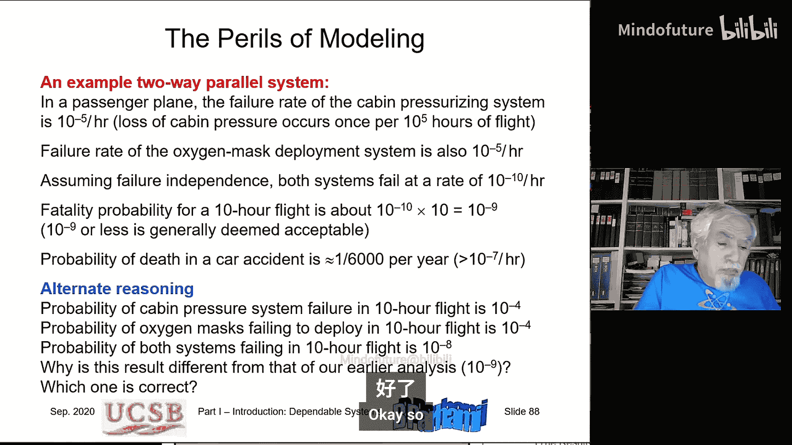

Before going into more elaborate models。I have a couple of slides here that。

Show you the perils of modeling。

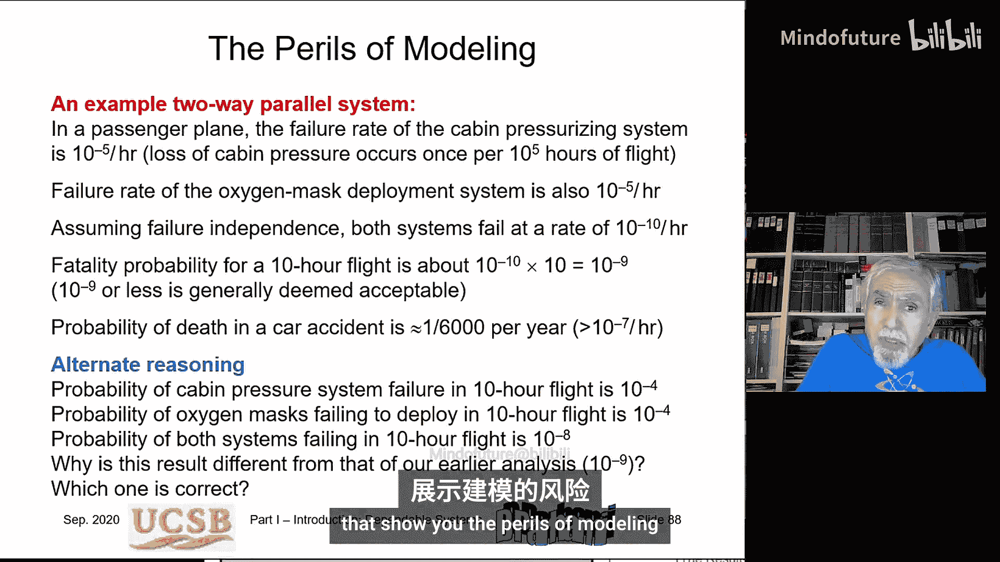

Modeling。Ass a risky activity， because if you're。Model is not accurate， is not realistic。

Then you can get results that。Basically。Have no。Counterpart in reality。

 you get results that are not realistic。And therefore。

 you may think that your system is more reliable than it actually is。

Or less reliable than it actually is。Of course， if you think it is less reliable， that's safe。

But if you think it's more reliable than it actually is， that's kind of risky。Because then。

The failure probability will exceed what your model shows。那你。😔，Describe an example。

 this is a very interesting example。It comes in two slides。

 the statement of the problem is in the first slide and the solution in the second slide。If you want。

 you can pause the video after the first slide。And then try to figure out what the answer is。

Before continuing with my explanation。So here is a two way parallel system。In a passenger plane。

The failure rate of the cabin pressurizing system。It's 10 to the minus5 per hour。In other words。

 loss of cabin pressure occurs once per 10 to the five hours of flight。

Now when cabin pressure is lost， the passenger planes have oxygen masks。

That are deployed from the ceiling of the plane。And the oxygen mask deployment system also has a failure rate 10 to the minus5 per hour。

And we get in trouble， there will be loss of life。Only if both of these systems fail。In other words。

 the cabin is depressurized。And the oxygen mask。Failed to deploy。And therefore。

 people cannot breathe and potentially die。So this is a parallel system in that sense。

So only if both of these subsystems fail。The total system， the overall system phases。

Now here is a potential solution model for this。Assuming failure independence between the two systems。

Both systems fail at a rate of 10 to the minus10 per hour， basically。

Each one has a failure rate 10 to the minus5 per hour， multiply them。

 you get 10 to the minus 10 per hour。Suppose you're considering flights that are 10 hours in duration。

Therefore， given that the failure rate per hour is 10 to the minus 10。

 multiplied by the number of hours in the flight。That gives you 10 to the minus9。

Probability of loss of life。Due to both of these systems failing。G sounds reasonable， the model。

Until I tell you that's alternate。Eing， then you start doubting whether that's the correct reason。

Now， generally speaking and safety critical systems。诶。10 to the minus9 failure rate。

It's considered acceptable where safety is concerned。In other words。

 it's small enough for us to accept that risk。That the passengers will die with that probability。

We a 10 hour flight。Okay， so here's alternate reason。诶。

The probability of cabin pressure system failure in 10 hour flight is 10 to the minus4。

The cabin pressure system has a failure rate of 10 to the minus5 per hour。

 over 10 hours it does a failure probability of 10 to the minus4。

Probability of the oxygen masks failing to deploy in a 10 hour flight is also 10 to the minus4。

 its failure rate of 10 to the minus5 multiplied by the flight duration 10。

Probability of both systems failing in 10 hour flight。Assume independence again。

Theres 10 to the minus4 times 10 to the minus4， which is 10 to the minus 8。Now。

 why is the result different from？Our first analysis。WSheG us at 10 to the minus9。

 I said 10 to the minus9。Failure rate in a safety critical system is acceptable 10 to the minus 8 is really not acceptable is a bit too high。

 so if the second model is correct， we are in trouble， if the first model is correct， we are okay。

But this is where I want you to think about these two ways of modeling。And they overall。

Failure of ability。And consider which one is the correct way of doing it。Okay。

 so I'm now going to proceed to the next slide， you can pause if you want to think about this。

Maybe do some calculations before proceeding。

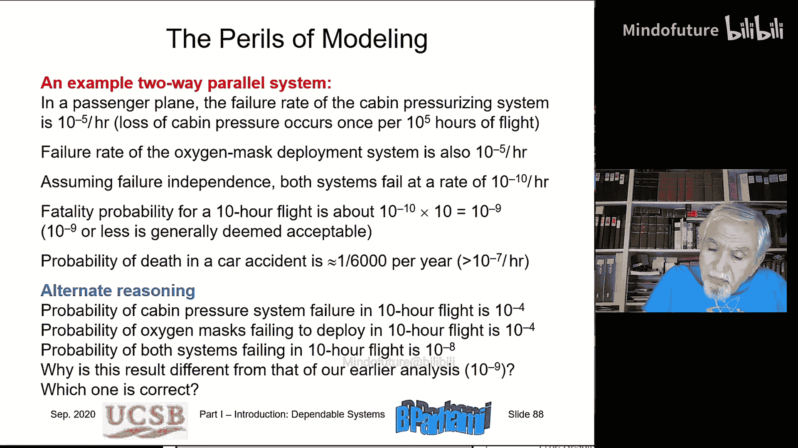

Okay， so here' is a little bit more detail in our modeling。

So the 10 hours of flight I've drawn them individually rather than just one long 10 hour flight。

 consider the flight as 10 one hour segments。ok。😊，Now， suppose masks fail。In that second segment。

While pressure is lost。😔，In the seven segment between six and hours， six and seven。

Does this lead to overall failure？Or the answer is no。Because when masks fail， oh sorry， the answer。

I yes， if masks fail。And we don't know this， there's no indication that they have failed because they are just you know some in some compartment and。

Ps dealing。We don't see them， they failed and don't notice that they fail when the pressure is lost a few hours later and we try to use the mask。

 the failed they don't deploy and we are in trouble。Okay， now consider the second situation。

The pressure is lost in the second hour。And masks fail in the seventh hour between hours six and seven。

This situation is probably safe。Even though both of these units fail。

The system as a whole will likely not fail， The reason is that when。Pressure is lost。

And the mask got deployed so the maskb not failed at that time。

Usual planes don't just go on their usual path and get to the normal destination。

 they try to land right away， return to the airport。

If they have just left or find a nearby airport that。

Can accommodate them and land there so that they can take care of the problem。

So the mask failing a few hours later may not be relevant because the plane will not be in the air for that long。

Okay。😊，So。What we can say。Is that the first model on the previous slide that gives us a failure rate of 10 to the minus 9 was optimistic。

Because it's sort of when we say the failure rate of the two systems together is 10 to the minus 10 per hour。

That sort of assumes that the two systems fail in the same hour。So it basically does not consider。

It does not consider this situation。Where masks fail here and the pressure is lost here。😔，Okay。

 so that's an optimistic model， which is very dangerous in reliability calculations。

Because we definitely don't want to overestimate the reliability。

The second model that gives us a failure rate 10 to the minus 8 is pessimistic。In other words。

 it considers this situation as a failure。Even though as I just discussed， it's not really a failure。

Therefore。The reliability。何必。Perhaps more than 1 minus10 to the minus8， how much more we don't know。

 but definitely it's considering some cases as failures that should not be considered as failure。

So this is the challenge of modeling， your model is as good as your assumptions。

If you're not careful and don't make very careful assumptions about the model and can justify those assumptions。

Then your model will not give you correct results， accurate results。

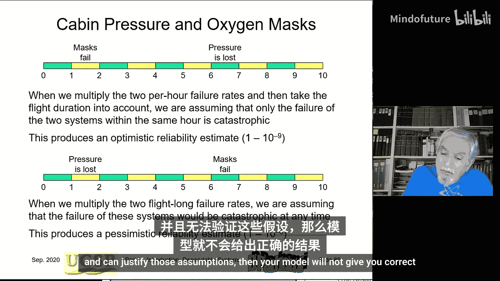

Okay， now in a parent system， like the one we just considered。

Whether there are two subsystems or four subsystems， any one of which。Is enough。

For the system to operate correctly。There is this challenge。

 so often these parallel systems are used in the following way so this is one operating module and these three are spare modules。

 replacement modules。So normally this one is working because only one is needed。

And then if we detect the problem in the functioning of this module。We replace it。despair。Okay。😊。

That spare subsequently fails。Weplace that with a spare and so on until all the spares have been exhausted and then the system fails at that。

Now， when we say that if the reliability of each of these is 0。9。

 the reliability of the overall system is 0。9999。We are basically assuming that that's failure detection。

And replacement。Are fully reliable， completely reliable， in other words。With complete confidence。

 we can detect that something went wrong here。Because if something went wrong and we don't detect it。

 we continue to use this bad module。And get basically garbage results out of it。

So the success of such a system depends on。Proper protection failure。And then proper replacement。

 so replacement is not。A trivial thing， because。If this unit is powered off。We have to power it on。

 we have to initialize it。So that it can take over。The function of this unit。

Okay perhaps initialize it with proper initial state， data and so on， and that takes both effort。

And more importantly， subject to failure， we may not be successful in failure detection here。

 we may not be successful in switching over。To another one of these modules。Okay， so this。

IdL parallel system has this reliability equation if all the modules are identical。

So 1 minus RM is unreliability of one of these modules。To the power N。

 when we have n modules and one minus stat will be the unreliability。

Now I write this in the following form。So that I can later compare it with the next equation。

 so what this is is basically in the denominator， at1 minus1 minus RM， the1 and minus1 cancel out。

 so I get RM and that cancels out of this RM， so this is basically the same equation。

Now lit the probability so we can model this。Imerfection in failure detection and switching over for an alternate module by something called the coverage factor。

 so this is the simplest way we can model that。And this coverage factor is basically the success probability。

But detecting a failure and switching over to an alternate module。I's less than one。Of course。

 the closer to one， the better。And then the reliability of this system with this coverage factors C is given by this equation。

 and I'm not going to justify it here。You can consult this reference。

End of chapter reference page 288 for the derivation of this。notice that if the coverage factor is 1。

 c is equal to 1， c to the n is 1， the c is1。The formula is converted to that ideal case。

If C is less than one。Then you get these factors that are less than one， it reduces the reliability。

Compared to the reliability of a single module。

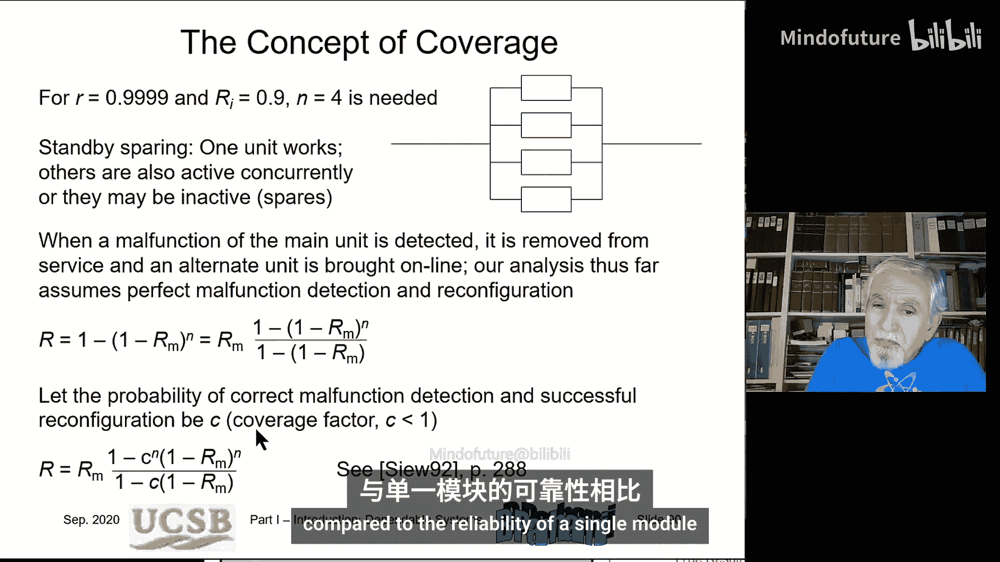

几。So this is coverage factor now graphically we can depict that equation like this。

This is n on the horizontal axis， and the number of parallel modules that we have in our system。

And the vertical axis is R。It's a logarithmic scale。Okay， so if the coverage factor is one。

Perfect coverage。Then if you use， let's say four module。You get a pretty high reliability。

If you use five module。😔，You get a reliability that consists of six nines。Okay， and similarly。

 it increases very quickly。If you have imperfect coverage， on the other hand。

 the reliability curve saturates after a while and it does not increase beyond a certain point。

 so even if the coverage factor is 0。999949s，😔，just still pretty good。After using， let's say。

 eight parallel modules。When you go to 9， 10， 11 and so on， this is by the way， also on log scale。

Okay， you don't gain reliability by using more and more module。

 that's because the system probably failed sometime earlier as a result of imperfect switching over between。

The early modules。In fact。Considering C a constant。

 regardless of the number of modules is a simplifying assumption。

Usually sea actually increases sorry， decreases， gets worse。

When you have more modules because the switching mechanism becomes more complicated with more modules。

 therefore the coverage declines with more modules， so these curves in practice not only flatten。

 but actually start dropping off after a while。So that if you use too many modules。

That not only doesn't buy you anything in terms of reliability， but it damages。Reliability。Okay。

 now here you see that， for example， but this coverage tractor。Point。0。4 nines。

If you have seven modules and increase it to eight modules。

 its you a little bit of reliability improvement。Not much， in fact。

 that increase may not be considered cost effective。Whereas the difference between， let's say。

 three and four modules is quite significant。And therefore。

 this cost effective to go from three to four because it increases the reliability significant。

Once the curve starts to flatten then perhaps。Of course， when it completely flattens。

 there's no point in going to larger numbers of modules， but even before it flattens。

It may not be cost effective。To go to slightly higher reliability by using more modules。

 you may want to stop at this point。Or maybe with six modules even， okay。

 so it basically cost considerations come into play as well。

So reliability improvement should be at reasonable cost。Of course， the coverage factor is low。

 like 0。9。Then you're in trouble beyond。Even going from two modules to four modules。

We don't experience much reliability gain and definitely from four to8 or 16， not no gain the seen。

 as I mentioned， we probably lose。Because coverage factor increases with the larger number of fact。

 decreases with the larger number of modules。Okay， so it's very important that this coverage factor be high。

If we want to gain significant reliability by using parallel modules。

This implies that a failure detection should be。As complete as possible so that we don't miss any failures and then the switch over from one module to。

Another one to a spare should also be a trouble free process， simple process that is highly reliable。

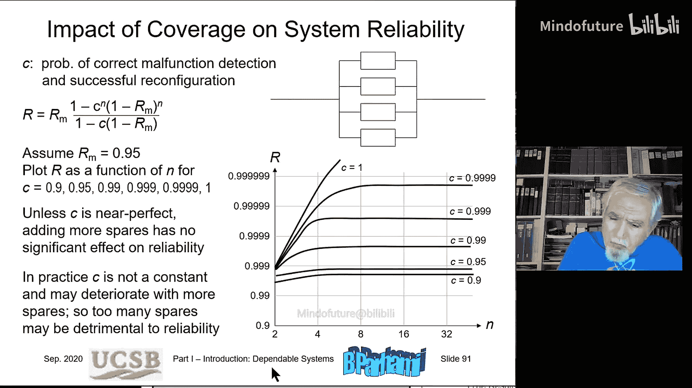

Okay， the next the notion。The next set of models are classes of K out of n systems。

The simplest of which is two out of three system。In cars that we drive， most cars have four tires。

And they have one spare tire in the trunk。And as long as four of those five tires are okay。

Properly inflated。You can drive your car。But again， you need。

A way to detect the failure of the main tires。And be able to successfully switch over to。

The spare tire。Because if for example， a tire blows out。And you're driving， you know you makes。

Get into an accident。And not be able to。Take advantage of despair。So assuming perfect。

A detectionte of。Tyre problem and perfect replacement of。诶。TheDeflat attire or。

Blowown tire with a spare， it's a four out of five system as long as four of the tires work。

You should be okay。So two out of three system means that you have three units doing a particular computation。

 let's say。And any two of them。Diving the correct result will yield the correct result because I use a voting circuit。

Majority circuit。So that if these two agree。And this one disagrees in terms of what it produced。

The two that agree。are in the majority and therefore the output will be correct。

Assuming this voter is working correctly。Okay， so this is the reliability of a two out of three system。

 the system works if all three units work。Or if unit one and two work and three doesn't work correctly。

Prodes the wrong answer。A two and three work and one fails， three and one work and two fails。

Generally， when you use this， these three modules are identical。

 so let's say each has reliability RM。And the reliability of that two out of three arrangement。

It's given inside the parentheesis here。And if the voter is imperfect。

 the reliability of the voter is also multiplied。By this expression。More generally in a K N system。

It basically says， as long as at least k units work， I'm okay。So。J goes from K to N。

 at least K units must work。Up to all N units working。R m to the J。

 this is the reliability probability。Of J units working？来毋食反 unit。Raise to the power J。

This is the probability that n minus J， the remaining n minus J unit not working。

And then NJ and choose J is the number of ways that this can occur。

So we have a closed form equation for reliability of a K out of n system。Okay。Of course。

 this is a perfect care defense system if we have a mechanism here。

To sort of decide what the correct output is， the reliability of that mechanism must also be multiplied by this expression。

So this is known as triple modular redundancy。Triple modular three modules are used is a redundancy system with three modules。

And a voter。

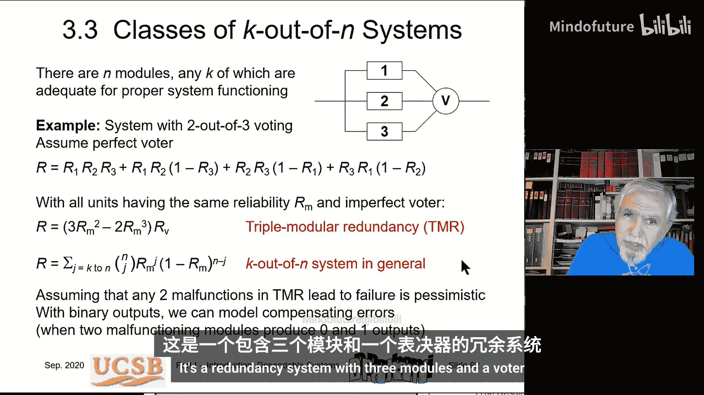

Now， if multiple computations are to be performed， this be one possible arrangement。

Triropplate as part of the computation， vote and the result。

Trilicate the next part of the computation， vote， and so on。In this arrangement。

 the voters will be part of the system art coreps， meaning that if any of these voters fails。

Then you get an incorrect result at the out。You can avoid that by triplicating also the voters。

 except of course， the last one。Which needs to produce a non redundant result。

But in the intermediate stages， you have three voters and three results are produced。

So if this voter fails， only this result is incorrect and you have two correct results here。Okay。

 so the failure of this voter is indistinguishable from the failure of this module。😊。

So we can lump them together in reliability analysis and say here is an expanded module。

Consisting of an original module。Plus， this voter。So the failure rate add up whatever this failure rate this one had。

What the failure rate of this voter， which is typically much smaller。

Then that of a module would be the failure rate of this composite module。

And then now we can model this as a two out of three system。Without higher failure rate。

This is a two out of three system。This is a two out of three system。

And then this is just a voter at the end， but there's not only one voter。

 which is part of the critical core， not three voters as in the original design。

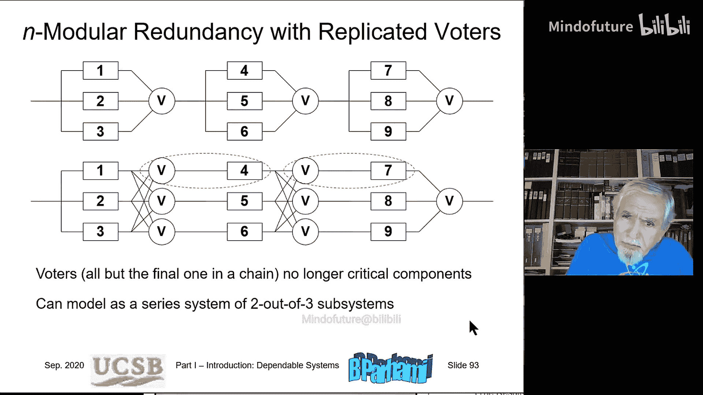

Okay， a variant of these k out of n systems， actually two variants， are known as K out of N G。

 G stand for good， or K out of N F F stand for failed。Just。Does this mean？

This means we have a system consisting of N modules， N units。

And as long as key consecutive ones of those modules are good。The system is good。

And this one says we have a system of n modules。If K consecutive modules out of those n fail。

And the system fails。 Let me explain this one first， because it's。Easier， more intuitive。

Suppose I have a system of street lights。So each street light is one of these n modules。

And the objective of streetlight is to provide enough lighting on the sidewalk or street。

For people to be safe。Okay。Now， if one of these lights fails。And it's not immediately fixed。

Then you will have less light in this area。Because light will have to come from this light and this one。

Let's travel at this ends to get there。Therefore， there will be less light， maybe that's not。

Unacceptable， you know， if one of these fails， then we still have enough light to ensure safety。

But if two of these fail。Then。There will be one good one here and another good one here。

 the separation between those two may be too large。4our。Delighting to be at the safe level。

So in that case， if that's the case， we say this is a consecutive two out ofN。

Faaiil system if two consecutive lights。Fil。Then the system fails。However， if two lights fail。

 that are not consecutive， so for example， this first one and third one。We are still okay。Okay。

 so the consecutiveness of the failures is important here。Unlike a K out of n。

 regular K out of n system or any K。Functioning。Yeah。Sufficient。Here。

You know you can't have two failures that don't cause problems。

 but when two failures are consecutive。Then we have a problem。Okay。

 so here's an example of a two out of 4G system。So this is。A two line bus， a very simple bus。

 a bus that consists of two lines， going from one side of the chip to the other。

 let's say I'm worried about these bus lines， the wires on the circuit board failing being disconnected。

 so I provide four of these instead of just two。And then provide switches here， so that。

So that these two lines come from some module that through the bus wants to connect to some other module。

So the bus itself is redundant， it has four wires。The connections to the module are nonri。Now。

 these switches are such that they can connect the two lines upward。

They can connect them straight through。Or they can connect them downwards。In other words。

 the way we control these switches is that these boat should be in the same state。Connecting upward。

Connecting straight through。Or connecting downward， there are three state switches。

Operated in tandem， know they both have the same control signal。Okay， now as long as two of these。

Whyers that are consecutive。Or okay， then I can sort of send the signals。

From one side of the circuit board to the other side， so if these two are okay。I set the switches。

Aport。If these two are okay。I set the switches to send things straight through and if these two are okay。

I send them down。But if let's say the top one and the bottom one are okay， and these two have failed。

Then I'm in trouble because there's no way to set these switches so that I use those two good lines。

 the way I've designed this， of course。Okay， so any two。Of the four that are consecutive being good。

Is enough for me to successfully route the signals over this redundant bus。Okay。

 these systems are not used that often， but because they are mentioned in the literature。

 I thought you should。You should hear about them。Conive K out of NG and consecutive K out of NF system。

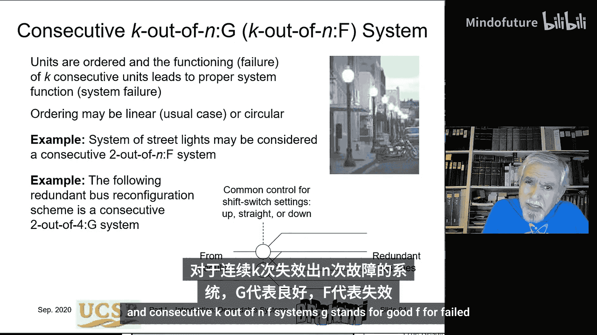

G stands for good F4 failed。Okay， so now we come to what we call reliability block diagrams。

That are the more general version of series and parallel system。

So series and panel systems are special cases of these reliability block data。

So here I've shown a reliability block diagram。Involving four modules，1， two，3， four。

And a success part as's usual goes from left to right。

And this says that if units one and two are good， I have a success path。

If units three and four are good， I have a success plan。Okay， so in order to analyze these。

 this one happens to be a series parallel system， in other words， I have two series subsystems。

 the series subsystem  one two。And the series subsisttent 34。And the two are connected in parallel。

Okay， so the series subsystem 12 has reliability R1 r2 or unreliability 1 minus R1 r2。

The series subsystem 34 has reliability R3 R4 or unreliability 1 minus R3 r4。And then the pal system。

As an unreliability， that is the product of the two unreliilbilities。Okay。

 so this is an example if I have valves like this。This arrangement of four valves happens to be tolerant to one closed。

Shut。Mo。And one closed open， sorry， shut open， shut， closed and shut open。So for example。If this。

Well this。Shut closed。And this one is shut open。Then I can still control because this one that was shut close。

 well， I can use this branch。To direct fluid to the other side， this one is shut open。

 and I can still use this other valve to control the flow。So it's easy to。Deeduce， of course。

 if you have two close shut。Faaiil ch well， like these two。

If these two are both failed to the shut state。Then I lose control because these two are shut and。

Equid will never flow to the others also if these two。Are stuck open。

Then this path will be open and I can't control the flow。

But one failed shut and one failed open valve will not cause a problem。

Whereas remember that in series and panel system， that wasn't the case。So these are in a way。

 more versatile arrangements。Modules in order to tolerate。Faures。

Now this diagram here looks similar to that except that there's this connection。

That connection makes this the series connection of two parallel subsystem。

 so this was the parallel connection of two series subsystem。This is the series connection。

Of two parallel substem。And I can easily write the reliability for this。

So here's a parallel subsystem， this is its unreliability。Units 1 and3。This is a pivotal subsystem。

This is its。Sorry， this is this it unreliability， so one minus status' reliability。

This is the unreliability of the second parallel system 24。One minus that is the reliability。

 and then the product of the two reliabilityities because these two are series。Okay。

 so series parallel system。Create no problem。 We can use the same formulas that we had。

 It's a little bit more complicated to write the formulas but。

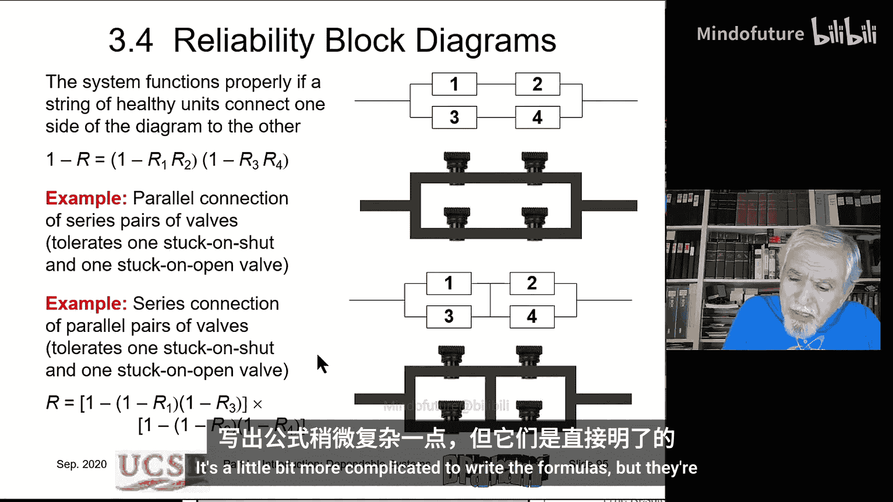

They're straightforward。Okay， sometimes we can draw reliability block diagrams that are not series parallel。

So if you look at this particular diagram。It has some elements of parallel in series， of example。

 three and four are connected in series， six is connected in parallel with one and two。However。

 the fact that5 is connected here causes some problems。

 I can't use the analysis method for simple series parallel systems。😔。

To write the reliability equation for this。Arrangement。So what do I do？Well。

 one of the methods that I can use is case analysis。

I introduced that at the beginning of the lecture， say， okay。

 I can analyze this unit system directly。So let me analyze it into two cases。For unit 3。Is bad。

Is unavailable。It has failed。So that corresponds to this situation unit3 is bad， so I can't use it。

 so it can't contribute to success paths。Through the diagram or unit3 is good。 therefore。

 I can assure that。It contributes to success but so I replace it with a straight。Connection。

If it's bad， I just remove it from it。Now I have two cases。That they're simpler to analyze。

Because they have fewer units， unit three has been removed。

 so if I can find reabbilities for these two cases。Then reliability for unit 3。

Times the probability that the system is okay， given unit 3 is okay， that's this probability。

Plus1 minus r3， that's the failure probability of r3 times the probability that system is okay。

 given unit3 is not okay so once I determine。Relibilities of these two smaller systems are just plugging into that equation。

And I'm done。Okay， so let's first focus on this one， which is the simpler case。

Now look at success path， success， the only success path in this diagram is 154。

And that corresponds to the reliability， the R1 or 5 r4， it's a series system。

Notice that I don't take a path such as six25，4 into account because the paths must go from by convention。

 from left to right。

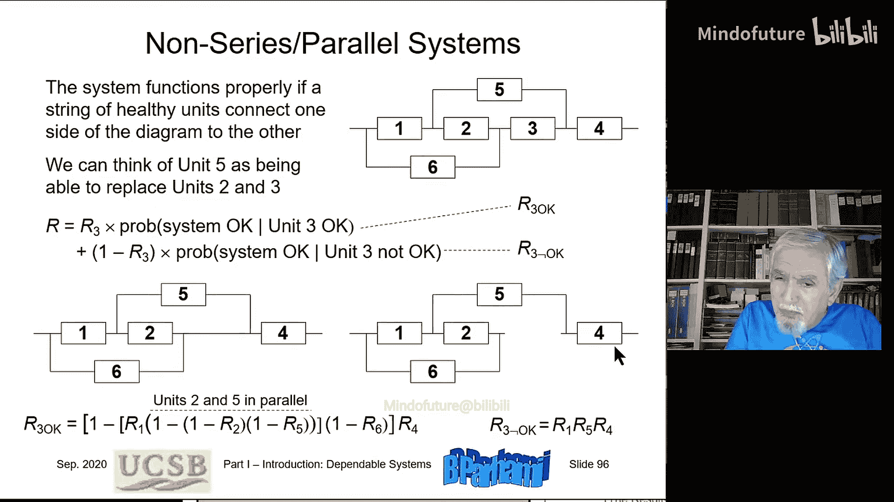

You can't go back。The way these diagrams are defined， oops。

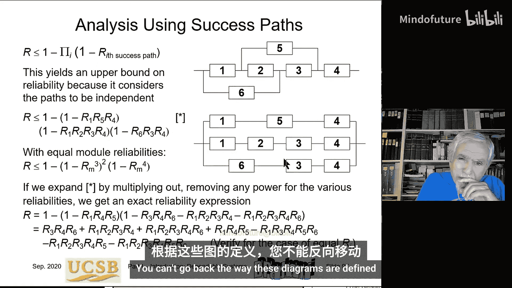

Okay， so basically two and six are immaterial and might as well remove them too because they never contribute to a success path。

Because the unit3 is no longer there。😔，So 154 so that's the reliability in the case that r3 is not okay。

Our three is not okay， so I plug in this equation into here。What about the other one？The other one。

 if you look at carefully。Is now a serious parallel system。

It may not look like a series parallel system at first glance， but it is。

Why imagine to take this connection and put it over here， move it over there。

Then you have unit four in series with something here。

 and that thing is the parallel connection of six。In this branch。And in the upper branch。

 the series connection of one with two and five in parallel。So in other words。

 it doesn't matter that there is a line segment here that's basically you can replace it with a point。

And therefore you now have a series parallel system， if you did not have a series parallel system。

 you could continue that case dividing into cases further until you got to a series parallel system。

So this is basically the product of R four， which is in series with this。What is it in series with？

This system， and that's a parallel system。Okay， so it's reliability is one minus its's unreliability and so on。

 So please take a look at this equation and make sure that。

You can convince yourself that it's written correctly， so I plug this one。

Into this part of the equation。And then I have the overall reliability of the system。

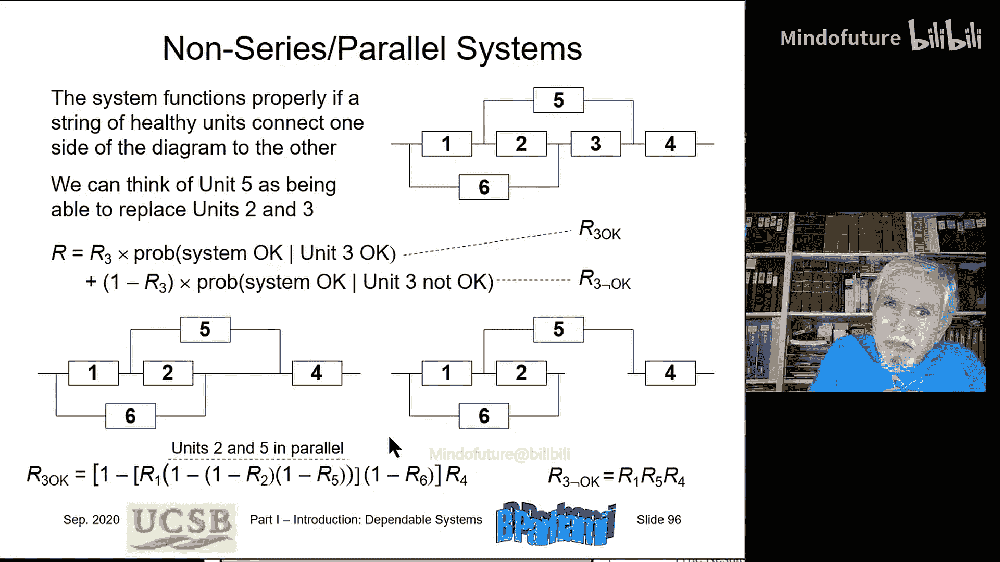

One way to find so case analysis is one way， there's a second way to find reliability for。

A non series parallel system。So。Let's enumerate all the success paths。

 so the success paths in this diagram are 154， that's one path。1，2， three，4。And six， three， four。

 there are three success paths。Okay， any one of those paths？Being okay， being available。

Leeds to the system working correctly。The system being available。

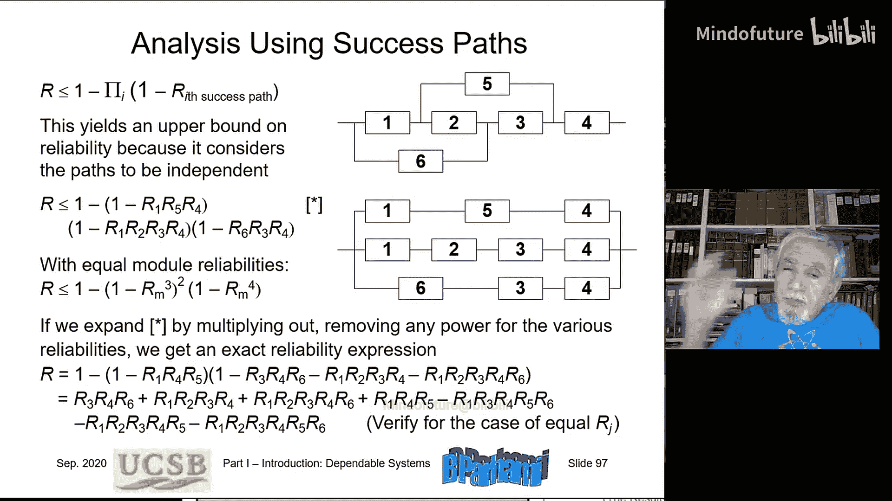

Okay， so I can consider this like a parallel system shown down here，154 is one success path， one。

 two，3，4 is one success path。

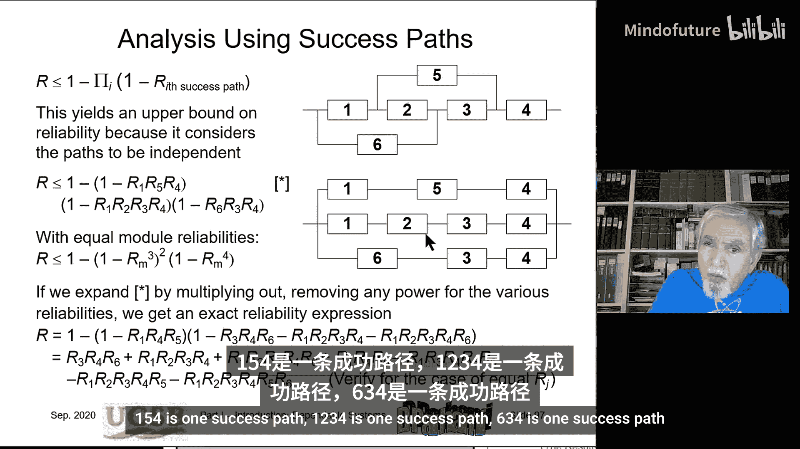

Six，3，4 is one success， Pat。And write this reliability as a parallel system。Parallel systems。

 each of its branches being a series system。ok。However。

 this gives you an optimistic reliability value therefore the reliability will be less than or equal to what this equation gives you。

Why is it optimistic？Because the unit one， for example， that appears in both of these branches。

When you write the reliability equation， that's way you assume that those two units are independent。

 in other words it's possible for this unit to fail。But this unit did not fail。Unit4。Similarly。

 is taken to be three different units that can fail independently。But there's just one unit for。

And if it fails， then all three paths。So this gives you。An upper bound for reliability。

 which in itself。Is not helpful because。We usually want to find lower bounds for reliability。

 not upper bound。You wantant to be pessimistic， not optimistic。However， this equation。

If you just multiply it out。Sone down here。So how do you multiply out to say， okay1 times1？

There's one， so that negative one cancels out with this one。

One times the negative one times r3 or4 or6。Get you this time。

A negative1 times R1 or2 or3 r4 gives you this one。Negative one times negativeness。

Use you this term and then you now go here。Positive r1 or4 r5 times 1。Gives you this time。

Positive R1 or four or five。Times this。So you have all one。 You have all three。Have our 4。

Twice in both terms and then r5 or if when you multiply these terms out。

 you don't raise these individual terms to a power， in other words r4 times r4 is taken to be r4。

Okay， later when you have， for example。嗯。R1 times r1， you take that to be R1。And it's provable。

 it's actually athereorem that if you multiply out。That。

The terms of that equation that you wrote by simply considering the success path and converting the diagram to this。

If you multiply out。While not raising terms to powers， in other words。

 r4 times R4 times r4 is still R4。Okay， so if you get r four times r four。

Because these are not independent， therefore just you get just r four。

Then you get the correct reliability equation， so this is the second way。

of writing the reliability equation for a diagram such as this one， just enumerate the success paths。

 pretend that these are independent paths， write the equation， when you multiply out。

 just ignore higher powers of each of these R terms。And you get the correct reliability equation。

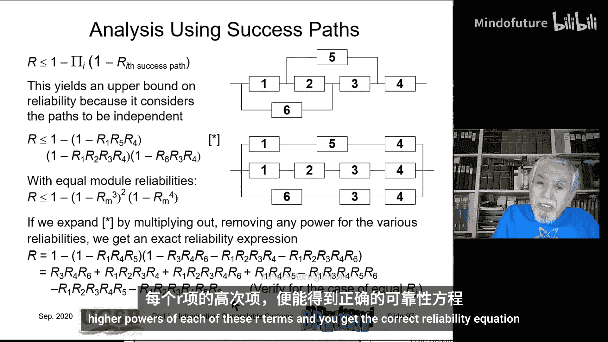

Okay， so reliability diagrams we already discussed that's one。

toolol that we use and formulating reliabilityabilities reliability graphs form a second tool we don't use these much。

 but i'm going to present it to you for completeness so what is a reliability graph a reliability graph is composed of notes and links like this directed。

Coirected edges。Connecting a source on the left side to a sink。And the other side。

 so it always has this shape， there's a single source node on the left。

A single sync node on the right and a bunch of arrows connecting these nodes。

The arrows are marked by module names。So unlike the reliability diagrams in which the boxes were modules。

 here， the links， the edges are modules。So this basically says for the success of this particular system modeled by this reliability graph。

Module A， module D， module G。And M， if they're okay， then I have a success path。If C，F， H。

K and M are okay， I have a success path。If B， E， JN are okay。Okay。

 so these are basically success patterns before， except that modules are labels attached to edges。

 not to nodes。There is one edge here labeled infinity， that means that edge。

It's sort of like a module that is always available。So for example， A D。LN is also a success path。BD。

LN is also a success。Okay， you may think why did I put this edge with infinity and it why didn't I just merge these two nodes together？

The problem is if I merge， then a path such as CFH。

 and these two are now the same CH Gm also becomes a success path。And I don't want to do that， okay？

So this basically is a way to avoid some paths that I don't want。To be success paths to be created。

So module failure corresponds to edge， disconnect。And an edge labeled infinity is never disconnected。

 so it's like a module that is always available。

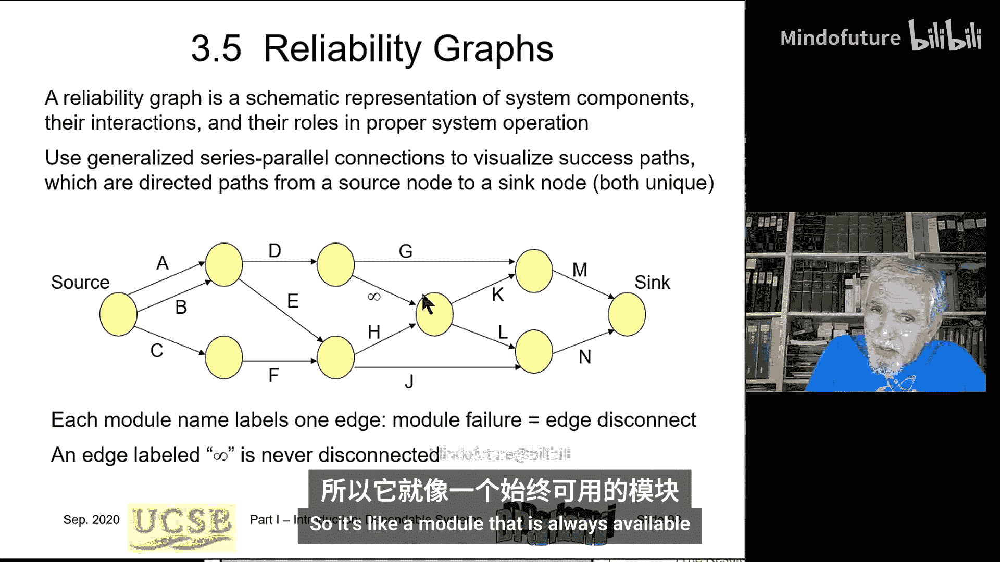

All right。The third and perhaps practically most important model of this kind。

 so we had reliability diagrams。And we had reliability graphs。

The fault tree model is something that is used。呃。Extensively in the industry。

It basically provides a way to systematically。Enumerate failure scenarios in a system。

What does that mean？So you start at the top or the tree root with an undesirable event。

 which we call the top event。And determine all possible ways that the top event can occur。Okay。

 analysis proceeds by determining how the top event can be caused by individual or combined lower level undesirable events。

 here's a simple example。Suppose top event is being late for work。

 so that's something that you are worried about and you want to analyze。And find out。

 you know what can possibly cause。You to be late for work。Okay。

 so you come up with these clock radio you're not turning on or if you use your cell phone。

 your cell phone， not ringing。Cellphone an alarm， not ringing on time。

There may be a family emergency that。Is you late for workwick。If you take the bus to work。

 the bus not running on time can be another cause， so you sit down and basically enumerate all the things。

That and contribute to that top event。And then some of these can be composite events， for example。

 qua radio you're not printing on。If there is a power failure， power outage。And battery is dead。

 so your clo radio has a battery can still work。When power is disconnected。

 but it may happen that power is disconnected。And the battery is dead so that it doesn't work。

 so this is an example of a composite event that requires two things to elementary or atomic events。

It happens simultaneously for that to happen。So these are some references that you can look at。

 and you probably don't need to study any further than what I tell you。

In class and also in the textbook about f trees， but if you're interested。

 there are many different sources。

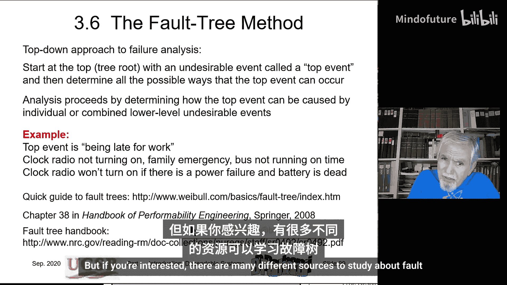

To study about fall trees。So fall tree analysis。Basically starts by drawing this diagram。

 so this is sort of a systematic way of thinking about and recording。

All the things that can contribute to the top event， so you identify the top event。

 this is the top box here， the root of the tree。And then you say that top event occurs。If。

All three things down here happen。So this is an end condition and it's drawn like that。

 this is an atomic event。So the notation for fter trees， it draws it as a circle。

 these are composite events so they're drawn as boxes。Okay。

 so this composite event occurs of either one of these two atomic events occur。

 so we draw an or gate in our fault tree。Okay， so if either of these two basic events or atomic events occur。

 then this composite event is satisfied。And if this one。And this one and this one。

 all three are satisfied in the top event。I satisfied。On this side。

 I have an end of three conditions。Again， one of them is atomic。

 the other two are composite and then can continue。You know， for many levels。

Other than and and or gate in these diagrams。F K out of N gates。When you have a care defense system。

We have X or gates， although these commonly exor gates are not used。

 it's rare that you have a condition that either this happens or this happens but not boat。

But just be aware that you can use X orgate。And you can use this box， which is。

Receives an enabling condition， so if this enabling condition。Is。嗯。Assert it。

 this enabling condition exists， then this event causes this event， otherwise it doesn't cause。

 so it's sort of like a switch it blocks。Proagation of these events。

And external events is basically something that comes from outside。Okay， by the way， in this slide。

 there is a first missing here， identify first level contributors， I don't know how it。

Disappear on the slide， identify first level contributors to the top event。

 use logic gate to connect first level。Events to top event and so on and so forth。

Second level contributors， second level。The gates and so on。And you can become， you can go。

As much into detail as you want to enumerate all the conditions。

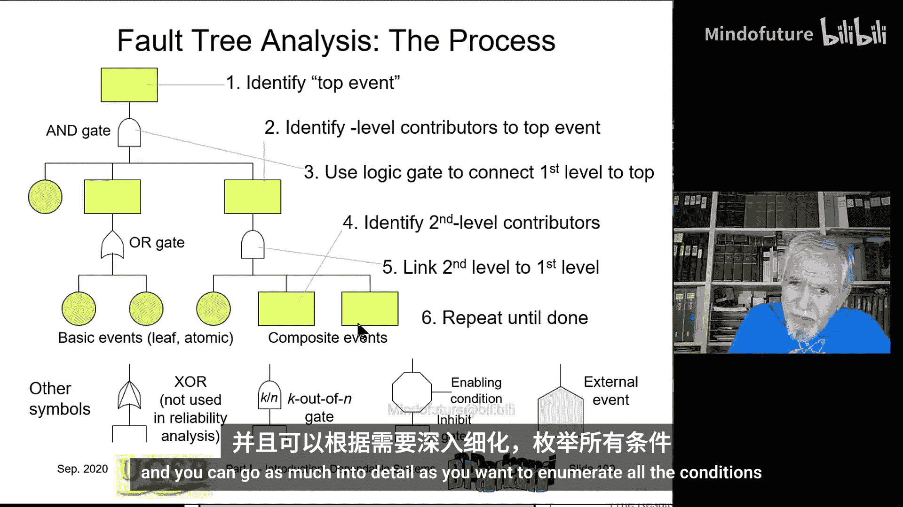

So here's an example of a fall tree。In order to analyze and write reliability equations based on fault trees。

We need a notion called Cuet。A cut set is any set of initiators。

So that the failure of all of them induces the top event。And what does that mean？So for example。

 if A and B， those conditions are satisfied。A being satisfied because of this or gate satisfies that box。

Be being satisfied because of this orage satisfies that and both of these boxes satisfied。

 satisfied the topic when because of this end。So if these two things， A and B happen。

Then the top event is satisfied， so AB is a cut set。AD is similarly a coset。

I'll leave it up to you to verify that and BC is a cutet。Furthermore， these are a minimal cutset。

 a minimal cutet is a cutet so that if you remove an element from it， it's no longer a cutet。

 so for example， AB is a minimal cutet because neither A by itself。Is it cut set？

Nor B by itself is a。So we are interested in finding these minimal cut sets。Okay。

 just as we can manipulate logic。Networks， logic gate networks。

 you find equivalent gate networks we can manipulate， we all trees into equivalent forms。Okay。

 something that is perhaps simpler。Now one of the roots of difficulties in analyzing all trees is these this repetition。

 so for example， B occurs both here and here。So these two are not independent。

Ppetition does not occur in analyzing。The fall tree is quite simple， but with repetitions。

 it's a bit more tricky。

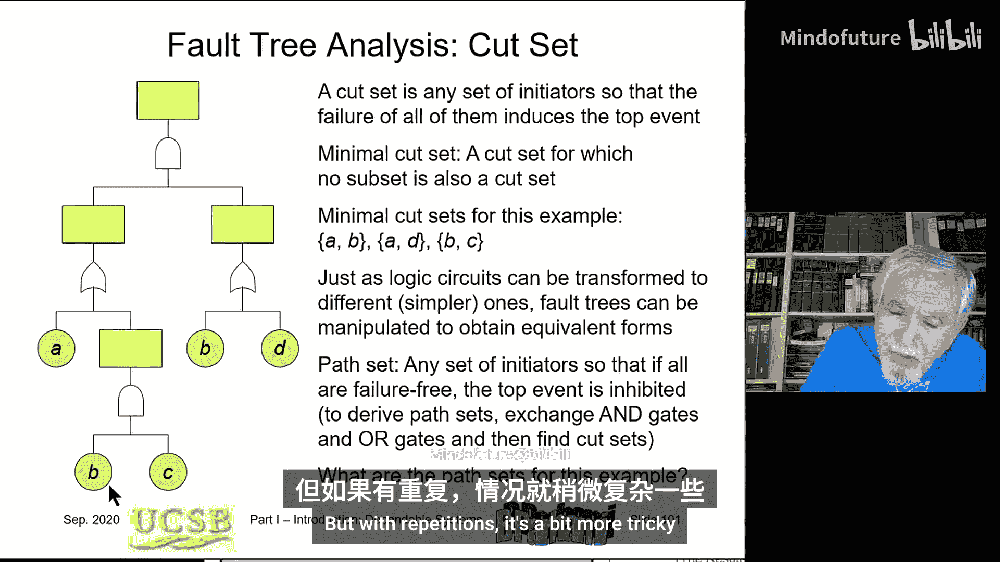

Okay， so in order to find the reliability of the system characterized by this fault tree。

I can use the cut sets and say， okay， one cut set is AB。AB， in other words。

There's no success path of both A and B， so I'm converting it to a reliability block diagram AD。NBc。

So if I have all the cut sets。I can convert the fault tree to a reliability block diagram。

 such as this one。And then analyze this reliability block diagram in the normal way。几。😊，Of course。

 remember I said that B。Being the same be， these are not independent。So you can say， okay。

 B has failed， so this pad is not available， but this pad is available and then this pad is available because if B has failed。

Then that's not available， okay， so you have to be careful。

So here's an example for you to work through， suppose that the minimal cut sets for a particular tree are A B。

 ACAD。And CDEF。Construct the fault tree for this。That exhibits that particular cutet。

Dive a reliability block diagram for it。And then find a path sets。Now。

 one application of cut set is that if the cut set is small。

Then your system is vulnerable in particular， if it cuts it there' just one element in it。

That means that element is critical in your system。And its failure can cause system failure。

So you want your cut sets to be not too small in order for your system to be robust or reliable。

Small cuts sets are。Alsome。

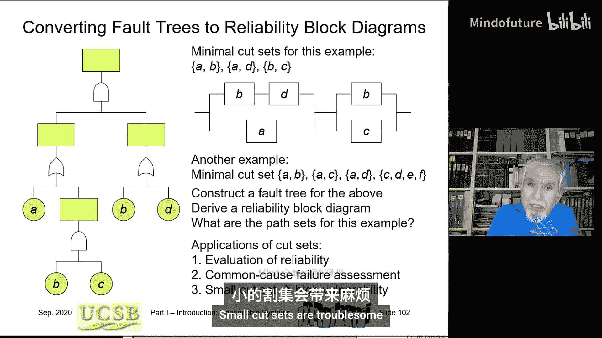

Okay， now the models that we have discussed constitute a hierarchy as shown on the slide。

Reliability block diagrams and fall trees with no repetition。Are completely equivalent。

 one can be converted to the other。So fall trees with no repetition offer nothing。

More than reliability block， reliability graphs。Are more general than both of these。In other words。

 both of these can be formulated as reliability graphs， but not the other way around， the arrows go。

In one way。And fault trees with repeated elements are even more powerful than reliability graphs。

Therefore， there is nothing you can do with any of these that you can do with fall trees if you allow repeated elements。

So that's why fault tree analysis tools are so popular in the reliability industry and there are all sorts of software I'll talk about you the software。

Pools for reliability analysis at the end of the next lecture。

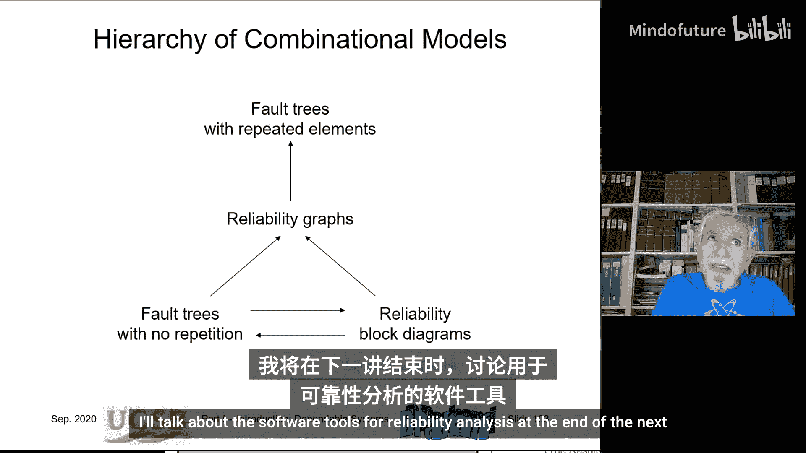

Okay， so this is the end of lecture three。I will record lecture four soon and post both of them。

To the course website。Thanks for listening and see you in lecture four。

