# 【加州大学】容错计算-｜-Fault-Tolerant-Computing-Ucsb-Ece-257A-p04-P04_第4讲_第4章_状态空间建模--BV19cFyz8EPV_p4-

Hello and welcome to Lecture four。The course， ECE 257A。At the UCSB。This is the last chapter。

In part one of the textbook。Part one is basically introductory material and tools that we need throughout the course。

And the title of chapter four is state space modeling。

Another class of modeling techniques beyond the combinational modeling that we studied。

In the previous chapter or like。So state space modeling， I will define what it means， how it's used。

And so on。Okay， so this is where we are in the textbook， last chapter of part one。Starting next time。

 we will enter into these variouss。Levels of the seven level model of dependability。诶。

Dealing with facts， faults。Thereors， malfunctions， degradations。And failures。

 so we will devote two lectures to each of these parts。

Unlike the first part where we devoted four lectures on per chapter。Okay。

 so what is state space modeling？With respect to the availability of resources on computational capabilities。

 a system can be viewed as being in one of several possible states。

And you can basically define as many states as you want as。They serve your purpose。

So you can do very fine distinctions between different states or you can lump states together into these blobs。

 big blobs so here on the diagram you see very coarse。

Representation of the system as being in one of four states。

I just call them arbitrarily the great state， the good state， the so state， and the lousy state。Okay。

 it's not a very technical example。You get the picture， the system from our viewpoint from。

How it serveds the purpose for which it was designed and built。Can be doing great。

 can be doing a good job， can be the social state。Or in the lousy， lousy。

 you can view sort of as the failed state。And then let's say。

The probabilities assigned to these states。A as shown in the red red numbers on the diagram。

86% probability that the system is in the great state。8ight% probability thats in the good state。

 these are somehow derived。I'm not yet telling you how to derive those。

 but suppose we know those probabilities， 4% in the social state。2% in the lousy state。

 and of course these numbers must add up to one。So it's。systemsem is one。

And only one of these states at any given time。So the system moves from one state to another。

As resource availability and computational power change due to various events。

So the system may be operating in the great state， something happens， and it may go to the so state。

Now， in the context of this course， some failure occurs， for example， something fails。

Or it can go into the good state， which is a less serious failure。Okay。

 when it's running in the good state。It can go into the lousy state。

Or it can go back so some other failure occurs and the system gets even worse。

Or some improvement occurs like something is repaired or replaced and it goes from good back to great。

And so on and so forth， these transitions。Generally have probabilities associated with them。

And therefore， with some probability when the system is in the good state。

It goes into the lousy state or it goes into the great state I haven't put a transition into the soso state。

 but there could have been a transition from good to soso as well so these where I put these transitions depend on how I manage the system and how it operates so in this case you see that from great to lousy there is no transition。

From great to lousy。Because I've designed the system so that when something fails。

It goes to one of these partially operational states rather than go directly to the failed state。

Functions of the design of the system。So state space modeling entails quantifying transition probabilities。

 so these transitions。Have some probabilities。So in the discrete case， they have probabilities。

In the continuous time model， they have rates。The rate means at what rate the system goes from the social state to good state。

ButThe rate can be， for example。诶。Voice per month， that's the rate。

So if I run the system for a long time， twice per month， I would experience this transition。

From so sort to。Okay， so transitions are quantified either by probabilities in the discrete case or by rates。

In the continuous time model。Some of these states are more desirable than others， okay？

So we are interested in finding out the probabilities of the system being in this most desirable state。

In this somewhat less desirable state and so on because those help us assess。

The usefulness of the system。诶。In probabilistic sense。

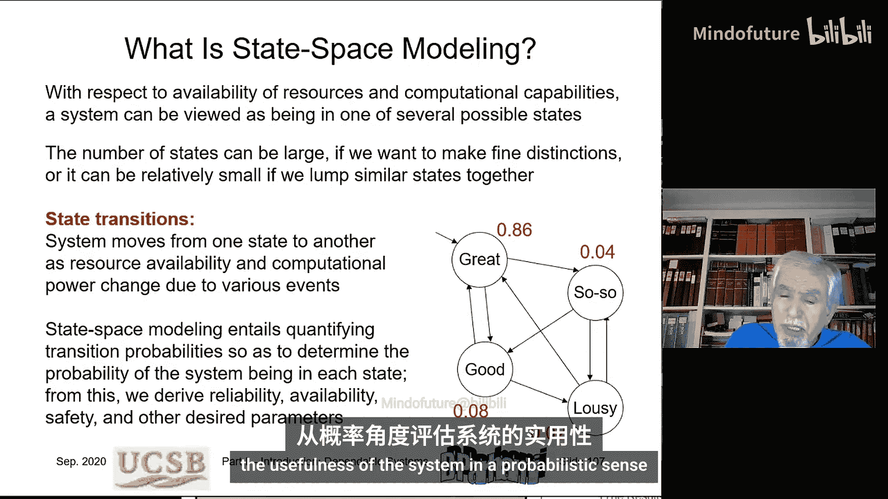

The starting point for our discussion is。The model known as Markov chains。

Sometimes called Markov models。So what is a Markov chain or Markov model？

Here I've shown a four state system， this is actually the same system。

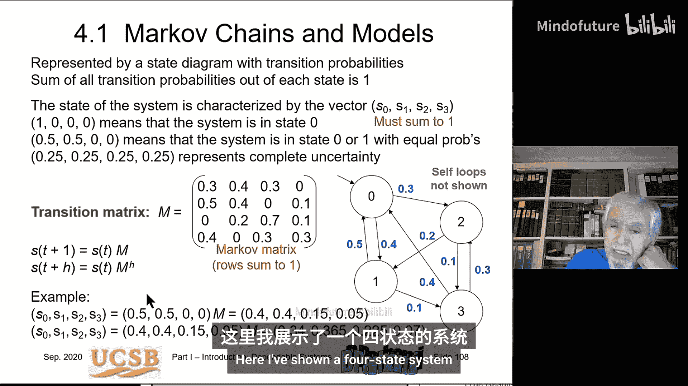

In terms of transitions。O屁。

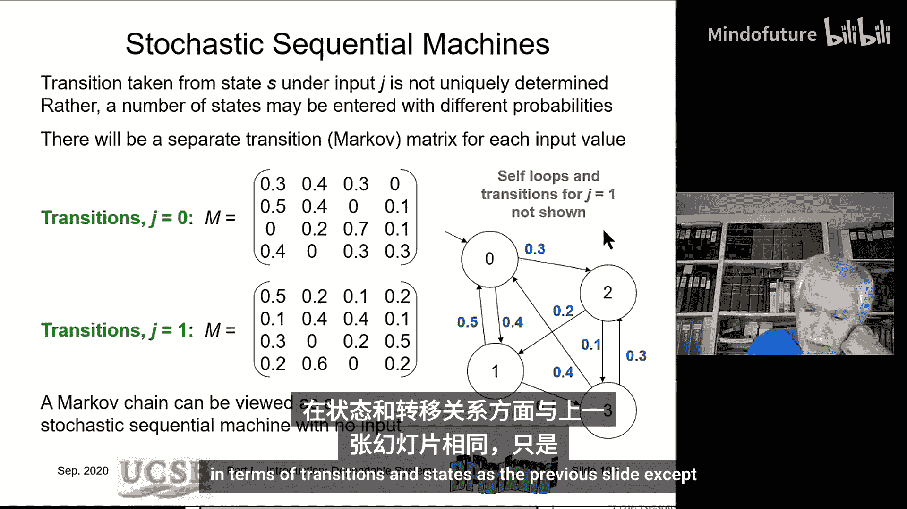

In terms of transitions。And states as。The previous slide， except that I've numbered the state 0123。

So from the numbers， it's not immediately obvious， you know which are the desirable states。

 which are the undesirable states， it doesn't matter in Markov model， we don't make judgment。

 they're just a bunch of states。There are a bunch of probabilities associated with transition。

 so this is a discrete time Markov model。So this says over a unit of time。

 so you can imagine that the system is running， there's a clock， and on every clock。🤢。

Pulse every clock cycle， theres a 30% probability that the system transitions if its in state zero。

 transitions to state two。诶。There is a 40% probability。That it goes to state one。So 03 plus 0。4 is 0。

7。That means with 30% probability， those are all the transitions out of state zero。

So that means with 30% probability， the systems remains in state zero。

 these are self loops that are not shown in this diagram。To avoid clutter okay。

 because their probabilities can be derived from the other transitions Okay。

 so the row one of this matrix， this is known the Markov transition matrix。

So each row corresponds to a state 0，1，2，3， and each column corresponds to a state 0，1，2，3。

And this point3 is probability of transition from state zero to state zero。

That's the self loop that they talked about。State zero to state 1。That's 0。4。State  zero to state2。

That's 0。3。And state zero to state three， that's zero because there's no transition。Similarly。

 state 1 to state 0。5。State 1 to state 1 0。4， that's a self loop。AndState1 to state two。

 there's no transition there， so that's zero。And state one to state three。That's point one。Okay。

 so Markov matrix is a square matrix for number of rows and columns equal to the number of states。

And the Markov model。The entries in each row add up to one。Okay。

 that's a key feature of a Markov matrix。In the markov matrix。

 every row entries in every row add up to one。It means the state must do something either stay in the current state or move to some other state。

Okay， now one nice feature of this transition matrix M。

Is that if you know the current state of the system。So if you。

So the current state of the system is basically a vector。If the vector is 1000 in this example。

That means we know for sure the system is in state zero。

And it's not in state one or state two or state three。Okay。

 this next one says the system is equally likely to be in state zero and1。

But it's definitely not in stage two and three。And this one means the system is equally likely to be in any F its4 states。

 we don't know， we have absolutely no information about what it is。

So the state of the system is defined by a vector whose elements add up to one just like a row of a Markov matrix。

If one element is one， the others are zero， that's a certainty about the state of the system。

 otherwise we have partial information or total lack of information in this last case。Okay。

So one of the nice properties of this Markov matrix is that if you take the state of the system at time T。

And multily， so that's a vector， multiplied by matrix M。

You get the state of the system at time T plus1。 remember， this is discrete time。

 so in one unit of time。The system goes from state S of T。To state S of T plus1。

That is determined by multiplying S of T by N。 So here is an example。

 Sose the current state of the system is 05。500。This one up here。

Meaning that it is in state zero or1 with equal probabilities and it's not in state two or three。

Multipliied by that matrix， normal vector by matrix multiplication， and you get this vector。

That says in the next time step。Sysem is in state  zero probability 04。State 1 probability 0。4。

Stay 2， probably 0。15， state 3 with probability 0。055%。Okay。😊，If I continue this one more step。

 so now take the new state of the system。I multiply it again by。Transition matrix。

 I get this so after two times steps。The system will be in state zero with 34% probability and state one with 36 and a half percent probability and so on。

So I have to etch。Time steps， the state of the system at time T plus edge。

Is derived from its state at time T by multiplying it by the etched power。Of this transition matrix。

Now， any power of this transition matrix， we can prove that there is also a markov matrix。

Now words if you take a Markov matrix and raise it to any arbitrary power。

The result will be a Markov matrix。

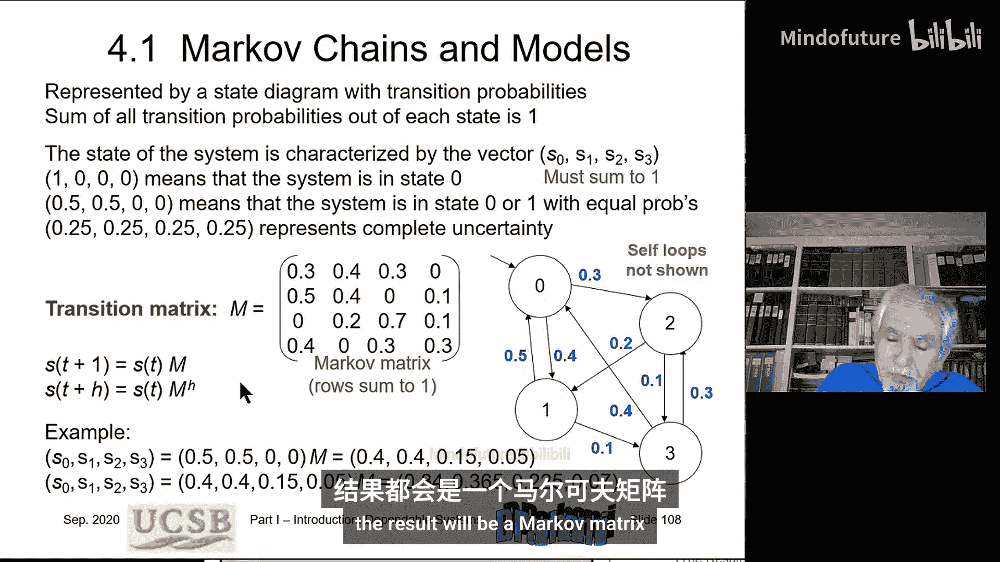

Okay， there is something called stochastic sequential machines， in fact。

 this is how I was introduced to Markov models。As my master's thesis， I was working on these。

Was interested in sequential machines and in particular in stochastic sequential machine。

A sequential machine receives inputs。And transitions would states according to some state table。

So the state tables。Tells us if the state is currently a。

And input x equal to0 is received what the next state will be。

If the input Xal 1 is received by the next state， then these are deterministic meaning。

It will go into those states。For sure。According to that。A state table of the machine。 Now。

 stochastic sequential machines have probabilistic behavior。

 and they are defined by as many transition， Markov transition matrices as there are possible input。

So suppose I have just one input J。Which is binary， it can assume the value0。Or the value one。

This is the transition matrix if the input happens to be zero。This is a different Markov matrix。

That applies when the input is equal to one。So basically， I have to put on these arrows now。不。

As we do with sequential machines。For input zero， what happens， this is for input zero。

 and for input1， this transition from 0 to 2 instead of being 0。3 will be 0。1。Okay。

 I haven't drawn that， so this is just the transitions for input being zero。

We have a similar diagram or we can merge the two diagrams。

Just labeling these arrows as we do in sequential machines， input， slash。

Probability of that transition。

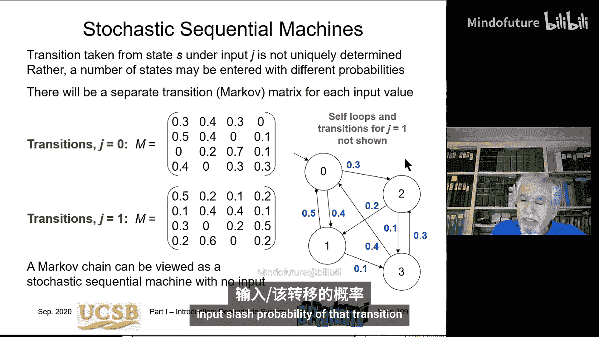

So it will be。

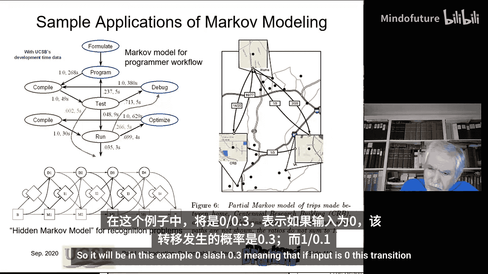

In this example，0 slash 03。Meaning that if input is  zero， this transition occurs with probability 0。

3 and one slash 0。1。So a Markov chain is basically an autonomous sequential machine。

 it doesn't have any inputs that moves with main states on its own。嗯。

So it's a special case of a stochastic sequential machine。

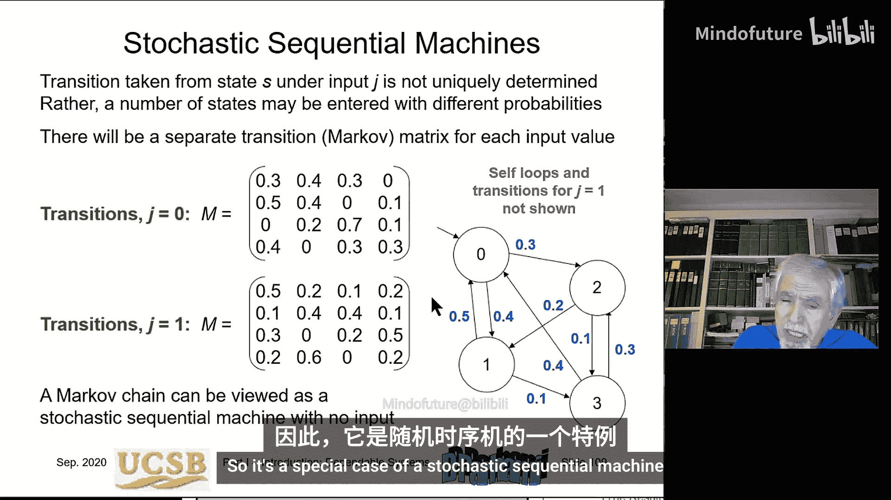

There are many applications for Markov chains。Drawn some diagrams outlining。

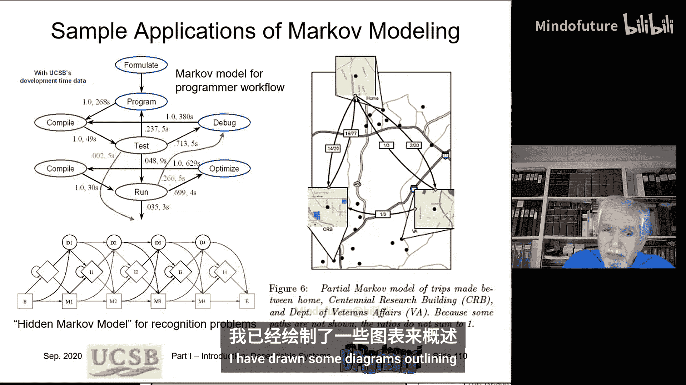

Research applications， there are many more， but let me just describe one of these examples up here。

This is a Markov model for a programmer's activity。The problem is formulated， the program is written。

 the program is compiled， the program is tested。Okay， then it is debared。

You go back to compile and iterate in this cycle until you are satisfied with the test。

Then we run the program。After we run， if it runs okay， we may want to optimize it。

And then compile again after optimization， run again。We going to in this cycle。Many times？

Or from the run state， we can go back to debug， something happens here。From test。

 we can go directly to out， in other words， we are satisfied and we don't do anything more。Okay。

 now the transitions in this particular diagram， this happens to be an old UCSB。Project。

So on this transition， you see probability one。And a latency 268 seconds。

 that's sort of the expected or average amount of time spent。In programming before we go to compile。

These are apparently simple programs that takes。Take a few minutes to write。For compile。

 we always go to tests so this probability is one。After， say 49 seconds on average。

After test with probability 0。713， we go to debug。With probability 0。237， we go back to program。

With probability0048， we go to run so these these parameters， of course， you know。

 somebody had spent time。And collected the data to assign values to these parameters。

And then now once we have the model and it's。Transition。Probabilities and latencies。

We can evaluate how much time a programmer spends。Programming。How often are we in this state。

 how much time is spent compiling， how much time is spent bugging and so on？Okay。

 so it models programmer behavior and where she or he spends time。

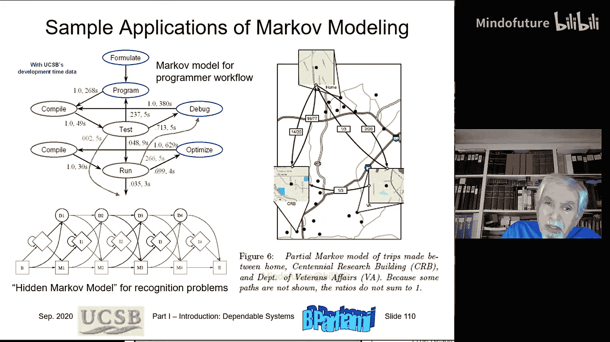

In this particular space of activities。Now， let me give you a Markov model example for a computer system。

This is basically what we are interested in in this course。

So here I have eight states for this computer system。

And this is a simplified model of a three processor parallel system。

In which the states correspond to。A subset of the processors being functional。

 so state 111 means all three processors are functional。

State 110 means the first two processors are functional operating。

 the third one has failed and so on， and of course the worst state here is when all three processors have failed。

And the system cannot do anything， it doesn't have any processing resources to do to get work done。

And then transitions between these states。Basically there's a transition from 111 to 110。

 this transition is when this third processor fails。

 so the state goes from 1 in this position to  zero。And let's say that has。嗯。A rate lambda。

 so we are now switching to continuous time model rate lambda， for example。

 lambda can be 10 to the minus8 per hour。Meaning that if we operate the system for one hour。

There is a 10 to the minus 8 probability， a small probability。That this transition。Is taken。Okay。

 it doesn't mean this transition is taken at the end of the hour， it can be taken at any time。

 it's continuous time。But the average rate of this transition being taken is 10 to the minus8 per hour。

There's also the possibility of repair。So the repair rate， let's say， is mu， that's again。

A random variable because some repairs take little time， others take a lot more time。

 so we model that by。Defining a repair rate。So for example， the repair rate can be four per hour。

In other words， on average， four of these failures。😔，Can fix per hour， in other words。

 it takes an average 15 minutes。To repair the system。Okay。

 so this rate mu is typically much larger than lambda。

 so the system is much more likely to be in this state if it just goes out of that state it will likely go back。

To that state quickly and does not spend much time in this。Fail state， partially failed state。Okay。

Similarly， we can assign transitions to the other ones， so if all the three processors are identical。

Then I can say， okay， this is also lambda。This is also mu and so on。In this case。

 processor3 has already failed， Pro 2 also fails when you go into this state。

 so this is still lambda。Okay。So now we may decide that we really do not need eight states for this particular system to model this。

S them at these three states。Are really the same when one processor has failed and the processors are identical。

We may not care whether it's the third one that's failed or the second one or the first one。

 so we merge these states into a single state。And we named the states。

According to how many processor are operational three。Or two or one or none， zero。Okay。

 now the transition from this state to this composite state。Has。Three times the rate。

Because processor3 can fail， processor 2 can fail， processor one can fail。

 so we label this transition with 3 Lada。We label this transition with two lambda because there are two processors。

 each of which can fail。And we label this one。

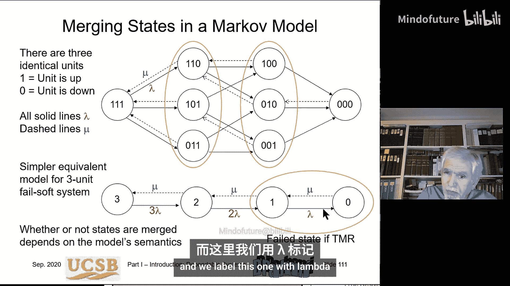

With Lada。The reverse transition is notice that I've labeled all of them with mu。

 this is the case when we have just one repair facility or one repair person so that even if。

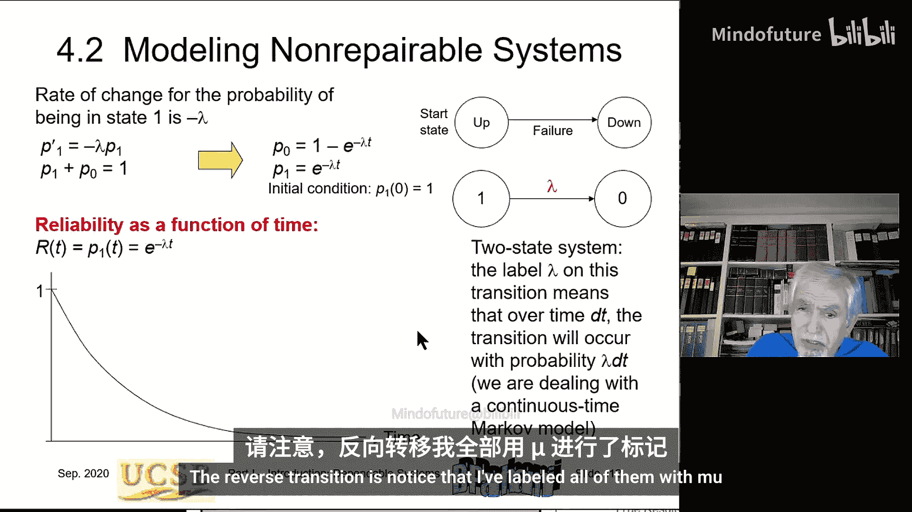

Three processors have failed。We can't fix all three together， we have to focus on one of them。

So at the rate meal， we repair。1 and get here at the rate meal we repair one and get here。

Of course this is an assumption， okay， we could make the assumption that we have。Let's say。

Three repair facilities are three repair people。In which case I would put three mu here。

Because the fixing will be at the rate three times as much when there three failed。

And I can put two meal here。And I can put me here because there's just one processor that does way。

 and so these are parts of the setting up of the model okay。

And you need some knowledge of the conditions and situation to be able to set up your model correctly。

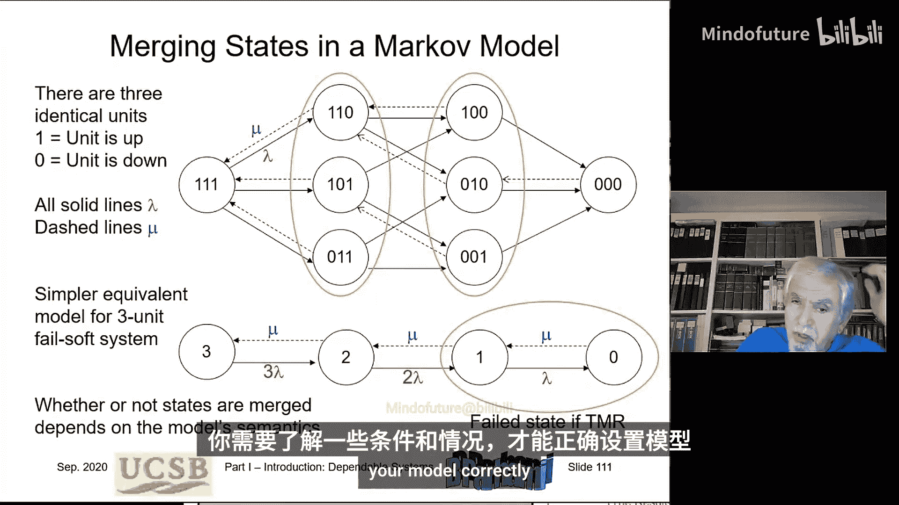

If。Having one processor is not acceptable for us， we may also decide to lump these two states。

Together and say the system has failed。So the system has failed if it has one or fewer processors operating again this is。

Context dependent depends on what we plan to do with this system。

It may be that one processor is still okay， the system is at least partially operational or we may decide to lump these two together into a failed state。

So setting up Markov model for a system is non trivialvial， you have to think about a lot of issues。

About what states to use。What rates to assign to transitions and so on？

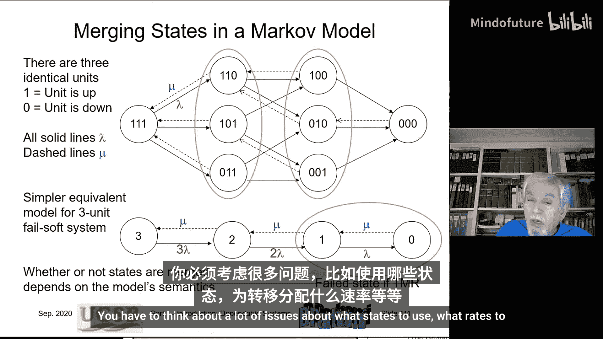

Okay， so let's start setting up Markov models for systems beginning with simple ones。

And then going to more complex ones gradually。So here is a two state system which has the two states are up。

For state one。And down or state zero。And the failure rate of the system is lambda。So the rate lambda。

The system goes from the upstate to the downstate。Notice there is no transition out of this zero state。

Such a state is sometimes called an absorbing state。

 an absorbing state is state where the system goes into it。There's no way to come out。Okay。

 so for such a non repairable system， if you operate the system long enough。The system will end up。

So you start the system in this state is operational at some point。

It may be in the near future it can be。Now， in the distant future。

 at some point it will eventually fail。And the system will go here and then it's done。

You can't do anything with it at that point。So this is known as an absorbing state。

 where there's no transition。Out of the state。 in order to。Evaluate this。

 so this is a mark of a very simple。Markov model with two states。

 I leave it up to you to write the transition Markov transition matrix。

In order to solve this and find out the probabilities are being in the。Two states。

 each of the two states， we set up a differential equation。And of course。

 we know that p1 plus p0 is equal to 1， the system is either in this state or in this state。

So this gives us one equation。And this ones， the first one is also one equation。

 we have two equations in two unknowns that we can solve。So what is this first equation？

This one says。That the rate of change。Of the probability of being in state one。

 so this is the derivative， p prime1 p1 is the probability of being in state 1 p prime1 is the derivative。

The rate of change of that。Is。Proportal to probability of being in state1， P1。

And the negative sign basically means the probability is reduced over time。

And Lada is the rate at which we leave that state。Here's the rate of change。

A probability being state 1 is equal to minus lambda times。The probability of being a state one。

Now this is a very simple first order differential equation。

And its solution is p1 equal to e to the minus lambda T。

This is the exponential reliability that we obtained previously。And then p0 of course， is 1 minus p1。

And if I plot P1。Over time， this is what I get p1 is equal to 1， when t is equal to zero。

 p1 is equal to 1。As t goes to infinity。B1 tends to0。And of course， p0 changes。

In the inverse direction， it starts with zero。And then eventually it goes to one。Okay。

 so this is basically known as the transient behavior of the system， it's transient because you know。

 it changes time。As this system does not have any meaningful steady state。

 because steady state over the long run， the system is here in state zero。Therefore， in steady state。

 E1 is equal to zero。E0 is equal to 1。So that's not very interesting。What a transient。

Variation of probability is given by。This equation。So。

Probability of being in state one is reliability， so this is reliability。

Probability of being in state zero is onre， okay？So this is the simplest case。

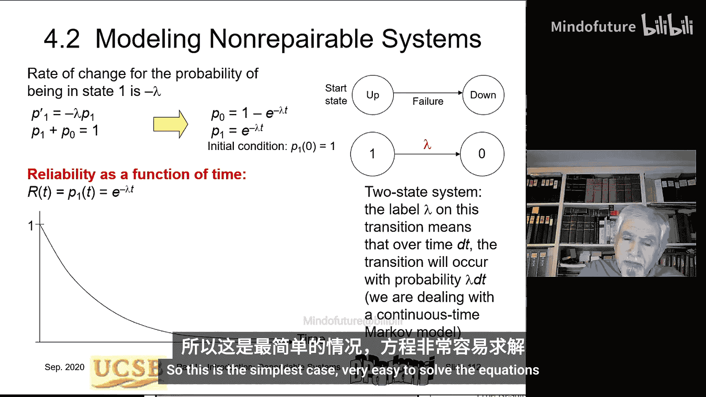

Easy to solve the equations。Here's a more complex example。A K modeling。

 a K out of N non repairable system。So we start with n functional units。

And then one of them fails that can occur at the rate n lambda。

And then we have n minus one functional units。Then one of these n minus1 fails at this rate。

Until we get down to K。Okay， the system is still functional as long as at least K out of n units are operational。

But upon the next failure at great K lambda。Go into k minus one functional states。

And from that point on， you know， we can have more failed units， all of these are essentially。

From the viewpoint of this k out of n on repairparable system。

 these are failures so we can lump those together。So this system has state n n minus1 n minus 2a。

And then F for failure。Again， F is an absorbing state， so in the long run。

 the system is sure to end up in this F state。So steady state probability is a probability of f equal to 1。

And probability of all of these other states being zero in steady state or long term。However。Again。

 we can do。Set up differential differential equations。So P prime n date of change。Here。

Is proportional to PN。And negative signing is again， because we。That's reduced， we leave that state。

 there's no way to enter that state， there's no repair。We always leave that state。

At the rate in Lada， so the rate of change。Is proportional to N Lambda and proportional to the probability of being there the first place。

Okay， so this leads solving that first differential equation gives Pn equal to e to the minus n lambda t。

Probably of being in this state。Then it becomes more interesting as we go to the other state in this state。

N minus1。We have both departure。Transitions and arrival。Transitions。

So the rate of change of probability of state n minus1。Its positively correlated with PN because。

We can go from PN to here， so that adds to the probability of being here and this one subtracts。

From the probability of being here。So n lambda Pn minus n minus1， lambda Pn minus1。Okay。

 we already determined PN。We plug it in here and solve this equation。

F French on the equation and get this answer。And similarly， we continue until PK。

The rate of change of PK。Is dependent on Pk plus1。And。And PK。So the negative term is for PK。

 that's departure。Positive term is PA1。And finally， we have this。

Equion that sum of probabilities of being in these various states and the failure state should be equal to one。

So that gives us the probability of being in the failure state as one minus summ。

Of all those that we found。Okay， so this is modeling K out of n systems using a Markov chain。Again。

 the Markov chain is absorbing it is an absorbing state。

Eventually the system will end up in this failure state。But， meanwhile。So do you think。

Smaller time periods， when T is smaller， its behavior is governed by these equations。

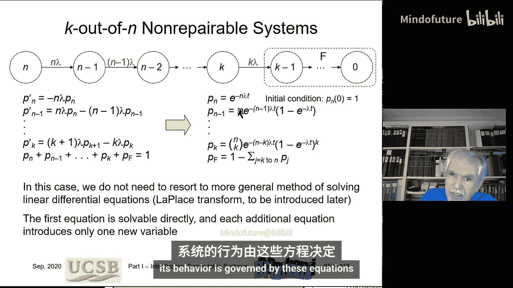

Okay， now it gets more interesting when we have repair， this is a two state， again。

 the simplest repairable system as two states。The start state。Where the system is up。And the down。

And this is basically the model。Up is state one， down is state zero。

A failure rate lambda takes us from 1 to0， repair rate mu takes us from zero to1。Okay。

 now it makes sense to do steady state analysis so with these models。That don't have。

An absorbing state。Because if you have an absorbing state。

 then all the probabilities in the long run are zeros。

And the probability of the absorbing state is one。In this case。

 it makes sense to talk about steady state。The system moves back and forth。

 which means state1 and zero。Sometimes is's in state one， the fraction of the time is in state one。

 a fraction of the time。Then state zero。So to find the steady state probabilities。

 we set up what are known as balance equations。So this is p1 plus p0 equal to 1， let me know。

This is a balance equation set up for state one。We say basically minus lambda times p1。

That's the basically rate of departure from state one。Plus mu。

Times p0 plus mue as the rate of entry into the state1， if you are in a steady state condition。

 these two should be equal。In other words， lambda p1 should equal to mu p0。And therefore。

 we solve these two equations and get。P1 equals to mu over lambda plus muu。

AndP0 is lambda over lambda plus mu， I mentioned previously that mu is typically a much larger number than lambda。

 so mu divided by lambda plus mu is very close to 1。

And lambda divided by lambda plus mu is very close to0。

 and of course you see that the sum of these two is equal to1。Okay， so this is basically。

How the probability of being in state one changes， it begins with one。AndThe outset is one。

Then it drops and drops and drops until it gets to the steady state。Which is this value？Similarly。

 the probability of being stayed zero initially is zero。Okay， and then it increases。

Until it gets to1 minus this value。So， it increases。Until it gets to one minus this value。😔，O。

So this curve that you see here， which includes the transient behavior。As well as the steady state。

As a。Has this equation， so probability of being in state one as a function of time。

And we will derive this later， okay， for now， let's accepted it mu over lambda plus mu。

Plus lambda over lambda plus mu e to the power minus lambda plus mu times t。

 let's test this if t is equal to0， then this term becomes1。

So we have mu over lambda plus mu plus lambda over lambda plus mu， which is one。So at the beginning。

 it's one。If t is infinity steady state， then this term becomes zero because there's a negative sign there。

This term becomes zero and the steady state availability becomes mu over lambda plus mu as we obtained with that simple analysis of。

Okay， so I'll show you。By the end of the lecture， how to derive this。Tranient behavior of the system。

 not just a steady state， steady state is always easy。Because you just set balance equations。

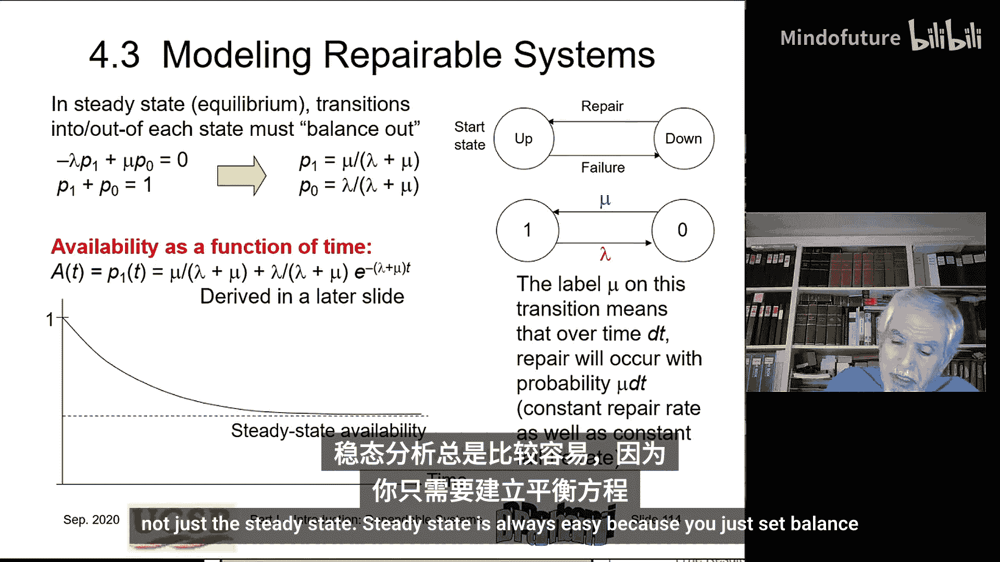

Okay， so here is a more complicated system。It has a good state。A2 fail state， type 1 and type 2。

Perhaps this is say a safe fail state， this is an unsafe， so that's why we are distinguishing them。

Because the consequences of this failure are different from the consequences of this type of failure。

Okay， so this is the model。Two is the operational state。One maybe is the failed safe state。

 zero is the failed unsafe state。Okay， as an example， it can be any two states。

Then we have transition rates。So from this state， there's a rate in lambda 1。

 so when the system fails。At the rate lambda 1， it fails to this state， at the rate lambda0。

 it fails to this state， and let's say the sum of these two。

Partial failure rate is lambda in other the total failure rate of the system is lambda。

A fraction of those failures take us to state one， a fraction take us to state Z。And then repair。

 let's say， is that the rate mu regardless of which state we are in。

So we are now interested to find out the steady state probabilities of this system being state2。

 state 1， state zero。Again， of this equation， p2 plus p1 plus pz equal to 1。

The sum of probabilities of the three states is equal to one。

And these are two balance equations for state two and state one。For state 2， we say minus lambda p2。

So these are the exit。Minus Lada 1 and minus lambda 0 together those are lambda。Minus lambda P2。

Plus mu times p1。Plus mu times p0。Okay， so that should be zero and steady state。For state one。

Minus miu P1 that's a departure。Transition。Plus， lambmbda 1， P2。Should equal to0。Okay。

 you may be curious what happens if I set up？The balance equation for state zero for state zero。

 I will get。诶。Minus muu p0。That's the departure trans minus P0。Plus， lambda0。P2。Is equal to zero。

Turns out that that equation will not be independent。

 so I couldn't set up just the three balance equations and solve them because those are not independent。

Equations， they don't give you unique answers。 That's why I am forced to use this。

Equation involving the sum of probabilities being one。

So I could have set the balance equations just for these two。And not for state two。

That would still have worked， so these two balance equations plus the third equation。

So the answers here are p2 is mu over lambda plus mu p1 MP p0。

And this is the situation here P2 starts with one probability  one at the beginning。

 and it drops to a steady state value。P0 MP1 start with zero。And they rise to theres。

Respective steady state values。Okay。So。As you see， the models are getting more and more complicated。

 but once you know。To handle these balance equations， no matter how complex the model。

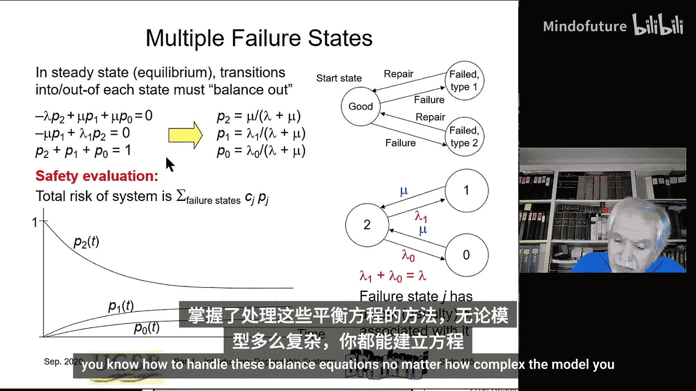

You can set them up and solve them。So here's another model of a fail soft system。

You can visualize this as a system having two processors。And if one of them fails。

 we go into this state and if that's the second one also fails， we go into this state。

And the transition rate is lambda2 here and lambda1 here。Of course。

 if these two processors are identical， you could have set two Lada here and just Lada here。

I'm setting up the model to be more general so that this transition can be anything。Depending on。

The context where we are using this model。So there's a different transition rate between states  two and1 between states1 and zero。

And again， for generality， the repair rate， I'm taking a mu 1 between these two and mu2 between these two。

Once I solve the model with these general parameters， I can， of course。

And there's special cases where this is2 Lada， this is lambda。This is mu， this is mu。

 these two are equal。Okay， again， I set up the balance equations， I won't go through them。

And this sum of probabilities being equal to one。I solve them。

And these are the equations where Delta is this。Rather messy expression， I've written it。

Up there so that I don't have to repeat it in each of these  equations。So P2 is deelta。

 which is given by that equation。P1 is delta times the ratio lambda2 over me2。

And p0 is delta times lambda 1， lambda 2 divided by me 1 me2。Okay， now。

I forgot to mention in the previous model。

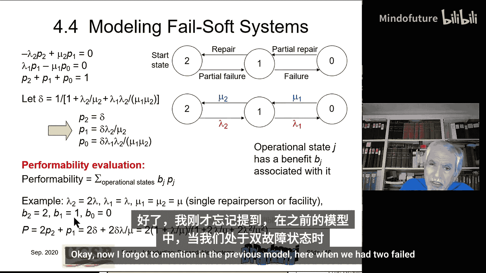

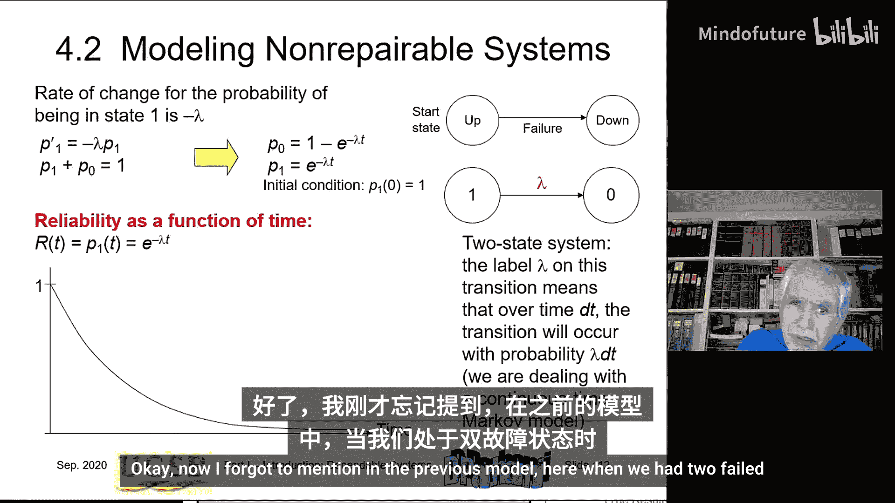

Here， when we had two。

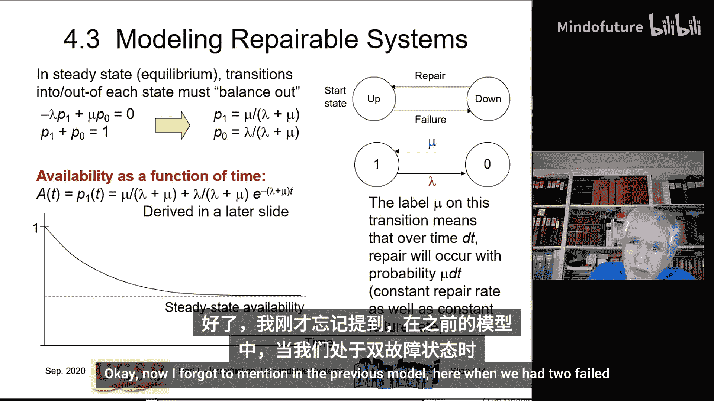

Faied state， we can do safety evaluation。So if being in this state fail type1 has some consequence。

 let's say some dollar cost for us and being in this state has some dollar cost。

Then the risk will be probability of being in the state times its corresponding dollar cost。Plus。

 the probability of being in this state。Times is corresponding。

So this allows us to do safety evaluation。We did reliability evaluation before。

 this is now something that allows us to do performability evaluation。

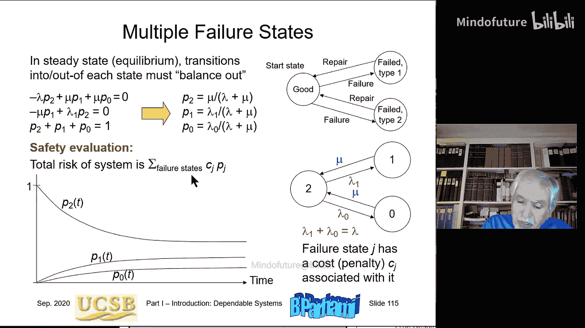

So let's say the system has some level of performance state two。

 some perhaps smaller level of performance in state one。

 and let's say zero performance in state zero。Or more generally。

 the performance level will be B2 in this state， B1 in this state。And B0 in this state。

So performability will be the summation of BJ， Pj。Performance in the state times the probability of being in this state plus performance in this state times the probability of being in that state and so on so for example。

 if this is the two processor system that I mentioned。

Let's say performance level is two in this state， it is one in this state， and it's zero there。

Then I can say two times P2。Plus 1 times p1 is the performability of this system。

 and there's a numerical example down here。

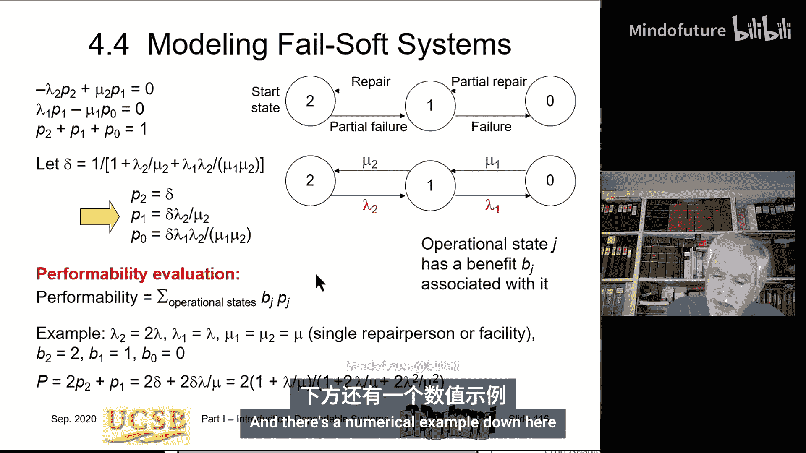

That you can study on your own。

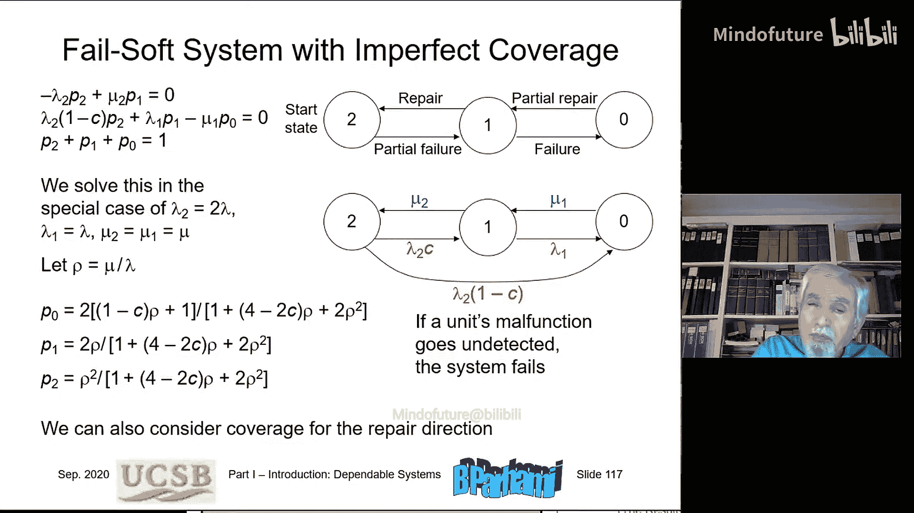

Okay， so here we modeled a fail soft system， assuming that when one of these processors fail。

 we always go to this degraded mode with one processor。Therefore， we have perfect coverage。

 in other words we detect the failure。Always， and we are able to reconfigure the system so that it continues its operation with one processor。

As I mentioned last time， this is not guaranteed。

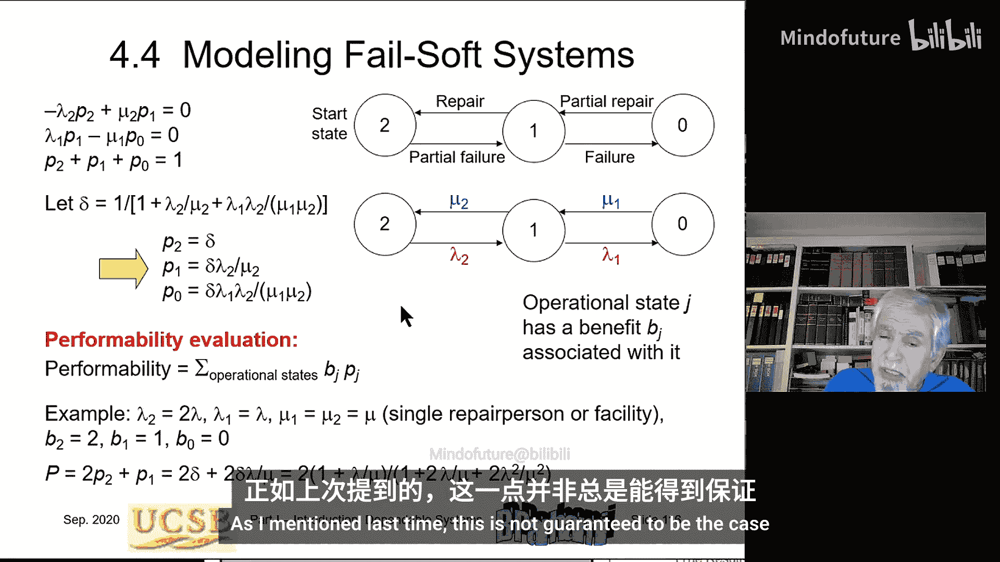

To be the case。So if we want to model that situation， we may replace。Our model。With this model。Still。

 we have。High performance state， low performance state， maybe failed state。

And then when something fails in the high performance state， with some probability。

 we succeed in reconfiguring the system and going into this state。

So the original rate here was lambda2 C is a constant。Less than one。So if the coverage factor is 99%。

 99% of the failure cases lead us to this state。And 1% of the failure cases lead us directly。

This failed state。So this is modeling of coverage factor。Again。

 we can set up the balance equations and there's sum of probabilities being equal to one。

Solve the equations。And we find p0， p1， p2 as a function of these various parameters and the coverage factors C。

Okay， if we want， we can also define a coverage factor in the repair direction。

Perhaps it's not guaranteed that we can successfully repair the failed system。

So maybe take C prime to be the coverage factor in that direction。So with probability。

 with rate c prime times mu2， we go to state 2。With probability 1 minus c prime。Times me too。

 we remain in this state， in other words， we are not successful。Repairing。

And then if you're not successful in need repairing。

 eventually a second failure occurs and takes us to this state。Okay， as you see。

 the examples are getting more and more complicated， but still we have only three states。Essentially。

 we can have many more states in modeling computer system。

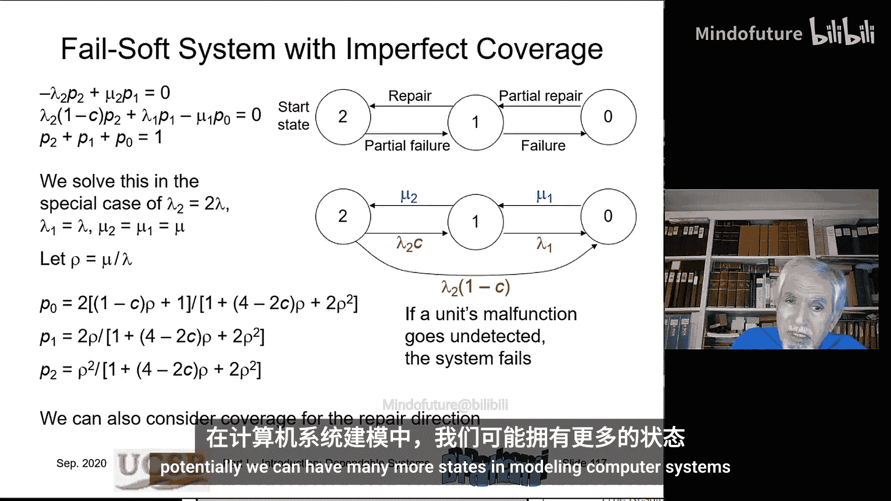

Okay， now let me tell you a little bit about how to solve Markov models to find the time dependent。

Probabilities or transient。Probilities， not just a steady state， which are easy。To update。

So I set up the balance equations for this system。The rate of change。At state one。IfI want tea。

Is negatively correlated with P1 T。And it's positively correlated with E0 T。

And then probability of being state zero changes。This is the departure probability meal。

 so it's taken into account with negative sign。And this is the arrival。Probability Lambda。

So I have two equations， two differential equations。That I need to solve， there are two unknowns。

 P1 and P0。P1 of T and P0 of T and two differential equations。

You may not have seen this or you may not have remembered if we have seen it in math courses。

 so let me explain how these。Systems are first order linear differential equations。

 they're linear because the constants。2。You know， the coefficients of these terms are all constant lambda。

 negative lambda mu， negative mu， lambda。So the variables are p1 of T and p0 of T。

These are the derivatives and the coefficients are constant， how do you solve these？

Here is the procedure to solve linear differential equations with constant coefficients through the following。

Invert the equations to algebraic equations using Laplace transform。

So we use La pro transform to convert these equations into algebraic equations rather than differential equations。

Then solve the algebraic equations， we know how to solve a system of two algebraic equations。

And then use inverse Laplace transform to find the original solution。Okay。

 theplace transform is defined by a table。The functions in time domain。

And their corresponding functions in the transform domain。

The entries in this table are all we need for solving our。Examples in this course。

 this table can be larger if you look at some sources， there are more entries。

 so what does this table said？It says a constant function in time domain。

And the transform domain becomes k divided by S。S is just a variable。In the transform domain。

We solve for eventually and find it。If you have an exponential function， e to the minus 80。

The transform version。 So we denote these functions by。In the time domain by lowercase letter。

And in the transform domain by upper case leather。So the function e to the minus at becomes1 divided by S plus a。

Okay。Fun K times H of T， in other words， if you multiply some function H of T by K。

Its transform is also multiplied by K， so you don't need to worry about constants。

If you find the transform of HFT。Then inter transform of k times h of T is just k times H of S。

So this edge， capital edge is the transform version of this。Function lower case H。

If you have sum of two functions， then you can individually find the transforms of these two。And add。

Perhaps the most important for our examples here is this。If you have a derivative。In the time domain。

In the transform domain， so H is a function。Big edge is the transform version of that function。

So it will be S times h of S minus h of0， this is basically the initial condition。Okay。

 this will become clear as we apply it to this example。So P prime 1 T。Conver it to Trans domain。

 it's of this form。So we will have S times p1 of s。Minus p1 of 0。S times p1 of s minus p1 of0。

 and on the other side。Just have constant multiplied by functions。So minus lambda times p1 of S。

 the transform version of this function。Plus mu times p0 of s。Similarly， for this one。

 this derivative。I use this。Correspondence to write it as S p0 of s minus p0 of0。

And then the right hand side is again simple。And p1 of 0， I know is equal to 1。At time zero。

 the probability of being state1 is1。And at time zero。

 the probability of being in state zero is zero。So， those。I replace with their values。

And then I have the two equations with two unknowns， p1 ofs and P0 of s。I solve those equations。

And I get these solutions for P1 ofs and P0 of。The one of s is s plus mu divided by s square plus lambda plus mu quantity times S。

P0 of s is lambda divided by。And the denominator S squared plus lambda plus mu quantity times S。Okay。

 now I have the solutions in the。Transform domain， I need to go back。To go back。

 I basically have to look at this table in the reverse direction so if I see。K over S。Here。

 I replace it with K。By C1 over S plus a， I replace it with e to the minus at。Okay。And so on。However。

 what I see here does not have the form。Of the functions in this table。So for example。

 I have a squared。In the denominator， well， this could potentially have a squared if n is equal to 2。

But then the other terms will not match here I have s squared if n is equal to2， have S squared。

Plus 2 ASS plus a squared， so that doesn't match the form of this function。Okay。😊，So what do I do？

The solution eventually we'll see will be。Yes。Let me tell you how you obtain。Those solutions。

So when you have an expression。安乐。And the transform domain that does not match any of these。

Then you try to transform it into some of terms。Each of which does appear here， and therefore。

 because。You know， the sum of。诶。The sum of two functions。

 the transform of the sum of two functions is the sum of the transforms。最快。

Convert this into the sum of two things。They of this form， of this form or of this form。

 then I can directly write。The corresponding time domain functions。And I'm done。So how do I do this？

This is done by basically expansion of fractions into simpler fractions。

So let me give you just one example。So。Take this fraction S plus mu。

Times s squared plus lambda plus mu times S this s plus mu is a constant。

 so I can ignore it for now and then reintroduce it later Okay remember。A constant。Times H of S。

 if I find the。Find the domain version of this， I can just multiply by K。You the。Time domain of this。

 so let's ignore this。So。Okay， sorry， I didn't take that path simply。Multipied out this。

 I could have done it that way， sorry， this is oh sorry sorry， this is not constant。

 it has an S in there。Totally wrong， so I do have to so I divide s at this fraction and then when I divide S by that fraction S。

And this power and this S cancel out， I get this fraction。And then divide mu by this。Expression。

And this is the second。Now the first part notice this is already in the form that we need is 1 divided but by s plus some constant。

And we already have a function of that form here。So it will be e to the minus8。

 but a here is lambda plus mu， so we know。We know the time domain version of this part。

What about the second part？Here I'm going to ignore Mi。

Because it's a constant and just focus on one divided by s squared plus lambda plus mu S。Okay。

 say this is basically S， I can factor out s， so it's S times what is left is S from this term。

And lambda plus mu from this term， so I say， okay， this is probably。The sum of two fractions。

 one of which has the denominator S。The other one is the denominator s plus lambda plus mu。

Factored out the denominator。Has S times S plus lambda plus mu。

So there is some number at the numerator， I don't know what it is。

There is some number B at this numerator， I don't know， I'm trying to determine what those might be。

Okay， so now try to。Combine these two， when I combine two fractions， I multiply the denominators。S。

Times s plus lambda plus mu。And then I have a。Times this。Plus b times this。做A。

Times this denominator plus b times this denominator。And that should be equal to one。

Because I started with this fraction。I decompose it into these two fractions。

 the sum of these two fractions should equal that。And， therefore。This expression should equal to one。

Okay。So that basically means if I factor out the terms that have S in them， I have AS。A。PS。Okay。

 I don't have any S on that side， so a plus b must be 0。And then I also have a times lambda plus mu。

 but because。呃。So a plus b should be equal to0。And then。A times lambda plus mu should equal to 1。

And therefore， a plus b0 and a times lambda plus me equal to1。Give me the values of A and B。Okay。

 once I have the A and B， I plug into here， so here I have some a。

 which is1 over lambda plus mu divided by s。That's up this form。And here I have be。Which is this。

Getative value divided by S plus now the first mu。Which is of this form multiplied by some constants。

Okay， so I now can go back and find the answers that。

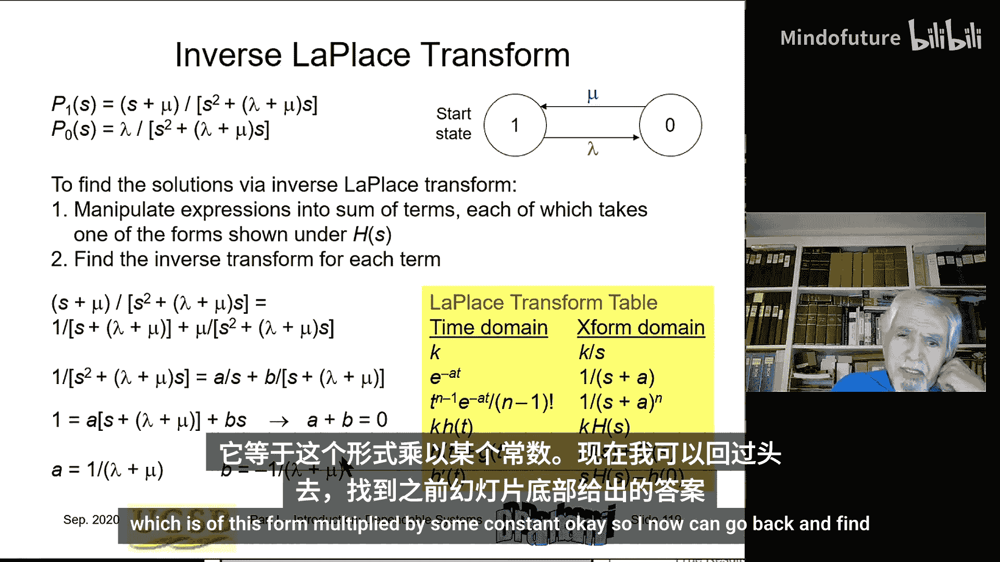

I gave you on the previous slide at the bottom。So notice this here。

These are the transient probabilities of P1 and P0。🤢，Again， if t is equal to zero。

Then this term becomes 1 and p1 of t becomes1。And p0 of t becomes  zero if t is equal to infinity。

 we get the steady state probabilities so guess that x out。

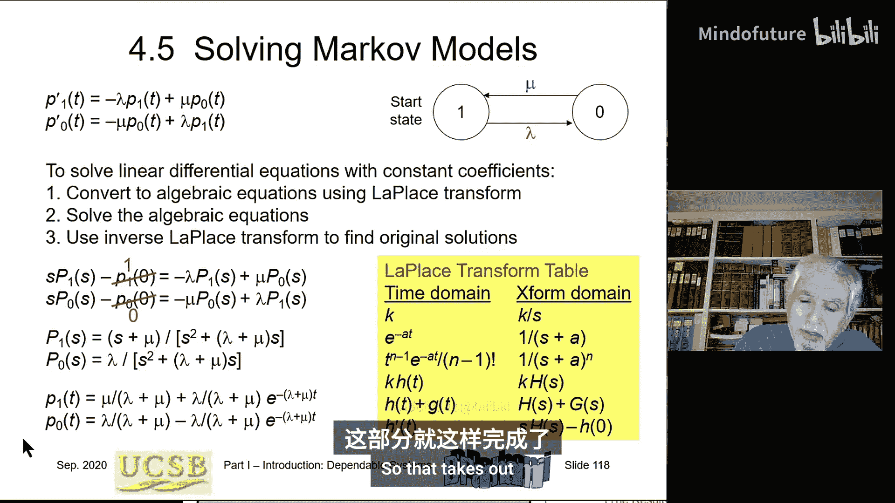

Okay， so you don't need to become you know， fluent or conversant with these Laplace transforms you can always use。

You know， referenceference sources。And sometimes the function you are looking at。

 we can look up just the clause transform directly。And。From the internet or the inverse transform。

 you can look up。But in the worst case， you have to do this us。And。You know， it's doable。

 you don't have to memorize these because you can always look up the correspondences and。

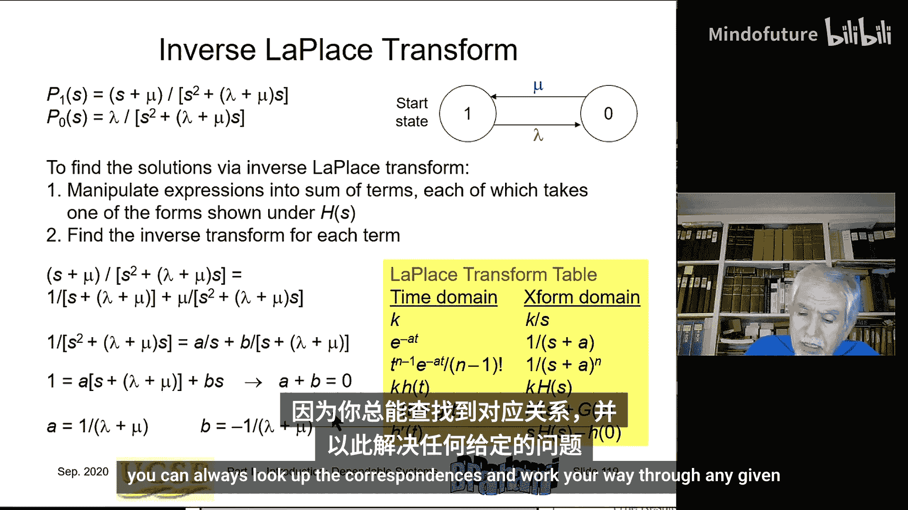

Work your way through any given problem。Okay， now what I have in this last section of the textbook。

 chapter four。Are a bunch of examples to just basically provide more exercise， more practice。

For dealing with these models。So a particular Markov model that is used extensively in practice。

Is the so called birth and death process。Okay， so the name comes from the fact。That。

If these transitions going rightwards are birds。And transitions going leftwards are deaths。

Then starting from a population of zero。You can go to a population of one as a result of a birth。

Of course， in the case of。You know， humans， it doesn't make from population of zero。

 you can't increase the population。But this is， you know more general than just。

I'll give you a good example in a minute。And from a population of one， you go to two。Up to n。

 and this can continue up to infinity because the population can increase。

And then so these are the birth rate。And these are the death rates。And then given。

Particular values for these lambda parameters and mu parameters you can find。

The probabilities of being in these various states are the probability that the population is three or four or five and so on。

This model， one of its most famous。Applications。Is in modeling wait times in banks and other places where customers go to get service。

So in this case， zero， one，2，3。It can be the length of the line of waiting customers。

So suppose there's a bank。And there's just one teller that serves all customers。

So initially there are no customers waiting， customer enters， customers enter at some rate。

Maybe one customer every three minutes or whatever they。Load of that particular。Bank branches。

And then the customer is served at a particular rate， so if lambda zero is three minutes。

Arrival rate is one every three minutes and then the service rate is one every two minutes。

Then it's less likely for the line of waiting customers to grow。

If arrival rate is three minutes and service time is five minutes， of course the line will grow。

Indefinitely， and。For infinity， because the rate of service is lower than the rate of customer。Arr。

Surprisingly， if you solve this model。If the rate is。If the rate of service is slightly less。

 let's say this is five。This is four， you might think if a customer arrives every five minutes and the customer is served every four minutes。

There's no reason for a Q to form， for a line to form。However。

 these are remember these are probabilistic parameters。

 a customer arrives every five minutes on an average。Okay， so， you know。

 two customers can come in at exactly the same time。Or within one minute of each other。

 so the average rate is five minutes one every five minutes。It can be more。

The interesting thing is that once the line starts growing。Because a few customers arrive。

Cause to each other。Then the line will not shrink very quickly， okay， so in fact。

 it can have arbitrarily long line。Even when the service rate is。Higher than。The arrival rate。

So this is one application。Of this model。Of course， you should know how to solve this。

 you set up balance equations。And then you solve the balance equations I've given the solution here。

Pj is p0。Times this ratio of the products of lambdas。Divided by the product of mules up to that jade。

And of course， then if you have all probabilities in terms of p0。

 then you just set the sum of them equal to one to find what the value of p0 is。

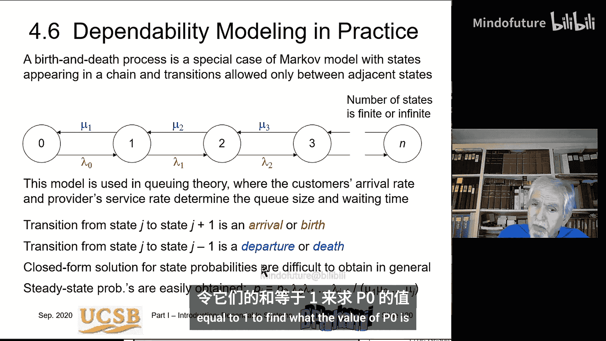

Okay， I already explained this written。😔，OkayIn the previous example。诶。

The death rate is constant regardless of what the population is。So in the bank example。

 the arrival rate of the customers。Does not depend on how many customers are waiting in line。

The service rate is also constant， but this doesn't have to be the case。And we can just define。

So if this is a multi processor system。With numbers now indicating how many processors have failed。

Zero have failed， one have failed， two have failed and so on。So if end processors are operating。Then。

 in Lada the。Applicable failure rate if n minus1 are operating。Okay。

 so you can use this model in that context as well， and then going back for repair。

 you can put mu on every one of these transitions。If you have a single repair facility。You can泡 two苗。

On some of these， if you have two repair facilities。

Of course here it remains mu because there's just one failed processor。Okay。

 but the other ones can be increased at fuial and so on and so forth。

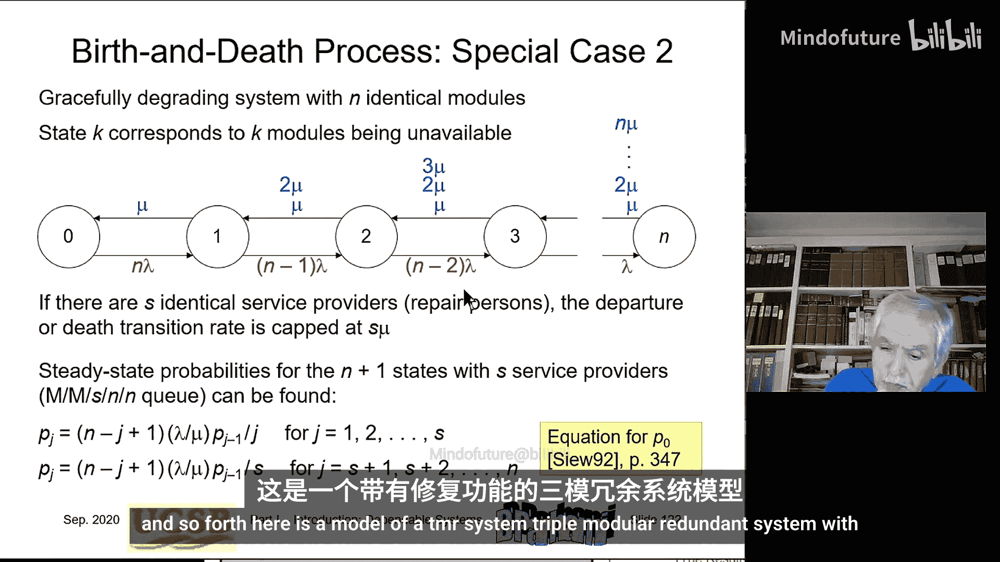

Here is a model of a TMR system， triple modular redundant system with repair。So。诶You。

Have three operating modules。This is the failure rate of。😔，For one failing。

 you have two operating modules。Still， you can get the correct answer， even though one has failed。

But if you have repair so that that one failed module can be brought back into service。

The lifetime of this system， expected life will increase because if the system is in state two and you don't have this repair。

 eventually it will go into the failed state。When one of these two fails。The rate being two lambda。

But if you have this repair and repair rate is much higher than this failure rate。

Very likely you bring back the system into full。Full functionality before this occurs。

And therefore the system will fluctuate back and forth between these two states many times before the system fails。

 so you expect that meantime the failure of this system to increase。

 I let you read the details on this slide and in the textbook。Sure enough it does。

When you have triple modular redundancy， when you have a non redundant system。

The failure rate is lambda。And the mean to failure is one over lambda。

Let's say with 10 to a minus6 per hour， it will be 1 million hours。When you have TMR。Surprisingly。

 the mean to failure is less。So imagine that this repair transition isn't there。

Because of this triple failure rate there and double failure rate there。Okay。

 the mean to failure is actually reduced。That's not worrisome because in the short term。

 reliability will be higher。And the long term reliability will be lower， but we don't use the system。

Over extended period of time。When you go to TMR with repair。You can derive。The meantime to failure。

And I've written it in this form so that is's directly comparable to that。

5ive over 6 lambda times this factor， what is this factor？Is one plus something。

 so it's more than one therefore。There's an improvement in mean to failure。

 how much more well 1 plus 0。2 times me over lambda remember we said that me over lambda is a large number。

Can be 10，000， can be 100，000。So meantime to failure。Will be improved significantly。

In this example I've taken mu to be 0。1 per hour。It's rather pessimistic meaning。On average。

 it takes 10 hours to do a repair。And it becomes instead of about one million hour。😔，It becomes。16。

000 million hours or 16 billion hours it's really。

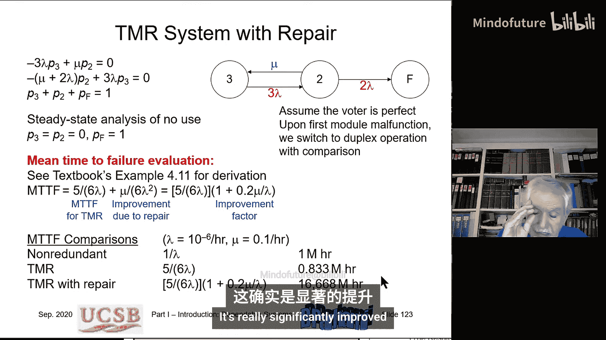

Significantly improved。Okay， the dependability modeling process is an iterative process。

You choose your modeling approach， whether you want to do。

It's the combinational model or state based model， which choose an approach depending on which one fits。

Your needs better， you construct the model。You derive the model parameters。To solve the model。

So you solve your Markov model or solve your combination model。You interpret the results。

And then you validate the model and result and you are done Unfortunately。

 most of the times you just don't go one pass down this。Pa。😊。

You may have to go back and adjust things。Okay， so when you try to interpret the results。

 you see that something is wrong and then。You may have to go back and redo your modeling。诶。

Reado your。Deerrivation of your parameters and so on。So once you are done once。

 you sort of may have to go back and when you go back。

 you either go back to all the way to the beginning。Redo the entire modeling process or maybe。

Somewhere in between， if you know that， you know， there's something there that。You can fix。

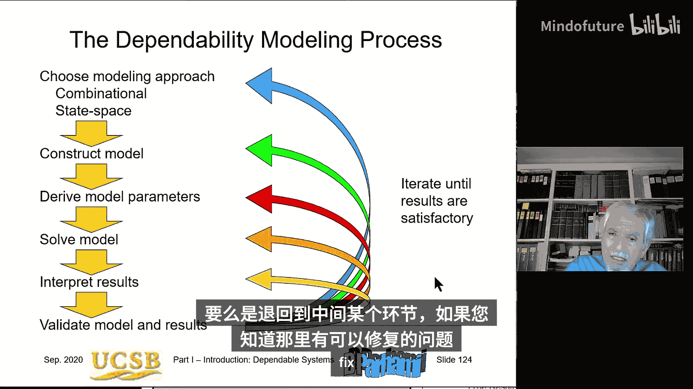

My final slide is a list of some software aids for reliability modeling。

if you work for a company and you are in need of doing reliability modeling。

 there are software products that are available and can be purchased。

Some of them are pretty expensive。So PTC Winchll is a company。

That specializes in reliability engineering and it has a bunch of products。Software products。

 you can。Purchase University of Virginia and Iowa State universities have their programs and these are free of charge you may have to register。

To get access to those programs they don't charge you money for those programs。There are some tools。

ABilt upon Matlab， so if you're a Matlab user， you may want to look into those tools their Matlab based again。

 they can be。You know， they may require purchasing or in some cases，'s be free。That's it。

So when I updated the slide I。So you've double checked all these links。

 in some cases the links were broken or obsolete。And the best of my knowledge。

 these links now work and you can pursue them to find out。

More information about these modeling products。Now for the purpose of this course。

We don't actually run programs， we four models on paper。You know， you may do homeworks。

 designing a model and finding its parameters。If you do research in this area。

 if your research topic is related to this， you may。

 we don't have any budget to go and buy these products。But we may gain access to these free。

Moodeling tools and use them in case your research topic requires that you do actual modeling。

But for the most part， you can just put this in the background。

Know that these exist so that in case you need them in future。Can go and find them and。

Acquire the necessary tools for your work。Okay， so this ends our discussion of chapter four。

 state space modeling。And。Stay safe， I'll see you。In lecture five next time。

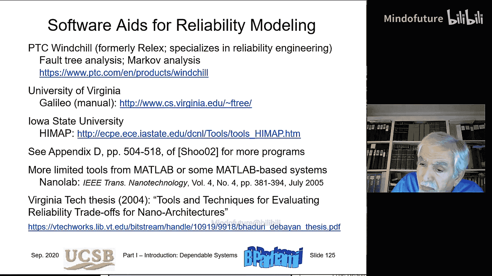