# 容错计算：第4讲：状态空间建模 📊

在本节课中，我们将要学习状态空间建模。这是一种在组合建模之外的重要建模技术，用于描述系统在不同状态间的动态变化。我们将从基本概念开始，逐步学习如何建立和求解状态空间模型，特别是马尔可夫模型。

## 概述

状态空间建模将系统视为处于多个可能状态之一。系统会因各种事件（如故障、修复）在这些状态之间转移。通过量化这些转移的概率或速率，我们可以评估系统处于不同状态（如正常运行、性能降级、完全失效）的可能性，从而分析其可靠性、可用性和性能。

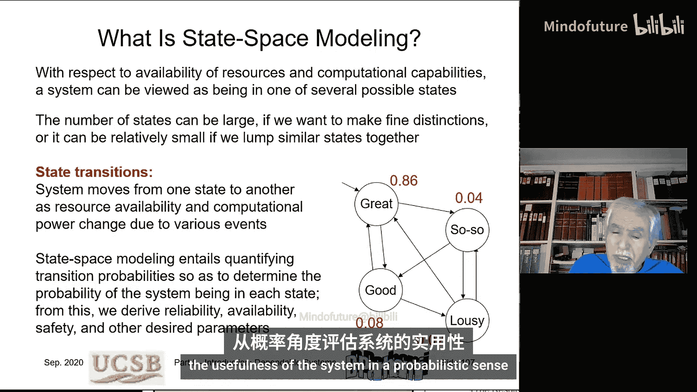

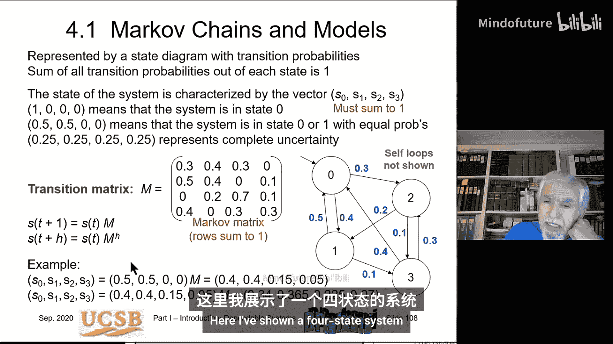

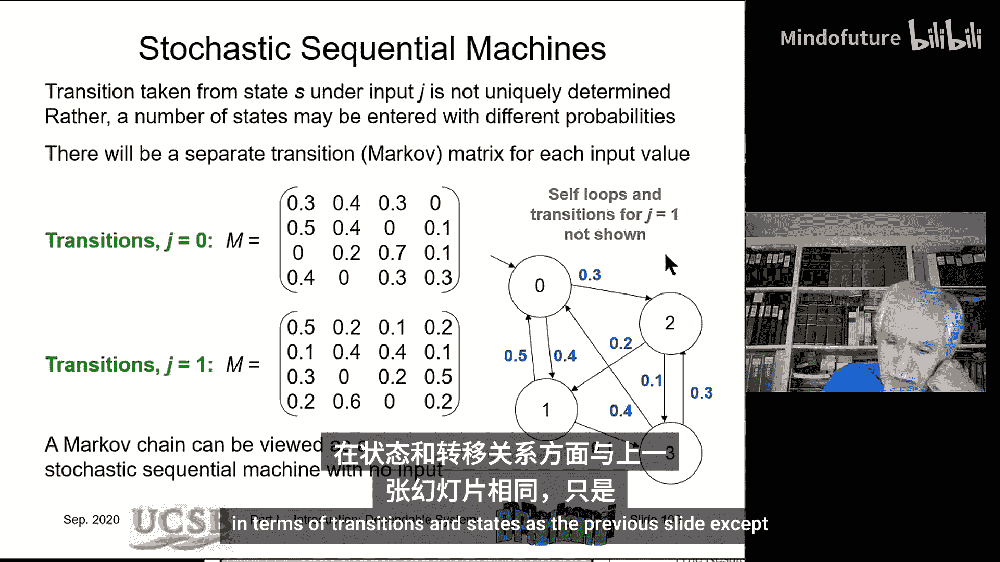

上一节我们介绍了组合建模，本节中我们来看看基于状态空间的动态建模方法。

## 什么是状态空间建模？ 🤔

关于计算能力或资源的可用性，系统可以被视为处于几个可能状态之一。你可以根据需要定义任意多的状态，可以对不同状态做精细区分，也可以将多个状态合并。

例如，一个系统可以被粗略地表示为处于四种状态之一：优秀状态、良好状态、一般状态和糟糕状态。系统在任一时刻只处于其中一种状态。系统会因资源可用性和计算能力的变化，在各种事件的影响下从一个状态转移到另一个状态。

在容错计算中，例如发生故障时，系统可能从优秀状态转移到一般状态。这些转移通常有与之相关的概率。在离散时间模型中，转移用概率描述；在连续时间模型中，转移用速率描述。速率表示单位时间内发生转移的平均次数。

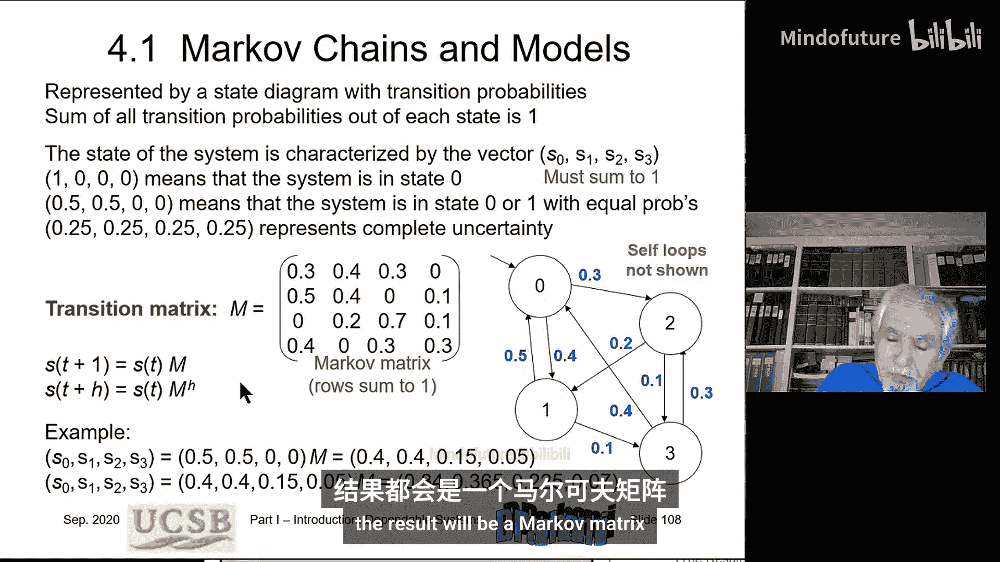

我们感兴趣的是找出系统处于最理想状态（以及其他状态）的概率，因为这有助于我们从概率意义上评估系统的可用性。

## 马尔可夫模型 ⛓️

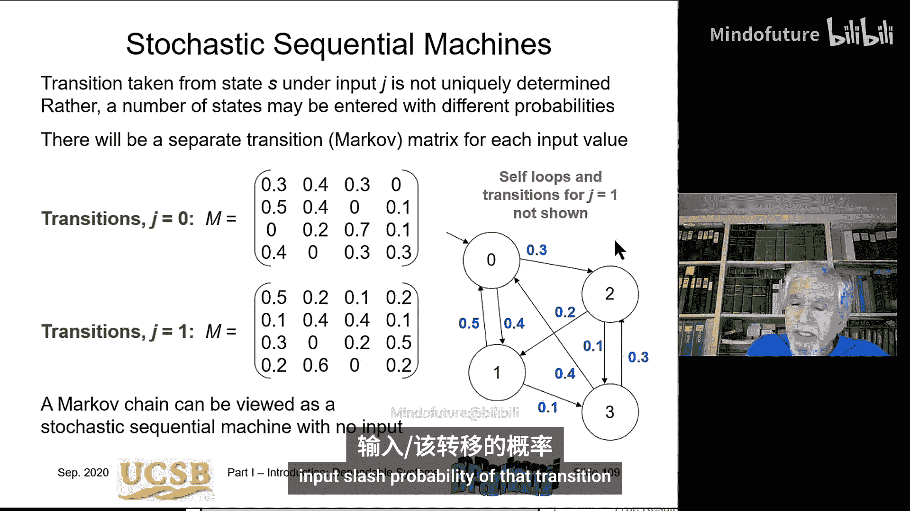

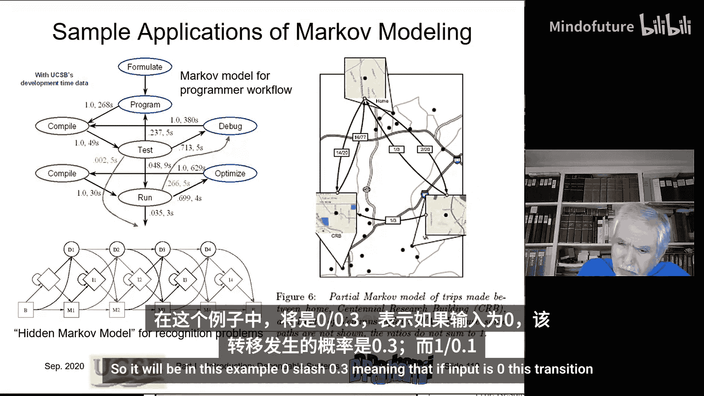

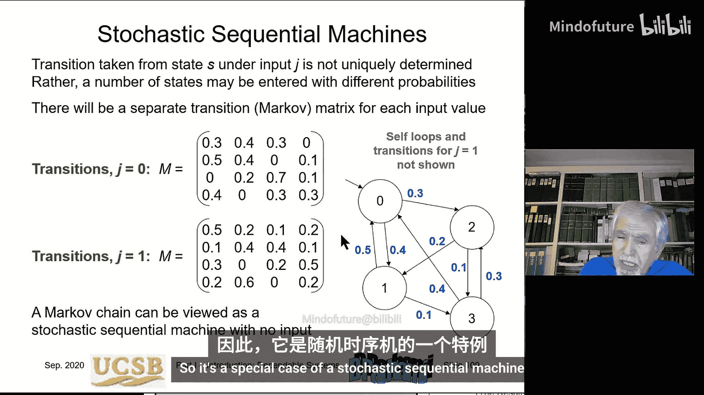

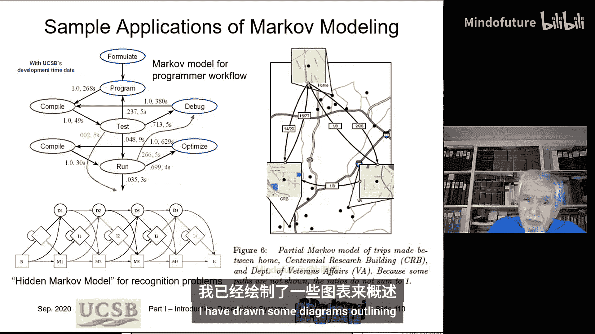

我们讨论的起点是被称为马尔可夫链（或马尔可夫模型）的模型。马尔可夫模型由一组状态和状态间的转移概率（或速率）构成。

下图展示了一个四状态系统的离散时间马尔可夫模型。状态用数字0、1、2、3表示。转移概率构成了一个马尔可夫转移矩阵 **M**。

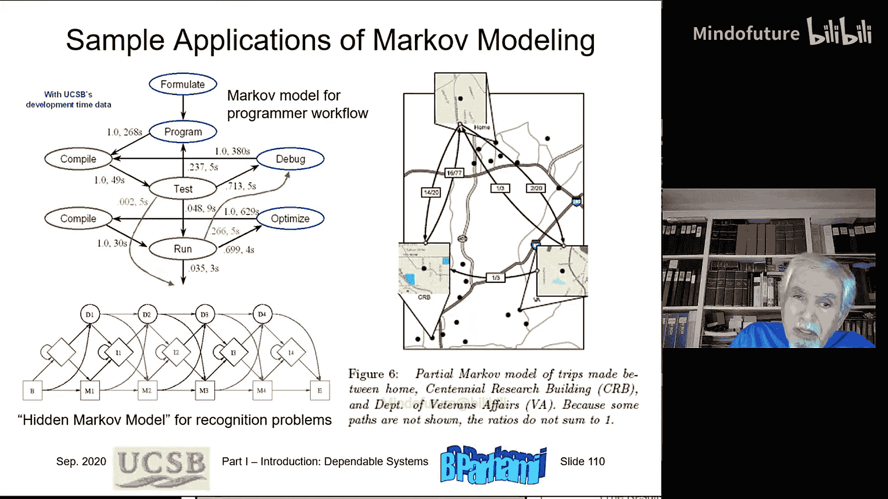

```
状态转移矩阵 M 示例：
[ 0.3, 0.4, 0.3, 0.0 ]
[ 0.5, 0.4, 0.0, 0.1 ]
[ 0.0, 0.0, 1.0, 0.0 ]
[ 0.0, 0.0, 0.0, 1.0 ]
```

马尔可夫矩阵是一个方阵，其行数和列数等于状态数。**关键特性是：矩阵中每一行的元素之和必须为1**。这意味着系统在下一时刻要么保持在当前状态，要么转移到某个其他状态。

马尔可夫模型的一个优点是：如果你知道系统在时间 **t** 的状态（用一个概率向量 **s(t)** 表示），那么通过将状态向量乘以转移矩阵 **M**，就可以得到系统在时间 **t+1** 的状态：
**s(t+1) = s(t) * M**

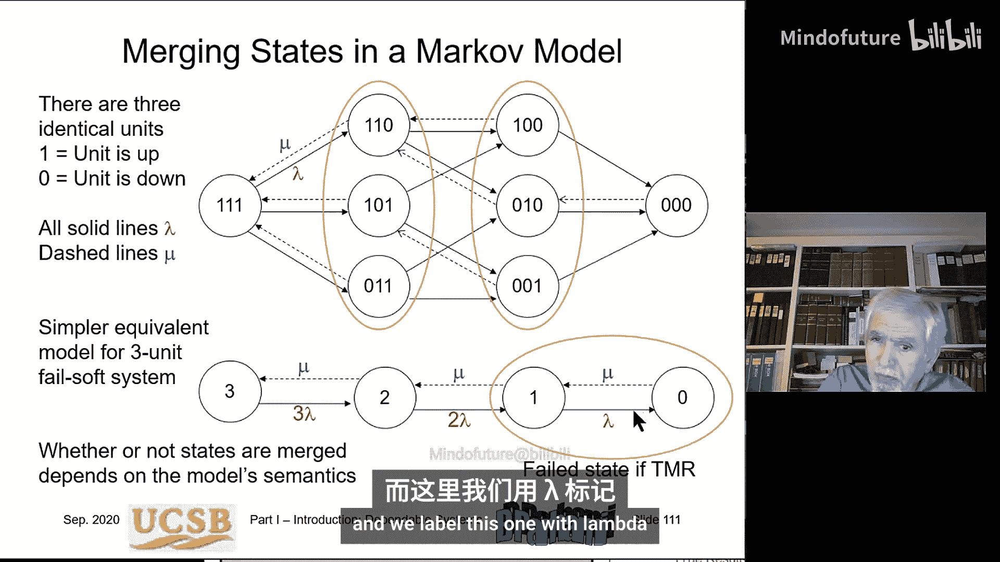

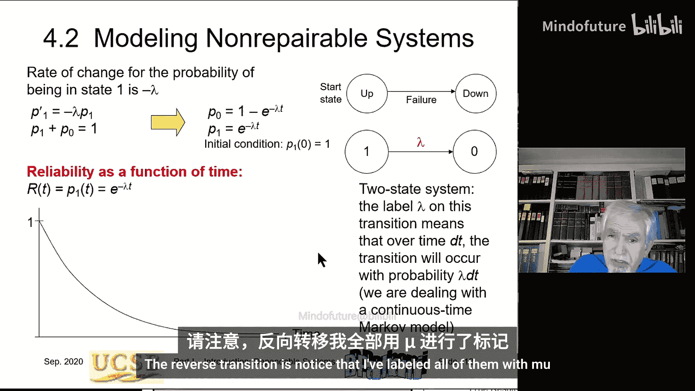

经过 **h** 个时间步长后，状态为：
**s(t+h) = s(t) * M^h**
可以证明，马尔可夫矩阵的任意次幂仍然是一个马尔可夫矩阵。

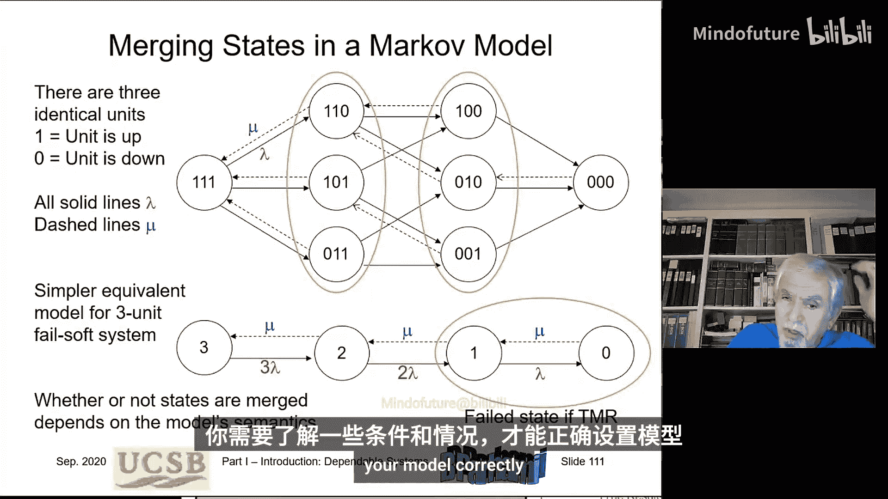

马尔可夫链是随机时序机的一个特例，后者可能有多个与不同输入对应的转移矩阵。而马尔可夫链是自主的，没有外部输入。

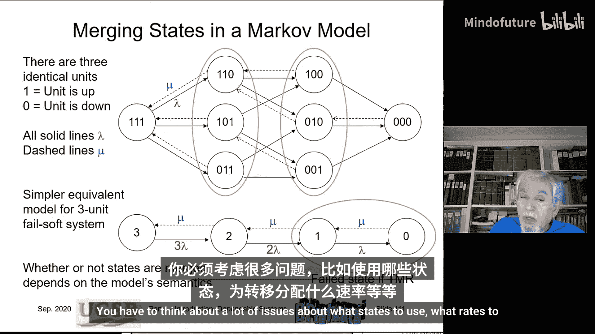

## 马尔可夫模型的应用实例 💻

马尔可夫模型有广泛的应用。以下是一些例子：

*   **程序员活动模型**：该模型描述了程序员在“构思问题”、“编写程序”、“编译程序”、“测试程序”、“调试”、“运行”和“优化”等状态间的活动。转移概率和平均耗时（延迟）是通过收集数据得到的。通过该模型，可以评估程序员在各个活动上花费的时间比例。
*   **计算机系统模型**：这是我们课程关注的重点。例如，对于一个三处理器并行系统，可以定义8个状态，对应三个处理器不同组合的工作/故障情况（如111表示全正常，110表示前两个正常第三个故障）。如果处理器相同，且我们不关心具体哪个处理器故障，可以将“单故障”的三个状态合并为一个状态，从而简化为一个四状态模型（3个正常，2个正常，1个正常，0个正常）。转移速率通常包括故障率（λ）和修复率（μ）。模型的具体设置（如状态定义、转移速率）取决于系统设计和分析目标。

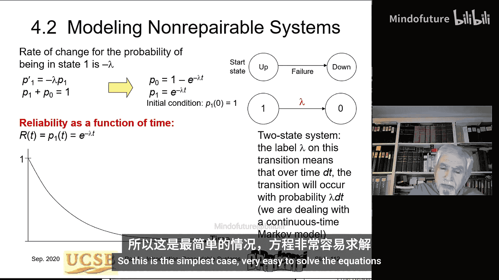

建立系统的马尔可夫模型并非易事，需要考虑许多问题：使用哪些状态、为转移分配何种速率等。

## 建立和求解马尔可夫模型 🛠️

让我们从简单系统开始，逐步建立更复杂的马尔可夫模型。

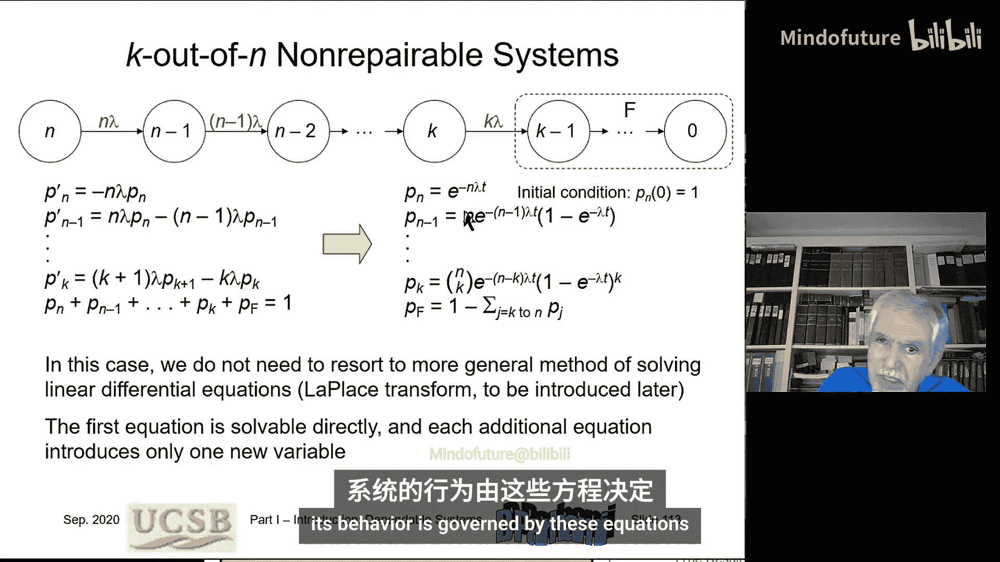

### 简单非可修复系统

考虑一个两状态系统：“运行”（状态1）和“失效”（状态0）。系统以故障率 **λ** 从状态1转移到状态0，且没有从状态0转出的转移（吸收态）。对于这种不可修复系统，长期运行后系统必定会进入失效状态。

通过建立微分方程可以求解瞬态概率：
**p1'(t) = -λ * p1(t)**
**p0(t) = 1 - p1(t)**
其中 **p1(t)** 是时刻 t 处于状态1的概率。求解得到：
**p1(t) = e^{-λt}** （即可靠度 R(t)）
**p0(t) = 1 - e^{-λt}**

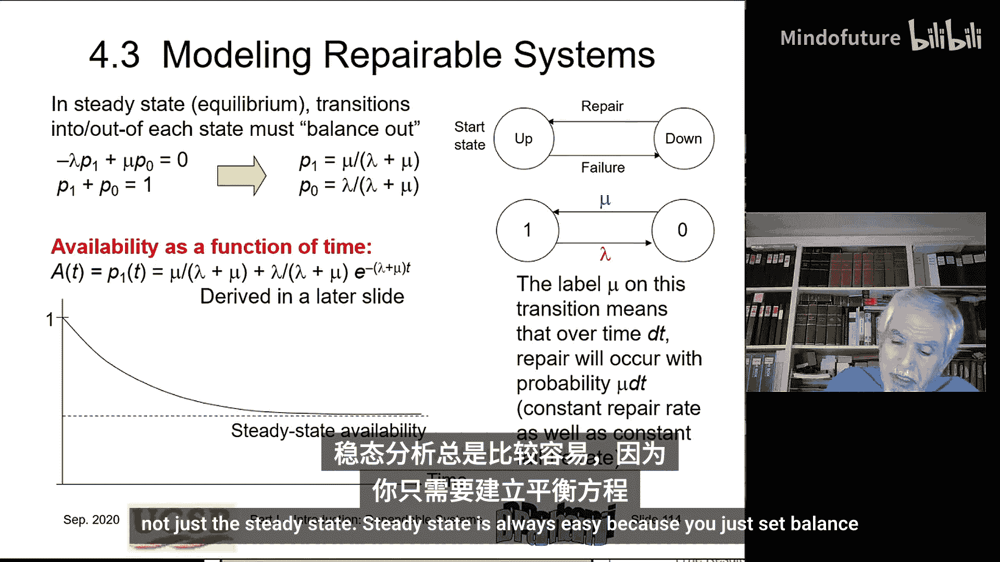

### K-out-of-N 非可修复系统

系统由 N 个相同单元组成，至少需要 K 个正常才能工作。状态表示正常单元的数量（N, N-1, ..., K, F）。转移速率从状态 i 到 i-1 为 **iλ**。状态 F 是吸收态。

通过建立一系列微分方程可以求解各状态瞬态概率。例如：
**pN'(t) = -Nλ * pN(t)**
**p{N-1}'(t) = Nλ * pN(t) - (N-1)λ * p{N-1}(t)**
... 依此类推，并结合总概率和为1的条件求解。

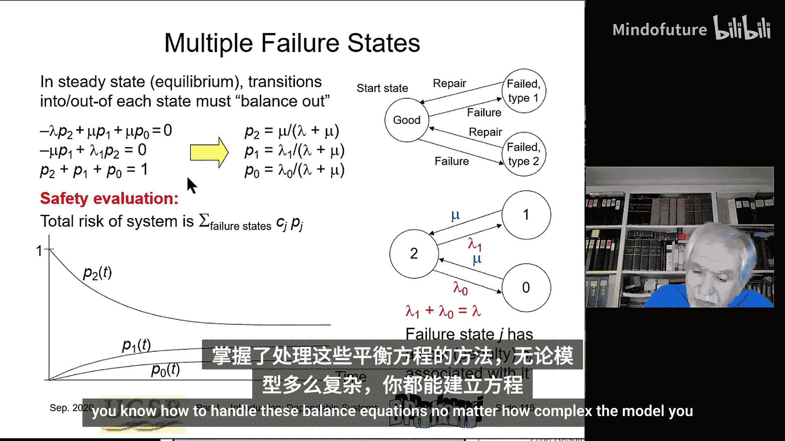

### 简单可修复系统

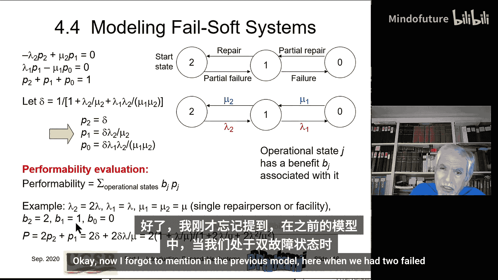

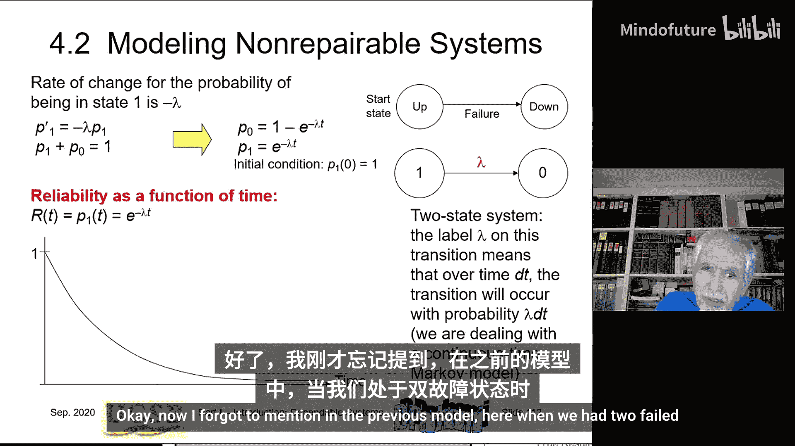

这是最基本的两状态可修复模型：状态1（运行），状态0（失效）。故障率 **λ** 使系统从1到0，修复率 **μ** 使系统从0到1。该系统没有吸收态，存在稳态。

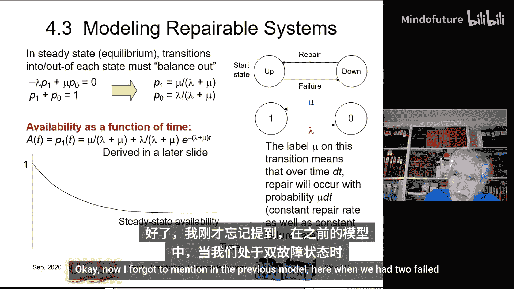

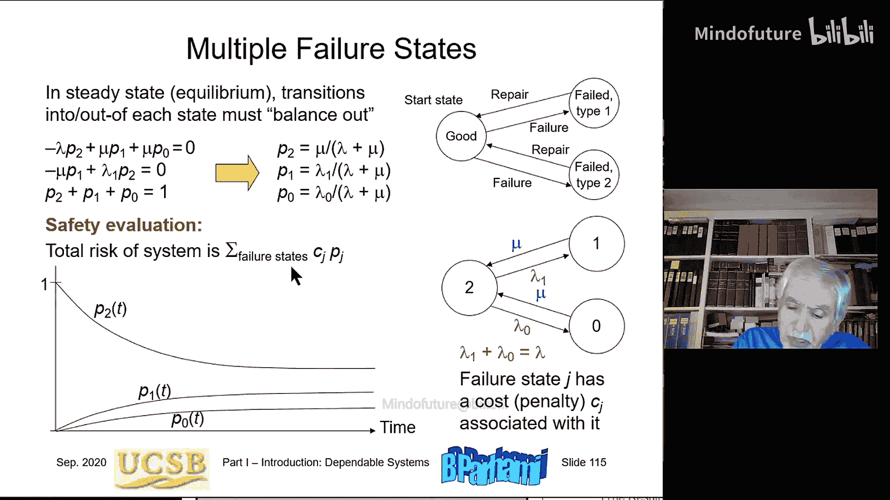

**稳态分析**：通过建立平衡方程求解稳态概率。
1.  **p1 + p0 = 1**
2.  对于状态1：离开的速率 = 进入的速率 => **λ p1 = μ p0**
求解得稳态可用度 **A** 和不可用度 **U**：
**p1 = μ / (λ + μ)**
**p0 = λ / (λ + μ)**
通常 **μ >> λ**，因此稳态可用度接近1。

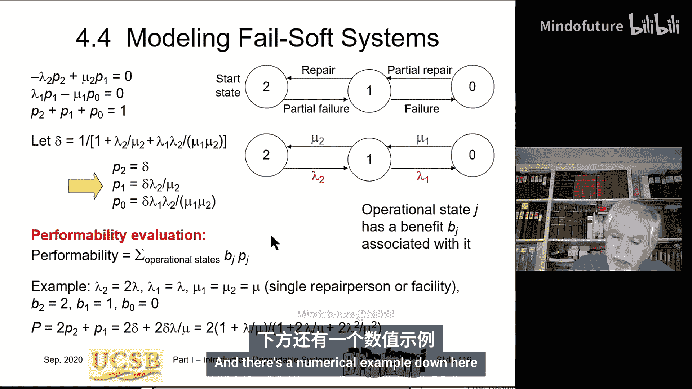

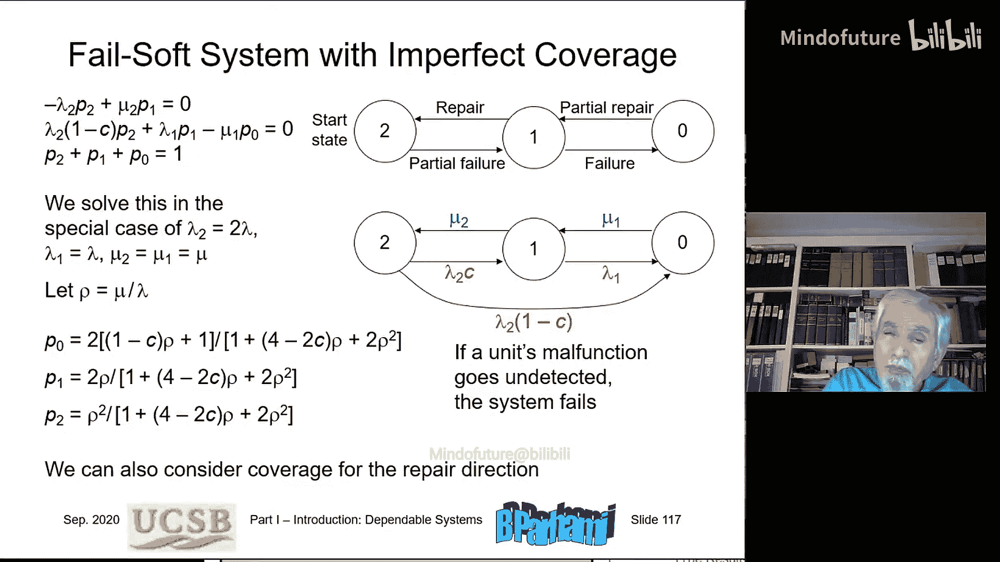

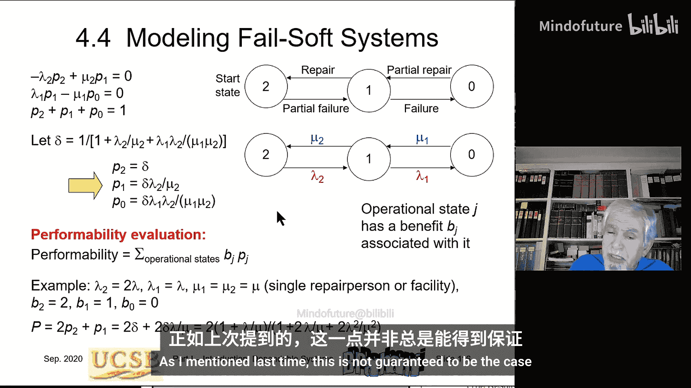

**瞬态分析**：通过求解微分方程组得到随时间变化的概率：
**p1(t) = μ/(λ+μ) + [λ/(λ+μ)] * e^{-(λ+μ)t}**
**p0(t) = λ/(λ+μ) - [λ/(λ+μ)] * e^{-(λ+μ)t}**
当 t=0 时，p1(0)=1；当 t→∞ 时，趋于稳态值。

### 更复杂的可修复系统模型

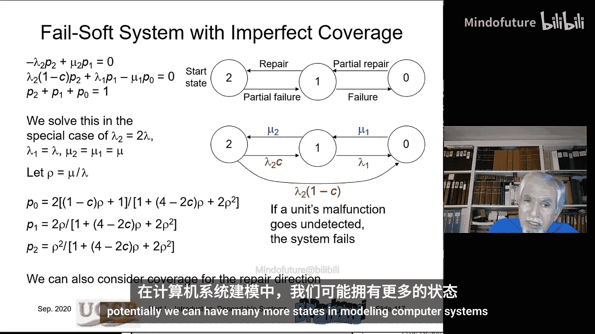

模型可以包含更多状态和转移，以区分不同类型的故障（如安全故障/非安全故障）、性能降级等级等。通过为每个状态建立平衡方程（离开速率=进入速率），并结合总概率和为1的条件，可以求解稳态概率。然后可以进行可靠性、安全性和性能度评估。

**性能度评估示例**：如果系统在状态2、1、0的性能水平分别为 **b2, b1, b0**，则系统性能度 **P** 为：
**P = b2 * p2 + b1 * p1 + b0 * p0**

**覆盖因子建模**：在故障处理中，可能无法完美地检测和恢复。覆盖因子 **C** 表示成功处理故障并进入降级运行状态的概率，而 **(1-C)** 则表示直接导致完全失效的概率。可以在转移中引入覆盖因子来建模这种不完美性。

## 求解瞬态概率：拉普拉斯变换法 📐

对于更复杂的模型，求解微分方程组以获得瞬态概率解析解可能需要使用拉普拉斯变换。基本步骤如下：

1.  **应用拉普拉斯变换**：将时间域的微分方程组转换为复频域（s域）的代数方程组。拉普拉斯变换将导数 **dx/dt** 转换为 **sX(s) - x(0)**，其中 **X(s)** 是 **x(t)** 的变换，**x(0)** 是初始条件。
2.  **求解代数方程组**：在 s 域中求解出 **P1(s), P0(s)** 等。
3.  **应用逆拉普拉斯变换**：将 s 域的解答转换回时间域，得到 **p1(t), p0(t)**。通常需要将复杂的 s 域表达式分解为部分分式，以便利用已知的拉普拉斯变换对（如 **1/(s+a)** 对应 **e^{-at}**）进行逆变换。

此方法虽然涉及数学技巧，但借助变换表和部分分式分解，可以系统化地求解线性常系数微分方程组。

## 生灭过程 🐣⚰️

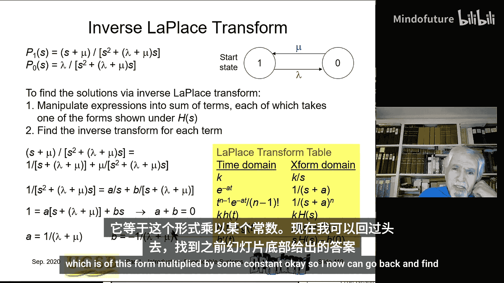

生灭过程是一类特殊的马尔可夫模型，状态代表“种群”数量（如顾客数、故障部件数），转移只发生在相邻状态之间。“生”使数量加1（速率 **λ_i**），“灭”使数量减1（速率 **μ_i**）。

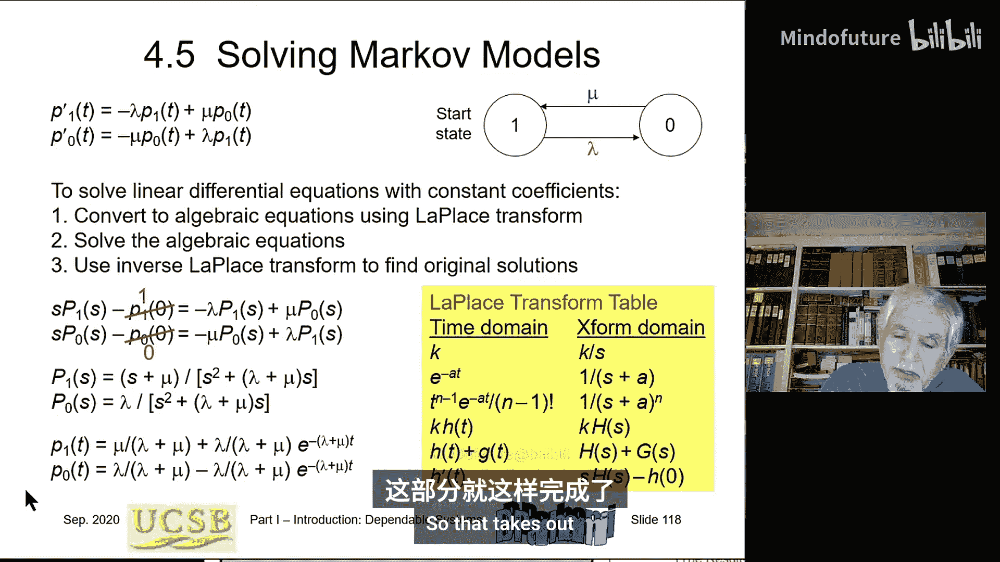

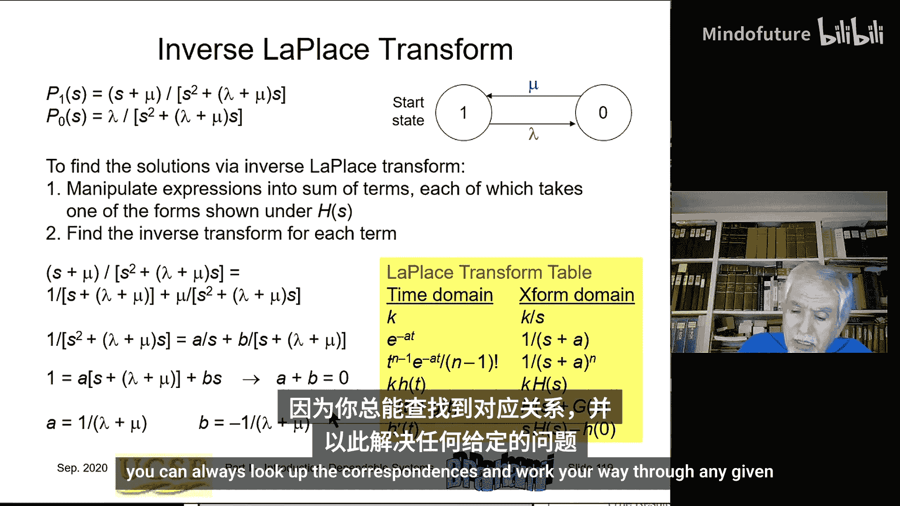

一个经典应用是**排队论模型**，如银行柜台服务。状态表示排队顾客数。顾客到达速率和服务速率决定了队列长度的概率分布。即使平均服务速率高于平均到达速率，由于随机性，队列仍可能形成并增长。

对于生灭过程，稳态概率 **p_j** 有通用表达式：
**p_j = p_0 * (λ_0λ_1...λ_{j-1}) / (μ_1μ_2...μ_j)**
其中 **p_0** 通过所有概率之和为1的条件确定。

此模型也可用于对多部件可修复系统进行建模，状态表示故障部件数量，转移速率与当前故障数相关。

## 三模冗余（TMR）系统示例 🔧

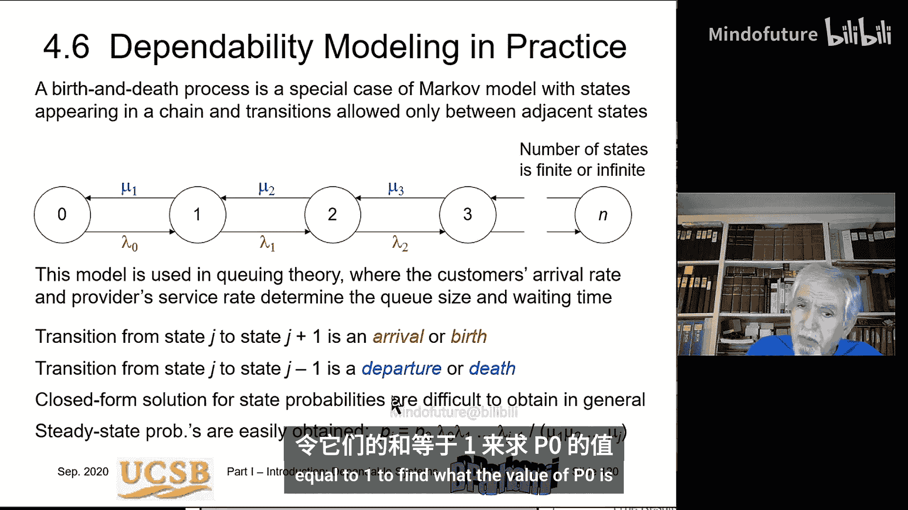

TMR系统使用三个相同模块，通过多数表决输出。其马尔可夫模型可包含状态：3个正常（全功能）、2个正常（容错运行）、失效。

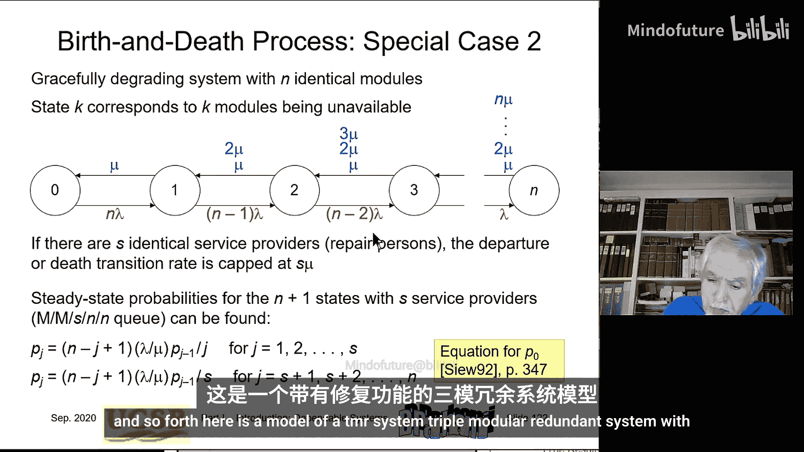

*   **无修复的TMR**：平均无故障时间（MTTF）甚至可能低于单模块系统，但其短期可靠性更高。
*   **带修复的TMR**：在降级状态（2个正常）引入修复（速率 **μ**）将故障模块恢复，可以显著提高系统的MTTF。MTTF的公式包含一个因子 **(1 + (μ/6λ))**，由于 **μ/λ** 通常很大，因此MTTF得到极大改善。

## 可靠性建模流程与工具 🧰

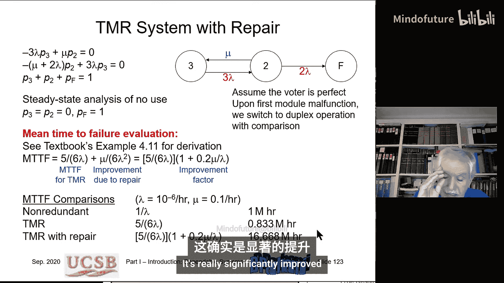

可靠性建模是一个迭代过程：
1.  **选择建模方法**（组合模型或状态空间模型）。
2.  **构建模型**。
3.  **确定模型参数**。
4.  **求解模型**。
5.  **解释结果**。
6.  **验证模型和结果**。
如果结果不合理或验证失败，可能需要返回前面的步骤进行调整。

存在许多软件工具可辅助可靠性建模分析，例如：
*   商业软件：PTC Windchill、Isograph等。
*   学术机构提供的免费工具：如弗吉尼亚大学、爱荷华州立大学发布的工具。
*   基于MATLAB的工具箱。
这些工具可用于处理复杂模型，但在本课程中，我们主要关注原理和手工计算。

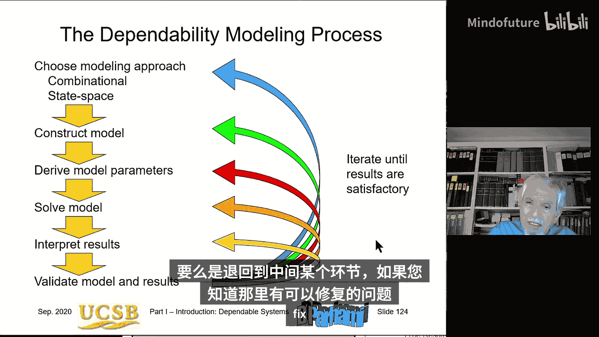

## 总结

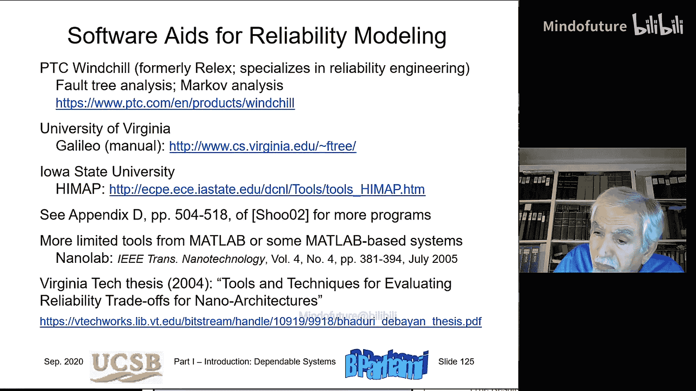

本节课中我们一起学习了状态空间建模的核心内容。我们了解了如何将系统抽象为一系列状态，并使用马尔可夫模型描述状态间的随机转移。我们学习了如何为不同系统（非可修复、可修复、K-out-of-N、带覆盖因子、生灭过程、TMR等）建立模型，并通过平衡方程求解稳态概率，或通过微分方程和拉普拉斯变换求解瞬态概率。状态空间建模是一种强大的工具，使我们能够定量分析系统的可靠性、可用性、安全性和性能度，是容错计算领域的重要基础。