# 【加州大学】容错计算-｜-Fault-Tolerant-Computing-Ucsb-Ece-257A-p05-P05_第5讲_第5-7章_缺陷避免--BV19cFyz8EPV_p5-

Hello and welcome to Le5。For the graduate course， ECE257A。Falult tolerant。Computing。In this lecture。

I will cover chapters5 and7 in the textbook。Chapter5 deals with defect avoidance。

 some general ideas about how to avoid defect。And chapter seven includes some examples for the avoiding defect。

Which includes shielding and hardening methods。Okay， so let's start with chapter five。

 defect avoidance。So here you see two。Photographs of defects in integrated circuits。

One of them on the left。Is shows an unfilled via via is basically。A whole。

That connects one layer in the I see one metal layer。😔，Two， the metal layer or device layer before。

And these Vs are filled with metal in order to establish electrical connection between this layer。

On the layer below and during the manufacturing， it so happened that this particular hole was not completely filled。

And therefore， the connection is either nonexistent。

Or it's a very weak connection that can sort of burn out over time。AndThis。

Photograph on the right shows the effect of a small particle。

Embbedding itself between the layers of integrated circuits as they are deposited。

And it causes problems in this region。So connections will not be good。Or transistors。

 if they happen to be in that area， will be malformed。Because of that embedded particle。Okay， well。

 the presence of these particles， the danger from them is why we manufacture and deal with integrated circuits in clean rooms。

 clean rooms， we don't have dust particles or other。Particles that can embed themselves within。

The manufactured circuit and cause problems。Now as。Integated circuits get denser and denser。

The physical dimensions become smaller， the effect of these particles。Come wars。

Vs now tend to be smaller because everything is denser。

And there's a higher chance that they're not filled。When you deposit metal。

So this V is filled when you deposit metal in this layer。

And the metal will simply flow into this view and fill it。The narrower this via。

 the more likely it is that。The metal does not flow in， and therefore we have。A connection problem。嗯。

Nowadays， with' very dense integrated the circuits， so we have problems due to。

Variations in IC component shapes。So here you see for example， that these are， say warriors。

And supposed to be disconnected from each other， but some。

perial out between these two and connected them to each other。And here the connection is。

Weaker or maybe even broken， so that may not cause any problem。

But if that extra material that sneaks in there。Establishes connections between these two components。

 then we are in trouble。Again， here， these are very tiny。😔，Features。And in the narrow parts。

 there is a chance that the。The connection breaks down because。

As we deposit material over these very narrow regions， the material may not be。

A practicallyly deposited， and therefore。Connection。Basically breaks between these two points。

So that's variation， you see that the same identical element here is shape okay。

But this copy of that component is misshaped and therefore。The connection is not established。😔。

So this is a statistical effect and if you make maybe1 thousand of these components。

 a few of them will have this problem。We also have problems arising from high temperatures in。

Icy chips。So for example， this shows a temperature map for a chip。Most areas of the chip are cool。

 the blue areas。This particular area is overheated。😔。

So that may be part of a chip that is currently active and doing processing。And if this temperature。

Exces a certain amount。It causes burnout problems。So one of their ways to avoid such problems is to redistribute the load so if this is a。

Multi core chip。And maybe this core is overloaded over here。

 if you redistribute the load to the other cores， then that hotspot may disappear。😔。

So it's important to monitor the temperature during。Operation。In the worst case。

 we can just shut down the chip if it gets too hot。Let it cool off and then restart the computation。

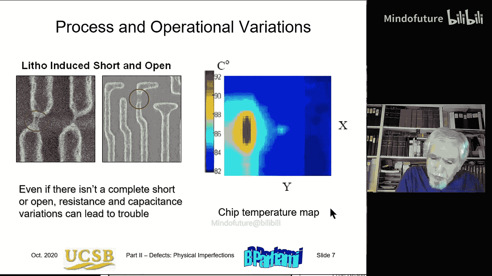

Okay， those imperfections that I talked about also。Appear elsewhere in our designs。For example。

 we are used to thinking of a clock pulse as this very。Ely shaped square wave。

But clearly define edges， rising edge and falling edge。Whereas real clocks。

 especially at very high frequencies。Look more like this。

So those straight up and down edges are really sloped。

And the amount of time we have during the clock rise is actually less than what we think with the perfect clock pulse。

And these can vary from one pulse to the next pulse and therefore。

Our design should be such that they tolerate these variations。In clock parts of speed of rising edge。

And following it， these can change。From one pulse to the next。And we have to be aware of this in。

Generating our digital circuit designs。

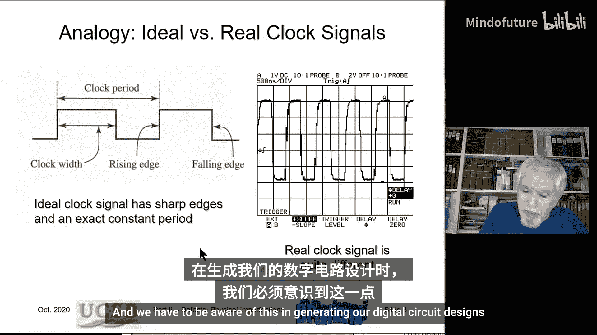

There are defects also in。Areas outside integrated circuits， for example， on disk memories。

A disk surface。Can be scratched。And therefore， that scratch can damage。

Thousands of bits because the bits are so。Densely packed that the simple scratch can affect thousands of bits。

So this is basically。APhoto micrograph of the disk surface showing the bits stored there。

And they're very close to each other。Okay， so this this。Thickness of this bit is 17 nanom。

 And this is。Even all technology。Diss are more densely packed than this today。Okay。

 also the head rewrite hand of the disc。Its very close to the disk surface。It's so close。

That the human hair by comparison。Is this huge， this is the cross section of a human hair？

If human hair gets on the disc surface， then we are obviously in trouble。

Because the head cannot fly past。😔，That under this， even things like dust particle， fingerprints。

 smudges and smoke particles。Are still too large。For this tiny distance between。

Disk head and disk surface， in fact， this distance is so tiny。

That we can just place the head mechanically close to the surface， this close to the surface。

 because as the disk surface rotates。😔，Any wobble in the surface will cause the surface to crash。

Into head and therefore damage a lot of data。 So the way modern this cant work。Is that they float。

So they are not at a fixed place in space， but they just float。Using an air cushion。Air was pumped。

Between the head and ear and the head floats。And that surface， so the head will go up and down。

As the disc wobbles during its rotation。So this is why modern describes are all steeled inside。

Their compartment because you don't want the fingerprint smudge in the surface of the disc。

Very old this in the。S0s and 70s when I was getting started。

With my work in computer engineering actually had removable disk surfaces。

You could remove this surface and put another surface in to change your dataset。

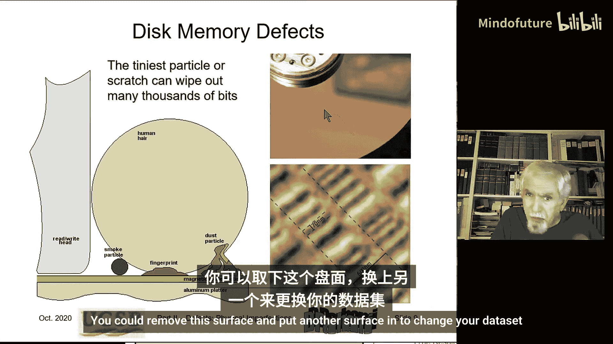

That's in no no with modern disks。🤢。

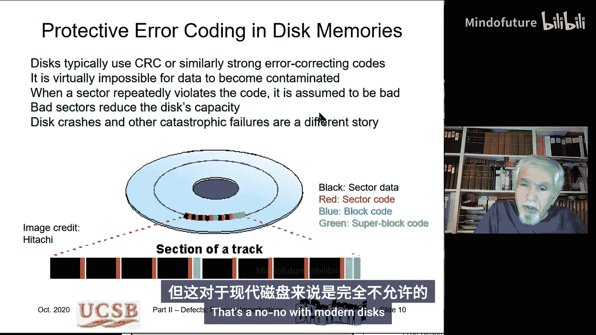

Because just handling of this disk surface。Leads to danger of fingerprints。

 smudges and scratches and stuff like that。So modern discs are sealed inside their compartments。

And you can't touch。The disk surface and particles cannot get。And sit on the disk surface。

Because these particles are just too large。

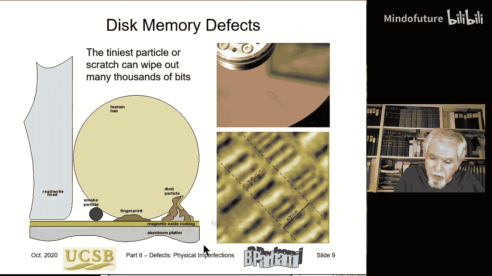

， in order to。Eal with these defects under this surface。Suppose we have a scratch。

 even if we don't handle the disc， scratches can develop during at the time of manufacture。

And therefore， a whole bunch of bits on the disc may be effective in other words， if we try to store。

Data and those spots affected by that scratch。The recording will be unreliable and if you try to store zero。

 you may not be able to store zero。So because of this， there are various coding techniques。Use。

 we'll talk about coding later on in the course， but for now let's just accept that。Sectors。

 these black。Segments of the disk data。Have。Coding a redundant bit is red part。

And then maybe four sectors。Have a block code associated with them this blue part and perhaps multiple blocks。

Have another。Super block code。So in this example， I've shown three levels of coding at the sector level。

At the block level and at the super block level。Now the net effect of this is that when a scratch occurs on the disk surface。

It may affect， as I said， thousands of bits， but those thousands of bits will not all be in the same sector。

So maybe within the sector。Five or six bits are affected。

And this code for the sector is strong enough to be able to not only detect a few bits of error。

 but also correct them。So even though the bits are damaged， we can still get。

Correct data out of that sector。If the sector code is overwhelmed because there are just too many errors in there。

 then the block error can probably catch those。🤢，Because of this sector， if one sector has a lot of。

There only splits， maybe the other three sectors do not， and therefore the total number of errors。

Could be within the tolerance。Capability of this block code。

 and then finally we have the super block。In the worst case， if a situation arises。That's。

Something happens and we cannot correct the error as long as we detect it， that's okay。

 we detect that， say sector。That's just too many errors for us to be able to correct them。We just。

Sort of declare that sector unavailable。And remap that sector to someplace else under the disc。

So if this is， let's say， sector 1000 in the address space after this。Its subse 1。

000 being mapped to here。We can remap it to somewhere else on the disk that doesn't have any damage。

And that's taken care of the disk's address translation mechanism。

 so when an address is supplied to the disk and say okay let's access sector。

So and so that physical address is mapped to a logical address， which may not be。

The same as the original physical address can be someplace else under this this is known as remapping。

And remapping can be done at the sector level or block level or any。

 that's basically up to us how to do it generally。It is applied at the sector level。

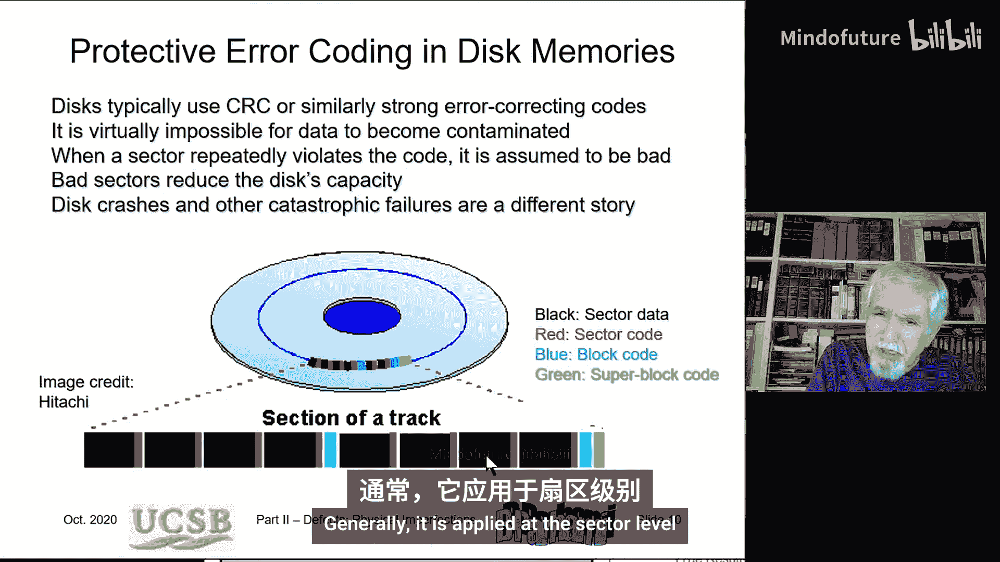

Now this drives fail and this is of course a major problem for。Data center operator that can have。

Hundreds of thousands of disk drives。嗯。Keeping the data that。

The data center operator is interested in customer data。And so on。In the case of Google。

 the index pages that they've constructed and so on。In case of Amazon， customer profiles。

 product profiles， and so on。So even though disc failures are pretty much random， you know。

 this can fail randomly。At times。There are often warning signs that if you monitor these discs carefully。

You can detect the signs of an upcoming failure。And remove that disc from service before。

This crashes and perhaps data。Is damaged。So here are some warning signs obtained by analyzing failed disk drives。

Over long periods of time。This is known as preemptive replacement。

 you don't wait for the disk to actually crash and for data to be damaged。

 you preventively replace a disk and transfer its data to some other。Disk。Before it actually fail。

 and these are some of the potential warnings。Head flying height。

If you monitor the head flying height over the disk surface and notice a downward trend that's getting less and less。

 that can be a sign of。Of an upcoming headcr and therefore you can replace the desk before headcr actually occurs。

Number of remap sectors as I mentioned， remapping of sectors allows the disc to continue operation despite a sectors。

But if you notice that。Through monitoring the disk again。

 many sectors are being remapped that can be a sign of trouble。

 there are problems in this disc that causes sectors to be remapped frequently。

And then once that remapping frequency exceeds a certain threshold。

 you give up on that desk and replace it before it actually fails。

Frequency of error correction when you see that the error correcting encodes kick in。A lot of times。

诶。So for example， in the past second， you see。100 casess of the error correcting code kicking in and correcting the data。

That， again， can be a sign that this disc is deteriorating。And therefore you replace it。So。

 there are a lot of。A lot of warning signs， if you monitor the disc operation。

 you can look for these warning signs。And avoid an actual disc crash。

By replacing the disc preventably。The next notion I will discuss is that of yield。So what is yield？

Well， this is a typical。Integrated circuit manufacturing process。You start with a silicon angle。

You slice it。And each slice becomes a wafer。And in this wafer， you have trouble spots these。嗯。

Imerfections in the。Sililicon。Or damage points like scratches and so on。Air bubbles。

So then you take this wafer。And pattern it with the circuit so you deposit various layers。

So you make。The number of dies， each of these small squares is a die。

Eventually you cut these dyes into individual dyes。That day。Is put through a tester。

And if it's a good diet， it passes the test。It is mounted on the packaging。

And then the package test also takes place because there's a chance that。

Damage can occur during the mounting buses。Anyway， so these the。

Damged spots on the wafer lead to dyes that are effective。In other words， they may not pass the test。

And therefore， those diets must be discarded。Yield is basically how many good dies you get。😔。

I up all the possible dyes that you could get。And it's an important parameter because if the yield is low。

And if the cost of manufacturing a wafer and it dies on it is constant， which it is。

Then the more dyes you have to discard， the more expensive the remaining guys become。

 so that's one factor for you。The second one I'll come to shortly。

So you basically do not want to have a very low yield， in fact。

 in modern interated circuits because these are so dense and therefore tiny flaw。

The wafer can cause many of these。诶。Ds to be defective。

So yields of 50% or less are not uncommon for very complex dyes。诶。With the advanced。D technologies。

 even 20% yield does not。Uncommon。So that means if the yield is 20%， you get only 20% good parts。

Which means each part will be five times as expensive。

As it would have been if you did not have any effects。And of course。

 this testing of dye is imperfect， there is a chance。But the bad dye passes the test。

 you take it to be a good dye， you use it in the part， and therefore you essentially ship。

A defective part。Which is pretty bad for the manufacturer to ship defect parts。

I'll come to this in a minute。So here's the effect of die size and yield。

So these are the imperfections and the wafer， if dyes are fairly small。

 this many dyes will be affected。As you get to larger dyes。So for example， one fourth as many dies。

So this is roughly the difference between the original pentium chip。And Pentium 4。

 which had four times the area。That's the original pentium。So。嗯。The same number of defects。

Causes a larger fraction。Of the dies to be。Effectives。So they yield。

Decreases from 109 over 120 in this example。To 15 over 26。And this example。15 good dies out of 26。

Versus 109 out of 120。You get much worse yield。嗯。So die yield is defined as the number of good ties divided by the total number of ties。

And it's given by this experimental formula。So die yield is equal to wafer yield times this expression。

 so sometimes you lose an entire wafer because the wafer is just too damage for you to even attempt to put。

A print dies on it and use it so you just discard a wafer this doesn't happen very often so if your wafer yield is say 99%。

This number will be 0。99。And then the dial yield itself is given by this experimental formula。Plus。

 defect density times di areaea。Divided by a。The whole quantity to the power minus。A is a constant。

That experimentally。Has been experimentally determined to be in the range  three to four。

Depending on the technology。And the process we use for fabrication。做一片。

Forced to solve a problem and you don't know what number to use， 3。5， you know。

 the average of these two is a good number to use for the arriving estimates。So。

Defect density times i area is divided by a and then raised to the power negative a。

Which means the lower the defect density， the higher the yield。The smaller the die area。

higherigher yield。So the die cost。Will be the cost of wafer。

Divided by the total number of dies times。To die yield。So you see that if the yield is's 20%。

The cost will be five times as much。Okay。So this basically tells me that。

The relationship between defect density so defect density times di areaea is really the parameter of interest。

 the relationship between this parameter and die yield is nonlinear。In other words。

 if you double this value。The yield doesn't just， you know divide by two， but maybe much less。

It's a nonlinear relationship。😔，So here is an interesting example， effect of yield。

On testing and parts reliability。Assume a die yield up 50%。Okay， this is very typical for modern Is。

So this means that if I manufacture 2 million dies。About one million of them will be defective。

NotExactly 1 million， but roughly statistically speaking around 1 million。Will be defective。

So if my goal is to ship parts to my customers。That are guaranteed to have 100 or fewer defects per million。

 so this is a sort of a measure of quality。When you say this part has 100 defects per million。

It's a higher quality part than if it had a thousand defect per million。

So if I want to ship to customers part that have no more than 100 defects per million。Units。

We must catch 999，900。The 1 million。Effective part。So there are 1 million defective parts。

 we are allowed to have just 100 defective parts in the shipped。Product。So that means 999。

000 and 900 of those defective。Chps or part。Must be screened out， must be detected。

This means the test coverage must be 99。99%。It's extremely difficult to design tests。

That have such high coverage factors。They're very expensive both in terms of designing the test。

And in terms of applying the test， so the test will be a longer procedure。

Many more inputs must be applied。And therefore it's more time consuming。So it's double cost。

 the cost of generating the test is higher。And the cost of applying the test is higher。

So if I want to go from， let's say， 99。9% cover it。To just a slightly higher 99。99% cover it。

A significantly higher investment in development time。And an application time is needed。

Test application。So this is the importance of yield， a yield of 50%。

 not only at least doubles the cost of the part。But also leads to more expensive testing。

In order to achieve。And the same part quality in terms of defects per million parts。Okay， in testing。

 we have two things called false negatives， so false negatives are these。

Effective dyes that we miss to detect。Those are dangerous false positives are when。A good die。

 the test says this good die is no good。That's not a major。Problem because。

Even if you have one to 2% false positive， that means the cost goes up by one to 2% because you're discarding good dyes。

So false positives are not the source of difficulty in this context。

But false negatives are very costly because they increase the number of defects in the shipped parts。

Okay， now a few words about defect modeling Sahad。Of course， we don't see these defects。

 The defects are tiny， they are very irregular， so we don't know where they are， so we。

One of the common ways of dealing with defects is to model them。

Develop a model of how many defects we can expect。In a particular。I see chip that we are building。

So defects are divided into global or gross area defects。Things that are due to scratches， mask。

 misalignment in manufacturing the wafer。Over and under a chain。Local or spot defect。

 these are tinier。Defects limited to a particular small area result from imperfect process such as extra or missing material during the。

Depositing of these various layers。And effects of airborne particles。

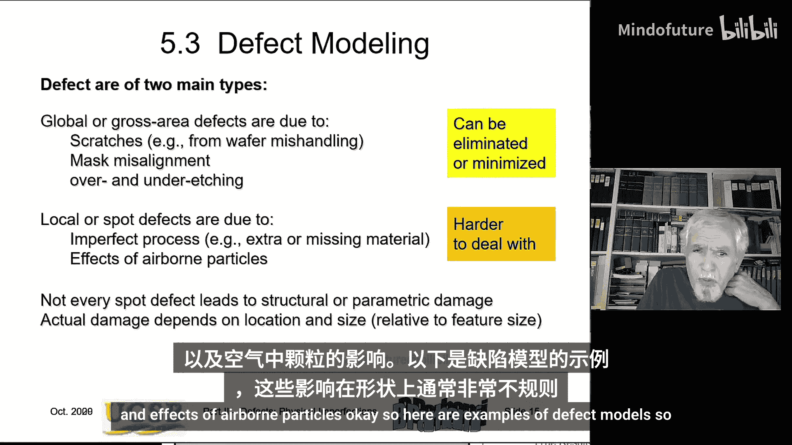

Okay。So， here are。Examples of defect models。Effects typically are very irregular in shape。

But in modeling， we view them as circles， so this is a very rough。View of the defects。

They're definitely not circular， but if assuming circular defects and running the model gives us a good estimate for how many defective parts we get。

Then that model is good enough， even though it's not realistic。So we judge the goodness of a model。

 but how by how accurately it predicts。Effects。So here I shown。一啲。

What are known as extra material defects。 So these blue regions， let's say， are。Components in our IC。

 let's say warriors， metal warriors going parallel to each other。

And these circles are extra material defect when we deposit。The metal for these layers。

 extra material somehow。Goes in。And causes these two wires。

That should not be connected to each other， to be connected to each other due to these extra material。

So if my defects have a certain diameter。In my model。

 and if that defect has a center that happens to be within this rectangle。So in this case。

 the center of that defect is here。And it's able to make connection between this。

Or the circle of the defect is here。It still connects those。

 but the circle of the defect is outside that region， let's say here。

And that circle doesn't quite to reach。That particular metal wire。

 and therefore connection is not made。And therefore， the defect。Becomes benign。

When a defect causes trouble， we call it typically。Killer defect， so this is a killer defect。

 this is a killer defect， a defect of the same size that has its center over here。

It's not a killer defect。So basically defect modeling。

Amounts to estimating the number of killer defects。That we will have。And therefore。

 estimating how many of these parts will be。Ammaged by these killer defects and have to be discarded。

So that's extra material defect。Another type of defect is known as pinhole defect。

A pinhole effect is when you have two wires， let's say this blue wire。

At one layer of your circuit and the red wire。Some。Layer below it。These wires。

Fross each other so this one， the red wire goes underneath this blue wire。

They are typically separated by an insulating layer。

Now if the insulating layer between the two wire in this critical area。Has pinhole in it。

That's basically air replacing。The insulating material， therefore。Basically。

 an electrical pad is established between this wire and the one underneath through those pinhole。

And therefore， we have short circuit。Between two wires that should not be connected to each other。

So again， if we have an estimate of。The distribution of pinhole， the frequency of pinhole。

And then the pinholes are randomly distributed on the surface of the hip。

And anytime the pinhole is in this critical area。Or in this critical area。

It causes problems if the pinhole is here， it doesn't cause problems。

So we can estimate assuming random pinhole distribution。

What fraction of the pinhole will cause trouble？And then if we have an estimate of the number of pinholes of distribution of pinholes。

 then we can。Use this model to estimate how many of these chips。

Will be adversely affected by these penhole defects， so these are just examples of defects。

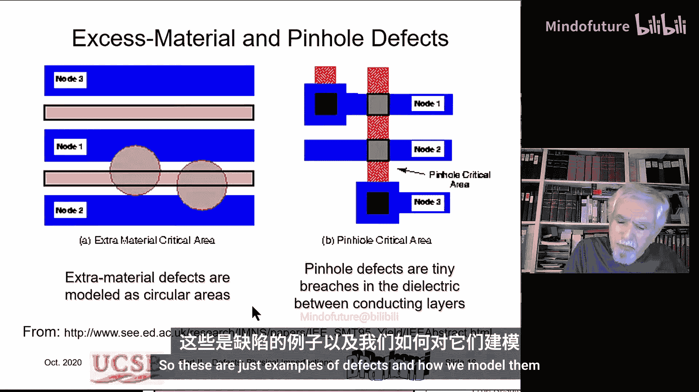

And how we modeled it。

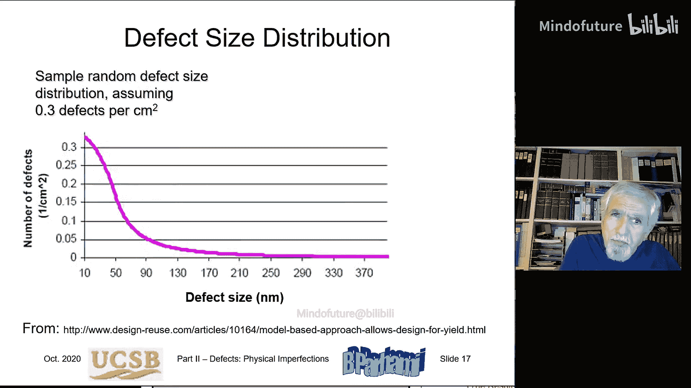

Now， I mentioned here that we view。Defects， extra material， defects are circles。

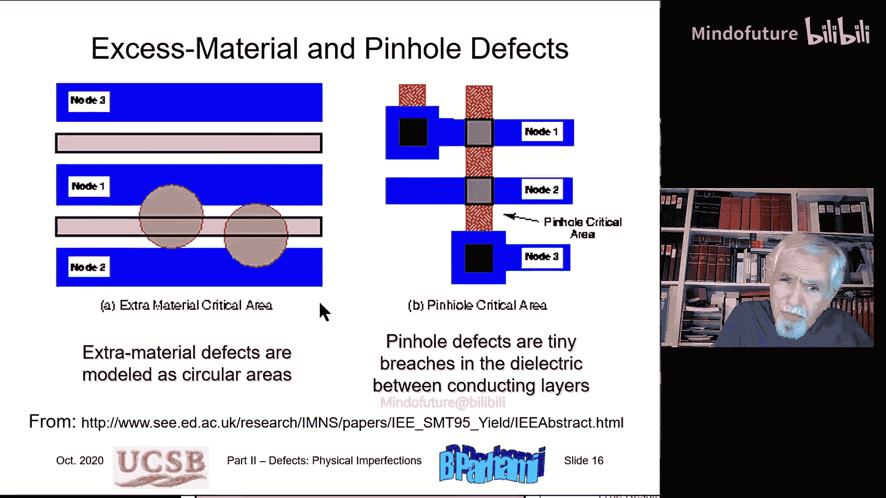

Those circles come in different sizes。And typically for the manufacturing process。

 we have a distribution of those defects。In terms of size。So small defects are much more frequent。

 so these are number of defects per centimeter square。

So these small defects of 10 nanometers in diameter。There are 0。33 of them， let's say。

Per square cent。When has a larger defect of size 200 nanometer。Are much less frequent。

And this distribution。Is modeled with that equation。So， x。

Is the defect size that goes from some minimum？Let's say 10th in this example to some maximum。

 let's say 400。Let's say anything about 400 is impossible。So this will be the probability。

That we get a defect of a particular size x p is a constant。And， typically。

It's in this range so again。You need to solve a homework problem and this parameter is not given to you。

 it's reasonable to assume。It's around maybe 2。7 or three。

 something in this range just to get an estimate。And K is a normalizing constant because a probability distribution should satisfy some。

 but the area underneath it should add to one。And therefore。

 we use a value k that guarantees that to happen。Okay。

 so we have a distribution for the defects and for each defect size， let's say 10 nanometers。

Use the method。

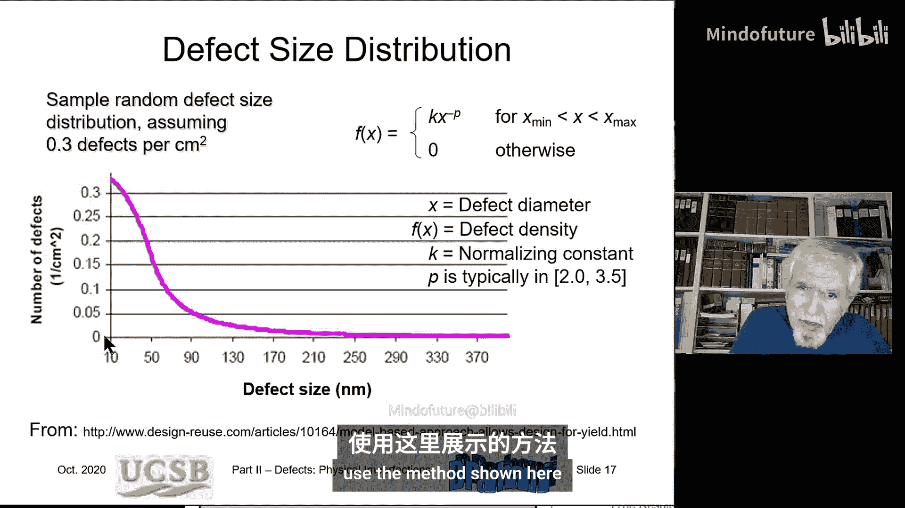

Shown here。What is the likelihood of defect of size 10 nanometer the cause problem？

Then we do it for 20 nanometer， then we do it for different sizes。

And get an overall model for the likelihood。Of course， in this example of the separation between。

These wires， let's say。There's 15 nanometers and of course。

 a 10 nanometer defect can never cause any problems。

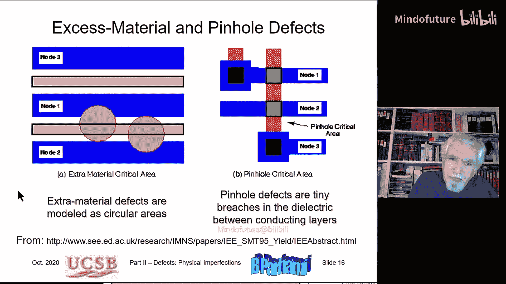

Whereas a 100 nanometer defect。can cause problems。But those are much less likely to happen。Okay。

 the next concept in this chapter is that of Ba her。A bathtub curve， basically。As a curve。

 it's called bathtub because of its shape。That says a failure rate。

 or in this chapter we are really talking about defects， not failures。So the defect rate。

As a function of time。And。Can you manufacture part。There's a period called infant mortality。

Where failure or having defect is quite likely。And some parts die pretty quickly。

Fromm infant mortality。Is used in analogy with human ins。

So a number of infants actually die right after they're born。

But if they survive that infant mortality period。Then they enter a period of low mortality rate。

These are things like， you know， for humans， accidents and stuff like that。

And that's where we take the failure rate or defect rate to be a constant lambda。

It's not really constant， but taking it to be a constant Lada is a good approximation。Okay。

 that's where the equation into the minus lambda t comes into play over the useful life。

And then we end。Aging or end of flight。Where out。Where the part actually ages becomes fatigued and therefore is more likely to fail in the case of human people die of old age。

And for。Electronic circuits that we are interested in， first of all。

 this wear out is not as severe as for other things。Secondly。

 often electronics become obsolete before we reach this stage in their lives。

 so usually we don't worry about this wear or end of life face for electronics。

So there are really two periods for electronics， infant mortality。Okay， in the case of electronics。

 these are due to latent defects， they are defects that exist in there， they are not visible。

 we miss them during testing， and therefore they cause quick failures。And this is observed。

 by the way， for cars also when people buying new cars。There， there is some。

Significant probability that it fails over the first few weeks of use。

 but then if it survives that phase， then it can operate reliably for long periods of time and then car gets old。

And it requires too many。Repairs and so on， so we just get rid of it。Okay。

 so this is basically a curve a natural curve。From this source。For a particular type of parts。

percentcent of parts that are still working。As they age。

I don't happen to remember what type of parts there were。

 but as the parts age from zero to 100 years。Then。Initially。

100% of the parts are functioning at the beginning， then this is the infant mortality period。

A bunch of them may be around 2% of them fail rather quickly。

And then we enter this phase of graduate。Decline。Gdual decline。So that。For example， after 20 years。

About 4%， so2% of the parts failed right away。In short time。And then 4% after 20 years。Then。

10% after。40 years， and so on。So typically we are using the part in this range。Okay。

 we don't let it you know get too old so that a large number of the parts fail。

But even in this range， this infant mortality is still a problem， can we get rid of that？Okay。

 that is known as burning testing In other words， let's say infant mortality occurs within the first maybe。

四。Three years。Of a part's life or six months， whatever that the case may be。Okay， of course。

 we could test this part for， let's say infant mortality period is three years。

We can just let the parts sit there for three years and use it in the lab。So that if it fails。

 then we simply do not ship it to the customers and after three years when this area。Has passed。

Then we shift apart so that we avoid the infant mortality for our customers， we screen out。

Well three years is a long time， we can't afford to wait that long。

So we have something called burn in for accelerated testing。In other words， we test the part。

So if we avoid this。Burnon period。And basically start the useful life of our component over here。

After infant mortality， then the customer will see a much better behavior。From this part。

 because it no longer has infant mortality。But as I said three years is a long time。So。

 we develop tests。That use the circuit or the system。

Under very extreme conditions so that may be a few hours of operation under those conditions。

Is equivalent to months or years of use under normal condition。

 so this is called accelerated or burning testing。Okay。

 so this is one mechanism used for burning testing， it's a burning oven。

We put integrated circuit parts into these ovens。Heat them。

Often the heating is done selectively because if you heat an entire chip。It may get damaged。

We may just heat certain parts of the chip selectively。And then test it， run programs on the chip。

As it is in the oven being heated。So because of this extra stress we put on the chip due to heating。

A few hours of tests will be equivalent to maybe months。Of testing under their normal condition。

 and therefore those parts that have latent defect。Tend to fail during this stress testing。

And therefore they don't pass the test， and we just discard them， don't ship them too。て？Okay。

 so accelerated or burning testing is。A technique that is commonly used。To sort of get past。

That infant mortality period for part。And not have the customers experience early failures during the use of those parts。

Okay， this section， I'm going to skip， I haven't yet written apart。

 so basically there are active defect prevention methods that we can use but。And。Okay。

 let's ignore this。I won't hold you responsible for this in homeworks and so on。😔，Okay。

 so let me now move to chapter7。Chapter 6 and8， I will cover in the next lecture。

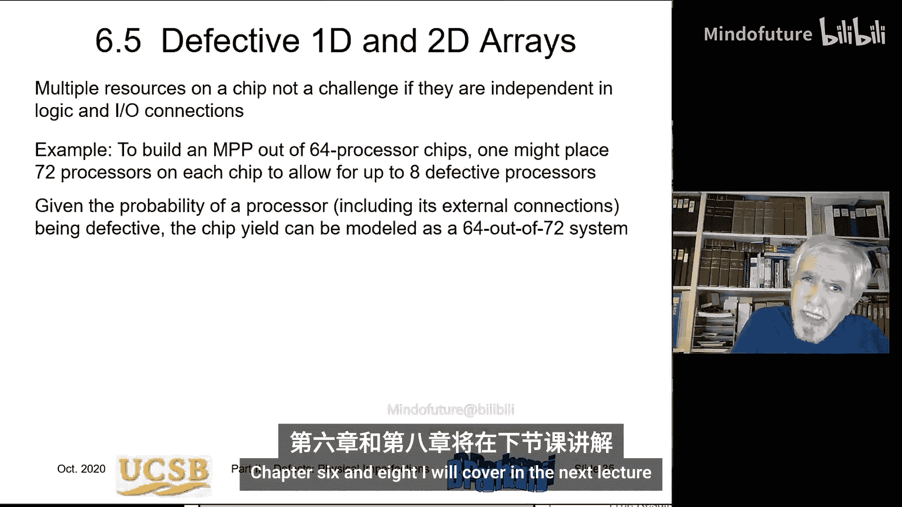

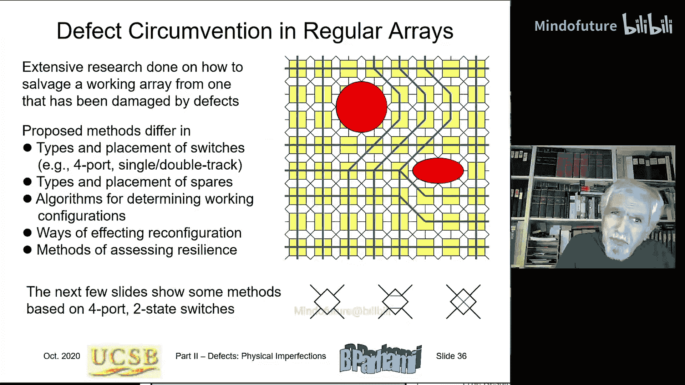

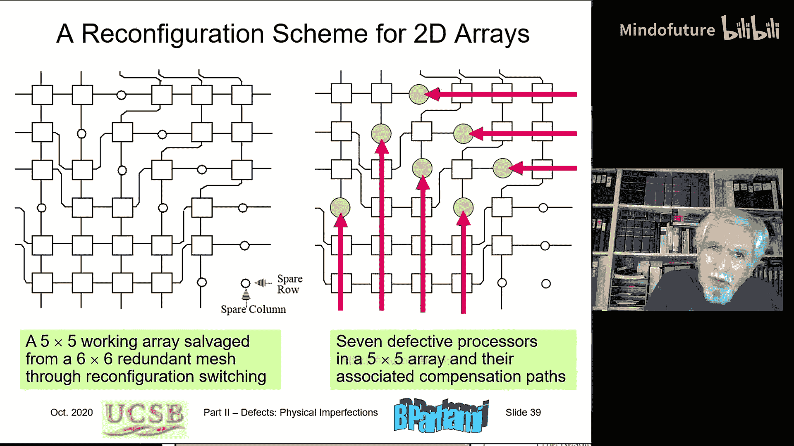

Chapter seven deals with shielding and hardening。Of components。So one cause of failure for parts。

Is external interference or operating under harsh conditions？For example， space computers。

Pututers that you put in spacecraft。Are subject to。Cosmic radiation。Parttics。

Bmard them and these particles very easily pass through the shell of the spacecraft。

And go in and hit the electronic components。 They're so tiny that。You know。

 the shield of the spacecraft is not a barrier。Their entry。Okay。

 one kind of interference is signal interference。A crossta。Basically。

 these high frequency signals that we use in。Digital circuits。Tend to interfere with each other。

Normally， electrical signals need conductive material to propagate。

 but high frequency signals can travel through air。And therefore。

 one wire sitting next to another wire。Can interfere the signal in one wire can interfere with signal in another wire。

 even though they are not electrically connected。To each other。

So interference can occur through the air。Or sometimes if these two signals。诶。

Are in parts of the circuit that are fed by the same power supply。Okay。

 a high frequency signal in one part。Can affect the quality of the power supply voltage。

So there will be fluctuations in the power supply voltage because of the signal in one part and that fluctuating power supply voltage can affect the quality of signals in other parts。

Of the circuit。So there are many types of interference through the air， through the power supply。

 and through of course， parasitic capacitance， I'll show you examples of that in a minute。

So crosstalk refers to any phenomenon by which a signal transmitted on one circuit or channel of a transmission system creates an undesired effect in another circuit or channel。

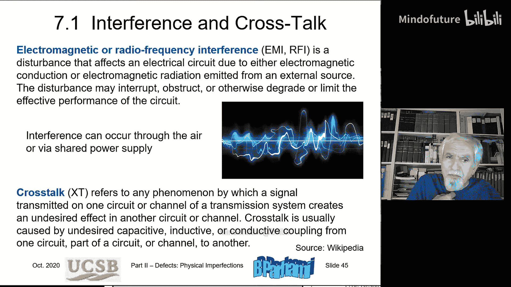

Okay， so crossdog is usually caused by undesired， capacitive。

 inductive or conductive coupling from one circuit or part of a circuit。They channel to another。Okay。

 let's see some examples。So here I've shown。Three wires， let's say part of a bus that we have。

On a chip。So three wires。This is the source of the signal。

This is the buffer that connects the device here to the bus。And then this is the。Load capacitance。

So normally these channels are independent， so signal going on this channel will go to this load。

And there， but theres。Possitive coupling between these signals。Meaning that this warrior。

And this wire together form acapacitance。And a high frequency signal。Can actually。诶。

Be transmitted through this capacitance in effect。The signal on this line。And in fact， this effect。

Is becoming more serious as density of the circuits。Increases。So this is a less dense circuit。

The three wires that I've shown here。A sitting here， these are the cross sections of the wire。

When they increase the density， those wires get closer to each other。So of course， capacitance。

Increases with reduce distance。But also in order to counteract the effect of increased resistance。

When we make these wires narrower， we sometimes make them taller so that the cross section remains the same。

And therefore， the resistance does not change because the resistance affects the speed of signal transmission。

So in order to avoid much higher resistance， when we scale down the width of the wire。

 we sometimes increase its height or depth。娘油。The area between these two wires。

Also affects the capacitance， so the capacitance is directly proportional to this area。

 the two wires facing each other。And inversely proportional to this distance。

 so the capacitance basically increases。Non nonlinearly as we scale down the circuit。

The larger this capacitance。The more interference between these signals。Okay。

 so this is something we need to be aware of。And we can't put these wires too close to each other without causing severe interference。

That cause。It can cause errors in the signal to transmit。So sometimes even though physically。

 we can put wires very close to each other。We may not do that for this effect to avoid this effect。

Okay， so here the terminology is the signal that affects other signal is called the agressor signal。

And other signals that are affected by the aggressors are called victim signals。Okay。

 one of the things we can do。Besides putting the wires more spaced from each other。

Is to use the equivalent of boosted pair of wires。You know， a lot of connections。

 internet connections use twisted pair of wires， twisted means that。The two conductors。

Basically are twisted。You one conductor goes around the other one。Along the length of the wire。

And that twisting basically cause interference。To be canceled。So when one wire。

 the blue is on this side of red。The interference， the direction of interference。

 will be different when the wire is on the other side。So this twisting basically。

It causes the interference in different parts to cancel one another。

We can do the same thing on the chip， so if two wires need to go。

Significant distance imp parallel in the tube instead of just putting them on one layer。

 we can twist them， basically this wire。Goes through a via。

To another level and then back down on the other side of the red wire。And therefore。

 because of this change of。Change of location of the two wires interference will be much less severe。

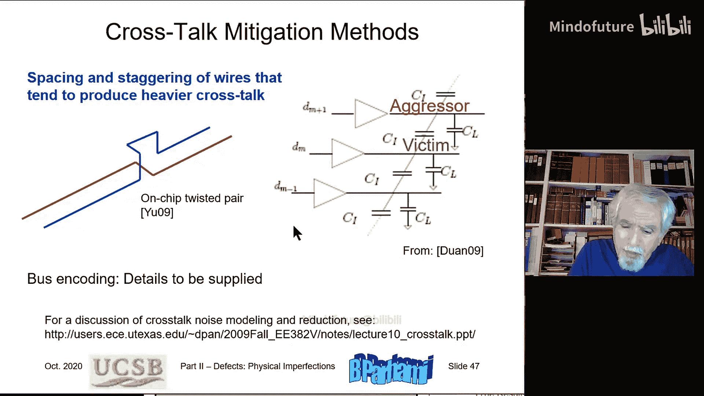

Okay， the concept of shielding is when we。So they use special covers of packaging。

To protect integrated circuits from external interference。

Many of you have seen these static shield packages。In which Is are shipped。

So that static electricity。Does not get to the circuit and therefore does not damage it in。

In transport as the。诶。Crcuit that's shipped from manufacturer to store or warehouse and then from there to the user eventually you remove the。

Static shield just before used， but you're careful not to touch the circuit so that static static electricity from your body does not damage。

The circuit before it's installed。There are other types of shields， for example， NASA computers。

Are placed inside side metal packages。That protects them from cosmic radiation。

So this is a very thick enclosure。That makes it unlikely for the particle。

To go through an effect circuit， tables are shielded。

And this is a shielded package for radio frequency signals。

It's designed for radio frequency signals to not penetrate it and affect the。Components In。

SoThere are different types of shielding， depending on what。They're protecting the circuit from。

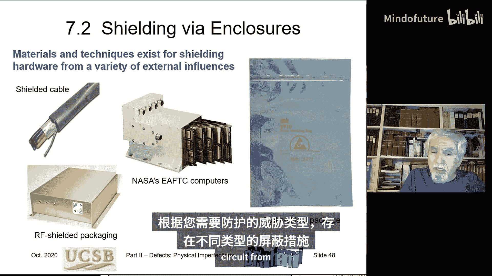

So the radiation problem is this， it used to be that radiation was only of concern to NASA engineers because as they sent。

Computers into orbit or。To other planet。The cosmic radiation tended to damage the circuit。

But on earth， we did not worry about it because even though there is some low level of radiation。

 even on earth。And where we are sitting now。The Icy components were large enough so that a particle adding to them。

 hitting them。Tended not to cause any damage。But now as the density of cicus has increased and parts are very close to each other and layers are thin。

Particles even on earth， can damage into the circuits。Here I've listed some types of radiation。

Alpha particles are helium nuclei。They don't do much damage， even a paper。

 a sheet of paper can stop them。They're not very。They don't have a lot of energy so they can't even penetrate the sheet of paper。

So we don't worry about helium nuclei or alpha part。Either particles。

 electrons are a little bit more penetrating。But an aluminum sheet can easily stop them。

 and so it's pretty easy to shield circuits against be particles。Neutron radiation。

 on the other hand， is difficult to stop。And it requires bulk key shielding。And cosmic radiation。

 of course， is only a problem on。A space mission is not on earth。There's also secondary radiation。

 so when we shield。Ccuit or a system。When particles hit that shield。

The shield releases some of its particles that those are known as secondary radiation。

So these neutrons， for example， come in hit the。Atoms of the。

Material that constitutes the shield and secondary particles are released。

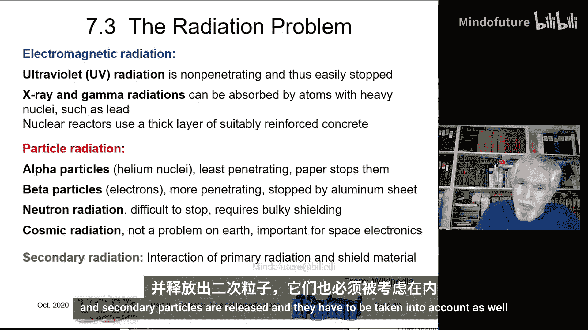

And they have to be taken into account as well。So I have a number of slides。

 I won't go into the details about the physics of these。Radiation effects。In a nutshell。

 basically when a high energy ion。Article。Hits an integrated the circuits。 In this case。

 it hits in the。In this area of the PN junction。诶。Ironions are created。And they cause。Basically。

 leaked。Current。And that leaked current high enough。

Can basically change the behavior of this component， transistor， let's say。The effect is local。

 this particle hits a particular transistor and affects the behavior of that transistor。

 so it's not difficult to protect against these by redundancy。So if I'm trying to build a flip fl。

If instead of just one flip fl， I built three。And then sort of vote on the see what you know。

 two out of three。The radiation is likely to affect only one of those flip flos。

And the other two will be unaffected， therefore I can get the correct computation result。

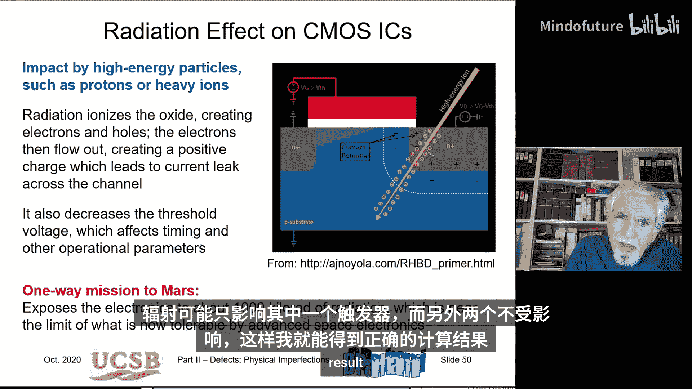

Okay， as I mentioned， I won't talk about the physics。Of what goes on here。

Here is the at the circuit level what would happen。So if a particle strikes this transistor here。

In that transistor， which is supposed to be closed。May conduct electricity。So。A current pulse。

We cause this。Capacitor。The load capacitor here to be charged。

And then later that capacitor will be discharged。And it creates a spike voltage。At the output。

 so this is a transient behavior that may or may not cause difficulty depending on what we do with this output。

 but there is a chance that say if this output is connected to，A flipflop。

And this transient high voltage may set that fliplo。And basically。

 do convert this spike to a permanent error that flipliplova now contains one。

Instead of the correct value0。On the other hand， it may also not if at the time this spike occurs。

For example， the clock pulse is not high， then this may not be recorded in the flipla and it just pass without any damage。

 but there is a danger that this spike。Creates permanent error in our circuit。So呃。

Impacts of radiation are sometimes classified according to these names。

We talk about single event upset， abbreviated Se。The single ion changes the state of a memory or register that as discussed on the previous slide。

It's unlikely that multiple bits are affected by the same single ion。

Even for very dense integrate the circuits， it's unlikely that a single ion a single particle。

Effects multiple bits， as I said， redundancy is sometimes helpful。A single event Laup。

A heavy ion or high energy particle shorts the power source to substrate。High current may result。

And these high current may actually burn the circuit。They're high enough。They burnt， actually， they。

Circu it and cause permanent damage。Single event transients。

The discharge of collective charge from an ionization event。Creates a spurious signal。

 this is what we saw in the previous slide。A transient signal is created that can cause permanent damage。

Single event induced burnout。 This is when the。诶。The current exceeds the limit of。

The tolerance for the circuit and caused burnout。Breaks down the。Ccus。Single event gate rapture。

Now these detailed naming are not important， it's just that。

 you know a lot of different things can happen。When these particles hit integrate the circuit。

So radiation hardening is the job of。Making these circuits。Resistance to radiation。

And this can be done。By using different material for the substrate。

 so instead of common and fairly inexpensive。Seconductor substrates， we can use more expensive。

The white band gap substrates that are more tolerant too。These particles。

A shieldielding package or the individual chip。Read youractive resistant packaging or use more resilient material in the chip's composition。

Replacing DRAM with a more rugged SRAM is one option。Now an SRM。诶。Memory is less dense。

 it also uses more transistors per bit。A memoryory DRA uses basically just one transistor and therefore if something happens to that one transistor。

You may lose data in that particular bit。Whereas IRAM typically uses at least six transistors per bit。

And therefore， it's less likely for a particle to affect。To destroy the contents of an SM。Sell a bit。

Fult and error level methods these we will discuss later in the subsequent parts of the textbook。

Basically， accept that。These particles cause problems at the component level。

Then use fault detection， fault tolerance。Aror detection and correction matter at higher levels to deal with these problems。

As I mentioned， tripplication of a flipflb may be one such fault level method。

And then even higher levels at the system and application level can be flight。

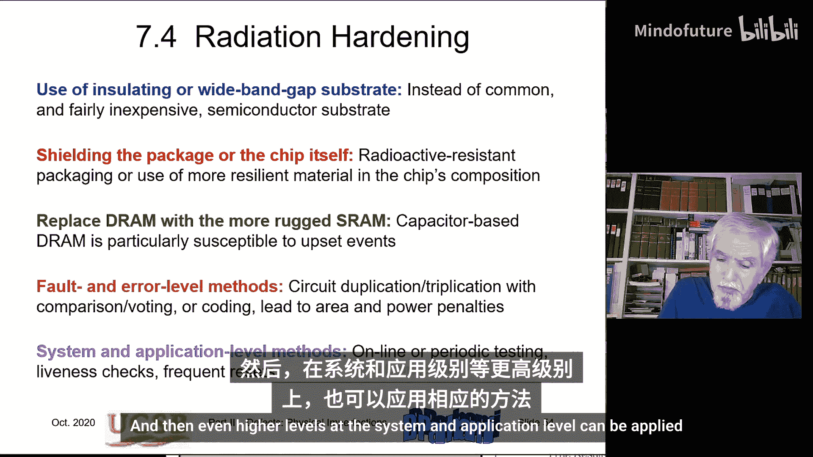

So this diagram shows。现在这。Quite difficult to shield against some types of。P energy particles。

So for example， electrons。So this is the dose of radiation in red。

And this is the thickness of the shield material and the horizontal axis。Now， when。For electrons。

 you use。A shield。Of thickness， 200 mils， that's basically 0。2200 something， 0。25 maybe。诶。Ans。

 that's about one。Thats's than one centimeter。That's good enough to basically screen out much of the radiation reducing the dose to。

嗯。Quite low levels， on the other hand with protons。As you increase the thickness of the shield。Okay。

 the reduction is much less noticeable。And therefore， you need very thick shields。

To reduce this substantially。Okay， in addition to radiation。

 there are other things that can adversely affect。诶。Digital systems that we use。

 three examples are vibrations， shocks and spills。And products are built to tolerate or be。

Resilient with respect to these problems。For example。

 if we use our cell phones all the time as we walk as we bike。So they're subject to vibration。And。

Basically， no cell phone these days has any problems with these vibrations。

 they're designed to tolerate those vibrations。You have a higher level of vibration。For example。

 something that is used。In an environment where there's a lot of vibration。这 just。

In the engine room of a ship。Then you have to use special packaging。To makeて。

System resilient to those vibration。Similarly for sharks and spills， of course。

 you know when you spill coffee in your keyboard。If the system has not been designed to tolerate that。

And it causes damage because the coffee will go to。Insight。The circuit。

 and we'll call short circuit another trouble。These are some examples of products。A shock tolerant。

Cellphone。Rgged laptop。And then rugged disk drive。So you can buy these that are more expensive。

 typically。Thenhan regular products。 But if you need them for。Harsh environments then。

Then you have no choice but to use them。Now the most common accidents for laptops are drops。

And spills。Nowadays， they make many laptops spill tolerance at least to some extent。For drops。

Many laptops have this mechanism that detect the drop。Basically from the acceleration。

So there's a sensor inside that sensorus acceleration。And decides that the laptop has。

Is being dropped before it hits the ground。It does some things， for example。

 it moves the disc rerite head。From the position that it has on the disc。

 it's trying to read something from the disc。It sort of retracts it and puts it outside the disk surface so that when。

And the laptop falls on the ground after this drop。

The disc is not damaged by the head hitting the disk surface。

So this is a common provision in modern laptops。

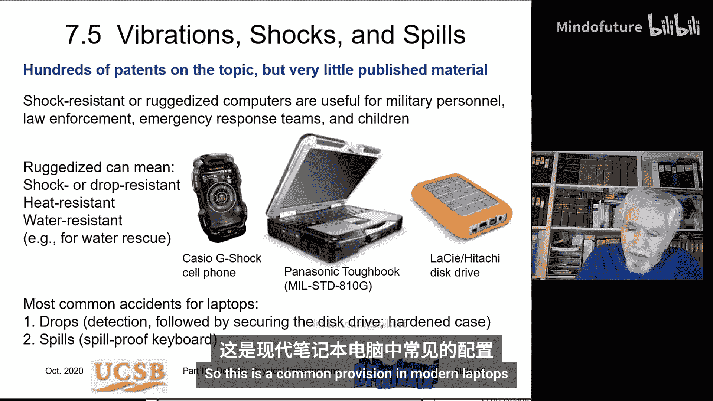

There's an example of a rugged laptop that NASA used in the space shuttle。Of course。

 it's pretty heavy。Because it has to tolerate the vibrations that the spacecraft goes through。

And also radiation from cosmic。Posmic ray。Co at the time，8150。

 which was a lot of money in those days is。

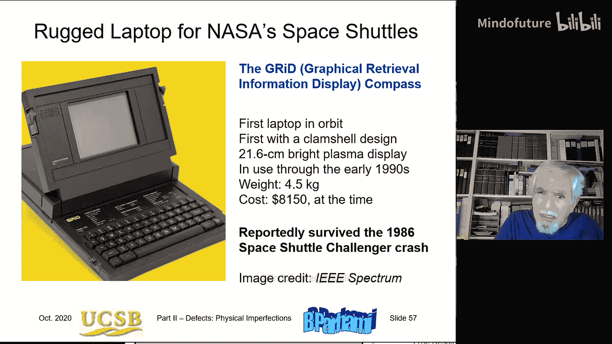

This was in use through the early 1990s， so '80s and early 1990s。Okay。

So that's all I wanted to say for these two chapters， chapters five and seven。Dealing with。Effects。

And shielding and hardening techniques。So in lecture six， we do the other two chapters of this part。

 chapters six and eight。And then we move on after that。To the fault。Pevil Li。In our model。

 So we are now at the defect level。Okay， take care and stay safe until next lecture。

