# 容错计算：第5讲：缺陷避免与防护

在本节课中，我们将学习教材的第5章和第7章，主要内容是**缺陷避免**以及**屏蔽与加固**技术。我们将探讨集成电路中常见的缺陷类型、如何通过设计和管理来避免它们，以及如何保护系统免受外部干扰和恶劣环境的影响。

---

## 缺陷避免

上一节我们概述了课程内容，本节中我们来看看**缺陷避免**的具体概念。缺陷是指在制造或使用过程中，系统中出现的不期望的物理瑕疵。这些瑕疵可能导致系统故障。

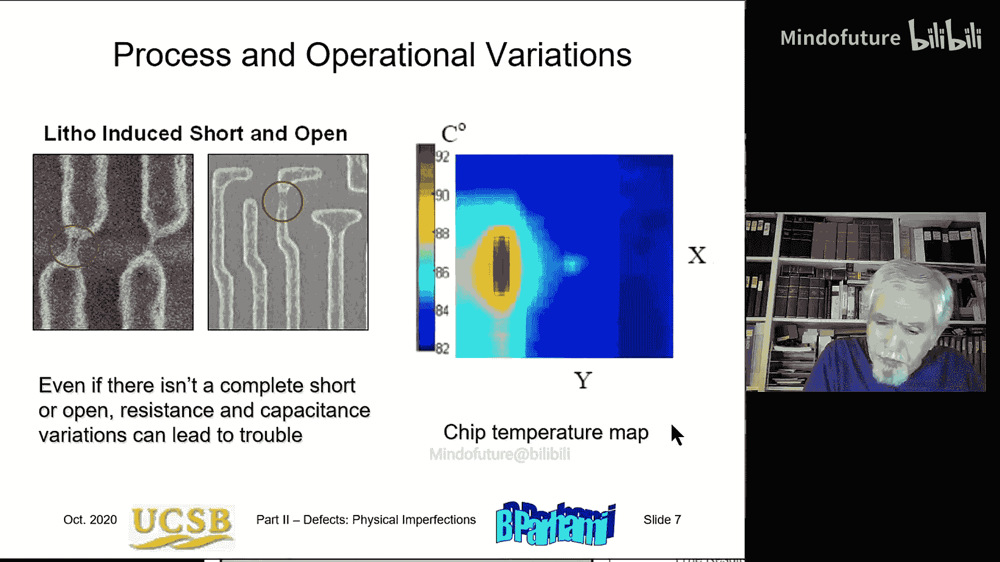

下图展示了集成电路中的两种缺陷：

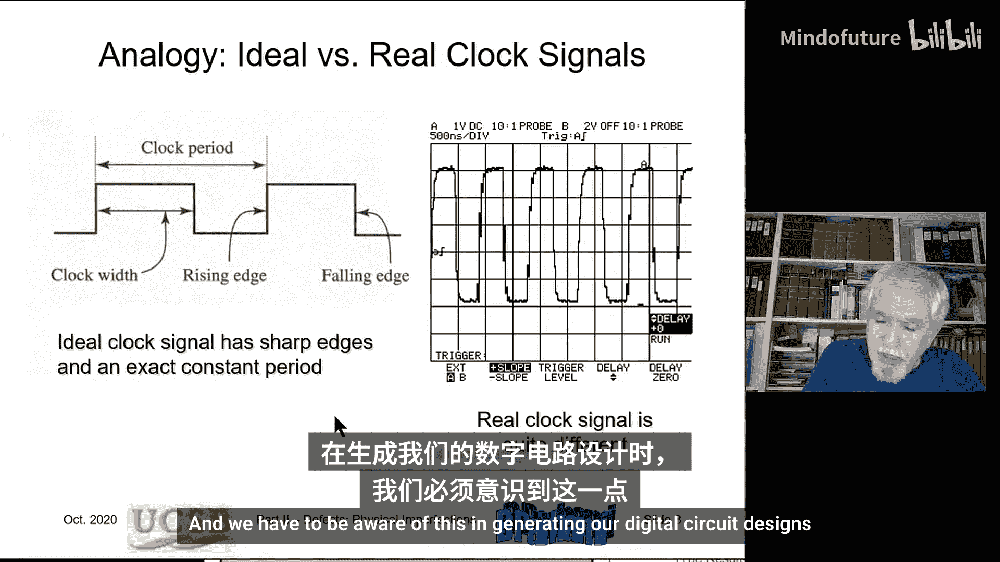

*   **未填充的通孔**（左图）：通孔是连接不同金属层的孔洞。在制造过程中，如果金属未能完全填充孔洞，就会导致电气连接不良或完全失效。
*   **嵌入的颗粒**（右图）：在沉积电路层时，微小的颗粒可能嵌入层与层之间，导致该区域的连接或晶体管形成不良。

为了避免颗粒污染，集成电路在**洁净室**中制造。随着电路密度增加，特征尺寸变小，颗粒和制造工艺微小变化的影响变得更加显著。

### 制造工艺变化与高温问题

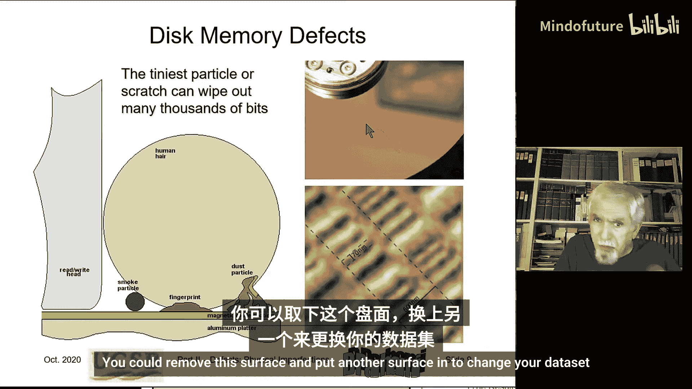

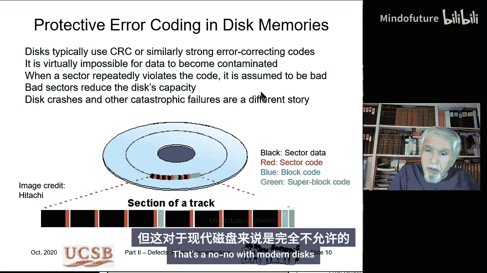

除了颗粒，制造工艺的微小变化也会导致缺陷。例如，导线形状的微小差异可能导致意外的短路（桥接）或断路。此外，集成电路运行时会产生热量，形成局部**热点**。过高的温度可能导致器件烧毁。

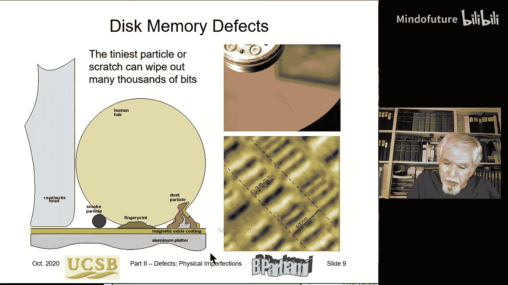

为了避免高温问题，可以采取以下措施：
*   在多核芯片上重新分配计算负载。
*   监控芯片温度。
*   在极端情况下，关闭芯片让其冷却。

### 时钟信号与磁盘缺陷

我们通常将时钟脉冲想象为完美的方波，但实际的高频时钟信号边沿是倾斜的，并且脉冲之间可能存在变化。电路设计必须能够容忍这些**时钟抖动**。

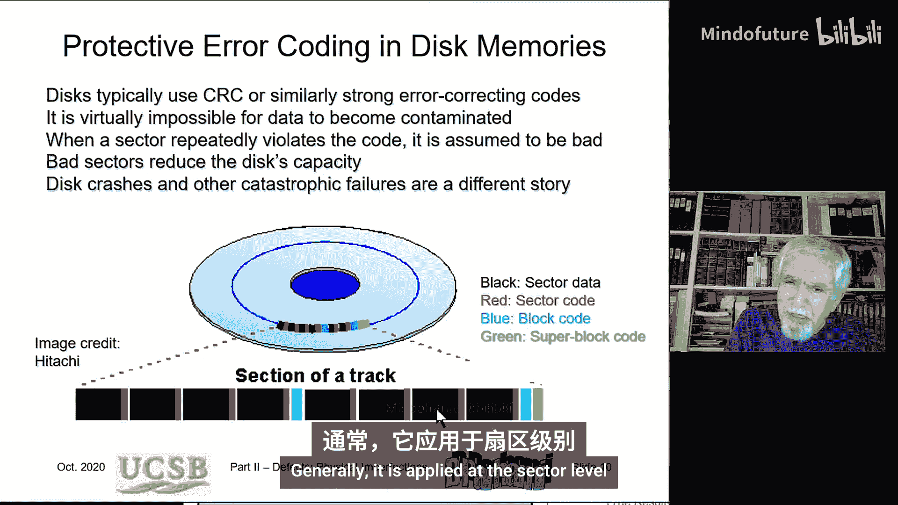

缺陷也存在于集成电路之外。例如，在磁盘存储器中：
*   盘片表面的**划痕**可能损坏数千个数据位。
*   读写磁头与盘片表面的距离极其微小，灰尘、指纹甚至烟雾颗粒都显得过大，可能造成损坏。

现代磁盘被密封在腔体内，并且磁头利用空气轴承**悬浮**在盘片上方，以适应盘片旋转时的微小摆动。

### 磁盘错误处理与预警

为了处理磁盘表面的缺陷（如制造时产生的划痕），采用了多级编码和重映射技术。

以下是磁盘数据组织的示意图：

*   **扇区级编码**：每个扇区包含数据和一些冗余校验位，可以检测和纠正少量错误。
*   **块级编码**：多个扇区组成一个块，拥有额外的纠错能力。
*   **超级块级编码**：提供更高层的保护。

如果某个扇区损坏过于严重无法纠正，磁盘系统会将其**重映射**到一个完好的备用物理区域。操作系统访问的**逻辑地址**保持不变，但磁盘内部的**物理地址**已经改变。

磁盘驱动器最终会失效。通过监控运行状态，可以在完全故障前发现预警迹象，进行**预防性更换**。常见的预警信号包括：
*   磁头飞行高度持续降低。
*   重映射扇区的数量异常增加。
*   纠错码被频繁触发的次数增多。

---

## 成品率与缺陷建模

上一节我们讨论了具体的缺陷案例，本节我们来分析制造中的宏观指标——**成品率**。成品率是衡量制造过程质量的关键，直接影响芯片成本。

典型的集成电路制造流程如下：硅锭被切片成晶圆，在晶圆上制造多个芯片（称为“晶粒”或“管芯”），然后进行切割和测试。晶圆上的缺陷点会导致其覆盖的晶粒失效。

**成品率** 定义为合格晶粒数量与总晶粒数量的比值。晶粒面积越大，单个晶粒包含缺陷点的概率就越高，因此成品率越低。成品率 `Y` 可以通过以下经验公式估算：

`Y = (Wafer Yield) * (1 + (Defect Density * Die Area) / α)^-β`

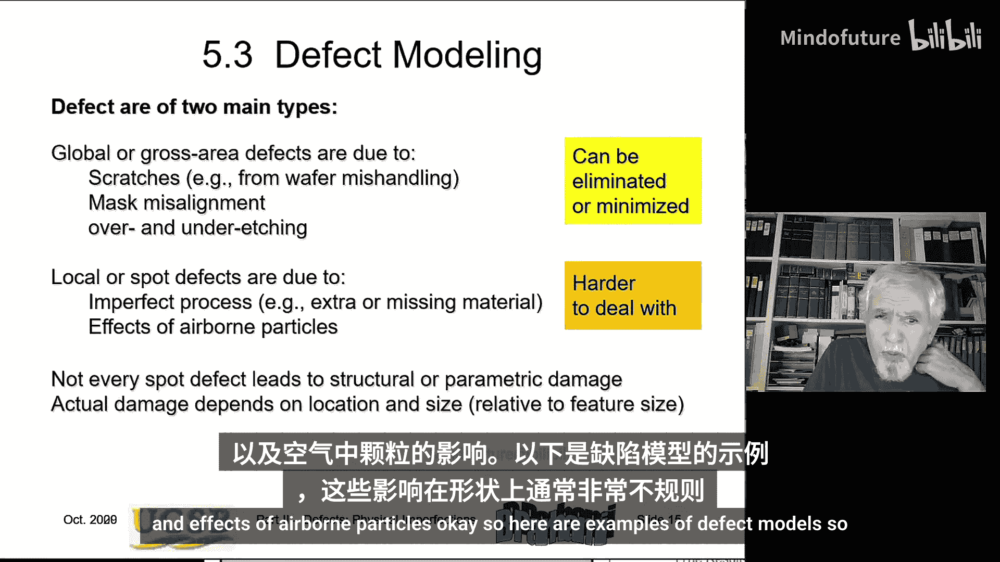

其中：
*   `Defect Density` 是缺陷密度。
*   `Die Area` 是晶粒面积。
*   `α` 和 `β` 是与制造工艺相关的常数（通常 β 在3到4之间）。

**晶粒成本** 可以用以下公式近似表示：

`Die Cost ≈ Cost of Wafer / (Number of Dies per Wafer * Die Yield)`

低成品率不仅会提高单个芯片的成本，还对测试提出了极高要求。例如，假设成品率为50%，要保证出厂产品的缺陷率低于100ppm（百万分之一百），就必须通过测试筛除掉99.99%的缺陷芯片，这需要极其昂贵和耗时的测试方案。

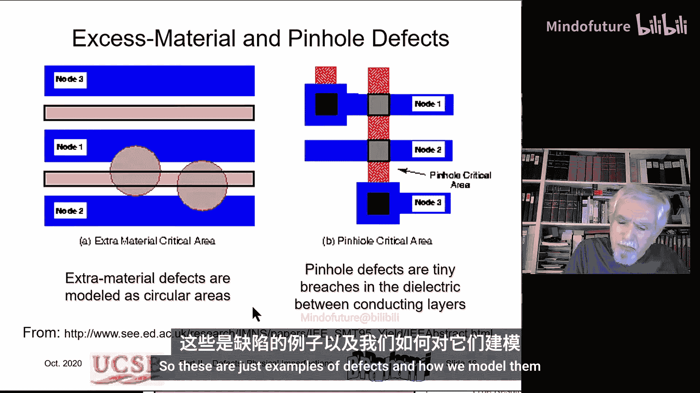

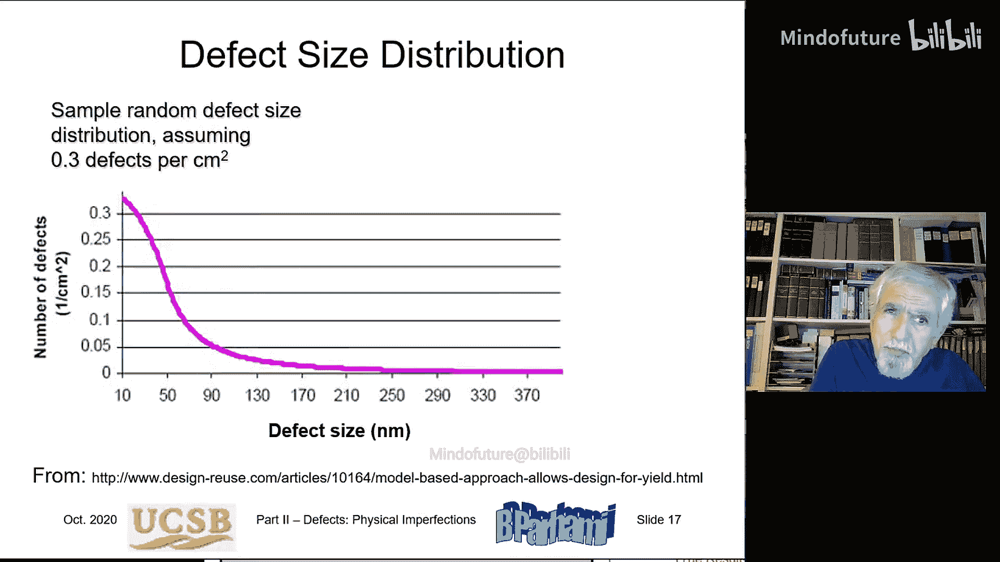

### 缺陷建模

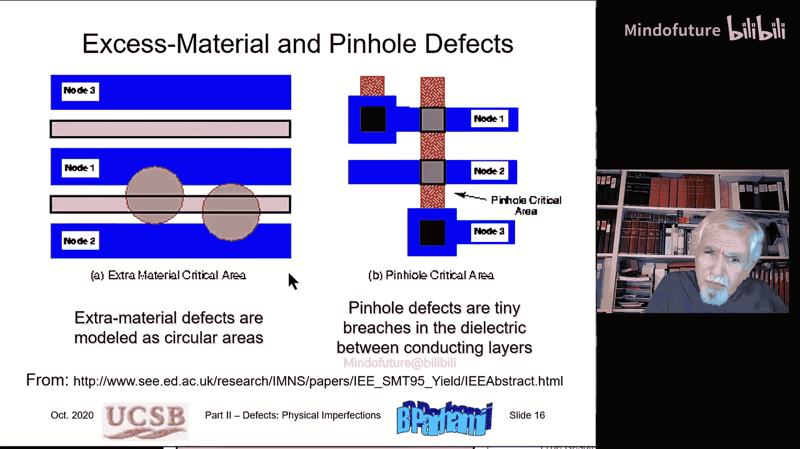

由于缺陷微小且不规则，我们通过**建模**来预测其影响。缺陷通常分为：
*   **全局缺陷**：影响大片区域，如划痕、掩模版错位。
*   **局部缺陷**：局限于小区域，如因工艺问题导致的材料多余或缺失。

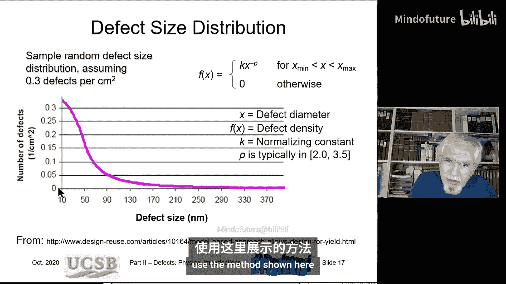

在模型中，复杂的缺陷形状常被简化为**圆形**。通过计算缺陷圆形与电路关键区域（如两条导线之间的间隙）的重叠概率，可以估算出导致故障的“致命缺陷”数量。

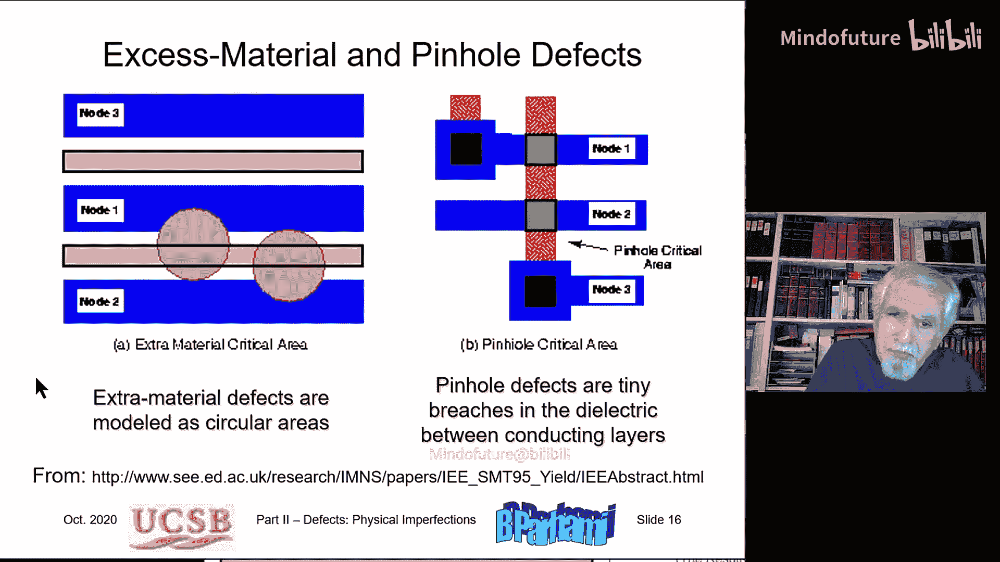

缺陷的尺寸分布符合一定的规律，小尺寸缺陷比大尺寸缺陷更常见。分布函数通常为：

`f(x) = k / x^p`

其中 `x` 是缺陷尺寸，`p` 是一个常数（通常约为3），`k` 是归一化常数。

---

## 浴盆曲线与老化测试

产品的故障率随时间变化的曲线形状类似浴盆，故称**浴盆曲线**。
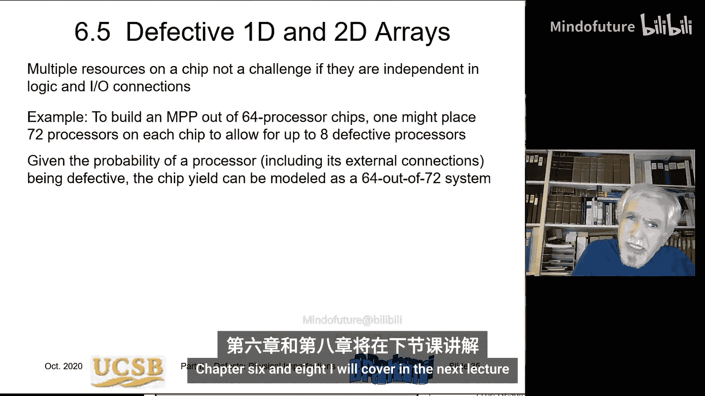

它包含三个阶段：
1.  **早期失效期**：故障率较高，通常由**潜在缺陷**导致。
2.  **偶然失效期**：故障率低且相对稳定，是产品的正常使用寿命期。
3.  **耗损失效期**：故障率因老化磨损而再次上升。

对于电子产品，我们主要关注前两个阶段。为了不让客户经历早期失效，制造商会进行**老化测试**。由于正常使用下早期失效期可能长达数月，因此采用**加速应力测试**（如高温、高电压运行）在几小时或几天内激发潜在缺陷，筛除不良产品。

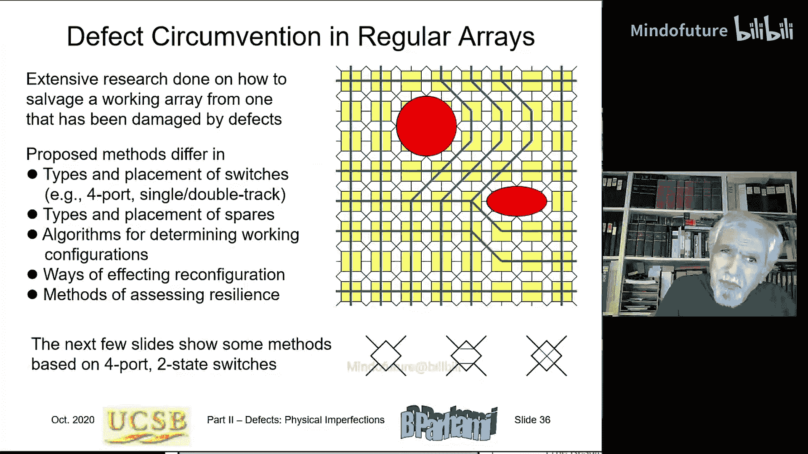

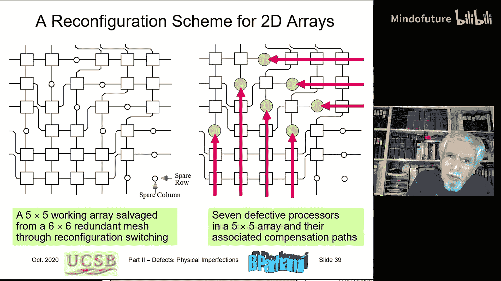

---

## 屏蔽与加固

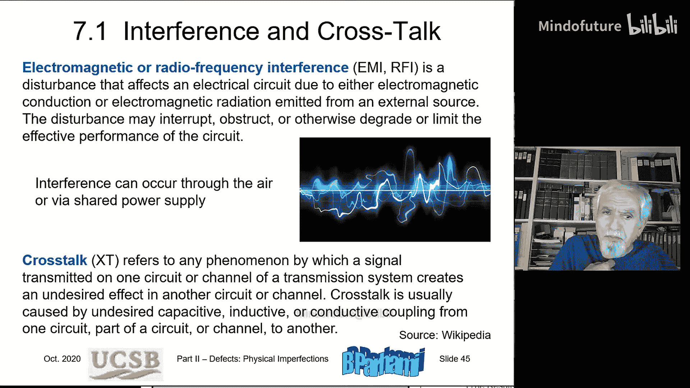

上一节我们介绍了如何避免制造缺陷，本节我们来看看如何保护系统免受外部环境的影响。**屏蔽与加固**技术用于防止外部干扰或抵御恶劣工作条件。

### 串扰

**串扰**是指一个电路或信道中的信号对另一个电路或信道产生不良影响的现象。在高速高密度集成电路中，相邻导线之间的**寄生电容**和**电感耦合**是串扰的主要原因。

*   **攻击线**：产生干扰的信号线。
*   **受害线**：受到干扰的信号线。

随着导线间距缩小、高度增加，它们之间的耦合电容增大，串扰问题加剧。缓解方法包括：
*   增加导线间距。
*   采用类似双绞线的**交错布线**技术，使干扰在不同区段相互抵消。

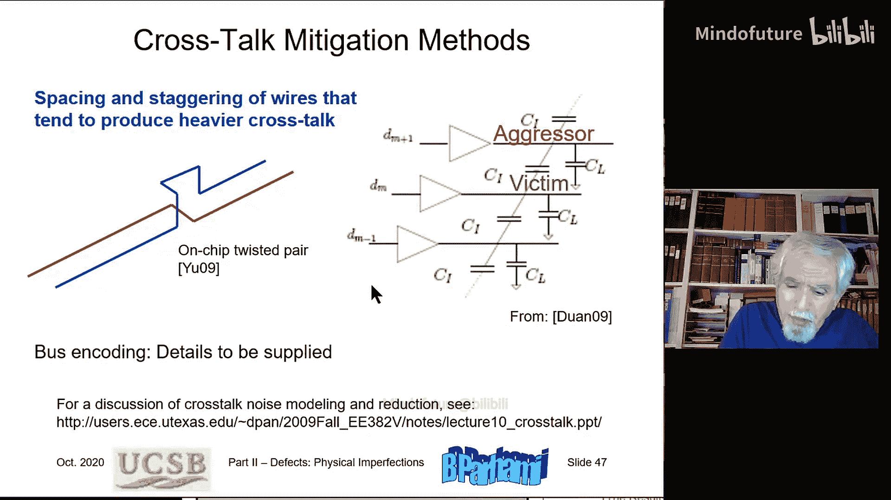

### 屏蔽

**屏蔽**是使用特殊封装或覆盖层来保护电路免受外部干扰。
*   **静电屏蔽袋**：防止运输中的静电放电损坏电路。
*   **金属屏蔽壳**：用于航天计算机，防护宇宙射线。
*   **射频屏蔽罩**：阻止外部无线电频率干扰。

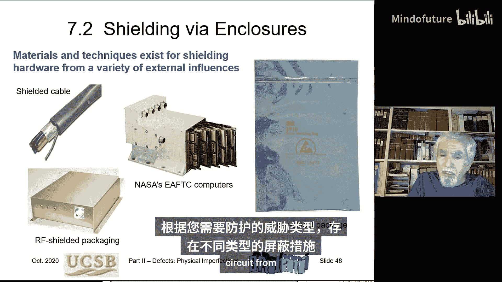

### 辐射效应与加固

辐射（如宇宙射线、α粒子、中子）对现代高密度集成电路构成威胁。高能粒子撞击芯片可能产生电子-空穴对，导致局部电流脉冲，进而引发瞬态错误或永久性损伤。

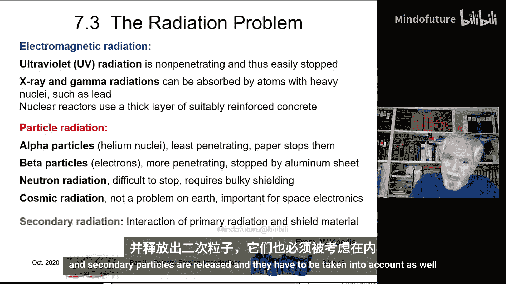

辐射效应包括：
*   **单粒子翻转**：改变存储器或寄存器的状态。
*   **单粒子瞬态**：产生一个可能被后续电路锁存的虚假脉冲信号。
*   **单粒子烧毁**：导致永久性物理损坏。

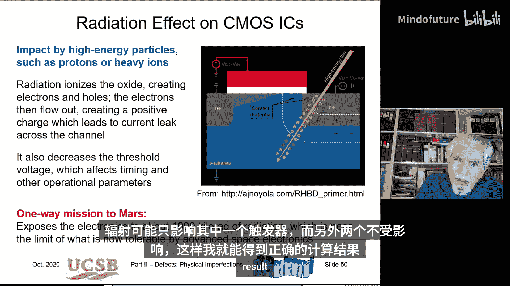

**辐射加固**可以通过以下方式实现：
*   使用更耐辐射的宽禁带半导体材料（如碳化硅）。
*   采用屏蔽封装。
*   用更坚固的SRAM替代DRAM。
*   在电路级采用冗余设计（如三模冗余）。
*   在更高层级采用故障检测与容错算法。

不同类型的辐射需要不同厚度的屏蔽材料。例如，阻挡电子相对容易，而阻挡质子则需要厚得多的屏蔽层。

### 其他环境因素

系统还可能受到振动、冲击和液体泼溅的影响。商用产品（如手机、笔记本电脑）已具备一定的耐受性。对于更严苛的环境（如工业、航天），则需要使用专门的**加固型设备**，它们通常更重、更昂贵，但能承受更强的振动、冲击并具备防溅洒能力。

---

## 总结

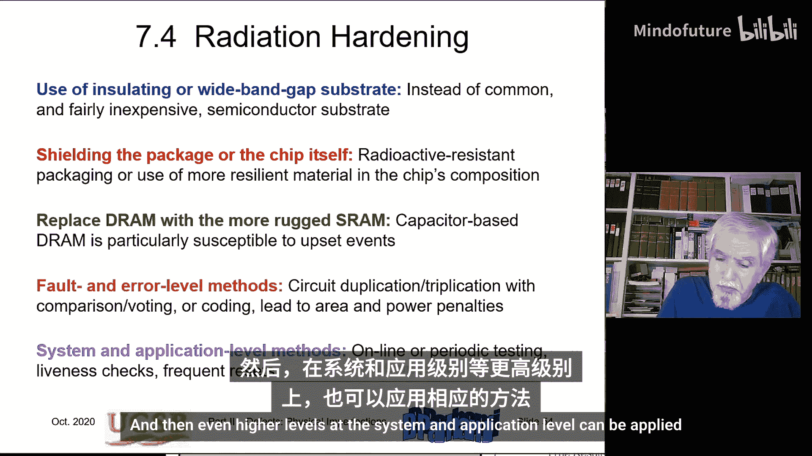

在本节课中，我们一起学习了**缺陷避免**与**屏蔽加固**的核心内容。

我们首先探讨了集成电路中缺陷的来源和影响，包括工艺变化、颗粒污染和高温问题，并介绍了磁盘存储器的缺陷处理机制和预警更换策略。

接着，我们分析了**成品率**对芯片成本和测试的深远影响，并了解了如何使用**缺陷模型**来预测制造质量。**浴盆曲线**和**老化测试**帮助我们理解产品寿命并剔除早期失效品。

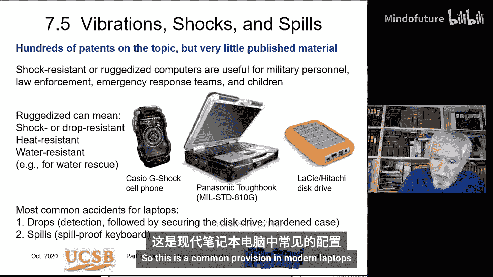

最后，我们转向外部威胁，学习了**串扰**的成因与缓解方法，以及如何通过**屏蔽**和**辐射加固**技术保护电子系统。我们还简要提及了系统对振动、冲击等机械和环境压力的耐受性设计。

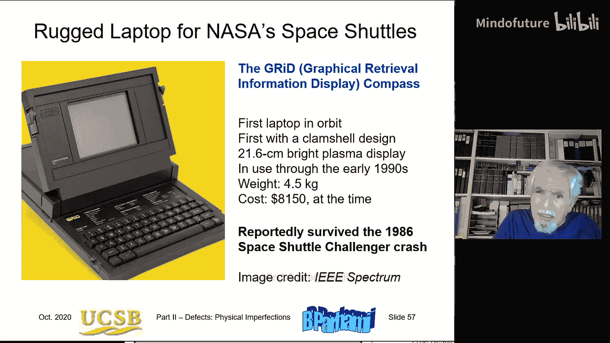

通过结合缺陷避免和系统加固，我们可以从设计和制造层面显著提升计算系统的可靠性和鲁棒性。