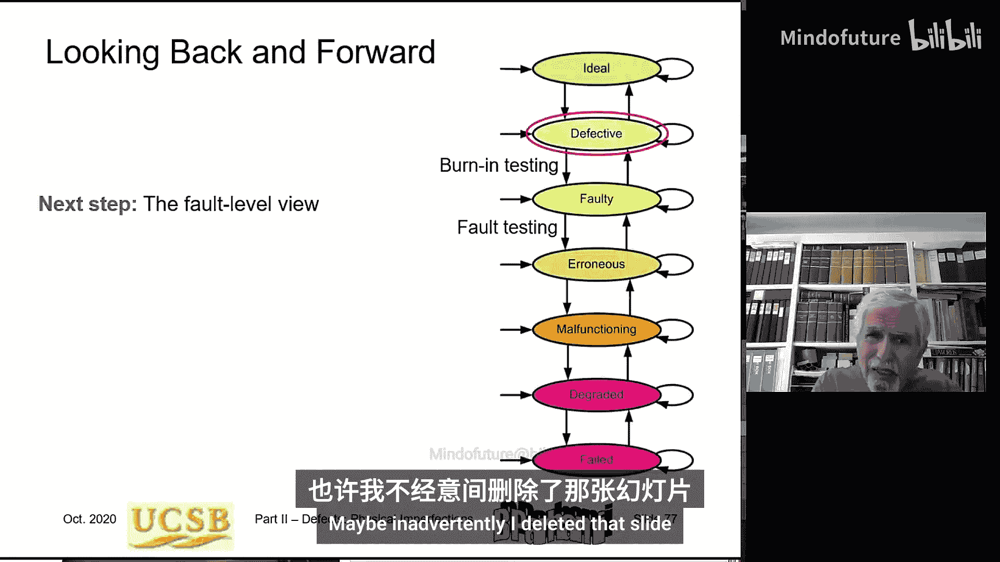

# 【加州大学】容错计算-｜-Fault-Tolerant-Computing-Ucsb-Ece-257A-p06-P06_第6讲_第6-8章_缺陷规避--BV19cFyz8EPV_p6-

Hello and welcome to Lecture 6。For the course， ECE257A fault tole computing。This lecture deals with。

As you see on the slide defect。Some general methods and then some specific examples in chapter8 of the textbook。

嗯。So as the name implies， the Fer convention basically is based on。

Detecting the defects and circumventing the effects， getting around them。

By sort of ignoring the defects and not using the parts that are defective。嗯。There are actually two。

Complimentary methods of defect F circumion。Either one or both of them can be used。

In a specific context。Defects are convention by removal。

requiresquire that we have built in dynamic redundancy under dye or wafer。

Identify the defective parts， this is done either by visual inspection when the defects are large。

Or testing or association。Association means basically you observe some effects that are associated with defects and therefore you conclude that there are some defects。

It's sort of like diagnosing a disease by its symptoms。

And then we bypass the defect or reconfigure the system through embedded switches that have been provided。

Under the chip。Okay， we'll see examples of these。Defer convention by masking， on the other hand。

 requires the provision of what we call static。Redundancy。

Statatic redundancy is when redundancy is built in and part of the normal operation of the system。

Except that when something goes wrong， that built in redundancy automatically。Kicks in。And。

Prevents undesirable effects from happening。If you will， you know， defect circum by removal can be。

Likened to error detecting codes， so you detect。That something went wrong。

 but then you have to say take some action。To。Correct， the error。

Or remove the undesirable facts of that error。The effects at convention by masking is sort of like error correcting code。

Where the redundancy is built in。And it just， you know kicks in and you correct。

There is no reconfiguration involved。Generally speaking。

 static redundancy requires higher levels of redundancy。

So it's more expensive in terms of circuit costs。And also in terms of power consumption。

Sometimes we do some adjustment of the redundant structures once we detect the defects。

 but this is optional， it's not required， the system can continue operation。With the defective parts。

 because there is enough redundancy to nullify the effect of those defective parts。Now。

 given that removal of defects implies lower redundancy。And therefore。

 lower circuit costs and lower energy costs， these methods are more popular。In integrated circuits。

🤧嗯。Okay， so detection of defects， one example is using visual or optical inspection on wafers after they're constructed。

So basically a specialist will look at this wafer。Focusing in particular on areas that are more likely to have defects like the edges of the wafer。

And some big defects， serious defects can be detected by visual inspection。

You can also use optical inspection that when light is。

Shied on the waff and the reflection of the light is examined to see if it is according to our expectation。

So that's obviously more accurate。And in。More likely to actually catch the defect。

Because even tiny defects have will change the optical characteristics enough for us to be able to。

Detect them。Now using redundancy and reconfiguration on a chip。Works best。

When the system has a regular structure。And examples of such systems are memory， FPGA。

 multicore chip。Or chip multi processor， this is sort of like multi core chip except that。The chips。

The chs and the Cha are can work together as a multi processorcesor rather than just as individual cores。

Iregular or random logic implies requires greater level of redundancy。

Because basically we have no option but just to duplicate or replicate。The structures。

And when we replicate the structures， we have to take care that they're not too close。

 the replication is not too close。To each other and the chip the replicated unit。

So that a single defect in one area of the chip does not affect。

Both the original unit and the replicated versions。On the other hand。

 if you put these units far apart on the chip。Becomes harder to。

For one to replace a defective one when it's far away because then wiring and switching overhead will be pretty large。

So it's a tricky balance to put them。Just far enough from each other so that defect does not affect multiple units。

And not too far so that switching and wiring costs。Are not prohibitive。Now。

 avoiding bad sectors on a disc memory。Is a good example of defect circumvention by removal。

So what happens disks use very strong error correcting codes。嗯。Actually。

 a combination of error correcting and error detecting codes。And then， when we。

Find out through those codes that a particular sector on the disc。

Sector is just a chunk of the disk surface that。Sttores a block of information。

When a sector is judged to be bad。We no longer record data in that sector because the probability of getting incorrect data。

Well， well be high。嗯。So we remap that sector to a different area。Of the disc。

So this get dressinging typically says， okay， give me sectors， so and so。That sector， so on and so。

 that's a logical or visual address physically on the disk， it can be located anywhere。

So by relocating sectors。We can。Scuvent the effect of a bad sector。So in this diagram。

 you see that we have two maps or tables。One is called P list。Perminent or primary defect table。

one is called G list， which is the growth or post use defect table。

The primary defect table is set up。By the disc manufacturer， so when the disc is manufactured。

And undergoes tests， some sectors are found to be。Effective， they don't store information correctly。

 they're not reliable。So the manufacturer simply。Bypassses those sectors， circumvents those sectors。

And there's a table that says where the new location of those sectors are a mapping table。Okay。

 so the net effect of these remapped sectors is that first of all， the disk capacity is reduced。

Because some sectors are not available。But the P list does not affect nominal capacity of the disk。

 so if you buy a disk drive and it says it's a one terabyte drive。

It really will have one TB of capacity。Even though some of the sectors are bad。

 this is because they actually built the disc to be slightly larger。

So that after removing and remapping those bad sectors， it still has。

Theenominal or advertise capacity。So the PLless sectors do not affect this capacity。

They do not affect the advertised disk performance either。

Because the manufacturer makes sure that the disc still performs according to。

Expects in terms of data transfer rate， latency， and so on。So if it doesn't meet those specs。

 then the entire unit will be discarded and will not be shipped。The customer。

 so Pless is actually something that is hidden and we don't really notice it。

It's something that the manufacturer of the disc sets up。And ensures that the disc can still operate。

Under its normal parameters， capacity， excess speed， data transfer rate and so on。

A G list is a list of sectors that are detected to be bad。After the disk has been shipped。

 so this is part of the basically the disk drive software that。He texts that sectors。

 a particular sector has gone bad。诶。For example， because an error was detected or the error correcting code basically kicks in too many times every time you read from that sector。

 the error correcting code has to make correction。嗯。's saferfer to just not use the sector because。

If something else goes wrong， then the。Capability of the error correcting code can be exceeded not be able to correct it。

 So once we see that errors are corrected too often for a particular sector， then we just。

To comevent that sector。And record its new position。And this Gless table。Now as the G list grows。

That this capacity will be reduced and this is something that will be observable because that this capacity will go under the nominal or advertise capacity。

Performance will be affected too。It has locations of sectors。Do。Affect。

How fast do you can get to them？So for example， if you have stored a file。On consecutive sectors。

Then it can be faster to read that file than if these。

Sectors of the file were at random locations Now if one of those sectors goes bad and you remap it to a different location under this。

Then access to that file can slow down。Because now you have to access maybe two different tracks on the disc too。

To read that file or write that file。Okay。😊，So the growth of G list affects both the disk capacity and the disk。

Performance。And once the gius becomes too large。Performance therefore is deteriorated by too much。

 you may want to discard the list altogether。And switch to Iud this。These days。

 discs are not expensive， so this can be easily done。

You simply have to transfer the data from the disk。To a different fresh disk and。

Start using that one。Now for memory arrays over the years。

 many different techniques of defects or conventions。Sirvent have been developed。

And this diagram shows one method。Where the memory array。Is supplied with spare rows。

And often also spare columns。Okay， so let's ignore the spare columns for now。

 let's pretend that it did not exist there。So we have spare rows。And within the memory array。

 a particular row becomes defective， either the entire row is defective or some cells。

 memory cells in that row become defective。And we don't have obviously the capability to replace individual memory cells。

 so we have to replace the entire row containing the defect。And that。Replacement is accomplished。

Through the decoding mechanism here。 So normally， if you say I want row。Say' maybe row 100， row 100。

 the decoder detects it。And select this row for access。Now if that row becomes defective。

 then row 100 must be mapped to here。One of the sparrows。And therefore。

 the decoding logic must be provided with this capability of mapping。

Part road to a different location， so it is more complicated than normal decoder。Now。

 if this can be accomplished and if you have M rows and S spares。

And assuming that all the peripheral logic and decoders are perfectly reliable。You know。

 questionable assumption， but let's for simplicity assume that。Then， if any。M。

Of the total m plus S rows。Or good， then the system is good。

 so you can model this as an M out of M plus S system。And of course。

 if you have a failure rate for the peripheral logic。

Then you simply multiply that by whatever reliability you get from this M out of M plus S system。

And the hope is that that reliability will be high enough so that。

The reliability does not deteriorate by too much。Now if you have spare columns as well。

 then if you have a failed column。😔，You can replace it with this call it。

Notice that if the entire column has failed， every cell in this column has failed。

Then spare rows will not be of much use because you only have a small number of spare rows。

And here you may have a large number of cells。That are defective。

So spare columns are actually useful because defects that are clustered。Belong to column。

Are more readily circumvented with spare columns， if defects are clusterted along the row。

 then they are more readily circumvented by using sparearrows。嗯。Def in logic。

And FG is a subject of this section， the textbook。然后。

Sircuventing the effects in logic has a long history。

 actually in the 1950s Moore and Shannon had this pioneering paper idea。

For building arbitrarily reliable relay circuits out of what they call called crummy relays。

Highly unreliable delays。Okay， so let's let's see how this works。

 let's say the probability that the relay device closes。When it's supposed to be open is P。

So this is sort of like。The failure probability， the relay must be。Open， but it closes。

 So here I've shown a bunch of relays， this relay is open。

But it may be defective so that it closes with probability P。When it's supposed to be open。

When all these so this is a redundant arrangement instead of one relay， I've used four relays。

All controlled by this signal X。When x is asserted the relay closest， it's a normal functioning。

But under this scenario of defects the re can close while x is equal to zero is not a。Okay。

 so if x is zero， we expect the circuit from left to right to be open。In other words。

 current should not flow。And at one floor， because all four relays are open。

Now one of these relays is defective。And closes。Then we still don't have current flowing from the side to this side because the other three relays being open。

 stop the flow of。Allright。Okay， however， if you have two defects。For example。

 the top two relays being both defect。And closing when they should not。Or this。

Top left and bottom right， relay closing。There are actually four combinations of double failures。

 the two bottom ones closing and the bottom left and top right close。

And it's easy to establish that the reliability of this redundant relay circuit is given by this equation our 4 port p squared is basically those four combinations。

😔，Of two relays being defective。But then when you count these two being defective。

And these two being defective。A separate events。P squared and p squared。

 you're double counting the case for all three of these are defected。ok。Now。

 for any relay structure such as this， we can compute H of P。

Which is the probability that the structure as a whole。Close us when it's supposed to be open。

And if this H of P is less than p， in other words， the probability of this structure misbehaving is less than the probability of a single relay misbehaving。

Then as soon as you get that then recursively you can use this method many times to get the reliability as high as you want of course in general。

 this is not very practical so this arrangement of four relays。Gives you a better。Defect probability。

 a smaller defect probability， but repeat this four times。Okay， so replace each of these relays。

With this structure， so youll now have 16 relays。Whose edge function is even smaller than this edge of P。

And you can continue this， so this is basically what they meant by。

Building arbitrarily reliable relay circuits out of crummy relays。Okay。

 now for this particular equation， we can easily establish that HF P is less than P。

If p is less than 0。382， so this is the curve of HF P。As long as P is less than 0。382。

H of P will be less。In fact， it will be much less if P is very small。

 which is the normal expected condition。If P is very small。Then this structure will be。

Maybe be reliable enough so that we use it we don't have to recurse multiple times。

This is what they also mean by crummy。All you have to have for this method to be applicable for the failure probability to be less than 0。

3 a2 defect probability。And that's a pretty large number， you know， so even about 38% of the defect。

Rate of a relay is 38% you can still gain by using this method。

 but of course in practice it's not 38% maybe it's。1% or even less。 And therefore， you get。

Significantly better。Lower defect probability for this structure compared with a single relay。Now。

 of course， relays are all technology， but now。呃。But CMmo。During get the circuit。

 those type of switches are really commonly used in ICs。

 so these methods have again become applicable， not for relays， but for CMs transistor switches。

FPGAs， of course， that are ideally equipped for the F circumion。So when you build this。

FPGA and this particular。Logic block。Was discovered to be defective。

 you simply declared unavailable and normally the tools that you use to map designed onto FPGAs。

Have this capability of not using a particular logic block or some particular interconnects。

Because you need those， you know， sometimes you put。Multiple circuits on the same FPGA。

 so once you have put one circuit on the FPGA， one design。

 then some of these configurable logic blocks have been used。

 some of the interconnects have been used。And therefore。

 the design tool that puts the next design on the FPGA should avoid those， okay。

 so this is built into the design tool， therefore if now this one is not available because of defects。

It can be very easily circumvented in the mapping。Mapping process。Okay， these are examples of。

one particular example of switches， so when you have these connections。

 there is a switch box here that allows you to do flexible connections between incoming and outgoing lines so that。

Can establish a p maybe from this blog。Through this line， through this line， through this line。

 through this block。So this switch box is programmable。And this is an example so that you have。

This is different from what you see down here， there are three vertical channels。

 three horizontal channels。And three switch boxes。Allowing you to connect between horizontal and vertical channel。

Popossible connections are straight through。Straight through。Tur。

This is a left going from up to here is a left turn。All right turn。😔。

And similarly for the other connections， so you can do alectern， establish thision。Make a right turn。

 establish this connection and so on。They can establish these pads through these channels。And again。

 if a particular channel is not available， so for example， this horizontal channel over here。

It's defective。Then this switch will simply just be set to this state or it never。

Puse us the signal to turn onto that channel。Multicor chips。Also， have a natural。

Bypassing or circumvention capability。So for example， if you want to build an eight core chip。

 typically we build a chip with more cores than we need， so maybe 10 cores。

And then if one or two of the cores。Are defective are found to be defective upon testing。

Then we simply don't use them， so if this connection。

 the thing that connects the course together is a bus。

Then simply isolating those two units does the trick。

 the other ones and still work if this is an interconnection network。

 then it becomes more tricky to sort of。Avoid。The effects of these bad cores。

And make sure that the other。The other cores still have flexible connections through this interconnection network。

 so we have to design the interconnection network to allow that degradation with this particular port。

Its not used in this particular port。Not just。So one way to。

Arrange these cores or any number of processing cells on a chip。Is to build as。

 one or two dimensional arrays。So， here。I'm contrasting having four cords on a chip or four processors。

 or sometimes we call these processing elements。Four of these on the chip。

Each of them is basically an independent unit with its own input output connections。

So we use them as for independent units except they happen to be on the same chip。Okay。

 this is not very practical because nowadays。Processors have a lot of IO connections。So， if。

So much so doubt， even on a single processor chip， sometimes the number of pins。Become a limit on。

Using the chip。So we don't run out of area to build a more complicated process around the chip。

 we usually run out of pins。To be able to feed that processor from outside。

So we will be if we adopt this strategy， we'll be forced to have very narrow channels。

So instead of maybe 16， 32 bit channels。Connecting in may have8 bit or four bit channels in order to limit the total number of pins。

This has been more popular nowadays to connect the processors on the chip。In this case。

 there's a 2D array。So that the number of iopians will be reduced。

 so basically these two set of links。And these two these two and these two are eliminated because。So。

 now。We have fewer pins or connections per processor， but we also have less flexibility。😔。

In other words， if this processor becomes defective。

And it may not be a trivial matter to allow the other three processors to continue functioning。

Because this process is sort of。呃。Was being counted upon to supply data to this in this process。

May be able to use the chip with degraded performance if this one is not available。But we better。

Think of this possibility ahead of time。And design the interconnection in the chip。

In such a way that one or two or three effective cells of processors。

Do not cause all the other ones from becoming。Ineffective or have such low performance debt。

They're practically of no use。So here is one such strategy。

If I'm trying to build maybe a five by five array。I built a larger array。So basically。

 I have spare rows and spare columns， extra rows and extra columns。

And now if I have defective areas on the chip， this is a large defect that has disabled four of my processors。

This blob is another defect that has disabled two of the processors。Meanwhile。

 by providing these alternate connections， I'm able to reconfigure the chip。

So that I still have one two。3。4。😔，And five。And six columns of processors。

Except they are no longer connected and straight up and down columns。

But I've reconfigured the chip so that the column is made of this processor。This one， this one。

 this one， and so on。And similarly， for rows， this row is intact， this row is intact， but this row。

It's shifted down here to avoid that。A defective area。Okay， so I've sort of salvaged。

It's five row by six column。A瑞。K does a job like a five by six unaffected array。

Despite the presence of these defects， Okay， so the next few slides basically。

Talk about this arrangement in order to allow this kind of reconfiguration。

One way is to use this kind of switches that you see here。These are four port switches。Okay。

 that can connect the ports in two。Schemes。This one we call the bent scheme。

And this one we call the crust。😔，So the bent state。And crossed state， there are two states。

Of this switch now given the。Such switches。I can build a one dimensional array。

In which I can bypass so I can provide a spare。And then when something of the processor has becomes defective。

 either at the time of manufacture or during operation， I can bypass it。

How do I bypass it while this array is a linear array？From input to output。

So connections are made to reduce switches， so this is the first。Seell in the array。

The second in the array。Next cell is bypassed。By putting these two switches in the cross state。

This now is the third cell in the array。And the for and out。Again。

 so by appropriately setting the state of these switches。I'm able to bypass。One unit。Of course。

 if I have more spares， I can bypass two units。Those two units cannot be consecutive。Because。诶。Yeah。

 maybe I take that back， they can be consecutive， so for example， if I want to bypass this P2。

I will go， this will be crossed。This will be bent。😔，This will be crossed and then I'll go there。😔。

Okay， so if I want to model the reliability of this system。Or yield in the case of defect tolerance。

This unit can tolerate defect can be circumvented， and one defect in one of these processors can be circumvented。

But the effects in the switches cannot be circumed， the switches must be all okay。

So in terms of reliability modeling， I have a four out of five。System here。

In series with this system of switches。Now switches are typically much less complex in terms of hardware。

D processors。So。You， the reliability will not be too low。

Even though the switches are the system's hardcore and should be functional in order for the system to work。

Okay， one way to avoid having the switches as part of the hard corere。

 therefore reducing reliability or yield。Is to do the distributea that's switching。

So this is the same array， except that I don't have these switches。

 I have multiplexors inside each of these。That allow this unit， this is spare， of course， this one。

 this unit to take its input from this zero。Or。From。The primary input。So even if a unit is defective。

 the good unit。Can reconfigure themselves by putting these marxes in appropriate states and be able to establish this pad that you see the heavy。

Heavy line。And then you need a mark at the end because the primary output can come from this unit or from this unit。

So the hardcore has now reduced been reduced to just this mugs。Therefore。And less effect on。

Reliability or yield。So this is known as distributed。Reconfiguration， this one tolerated one defect。

This one tolerates one defect because if this is defective。

And this P2 has the option of taking its input from here。However。

 whereas this one could tolerate two defects in a row， this one can't because of。

 say these two are both defective。There's no pads。For this you need to supply。The input of this unit。

 so I have to provide additional connections for that to be feasible。Okay。

 this is the two dimensional version of that reconfiguration scheme again we have。

The same kind of switches。And these switches allow。 so if this PB。It' processoror P sub B。

As defective and therefore cannot supply information to this one， we set these switches。

So that the north neighbor of this PD， instead of in PB now becomes PA。Okay， so this is a。

Reconfiguration scheme for two dimensional。The processor arrays。

And this is the distributed version of the same scheme。Where I provide multiplexors。For this PD。

To be able to。Choose its north neighborigh。From among PA， PB， and perhaps another unit on this side。

And it can choose。It's West or left neighbor from among PA， PC， and perhaps another unit down here。

Okay， again， there is no hardcore here。If one of these Marxes is defective or fails。

And the effect is that this box。That's defective。So the effect of switch defect is no more serious than processor defect。

More on this later。So this is basically a reconfiguration scheme。That's an old scheme。

 but it's still quite interesting。So here I'm assuming that。Some processors are defective。

So these small circles are defective processors， so there's a spare row at the bottom。

As spare columns。Three of the units in this spare column are being utilized。

And four units in the sparearrow are being utilized to form an array。So I built six by six array。

 one pair row and one pair column。But I need only a5 by5 array。

 and I'm able to extract that5 by5 array， assuming that these defective processors can be bypassed in the row。

So I'm assuming some additional switching capability that allows。These bad。Processors to be bypassed。

So here is。Row one。Well theres five units。Row2。😔，Roow 3。R for。

And row five and similarly for the Cols。Notice that the rows are shifted down。

In order to circumvent this particular defect。So the road that normally went here has been shifted down。

And then back up， once we have circumvented that defect。

 it doesn't have to go back up so for example， this third row。Because that row was shifted down。

 this one must be shifted down also。This one stays down because there's another defect there。

And then it goes there。Okay， and this last row has been。Shifted down。

For the first four units and then back up there。Okay。

 so the presence of this redundant row allows me to shift rows down。I won place。Of course。

 if I had two。Spare rows at the bottom shifting by two ices， So for example。

 after I shifted this down。Not there， that's not a good example。诶。Yeah。

 after I shifted this one to the right。Suppose now this is also defective， so it can't go there。

So I can basically go to here。If I had two spare columns。

So if I have multiple spare rows and multiple spare columns， I can do more shifting。And therefore。

 be able to circumvent a larger number of defects。Now assuming this one spare row and one spare column。

诶。The inventors of this particular configurationfiguration scheme notice that as long as you can draw arrows。

From the spare column。Or sparrow。To each of the defective。

Processors without these arrows intersecting。Then you are able to reconfigure the system。

In this case， I have seven defects。The orange circles。

And I'm able to draw these three arrows to these three notes。

From the spare column and these four arrows。To these four defective notes from the spare row。

And because these arrows do not intersect， do not overlap。Then I should be able to reconfigure。

The system and as you see I was able to reconfigure it。

So it's an interesting property you can quickly check。So the question is， in this case。

 I was able to circumvent seven defects。The natural question is that what is the worst case situation。

 what is the smallest number of defects？That will。Not allow me to reconfigure。

And we'll answer this question later， okay？In chapter eight。All right。

 there are some additional topics here that I'm going to skip and therefore I'm going to go to chapter。

8ight。Yield enhancement。So a lot of these。Defects circumvention schemes。

Have the roots in efforts to improve the yield of integrated circuits。

 provide redundant elements on the chip。So that。If there are defects。

 we can still use that chip and therefore increase the yield， not have to discard the chip。Of course。

 the same method with some danger can be applied for fault tolerance， fault circum at higher levels。

So。These reconfiguration schemes are quite general and can be applied at different levels。

And that's why sometimes I say， you know， faulty processors。

Even though we are talking about defects at this point， because the same methods can be applied。

For fault tolerance， circumventing faults。Okay， yield models。Assume defect to be。Cirly shaped。

Even though defects are very seldom circular。The thing is for a model does not have to reflect physical reality。

To be useful。As long as when we run the model。The outcomes， the result of the model。

 match reality and that's a useful model， even though the physical details do not match the real world。

So models defects are modeled as circles。And here is a very simple example， it's a trivial example。

 but it shows。Even at this simple level， that things can be difficult。If you are not careful。

 you can commit errors in modeling。So let's say we have。A chip that is1 centimeter square。

And it's one centimeter by one centimeter。And it has nothing but wires that are one micrometer wide。

 so there are a whole bunch of wires。Each of which is one micrometer wide and there's one micrometer spacing between two wires。

Okay， so there will be 1 million such wires， of course this is not a useful chip， it's only wires。

 but I want to try to model effects and this' very simple。Non use chip。Now let's say that。

There are an average of 10 random defects per centimeter square。

 so this is what is known as defect density。There are 10 random defects per centimeter squared。

 so this chip is expected to have 10 defects on average。Now， furthermore， assume that 80% of the。

The effects are small ones。A diameter 0。5 micrometer。

And those cannot cause short circuits between these wires。So here I've shown those small defects。

Those small defects。Cannot connect these two wires， these are extra material defects I'm assuming。

So small defects I can just ignore because they never cause problems。

 they don't cause short circuit between these wires。Okay， and therefore I can ignore them。

20% of the defects， so two on average will be for this。One centimeter square chip。

A large defect of diameter one and a half micrometer。

The one and a half micrometer is large enough to。Of course， if that defect is set here。

 it does no damage。But if it sits here， then it will connect。

It's very easy to see that these large defects。Will cause a problem will cause short circuit if their centers are within these red。

Critical areas。And those red critical areas constitute one quarter of the area of the chip。

So I'm trying to sort of。Walk you through the modeling process for this very simple example。

So I've established that I only need to worry about two defects on average。

Given given this information。And those two defects will cause problems if their centers are in this one quarter。

Of the chip surface that。Constitute the critical area。Okay。

 now if one of these defects is just randomly placed on the chip。

There is one quarter probability that the center will be in a critical area。And therefore。

 one quarter probability that it will cause a short circuit。

Or three quarters probability that it won't cause a problem。The second effect， similarly。

 has three quarters probability that it won't cause a problem。So three quarters times three quarters。

 916。So the two defects have a 916 probability of not causing a short circuit。

Which means there is a 716 probability that they do cause a problem。Okay。

 so you can say that the yield of this integrated circuit。Will be 9，16th。Okay。

 so you notice that even with this very simple example and a lot of simplifying assumptions about the shapes of the defects and about。

Just two different sizes， defects are typically many different sizes。Okay。

 but this gives you the flavor of the model。Of course， if our model is computerized。

 then we can afford to。We don't have to do manual calculations。

 then we can afford to take many different defects into account and more complex situations。Now。

 one of the methods used for yield enhancement is redundancy， but we have to be aware of the fact。

That redundancy by itself is not sufficient， so in redundancy you can say okay。

 I have n cells that I'm building on a chip and I provide S pairs。Therefore。

 as long as n out of the n plus S。Are defect free， then I have n defect free cells to use。Therefore。

 simple mindedly， I can model this as n out of n plus S structure。However。

 it's a non trivial matter to replace a particular defective cell。With one of these spares。

 if there are different places on the chip。Okay， well， for example。

 this cell may have been connected maybe to this neighbor and this neighbor。

 if you replace it with this one then this one has to be connected to those two neighbors as well。

 and this is nontrivial to arrange。So it's not just a matter of providing redundant elements on the chip。

 but interconnects and how actually one of these cells。Takes over。

For a defective cell is a non trivial matter。We'll talk in sections 8。4 and 8。5 about some。

 so typically what we do instead of allowing providing the capability of replacing each of these cells。

With a random spare。We organize these cells into rows and columns and perhaps replace an entire row when this cell becomes defective。

Could you place an entire row rather than that one cell？

This makes the reconfiguration a little bit simple at it， but it's also wasteful。

To replace an entire row when there's just one defective element。

We'll talk about these in more detail shortly。Now in VLSI floor planning and roing。

 the impact of effects must be。Considered。So typically wider wires are less sensitive to missing material defects。

It's harder to disconnect a wide wire。Part of the material， part of the material is missing。

On the other hand， narrower wires。Are less likely to be affected by extra material defect because we can provide more spacing between them。

But they are more likely to be impacted by missing material defect。Okay， so there's a trade off here。

 you don't want the wires to be too white。Or too narrow。So here is basically in graphical form。

 first of all， here is a missing material defect or emphasize the fact that these defects are almost never circular。

They are very irregular shape。税费。Model this missing material defect。By a circle。Well。

 that's not an accurate reflection of reality， but again， as I mentioned。

 if my model provides good predictions about yield， then I will continue using it even though。

This circular missing material defect is nothing like this actual missing material defect。

In this particular example， this missing material defect。诶。Its not a killer defect。

 it doesn't basically disconnect this wire， so this is a metal layer。🤢。

There is still connection here， but that connection is a weekend。

It acts sort of like a fuse if high current flows through this。Wyer。

 this acts like a fuse and may blow， in other words， it may blow this part and。

Thisiscon may take place， so even though this is not a killer defect at this point。

May develop into a killer defect as a result， for example， of high current in this wire。Okay。

 so here I've shown extra material defects of the same size。In two cases。

 when you have wider wires with less spacing， narrower wires with more spacing。

You see that the same defect is a killer defect here。And it's not a killer。Similarly。

 missing material defect， again of the same size， it's a killer defect for this narrow wire。

It's not a killer defect for this wider way。So when laying out realLSI circuits。

 we have to be aware of these kinds of defects。And。

The balance the width of the wire to make sure that。

You don't have too many killer defects at this kind and too many killer defects of that kind。

So here is an example， a small section of an actual VLso layout。So， these are a bunch of。Metal wires。

 the blue ones are in one layer and the red ones are in the different layers and these boxes are Vs so this blue line goes here。

Goes down the via and connects to that wire。Now if I have extra material defects。Of this size。

And that size is here， it causes no problem okay， if it's here。It causes no problem， extra material。

 okay？However， if the center of that circle is in one of these small rectangles。Showing here。

Then it provides short circuit between this blue wire。And this blue wire。

If the circle is if the center of the circle is there， then the circle is large enough to。嗯。

Short circuits。Its true。So the probability of this happening。

Is basically the probability of having an defect of the size。

Finds the probability of the center of that defect to be in one of these areas。

So if the defects are randomly， we assume they're randomly distributed。

 then the probability of the center being in one of these areas is the sum of those areas divided by the sum of the whole layout。

So it's a very small probability。So if this defect has a high probability， even' multiplied by。

That small probability of the defect being a killer defect， the probability will be small。

On the other hand， for these large defects。The critical area is quite large。

 All these gray areas are critical。The center being in any of those areas will cause bridging。

Between these adjacent wires。Okay。So the probability of this killer being and this defect being a killer defect is large。

 the sum of these gray areas divided by。The total layout area in this example， it's maybe 50%。

But fortunately， these large defects are rarer， they have the small probability。

So even though for each such defect， the probability is high。That it is a killer defect。

 the probability of the defect itself is small。Okay， so we model this。Okay。

 we'll come to that in a minute。So we basically have to have probability distributions for defects of various sizes。

And then once we have that。It's pretty easy to find out all the critical areas for each defect size。

 remember defects are not circular， we'll take them to be circular to simplify this analysis。

Because we have no idea what the shape of the defect is， so this is just as good as any other shape。

嗯。Okay， to improve memory yield。I mentioned that we provide spare rows and spare columns。

 here is a toy example， simple example。诶。We have six by six memory array， the yellow cells。

Some of which are defective the red cells， okay， this is an exaggerated example。

But we usually don't have this many defects in such a small memory。But this is just an example。

We also have two spare rows。And two spare columns。And we want to be able to circumvent these defects。

 this is an allocation problem that happens to be MP complete。In the general case。Okay， so。

Here is my solution to this problem。Replace this。Effect by。Replacing this row。

Replace these two defects by replacing this rows， so I'm using two rows。And then replace this defect。

Maybe replacing the column。And replace these three defects。By replacing that whole column。

 I do have two extra columns。And two extra rows。And those two rows and two columns collectively cover。

All of the defects。So the problem is finding。A covering。

For the defect using the resources that we have。This can be turned into a mathematical。

 the graph problem in the following way。And constructstruct a bipartid graph。

With notes on one side being the rose。Of the memory array。

And node on the other side being the columns， in this case， I have six rows。And six columns。

Connect a row to a column if there's a defective cell。

 so row0 is connected to column 2 because there's a defect and row zero column2。So these。

Connections in the bipartid graph。Present the defect。

Now because I have two spare rows and two spare columns。I have to choose two rows。

 two of these nodes。And two of these notes。So that collectively they touch all of those edges。

 they cover all of those edges。Okay，Previous I said that C2 and C4。C2 and C4。

They touch these four edges。R3 and R5。And therefore， all the edges are touched by the selected。

Notes therefore， rows three and five and columns。2 and four are。

The ones that should be replaced with spares。Okay， of course， if we have random defects。

Then I have two rows and two columns I guaranteed to be able to circumvent any four defects。

Because in the worst case， the four defects will be in different rows and different columns therefore we have to assign。

One row or one column to each defect。But up to four random defects。A guarantee to be。Sirumventible。

Tolerable。OkayHowever， defect tends to cluster。In columns and rows。

 and therefore because of that clustering， I typically can circumvent many more defects。Okay。Now。

 this。Linear processor array I showed you before。If I'm worried about those switches becoming。

A problem so that defecting switches。Basically causes low yield。

I have the option of making the switches redundant， this is one possible scheme。诶。So in this scheme。

呃。I have two rows of switches。So that if one of these switches is defective and I can't set it in the proper state that I want。

 I can avoid that altogether。By going around it。So here you see that。诶。0。The pad goes here one。

And then I avoid that bad switch by going to this row of switches。Asmbly get to the other side。😔，Now。

 here。If I can tolerate one of these modules being defective。In this case。

 it will be a three out of four system。I can also tolerate one of the switches being defective。

So given that I have 10 switchs， this will become a nine out of 10。

Any nine out of 10 working and guaranteed to be able to。瑞象这个。

So switches are no longer part of the hardcore。Now here is the answer to a question I posed earlier in the lecture。

It takes only three defective processors。To disable this reconfiguration scheme。

 because remember I mentioned there should be paths。To all the defective。

Moddules either from the spare column。From the sparearrow， if I have this arrangement of three。

Defective。Notes。Then I can't get to that note。Either through the row。Or through the column。

 therefore。So at best， I can say in the worst case。This can。Sirumvent two defects。If I'm unlucky。

 three defects would disable it。Of course， as we saw before， seven defects。

May also be circumventible if I'm lucky， but in the worst case， three defects。So two is basically。

Maximum I can count on。So in reliability modeling， if this is an M by M array。

I will model it as m squared minus2 out of m squared system， so as long as m squared minus2。

If those blocks modules are okay， then I'm guaranteed to be able to circumvent the defect。However。

 this is highly pessimistic。And it's sort of。You know， alwaysway when we do reliability analysis。

 we establish lower bounds。And those lower bounds， of course。

 the closer they are to actual reliability， the better， but sometimes the lower bound will be much。

 much lower than the actual reliability and we have to live with that because。呃。

There are limitations to adults， Of course， we can go the route of。

More complex modeling that takes all combinations of defects into account that assign a probability to each。

And then whether or not that particular combination is circumventible or not。

 we can compute a more precise lower bound for the reliability。But that's a lot more work。Okay。

 at the edge of this array。When there are say5 in external row connections。

I have to be able to connect the row connection either to the original rows or to one row down and the mechanism that allows me to do that are called it's called shift switching。

So his shift switch allows a signal to either go straight through or to be shifted down。

This is a more elaborate shift switch。It's basically a D multixer。

And this is three way shift switcher that allows the signal to go through。

Be shifted up and to be shifted down。whichhiever we choose and that would be useful I forgot to mention if I decide to provide so I said I have a spare row here and a spare column here。

 nothing stopped me to provide a spare row at the top。And a spare column at the left。😔。

More redundancy， therefore， more tolerance。And now rows can be shifted downwards。

Towards despair pair， or they can be shifted upwards towards despair spare。

Right words towards this spare column or left word。

 so there's a lot more flexibility and in particular this pattern now becomes tolerable。

Because I can get to this， the arrow， this can go through the sparrow at the top。

I'll leave it up to you to establish。The worst case pattern。

 the smallest number of defects that would disable that scheme would。

Spare rows at the bottom and the top and spare columns on the left。And on the right。Okay。

 often we use multiple redundancy schemes in order to take advantage of the strengths of each method and the classic example of this。

 this is an old chip。That's by IBM。Where they use error correcting codes。

And spare rows of rows and columns。In order to circumvent defects。

So if you had just occasional isolated defects， error correcting code by itself would be sufficient。

Because one defective cell in the word， if a single error correcting code， then one defect。Well。

Basically， the effect of one defect will be corrected by the error rectangle。However。

 if defect are clustered then error correcting code is' not good。

 but spare rows and columns are good。Inclusion of this study was that if you used error correcting code only。

The average number of failing cells per chip。Okay。Could be as small as 1000 before the yield would drop to。

Unacceptable level， if you use error correctating callone， if you use spare only， spares only。

Then you need even fewer。Defects。Because the number of spare roots and column them is limited maybe you have。

I don't know four of each， so eight random defects can use up all the capabilities of those spares。

And the ninth random defect basically disabled。But if you use both of these。

 then experiment showed that you need a lot more， so even up to 2000。Thes per cell。

 the yield is still quite acceptable， it's around 90%。Okay， so the lesson here is that multiple。

Schemes are often useful because each one has its own strengths and when combined together。

They can provide high benefit of course， the downside of that is that each scheme also has weaknesses so。

You have to be careful when you。When you combine。Differentend schemes together。Okay。

 this section I'm going to skip I just。Realized that for some reason， a very important slide。

I may have skipped inadvertently。😔，So let me go back。Fortunately。I don't know what happened。O。Okay。

 I'm sorry， but maybe inadvertently I deleted that slide。😔。

Okay， so let me stop at this point and。There is this final。Slide that I needed to show you。

This is basically looking back and looking forward。We have finished our examination of this state。

 effectiveive state， how to deal with defects。And in particular。

 we talked about burning testing that exposes latent defects and basically turns them into faults。

So even though we really try to focus on these upward transitions that make the situation better。

 sometimes we purposely put the system through these downward transitions。

Because a fault is more readily observable than an defect， and error is more。

Eally observable than a fault and so on， so we put the system through this transition by burning testing。

 we test it under extreme conditions so that defects。Manifest themselves a fault。

 and then we can detect their presence。Using fault testing methods， which is the subject。

We'll cover next time， similarly at default fault level。

Falult testing basically has the objective of turning faults into errors so that we can observe the errors at the output of the circuit。

And deducuce that there was a fault， okay， so these downward transitions。

 even though they're undesirable， sometimes they' are helpful to us in exposing。Effect or fault。Okay。

 so next time we'll talk about the default level。不则。

Falult detection and testing designed for testability。And fault tolerance。

Which is the counterpart of defect or convention that we covered today。All right。

 thank you and stay safe until the next lecture。

