# 【加州大学】容错计算-｜-Fault-Tolerant-Computing-Ucsb-Ece-257A-p07-P07_第7讲_第9-11章_故障检测--BV19cFyz8EPV_p7-

Hello and welcome to Le 7 for the course ECE 257A faultult Tolerant computing。诶。This lecture covers。

诶。Two chapters in the textbook， chapter nine， fault testing。In chapter 11， Design for Testability。

The next lecture， lecture 8 will deal with fault masking chapter 10。And chapter 12。

 Replication and voting。Okay， so first， the topic of fault testing。Fult testing is when we try to。

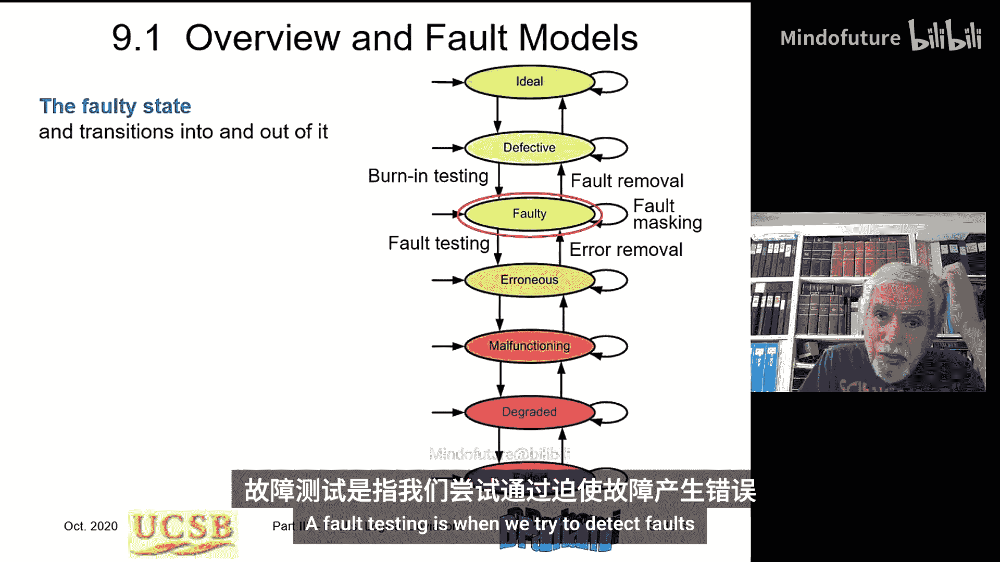

Detect faults， logic faults in the circuit。By forcing those faults to generate errors。

 in other words， we try to force this transition。From the faulty state into the erroneous state。

So that we can observe the errors and based on our observations then deduce。Their presence of fault。

In the circuit and in some cases。Actually determine what fault。

 you know what part of the circuit is fault。But that part is not necessary because when we know that the circuit is faulty。

 that may be enough。

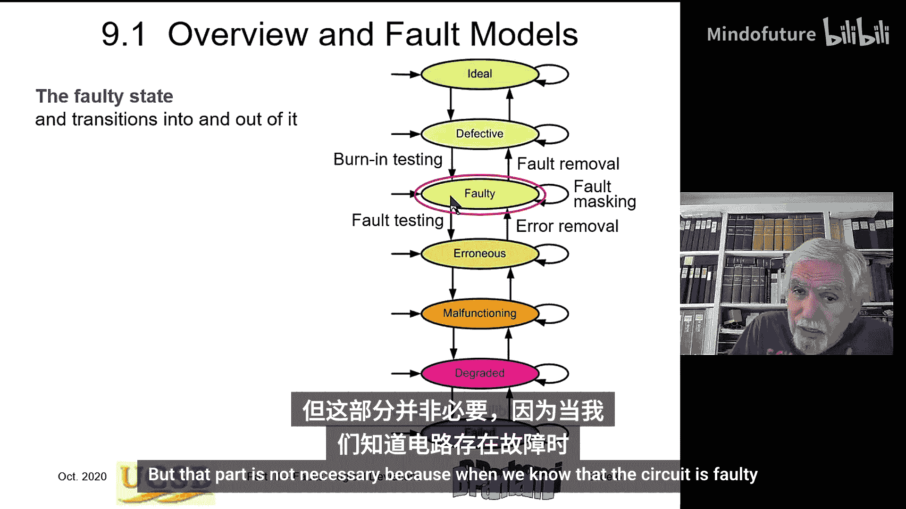

Because we just replaced the entire circuit， we don't know。

 we don't need to find out exactly what part of the circuit is faulty。

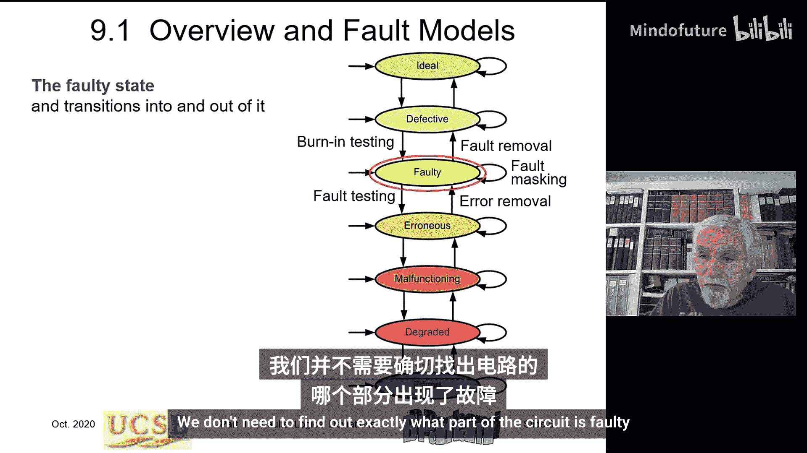

Okay， so we are now entering into our discussion of this faulty state。

 the first item of business is fault testing。And then fault masking is basically。

The collection of methods。Strategies that allow the system to。Remain in the faulty state。

 despite the presence of faults， in other words， we avoid。

Prevent the system from going into from the faulty into。The erroneous state。诶。So that default fault。

 even though they're there， they don't generate errors。And the system can continue。

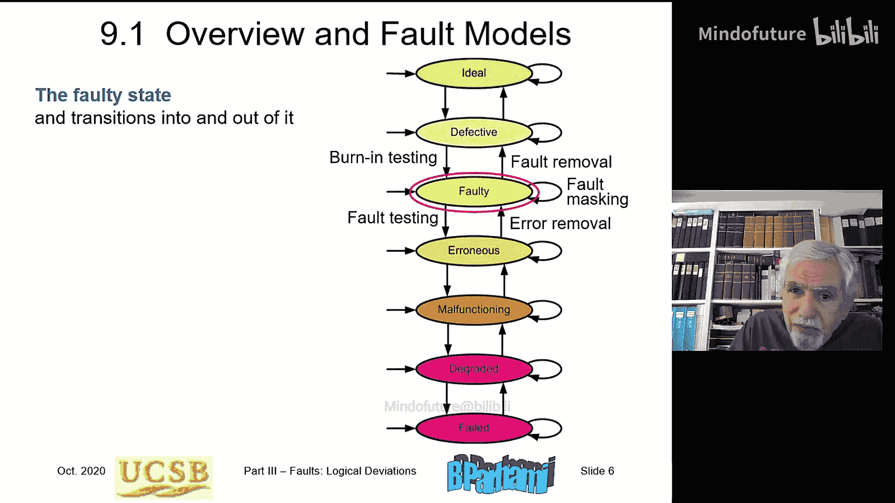

It's operation。Okay， now fault testing is a fairly。Extensive area of study。

There are many different types of faults， the three types that we are。呃。

The three types of fault testing that we are most interested in are engineering。

Testing where engineering falls， this is basically when we tried to determine whether the system。

As a correct design at the time of。The engineering design。In manufacturing， fault testing。

 that's basically when we try to determine whether we have implemented。

The circuit or system correctly。And maintenance fault testing is when we try to determine whether the circuit。

Is operating correctly and no matter which type of fault testing。

Or which type of fault we are interested in， the process of fault testing is the same。

There are three parts to fall testing test generation。Test validation。And test application。So。

 test generation。Can be preset， meaning that we。Determine all the tests ahead of time before we validate and apply them。

Adaptive is one the。AGeneration of one test depends on the circuit behavior。

During the previous tests。So depending on the outcome of previous tests。

 we apply different tests in subsequent steps。Now， the test generation can be functional。

Or structural。Functional basically we use the circuit or system being tested as a black box。

We either don't know or don't care about the internal structure。Of the circuit。So for example。

 if we are testing an adder。We test the。Addition function。

We don't care how the addition is performed inside the circuit。

Fal tests are often not very practical because they require a large number of tests。

 so imagine if you want to。Test a 32 bit other。Which has a total of 64 input bits， 232 bit upper。

And if you want to test it exhaustively。For all possible inputs。

 you have a very large number of inputs supply。Which is2 to 64， which is。Iractical。

So when you do functional testing， you have to come up。

With inputs that are most likely to create problems for the circuit。And that's a basically。

 that's a difficult thing to do。You have to come up with a set of inputs that exercise the circuit in such a way that makes it more likely to detect internal faults。

Okay， structural testing is more common， basically you design your tests， you generate your test。

Based on your knowledge of the structure of the circuit， so if you are testing an adder。

 you know whether it's a ripple carry adder or carry look ahead eitherer or what type of design of a carry look ahead adder。

And that allows you to target your tests to tests。To basically determine whether the internal parts of the circuit are operating correctly。

Now for structural test generation。We need to start with a fault model。Then decide on fault coverage。

 fault model， basically what can go wrong in the circuit。Coverage。

 what fraction of default am I aiming to detect？Of course， ideally coverage will be 100%。

 but that may be impractical， so we may be satisfied with a coverage of， say 99%。

The diagnosis extent， basically， do I want to be able to determine what's wrong in the circuit。

 or am I aiming for just what is known as a go， no go test？

I just want to determine whether the circuit is okay or not okay， I don't care if something is wrong。

 I don't care what is wrong。Replace the circuit。And then basically the algorithm for structural test generation。

 and we'll see a couple of these algorithms， the algorithms and Boolean difference in subsequent slides。

Now test variation validation can be theoretical， we mathematically proved that these tests。

Are appropriate for detecting the faults that we are interested in。Or can be experimental。

Experiment can be done through stimulation。We stimulate faults and then see that the tests that we have designed actually detect those faults。

Alternatively， we can do fault injection， this is basically when we go into the circuit。

And purposely insert faults。We disconnect some wires or do something to the circuit。

And then see whether our tests detect that。Typically fault injection will be done by a team different from the team that designed the test。

They should be independent that。We have high confidence that our tests are appropriate。

So basically a team goes and。Makes parts of the circuit faulty， inserts， inject faults。

 and then we apply the test。And if the tests。Detect those purposely injected faults then。

It will increase our confidence in。The coverage or appropriateness of the test。Finally。

 test application can be externally controlled or internally controlled。Externally controlled。

 as the name implied， we externally apply tests。To the circuit and this can be manual application。

Or automatic。Application these are。Basically techniques for。Automatic test equipment。

So we insert an IC chip into this。ATTE unit and the unit automatically applies tests to it and observes the behavior。

And from the behavior judges， whether the particular circuit is faulty or not faulty。

Internally controlled can also be of two kinds when the circuit has internal tests。

Generation and application equipment， it may go into a special test mode。

And all these three types of test application。Strategies are known as offline testing。

The circuit goes offline， it basically abandons this normal operation。It goes into the test mode。

Alternatively than this is much harder to do， we may aim for concurrent testing。

 basically testing occurs as the circuit is performing its normal function and these tests like these are much more challenging。

 more difficult to design。Okay， so this is basically an overall view of testing。😊。

We will focus on structural testing this part that has been highlighted。

And we'll see some examples of methods in that category。

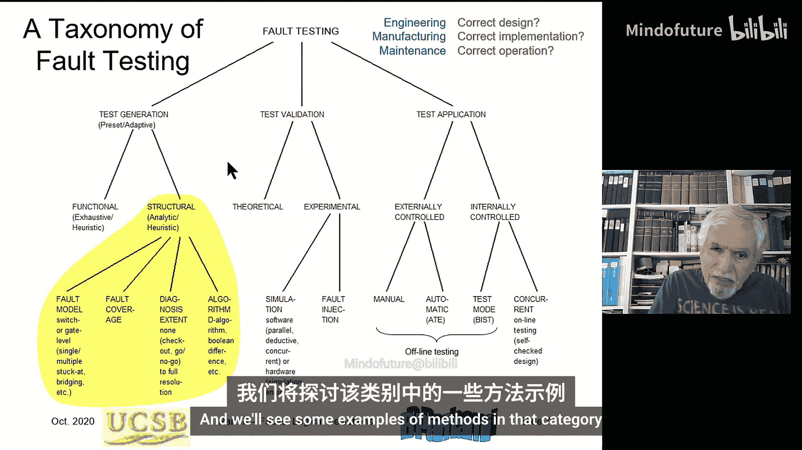

Okay， so this is the test setup， you have a circuit under test。是 you子。

And there are some faults that can occur in this circuit， so for example， this point in the circuit。

May be faulty。And the type of fault depends on the fault model that we are assuming。

In order to be able to detect this fault。We must be able to control that point through the inputs。

 circuit inputs。😔，So there must be some controllability。Of that point。

 and then we must be able to observe that point through the。F outputs of the circuit。

 so this is part of the observability， so in order to be able to test a point in the circuit。

We need controllability， good controllability， and good observability。

And we'll define these a little bit more。Precisely later on in this lecture。

Then we apply a test pattern from test pattern source can be just a table where all the tests are stored。

 or it can be some random generator test pattern generator。

And then the output of the circuit is compared against some reference value。

And if it matches the reference value， it passes the test， otherwise it fails the test。

But the reference value can also come from a table， so a particular test。

 we know what the correct output of the circuit should be we read it out from a table。

Or it can be a copy of the circuit over here that we are sure it's fault free。

Sometimes this is known as the gold version of the circuit。

So a gold version of the circuit is sitting here。And receives the same inputs as this circuit under test。

And then the output of that gold version that we know is correct is compared to the output of this。

Circuit under test and if they match， it passes the test。

Sometimes in order to reduce the volume of data。Rather than compare each output of the circuit to a reference value and make a judgment for it。

We combine the outputs into what is known as a signature。

So let's say this circuit generates a 32 bit number。Okay。

 rather than compare each 32 bit number to a 32 bit number reference value。

And then basically have a bunch of comparison results。

We combine these outputs into a single signature， let's say we X or。

All the 32 bit outputs from the circuit。and get a 32 bit number at the very end of the test process and that's known as the signature of the circuit。

 and that signature then is compared against a reference signature。

 so that reduces the number of comparisons。Of course， there's a small chance。

That even though the circuit is not operating correctly。

 the signature actually matches the correct signature。

Because basically the incorrect values when combined cancel each other and we lose。

The information about the fact that something is wrong。

 but that usually doesn't happen if these are 32 bit values。

The probability that the circuit produces the correct or youtu it signature despite something being wrong is maybe so small that。

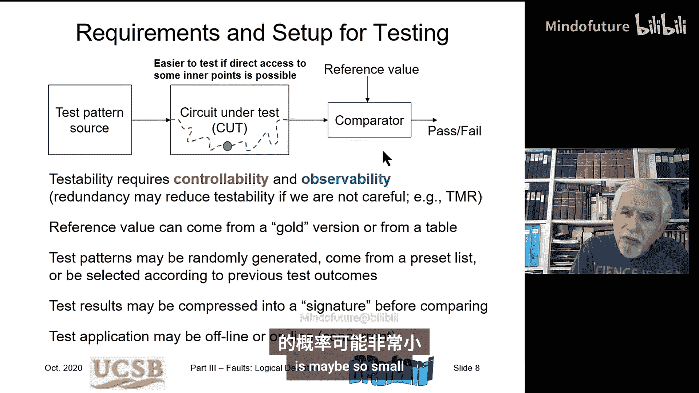

It does not worry us。Okay， now it's very important to detect faults as early as possible。

And this is these numbers don't take them too seriously， they're just。

 you know rough orders of magnitude if you detect the fault。In the component。

That may cost you a few dollars。Because the component， which is bad， is just discarded and you lose。

You lose that component if you put the bad component into a board。

And then detect the fault at the board level， you lose more money。

Because you spend more time testing and also you may have to discard the entire board。Similarly。

 at the system level， your cost increases。And if you ship a product to the customer。

And then detect the fault in the field during the use of the component。It cost you more because。Well。

 you may have to replace the customer system with it。Good system。

 and also you may have to dispatch test engineers to the customer site in order to do the testing。

So the later you detect the fault， the more costly。It becomes。And generally speaking， fault testing。

These are two codes。That they important。Because you almost never can。

Can test it circuit exhaustively。Then if you test it for a long time and you don't detect any fault。

That may not be because the circuit does not have any faults。

 it's just that your test did not detect a fault。So these are two famous codes。

Trying to improve software quality by increasing the amount of testing。

Like trying to lose weight by weighing yourself more often。

This is basically an indication of the limitation of testing。And the second one。

 the computer late computer scientist Edtzgar Dktra。

Said that program testing can be used to show the presence of bugs， but never to show their absence。

In other words， if you test the piece of software for days or months。

And you don't detect any bugs in it。That may not be because it doesn't have any bugs it's just you didn't come across them with your test。

 as I mentioned， you know you can test exhaustively。There's the limit。The effectiveness of testing。

But if a software does have bugs。Then。Appropriate testing may actually reveal。Some of those bugs。

 and we'll talk about software testing much later in the course。

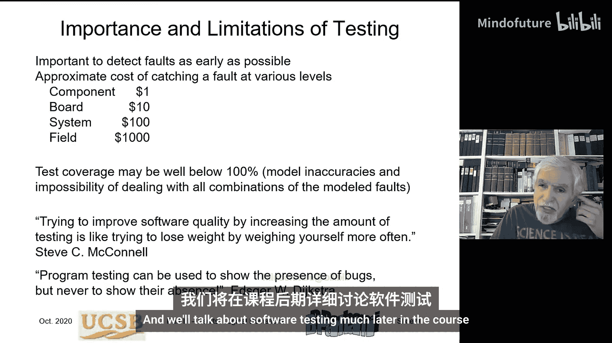

Okay， fault models。甜蜜。Consider at different abstraction levels。You can have transistor level faults。

Gate level faults。Function level fault and system level fault。

I've highlighted G here because our discussion and the rest of today's lecture will be at the gate level。

At a transistor level， of course you can be a lot more detailed。

 but that's also the downside of this kind of testing because you have a large number of transistors in a circuit。

And if you consider all the things that can go wrong with every single transistor。

 you have a large number of cases to study。Function level falls。

 so you basically test the function of a circuit， if it's an ALU or decoder or memory。

 you test the function。System level faults， which is malfunction in our terminology。

 but we'll discuss later in part five。Of the textbook。

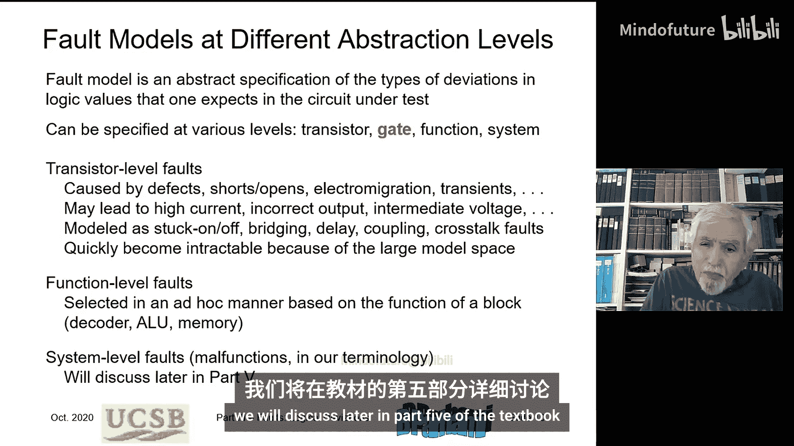

Okay， so let's focus on gate level faults。Now the simplest gate level fault models are the so called stuck。

And bridging models。 So what are stack faults？If you have a particular line and circuit， okay。

 that line can assume logical value zero。Or logical value 1。

Depending on the inputs that you supply to the circuit。

So this is basically a full eitherer circuit inputs ABC。Outllput some and carry。

If this line is stuck at zero means that this line。Permanently carries logic value zero。

Regardless of what inputs you supply to the server。Of course， this is if this is stuck at zero。

 then you're。Full add occasionally generates incorrect output， of course。

 not the S output because this line is not on the path。To us。

Notice that this line will just stuck at zero， even though it's logically the same as this line。

On the normal operation， it is possible for this line to be sta at zero， whereas these lines are not。

 so these carry the correct logical values。Well， this one is staazu。So if this line is stuck at zero。

 the output S will not be affected， but the output K may or may not be affected。Because in fact。

 the logical value on this line may be0。Correct value may be zero at a particular time。

 so in that case， stuck at zero fault on this line is basicallyeffective。On the other hand。

 if this line should carry logical value1。Then it's being stuck at zero。May cause problems。Okay。

 in order to detect。This line stuck at zero。We have to try to force it to one， in other words。

 provide inputs。So that the proper value for that line is equal to one。And then therefore。

 the correct。Circuit will have a one here， the faulty circuit will have a zero。

Then you have to be able to detect this difference between the faulty circuit and the fault free circuit and this output key。

There are other types of faults， line open faults。So for example， this one to slide open。Okay。

 this line open may actually be equivalent to this line stuck at zero depending on the logic technology that we use。

Or this line stuck at one， actually， in some cases。Delay faults is when signals are delayed。

Beyondond the normal expected range， so the signal value is not incorrect。

 eventually it assumes its' correct value， but it's delayed beyond the design limit and therefore it may cause incorrect circuit operation。

Coupling and cross talks are example of other faults。

 so we're focus in the less rest of this discussion of bridging fault， by the ways when two lines。2。

Which happen to be physically close to each other in the layout may get shorter to each other。

Sometimes this shorting is equivalent to logical or， in other words， both of these lines。

We'll assume the logical or of the signal value B。And the signal value a。But maybe also a different。

 different thing。Okay， so for the rest of our discussion to limit the amount of。Discussion。

Given our limited time， the limited time we can spend。Discussion of testing will。

Focus and stack at zero and stack at one fold。

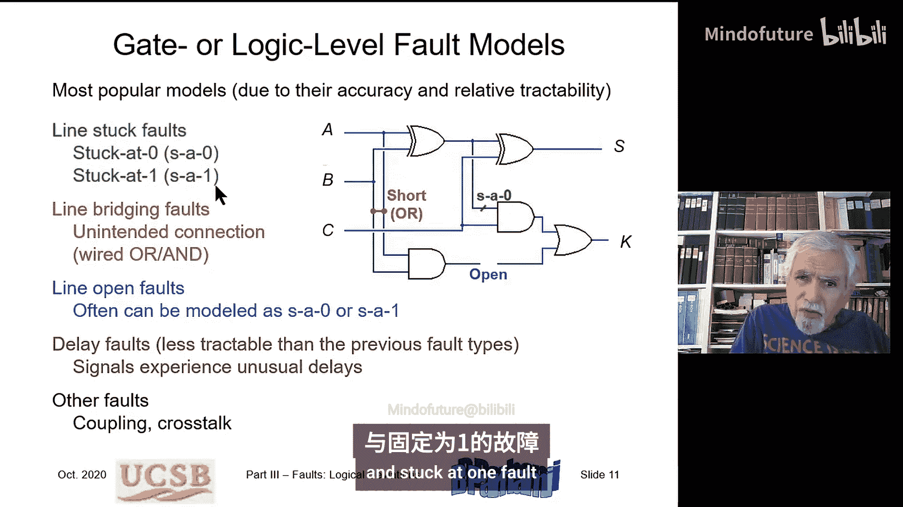

Okay， so back to this line being stuck at zero and the question is， how can I detect？

This if I can detect this。Then I've detected that particular fault。

 of course I should also consider this line stuck at one and also all the other lines stuck at zero or stuck at one。

So there will be a large number of different faults that I have to consider。Okay。

 as I mentioned when discussing the previous soil， I have to force this oops。

I have to force this to one。In other words， I want the value of this signal to be one。

And for this signal to be one， this is an x or gate， Amb must be different。So a0， B1， and or A1。

 b0 will force this line to 1， and therefore we'll try to force this line to one。So this notation 10。

Means that this line will be one。If the circuit is operating correctly。

 it would be zero if this fault is present。Okay， we use the notation D。For such a signal。

 this is known as calculus。So D on this line means that normally this will be one。

 but under this particular fault that we are considering it will be zero。Okay， so now。

The circuit will have。A different signal value on this line， depending on whether it's。Okay。

Or it's faulty。Now I have to be able to observe the difference between OK and faulty and this output。

In order to be able to do that， I have to set this other input of this end gate to one。

Because if this input is zero。The output of the sand gate will be zero regardless of the value of the signal。

 and therefore I won't be able to observe。The difference between good and bad circuit。

 so this must be set to one， meaning C must be set to one。So if this is 1 or0， this will be 1 or0。

 so this is also D。And then in order to propagate this difference。

This information through the orgate， the other input to the orgate must be set to zero。

So that I can observe the difference between good and bad circuit and this up。

Now this being zero means one of these being zero。But that's already satisfied because I said either a is1。

 b is zero or a is zero， b is one。So that's okay。Therefore。系。Determine that these two tests， A。

BC being 011。Or 101， these two input patterns。Detect this particular line， stuck at zero。Okay。

 now once I've determined the test for all the faults of interest。P stuck at zero， P stuck at one。

 M stuck at zero， M stuck at one， e stuck at zero， e stuck at one and so on。

 a large number of faults。I form a table， so this is a partial table。

That contains the test patterns for P stack at zero and P stack at one。

Or Q stuck at zero or  Q is stuck at  one， okay？The full table will have a lot more columns corresponding to all the other faults。

And here I see that Q stack at  one is detected by this test。Q stuck at zero。

Is detected by these two tests。P stack at1 is detected by this test。

And piece I at zero is detected by least。Notice that p stuck at zero and Q is stuck at  zero。

A equivalent with respect to the tests that detect them。

This is sort of obvious as if you look at the circuit， if p is stuck at zero。

Then it's like Q is instead at zero because if p is0， q will always be0。Okay。

 so the two are equivalent with respect to the tests that detect them。Okay。

 so the next thing is once I've constructed this table， select a minimal set of tests。

That detect all the faults of interest。And this is a minimization problem。

 and basically I have to find out a minimal set of tests。Cover， so to speak。

All of these different faults， okay？I'd first start usually in doing this process。

By faults that are detected by just one test， so this particular fault P that at one is detected by just this one test。

 so I have to include this test， I have no other option。Once I've included this test。

Kusta at1 is also detected。So I really don't need this upper test because Q stack at1 also is detected。

By this test。So I've covered P stack at one and Q stuck at one with this test。

I now need to cover P stack at0 and Q stack at zero on either of these two tests。We'll do the trick。

 okay， so a minimal set of tests。With respect to these just these four faults that I've listed in this table。

Is this test 001？And one of these do。Let's say 101 okay。

 these two tests together detect all four faults that I've included in this table。Of course。

 the real table will be much larger， more columns， and more rows。

 and the optimization problem is a little bit more messy。

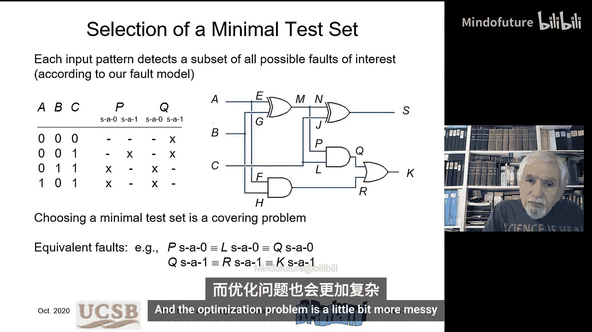

Okay。Now the D algorithm has this weakness that sometimes it gets stuck as shown in the case of the circuit。

So suppose I want to detect。Thiss S stuck at zero， and this is， by the way， a multiplexer。

 the two inputs are x and y， and this is the selection circuit。S is equal to one。

X will be forwarded to the output if s is equal to0， y will be forward。Okay， so it's a。

Pretty common circuit。 And if the the algorithm。Has problems with this， we are in trouble。

So why does the algorithm run into problem， okay， so here's D。Oh， by the way。

 I forgot to mention that。

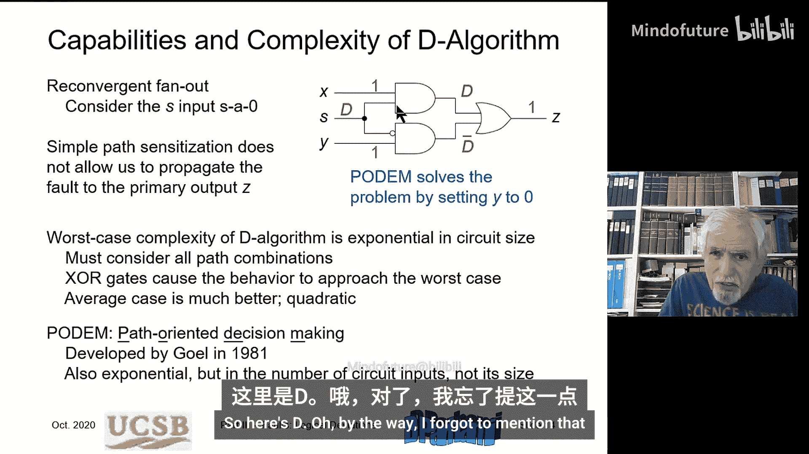

Let me go back。In trying to design test for this particular fault。We have a backward trace phase。

W whichhich determines what input values。Will' force this line to one。

And we have a forward trace phase or path sensitization that sensitize us the pan from this location of fault to the output。

The patch should be sensitized or made sensitive to the change of value on this line so that that change。

Is reflected。In the output， so this part is called Pat sensitization。The forward trace， okay。

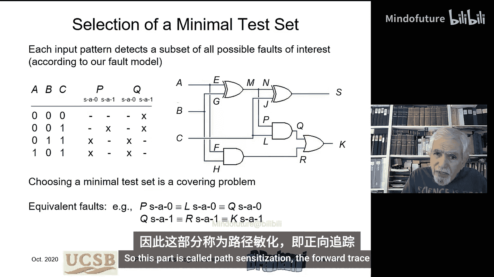

So basically because we have an end gate here。Pat sensitization dictates that this input should be one。

So that this。change from。1，2，0。Can propagate to the output， and this input should be one。

So this will be D。D and one。This will be D bar and1 D bar， and the output will be one， regardless of。

在Dvalue。So we really can detect D， so what is the problem， what caused this？

This is known as the problem that caused this is known as reconvergent fan out。

 so the signal D is fanned out into these two gates。And then there is。The two partss reconverge。

Into a single path here and this reconvergent fan out can cause problems for the D algorithm。

And intuitively in this example， we。We're really a bit overzealous in path sensitization。

All we need is to have one sensitized path from this point to the output。

 we don't really have to sensitize both of these paths。So if I set this line to zero。

Then D will not propagate， so this line will be zero here。E will propagate through the upper line。

 I will have D0， and will have D here， and therefore the information will propagate so the trouble came from the fact that I tried to sensitize both of these paths。

Whereas I didn't need that。So a modification of the algorithm called podM solves this problem。

Poem is short for path oriented decision making。And therefore。

 it pays attention to these reconvergent panouts。And tries to not sensitize both of these in order not to run into problems later。

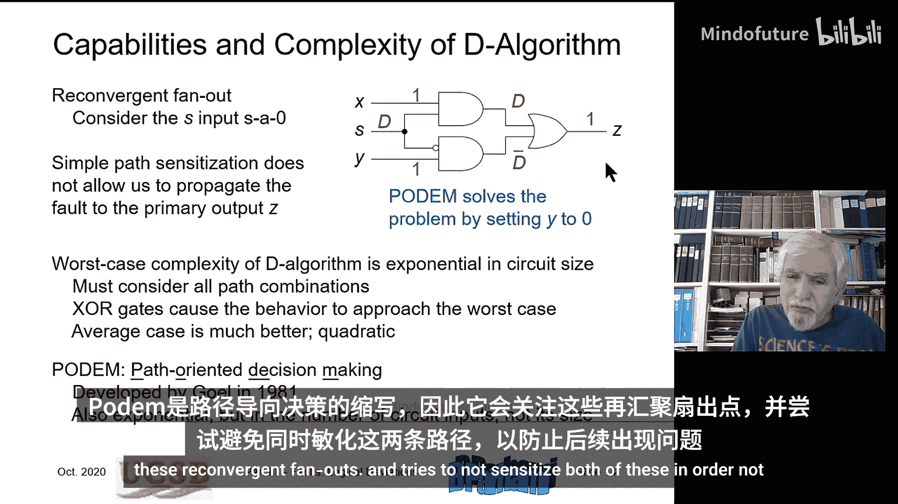

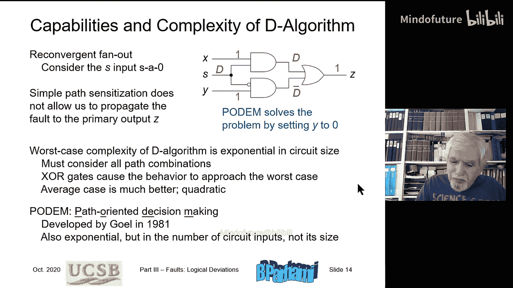

Okay， the second method， and this is more really a method that helps us understand。

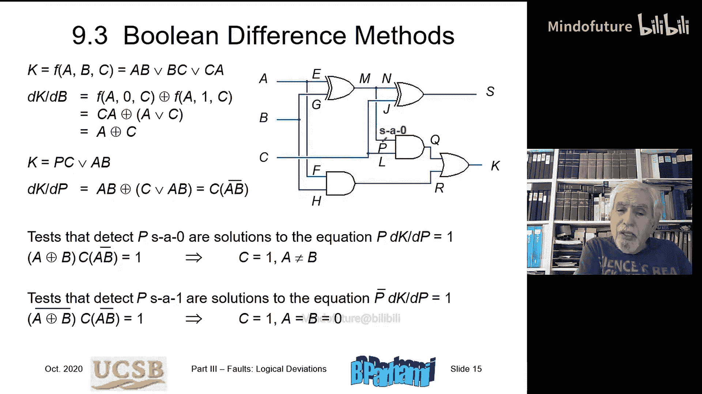

诶。诶。Test pattern generation rather than a practical method for that。For testpa generation。

 so what is Boolean difference？Well， we can differentiate a Boolean function much in the same way that we differentiate an algebraic function。

 so let's say we have this function K。Which is a Boolean function of the three variable A， B and C。

And this is the logical expression for that function， A B or B or CA。

The Boolean difference of this function K with respect to B。

 this is sort of like differentiating three variable function with respect to one of the variables。

So the Boolean difference of k with respect to B is defined as the value of the function。

When B is replaced with zero。Xor。So this is definition x ord with the value of the function when b is replaced with1。

So basically， x or remember is one when two things are different， when the two inputs are different。

So basically this we are trying to determine whether the value of the function K is sensitive to B if I change B from0 to1。

Does the value of the function change？So if the Boolean difference is one means the value of the function changes。

 if it's zero， it means the value of the function doesn't change。

 so the function is not sensitive to B。Okay， so F of 0， C。Just replace B with0， this stem disappears。

 the stem disappear to get CA。X or width。B equal to one。 When b is equal to one， you get a。Ory。

And then the CA is redundant， we can remove it A or C。And then we can simplify that to A， X or C。

In other words， the Boolean difference of k with respect to B。Is A X or C。So if I want to make。

K sensitive to B， I better select A and C。In order to make this expression equal to one。

In other words， A and C should be different。1，0 or0，1， this becomes one。

 and when the Boolean difference is one means the function is sensitive to。

A change in the value of B。Okay， now when faults are introduced into a circuit。

This line that has a fault becomes basically an independent variable。Normally， if there's no fault。

 this variableable P is a function of A， B and C。But with the presence of all。

 P becomes an independent value。So basically， I can write K as a function of the primary input and P。

So， it's P。Or C， a P and C。Or。A and B。So k has a function of the primary inputs， A， B， and C。

 and this independent variable P。

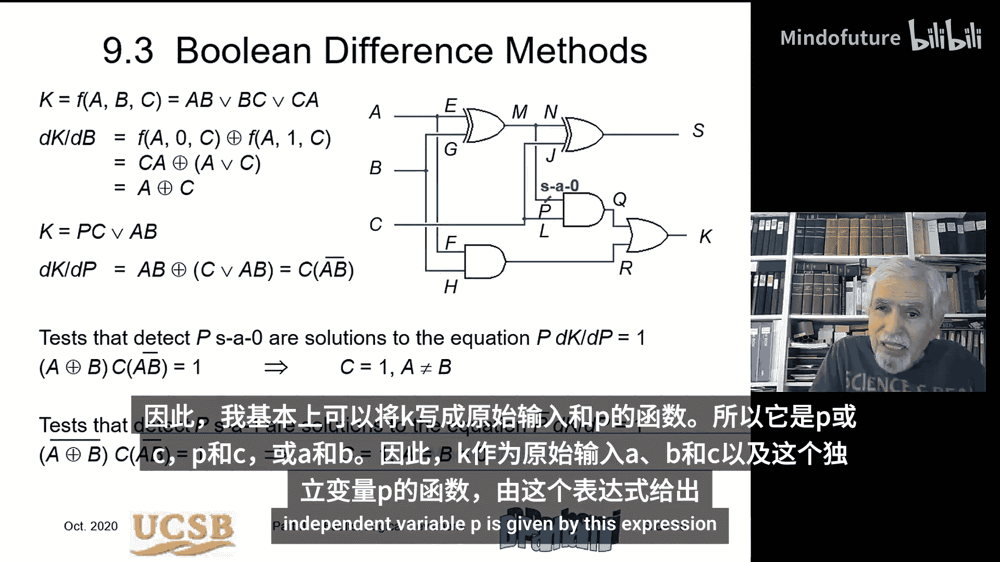

Is given by this expression。DKDP。Remember， I want to make k sensitive to changes in P。

 so Dk dp should be equal to1。So DKDP is basically。P equal to0， this becomes Ab。

X or with p equal to 1， this becomes C or AB。And then this can be simplified to this。

So this is the Boolean difference of K with respect to P。

So I want to make this function equal to one。So that K is sensitive。To a change in P。

On the other hand， I want to make p also equal to1 to detect sta at0。Therefore。

 the tests that I'm interested in are solutions to this equation。Times dkDp equal to1。

 I must make p equal to 1。I must make DKDP equal to1。So this end of these two should be equal to one。

Okay， so P is a。X or B。And DKDP is C。And。A B bar。So this expression should be equal to one。

So the tests that I'm interested in are solutions to this。Equation。Okay。

 for this to be equal to 1 C obviously must be equal to 1， this is the end of three things。

 C must be equal to 1。So once c is equal to 1。A， X or B should be equal to1。

And if a x or be equal to 1， meaning one of these is 1， one of the other one is0。

 then this will be 1。Therefore， I don't need to worry about that。So there are two tests。

 both of them corresponding to c equal to1。One of them has A0， B1， the other one has A1， B0。

 the same thing that。We determined before。Now test the detect P stack at one。

Are similarly solutions to this equation。P bar， in other words， I tried to force p to zero this time。

But DkDp must still be equal to 1， in other words， K must be sensitive。To a change in P。So again。

 this is the equation and the solution is c equal to one。And a equal b equal to zero。

 so there's just one test in this case。Okay， so this is a very nice formulation。

 it converts the problem of test generation。Finding out what tests detect。A particular。

Logic fault of interest。Two the problem of satisfiability。

 satisfiability is basically trying to see whether we can satisfy a particular logic equation。

 in other words choose the variables so that the value of this logic expression becomes one。Okay。

 of course， we know that satisfiability is an NP complete problem。And therefore。

 this gives us a hint that testing is also a difficult problem， although this is not the proof。

Now testing is NP complete。Because we showed that testing。

Can be converted to a problem that is MP complete。We really should do the opposite， in other words。

 we should show that an MP complete problem can be converted to testing in order to show that testing is MP complete。

But that's， in fact， the case。 We can prove that testing is。MP complete。

And I'll show you the proof in a few minutes。

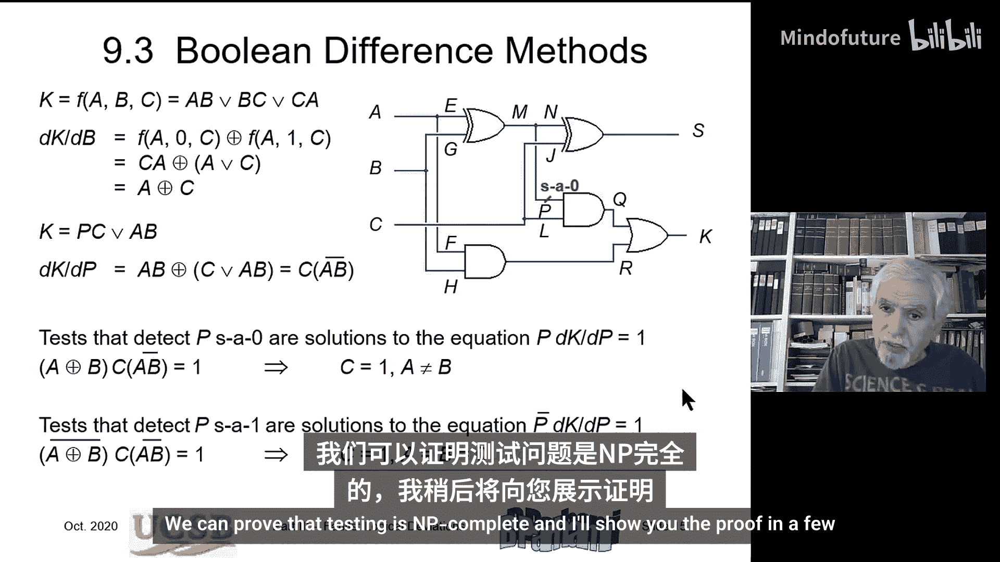

So the satisfiability problem。This is basically a decision problem。

 is a boolean expression satisfiable， in other words。

 can we choose values for the variables in that expression to make the result equal to one？

This is known to be MP Comp that was proved a long time ago by Cook 1971。In fact。

 Cook also proved that this。Special case， seemingly simpler case of satisfiability known as3SAT is alsomp complete3S is basically satisfiability with a logic expression。

That is a product of three term or clauses。In other words， it's a product of。Cluses。

 each clause has only three terms in it， three variables or complemented variables in it。

 and theyre all together。Okay， so we just saw that Boolean difference formulation converts fault detection to the SA problem。

To prove MP completeness of fault detection， we need to show that SAAT or some other MP。

 any other MP complete problem can be converted to fault testing。

And this proof is due to Ibarro and Sanni 1975。A simple alternate proof by Fujiwara is in the textbook。

If you are interested， you can read that that's a much simpler than the original Ibarra and Sony group。

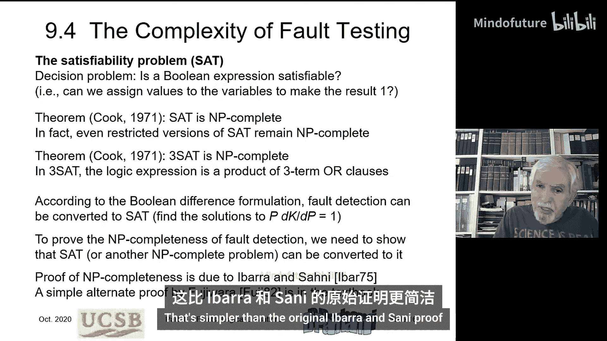

Okay， so this is an outline after proof。We know that3SAT is MP complete。In fact。

 the reset with the further restriction。That each of the clauses is monoton， in other words。

 a clauses monoton。If。Each if it contains the three terms， the three terms it contains。

A both either all complemented or all uncomplimented variables， but not both at the same time。

So this is basically a special case of three SA。Which is also known to be NP complete。Okay。

 now closed monoton sat can be converted to fault detection in a circuit。

And the remaining steps of the proof basically show that I won't go through this。

 details are in the textbook if you are interested。

And you are not required to do it unless you're curious to see how such proofs go。

So fault detection is NP complete， meaning it's a difficult problem。And we don't have。嗯。

Good algorithms for it， efficient algorithms for it。

Algorithms tend to be exponentially exponential in time。

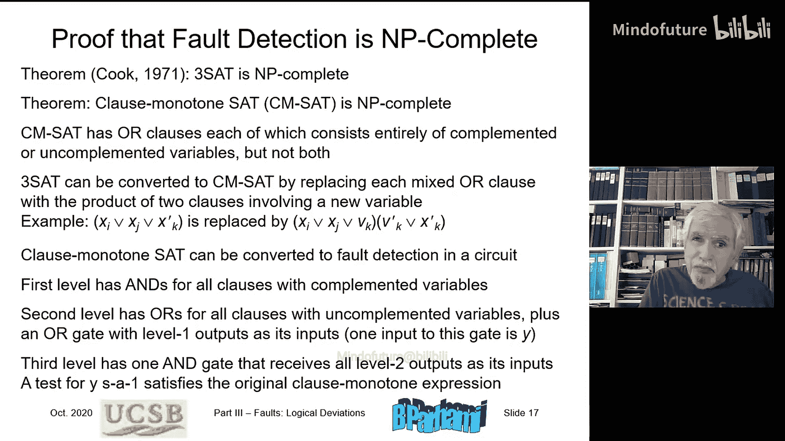

So we need heuristics， like any other MP hard problem。

 we need heuristics for fall testing and there are a whole bunch of heuristics available for it。Now。

 so far we have been talking about testing a combinational circuits。If circuits are sequential。

 in other words， they have memory， testing becomes much， much harder。

Because the presence of memory flip flops。Provides the circuit with states。And therefore。

 not only we have a large number of input patterns。

 the circuit can be in a large number of possible states。

 and the combination of large number of inputs on a large number of states basically makes fault testing much harder。

So when we apply an input sequence。The circuit moves through its states。And therefore。

 we have no idea which state it's in。And therefore。

 not only we have to apply inputs to exercise different parts of the circuit。

 we have to exercise the circuit moving through different sequences of state。

Okay， so it's much， much harder。Testing of memory is a subject that has received a lot of attention。

And。Because memory is basically a common component of many digital systems。So if you have， let's say。

 an SM or DM， how do you test that to see that it's working correctly？

A simple minded approach would basically write the all zeros pattern and all once pattern into every memory word。

The thinking being that if we can store zeros， all zeros。

And all ones in a memory word that means the individual cells。Can be changed to zero。

 they can be changed to one， therefore they should be okay。

There's a lot of problems with this argument。First of all。

 this approach does not test the access and decoding mechanism when you write into a particular location in memory and say。

 okay， I could store zero， read it out， read out zero。I can store one， read it out。

 notice that it's all ones。But how can you be sure that this pattern or this pattern was stored？

In location 1000， for example， that you're trying to test。

Because if the decoding circuitry doesn't work correctly。

Then this may be stored in a different location and read out from that location。

So you tested another location， not location 1000， so that's one problem。

Many memory faults are pattern sensitive。In other words， this cell， when you store all zeros。

 it works correctly， when you store all ones this cell。

So this cell can be changed to zero and it can be changed to one。

But whether or not you can change the cell from zero to 1 or vice versa may depend on the contents of neighboring cells in memory。

 these cells are so close， so tightly packed to each other。

That sometimes it generates pattern sensitivity， in other words。

 whether or not you can reliably store a zero or a one in a cell may depend on the content of neighboring cells that are very close。

In space。So this pattern sensitivity means you have to test a lot more cases。

To have a reasonable confidence that the memory is working correctly。Furthermore。

 memories tend to have dynamic faults。That are exposed for specific access sequences。

So if you stored this pattern in the word then a different pattern and a different pattern。

 that sequence of patterns。May actually reveal a fault。

In one of those memory cells that does not exist for a different pattern。A value stored。

 So this is these are dynamic fault， so to summarize testing memory。Is non trivial。

And there's a lot of research on the topic， different strategies。Of course， none of these。

is completely foolproof because we cannot test memory exhaustively given all these dependence on you know the pattern sensitivity。

 dynamic faults and so on， but there are good heuristics that allow us to develop reasonable confidence that the memory is working correctly after we have put it through。

And in fact， this is done when you。Bd up， a computer， part of the Bu up process。

Is subjecting the memory or at least part of it。2。😔，Riggorous testing。

And then using that part of the memory that was tested in order to run diagnostics and other parts。

The CPU and so on。Okay， that's enough for us to know about memory testing。

 just remember that it's non trivial and a lot of research。

Has gone into it。Okay， I'm going this section has not been written yet， so nothing to talk about。

 I'm going to go now to chapter 11。And discuss a little bit。Design for testability。

So if testing is difficult。We better not design a circuit than then worry about。

It'sTing because it may be very difficult to test。We should aim to build testability into our circuit。

In other words， design the circuits to be easily testable。Okay， so that's the topic of。This chapter。

As I mentioned before， a complex unit such as a microprocessor cannot be tested。

Soly based on its input and outputward behavior。Because it has many， many inputs and many outputs。

 and you cannot exhaustively test a microprocessor。Okay， so you have to have a strategy。Be heuristic。

To design a test that does a reasonable job of detecting faults in the microprocessor。

So we should design the microprocessor or any other complex unit。With testability in mind。Okay。

 as I mentioned before， testability is a function of two things， controlability。And observability。

In order to be able to test。Whether point a in a circuit is faulty。

 we must be able to control that point from primary inputs and we must be able to observe that point。

On primary output。Okay， later we'll talk about controllability and observability in quantitative terms right now it's just qualitative。

Point A is controllable if we have reasonable control over it from the input and it's observable if we。

Can observe。That point reasonably well through the output。

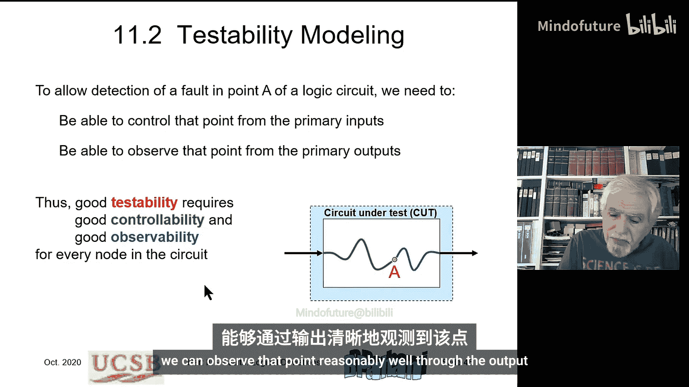

Okay， so let's now try to quantify controllability there are other ways of quantifying controllability。

 so i'll just discuss one method to just give you a sense。Of what。This is about。So， the control。

Controllability of a line in the logic circuit is a number between means zero and1。

Zero means it's not controllable at all， one means it's fully controllable。

And numbers in between basically are sort of intermediate values。Okay。

 a primary input of a circuit is fully controllable， so in this circuit you see。

Controllability of this line is one， that's probably a primary input。

To circuit because I can put any value I want on that input。Therefore。

 I can fully control this particular line。These other two lines are not fully controllable。

 they have smaller than one values that are smaller than one， so they probably come from。

Other circuit components。Okay， so suppose I've already determined the controll abilities for these three lines。

Inputs2 or three input end gate， what is the controllability of the output of that end gate？

So controllability quantification proceeds from inputs。Two outputs， we start from the input。

 assign them controllability of one。And then proceed through the circuit and assign controllability values to other lines in the circuit until I get to outputs。

Okay， for a gate or other logic element。We define what is known as a controllability transfer factor。

For this gate， I'll show you how it is derived， it's 0。25。

So if the controllability transfer factor is 0。25 for this gate。The controllability of its output。

Is the average of input controll abilities times the controllability transfer factor？

So the average of 1。3 and 0。5， these are 1。8 total divided by 3 is 0。6。So 0。

6 times the controllability transfer factor， which is 0。25， gives you 0。50。ok。

So the only remaining thing is to show you how we derive this controllability transfer factor because the rest is just mechanical if you have the input control abilities。

And if you have the controllability transfer factor。

 you just multiply the average input controllability by the transfer factor to get the output controlability。

Okay， the controllability transfer factor for a gate or other circuit element is defined as this one minus。

The number of input patterns that force the output to zero。

Minus the number of input patterns that force the output to one。

Divided by the sum of those two values。Now for an end gate， there are eight possible input patterns。

 seven of which force the output to zero。And one of which forced the output to one。Okay。

 the only way to make the output equal to  one is to have 1，1，1， all three inputs equal to1。

 so one of the eight input patterns makes the output equal to1。Seven make the output equal to0。

So1 minus seven minus1。Divided by7 plus1。So7 minus1 is6，7 plus one is eight。Six，8 or three for。

 one minus three for is one for。Get intuitively。This has poor controllability transfer because it's much easier to make the output equal to zero。

🤢，Then to make the output equal to one。If I had an X or gate， an X or gate。Has two inputs。

And one output。Two of the four input patterns make the output equal to zero。

2 after four input pattern make the output equal to1。

 so if I use this formula I will have 2 minus20 controllability transfer factor is one for an x organ。

Okay and that's because in an ex or gate it's equally simple to make the output equal to zero。

And to make it equal to one。And therefore。Networks built of Xor gates。

Have good controllability for their internal lines， whereas networks built of end and or gate。

Basically， lose controllability as we proceed。Through。The circuit。

 these numbers become smaller and smaller as we get deeper and deeper into the circuit okay now。

An important point here is that these numbers do not have any physical significance。

In other words here you see a controllability 0。3 this 1。15， which is half of that。

 the fact that it's half of that。There is no physical significance。It's just。

Sort of an indication this has。Poorer controllability compared to this one。

So that's the only thing these numbers indicate whether controllability between two lines， you know。

 comparing them， whether one is better than the other one， okay。

 the actual numerical value has no physical。Significance。No interpretation。

Other than a smaller number is worse than a larger number。

 one is of course ideal for controllability。Okay， so if we have a circuit and we notice that this point in the circuit has very poor controllability。

We can insert a test point there。In other words， this is a test point。

And through this control point I can control this point okay。

 so normally I have to control that point through primary inputs and because signals go through a large number of logic levels。

 controllability is poor if I insert this text point text point so that I sort of decouple。

This signal from this point。And then provide an external access point。So that I can control。

 so in testing this blue part， I now have full control over this line and therefore it's easier to test。

This part。Compared to the case where I had to test this part by providing inputs through this yellow box。

Okay。😊，So poor controllability is an indication that I perhaps want to insert a test point。

Over there， okay， now observe oh， by the way， fan out。If the controllability of this line is C。

Then the controllability of these。Fan out branches。Is this is an empirical formula， again。

 it has no physical significance， a C divided by1 plus log 2 F。So for example。

 if this branches out into two lines， the fan out。F will be  two， log 22 will be 1。

 so it will see over2， so if this were a two way fan out。

 each of the branches would have controllability C over2。For three way。

 it's a little bit less controllability okay， so basically it means I cannot really control these three lines very well individually。

有。You know whatever I put here will go on all three of those。

 so individual control is lost over those lines。But why this particular formula that's empirical and that's been shown to work well in practice。

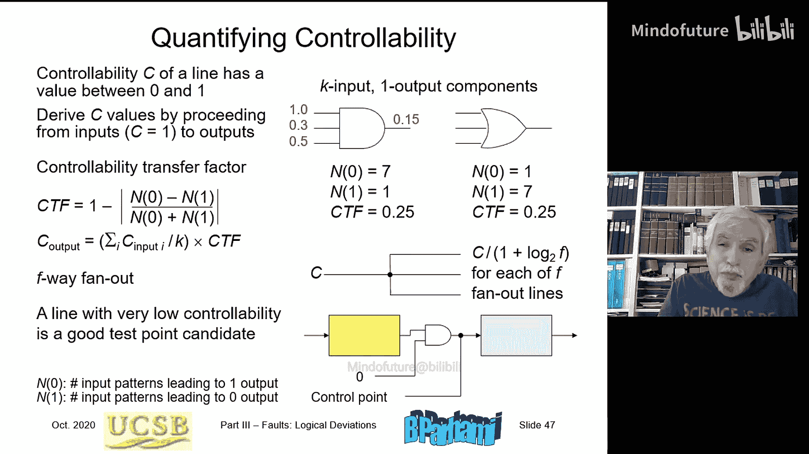

Okay， observability is similar except for observability， we move from the output toward the input。

 so a primary output line has。Perfect observability。Observability of one， and then we move backwards。

By computing what is known as observability transfer factor for various circuit elements。

 so if I know that the observability of this line is 0。6。

And the observability transfer factor for this box is 0。25。

 then each of these observ abilitiesities will be one fourth of this。So， this is。you know。

This has fairly good observability 0。6， it's not perfect。These。Have worse observability， because。

They have to go through the skate before getting here。

So how do you compute observability transfer factor？

So observability of input is observability of output times observability transfer factor 0。6 times。

0int25 is 0。15。Observability transfer factor is given by this。Equation。

This is the number of input patterns that sensitize the pad。Divided by number of。

Input patterns that sensitize the path。Plus， the number of input patterns that inhibit the path do not sensitize。

 so this is basically total number of input patterns。So， the more。Imput pattern sensitize the pad。

 the larger the observability transfer factor， so why is it 025 here。

 so suppose there is a fault on this line。On the top input to this end gate。

In order to sensitize the path。I have to set both of these other inputs to one。

So one of the four patterns sensitizes the path。Three of the four patterns do not sensitize the pattern。

So the number of patterns that sensitize the pattern is one。The number that inhibit the path is 3。

So this is four total number。So one divided by four。So again， because this is a n。

 if this were an x or gate。Okay， and it had two inputs and this were stuck。

Then no matter what I put on the other line， zero or1。The output will depend on this okay。

 so if this is D using the d calculus notation， this is x or okay， imagine this is xor。

 one input is D， the other input is1。Then this will be。Dbar。If this is d and this is zero。

 this will be。D。Okay， so the output in both cases depends on the。Faly input。

 and therefore the observability transfer factor therefore x or is also one。Okay。

So X or is pretty good with respect to testability in circuits because it has。

Controllability and observability transfer factors of one。Again。For find out。

 if you have the observabilityities of the。Outpward side of the fan out。

You get the observability of the input using this equation。

So suppose each of these has observability 05。0505。5。So each of these terms will be 0。5，12。

The product will be 18， this will be 7，8。So observability of this line is better than those because basically you can observe this。

Through three different paths， so these will go to different parts of the circuit。And therefore。

 even the observability of these lines was。05 H， this one would be78s。嘅见。

There's no physical significance to why this formula is used that has been。

Demonstrated to work well in practice， it's an empirical formula and therefore this。Again。

If the observability of this point。Is poor。Because it has to go through this blue part of the circuit to get to primary output。

I can provide an observation point here。By basically。

Making the signal go through here and then be observed through here。Okay。

 so the test point can be used for observation point。

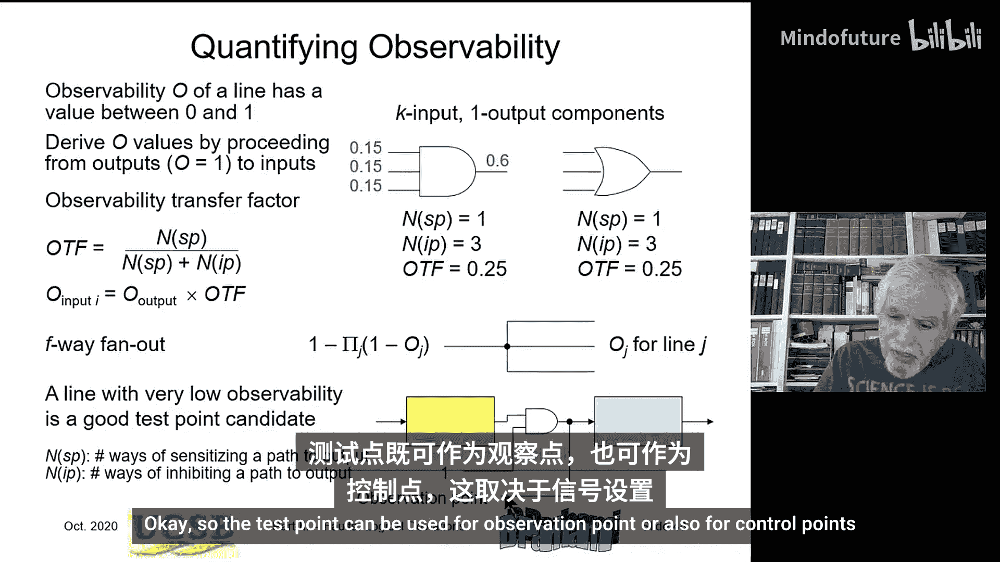

Or also for control points。Depending on this signal， if you set this signal equal to zero。

You decouple the signal from the other side and this becomes a control point。

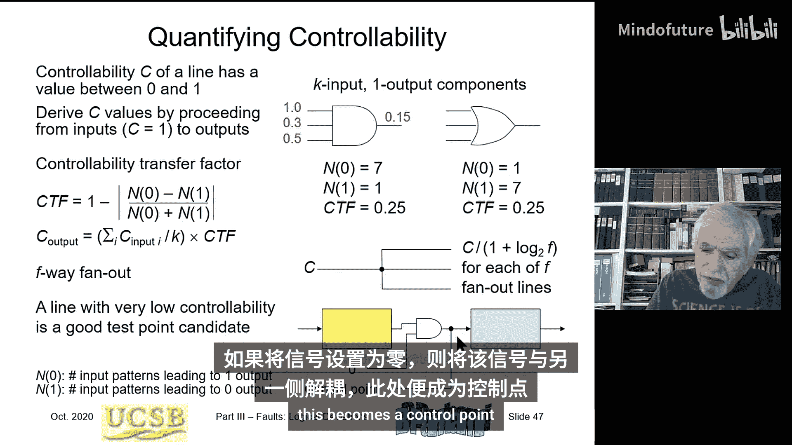

If you use one here， you propagate this and then you can observe。

The signal directly without it having to go through more circuitry。

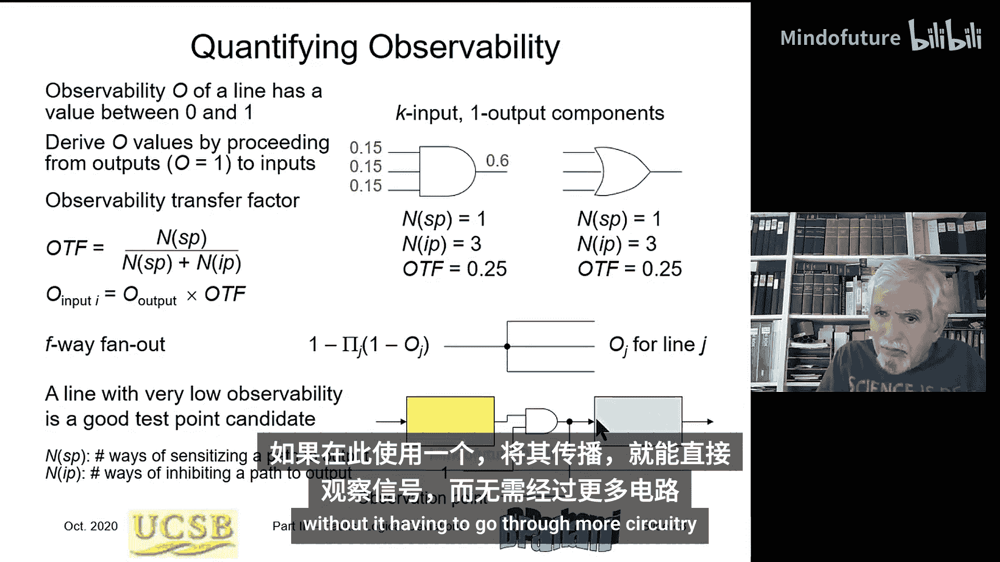

Now controlrollability is basically the product。

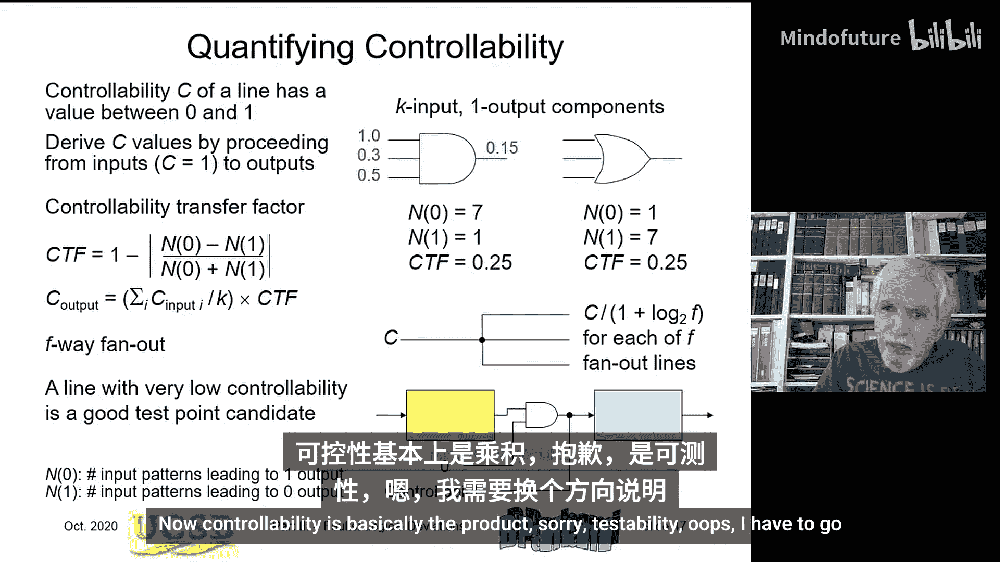

Sorry， testability。

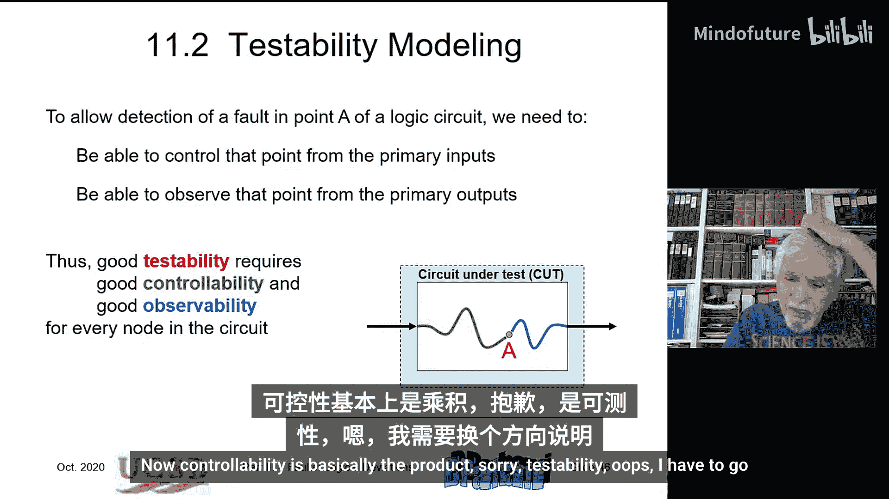

Oops， I have to go in the other direction。Testability is the product of controllability and observability。

 the intuition being that good testability requires good controllability and good observability。

So if both of these are equal to one， test will be equal to one， if one of these is equal to zero。

 then testability will be zero。If this is one half， this is one/ half， then this will be one fourth。

Okay， so in the previous examples， we obtain these controll abilities。

For the input and output lines of an endgate and these observ abilitiesities。

 you simply multiply these 0。6 times 0。15。And then you can see that among these lines。

This one has the worst testability。This one is the best stability。Okay， again。

 the relative magnitudes。Do not have any physical significance just the fact that this is the smallest number means。

 so if I had just one， if I had enough room for just one test point。

 then I better put that test point over here because it has the smallest test ability。Okay。

 if I want to put two test points， then perhaps I can put the two test points on this。

So normally I'm dealing with a much larger circuit。

 so I look for points that have poor testability in order to decide where to put the test points。

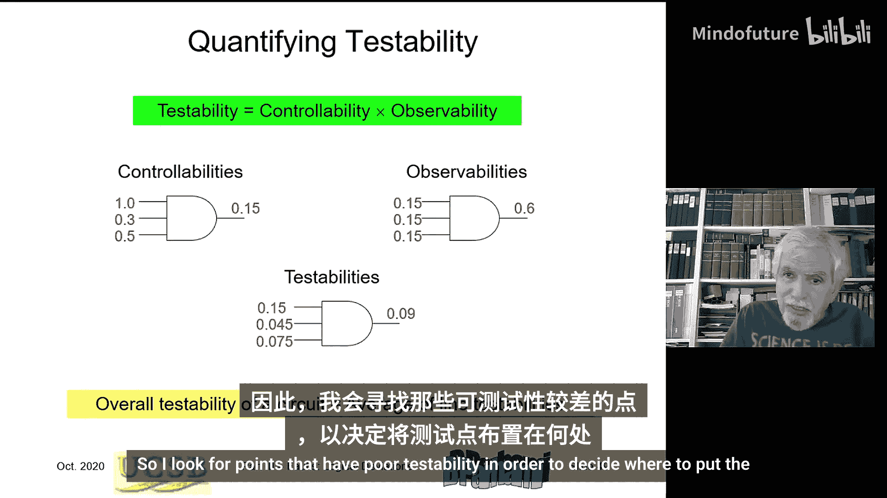

Okay， let me skip the slide。

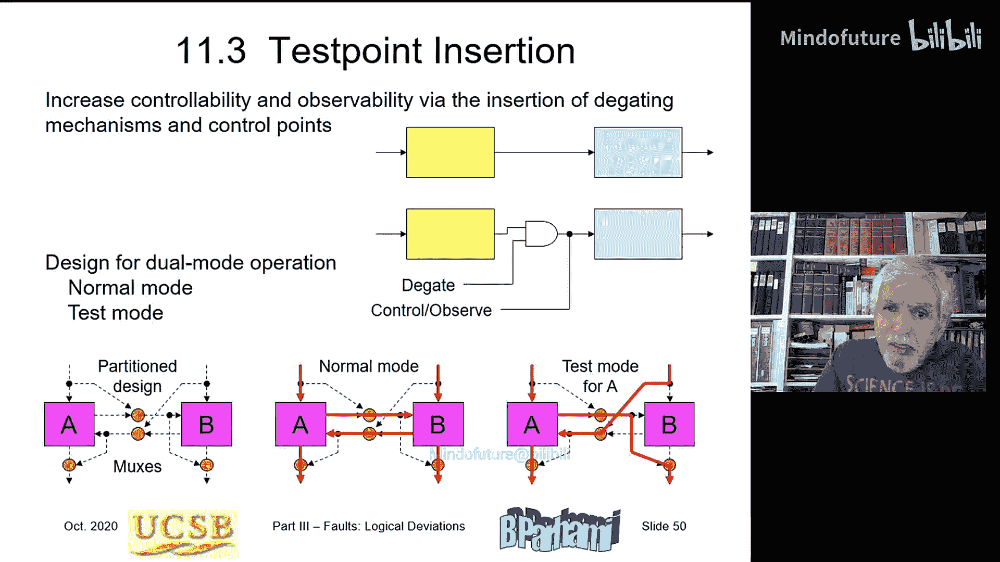

In order to improve the testability of sequential circuit。

 one of the methods is the so called sequential scan technique。And what is this method？

So this is a typical sequential circuit， which has a combinational part and a bunch of flip flops that are fed。

That are set by the combinational part and also they are。

They affect the operation of the combination so that if you provide some input and these flip flos are in a particular state。

 then the output will be determined as well as the next state of these flip flows。

So this is sort of an abstract model of a sequential circuit。The problem。

 as I mentioned for testing sequential circuit， is that when you provide input。

And these flip flops have a particular state while you are testing the combination， let's say00。

 you are testing the combinational circuit with these inputs being zero and zero。Then。

In the next time step， this may become 01。So now you have 01， so the next test will be applied to 01。

 it would be nice if you can test the 0 zero state。With other inputs。Okay。

This is done by providing a mechanism for you to be able to set desired values into these flip flos because the values into those flip flos。

🤢，Are dictated by the operation of this combinational logic and input。

 they are not fully under your control。Okay， so we have poor controllability over those flip flos。你好。

If you provide yeah。It switches。So that under normal mode。

This signal is rooted to the flip fl and this signal is rooted so the normal。

Normal connections are established in the circuit during a special test mode you can supply through this line an arbitrary value to go into this flip fl。

And then basically by shifting a sequence of values。

You can set those flip flos to an arbitrary pattern， so for example， if you shift in00。

 the flip fls will be set to 00。And then you supply some input。

 basically you're now testing the combinational logic。With those flip fls being 0， zero。

You don't let those flipfls change， you maintain the test mode。And therefore。

You supply another input and test the combinational logic。Again， with those flip flops being0 zero。

 so this basically gives you。Full control over the contents。

Of those flip flops as you try to test the combinational knowledge。Of course。

 you have to supply a lot more tests because then you have to test。For the case of 01，10，11。

 but at least you have control over the contents of those flip flos。Okay。

 if a circuit has a lot of flip flos， then perhaps you don't want to put all of them in this scan path because then it takes a long time to shift values into them。

By the way， as you shift new values into the flip flops， you also read the old values。That where。

 so this is like a shift register， you shift a new set of values and you read out。

The content to see what was generated by the combinational circuit。And put into the flip flow。

So if there are too many flip flops， then perhaps you can decide to use a subset of the flip flops。

The ones that are more critical in some way。Into the scan pad in order to reduce the length of the scan pad。

 and then these two perhaps are not all that critical and you leave them out。So that's partial。

Scan design。Okay， so scan design allows you to have。Good controllability and observability。 Okay。

 you can control the contents of the flipflop by shifting arbitrary values into them。

 and at any time you can view。The contents of those flip lover as you shift out。

The values through this hat and see what was in those flip flops。

So improve the controllability and observability of the flip flos。

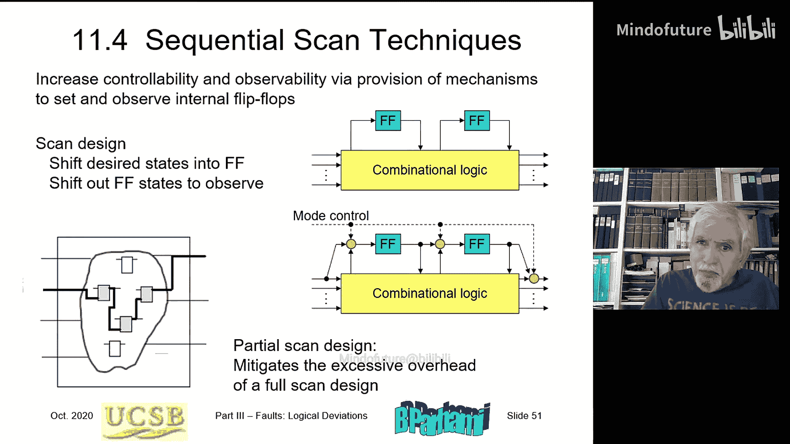

Okay， this is one way in which this idea can be used for。Testing a component。

So suppose you have a simple chip， of course， chips normally have many more inputs and outputs。

 but let's take a toy example。In which we have five parallel in。Pins into the chip。5 parallel outs。

And some control pins。So basically， you can test the digital circuit， whatever it is here。

By putting a desired pattern into these cells。Therefore， apply this。嗯。

Apply an arbitrary input pattern that you want to this digital circuit and then observe the output。

So you scan in。A particular pattern。To be used as input for this digital circuit。

And then you observe the output through the scan out。

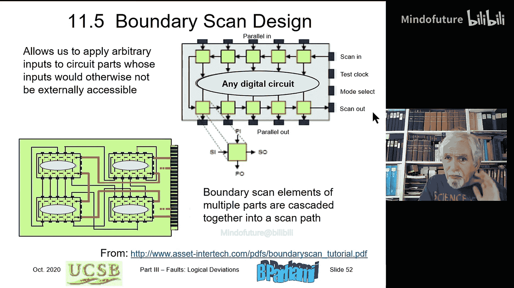

Moode select basically says whether we are in normal mode， in normal mode basically。

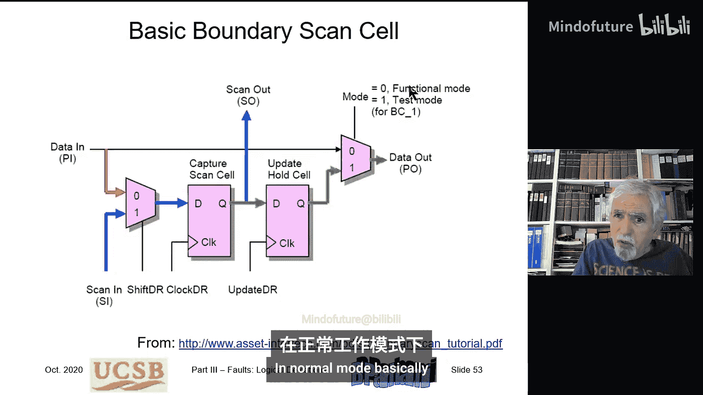

Inputs， primary inputs are led to the circuit， so these boxes become transparent as if they are not there。

 inputs are supplied to the circuit and the outputs go out normal。Under test mode。

Then these boxes do not let inputs to go through， but take values from。The scan path。

And this is an example of how you can use multiple components on the circuit board。

By cascading together their scan path， so the scan path for this component。

Is connected to the scan pad of this one。Through the scan pad of this one。

And then the scan pad of this one。 So you have one huge scan pad that。

Basically encompasses all four components in this particular circuit。Okay。

 so this is the design or one particular design for these yellow boxes that you see in the diagramgram。

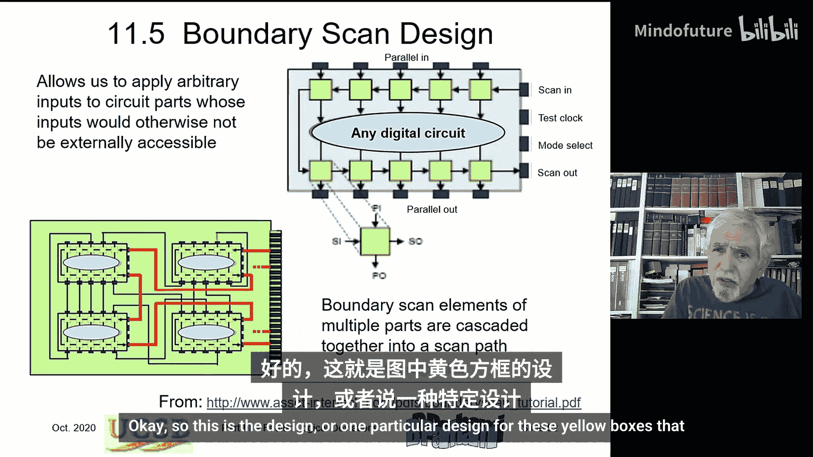

So when you want those boxes to be transparent， you set this multiplexer so that data in。

Goes directly to the chip。Or the chip output goes directly to the pin output pin。

When you want to do the scan part。Then you scan in， so this is basically the scan path。

 you scan in arbitrary input into this flipfl。And then from there to the next one。

 you shift in whatever you want。Meanwhile， as you are setting the contents of this flipfl。

This one is isolated and is holding the old values so you can overlap。

The scan input with the previous test， so previously you put some set of values here。

And you are now testing the circuit with these set of values through the test path， the green path。

But simultaneously with that test being in progress， you' are shifting in a new set of values。

So that when that test is over， you simply transfer these values here and now use those for testing。

While you input yet another set of values。So this saves time because you overlap the shift in and shift out of the scan pattern with the actual testing。

 this is sort of a leader follower arrangement。So you set the leader to whatever pattern you want while the follower is keeping its old contents and is using it in the test mode。

And then when this test is complete， you transfer these new values here。

Do the new test while also loading a new set of values into the scan pad。

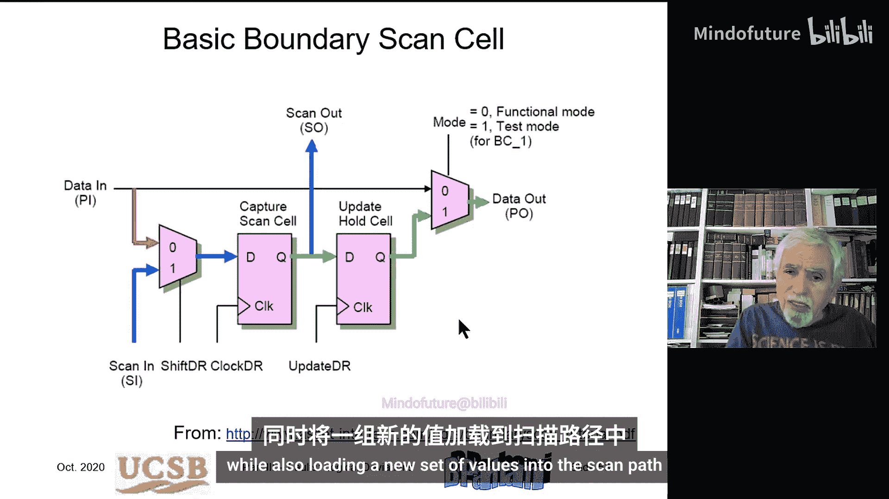

Built in test self tests test pattern being applied from outside。The circuit that you build。

 the chip that you build has an internal test pattern generation。Circuit capability。

And then once in a while， when the circuit is idle。

A test pattern generator supplies it with test and then decides whether it did well in that test。

So the idle cycles of the circuit are used internally to the chip。

By this built in self test capability to ensure that the circuit is working correctly。

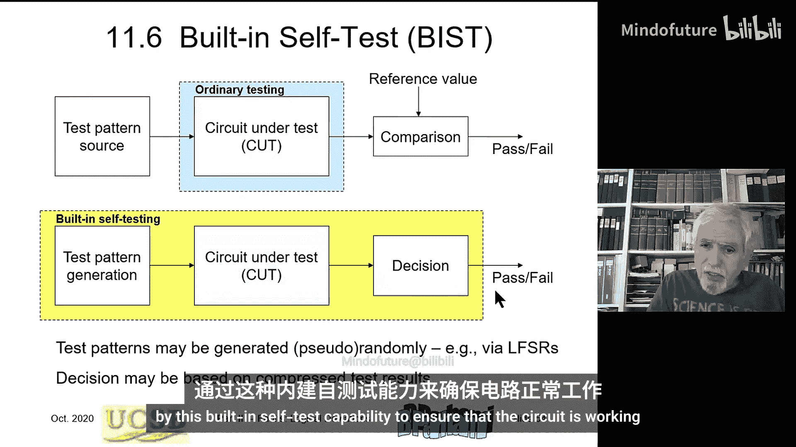

Okay， so this is all I wanted to say for。Testing， fault testing and design for testability and the next lecture we will talk about fault masking and some practical methods for using it in actual digital circuit。

Bye for now， stay well until the next lecture。