# 容错计算：第7讲：故障检测与可测试性设计

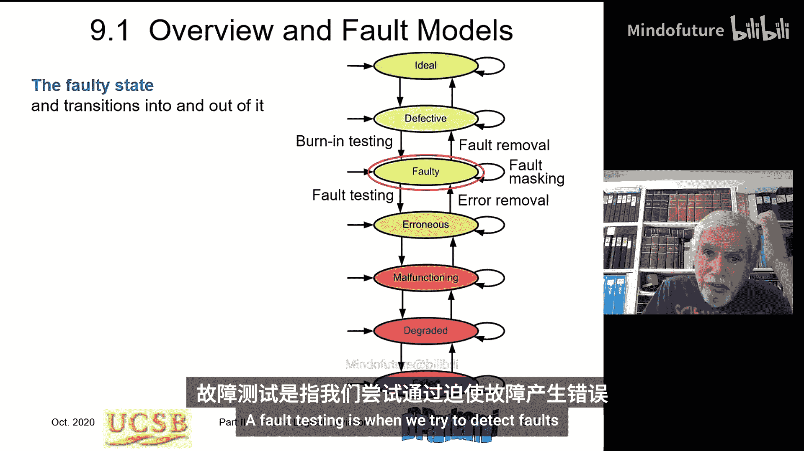

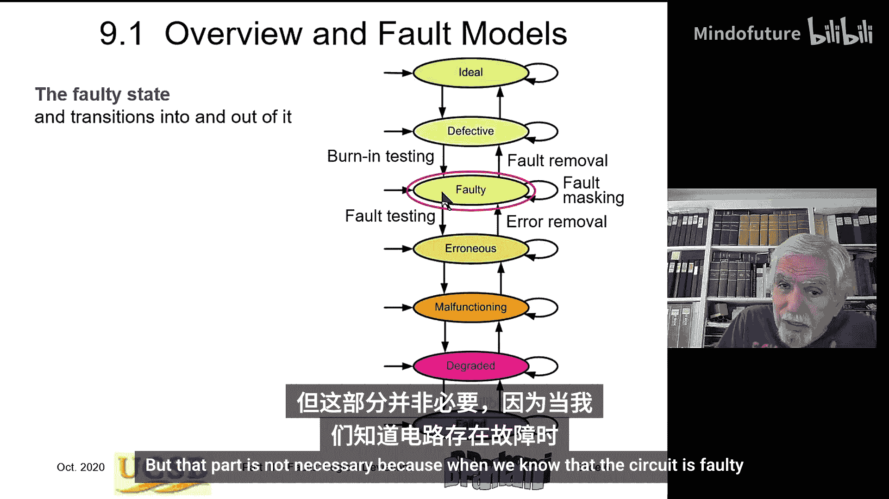

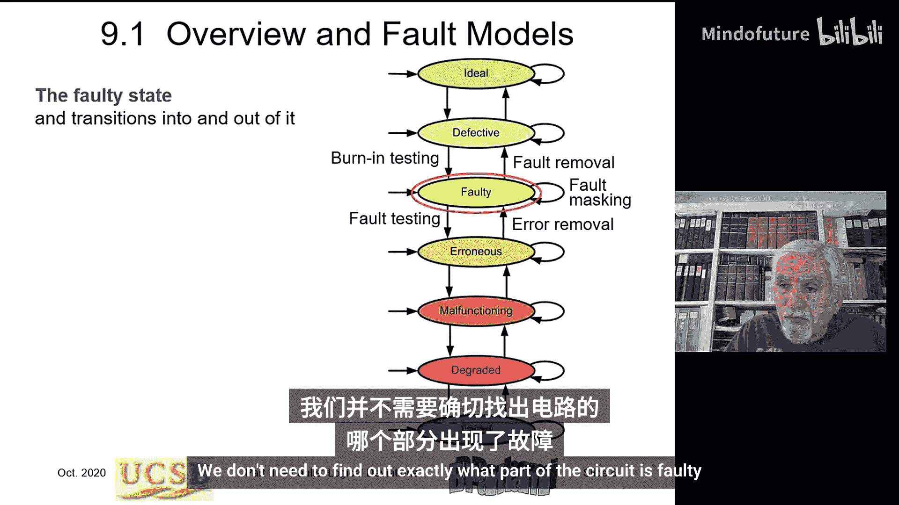

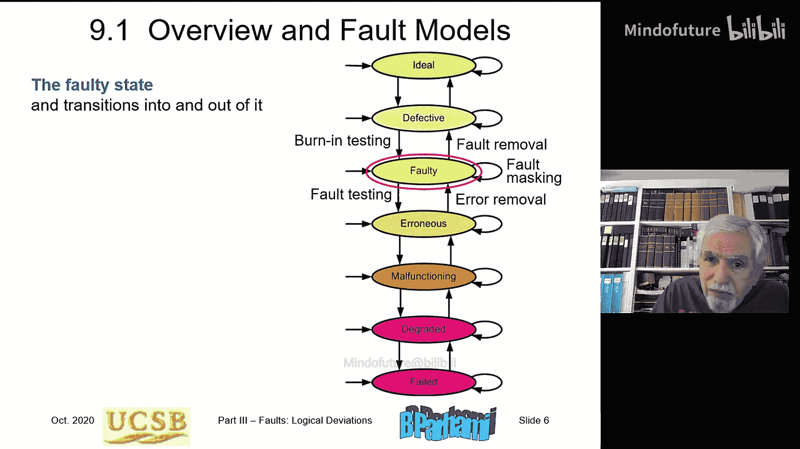

在本节课中，我们将学习故障检测的基本概念、方法以及如何设计易于测试的电路。课程内容涵盖教材的第9章（故障测试）和第11章（可测试性设计）。

## 概述

故障测试旨在通过强制电路中的逻辑故障产生可观测的错误，从而检测故障的存在。与之相对的故障掩蔽，则旨在防止系统从故障状态进入错误状态。本讲将重点讨论故障测试，特别是结构测试方法，并介绍如何通过设计提高电路的可测试性。

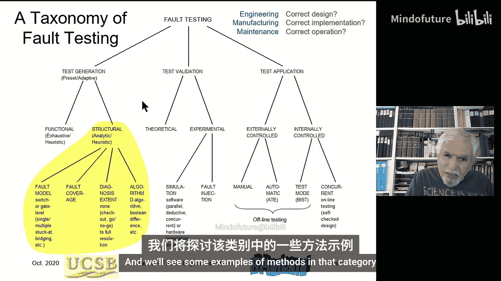

## 故障测试简介

故障测试的过程通常包括三个部分：测试生成、测试验证和测试应用。

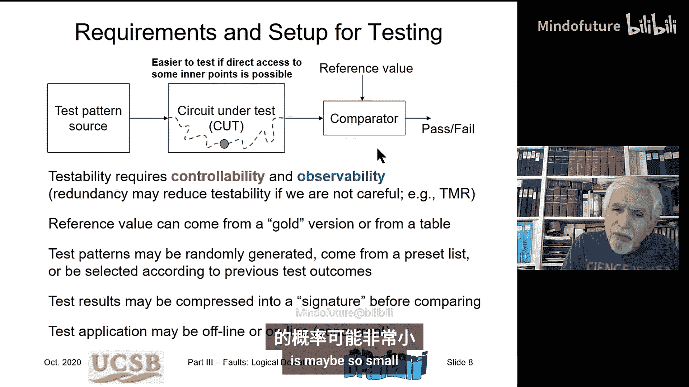

上一节我们介绍了故障测试的基本目标，本节中我们来看看测试过程的三个核心环节。

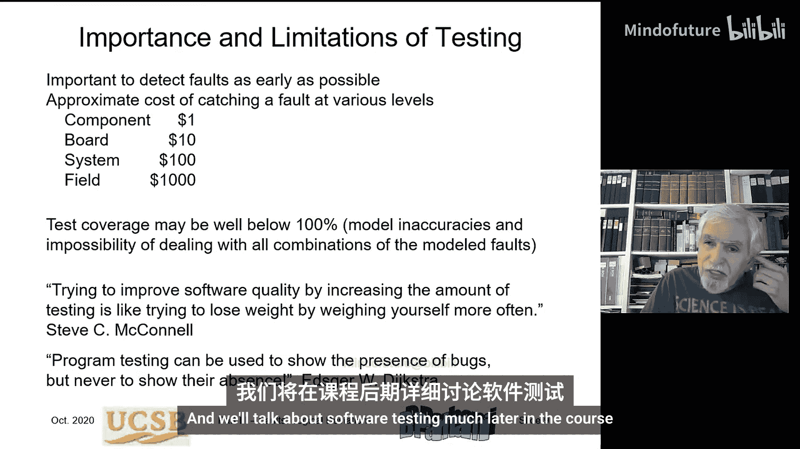

以下是测试过程的三个主要部分：
*   **测试生成**：确定用于检测故障的输入模式。可以是预设的，也可以是自适应的。
*   **测试验证**：通过理论证明或实验（如仿真、故障注入）来确认测试的有效性。
*   **测试应用**：将测试模式施加到被测电路上，可以是外部控制（如自动测试设备ATE），也可以是内部控制（如内建自测试BIST）。

## 结构测试与故障模型

由于功能测试（将电路视为黑盒）通常不切实际（例如，测试一个32位加法器需要2^64个输入模式），我们更常使用结构测试。结构测试基于对电路内部结构的了解来生成测试。

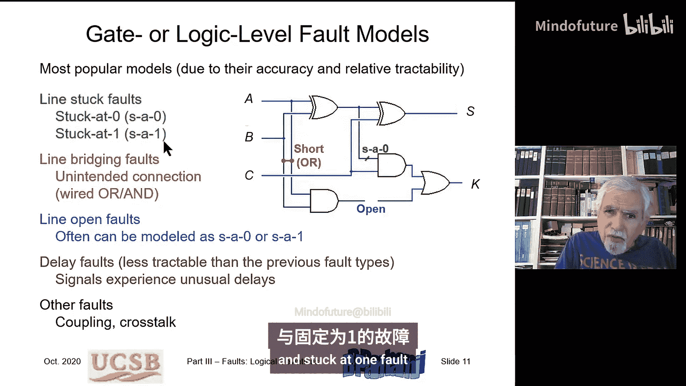

为了进行结构测试，我们需要从故障模型开始。

以下是结构测试的几个关键概念：
*   **故障模型**：定义电路中可能出错的类型。在门级，最常用的模型是**固定型故障**，即某条信号线永久固定为逻辑0（`stuck-at-0`）或逻辑1（`stuck-at-1`）。
*   **故障覆盖率**：目标检测的故障比例（例如99%）。
*   **诊断程度**：目标是仅判断电路好坏（`go/no-go`测试），还是精确定位故障位置。

## D算法：一个测试生成示例

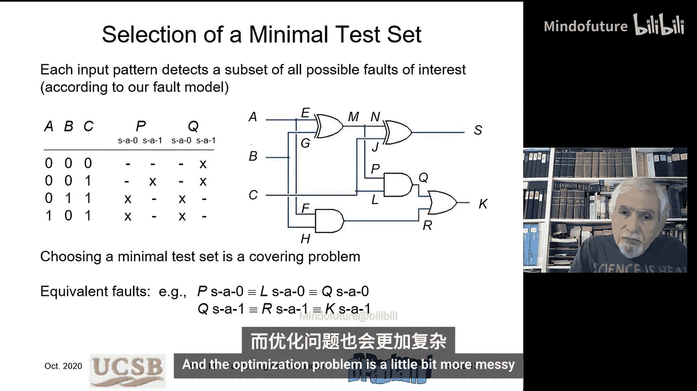

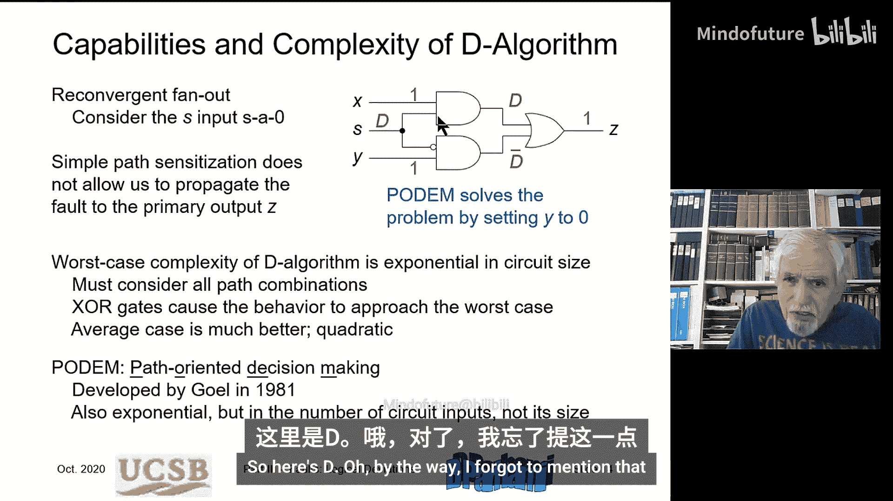

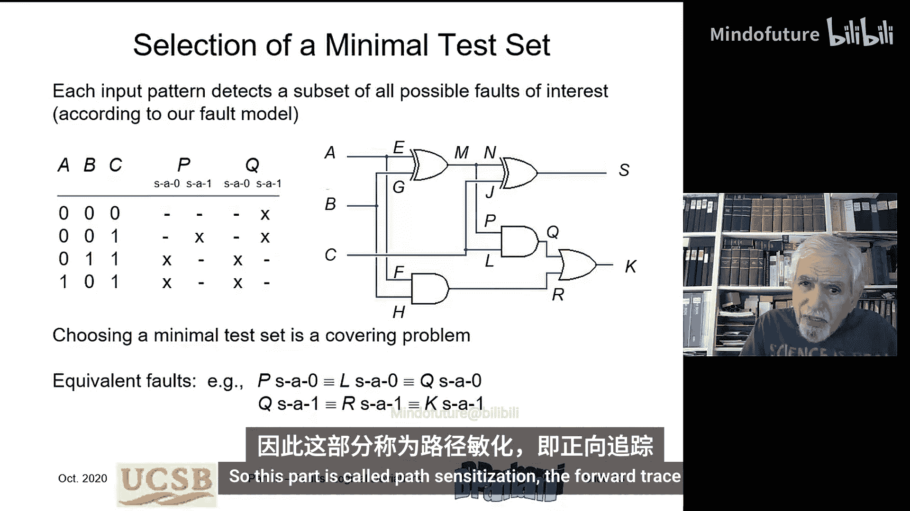

D算法是一种经典的结构测试生成算法。其核心思想是通过**反向追踪**确定能激活故障（例如，迫使某条`stuck-at-0`的线呈现逻辑1）的输入值，并通过**前向追踪**或**路径敏化**，将故障效应（用`D`表示正常值为1/故障值为0，`D̅`表示正常值为0/故障值为1）传播到可观测的输出端。

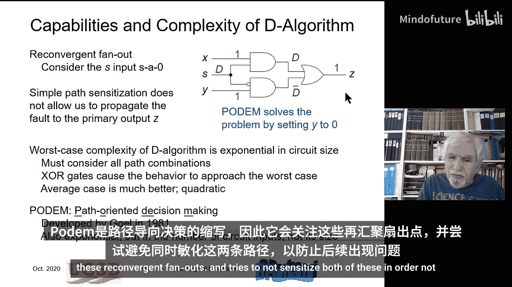

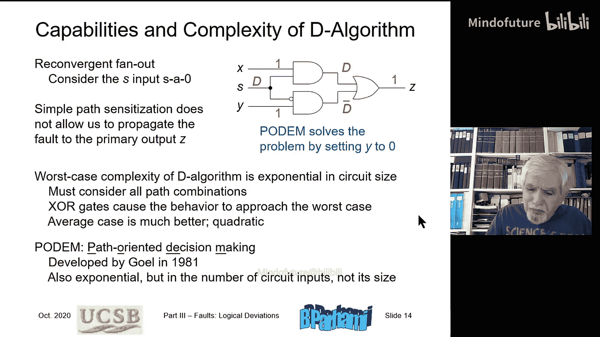

考虑一个简单电路，我们想检测图中P点`stuck-at-0`的故障。
1.  **激活故障**：要使P点在正常电路中的值为1，需要A和B不同（即A=0,B=1或A=1,B=0）。此时，正常电路P=1，故障电路P=0，该点信号值为`D`。
2.  **传播故障效应**：为了将`D`传播到输出K，需要设置C=1（使与门另一输入为1），并设置其他输入使或门的另一输入为0（该条件已由步骤1满足）。
3.  **确定测试向量**：因此，能检测P点`stuck-at-0`的测试输入为`(A,B,C) = (0,1,1)` 或 `(1,0,1)`。

对所有关心的故障（每条线的`stuck-at-0`和`stuck-at-1`）重复此过程，可以生成一个测试表，然后通过优化选取最少的测试向量集合来覆盖所有目标故障。

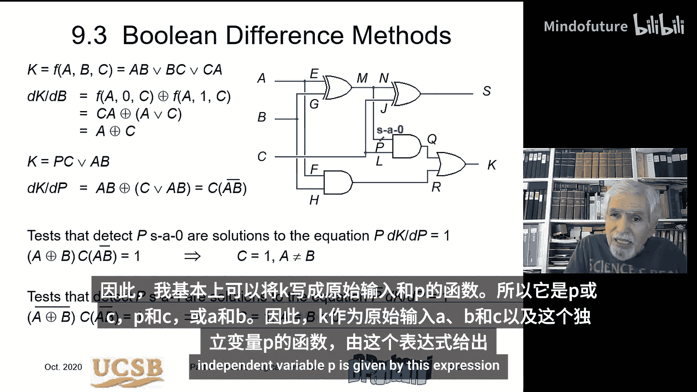

## 布尔差分法

布尔差分法提供了另一种理解测试生成的视角。它将检测特定故障的问题转化为一个逻辑等式可满足性问题。

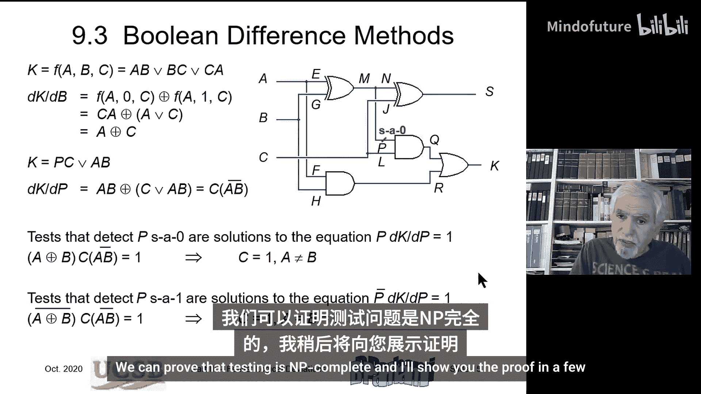

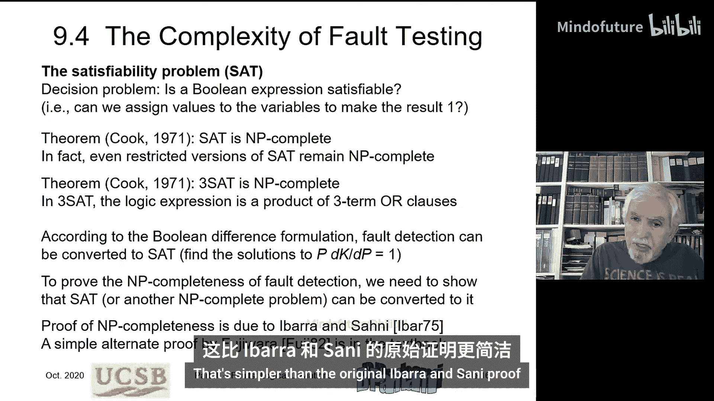

函数`K`对变量`B`的布尔差分定义为：
`∂K/∂B = K(B=0) ⊕ K(B=1)`
当`∂K/∂B = 1`时，表示`K`的值对`B`的变化敏感。

对于电路中某个因故障而变成独立变量的点`P`，要检测其`stuck-at-0`故障，需要找到满足以下等式的输入：
`P · (∂K/∂P) = 1`
其中，`P=1`用于激活故障，`∂K/∂P=1`用于将故障效应传播到输出。求解此等式即可得到测试向量。

## 可测试性设计

如果测试本身很困难，那么在设计电路时就应该考虑其可测试性。可测试性主要取决于两个因素：**可控性**和**可观测性**。

上一节我们了解了生成测试向量的算法，本节中我们来看看如何通过设计让测试变得更容易。

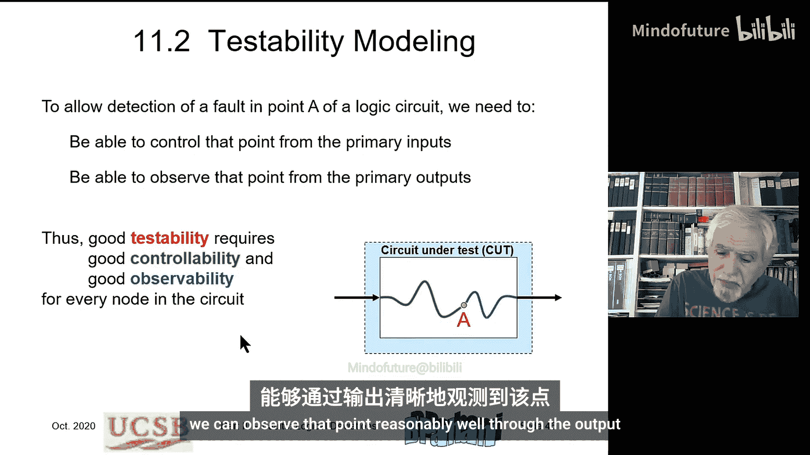

*   **可控性**：从原始输入端控制电路内部某个节点难易程度的度量。
*   **可观测性**：从原始输出端观测电路内部某个节点难易程度的度量。

### 可控性与可观测性的量化

我们可以为电路中的每条线分配一个介于0（不可控/不可观测）到1（完全可控/可观测）之间的数值。

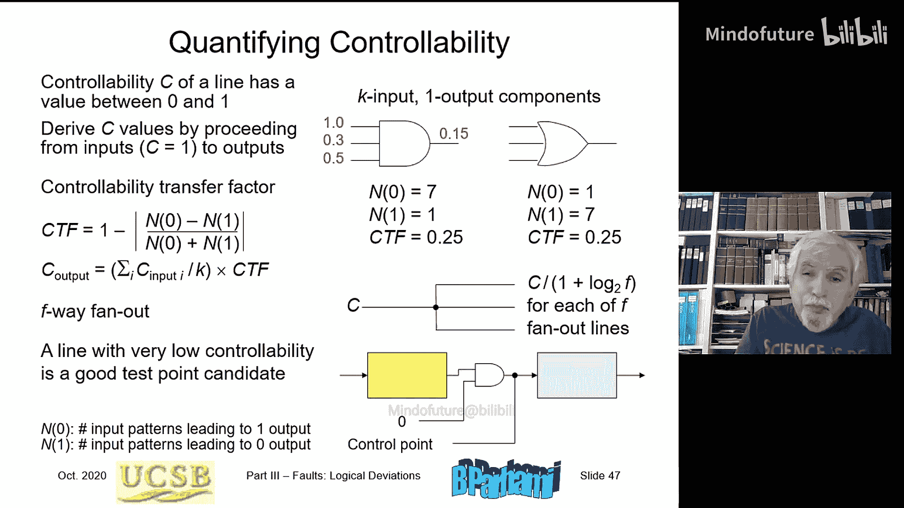

**可控性计算（前向传播）**：
1.  所有原始输入的可控性设为1。
2.  对于门电路，其输出可控性 = （输入可控性的平均值） × （该门的可控性传递因子）。
3.  可控性传递因子计算公式为：`1 - |#(输出为0的输入模式) - #(输出为1的输入模式)| / #(所有输入模式)`。
    *   例如，三输入与门有8种输入组合，7种使输出为0，1种使输出为1。其传递因子 = `1 - |7-1|/(7+1) = 1 - 6/8 = 0.25`。
    *   异或门（XOR）则具有很好的传递因子1。

**可观测性计算（后向传播）**：
1.  所有原始输出的可观测性设为1。
2.  对于门电路的某个输入，其可观测性 = （输出可观测性） × （该输入到输出的可观测性传递因子）。
3.  可观测性传递因子 = `#(能敏化该路径的输入模式) / #(所有输入模式)`。
    *   例如，对于三输入与门，要敏化顶部输入到输出的路径，需要另外两个输入均为1，只有1/4的组合满足，因此传递因子为0.25。

**可测试性** 被定义为该点可控性与可观测性的乘积：`Testability = Controllability × Observability`。数值越低，表示该点越难测试。

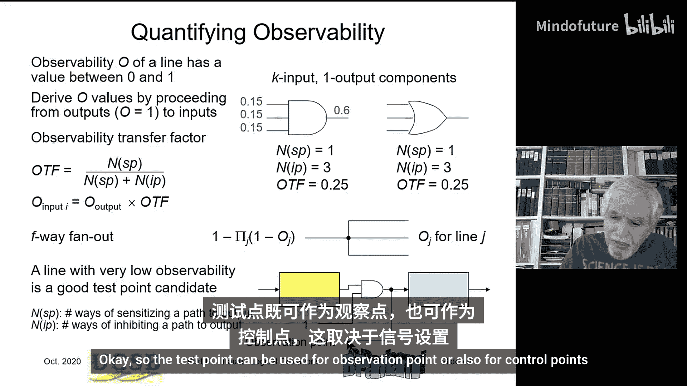

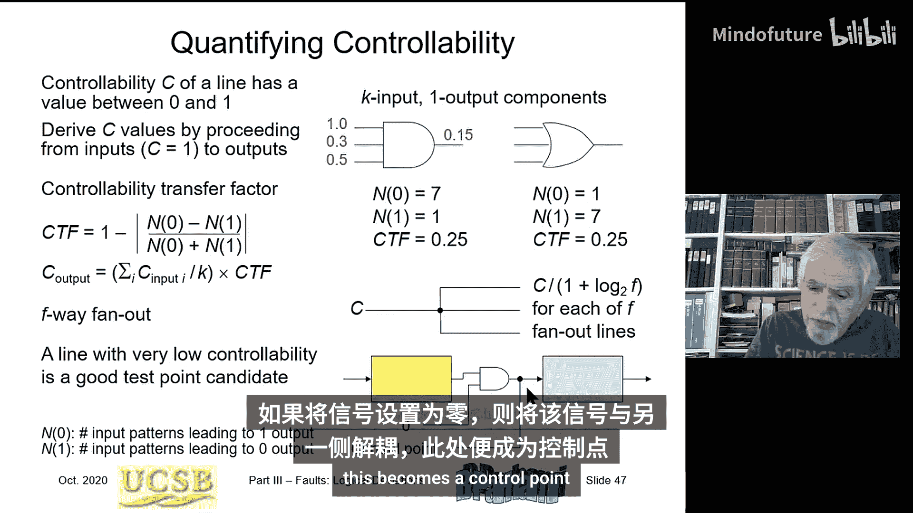

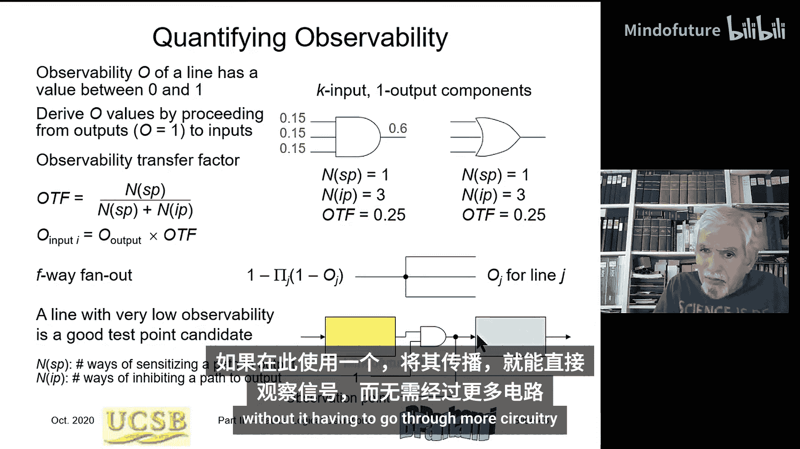

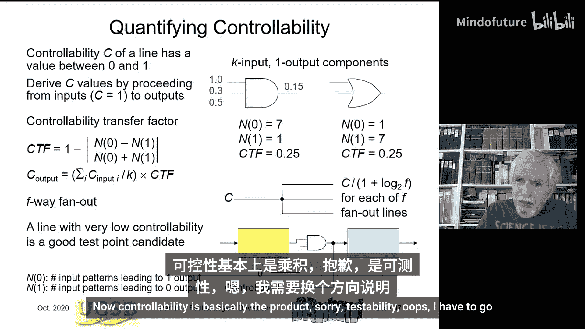

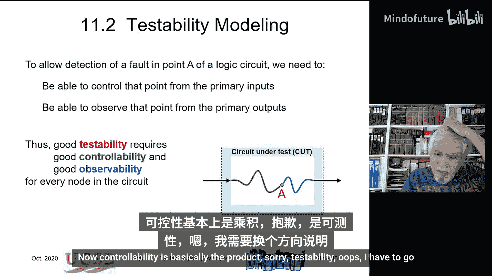

### 提高可测试性的技术

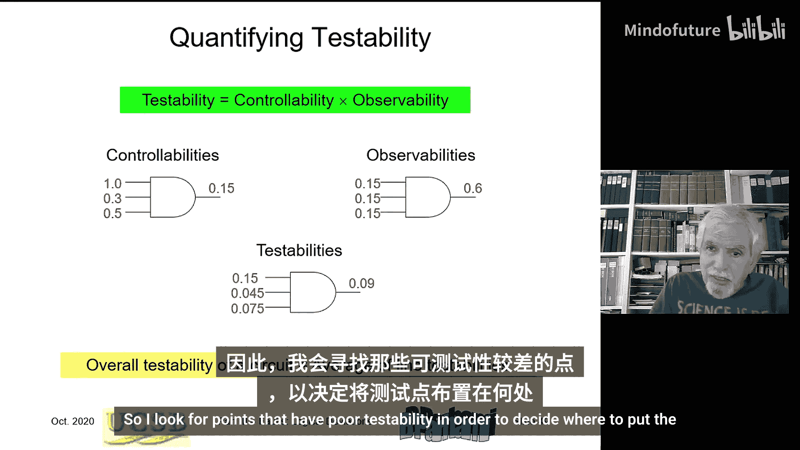

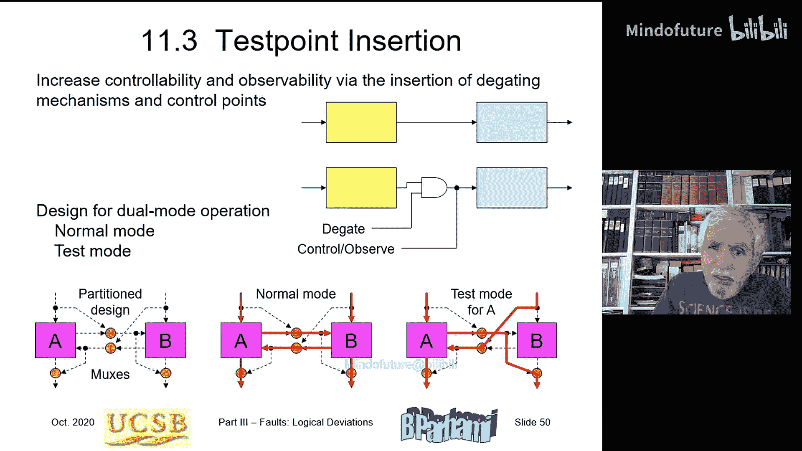

如果电路中某点的可测试性很低，可以通过插入**测试点**来改善。
*   **控制点**：插入一个多路选择器，在测试模式下可以从外部直接注入信号，提高可控性。
*   **观测点**：插入一个缓冲器，将内部信号直接引到外部引脚，提高可观测性。

对于时序电路，其测试比组合电路困难得多，因为内部状态（触发器内容）难以控制和观测。**扫描设计**是解决此问题的关键技术。

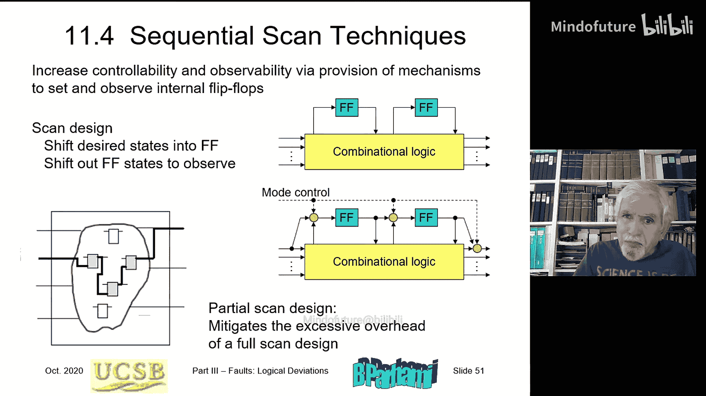

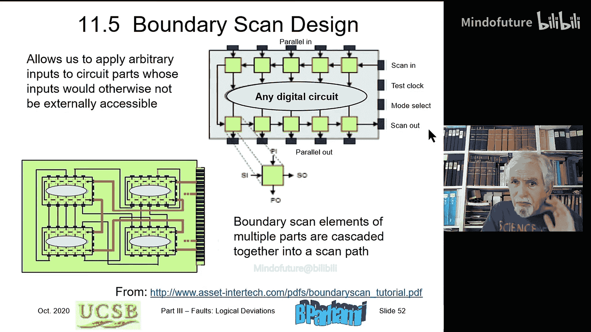

以下是扫描设计的基本原理：
*   将电路中的触发器连接成一个或多个**扫描链**。
*   在正常模式下，触发器正常工作。
*   在测试模式下，触发器构成一个移位寄存器。我们可以通过扫描输入端口将任意测试向量串行移入（设置电路状态），执行测试后，再将结果状态通过扫描输出端口移出观察。
*   这样可以显著提高时序电路内部状态的可控性和可观测性。**局部扫描**和**内建自测试**是此技术的进一步发展和应用。

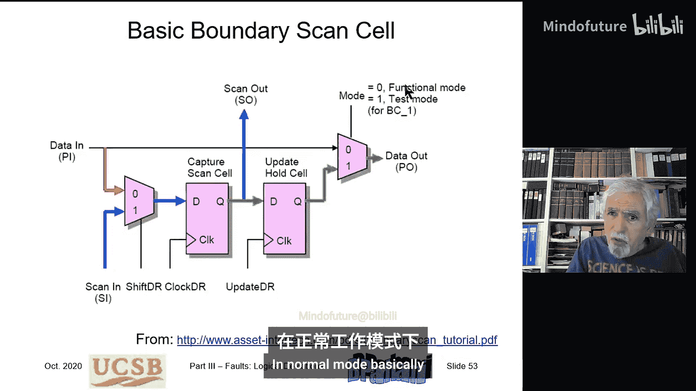

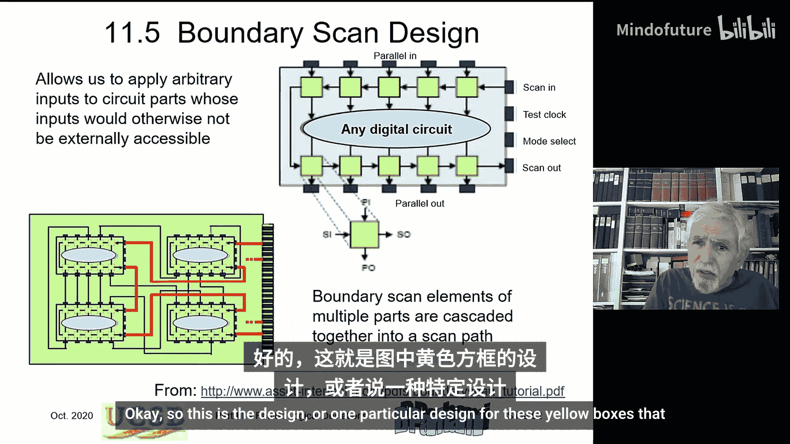

## 总结

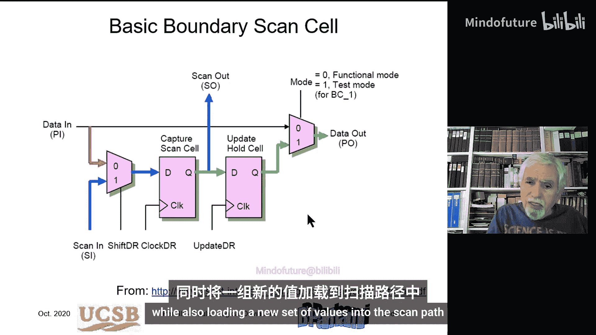

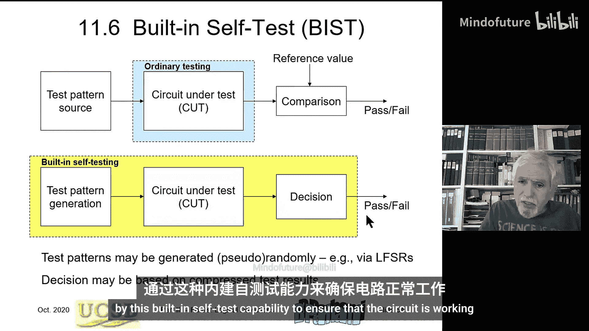

本节课我们一起学习了故障检测与可测试性设计。我们首先介绍了故障测试的基本流程和结构测试方法，并详细讲解了D算法和布尔差分法这两种测试生成技术。我们了解到故障测试是一个NP难问题，需要启发式方法。接着，我们探讨了如何通过量化可控性和可观测性来评估电路的可测试性，并介绍了插入测试点、扫描设计等提高可测试性的关键技术。良好的可测试性设计能显著降低产品生命周期各阶段的测试成本与难度。在下一讲中，我们将学习故障掩蔽技术。