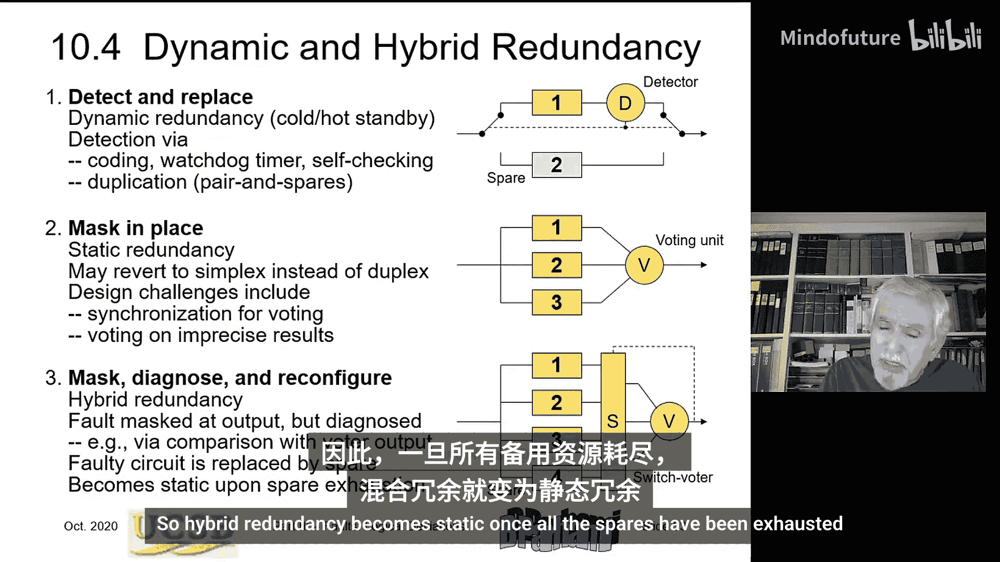
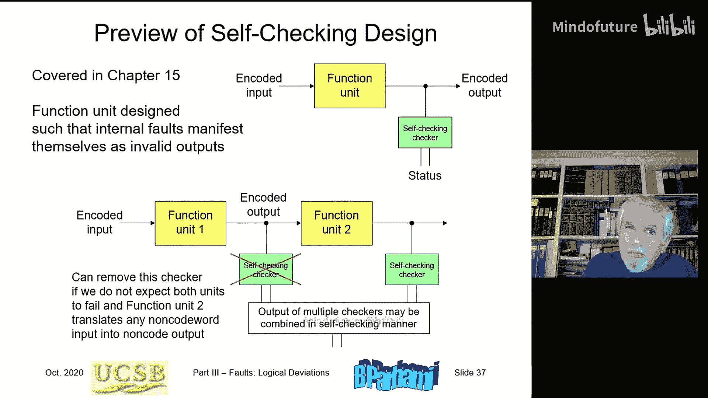
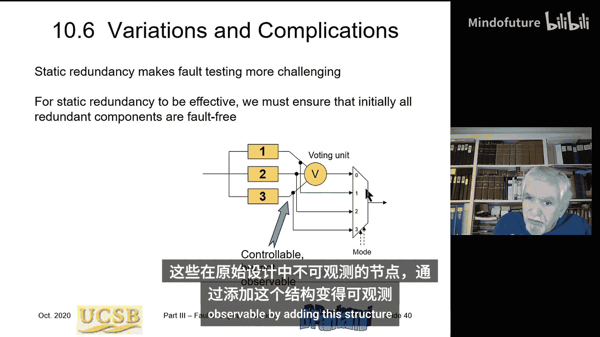
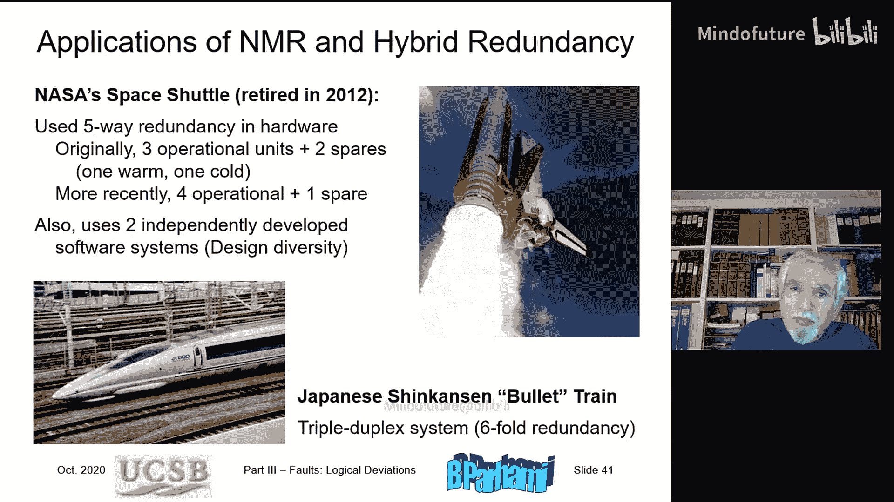
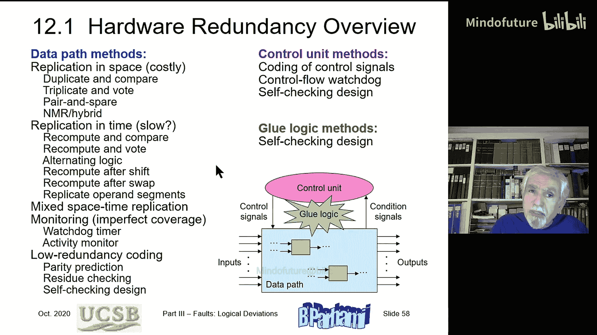
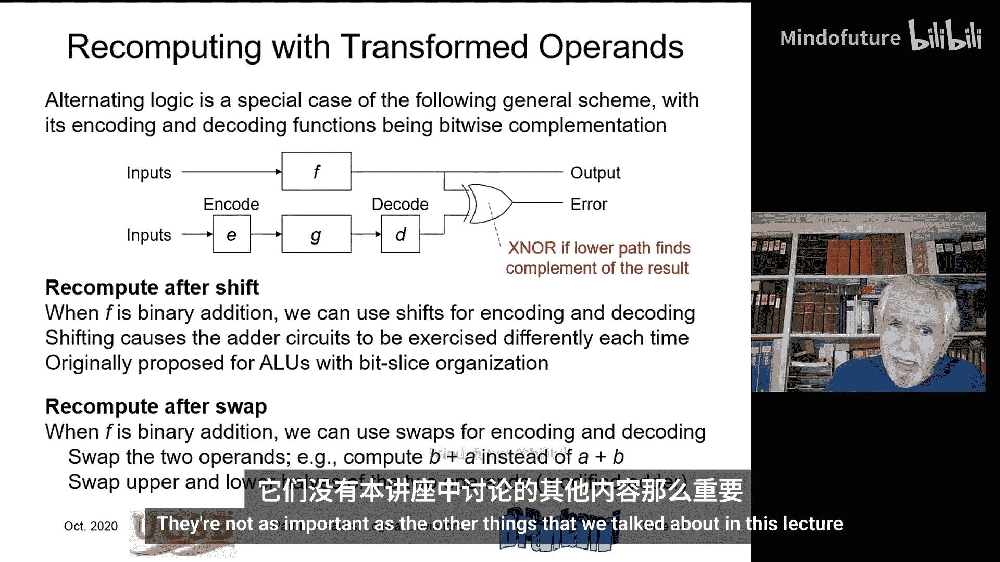
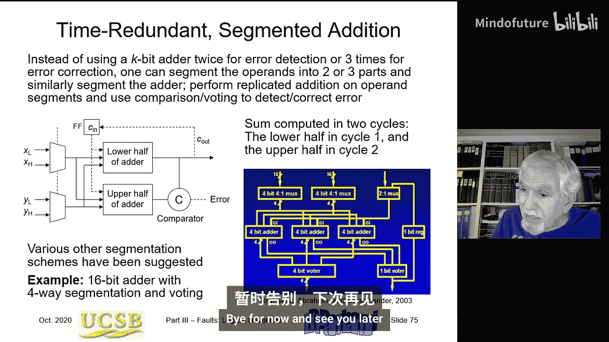

# 【加州大学】容错计算-｜-Fault-Tolerant-Computing-Ucsb-Ece-257A-p08-P08_第8讲_第10-12章_故障屏蔽--BV19cFyz8EPV_p8-

Welcome to lecture8 for the course ECE 257A。Falult tolerant computing。In this lecture。

 we will cover chapters 1 and 12 in the textbook， chapter 10 deals with fault masking。

And chapter 12 deals with some specific techniques， including voting schemes。

For accomplishing fault masking。So let's start with this diagram that basically。嗯。

Shows methods for fault avoidance on the left side。And fault masking on the right side。

And this diagram has a nice symmetry that shows the relationship between fault avoidance techniques and fault masking techniques。

A fault avoidance can be done through quality assurance。

 we basically prevent the occurrence of fault。And therefore our system will be perfect to begin with。

 and therefore we don't have to worry about faults。Or through。Falult removal。Which involves testing。

So we do testing。We either miss the fault， in which case our system will be faulty so there will be fault inside。

 but we missed it， we didn't detect it。If we detect the fault， you have two options。

 repair the fault。Or discard the entire circuit。🤧Excuse me， I discard it。

And repair can be full or partial。With full repair。

 basically the circuit is brought back to its original condition。

And therefore it's fixed with partial repair， the system will be partially repaired。

 but it will remain injured， so to speak， it's not completely back to normal condition and may may still have some problems。

On the other side， masking。We can use dynamic redundancy or static redundancy。

If you use static redundancy， the fault is concealed。So that it's there， but we don't see it。

 we don't see the effect of fault， and therefore the system operation is unaffected。See。

 this is the symmetric， the counterpart of this prevention on the other side。On the other hand， we。

May expose the fault rather than conceal it。Through monitoring， we monitor。And when we monitor。

 we may miss the fault。In which case the system remains faulty？Or we can detect the fault。

And when we detect the fault， we have two options。Abort the computation， in other words give up。

The system will be faulty but at least safe because we abort the computation。

 therefore we don't use the incorrect result of the faulty computation。

So we call this faulty safe system is faulty， but it's safe。Or we reconfigure the system。

We sort of do things to get around the faulty components。And the reconfiguration can be full。

 in which case the system is restored。To its original function。

Or it can be partial in which case the system may be degraded as I mentioned this diagram is completely symmetric shows that for the methods on this side。

 there are counterparts on this side。And the relationships are very similar。Okay。

 the first idea in masking faults。Is。The idea of interwoven redundant logic。

 and this idea is quite old from the。1960s。so because in those days hardware was pretty expensive。

 this was sort of a curiosity because it involves a lot of redundancy。But now with nanoes。

 people are taking the new look at this method because with nano electronics， we can afford to have。

8ight fold tenfold redundancy it won't be very expensive so what's the idea look at this circuit consisting of alternating layers of and and or gates there are two ends here。

The single or in this layer and another end in this layer。

And these ones and zeros are basically signal values at the present time。

And according to these signal values， the output is0。Okay。

 now suppose a fault develops in the circuit。So that B， instead of being zero becomes one。

So for example， this line is stuck at one using the terminology from the last lecture。

 if this line is stuck at one。Then the output of this end gate will be one instead of zero。

If this is one， the output of this orga will be one instead of being zero。

And 21 Si will cause this final output to be one。So we call such a fault a critical fault。

 it's a critical fault because this zero changing to one affects the correctness of the output。Okay。

 of course， critical faults should be avoided， but they're also non critical or sometimes called subcritical faults。

 okay？For example， if C or D changes from zero to 1。

 let's see what happened if C changes from zero to1。

Nothing happens because one and zero produces zero and therefore the rest of the circuit。

 including the output。Would be unaffected。So such a fault for this particular combination of input values。

Is noncrit or subcritical because it doesn't affect。The correctness of the outputward Okay。

 so the lesson from this。Exercisees diagram is that。Even in non redundant circuit， such as this one。

Has some fault masking capabilities can mask this line being stuck at one。

For this particular set of inputs。Okay， it cannot mask， however， this line being stuck at one。

So some faults are not masked， but some falls are masked， so even a non redundant circuit。

Has some fault masking capability okay so the question is is there a way to exploit this inherent masking capability of logic gates to achieve general fault masking and the answer happens to be yes。

 we can do that。So here is the idea of。What is known as quad logic。

 quadd means we basically use four times。🤢，As many gates and four times as many signals。

To achieve fault masking， so let's see how this works so each so this is the original circuit that I showed you before。

And this is the quaded version of that circuit that has four gates for every gate in the original circuit。

🤢，So this yellow gate， yellow end gate there is replaced by four end gates。

And each of the gates has twice as many inputs， so this same gate at two inputs。

 this one has four inputs。Okay， so it's roughly a factor of eight in complexity。

Because we have four times as many gates。And each gate has twice as many inputs。Okay。

 so each signal also has four versions， there are four lines that carry the same signal。

 so under normal condition。The signals A1， A2。A3， A4。

 these are copies of the signal A will all have the same value。

 so if a is equal to1 all four copies normally have the same value。Similarly， E。

 which is one in this example， has four copies。And all of them will be ones under normal condition。

 okay？So let's see what happens if this A1， one copy of the signal a changes from one to zero。Okay。

 it changes from one to zero。The output of this gate changes from 1 to0。Because this gate has。

You know， both inputs are one， or in this case， all four are ones。And therefore the output is one。

 but if one of those changes from one to zero。This one also changes from one to zero。However， this。

Falult this change from 1 to0 is masked by the or gate because this or gate will receive a one。

 another copy of the signal E。Is one and that one is enough to make the output of this or gate。One。

 and therefore this one changing from one to zero does not affect。So generally speaking。

A one to zero change is critical for an end gate。Because only one change from one to0 affects the output。

But a1 to0 change is subcritical for an or gate because it doesn't affect the output okay and these alternating layers of n and or gates in the circuit basically convert a critical fault。

For n gates to a subcritical fault for the next layer， which is an or gates。

And therefore masks that fault。As I mentioned， you know， in the 1960s。

 this was a radical idea because so much complexity was。Sort of frowned upon because。

Logic circuits were so expensive in those days。But now it's no big deal to have eight times as many because each of these gates are tiny。

And of course， we still have the。Problem of energy usage。

 because if you increase the circuit complexity by eight， you will be using more energy。

But if we manage to build nano electronic components that are very low energy。

 then perhaps the energy usage drawback will not be a major factor either。

So this is known as quadt logic， the more general name is interwoven redundant logic。

 the reason it's called interwoven is because of this pattern that you see here。So here I have A 1。

 A 2， B1， B2， so two copies of A and two copies of B going to this gate。Two copies of a。

2 copies of B。Two copies of A and two copies of B， and then the warrior sort of。A interwoven。

 in other words。Here， copy E1 and E4 of signal E。I put along with copies F1 and F4 of signal F。

And this is critical for this to function correctly and so for these two gates。

 we have E1 and E4 and F1 and F4 for these two gates， we will have E2 and E3 and F2 and F3。Okay。

 so these wires are sort of interwoven and that that's a critical part of the design。Okay。

 so the mask edge critical fault with this interwoven redundant logic， the number of gates。

Is multiplied by h plus one squared。And the number of gate inputs is multiplied by h plus one。

 so the special case of h equal to1。We have four times as many gates。And twice as many inputs。

 that's the special case of coordinated logic。But if we can afford higher levels of redundancy。

 then we can mask more critical faults so et equal to two。

Requires nine times as many gates and three times as many gate inputs。Pgate。Okay。

 so this is basically a neat idea， it is people are starting to use it， but not quite。

It's not quite a mainstream idea yet。So here's an example of this in an actual circuit。诶。So。

 this is a half other。A and B， sum and carry。And this is the same half either built of Nand gates。

And this is the quadted version of the circuit。You see here this N gate。There are four copies of it。

Over here。These two nine gates， each have four copies。And then these inverters。

Each of them have four copies。So this is Nandgate used as inverter by。

Feeding it with the same signal。Okay， so two inverters。Four， two input N gates。

 the three two input N gates。Is this circuit。So you see it's significantly more complex and you see that the connections are。

Down in a special way。In order to make sure that critical faults in one layer。

Are converted to non critical fault for the next layer。Okay。

 the next idea is something that we have looked at before。

 that's the idea by Mooreren Shannon from the 1950s。

To build highly reliable logic from crummy or highly unreliable。

Relays so this is a little bit more detailed than our previous discussion of the same idea。So， let's。

Going into the details。So we have two types of relays in relay circuit。

 of course in those days we still didn't have transistors， so relay circuits were used for。Control。

Circuitry and telephone switching。Systems。So a relay is of two types。

 a relay can be normally open and then if you energize， if you assert a signal here。

The relay will close， so this is a normally open relay that closes when you put in a logic signal one here。

 when you insert this signal into this。So this magnetizes basically。This area and then it ports。

They really lay down and close。And this is a normally closed relay that can be opened by asserting this signal。

Okay， so of course， a normally open relay should be open。If it closes。

 then that's considered a fault。A normally， closed relay。

Should be closed and if it opens without without the assertion of the signal， then that's a fault。

Similarly here， if this closes without the assertion of this signal， that's a。

So let's ab the probability that contact is made given that it's energized。🤢，If you energize it。

 the probability that contact is made is a。Put it reliable relay fairly close to one。

So with 99% probability， it closes when you energize it。But with a small probability，1 minus a。

The contact will remain open， even though you have energized the relay。Similarly。

C is the probability that contact is made。When the relay is not energized。

And1 minus Cs the probability that contact is open when it's not energized。So in a make contact。

 the contact of this type， A will be much greater than C。If it's reliable。

And for the contact of this relay of this type， A will be much smaller than C。Now。

 Muren Shannon basically said it doesn't have to be a。

 does not have to be much less than C as long as it's。Just below C。

 then we can synthesize relay networks such as this one。

That are more reliable than the individual contexts。And if this is more reliable than an individual。

 the single contact。Then you can use this now recursively as a contact。

And replicate it four times to get an even more reliable lay circuit， so that's the idea。

So their idea was that no matter how crummy it relays， in other words。

 how close the values of A and C。One can interconnect many of them in a redundant serious parallel structure to achieve arbitrarily high reliability。

So in this particular example， the probability oops。The probability that connection is made。

Given that they relay， so all four of these relays are controlled by the same signal eggs。

So if X is asserted， then all relays should close， the contact will be made between the two sides now if one of these relays is faulty and it doesn't close when x is energized when x is asserted。

Then still connection will be made within the two sides， that's the idea。

So we can easily derive the probability that connection is made given that relays are energized to be 2 a squared minus a to the4 where a is the parameter defined up there。

And this will be greater than a， in other words， this。Structured。

 this combination would be more reliable than a single relay if a is greater than 0。62。

In other words， as long as the reliability of a relay is greater than 0。62。

 which is basically a very minimal requirement。The relay does not have to be very reliable。

 then this structure will have higher reliability。And then as I said。

 recursively applying the same idea will make this more and more reliable。

Probability that connection is made when the relay is not energized， that's undesirable。

 when the relays are not energized， we don't want connection to be made。

That's 2 c squared minus c to the fourth。And this is provably always less than C。In other words。

 that unreliability is always reduced and therefore this is。

The essence of the method proposed by Moore and Shannon。For building highly reliable relay circuits。

Okay， the next idea， which is。Probably the most useful， the most commonly used nowadays。

Is triplication with voting。So if you want to compute a particular logic function。

You use three units to compute it three times。And then。The majority of these results。

Will be taken by this voting unit and sent to the output。

So if these two compute one and this one compute zero， one is in the majority and one will be output。

So this one basically masks。A faulty， a single faulty unit。

 so if this unit 3 is faulty and it generates zero when it should produce one。

 the other two will produce one and the output will be one。

So this is basically a two out of three structure as long as two of the three。More correctly。

 we get the correct output， assuming that the voter is perfect， okay？

We'll come to that later what happens with an imperfect vote we'll discuss later。

So this is the reliability of a two out of three structure。

Each each of the units have reliability RM module reliability。This is reliability of the ensemble。

Okay， under what condition this reliability of the ensemble is greater than module reliability？Well。

 when the reliability of the module is more than 0。5。So this is TMR reliability， this curve。

It is better than single module reliability。我那边。Module reliability is greater than 0。5。And in fact。

 it's worse than module reliability if the module reliability is less than 0。5， but of course。

 module reliability point less than 0。5 is not of practical interest， so we don't worry about。

That situation。So module reliability will be very close to one。

We'll be operating in this region and then TMR is much better than the simplex。Or single unit system。

And this is just some algebraic manipulation I've written this R。In this form。

 to emphasize the fact that r is Rm times this factor。And this factor is one plus something。Okay。

 so as long as this something is positive。If this something is positive then we have gained in reliability。

Under what condition is this factor positive when 1 minus RM is always positive。

 we don't worry about that。So when 2 Rm minus1 is positive， that leads to Rm greater than 1 half。

Okay， now reliability of TMR is better。So if these are exponential， if RM is e to the minus lambda T。

Then this is the reliability of module， the blue。Dashline。

The red line is the reliability of the TMR structure， again， you see that。At some point。

 the TMR structure becomes less reliable。But that happens， you know。

Over a long period of time that is not of interest to us， we are usually operating around this area。

Where lambmbda T is small， in other words。Remember that Lada is the failure rate。

 one over lambda is mean。To failure。And we are operating。And time scales that are much less than。

1 over lambmbda。So TMR is more reliable。But right here I'm going to mention that TMR。

 even though it's more reliable in the short term。It becomes less reliable over the long run。

 so if you compute as mean to failure， this mean to failure is5 over6 lambda。

The simplex mean to failure is one over lambda。TheTMR。Mean， the failure is less。That's because。

 you know， meantime the failure is basically the area under this curve。

And because this drops and then it will be lower for a long period of time。Compared to simplex。

 the area under the curve is less。And， therefore。Meantime， the failure is less。

So that's another indication that meantime to failure is not really。

A good measure to compare two systems because you see the system， which is much more reliable。

In practical terms for short duration of time。Actually gives you a smaller mean to failure。

 so if you compare mean to failures。Then this simplex is better。Okay。

So this is an example of triplication with voting that has actually been used in practice to protect against radiation。

So if you want to build a flip flb and you're worried about， you particles。

Bmbarding the system and sort of changing the contents of the flipla， you can tripate the flip fl。

And then it's very unlikely that the radiation affects all three copies。

 it may sort of change the value in one copy。But the other two copies will be correct and therefore you get。

 and this is voter。This is another interesting part of this diagram， why is this a voter？

Because if these two signals are zeros。Both of these two signals are zeros。

Then the multiplexer selects this value， zero will go because zero will be in the majority。

Both of these are ones。Then one will be sent to the output。If one of these is zero。

 the other one is one。Then。The contents of the third flipflop。So one and zero。

 so whatever this one shows will be in the majority。So this is basically a simple design for a voter。

 it's a four input multiplexer。With two the two control signals， select signals。

Connect it to two inputs。And the third input goes to these two。Of course。

 if you're worried about the radiation。It's completely possible that the radiation affects this voter and therefore the system is not totally protected against radiation。

 it's protected if radiation affects the flip flos， but not that it affects the vr。

One way around this is to trip the voters。So what happens here if？So these are the three flip flops。

 two inverters that basically form a flip flop， one flip flop， two flip flop， three flip flops。

And then radiation affects one of these flip flos and the output is different from the other two。

There are three copies of the voter that basically correct the content， so01。

1 input to this voter produces one。And changes that zero back to one。

And therefore now if the radiation。sortr of affects this voter。

 it's no big deal because that voter only affects the contents of this one flipfl。

 the other two will still be correct。So this is basically， this is capable of masking flipop。False。

Or these vote faults， but of course it's a little bit more。Complex than the previous circuit。

We can generalize this triplication and voting to what is known as n modular redundancy。

So for example， I've shown here five。Fold redundant system with a voting unit。

Here we can mask two faulty units。Because let's say if the first three generate one as output and these two are faulties。

 so they generate zero， one will be in the majority and therefore correct output。Will be produced。So。

The tripplication， we call it triple modular redundancy。

And this one we call it five modular redundancy。And more generally。

 we have N modular redundancy or NMR。An N does not have to be odd。🤢。

Because you can have n equal to four。And then you expect three units to agree。

 so four modular redundancy can mask one fault。But it can also detect two faults， in other words。

If you have four modular redundancy and these two produce ones and these two produce zeros。

You can detect that。So4 modular redundancy is one。Is capable of masking one fault。

But is also capable of detecting two faults。左 end。Typically in is odd， but it doesn't have to be odd。

Okay， so this is basically a summary of these。Rreedundancy techniques that we have seen so far。

We have duplication。In duplication， we have one active unit and one spare unit。

 the active unit is running。Under normal conditions and its output is monitored by some detector。

That is in charge of detecting problems in this output。Now how it detects it there various methods。

 we can use coding methods。We can use a watchdog timer， for example of this。

Takes too long to respond or something like that then we sort of。

Guess that something is wrong with it。We can also use duplication and comparison。

 so there may be two of these units actually operating concurrently and the detector basically is based on comparing the two outputs。

So if this is duplicated and this is also duplicated， that method is known as pair and Sps。

 so we have a pair of active modules。We have a pair so that we can detect。problemsblems。

And then these are two spares that take over。Now， when we say takeover。

 there are various things that we can mean by that。So the spare can be， for example。

 powered off and just sitting to the side so that when this one is judged to be faulty and is removed。

 we sort of power up the spare。Initialize it， it takes some time in order to bring it into service so this is。

Sometimes referred to as cold spare or cold standby。

 so we have an operating unit and a standby unit that is cold in other words。

 it takes a while for us to。Bring it back， bring it into service， okay？We can also have a hot spare。

 hot spare is operating concurrently with that， so even though we don't use the output of the spare。

 it's running as if that it's being used。Just so that whenever we need it。You know。

 in very short time period， we can bring it into service because it's already running。

 it's already powered up， it's already in the proper state。

 it's already initialized to the appropriate state， we quickly bring it into service。

Intermediate between cold and hot spare， we have something called warm spare。

 a warm spare may be powered up。🤢，But it's not completely up to full speed， it's powered up。

But maybe it needs some initialization in order to be able to replace this unit。

 so we have cold spares and cold spares basically save energy because they're not powered up。

But they employ long delays when we need to bring them into service。

Hot spares are running in parallel with thee。F unit。

 and therefore they're ready to take over on very short notice and warm spares are intermediate between these two。

Okay， the triplication and voting masks the fault in place， so if this unit2 is faulty。

 its output is masked， it doesn't affect the system output。

And then we can use a combination of these two known as hybrid redundancy。

So what is hybrid redundancy， we have three operational units that are capable of masking one fault。

Now， the problem with masking default is that we have two good units and one that is faulty。

What happens if one of these good units fails and you know subsequently。

 then we can get an incorrect output， so this is basically not tolerant of two faults。

If we have two faults， then we may produce an incorrect output。So this one basically。

Removes the faulty unit because we know which one is faulty。

 we know which one disagreed with the other two。Removes it and brings the spare。Into operation。

So that we are essentially。Sort of refreshing the system。We will have three。Functional unit。

 correctly functional unit after we replace the fault unit with a good unit， good spare。

And this extends the life of the system because now again， we can tolerate one more faultult。

And therefore， the system can run for a longer period of time。Without。Generating an incorrect output。

So this requires us to design the switch， the switch basically forwards three of these outputs to the voter。

 initially the three outputs that are forwarded are these three， the top three。

But when we detect that this one disagreed with the other two， then it will forward this one。

 this one， and this one。And then meanwhile， the system can continue operation as we bring this spare unit up to speed because we still have two good units so we can take our time。

We have more time to bring despair spare， so this delay that was。

A problem up there does not exist here， the delay is masked。Because there are two good units running。

As long as it it doesn't take too long。To initialize and bring this unit up to speed。

 we are going to be okay。Okay， of course， we can have more than one spare。

And then once the spares have been exhausted， so suppose。In this case， we have one spare。

This one is faulty， we remove it and bring the spare in。Now the spares have been exhausted。

 we don't have any more spares， so at that point the system becomes static， becomes like this one。

Okay， and no longer can bring other spares in。If we have two spares。

 then we could continue with two steps， bring the first spare in， then upon the next fault。

 bring the second spare in， at that point spares have been exhausted and we go to static redundancy。

So hybrid red density becomes static once all the spares have been exhaust。

Okay， and modular redundancy。Oops， I'm going backwards。

So these are advantages and drawbacks of these three schemes， dynamic redundancy， static redundancy。

And hybrid redundancy。Dynamic redundancy uses less power。It provides long life。

 especially if you have more than one spare。Because basically we are using the units consecutively。

 if this spare is powered down， then it's less likely to fail。And therefore， once this one。Fails。

We bring this one in and so on so you can have long life。On the other hand。

 the problem of coverage that we discussed before is an issue here。

There is a non zero probability that we cannot successfully recover from fault in this unit。

And start operating this one， either detection is imperfect or even if we detect switching is imperfect。

So coverage factor is an issue there。And there's a latency。Involved in tolerating。The fault。This one。

Has high safety。It has immediate masking with high safety。

It has power and area of penalty because three units are running concurrently。

So we have the complexity of three units plus the power usage of three units。And the voting circuit。

Here is critical。If there's a problem in the voting unit， then we are in trouble。

This one basically you can say， has the advantage of both of those， it does immediate masking。

It has long life and high safety because the more spares you put in， the longer the life becomes。

But then on the other hand， it also has the disadvantages of both of those， for example。

 it uses a lot of power。And now we not only have the voteter but builds up the switch。

 so the critical part of the system has grown in complexity。Okay。

 there are various ways of designing switches， so here's one approach to designing switches for standby redundancy。

Here we have。An active unit，An active unit and two spares。

So this was basically schematic diagramagon， we really don't have a switch like that。

The switching takes place by an electronic。Unit。That takes the output of these three units and then simply chooses which output to forward to the primary output of the system initially it is this output that is forwarded。

But then if this detector detects a problem in this unit。

Then it signals this problem to the switch and the switch basically moves on。

And next we'll forward this。Signal to the output。Okay。

 and then once that one also is detected to be faulty， we move to the third one。

 so the switching here is electronic， not mechanical， as suggested here。Okay。

 so how do we detect faults in such a standby redundancy scheme？We can have activity monitoring。

 so this detector is a monitor basically that monitors the output of this unit。

 and it has a bunch of criteria， a number of criteria that it uses to judge whether this output is okay。

We can use duplication and comparison， of course， you know that。Detection。

And the scheme will not be perfect because this unit can generate。An incorrect outputward。

That simply does not raise any flags in this detector。Okay。The duplication and comparison。

 you basically have two units here。They're both running at the same time and we compare the outputs。

 the detector is basically a comparator that compares the outputs and if they disagree at signals。

Disagreement。Our fault。And then we will see later in the next lecture， actually。

 that we can design these units to be self- checking so that they sort of signal any internal problems and their output so that the detector's job is simplified because the unit itself participates in validating its output that's called self checking design that we'll talk about next time。

Okay， let me skip this preview self checking design。And go to switch for hybrid redundancy。嗯。

So here is a hybrid redundancy method with three concurrentency operating units and one spare。

 and this is more general there are in。Concurrentency operating unit。And S spares。The switch。

 basically one of the ways of designing it is a bunch of switches here。In rows and columns。

And normally， initially， when these are the active units。So these three， for example。

 are active units， all these switches are set in the horizontal connection mode so that these signals。

Are forwarded。To this voting unit。Okay， so。Three these three signals coming from these units are forwarded to the voter。

By these straight paths。Through the switches。Now， if one of these units。

Is faulty and needs to be switched out。These switches can be reconfigured， for example。

 this switch set in this state will bring。This unit。To replace this last unit。

 so the last unit signal will go straight through but。It will stop here。Okay， instead。

 the signal from this spare unit。Will be forwarded to the vote so by appropriate setting of switches in this matrix。

So the matrix will have n rows corresponding to the n active units and S columns corresponding to the S。

Spares。And that's enough to be able to route the outputs of these spares to the voter instead of some of the active units。

So this is one way of designing so you see that this switch is。

Can be relatively complex if there'll be an array of n by s of these four port switches。

And therefore， you know， the hardcore of the system， the part that cannot malfunction cannot fail。

Grows in size that's one of the disadvantages of。Hyb redundancy。Okay。

 another idea is to use time redundancy， so basically we can say that this is redundancy in space because instead of just one unit。

 we are using say four units in this example， we are using more space。Okay， so redundancies in space。

Time redundancy is redundancy in time。So imagine if you want to compute some of two numbers， okay？

You use one other。So in redundancy in space， you could use two add and then compare the output。

In redundancy in time， you can use the same adder twice。So add the two numbers once。

 store the result。Add the two numbers a second time， then compare the two results。

So this is particularly effective against transients。Falults。

So if something happened in the first edition。But went away some problem that went away。

 it was transient。In the second edition， then you detect the problem。Okay。

 if there's a permanent fault in your adder， then when you do the second edition。

 then you get the same wrong result， you may get the same wrong result because the fault is permanent。

 therefore you won't be able to detect that fault。So there are some techniques that make it more likely for you detect to detect even permanent faults。

 so for example， if youre using a multiplier，And one of your upper ends is even。

Instead of multiplying A by 2b， this is the even operaand。

 you divide this operaand by 2 and multiply this operaran by 2。

 this is basically right shift this operaran and left shift this operaran。

And now you use the same multiplier hardware， but this time because the opera ends are different。

It's unlikely for the same fault to produce the same incorrect result because different signals will flow through the circuit and therefore if something was stuck at zero。

It's unlikely to affect the new computation in the same way as the old computation。

So this is known with computation with transformed opera。

So sometimes it's possible to change your opera another simple technique in。

Addition is to just switch the opera end， we were doing a plus B this time due B plus A。When you put。

B is the first opera and A is the second opera， you switch them。Then again。

 the internal signal of the circuit will change and again it's less likely for a fault to affect。

 oops， sorry。To affect both computation at the same time， okay so there are a lot of tricks。

So this is another one， instead of adding A to B， complement A， complement B。

 and then complement the final result。So put the two complement of A in or ones complement。

 which is easier to compute。One's complement of A in， one's complement of B in。Due the addition。

 again， the signal values change。And then。Form the ones complement of the output。Okay。

 so this is the general method of computing with transformed opera recomputing。

 so redundancy in time becomes more effective if you change the opera。

From one repetition to the next。Okay， another problem that arises when you have redundant circuit is that of testing。

So suppose you have built this circuit that is triplicd。And as a voter。

 ignore this multiplexia here for the moment。And then you built this unit and you ship it to the customer。

But before you ship this because it's sitting in the warehouse or on the shelf for a long time。

 one of these units， let's say， fails。In the meantime time。

So you test this just before shipping to the customer， you input something。

 you see that there's a correct output， even though you know because this is designed to mask。

The fault in one unit， you won't be able to detect that fault。

 so you're shipping basically a defective product to the customer that already has one fault。

And the first fault that occurs after that。Leads to an incorrect output and this is not what this unit is supposed to do。

 this is supposed to mask the first fault and maybe fail with the second fault。

But if one of the units is already faulty when you ship your product。

hen this is not doing its job okay， so testing of redundant systems is harder。

 there is no way to test this because you just have one input and one output。

So this is a structure that you can put in for the purpose of testing。

 so this goes without our discussion of testability in the。Previous lecture。

So you basically have this multiplexer。Through which you can look at these outwards， okay， so you。

Input something。And then you examine this output。By selecting this。

 setting the multiplexer to select this one， you examine this outward。

 so you make basically these points observable。They are not observable when you just vote。

But through this method， you make them observable so that if one of these is faulty， you observe。

Defa and therefore you know that this unit is not okay。Okay。

 so these points that were not observable in the original design are made observable by adding。

This structure。Here are two well known examples of application of N modular redundancy and hybrid redundancy。

NASA space shuttle。Whi was retired in 2012， so it no longer exists。

 but the same redundancy methods are being used in other NASA spacecraft。So up to 2012。

 the space shuttle used fiveway redundancy in hardware。

So the computer on board the space shuttle had five copies。Originally in early shadow designs。

Four of these five units were operational units and two of them were spares。

 so this is a hybrid redundancy with three operational units and two spares， but the two spares。

 one was warm， one was cold。In other words， one of them could be brought into operation more quickly than the other one。

 this one is there。In case it's needed。It lengthens the life of the。Spacecraft computer。

More recently， more recent shuttles in the latter stages of its life。

Used four operational units and one spare， so this is again。

 hybrid redundancy with four operational units， so this increases the safety and you have four operational units and it had one spare。

It also used two independently developed software systems。

 so not only the hardware system was redundant。The software system was also redundant。Of course。

 in software you。Can't use just two copies of the same software because whatever bug one copy has。

 the other copy will have also， so in the case of software we use something called design diversity。

Ining that two separate。Software design teams basically design this software from scratch so that they're unlikely to commit the same error and therefore the software is unlikely to have the same bug in both versions of the software。

Another example is the Japanese Chiinkinsan bullet train。

It uses triple duplex system or sixfold redundancy triple duplex means that there are three copies of a duplex system。

Dplex system has two units operating in parallel and comparison between the two outputs of the two units leads to。

诶。Falult detection。So you have three units， each of which is capable of fault detection。

Operating in parallel。And we vote on the。Outputs of those three pairs of you。

Okay。Let me now go to chapter 12。And get into some more detail。About replication and voting。

So this slide I'm not going to go through in detail。

Basically is sort of a list of all the different techniques， the main points I want to make。

From this slide is that a typical digital system。Has a data path， This is where。You know， inputs。

Nummerical values or other types of inputs undergo transformations。To generate output。A control unit。

That controls the operation of the data path through control signals。

And observe the state of the data pad through these condition signals to see what's going on there。

And make appropriate decisions according to what's going on。

And then some glue logic that basically connects these two together。Now。

 data paths are much more easier to protect against faults because they are more regular。🤢。

And also because of the kinds of transformations that are involved here。

 they're easier to check so here's a long list of methods。For checking data partss。

Control units are much harder to check。Because specifically irregular logic。

And the options are limited， coding of control signals， control flow， watchdog。

 and self checking design。Glue logic is even more random。In nature and therefore。

 self checking designers is basically our only option。So。Data paths are easier to check。

 we have a whole bunch of methods， replication in space， replication in time。

 and we discussed these before， mixed space time replication， I'll show you an example of that。

AndMonitoring， but monitoring will have imperfect coverage。And also low redundancy coding。Okay。

 so the main point from this slide is that data paths present less of a problem in。诶。Masing。

 detecting a masking fault。Control units and gr logic are much more difficult to deal with。

Okay， so here are some examples of replication in space that we have seen before。

 some of these are shown in more detail here。So。Duplicate and compareare is one method of replication in space。

Top and voting is another method。Hybrid redundancy in this example， three active units of one pair。

And this is a method called peer and Sp。Well you have two pairs。

Each pi does its own fault detection through comparison。And then the switch， basically。

 when this one does not indicate a problem， comparison basically indicates that the two match may select this as the output。

 when these two disagree， then it may select this one as the output。

So pair and spare is the name of this method。The Japanese bullet train used troplication three pairs。

 okay？But this uses just two pairs， so these are examples of replication in space。

Now let's look at TMR with imperfect voting in the previous discussion we assume perfect voting。🤢。

Now we say that the voter is imperfect。Therefore， it has reliability RV。

 so this is two out of three for the modules。Times the reliability of the voter。

 and we are interested in finding out under what condition。This overall reliability。

 Rv times2 out of 3 is greater than reliability of a single module。if you do the math。

You basically discover that RV reliability of the voter must be greater than this。🤢，Function of R M。

And if you plot this， this curve。Is basically when these two are equal。

Above this curve is when the R for TMR is greater， TMR is better。

 below this curve is when simplex is with， and then the two axiss we have RM。

 module reliability and voter reliability。So for a particular module reliability， let's say 0。

75 and vote reliability 0。95， TMR will be better。Okay。Actually， if the voter reliability is 0。95。

 there's a range of module reliability values。That caused TMR to be better if you are outside that range。

Of course， this is not a practical interest。Because reliability less than 0。56。Really not good。

But on the other side。If you have a voter whose reliability is 0。95。And in module。

 his reliability is also 0。95。Then you don't want to use dripplication because the TMR will be less reliable。

Okay， so if the modules are highly reliable。😊，You need。Highly reliable voter。

 even more reliable voter in order to gain advantage from TMR。So this is interesting。

So on the other hand， if you fix RV。RM must be between these two bounds so that these are basically the two bounds here。

For a particular RV value。There's a range of values for module reliability that ensures improvement in reliability。

Okay， now when RV when the voter reliability is pretty close to one。Let's say one minus epsilon。

 epsilon is a very small number。Then one over RV here。Will be roughly one plus epsilon。

So if this is 0。99。This will be 1。01。Okay， so one over RV is one plus epsilon。And then9 minus。

Eight times1 plus epsilon。Will be1 minus8 epsilon。And so this square root will be roughly  one minus four epsilon。

Okay， and then RM， the range of Rm will be 0。5 plus epsilon， so these are approximate computations。

 the closer epsilon is to zero， the more accurate this so this basically says。

If RV is pretty close to one。Then as long as R M。Is less reliable than your voter。

And it's more reliable than this now this is pretty close to 0。5 so。

It's almost certain that you'll meet that condition。

So as long as RM is less reliable than your voter than you gain with TMR。

 so this is in the special case where RV is pretty close to one。🤢，Okay， on RM。

 the module being more complex than the voter， this condition is almost certainly met and therefore TMR gives you。

And improvement in reliability。Okay， this one I'm going to just explain won't into won't go through the computation。

 the idea is that there are sometimes when you say if two modules here are faulty then you get an incorrect output that may be too pessimistic。

Because these two modules may be faulty in such a way that this output is incorrect。

It's stuck at one， let's say， and this output is stuck at zero。

So these are basically compensating faults if this is stuck at one and this is stuck at zero and this is correct。

Then this correct value will prevail will have the majority because it will match one of those。呃。

 faulty。Outputs。And you still can get so。Under some conditions。

 you can have two faults and still get。To the correct output。

 and these are known as compensating faults。If the faults are compensating。

 then you can get the correct output。even with two faults and this leads to reliability improving from this value to a little bit more。

 this is the added reliability I'll let you read the details of this slide。So。

Consideringcompensating faults leads to reliability improvement。

Or actually not reliability improvement， but better， better bound for the reliability。

 remember in homework one， you did the reliability inversion problem。

And so what we are establishing here are bounds， lower bounds for reliability。

 not actual reliabilityabilities， but we get a better bound for reliability。Okay。

 replication in time。Of course， you can use the same unit twice。

So here I've shown a computation and four inputs that involves two additions and a multiplication。

Okay， once these two additions are done， the second computation。

 the replicated computation can start while you're doing this multiplication。

 so you don't have to wait until this entire computation is done。

Before starting the second version of the computation。And remember， the second version can have。

Modified opera， not the exact same opera。So for example， you can switch the inputs to these adders。

But let's ignore that for now， so the second computation does its additions。

While this first one is doing its multiplication， so we do a sort of pipelining。

So instead of taking twice as much time。In replication。It takes。A little bit more。 So let's say。

Additional and multiplication both take one unit of time， just simplify。

 so this takes two units of time， if you just did the computation once， if you do it twice。

 it takes three units of time， so it's not double the original。Now。

 in case you have just one add rather than two adders。

 then this is the way you schedule the computation。Do the first edition。

And the next f cycle do this edition。And the third clock cycle do this edition。

 so it takes three time units。And this is a duplicated computation that takes two extra times。

So we go from three to five time units。Rather than to6， which would be。With naive duplication。

We can also do triplication with voting。And the same computation that I showed you before。

The first version of the computation， the second version， the third。

 so this one took two units of time and the three take four units of time altogether。

And then once we have the three results， we have to apply voting。To get to the majority。F those。

Of course， we can have a mixture of space and time redundancy。So for example， here。

 we had one adder and one multiplier。When you add a second adder。

 you're basically using replication in space。And it takes less time now to do this computation。

So here you have just replication in time。Because you had one adder and one multiplier。

 no redundancy here you have two adders and one multiplier， you have some redundancy。

 so it's a mixture of space and time redundancy。Okay。

 now this is one of my favorite topics because I've in my own research。

 I've considered the design of voting units。So this is the simplest possible and majority rotary unit design。

So if you have three values on which you want to vote。You compare x1 and x 2。If they agree。So。

 the signal will be。If they disagree， the signal will be one。So you use this， the third output。

If they agree then this signal will be zero， we use this one。

 so this is a voter that consists of a comparator and a multiplex remember that when we do voting these things on which we vote do not have to be just single bits。

These can be wards， so let's say these are adders， they add numbers， so these are the sums。

 so this is a 32 bit number， this is a 32 bit number， this is a 32 bit number。

Three versions of the sun。And then if these two match they're the same values。

 this comparator determines that。If they disagree with each other。Then this one is chosen。

 so we assume that we have just one bad unit。If these two disagree。

Then the bad unit is among these two， and therefore this one must be correct。If they agree。

 then both of these are good， then you can choose this one for the output。

So there's a simple way of designing voting circuits。This is from。

A publication of mine from many years ago。In which voting units are designed in different ways and compared。

So using gate networks。Using multiplexers。Two different designs。

 I won't go into the details because I have a different way of presenting this in a subsequent slide。

Okay， and these are compared here with regard to complexity。

 the number of inputs and how many inputs you are voting on。And the total number of gates。

And so this is the gate level design， the complexity is exponential。

So pretty soon it becomes impractical。This is the multiplexer based design。It grows。Less quickly。

 but still after a while within。15 or more， it becomes substantial， complexity becomes substantial。

The other two methods， arithmetic method is based。And。Basically counting the number of ones。

 those of you who have taken my computer arithmetic course are familiar with the notion of parallel counters a parallel counter basically counts the number of one among the inputs so these five。

Bits。We count how many ones there are among them， and if we find out that there are four ones。

 then obviously the output， the majority is one。If there are three ones， then the majority is one。

 if there are two ones， then the majority is zero。That's the arithmetic。

And then there's also the selection if these are ones and zeros。

Then the median of these values is also the majority， so if you have three ones and two zeros。

 the median will be one， which is also the majority。If there are three zeros and two ones。

 then the medium will be zero， so the other two methods in this diagram。The selection based。

 which for large n is the best methods among these。And then the arithmetic base。

Which falls between means selection and mugs， so the gate level basically is not competitive for large n。

These three selection is always。The best method for large N。Next comes the multiplex。

 the arithmetic base method。And then the multiplex sub based method。Okay， more recently。

 I've been looking into the some new technologies that are majority friendly， in other words。

 you can build majority gates in these technologies。Very easily。

 so the complexity of this majority gate。Or two out of three gate。

Is not any more than end gate and orgate。So this is basically a three out of five voter。

Using multiplexors。And gate， an or gate and a majority gate。Okay。

 and this basically this method is I call a recursive method for designing。

Voting large voters that this paper is not yet published。

 we are finalizing it and it will be published soon。So once it's published。

 I'll add that to the references for this course。But for now， just。Take this if I want to design。

General threshold circuit。That determines whether at least L of the n inputs are equal to1。

 so three out of5 is a special case of this。At three。A five input voter。

 basically we want to determine whether at least three of the inputs are ones， in that case。

 then the output will be one。Okay， so basically， recursively。

 we designed the circuit by taking one of the variables。And saying， okay， if this variable is zero。

And I want at least L1s among the inputs， and this one is0。

 then I must have at least L1s among the remaining n minus1。If this input is1。

 then I want at least L minus one ones among the remaining n minus1 input。

So this converts the design of this threshold circuit。Into the design of two smaller。

Threhold circuit。And I can use this idea recursively leading to a circuit such as this one。

So this is x9， so that this is nine inputs， this is a five out of nine majority circuits。

 there are nine input。And I want to determine whether at least five of the inputs are ones。

So x9 is using this final multiplexer。X8 is used in these two multipleflxs， x7 controls these。

And then eventually I get to the edges where this is an end gate， okay， it's a and with an inverter。

 so there's an end gate。This is an orgate。And this is a majority， going back to the previous slide。

Basically， we say if these two。So this is a three other five if these two are zero。

And both of these are zero。Then。All three of the remaining inputs must be onces。

 this is why I have an end gate here。For me I have at least three ones， okay， these two are zeros。

 I need three ones among the remaining three。On the other hand， if both of these are ones。

 then I already have two ones， I need just one， one among the other three。

To exceed this threshold of three， so that's why I have an or there。On the other hand。

 in the other two cases， when one of these is one， the other is zero。Then I have one one here。

 I need two ones among these， that's why I have a majority gig here Okay， so the same idea applies。

To the circuit。So this circuit has a nice regular structure， very VLSI friendly。

 easy to implement in VLSI。And we have shown that this has。

Both lower complexity and lower power consumption and other ways of designing voting networks。

Now so far we have talked mostly in these detailed design， these are bits， the inputs are bits。

 what about the inputs to the voting network are wordss rather than just bits， what happens then？

Then we have to be careful， so here is， let me skip that first example。

 just go to the second example。So here are three wordss， 000，101，3 bit wordss， 110。

 say three units generate these outputs， and I want to see whether there's a majority among those that I can use for the output。

Well， if I use majority and individual bits， in other words， if I use bit voters。

 then I can get an incorrect result because in this least significant bit，The majority is 0。

In the middle bit， the majority is zero。And the most significant bit majority is one。

 so if I use bit quos on the three bits， I get something that doesn't make sense。

 it's not even equal to one of the inputs， of course in this case I don't have majority because the three inputs actually disagree with each other。

The three values disagree with each other I don't have majority， but if I do bit voting。

 I'll be left with the impression that 100 has a majority。But 10。

0 doesn't even appear among the three inputs。Voting at the word level is different and I need special design techniques。

 and some of those design techniques appear in this particular paper from 1991。Okay。

 these variations I'm going to skip most of them。诶。And if you are interested。

 please read them otherwise just don't worry about them。

 they're not as important as the other things that we。Aked about in this lecture。

So let me just spend a few minutes on this slide， which is the last one。

To show one alternative to using， suppose you're doing， say。诶。16 bit addition。

And you have a 16 bin out there。Instead of using the 16 bit adder twice to do the 16 bit addition twice and then comparing the result。

 one interesting alternative。Is to divide the 16 bit other into two8 bit others。

The lower half out there， the upper half。And then input the lower half of the two upper ans。

Compute the lower half， so you have two copies of the lower half of the sum。

Compare them if they are equal， then you're okay， save the carry。

 now input the upper half of the two upper ends。Use these two to compute two copies and again compare。

So this has the advantage that you're using。You're not using the same adder twice。

 but you're using the two halves， so these are basically different logic circuits this is the first half of the add this is the。

Second half， and therefore， if one of these has a problem。

This part of the addition will be performed correctly。

 whereas if you use this the entire circuit as a 16 bit out there。

 no matter which half you have a fault， you can get an incorrect output。So duplication in time。

Would be more effective， less likely to lead problems if you use this scheme。

Then if you just use the entire 16 bit adder twice， okay， and of course。

 this can be done with triplication as well， which I'm going to skip。Okay。

 so that's all I wanted to say about fault masking and some details about design of switching and voting circuits。

And please stay safe。And。Until we connect again in the next lecture。Bye for now and see you later。

