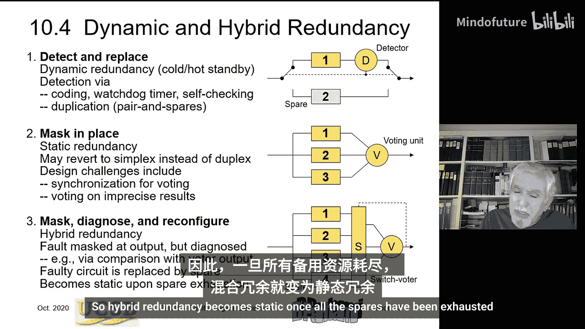
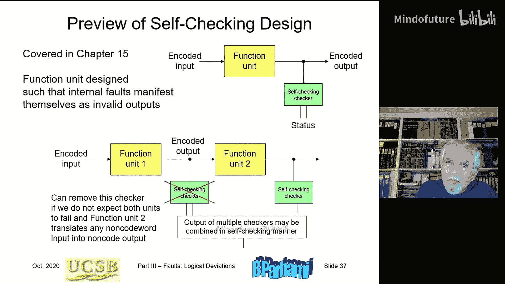
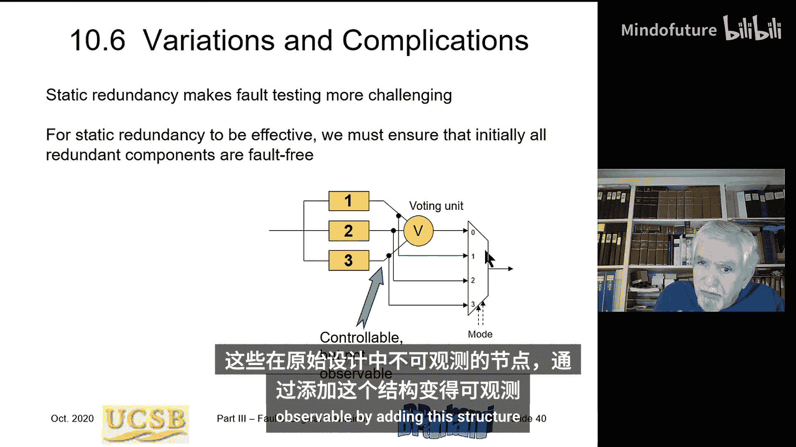
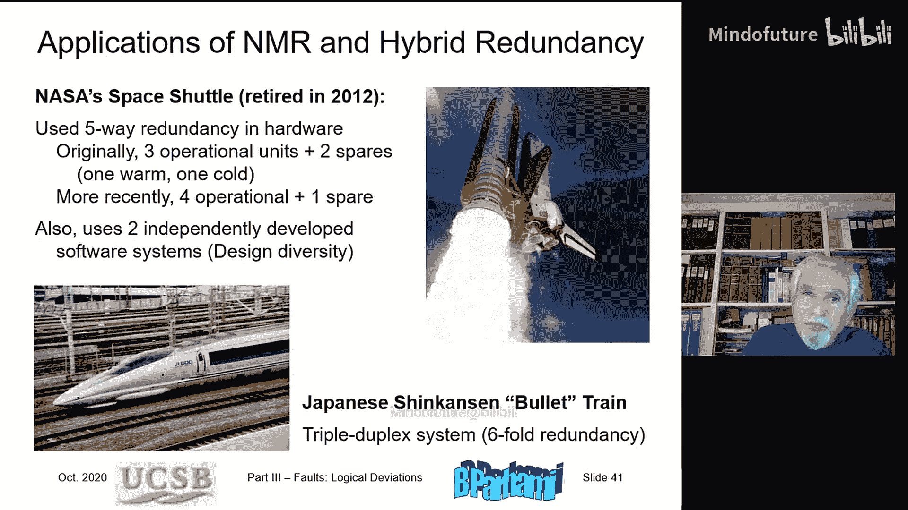
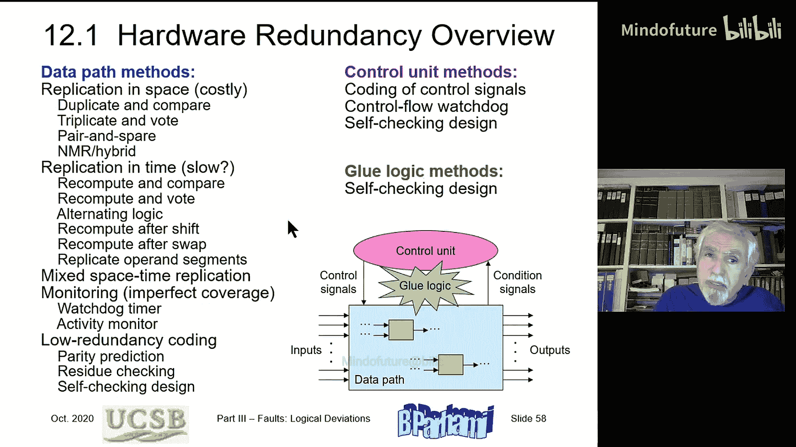
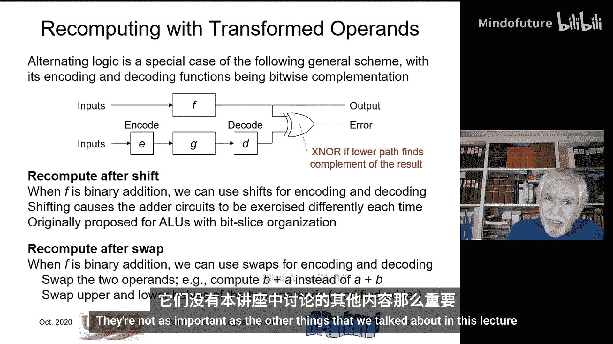
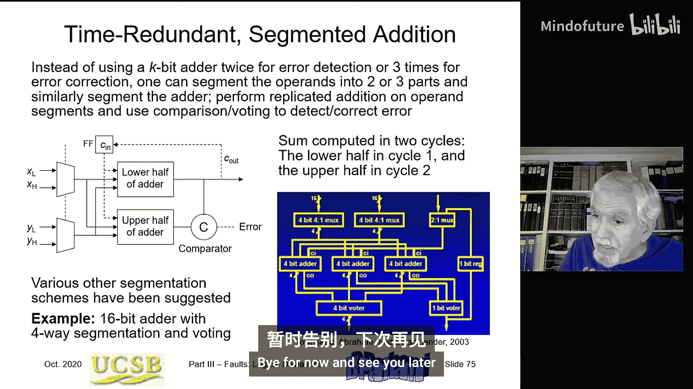

# 容错计算：第8讲：故障屏蔽与表决方案 🛡️

在本节课中，我们将学习教材第10章和第12章的内容。第10章主要讨论故障屏蔽的基本概念，而第12章则深入探讨实现故障屏蔽的一些具体技术，特别是各种表决方案。我们将从故障屏蔽与故障避免的对比开始，逐步介绍多种冗余技术及其应用。

## 故障屏蔽与故障避免的对称性 🔄

上一节我们介绍了课程概述，本节中我们来看看故障屏蔽与故障避免方法之间的对称关系。下图展示了这种对称性：左侧是故障避免方法，右侧是故障屏蔽方法。

故障避免可以通过两种方式实现：
*   **质量保证**：预防故障的发生，使系统从一开始就是完美的。
*   **故障移除**：通过测试来发现故障。测试后有两种可能：未检测到故障（系统仍存在故障），或检测到故障。检测到故障后，可以选择修复故障（完全修复或部分修复）或直接丢弃整个电路。

故障屏蔽则可以通过两种冗余方式实现：
*   **静态冗余**：将故障隐藏起来，使其不影响系统运行。
*   **动态冗余**：通过监控来暴露故障。监控后有两种可能：未检测到故障（系统仍存在故障），或检测到故障。检测到故障后，可以选择中止计算（使系统处于故障但安全的状态），或对系统进行重构（完全恢复或部分降级运行）。

这个图表完全对称地展示了左右两侧方法之间的对应关系。

## 交织冗余逻辑 🧩

上一节我们了解了故障屏蔽的整体框架，本节中我们来看看一种具体的实现思想——交织冗余逻辑。这个想法源于20世纪60年代，当时硬件昂贵，因此它更像一种理论探索。如今，随着纳米电子技术的发展，我们可以承受较高的冗余度，这种方法重新受到关注。

其核心思想是利用逻辑门固有的容错能力。即使在一个非冗余电路中，某些故障也可能被“掩盖”。例如，对于一个特定的输入组合，某个信号线的固定型故障可能不会影响最终输出的正确性，这种故障被称为**非关键故障**或**亚临界故障**。相反，那些会影响输出的故障则称为**关键故障**。

那么，能否利用这种固有特性来实现通用的故障屏蔽呢？答案是肯定的，这就是**四倍逻辑** 的思想。

在四倍逻辑中：
*   原始电路中的每个门被四个相同的门替代。
*   每个门的输入数量翻倍。
*   每个信号也有四个副本。

在正常条件下，同一信号的四个副本具有相同的值。其工作原理依赖于电路中间层与或门的交替结构：一个关键故障（如与门输入从1变为0）在下一层的或门中会变成亚临界故障，从而被屏蔽。

更一般地，对于冗余度级别 `h`，门数量将乘以 `(h+1)^2`，门输入数量将乘以 `(h+1)`。当 `h=1` 时，就是四倍逻辑（4倍门，2倍输入）。当 `h=2` 时，则需要9倍的门和3倍的输入。

这种方法之所以称为“交织”，是因为信号副本以特定模式连接，例如将信号A的副本A1、A2与信号B的副本B1、B2组合输入到不同的门中，这种交叉连接对实现屏蔽功能至关重要。

## 摩尔-香农高可靠性继电器电路 ⚙️

上一节我们介绍了一种利用逻辑结构的屏蔽方法，本节中我们来看一个更早的经典思想——使用低可靠性元件构建高可靠性系统。这个由摩尔和香农在20世纪50年代提出的想法，旨在用质量很差的继电器构建高可靠的继电器电路。

继电器有两种类型：
*   **常开继电器**：通电时闭合。
*   **常闭继电器**：通电时断开。

定义两个概率：
*   **a**：继电器通电时触点闭合的概率。
*   **c**：继电器未通电时触点闭合的概率。

对于一个可靠的常开继电器，`a` 应远大于 `c`；对于一个可靠的常闭继电器，`a` 应远小于 `c`。

摩尔和香农的核心思想是：即使继电器的 `a` 和 `c` 非常接近（即继电器质量很差），只要 `a` 略大于 `c`（对于常开触点），就可以通过将多个继电器以冗余的串并联结构互连，达到任意高的可靠性。

例如，一个由四个继电器组成的桥式结构，其通电时连接成功的概率为 `2a^2 - a^4`。只要单个继电器的可靠性 `a > 0.62`，这个组合结构的可靠性就高于单个继电器。通过递归地应用这种结构，可以构建出可靠性越来越高的电路。

同时，该结构在未通电时形成连接（这是不希望的）的概率为 `2c^2 - c^4`，这个值被证明总是小于 `c`，即不可靠性总是降低的。

## 三模冗余与表决 🤝

上一节我们学习了用低可靠性元件构建高可靠系统，本节中我们来看当今最常用、最实用的故障屏蔽技术——三模冗余与表决。



基本结构是：使用三个相同的单元来计算同一个逻辑功能，然后通过一个表决器输出多数结果。
```
         +---+       +---+
输入 --->|单元1|----->|   |
         +---+       |   |
                     |   |
         +---+       |表决|---> 输出
输入 --->|单元2|----->|器  |
         +---+       |   |
                     |   |
         +---+       |   |
输入 --->|单元3|----->|   |
         +---+       +---+
```
只要三个单元中有两个工作正常，表决器就能输出正确结果，从而屏蔽掉一个故障单元。这里假设表决器本身是完美的。

三模冗余系统的可靠性 `R_TMR` 与单个模块可靠性 `R_m` 的关系为：
```
R_TMR = 3 * R_m^2 - 2 * R_m^3
```
当 `R_m > 0.5` 时，`R_TMR > R_m`，即系统可靠性得到提升。在实际中，模块可靠性通常远高于0.5，因此TMR能显著提高短期可靠性。

然而，从长期运行的平均无故障时间来看，TMR系统（`5/(6λ)`）可能低于单模块系统（`1/λ`）。这再次说明，平均无故障时间并非比较系统可靠性的完美指标。

三模冗余的一个实际应用是抗辐射触发器设计。通过三倍化触发器并使用表决器，可以防止单粒子效应翻转存储的值。为了同时保护表决器本身，可以对表决器也进行三倍化。



## 冗余技术的扩展与对比 📊

上一节我们深入探讨了三模冗余，本节中我们将其扩展并与其他冗余技术进行对比。

我们可以将三模冗余推广到 **N模冗余**。使用 `N` 个模块和一个表决器，可以屏蔽 `⌊(N-1)/2⌋` 个故障。`N` 通常为奇数，但也可以是偶数（如四模冗余可以屏蔽一个故障，同时检测两个故障）。

以下是几种主要冗余技术的总结与对比：

**动态冗余（例如：单工+热备）**
*   **优点**：功耗较低；通过备用模块可提供较长寿命。
*   **缺点**：故障检测和切换可能不完美（覆盖问题）；从故障发生到系统恢复存在延迟。

**静态冗余（例如：TMR）**
*   **优点**：故障被立即屏蔽，安全性高。
*   **缺点**：功耗和面积开销大；表决器成为关键单点。



**混合冗余（例如：TMR+热备）**
*   **优点**：兼具立即屏蔽和长寿命的优点；安全性高。
*   **缺点**：兼具前两者的缺点，如功耗高；开关和表决器组成的核心部分更复杂，是关键点。

在混合冗余中，备用模块的状态可以是：
*   **冷备**：断电状态，接入需要较长时间。
*   **热备**：与主模块同步运行，可快速接入。
*   **温备**：介于两者之间，已加电但可能需要初始化。



## 时间冗余与测试性设计 ⏱️

上一节我们比较了空间上的冗余技术，本节中我们来看看另一种思路——时间冗余，并讨论冗余系统的测试问题。



**时间冗余** 是指使用同一硬件单元在不同时间多次执行同一计算，然后比较结果。这对于屏蔽瞬态故障特别有效。为了也能检测某些永久性故障，可以采用**操作数变换**技术，例如：
*   在加法中交换操作数顺序。
*   使用补码运算：先计算操作数的反码，相加后再对结果取反。
*   在乘法中，如果操作数是偶数，可以将其除以2，另一个操作数乘以2，从而改变流经电路的数据路径。

**冗余系统的测试** 面临挑战。例如，一个已部署的三模冗余系统，如果其中一个模块在仓库中已失效，常规测试可能无法发现，因为表决器会屏蔽这个故障。这样，系统在交付时已带有一个潜在故障，容错能力下降。

为了提高测试性，可以增加测试结构，例如使用多路选择器将每个模块的输出单独引出观测，从而在测试时绕过表决器，直接检测每个模块的健康状态。

## 表决器设计详解 🎛️

上一节我们提到了表决器是关键部件，本节中我们深入探讨表决器的不同设计方法及其复杂度。

表决器的输入可以是单比特，也可以是字（多位）。对于单比特输入，设计相对直接。以下是几种设计方法：

1.  **基于门电路的设计**：复杂度随输入数 `n` 呈指数增长，不适合大规模输入。
2.  **基于多路选择器的设计**：例如三输入表决器可由一个比较器和一个多路选择器构成。复杂度增长较快，但仍比门级设计好。
3.  **基于算术的设计**：使用并行计数器计算输入中“1”的个数，然后与阈值比较。复杂度适中。
4.  **基于选择的设计**：输出即为输入的中值。对于大规模输入，这通常是效率最高的方法。

对于**多位字表决**，需要特别注意。不能简单地对每个比特位独立进行多数表决，因为这样可能产生一个不属于任何原始输入字的无效结果。此时需要在字级别进行设计，确保输出是某个真实的输入值。

一种高效的递归设计阈值电路（如 n 中取 k 表决器）的方法如下：
```
function Threshold(x, n, L):
    if n == 0:
        return (L <= 0) ? 1 : 0  // 基础情况
    else:
        // 递归情况：考虑第一个输入 x[0]
        result_if_0 = Threshold(x[1:], n-1, L)    // x[0]=0时，仍需L个1
        result_if_1 = Threshold(x[1:], n-1, L-1)  // x[0]=1时，还需L-1个1
        return (x[0] == 0) ? result_if_0 : result_if_1
```
这种结构非常规整，适合VLSI实现，并且在面积和功耗上具有优势。

## 实际应用案例与总结 🚀

上一节我们探讨了表决器的设计细节，本节中我们来看两个著名的实际应用案例，并对本章内容进行总结。

**NASA航天飞机**（已于2012年退役）的机载计算机采用了五模冗余硬件。早期设计使用三个操作单元和两个备用（一温一冷）的混合冗余。后期则使用四个操作单元和一个备用的混合冗余，以提高安全性。此外，软件系统也采用了**设计多样性**，即由两个独立的团队开发不同版本的软件，以避免共模故障。

**日本新干线子弹列车** 采用了**三重双工系统**，即六模冗余。它包含三对双工模块，每对内部通过比较进行故障检测，然后对三对模块的输出进行表决。

**空间与时间冗余的混合使用** 可以优化性能。例如，在一个需要两次加法和一次乘法的计算中，通过合理的调度，时间冗余带来的时间开销可以小于简单重复计算两倍的时间。进一步地，如果将单个加法器拆分为两个更小的加法器分别用于时间冗余的不同阶段，可以构成空间与时间混合的冗余方案，提高资源利用率和故障检测效果。

---



**本节课总结** 🎯



在本节课中，我们一起学习了故障屏蔽的核心概念与技术。我们从故障屏蔽与故障避免的对称性入手，了解了交织冗余逻辑、摩尔-香农继电器电路等经典思想。重点掌握了三模冗余及其推广N模冗余的原理，并对比了动态、静态和混合冗余的优缺点。我们还探讨了时间冗余、操作数变换以及冗余系统测试性设计等实际问题。最后，深入分析了表决器这一关键部件的多种设计方法，并了解了故障屏蔽技术在航天、高铁等领域的实际应用。通过这些内容，我们建立了如何利用冗余技术来屏蔽故障、提升系统可靠性的完整知识框架。