# 【加州大学】容错计算-｜-Fault-Tolerant-Computing-Ucsb-Ece-257A-p09-P09_第9讲_第13-15章_错误检测--BV19cFyz8EPV_p9-

Hello and welcome to Lec9 for the course ECE 257A。Falult tolerant computing。

This lecture covers chapters 13 and 15。In the textbook， chapter 13 is entitled error Detection。

Where we learn about error detecting codes。And chapter 15 is entitled self checking modules。

Which is one important application of error detecting codes。The next chapter 10， the next lecture 10。

 will cover chapters 14 and 16， dealing with error correction， error correcting code。

 and a very important application of such code， redundant disk arrays。Okay。

 so let's start with the chapter。13。Arero detection。🤧嗯。So。

Let's start with something that we already know about duplication as a method of。A checking errors。

 So if you want to compute the function。F ofX。You may decide to implement two circuits。

Use two copies of a circuit computing F ofX。Provide X to both copies and these two outputs should be identical under normal condition。

If they're identical， then。This X or output will be 0。And we can use。The output from the top copy。

If they're not identical， if they're different， so this does not have to be a single bit if it's a single bit result。

It's just a simple X or gate if these are say words。

Then you x or all the bits and you expect to get all zeros in other words they should match in all the bits。

So if they disagree， if the two outputs are not the same。Then this X or circuit。Will， signal。

But there's an error and you just don't use the out。So this is a way for error detection。

Once you detect the error， you don't know which of the two。Outputs is the correct one。

So you can't correct the error， but you are aware of the existence of error。However。

 this method of error detection has a very high redundancy， 100%。Not even counting this comparison。

Circuit。Xor， which is not very complex compared to the two copies， it's 100% redundancy。

So the question is， can we do error detection using less redundancy than 100%？And preferably。

An order of magnitude， less in other 10%， 15%。Of that order and the answer is yes。

 and we can use error detecting code for this purpose。So with this duplication， the encoding process。

 so we have a code。Where。Award x is represented as xx， two copies of x， these are the two copies。

Encoding is basically a simple fan out， doesn't involve any computation。

And decoding is also simple if you do use the output， that output always comes from this module。

So those are trivial operations。嗯。So we will see that encoding and decoding in general for codes is non trivial。

 it involves complexity in terms of circuitry use。And also a time delay， so that's basically。

The price we pay for reducing this redundancy。Below 100%。Okay。

 one variation on this duplication is called two rail encoding。That's basically instead of using。诶。

X x as the encoding of x， we use x x bar in other words x and the complement bitwise。Complement of X。

 We still have 100% redundancy。For example， zero is represented as 01， one is represented as 10。

It detects。Any error in one version like duplication does。

But it has the additional advantage of detecting all unidirectional errors。In other words， if。

All the errors in one of these versions is in the same direction。Then the error will be detected。

So now this is the encoding。It's basically。Complementing the inputedex。To find a second version。

And then the second circuit in sub computingut F effect that computes F bar effects。

 the complement of the function。And therefore normally we expect the two outputs of these blocks to be complementary。

Therefore， we use an x nor。As the error detector。So we gain a little bit of advantage over straight duplication by using cur railil encoding。

And then we can implement two rail logic。呃。If you have a signal。T1 C1。

 this is the true part of the true form of the signal， this is the complement form。And T2 C2。

 a second signal if you want to end those two signals together。

You basically end the true parts and or complement parts， so you still get a two rail signal。

Which is the logical end of these two。So you basically。

Have twice as many signals and you also have twice as many gates because instead an of an end。

 you use an end in the door。Or is similar， not is very simple because to complement the signal。

 you just switch the two bits。Okay， use the true part as the complement part and the complement part as the true part that inverse the signal。

Next or similarly， roughly doubles in complexity。

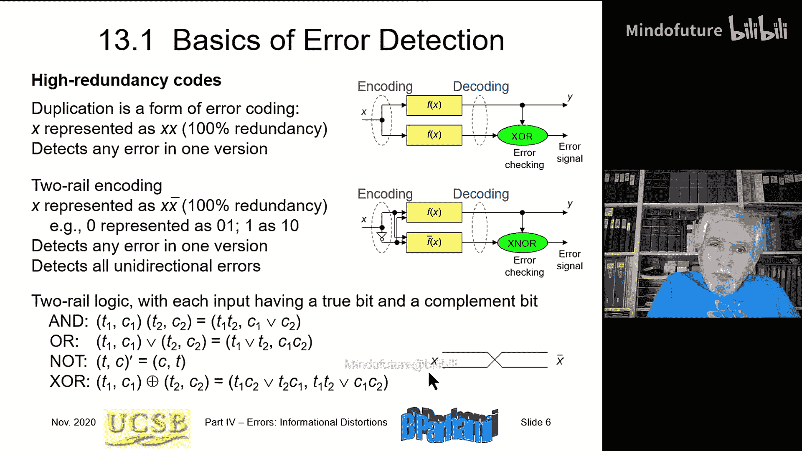

Okay， a very important notion in studying codes， whether error detecting codes。

Which I do in this lecture or error correcting codes， which I'll do in lecture 10。

Is the notion of hamming distance。Havingming distance is defined as。

The number of positions in which two bit vectors differ。

 so imagine two bit vectors of the same length。And then compare them bitwise。

 the number of positions in which they differ is called their hemming distance。And basically。

 to be able to detect a single bit error。In our data。

The code we use must have at least a distance of two。In other words， any two code words。

 any two code vectors。That we take from the code should should have a distance he distance of two。

So here is a two out of five code。And， this。Was used in the old days and is sometimes still used。

To encode decimal digits， because when you use two other five codes， in other words。

 there are two ones。There are five bits in the code and each code word has two ones。

It's obvious that the distance between code words is at least two because if this one has two ones and this one has two ones。

And the two ones are not in exactly the same places。Then there will be two bits that are different。

 So in this first example， one here has0。An X code word and0 here has one， so this needs to。

And distance 2 is sufficient to detect single bit errors。Okay。

 so here is the notion represented graphically， so if I have a code word。

This green circle in the middle。All the code， all the words that are distance one from it。

Are here Okay， so if I take this code word。At the top。

There are five words that are distance one from it， okay， I can change this one to0。

I can change this one to zero， that's the second， I can change this zero to one。This zero to one。

 this zero to one， there are five ways in which I can form a word。

That is distance one away from this Okay， so that circle represents all of those words that are distance one from this code。

And the next circle out in this diagram are distance two。Okay。

 so if a code has distance to it means that if this is a code word。

 there should be no ch word in this circle。There can be code words on this circle。

Because they're distance too away from this one， of course。

 those ch wars and the circles should be distance two away from each other as well。ok。😊。

So this basically explains why a single error can be detected because if I take this correct code word。

And change one bit。And that cord word， due to error。Then I get one of the words。On this circle。

And none of those is a valid code where therefore I'm able to detect。A single bit error。

 on the other hand， if I have two sp errors。Then I can get。Award on the second circle。

 which may be a valid code word， so let's take an example。If I change this one to zero。

And this zero to one is an example of a double bit error。

Then this code word is converted to another valid code word， and therefore the error goes undetected。

Okay。More generally， so distance two， heming distance two。

 I sometimes say just distance rather than hemming distance because in the context of coding distance means heming distance。

If I have a distance of two。Then I can detect single errors and there's such a code is known as a single error detecting code。

If I have a distance of three， I can detect double errors。

 so imagine that the nearest code word to this one is on this third circle。

There's no valid chword on the first circle， distance one and none on the second circle。

 distance two， the closest one is distance  three。Therefore， if I have up to two errorss。

Its impossible to convert a valid code or to another valid code。

And more generally speaking if you have。Distance。Distance D。You can detect d minus-1。D minus1 errors。

Now， if your distance is3。You have the option of detecting two errors。

 if you use the code as an error detecting code， you can detect two errors or you can correct one error okay so here is the justification this is a code word and the nearest code word to it is on this circle。

So if you have a change in this code word， you move to this circle。

If you have it changed in this code word， you move to this circle。And therefore。

 the two erroneous words will be distinct， In other words。

 there's never a possibility to confuse this code word。For this code word。

 when you have a single error， so you have a single error and you go here， you can go back。

 you can correct that error， but if you go from here to here， you can go back。

Because no other code word will map to here as a result of a single error。So distance three。

 you can correct one。Or detect to。Either one or the other， you can't do both。If the distance is4。

 you can do both， you can correct one error and detect two errors。So here is a distance， for example。

 this is a code word， this is a code word。If you have a single letter， you move here。

you move here and that's correctable。If you have a double error。

 there's a chance that you get from both of these code words to the same erroneous word。

That happens to be different in two bits from both of those。And， therefore。You can detect the error。

 but there's no way to correct it。If you have five， you can correct two errors。

Or you can detect four errors。Or you can use a combination。

 correct one error and detect three errors。So these have names sec that means single error correcting。

 double error detecting。SAC3E means single error correcting triple error detect。Okay。

 now generally speaking， if the distance is hch。Then。You can。Detect the errors。

And correct see if this relationship holds。So double error detecting。

 single error correcting requires a distance of four。Okay。

 single error correcting triple error detecting one plus3 plus one requires a distance of five。

So this is a useful formula to know。诶。Of course， D must be greater than or equal to C。

 it doesn't make sense to say。Single error detecting and double error correcting。

 that doesn't make sense。

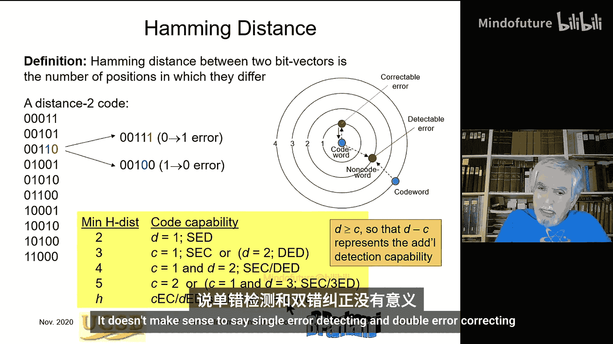

Okay， in order to discuss errors， we need to classify them。

Into categories and have models for them models basically。呃。Schemes that allow us to。

Sort of deduce how these errors can occur based on physical properties of。

Our information processing exists。The goal of error tolerance methods is to allow uninterrupted operation despite presence of certain errors。

Okay， of course， uninterrupted occurs when we have error correction。We have error detection。

 we just know that an error occurred and we can't continue the computation。

 we have to basically go back and redo the computation restart。

The error model is relationship between errors and faults or other causes of errors。

Errrrowors are detected， corrected through redundant representations。Basically， data plus。

Coach checkers。Or through some reasonableness checks， so for example， activity monitoring and so on。

 so for example， you don't always need to have codes to detect errors。For example。

 if a data comes in and youre processing that data。That represents the height of a person。And feet。

And the data is 12。Then a reasonableness check basically detects the error。🤢。

Assuming that there's nobody in the world who is 12 foot high， tall。

So some reasonableness checks based on prior knowledge or domain knowledge about the data can allow us to detect errors without any encode。

But those are exceptions， usually for normal data that we processed， we need encoding。Okay。

 errors can be single or multiple according to the number of bits affected。

 single bit or multiple bits。And of course， multiple。Errors can be double errors， triple errors。

 quadruple errors， and so on。It can be a type inversion or erasure。

 and inversion means a one being changed to 0 or0 being changed to 1。

That's an inversion error Esure error is when。Z or one basically disappears。

 so you know that there was a symbol here， but you don't know whether it was zero or1， it was erased。

An example of this would be if you receive a voltage level。That is not。

Is it between zero and one levels？And you can't tell whether it was zero。Or one with certainty， okay。

 you may be able to tell that this is more likely to be one than zero， but。If you want certainty。

 those intermediate voltage levels are basically erasure errors。

Random or correlated random is when multiple bits。Are changed randomly independently。And correlated。

Is when multiple bits change as a result of a common cause。

 an example of correlated errors are height errors an error that affects multiple bits in a bait。

And burst errors， burst is when an error。Affects multiple adjacent bits。

 so a burst of lengthan five bits， for example。In a 32 bit word means that that burst can affect five consecutive bits。

 and these are common， for example。When you do bit serial transmission。

 when you're sending bits of your data。One at a time。

And if something goes wrong with the communication channel。

And that in lasts for the duration of five bit transmissions。

 then it can cause a five bit burst error。They can be symmetric or asymmetric。

 symmetric means zero to one inversions and one to zero inversions are equally or almost equally likely。

Asymmetric means that。One of those is much more likely or in some cases。You know。

 your errors are unidirectal， in other words your。Received word or processed word has multiple errors。

 but you know that either multiple zeros have changed to one or multiple ones have changed to zeros。

 but not both at the same time。So these unidirectal errors are typically easier to detect because of this restriction。

Okay， for non binary code， we usually discuss binary codes， but we also have non binary codes。

 in which case an error means substitution of one symbol for another symbol rather than inversion。

Okay， so for example， if you have a decimal code。And each code symbol is a digit zero through nine。

Then if a five changes to eight， that's a substitution error。So for bits。

 we talk about inversion errors， for non bits or general symbols， we talk about substitution errors。

Okay， the transposition error I'll discuss in the context of an example。Now。

 errors are permanent by nature。We talk about transient faults， faults can be transient。

 a signal can momentarily change from zero to one。But an error is typically not transient。

 error is when you store something incorrect in a flipflop or in a register。

 so it's by nature permanent， you have to go back and change it to the correct value。

 it doesn't change on its own， whereas a transient fault can basically disappear on its own in a few microseconds or milliseconds depending on the duration of the transient。

So in our terminology， the terminology that we use in this course and I use in my book。

There's no such thing as transient error， we have transient faults。

 but the errors are by nature permanent。

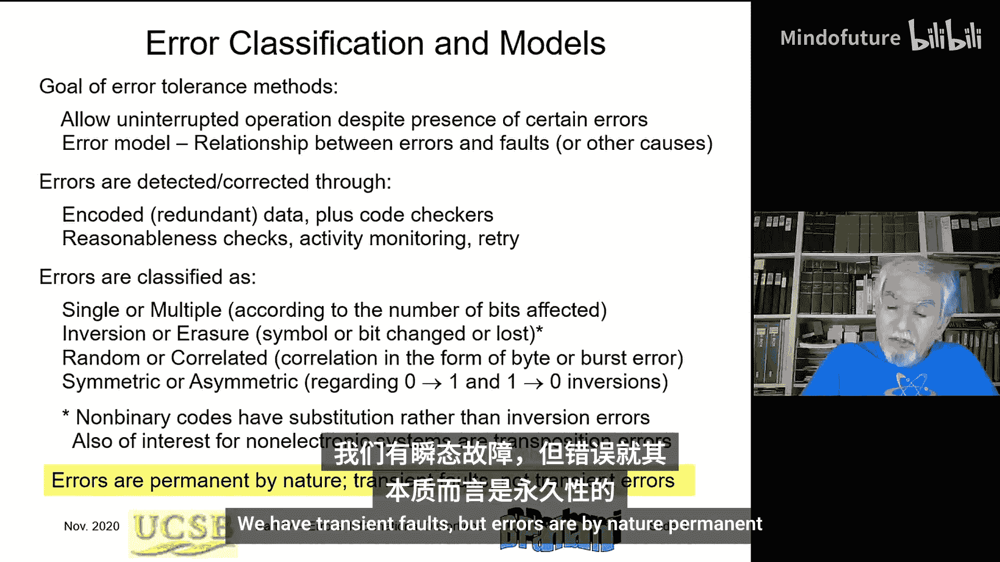

Okay， here are some examples of。Air detection in natural language text。So here。

I was trying to write the word error， maybe the printer had some problems。

 or maybe I'm covering a part of this word if you look at that wordd。

You can't make it out to probably you can't， you don't know what it is， so this is an error。

 this is basically an erasure。It has been erased okay， as you show more and more of that word。

 at some point you realize that maybe here or here。That this ward is error。

 even though still you don't have the entire ward。So there's natural redundancy。

In natural language text so that you can。You can understand， you can decode these words。

 even though part of the word。Is not present， it has been erased。Similarly。You can have。

Letters erasse。And then if you know that this is a word from the context。

 you sort of deduce that this is error。So that's erasure， two erasure errors。

This is a substitution error。That the R has been replaced by Q。still， you know。

 you probably can understand that this was meant to be error， so we basically detect， in this case。

 actually correct that substitution error。And then this is transposition error。

Where this r and O have switched places。ATposition errors are quite common。In manual data entry。

 that's why we'll see in。Bar codes， for example。They aim to detect。Ps positional。

Because if a supermarket cashier， for example， the scanner doesn't work correctly。

And the cashier enters the。呃 code。Annually， it's very common to transpose to symbols。And therefore。

 these are important。

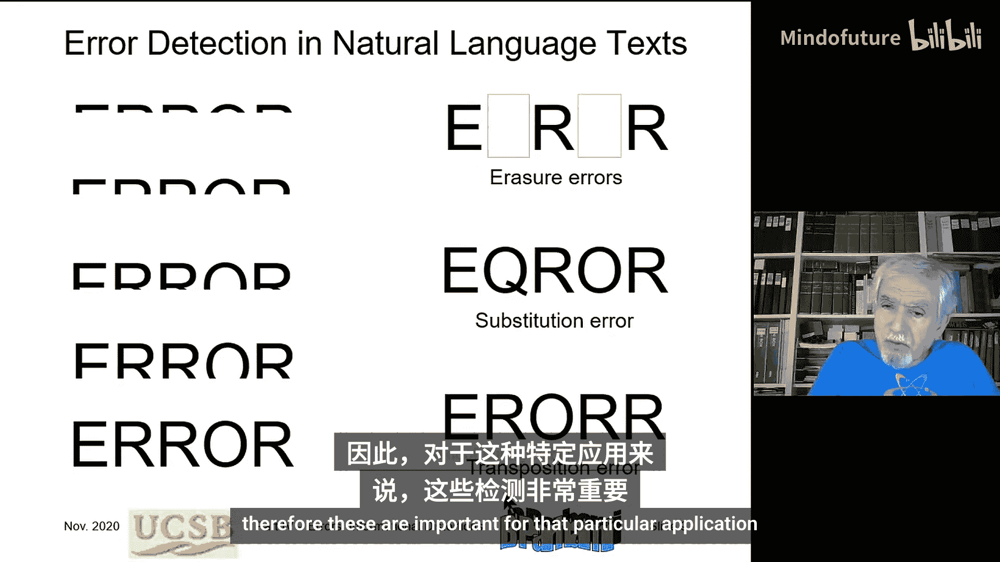

For that particular application。Okay， application of coding coding basically historically was。

Developed in connection with communication communication channels。

 so you would send a symbol from the transmitter。The symbol would go over a noisy communication channel。

And perhaps changes as a result of noise and you want to be able to detect。

That something has changed。Or maybe corrected error detecting or correcting codes， okay？

Now in communication channels， you don't do data processing， you just take a symbol， encode it。

And send it and decode it now in computer application， we have this processing。嗯。

It's a manipulation step as well， so we have an input， say coming from memory。We encode it。

We send it， the send can be over a communication line or over the bus or。Whatever。

And then we store this in memory。And then when we retrieve it from the memory。

 we again send it to the location where it's needed， we decode it。And send it to the output。

 if this was just a trans communication application， this would be the path。

 but if this is a data processing application， then the decoded value will be manipulated。

 so two numbers both of which were encoded will be decod。

 added and then the sum will be encoded and stored。In memory。

Notice that during this data manipulation phase processing。

 data is unprotected because you remove the redundancy， you decode it。

These are just ordinary numbers not encoded， so if something goes wrong here and a bit changes。

 you won't be able to detect it。We'll see later that there are codes that。

You don't have to decode before。😔，Adding numbers or multiplying numbers and those are good because data remains protected through this phase as well。

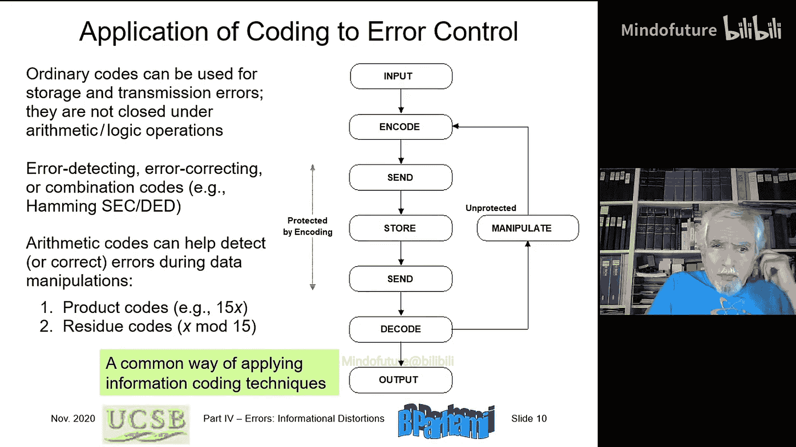

So for example， we will see arithmetic code。Such as representing X。By 15 x multiply x by 15。

 This is a particular product code。

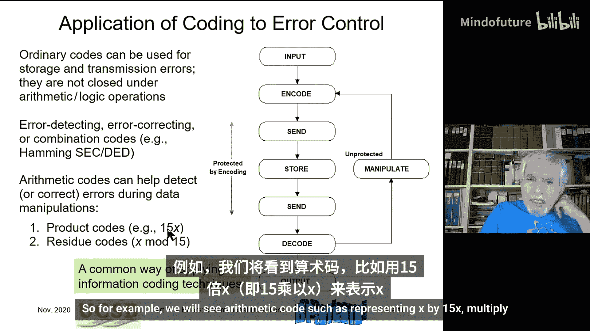

Okay， so y is also represented as 15 y and if you want to add these two numbers。

 you add 15 x to 15 y and you get 15 times the sum and that's the encoded version of the sum。

They don't have to remove the encoding， and therefore the data remains protected。

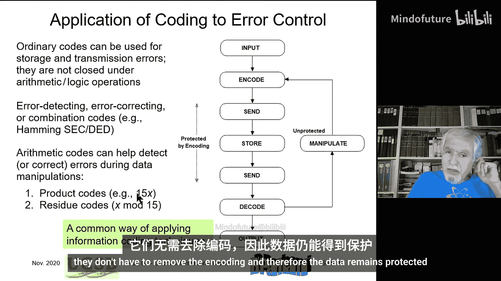

Okay， so this diagram is a high level view of the concept of error detecting codes。🤧嗯。

So if we have a data space where there are data wars， we have data wars that we want to encode。

 let's say for the sake of simplicity， these are 32 bit numbers， our data wars are 32 bit numbers。

We encode these data words into longer words， we introduce redundancy。

 so in depth 32 it may be 40 bits。So these are code wordss。

I added eight bits of redundancy to protect these data words against changes。Okay。

 now what code that I use will discuss later， but for now。

 just assume there is some suitable code that makes these data words。

 take 32 bit data words and turns them into 40 bit code wordss。

And then that 40 bit code word can be decoded。And。From format it we can generate the original date。

And this relationship is often one to one， there's a one to one relationship between data words。

And code， although it doesn't have to be one to one。For example。

 a particular date award can have two。Code words。Going back。

 each code word must go to a unique data word because otherwise we won't be able to decode it。

 but it's possible to have two different code wordss。For one data words， usually we don't， but。

Theoretically it's possible， okay。Now， these ch words have。

A particular distance from each other so that if。Say a bit in this code word changes。

 it never changes to another code word， it changes to a non code word。So the space of words。

 the code space here， is divided into two parts。The set of code words valid representations and the set of non code words invalid valid representation representing errors okay。

So this code word and this code word by changing various bits。May both go to。This error word。

 that's okay， that's allowed。We just can't correct the error because if both of these can generate this erroneous non code word。

 then I don't know which one was the correct date。On the other hand。

 if this relationship is also one to one。Then。Like this case。

Then if this is generated and assuming this non code word is not generated by any other code word。

I can make correction。So in order to make corrections。

 I should not have multiple code words mappingping into the same non code words。Okay。

 the simplest possible errority detecting code is the parity check code， okay？

They've probably been exposed to this many times before。If I have a code word， the blue bits。

I attach a parity check bit to it。In order to make the overall parity even in this example and。

Opting for even parity， I could do odd parity too。So because there are three ones in the code word。

 in the data word。I add the one to make the number even。Now， if any bit in this。Word。

 coded wordd changes， that zero changes to one。It violates the parity and therefore I can detect。

A changenge。However， if two bits change， for example。

 this zero changes to one and one of the ones changes to zero。

Paity will not be violated therefore double errors are not detected。So this is a very。

 very common code that this use， this very low redundancy。

 in other words you can have 32 data bits and just one pairy bit。

But also it provides very limited protection if you have 32 data bits。

Chances of having more than one bit error increases。

 and therefore this single parity bit can provide only limited protection。

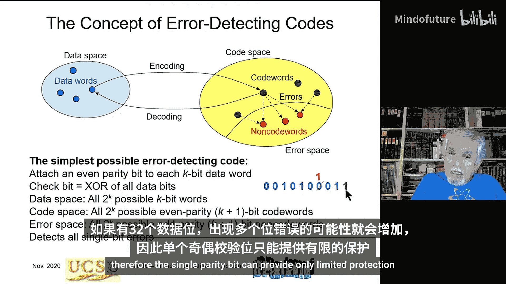

Okay， so in order to evaluate error detecting codes， we have。We examine several features of the code。

For example， redundancy， if you have k data bits encoded in n bits， in other words。

 we are adding R redundant bits。Then， redundancy。Is R over K R extra bits are used to encode K data bits。

That's the redundancy， of course we aim to make redundancy as low as possible if we can。

Encoding how difficult is it to encode， both in terms of circuit complexity for the encode and we'll see examples of encoders and decos later。

And also in terms of the amount of time needed。Because if you look at that path where data is encoded and then transmitted and then decoded it。

The latency of encoding and decoding is added to the overall latency， therefore we prefer codes。

That are fast。In terms of encoding and decoding。And also requires simple circuitry。

For encoding and decoding simple because it limits the cost and also the power consumption。Okay。

 capability of the code， what types of errors is it capable of detecting？

The greater the detection capability。Usually we need the more， we need more redundancy， okay。

 the more the detection capability， the more redundancy。Okay。

 examples of code detection capabilities are single error detecting single error correcting。

Double error detecting B bit burst error detecting， byte error detecting。

 uni directional error detecting and so on。Okay， and closure of course。

 is a good property to have closure means that arithmetic and other operations can be done directly on code wars and other words the code is closed under。

Types of operations that we want to perform， this is not a common property of codes， okay。

We we willll discuss a special category of codes called arithmetic error detecting codes。

Those are not very commonly used， so usually this particular property is not。

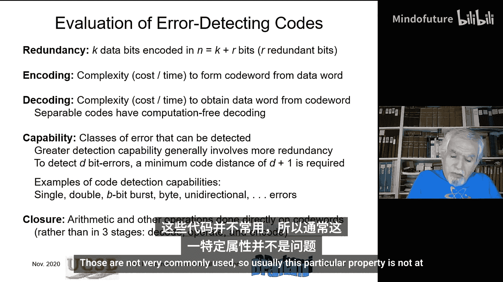

Thats the issue。Okay， let's consider a particular class of codes called check some code。

Exemplified by the 12 digit UPCA Universal product code。So， this is basically。你有呢。

The 12 digit universals product code。Up to here。One， two， three， four，5， six， seven， eight， nine，10。

11， 11 digits， sorry。And then a 12 tech digit has been added。

So the 12 digit includes that check digit。

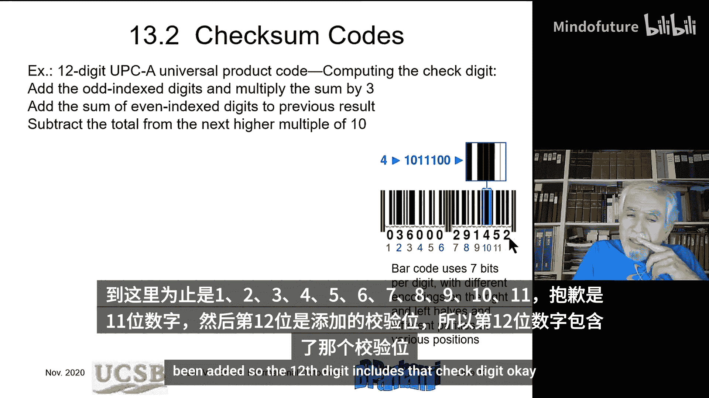

And the rules for adding the check digit I can tell you through an example。

Some the odd index or index these digits2，3 and so on， the red indices are odd indices。

 the blue indices are even indices。So， the。Process for determining this check digit goes like this。

Some odd index digits。So add zero to65 to zero and so on。And you get 14。Multiply by3。

 so this is the basically encoding process， whatever sum you get here， 14， multiply by 3， you get 42。

Now add to this 42， even index digit， even index digit in this example are 3，0，0，9， and so on。

You get 58。Find the next multiple of 10 after this number， which is 60。

And subtract that number from it， you get two， so that's the check digit that you put there。Okay。Now。

Basically what you are doing， you are making now that that location is actually an even。

Index location。It's location 12， okay？So。You give all the index location a weight of three。

 you give the even index location a weight of one。And therefore， if you do this calculation。

 and then simply add the check digit。You get the multiple of 10。

And that's basically a sign that your code。Its okay， there's no error in it。Okay。

So the process of error detection is。Do this calculation。But include also the check digit。

 which is an even index digit， so I add two to this。So you get 60， which is a multiple of 10。

 and it says that。There's no error if it's not a multiple of 10。

 then you have an error now this particular code。Detects all single digit errors。

If one of those digits changes。Let's say this six changes to four。That's an odd index digit。

6 changing to four reduces its value by two， three times two is6， so it will reduce the sum by6。

 and therefore the sum will no longer be。A multiple of 10， and you detect that error。

 so any single digit error。Whether you increase the value of the digit or decrease the value of the digit。

Okay， so for example， if this barcode is not easily readable。Caashier mistakes the six。For0， maybe。

Then it's what we detect。Or if the scanning device。

Let's say this is scratch and the scanning device cannot read it。Correctly。

 then the error will be detected。It detects most， but not all transposition errors。

Let's take an example， let's say this one and four being transports。

So the normal sum would be1 times three because this is an odd position plus four。To 7。

When you transpose it， it will be four times 3，12。Plus 1，13。And therefore。

 the sum will not be a multiple of1。There are。Exceptions though。

 and I leave that as an exercise for you to determine what types of transposition errors are not detected by this code。

And that's basically a compromise in order to manage with just a single redundant digit。

 they had to compromise and allow those。Few and position errors to go undetected。

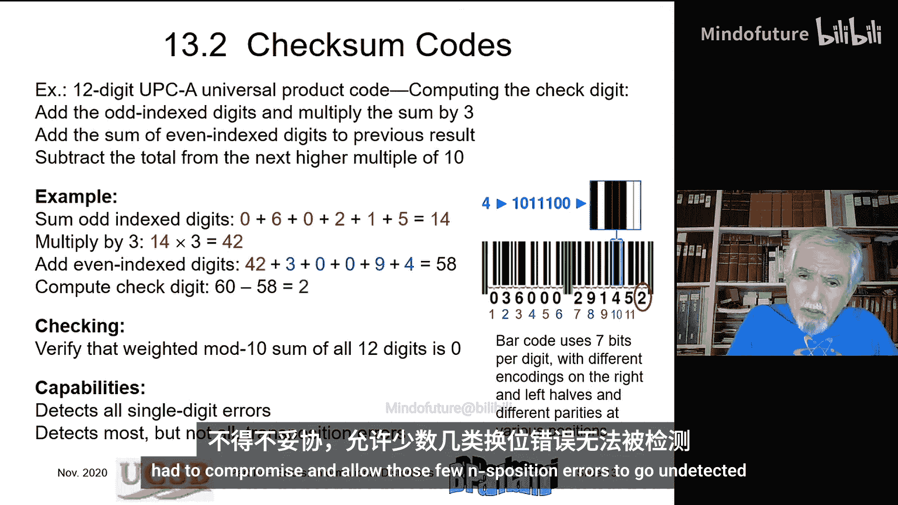

Of course， if we add more redundancy， we can detect those。Okay， so generally speaking。

 checks some codes are like this， you have a data vector。

You encode the data by attaching the check some XN plus1 the last。Symbol。Such that summation of。

Alllder digits， each multiplied by its corresponding weight。Is zero modular sum， check some constant。

Okay， so for example， the UPCA code on the previous slide has these weights。

Ot index positions of weight3。Even index positions of weight1。And the check constant is 10。

You do module 10。Checking。Okay， so these weights are up to me to assign。

 I don't have to assign only threes and ones。If I can show that other weights， you know。

 introduce desirable properties for my code， I can use other weights。Okay。

 such a check some code detects all errors that add an error magnitude。That is not a multiple f A。

If the error magnitude， if what is added to that checkum is a multiple of a。

 then the error goes undetected。And just the。For your information。

 this is not really relevant to our discussion of the code。But these barcodes， you know。

 this three or the six actually consist of。7。Bars， dark or light barss。And so。You know。

 these narrow lines are just one of those narrow gaps are just one of those。

 then you have this maybe three。Bars like that， so for。That you see here。Consist of。A bar。A blank。

Then three bars， three black bars。And then two whiteboards。So that's basically so that the scanner。

Has some error detection capability if these bars are not completely formed on the label。

 it can still make sense of the digits。

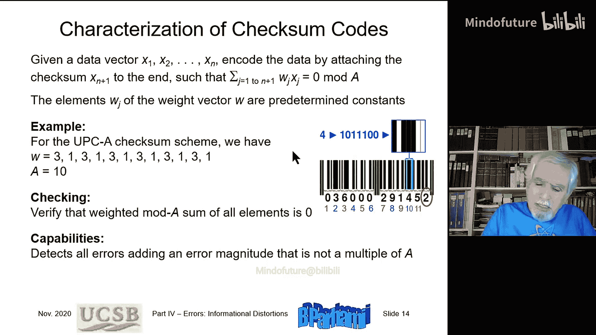

Okay， white yeast and Bur coats is the subject of the next。Section。

And so this is a weight based code， this is weight two。

 and other other code words are five bits long。And every word in this code has a weight of two。

 meaning it has two ones。Okay， so this one is capable of detecting all unidirectal codes because even if three zeros are changed to ones。

The weight changes if one or both of these ones change to zero， the weight changes。

 therefore you can detect。However， if this one changes to zero and this zero changes to 1。

 the weight remains the same， so it does not detect bi directionional。Errors。

 uni directional errors in any number of bits are detected。Of course。

 single bit error is always unidirectal right if you have a single bit error。

Either one it changes to0 or0 changes to one。So single bit errors and in fact。

 all unidirectal errors。Okay。Burger coats。Were invented by Jay Berger， an IBM engineer。

 tried to find a photo of him。And to my surprise， there was no photo of him on the internet。

 so I'm going to keep looking and put the photo here。嗯。As a way of giving him credit。

 so Jay Berger of IBM defined this code。So you have data words。Like six bit data awards。

So these are 64。Data words going from  zero to 63。Burgger suggested。

For us to count the number of zeros。And attach that as a number。As the redundant part。

 so for example here I have six zeros and six is 110 in binary okay。

 here I have four zeros in this code word。And4 is 1，0，0。Okay， why did he？

Decide that it's a good idea to count the number of zeros and add here。

It turns out that this code is unidirectional error detecting。Because of zeros change to ones。

The number of zeros is decreased here。😔，And zeros changing to one here increases the count。

And therefore they will not match， so if some zeros in the data part change to ones and some zeros in the check part change to ones。

 then the count certainly will not match。Whereas if we had counted ones。Okay， so we could say。

All right， here， there are two ones here。So this code will be 010。😔。

Then if this one changes to zero and this one changes to zero。A uni directional error。

 it will not be detected。So by attaching the count of zeros。

 you make the code capable of detecting all unidirectional errors。

So you need log base two of K plus1 check bits for K data bit， so it's fairly efficient。

 it's a logarithmic number of bits， the longer the data part。More efficient as code becomes。

So if you have a 32 bit data part。A 31 bit， let's say， 31 bit。

 then log2 31 plus one will be five bits you need only five bits。

And it becomes even more efficient if the data part becomes longer。Okay， the next category of code。

I should mention at this point that。Now， coat， and this is。True。

To some extent of all the topics that consider， so for example， fault detection is by itself。

Fairly broad topic。And we just basically touched upon some basic ideas in fault detection。Now。

 error detecting and correcting code is even broader in scope and in fact some universities。Offer。

A course sequence dealing with error detecting and correcting code。

 so multiple courses be because there are so many different code and there are so many different theories on which。

Coode construction is based， so they're going to touch upon some examples to give you a basic feel。

For why codes work。You know why they detect or correct errors and some。Typical codes。

 some of the most commonly used codes will be exposed to and some other codes you'll just hear the names。

 but at least you have the general knowledge to be able to pursue a study of codes if the need arises in the work that you do so what are cycling codescycl codes。

Are codes for which any cyclic shift of a code word produces another code word。

So here's an example of acycl code。In thecycl code， we have a K data word。

So let's say this is our data word。And K in this example is seven。

And this data word is represented by a polynomial。So it's 1 plus x， there's no x squared。

G the coefficient of x squared is 0。Plus x to the third。No x to the fourth。

 no x to the fifth plus x to the6， so this polynomial。In which addition is modular2。

 I'll explain what that means。Represents this data， in other words。

 there's a one to one correspondence between data words。

And polynomial such as this in which the coefficients are once。Or zeros。Okay。

 addition is done moduleular2 means if I add x to this polynomial。

X plus x becomes 2 x and then 2 modular 2 is0， in other words， x plus x cancel each other out。

So addition is sort of like subtraction in this modular2。嗯。Operation space。

So adding X is like subtracting X to this polynomial。Okay。

So a polynomial a data word is represented by a polynomial。

And the code has a generator polynomial of degree。2。

So here's an example of the generator polynomial1 plus x plus xq。Okay。

 r is equal to three in this example。Okay， and then encoding is done。

In multiplying the data polynomial。By the generator， polynomial。So this is the data polynomial。

 this is the generator polynomial， we multiply one times 1 is 1， one times x is x。

 one times x cube is x cube， one times x to the6 is xa。Then we go to x， x times1 is x。

 x times x is x squared， x times x cube is x4 and so on， and then we simplify。Basically。

 this X cancels this X。The X cube cancels the X cube。And we get this。

 so this is the encoded version of that data word。Okay。

 the polynomial corresponding to this encoded version is 1 plus x squared。3， four，5，6 plus x7。8ight。

9 plus x9。Okay， such a code detects all burst errors of width less than n minus k or less than R。

So because。A generator polynomial was of degree3， so R or n minus k is equal to3。

Any burst error of size less than three， in other words， burst errors of size up to2。

It be detected by this coat。So now burst arrow do not have to be unidirectal as long as two consecutive bits are affected。

One can change from one to zero， the other one from zero to one， it's still a birth set。

First means the effect of the error is limited to consecutive locations。

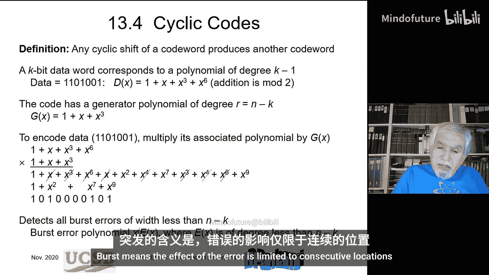

Okay。Now cyclic codes that I discussed on the previous page have simple encoding and decoding circuits。

I won't try to explain this why this works。Basically， the data word comes in。One bit at a time。

And then it goes through the circuit and then the encoded wordd emerges from there。

Now the structure of the circuit is dictated by the generator polynomial。

It was x to the 3 plus x plus 1。ok。So x to the three x and one have flip flops， the three terms that。

Existed in that polynomial。And then you have an x or gate between these two terms and between this one and output。

 but not here。So that's the decoder， so it's simple circuit， of course。

Because data must come in bit serially， it can be slow。And this is the decoder。Here the。

Encoded word comes in。Goes through the circuit。😔，Again。

 xq plus x plus 1 is the generator polynomial that dictates the structure of the circuit。And then。

AndThey decoed。The decocode that data emerges from here。

So both encoding and decoding are fairly simple， low cost。

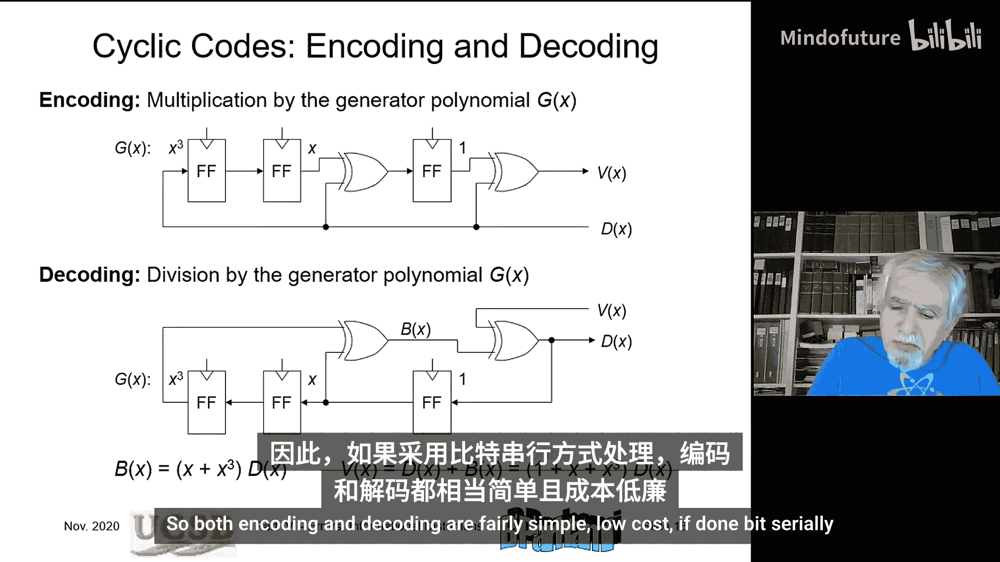

If done bit serially。We can also have separable cyclic code Now the notion of separable code is very important because the code that we discuss both。

诶。The constant weight code and this not this one。

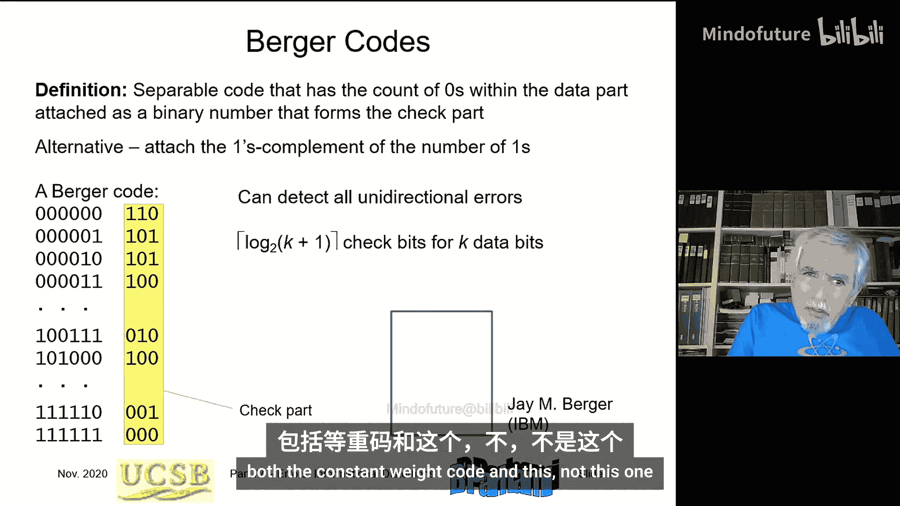

The constant weight code in this slide is not separable data。It's redundant， you know。

 because to encode 10 things， you need only four bits here， we are using five bits。

But you can't point to one of these bits as being the redundant bit data and the checkboard are intermixed this is known as a non separable code。

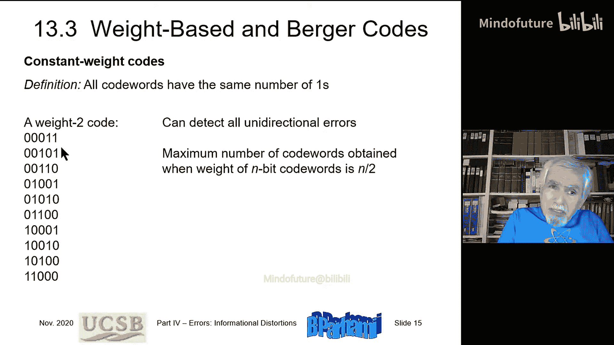

Burger cord， on the other hand， is a separable code。

Because the check bits are separate from the data。So this means that decoding is trivial if I give you this code word。

 you just look at these six bits and that's the date。Decoding is trivial for separable code。So。

We are interested in seeing whether we have separable  cycle codes。Yes。

 we do have several thoseic codes。So I'm going to let the reading of this slide to you。

 there's a way， one particular way of constructing a separable cycling code。

In which when you get the code word after encoding。Okay， the data is 10，01 in this example。

And that 1001 appears here。That's the data part， that's the check part。

 they're separate from each other。The data maintains its original form and therefore decoding as trivial。

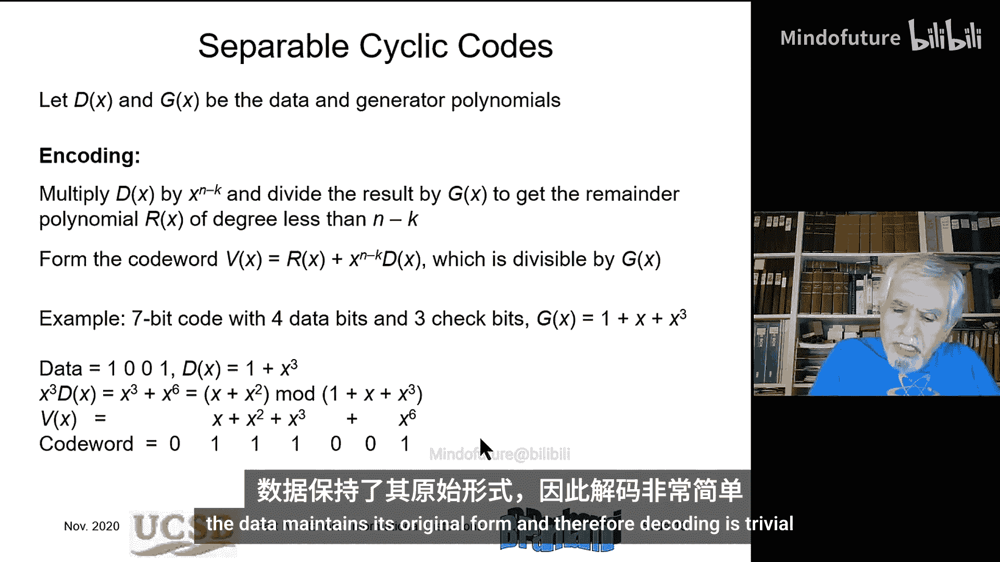

Okay。The next idea is that of arithmetic error detecting codes。

These are error detecting codes that are particularly suited to。Arithmetic operations。First of all。

 arithmetic operations are different with respect to。Es。Compared with just regular words， you know。

 in transmission when you transmit。Award over a communication line。

And if you have a single bit error， it changes one bit， and therefore a single error detecting code。

 or later we will see also single error correcting code can deal with that single bit error。

Or the communication line may have a burst of errors， in other words， for us。

A particular duration of time， there's noise and therefore several bits in sequence are affected。

So if you have a burst of length four bit affects four bit。

 and if your code is capable of detecting burst of length4， then you will be okay。Im arithmetic。😊。

Circuits， sometimes a single。Falult or a single error causes a large number of bit flips。

 so let's take this example。Add of these two numbers。

I'm adding these two numbers and this is the correct sum。Now。

 when the adder that is adding these two is operating under the two carries will be generated and let's say inside the add。

 this carry which。Its supposed to be zero。Because this position with two zeros should generate a carry of zero。

Suppose changes to one because of fault in the circuit。When that carry changes to one。

It propagates over these eight bits and changes them to zero， sorry， 11 bits。

And then it also changes the zero2 point。So that single fault in the add circuit。

Causes 12 bit flips in the output。ok。All these 12 beds have been flipped。

And it's unlikely for us to have a code that can detect 12 bit flips。

So normal code really cannot deal with this kind of error。That commonly occur。

Occurs in arithmetic circuits。So what's the solution？

Well the solution is to define the error not by changes in bits。Okay。

 we don't view these as many errors， we view these as the addition of2 the four。

To the correct sum okay， so there's two the0 to the one。

 to the two to the three to if I add two the four to this correct sum。This word will result。Okay。

 so a single error in this arithmetic context。Is an error that changes the value of a word。

By a power of two， so here's an example。So the output of that adder， yeah。

If you add two to four to it， which is equal to 16， it changes to this。

 so this is a single arithmetic error。Because a single power of two was added to this to get。To this。

This is an example of a double it arithmetic error， two powers of two have been added。

 one of them has actually been subtracted。So two to four has been added and two to 15 has been suspected。

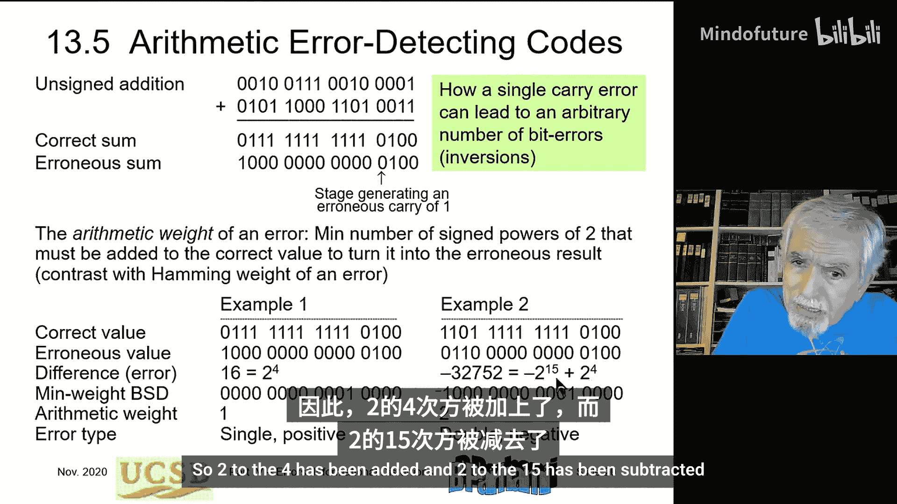

So the error， in this case， the sorry。

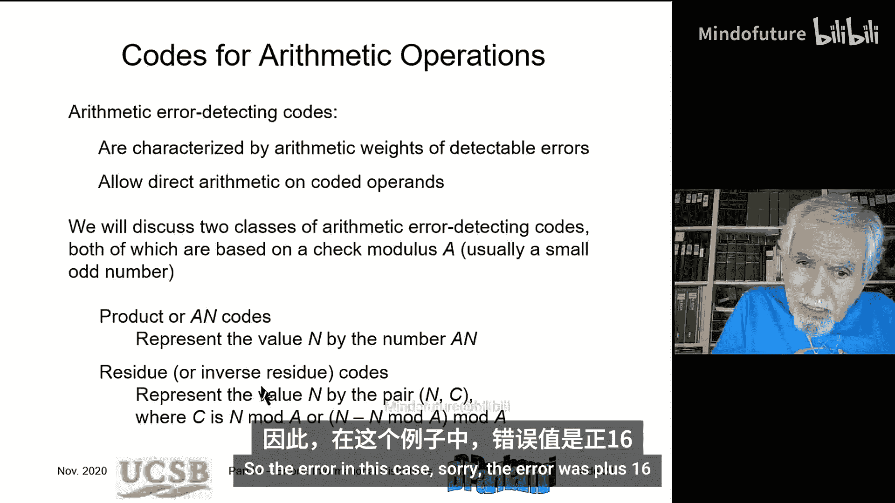

The error was plus 16， in this case the error is minus 32，752。

 but this error happens to be of a kind that can be written as the sum of two powers of two。

And therefore， we call this a double arithmetic error。

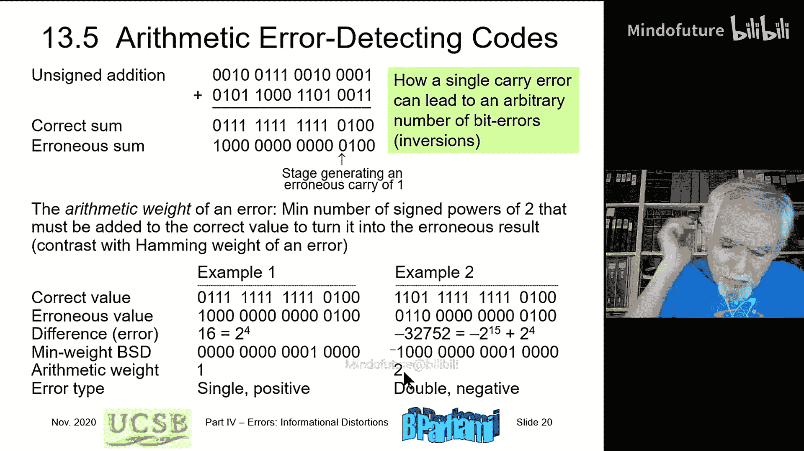

Now codes forrimetic operations， I'll just explain these briefly。

We have two categories that are widely used。APro or sometimes called AN code。

 when you want to encode N， you multiply it by constant A， that's where the name AN comes from。

And the residue or a variation of residue code inverse residue code。In this。

 if you are given a number n to encode， you attach to it a check part。

That is the residue or remainder of n when divided by some constant a。

So a in both cases is a constant that is given to us as part of the code definition。

This is a non separable code。Because when you multiply a number by a。

 then n itself does not appear in the result， this is a separable code because the check part is distinct from the data part。

Okay， so let's see some examples of these。For all the a。

So let's talk first about product or AN code for any odd A doesn't matter what  three，7， and 15。

All weight1 arithmetic errors are detected。Okay， that's because a weight one arithmetic error is a power of。

2， and therefore it will not be divisible by a。And therefore， it will be detected。

Arithmetic errors of weight greater than or equal to 2 may go undetected。Here's an example。

The  error 2 to 15 minus2 the 5。Is undetectable with a equal to 3。

Because this number happens to be divisible by three。ok。Even 11 will not work。

Because this number is also divisible by 11 and 31 will not work。Okay， so。Basically。

 product codes are for single arithmetic error detection。And to detect error。

 we check the visibility by a。And then to do arithmetic。before doing arithmetic。

 there's a version of these product codes， which are called low cost product code。

 where this constant chosen is a power of 2 minus1。So for example， three or  seven or 15 or 31。

The reason this power of 2 minus1 is a good。Check value is that multiplication by a becomes shift and at。

We need multiplication by a for encoding。So encoding is done through shift and add rather than through multiplication。

Which is a slower operation。Division by 2 d a minus1。Is also simple。Basically， we compute。

 let's say this is 15。So you're given 15 x and you want to find X。Okay， 15 x is given。

 you want to divide by 15 to find x， you observe that 15 x is equal to 16 x minus x。Okay， 16 x minus。

Sorry， 16 x minus 15 x。The 15 x we know， that's given to us 16 x we don't know。

 but we do know that 16 x ends in four zeros。So we know the last four bits of 16 x。

 we know the last four bits of 15 x， therefore we can compute the last four bits of x。

And then once we have the last four bits of x we substitute here。

 we now have the next four bits here and so on， so if we do the operation four bits at a time。

 we can easily divide。15 x by 15。Without doing an actual division， which is a slow operation。是。

Any unidirectal error with arithmetic weight of at most a minus1 is detectable by a low cost product code based on。

Constant a equal to the a minus1。So again， taking the example of 15。For 15， a is equal to 4。

So any unidirectal error with arithmetic weight at most three。It be detectable by that quote。

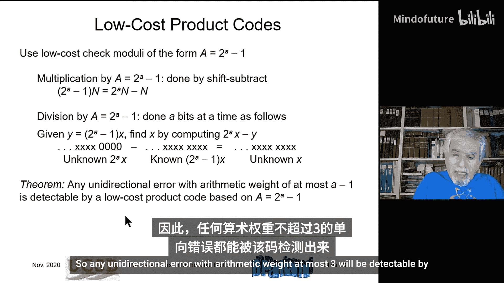

Okay， here are arithmetic operations， addition is trivial。

 if you have x coded as Ax and Y coded as AY， you just simply add them。Directly。

 and you get the coded version of x plus or minus y。So you don't need to remove。

 you don't need to decode and then add and then encode， you just do it。For multiplication。

 if you add the coded version of a by the coded version of x。You get a squared Ax。

 but you want a times ax， so you have to divide by a， but divide by a。Can be simple。

 as explained previously。Division is difficult， so I won't even discuss it。

 square rooting is difficult。For those of you have taken my course and computer arithmetic。

 you know that residue number systems。Great when you do addition， a multiplication。😊。

But they were awful for other operations， difficult operations。For their use。

In applications when you don't have those difficult operations， such as division， square roing。

 and so on。A similar thing holds here this type of code is used when you don't have those difficult operations。

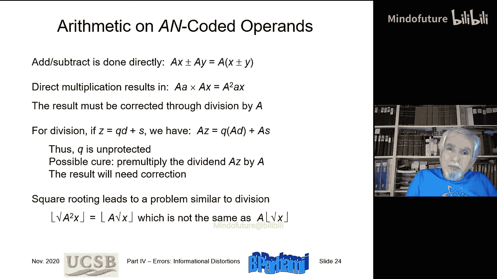

Resid code。Here's an example。So。Let's say a is 15。So you want to compute the module of 15 residue of some given number N。

So let's say this is the number in 16 bits。And you want the module of 15 residue。It's very easy to。

Prove that you simply add these chunks of four bits module of 15 because this is weighted1。

 this is weighted 16 and 16 is Mau1 mod 15。This is weighted。16 times 16256。

And 256 is also one mod 15， so you just add these together moduleular 15。

And you'll get the checkboard， so it's a pretty simple process。Okay， once you have encoded your。

Operans using residue code， here is how you operate on them and check for errors。

So X and its check part， y and check part come in， x and y go to the regular arithmetic processor。

 do addition multiplication， what have you？The check r go into the check processor。

And if you want to do addition， you add the check partss， modular A。If you want to do multiplication。

 you multiply the checkbar so the check processor。Its only four bits wide is's much simpler than the main arithmetic processor。

So that's the attractiveness of this kind of encoding because redundancy is much less than 100% when you compare it to duplication。

 this is much better。So the checking is done by computing the result。

formming its mod a residue and comparing with the output of this check processor to see if there is any error。

 if there is no error， then this is the output， otherwise you just don't use that output。

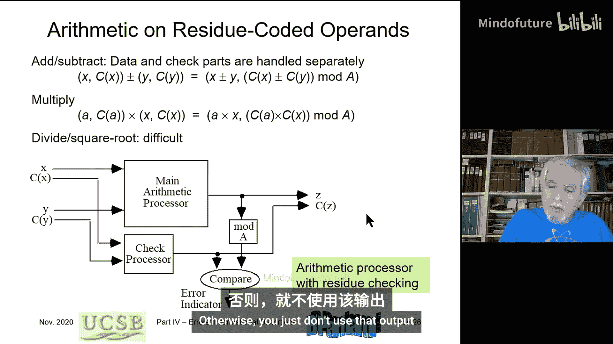

Okay， so on this slide I've just listed a bunch of other codes that you may have heard about。

 but we won't discuss them in this course。First of all， we have codes for erasure errors。

Erassure errors are easier to deal with。It's sort of。You know， if you try to compare it to lying。

 if you talk to somebody and that person does not respond。

You get into less trouble than if the person responds， but gives you the wrong answer， okay？

But you raise your error， you just don't know what that particular bit or symbol is。

But you don't get misleading information， okay， so erassure errors typically involve less redundancy。

And they're easier to deal with。Codes for byte errors。Okay。

 because byte is such an important unit of information in computing。

We have specially designed codes that。Detect a errors。

 So no matter how many bits in a byte to change the code detects it。

This is reasonable because a byte comes from a register from some memory location。

And if something goes wrong， it's possible that multiple bits in the byte。

Are erroneous and therefore bite coat。Are useful。And codes for burst errors。

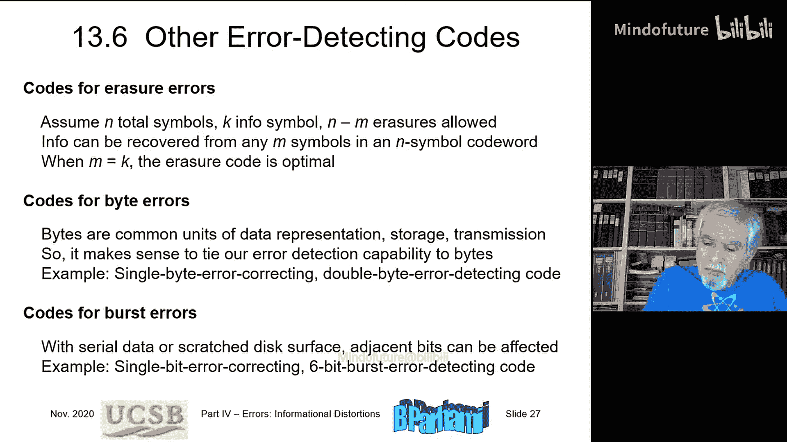

Okay， so let's now go to。

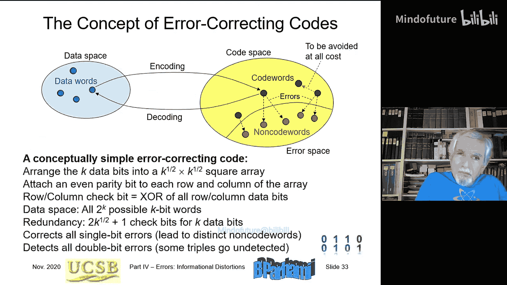

Chapter 15。

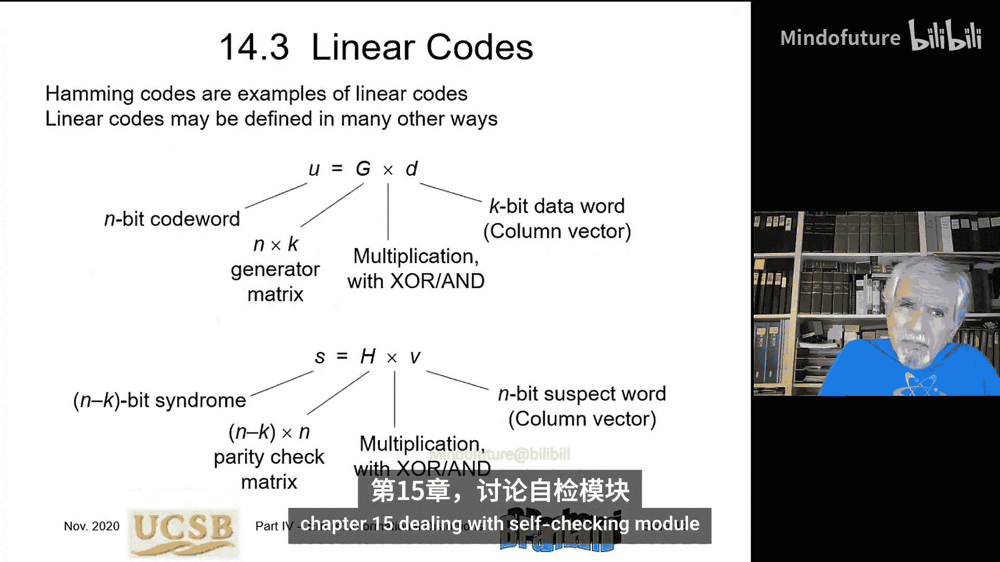

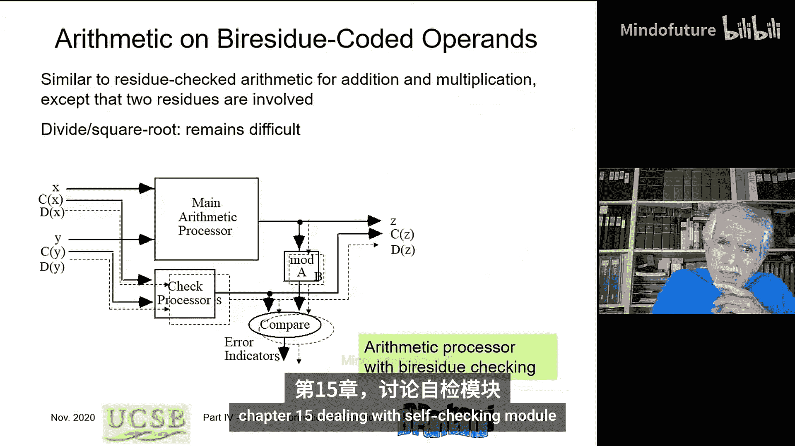

Okay。Dealing with self checking module。It's a very interesting concept。

 unfortunately it is not used that much in practice。

 even though it's a very powerful way of designing circuits as we will see。It has not。

Found its way into。Mainstream design techniques。But if you are trying to design fault tolerant or highly dependable system。

 it's a good method to know。So。Suppose I'm designing a function unit。

It receives some input and computes something for me， it doesn't matter what it computes。

The self checking design paradigm does this， it uses encoded inputs instead of just regular inputs。

The function unit operates on the encoded input， it generates an encoded output。

We design the function unit so that if something goes wrong in the function unit。

 some gate is stuck at zero or some wire is disconnected。

 the types of faults that we expect to occur in the function unit。

We design it such that whenever that happens， this output。Will show an error， so it's encoded。

Normally， if the input is correct and the function unit is working correctly。

 then we get the correct output encoded as a code word。If something goes wrong in the function unit。

Then we get a non code word here， therefore we use a code checker。

And why this has to be self checking itself， I'll discuss in a minute。

 so we use a code checker to check on this。If this is a valid code word。

Then we are okay if this is a non code word then。We have detected。The problem and the function unit。

Now implicit in this design technique is that the function unit and the checker both cannot be faulty at the same time。

This is a reasonable assumption because these are two separate units。And。

Each of them has a very low probability of being faulty to begin with。

 So both of them being faulty has a very。Small， it's a tiny probability that we can ignore。Okay。

 with this assumption？Then this scheme basically detects any faults in the function unit。

We can also design the function unit such that if an erroneous input comes in。

It generates an erroneous output。In other words， if the function unit is working correctly and then erroneous input comes in。

Then it generates an erroneous output so that we can detect it。So basically， input error。

Under those conditions propagated to the output so that we can detect it with this trick。So。

In abstract form， this is what we are really doing。We have an input space。Valid inputs。

 invalid input， we have an output space， valid outputs invalid outputs。They're coded。

And then we expect if the function unit is working correctly， if you give it a valid input。

 it produces a valid output， which is the normal function。Of that function。

If the circuit has some fault fee in it。Then。The outputward。

We'll be in errorspace so that we can detect it through here。

This is part of the specification of this function。If it's non faulty。

 then it generates a correct output， if it's faulty， then it generates this or we have the option。

Of designing。Circuit so that it does produce the correct output。

We basically build in some sort of error correction into this。However， under no circumstances。

 should the unit produce a different。Valid code word。In other words， if something goes wrong here。

 we don't want instead of this。Correct output to generate another output that is incorrect。

But not which is valid， it's in code space， but it's not the correct outcome。Okay。

 so the circuit has the option of。Producing the correct output when it's faulty。

Or producing an incorrect output that can be detected。By this codech。Okay。

 so we have four possibilities， both function unit and Checker R okay。

This is the normal mode of operation。Only function unit is okay。

The function unit is okay and the code checker is faulty。Then it may signal an error。

 even though there's no error。But this is a safe type of。Faalult。

Because we do have the correct output， this one says that it's not correct， we don't use that output。

 so we are at least safe。So this is a safe mode。It's not very desirable， but it doesn't cause any。

Serious safety problems。If only the checker is okay。

And the function unit is faulty and the checker detects。De fault in the function unit。

 this is a detectable error。And the fourth combination， neither function unit nor checker is okay。

Okay， this we do not allow， okay， we do not allow two faulty units at the same time。

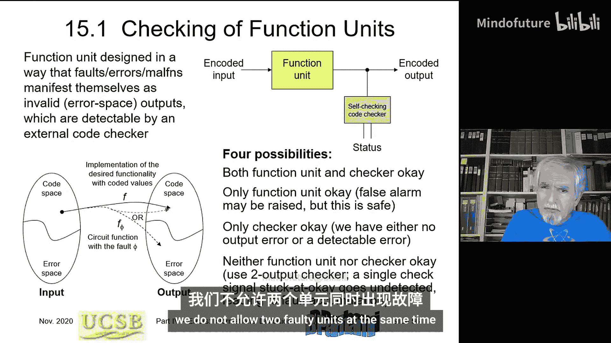

Okay， we can cascade。Self checking units are shown in the diagram。So this is function Uni one。

 which is self checking， it's output for this check， function unit two， which is self checking check。

Remember， I said that we can design function unit one， function unit two， let's say。

So that if it receives an incorrect input， it generates an incorrect output， if that's the case。

 if it has been designed for that， I can remove this checker。Save。Save some hardware。Okay。

 so if function unit2 is of a kind that translates an input error into an output error。

 then there's no need to check this here。Of course。

 I'm still assuming that one unit out of the three is faulty because if this is faulty and it generates an incorrect output。

And this is faulty。And does not generate an incorrect output because it's faulty。

 then we are in trouble。Okay， of course I can also for safety reasons。

 I can include this if I include this。And I can combine the check signals from the two self checking checkers and obtain an overall check。

 so if this one says something is wrong or this one says something is wrong。

Then something is wrong in the overall system。 So this is。OutCombining outputs of multiple checkers。

Using a self checking circuit。Okay。Let me skip this。

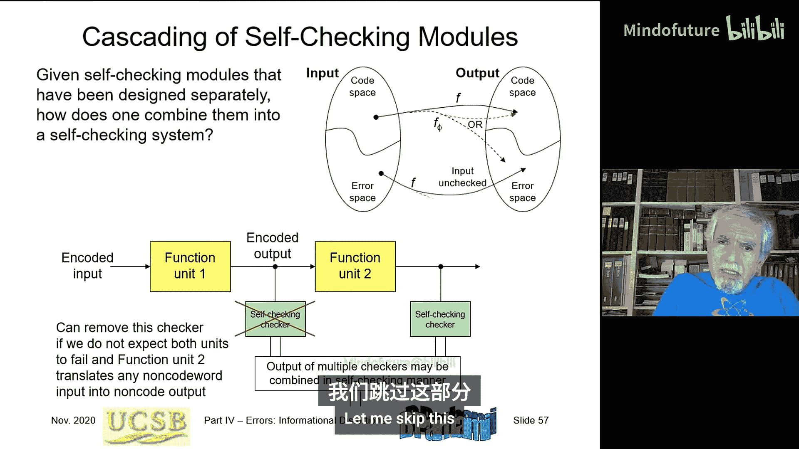

So how do you combine error signals？basicallyically。

 these self checking checkers are designed so that。They have two output lines。

And the two output lines。Are01 or 10 if everything is okay。🤧嗯。

And they signal error by generating zero，0 or 11。Why do we need two output lines？Excuse me。

We need two output lines because if we have just one output line。

That output line happens to be stuck at 0。And let's say zero is。

Zero tells us that everything' is okay， if that output line is stuck at zero。

 then it will never detect anything。So by having two output lines and insisting that both output lines assume value 0 and1。

 so01 for some combination of good inputs here， it generate01 for other combinations generates 10 so both of these lines through normal operation of the checker assumes a value 0 and1 so if one of them is stuck。

Then。We will see this pattern， so when it's supposed to be 01 and if this one is stuck at  zero。

 it' will see 00。It's supposed to be 01 and this one is stuck at1 but we'll see11 okay。

 so that's the idea of having at least two output lines for these self checking checkers and this particular example circuit that I let you study on your own。

Combinines those pair of check signals。And generates a single check signal at the output。

This is basically logical or of those two。If this one signals an error or this one signals an error。

 then this one should signal an error。

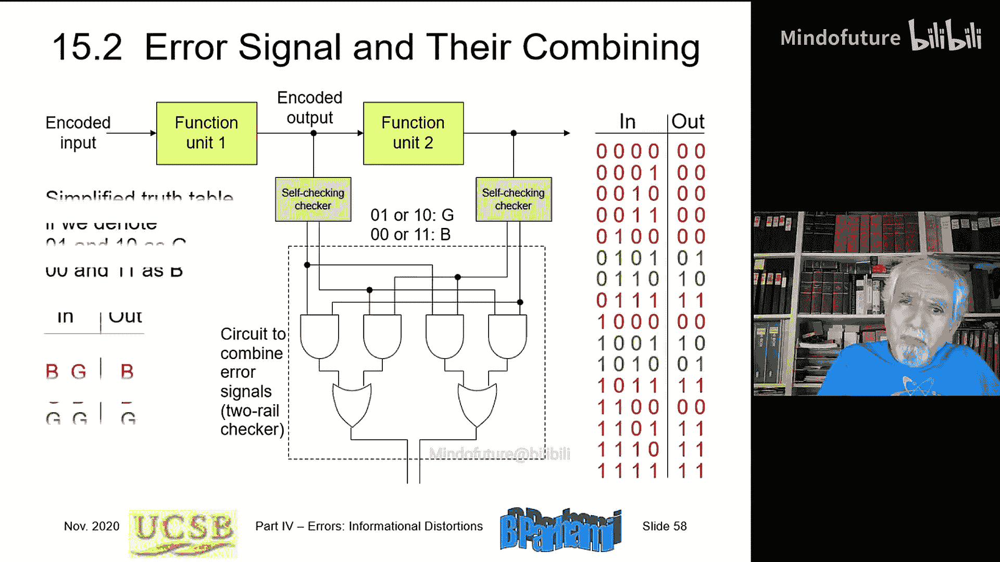

Okay， so I'm going to skip the rest of this now。The notion of totally self checking design is important。

Because。We mentioned that if there is an error， let's say， a stuck at one fault inside the circuit。

The circuit generates this。But we cannot design the circuit to be tolerant of all faults， okay。

 we basically focus on a class of faults， like single stuck at faults。

And designed the circuit to be tolerant of those single stahead faults。Now if the circuit。Basically。

诶。Makes too many of these corrections。So there is a single stuck at fault。

 but that single stuck at fault does not affect the output because I've designed the circuit to be fault tolerant。

Then at some later time， a second fault can develop in the circuit。

And now the circuit is not tolerant of two faults， so I run into trouble。

So for totally self checking circuits， not only we insist that the circuit be self checking。

We want it to be self testing。 In other words， we wanted to。For some。

Set of input to actually generate this incorrect output so that we can。

Test it we basically before a second fault develops， we detect。This first fault。ok。Now remember。诶。

If I have a particular stockfold in the circuit。And the circuit has a bunch of inputs。

Now the test for that particular fault。May not necessarily be one of these code wordss。

The test may be one of these。But these aerospace inputs are never received during the normal operation of the circuit。

Therefore， if the test for a particular fault happens to be in this area。We are in trouble。

 we want the test to be among the normal circuit inputs so that during is no normal circuit operation。

 the circuit is tested。And the fault is signaled at the output。

So such a circuit that is both self checking and self testing is called totally self checking。

It's just a term。Invented many years ago。Okay。And then this is an idea that I introduced many years ago。

 self monitoring design， self checking designs tend to be very difficult to generate。

Because of the large class of faults that one has to consider。然后。

A self monitoring design is totally self checking with respect to some small fault class。

Which is a subset of all the faults that we are interested in。And this small fault class is chosen。

So that all faults in f develop in time a sequence of simpler faults。

 the first of which is in this F in it。Initial said default。For example。

 these initial set of faults can be single stuck at faults。

This can be a more extensive set of faults。If these extensive faults always develop by first producing a single stuck at fault and then perhaps later developing into the more complicated fault。

And if my circuit is totally self checking with respect to these， I'll be able to detect。

That fault before a second or third fault develops and causes trouble。

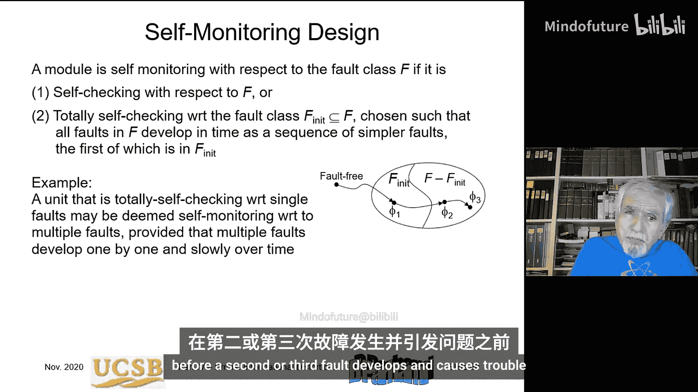

Okay。Now， as I mentioned before， self checking checkers have to have at least two outputs。

 a regular checker。As just a single bit output，0 meaning okay， one meaning not okay。

 but as I mentioned， if that output is stuck at zero。Then we are in trouble。

But this is a regular checker for an odd parity check code。

So if I have odd parity among these five inputs， this output of this Xor will be one。And therefore。

 the inverse of that will be zero and therefore the signal that everything is okay， so odd parity。

Is represented by zero and even parity is represented by one， so this is a regular checker。

It's not self checking because this e can become stuck at zero and then。

We can never detect problem in the input。This is like a fire alarm in a room。

Basically being stuck running out of a battery and therefore it will never sound the alarm no matter what happens okay。

 so if this line is stuck at zero， this checker never sounds the alarm so to speak and we'll never know that something went wrong。

So you can do self checking with two outputs， you need at least two outputs。So for example， use 0。

1 and 10 as everything is okay and 0，0 and 11 as something is wrong。

So this is the self checking checker for the same。Od paryote。

Now this is interesting because the self checking checker is simpler in terms of complexity。

 it uses only three gates。As opposed to four， this usually is just the opposite。

 the self checking checker tends to be more complex for this example。So basically。We say， if。

If the number of ones at the input。Is odd。And I either have an odd number of ones here。

And then even number of ones here。So that's 10。Or an odd number of ones here and an even number of ones here。

 that's 01。In all other cases， we can get 0011， which is a sign of。The code not being valid。Okay。

 I'm going to skip the next few slides， I'll skip the details。

 I just give you the problem definition and why。So totally self checking checker for M。

 so over the years people have designed totally self checking checkers for various codes。

For M out of 2 M codes。There's a design。On this slide。There's a different design on this slide。

This is due to JE S。

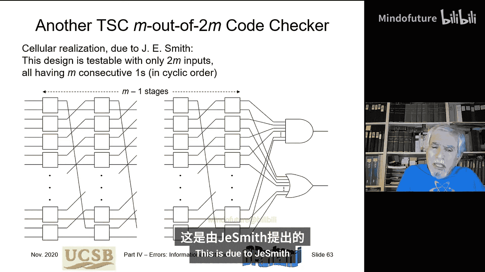

And this one， let's see， I don't remember who did this。😔。

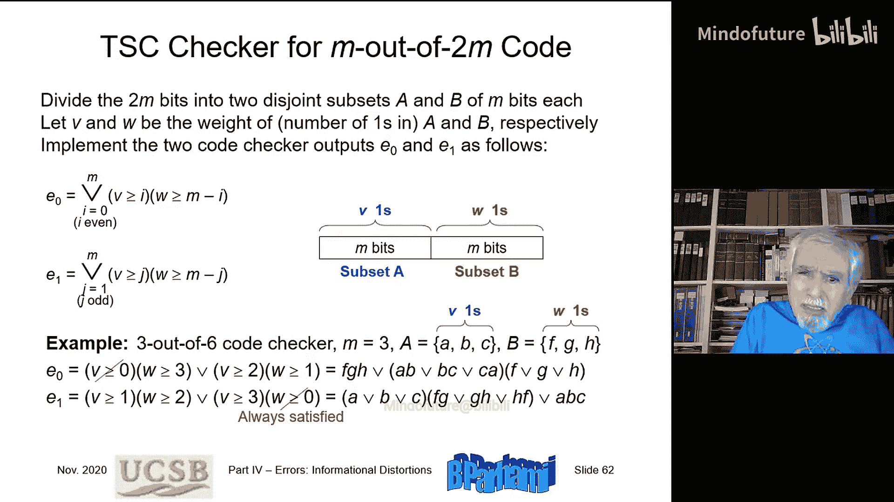

But the reference is given at the end of the chapter。

So these are two particular designs for M out of 2M。So this is a specific type of code。

For which we have two designs for self checking check。

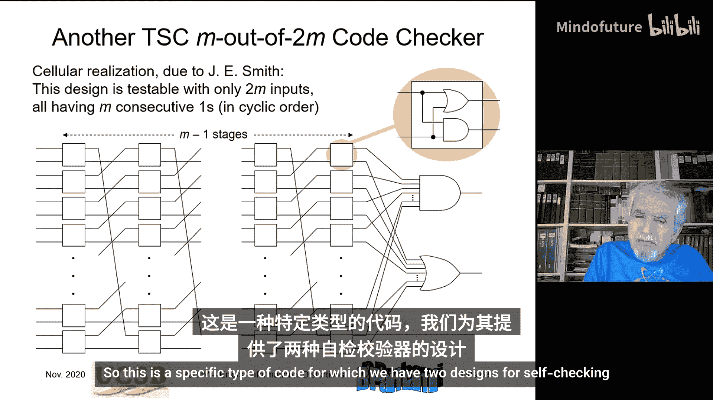

This is another design strategy that uses two out of four checkers as building blocks。

So if you have already designed two out of four checkers， you can design three of six checker。

Or four out of eight checker using these designs。

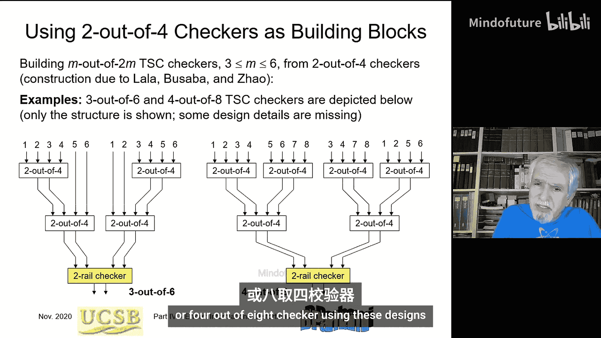

And for general K out of encode code， we don't have a general strategy。That directly do that。

 however， this is always possible， although sometimes it becomes very complex。

 so if I want to design a two out of five totally self checking checker。

And2 out of5 is not of the form m out of 2 m， so I can't use that previous design Str。

 I convert the two out of five code into a one out of 10 code。

Using 10 end gates so this can be proven to be。Totally self checking。

Then I can convert the one out of 10 code to 3 out of6 code。

 which is of the form m out of 2M using six or gates。

And then I can check this using the methods that we previously。Introduced and therefore。

The sequence of three checkers act as a self checking to other five code check。O。

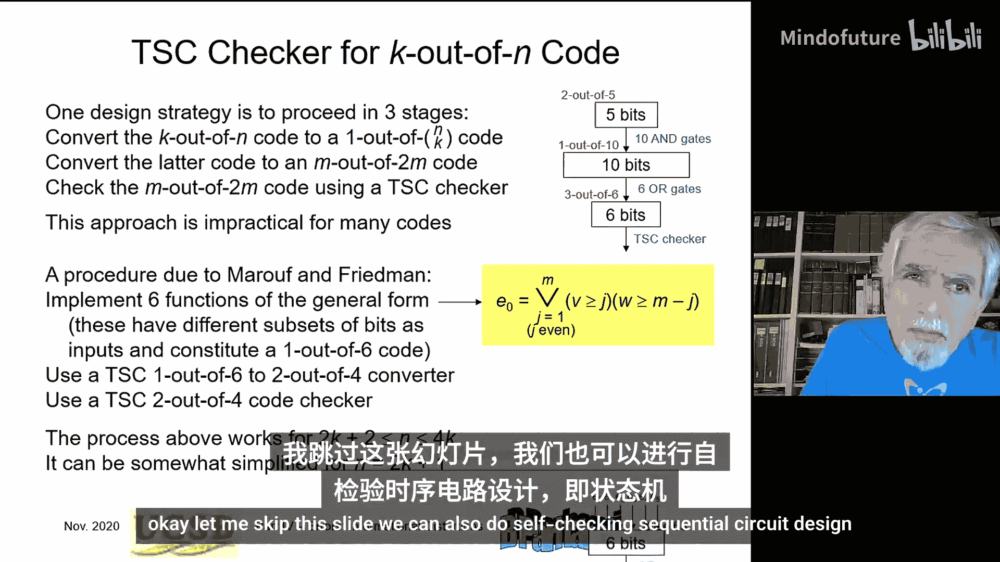

Let me skip this slide and we can also do self checking sequential circuit design state machines。

 so this is a state machine with four states。

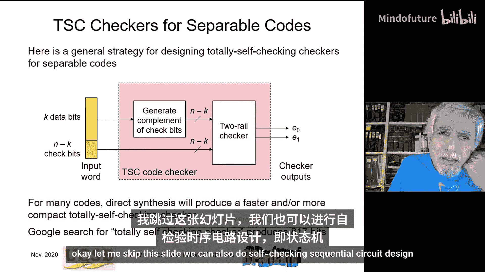

And one input。And these are the next states depending on the input and the current state。

 and this is the output。So in order to design a self checking version of this， this is one strategy。

 there are other strategies too， I encode the state。Using， in this case a two other four code， okay？

Using a constant weightcoat。So a is encoded as 0，0，1，1， B as 0，1，0，1， and so on。

And the next states I read from that table and just introduce them here。

 input is also2 rail encoded as2 rail，0 is represented as 01。And one as 10。Okay。

 so if one of the input lines is stark， I can detect that， okay。And the output is also too real。

And the nice thing about this is that if states are encoded using a K out of n code， in this case。

 two out of four code。A constant way to go。One can express the next state functions。

One for each bit of the next state， so here I need four circuits。Because four bits。It to be computed。

Based on the current four bits and based on the inputs。

 so there are four circuits that need to be designed。These are the excitation circuits。

 or next state circuit。All of these can be implemented via monoonic expressions。

 meaning without complemented variables， in other words。

 we use only n and or gates in implementing the next state functions and because we use only n and or gate。

Any unidirectal error will be detectable。Okay， because in an end gate。

 if an input changes from zero to one。The output can only change from zero to one。

And if an input changes from1 to0， the output can only change from  one to0。

 similarly for an or gate。Okay， so these are and and all are both monottonic functions。And therefore。

 this particular sequential circuit will be。Self checking with respect to all uni directional faults。

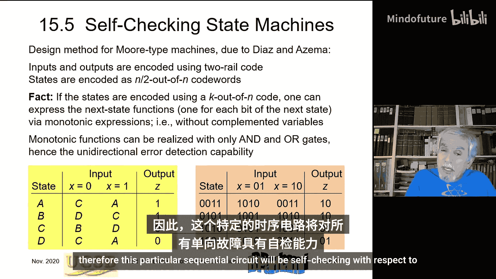

Okay， a whole bunch of。Practical design strategies can be found in the literature。

I have not yet included at I'll include in the final version of the textbook。

 a few examples of these。Designs based on parity codes， designs with residue encoding。

 FBGA based design。Some general synthesis rules and partially self checking theses。

 and these are at present not included in the textbook or in the slides。Okay。

 so there is a little bit of material here， but not much description to make it。

Completely understandable， okay， I'll complete these discussions in the next version of the textbook。

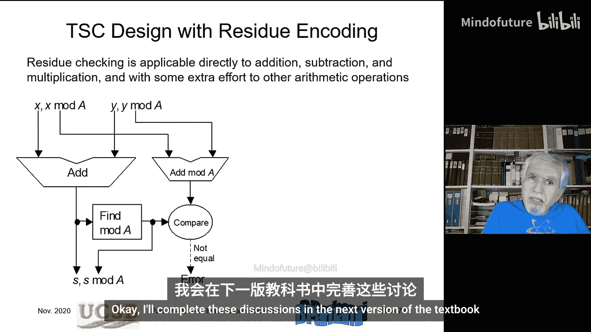

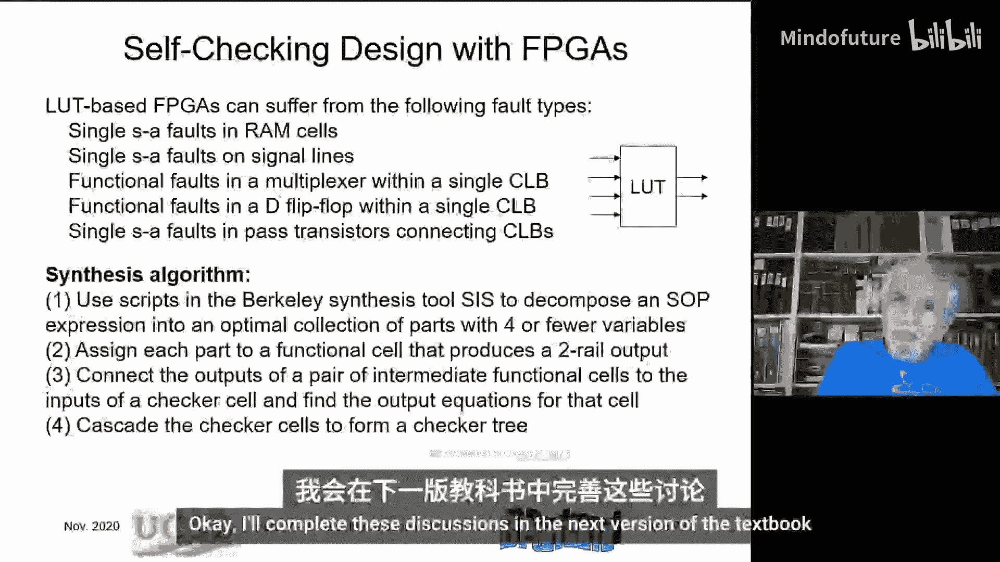

Okay， so let me stop at this point and。This is the end of lecture 9。

 I will be recording lecture 10 shortly。Bye for now， stay safe until the next lecture。

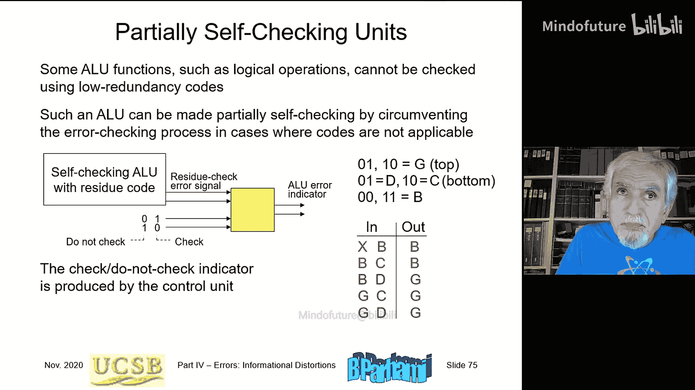