# 【加州大学】容错计算-｜-Fault-Tolerant-Computing-Ucsb-Ece-257A-p10-P10_第10讲_第14-16章_错误纠正--BV19cFyz8EPV_p10-

Hello and welcome to Le 10。For the course ECE 257 a。Falult， tolerant computing。

This lecture deals with the concept of error correction， in particular error correcting code。

And their use in。Of their most important uses in building disc arrays。To store lots of data。Without。

The risk of losing data。So this will be chapters 14 and 16。In my court， in my textbook。

 ondependable computing。So we start， as we did for error detection by looking at。

The code we already know， although we didn't talk of it in terms of coding。🤢，AndTplication。

Allows us to correct。Correct， an error in any single。Computation channel out of the three channels。

So basically， when we trip a unit and use a voter to。Vote。And three。Computed results。

We are essentially using a triplication code where x is encoded as three copies of x。

 so x is represented as xxx， this is 200% redundancy。

Then we compute separately on each of those copies of x。

And then vote the majority of these results will determine what the output will be。

 so one of these results。It's corrupted is incorrect， the two correct one will determine。

What the outcome should be。So encoding is trivial， basically copy X three times。

Decoding consists of this voting process。And redundancy， as I mentioned， is 200%。Now。

 if we also tripate the voting unit so that we have three voters independently voting on these three outputs。

Then we basically start with coded inputs， we can start with coded input， three copies of X。

And obtain a coded output， three copies of why。It's still a tolerant of single faults。

But it allows us to compute directly and code at values， in other words。

 we don't need encoding and we don't need decocoding。Now with the larger replication factors。

 of for example， five copies， more errors can be corrected。But it very quickly becomes expensive。

 even tripplication is rather expensive。Despite the fact that hardware nowadays is very cheap。

Triplication is still not the most desirable way of achieving error tolerance。

So our challenge in this chapter and in this discussion is to come up with strong correction capabilities。

Using much lower redundancy， perhaps an order of magnitude less， so instead of 200% redundancy。

 maybe we have 20% or 30% around that ballpark， so we want to have much less redundancy。

While still having pretty strong。Eror correction capability。Okay。

 now to correct all single bit errors in an end bit code。We must have。

R redundant bits so that 2 to theR is greater than n。 this is easily proven。And therefore。

 we need about log 2K， at least log 2K check bits for K data bits。Okay。

 so the amount of redundancy is logarithmic， at least。In the number of database。

 so this is a lower bound， okay， some codes have more redundancy but we need a least a logarithmic number of bits。

For K databases， redundant bits for K database。

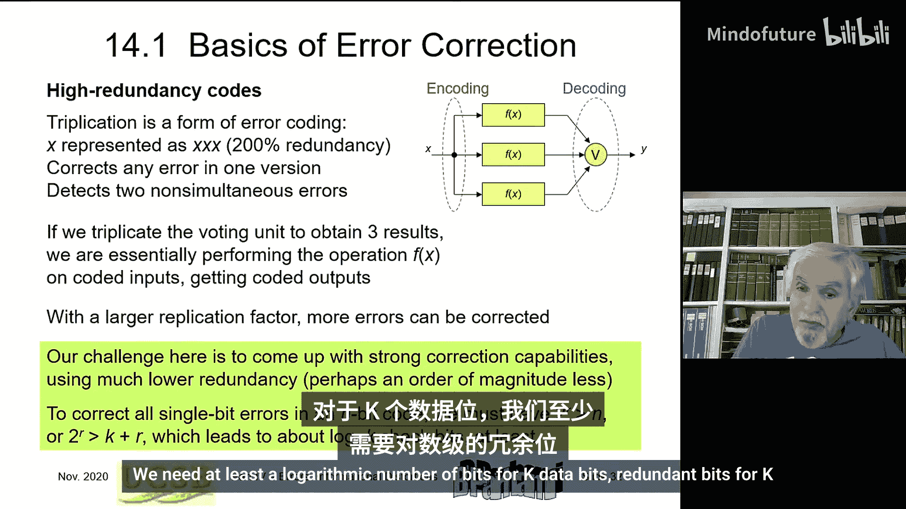

So this is similar to the diagram I showed you for error detecting code。We have data words。

And those data words are encoded。Has code words。Within the code space。

And some words in this code space are code words， valid words， some are non code words invalid words。

And this is basically what allows us to correct errors， so if a code word。

Tnge just to a non code word。If this relationship。Is。

Sort of is not one too many in other words sorry it's not many to one so that multiple code words are not mapped to the same noncode word as a result of error。

 then we can go back and correct the error and in this example you see that no matter which of these red。

Points we get， it's associated with only one green point。

 therefore we can go back and correct the error。If we happen to have， for example。

 an arrow from this screen point to this red point。In other words。

 this code word could change as a result of an error to this noncode word。

 then we would be in trouble because we cannot go back and correct the error。

Because if we receive this erroneous word， we are not sure whether the correct word was this one or this one。

As long as we don't have many to one mapping。Then we'll be able to correct the error。

So here is a conceptually simple simple error correcting code， it's not particularly efficient。

 but it's very easy to understand， so let's get started with this one。😊，So we have key databits。

We arrange them into a square root of k by square root of k square array so for example。

 these blue bits，9 bits are data bits。And I've arranged them into a three by three array。

And then the redundant bits， which are the green ones， are charityity bits for rows。

Aitity bits for columns。And this one parity bit at the corner which can be viewed as parity bit on this column or parity bit on this row so for example the first row。

 the top row is 011 it has two1s， so if we assume even parity the parity bit will be0。

The next row has a single one， so its's parity bit for even parity will be one。1，1 will be 0。

Similarly， in this column，1，1， so the parityity bit is 1。Two ones。

Piedity bit to zero and two ones pairity bit to zero。

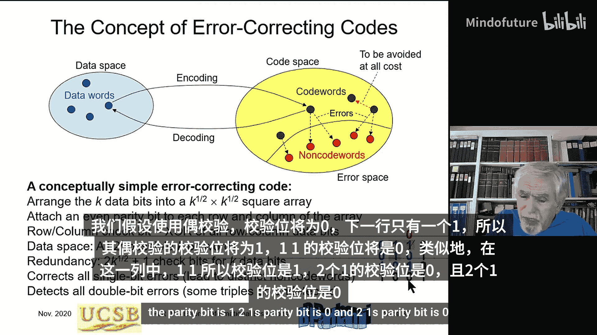

And it's easy to prove that this corner bit doesn't matter whether they you。

You use the parity of this row or the parity of this column， you get the same thing。

So now in this four by four array of bits， any single bit can change and you can correct it。

Let's see why。Let's say this one over here changes to zero。

What happens then parity check is violated for this row。

This room no longer has even parity and parity check will be violated for this column。

The intersection of the row and column for which the parity check。Is violated。

Pinpoints the location of the error。And you can go and change that bit。To make it correct。Okay。

 let's see what happens if you have two erroneous bits like these。You be highlighted in purple。

If these two bits are in error， let's say this one changes to zero and this zero changes to1。

The imperative bit for this role will not be violated。

But parivbit for these two columns will be violated。So you will know that something is wrong。

 but you don't know。What is wrong， you know， something is wrong in this column。

Because the penaltyity check was violated and something is wrong in this column。

Because all the row parities are okay。you don't know the double error。

 which row contains the double error，Of course， if the two。

Errors are not in the same row in the same column， the situation will be different， so for example。

 let's say this bit and this bit， these two bits change。

Then you will have two row parity violations and two column parity violations。

And then you don't know which of these four bits is in error。Okay， so double errors are detected。

But no they are not correctable， single errors are correctable。

What about triple errors well if you think a little bit。

 you will see that the worst case pattern of triple errors are these three。I've shown here。

 these three ones change to zeros。And pairity bit for this row will not be violated because there are two changes for this column will not be violated。

But for this column。In this row， chaitities will be violated。So that triple error。

Will be mistaken for a single error in disposition position。So in other words。

 you may go and try to correct this bit。Which is not the error。

Because you would think that the parity。For this column having been violated imperativeity for this row。

 this is a single error that is in this location。So triple errors。

 some triple errors are indistinguishable from single errors， and therefore you cannot detect them。

Okay， because you may go and try erroneously to correct another bit that is not in error。

So this is basically a single error correcting， double error detecting code。Okay，So redundancy。

 at least in this example， is rather high。You have nine database bits。Nine datas。And7。Weundant bits。

So 7，9， which is about 80% is the redundance。Of course， as the number of data bits grows。

 so if you have， for example， a 10 by 10。Aray of data， 100 bits。Then you will have 19。Sorry。

 you will have 21。21。So 21 redundant bit for 100 database at 21%。

 so redundancy shrinks as the size of the data increases。But the capability is still the same。

 its single error correcting， double error detecting。

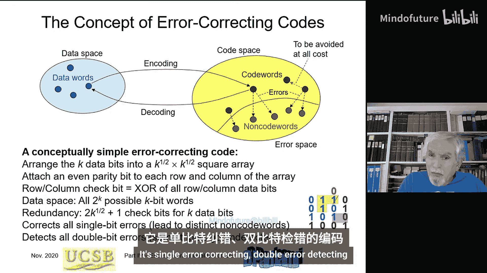

Okay， error correcting codes are evaluated。Pretty much the same way as。Arero detecting codes。

 we think about redundancy， how much redundancy they involve。

The greater the error correction capability， the higher the needed redundancy。

 so we try to keep the redundancy low as low as we can。

Encoding and decoding complexity in terms of circuits。

And in terms of time needed to encode and decode。Capbilities of the code。Basically。

 what types of errors does it correct for us， single double by， bebit burst。

 uni directional and so on？And then we sometimes provide。

 as we saw in the example on the previous slide， combined ad correction and detection capability。

This makes the system safer because up to a certain number of errors， we can correct them。

If the number of  errorss exceeds that level under the correction capability。

 then we at least detect them and the system remains safe。

So to correct C errors and additionally detect D errors where D is always greater than C。

A minimum code distance of C+ d plus1 is required， for example。

 heming single error correcting double error detecting code。So C is1， D is 2。

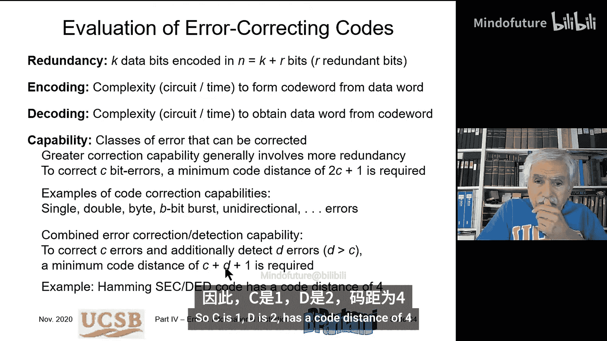

Has a code distance of four。Okay， hemming distance for error correction should be at least single bit error correction requires a heming distance of。

3。And this diagram shows this graphically， these red circles are code wordss。

The yellow circles are words that are distance one away from the code words。

 and you see distance one code words from this。From this one are distinct from distance one from this cohort and distinct from distance one。

 so you can tell if you get this erroneous value， you can tell that it came from this。

 you can go back to this and correct it。But distance two in this example， one， two。12。1，2。

 there's a shared point。The shared data award。That is distance2 from all three of these。

 so if you happen to get this incorrect data word。You won't know what is the correct value？

So you have just detection for that one， not correction capability。

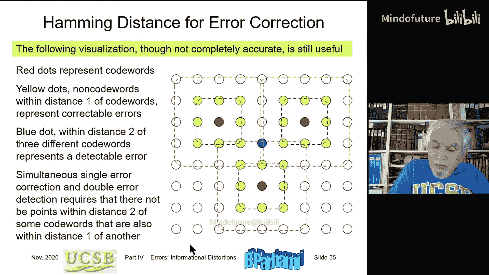

Okay， perhaps the most famous error correcting codes are haming codes。so this is an example。

 the smallest heingcoat。Which has four data bits。D3， D2， D1 D0 for data bit。And three heritage bits。

P2 P1， p0。And the parity bits are defined and a subset of the data bit， so parity bit0。

Its based on D0， D1， and D2。In other words， you x or together those three data bits and。

That gives you this parament。P1 is the x or of d0， d1 and D3。E2 is the x or of d1， d2 and D3。

For each of the parity bits。And is。Corresponds to a subset of the four data bits。

The reason they' have been selected in this way is that they allow them error correction。

So forming the parity bits， in other words， encoding requires three Xor networks， okay。

 you have to do three bit XOs。To compute each of these， that's encoding。

Checking the correctness of this code word requires three XO networks。

Each of them doing four bit parity computations， so p0， D0， D1 and D2。A X or together。

And if the result is zero。Then we know that at part is okay。Okay。

 so you need three XO networks to verify pairies decoding is trivial because this is。

A separable code， the data part。Is separate from the checkboard。

Therefore you just look at these four bits， there's no decoding involved。

Redundancy for this example is the recheck bits for four data bits。So it is 75% redundancy。Three。

 four，4， 75。But it's quite high， however， as the number of data bits increases。🤧Yeah。Excuse me。

As the number of database increases。嗯。The redundancy factor gets better， so for example。

 if you have 31 26 data bits。Need only five。Pbits。So five for 26。

That's a little bit less than 20% if you go to 120 database bits。You need only seven redundant bits。

So that's 7 divided by 120， roughly 6%， so redundancy improves。As the code gets larger。

Now in order to， once you receive a data word like this， a seven bit data word。

 and you're trying to find out if anything is wrong with it， whether it contains an error。

That needs to be corrected。You form what are known as syndromes。

The syndrome has three bits in this example， that's basically the three parity checks。

So you expect all of these syndrome bits to be zeros because all these parity checks。Be correct。So，0。

0，0。Means that there's no error in this code word。Now of course。

 remember that we are doing single bit error correction。

If you have double bit errors or triple bit errors。

 then you won't be able to do anything you may not even detect。That。Okay， so for example。诶。

If this syndrome is one。In other words， this purity check fails。So you have P2。Equal to 1。

 p1 equal to 0， p 0 equal to 0。Sorry， yeah， sorry sorry S2， S2 equal to1 S1 equal to 0。

 S 0 equal to0。So 100 is the syndrome。And 100 being the syndrome means P2 is the erroneous spit and you can go and fre。

Why is that？Because if this parity check fails。Means some bit in this equation。

 and this expression is in error。Now D3 cannot be in error because D3 also appears here。

 so if it were in error， this one should have failed as well。

D2 cannot be in error because D2 also appears here。

D1 cannot be in error because it also appears here。Okay。

 P1 cannot be in error because this parity check did not fail and P0 cannot be in error because this parity check did not。

So that's syndrome 100 pinpoint P2。As the erroneous bit。And each distinct syndrome at 0，0，0。

 of course， is no error， each of the other seven。Patterns in the syndrome。

Pinpoint one of the seven bits。As being in error， and therefore you can simply flip that bit and correct the error。

Assuming that the error is single， there's just one bit error。

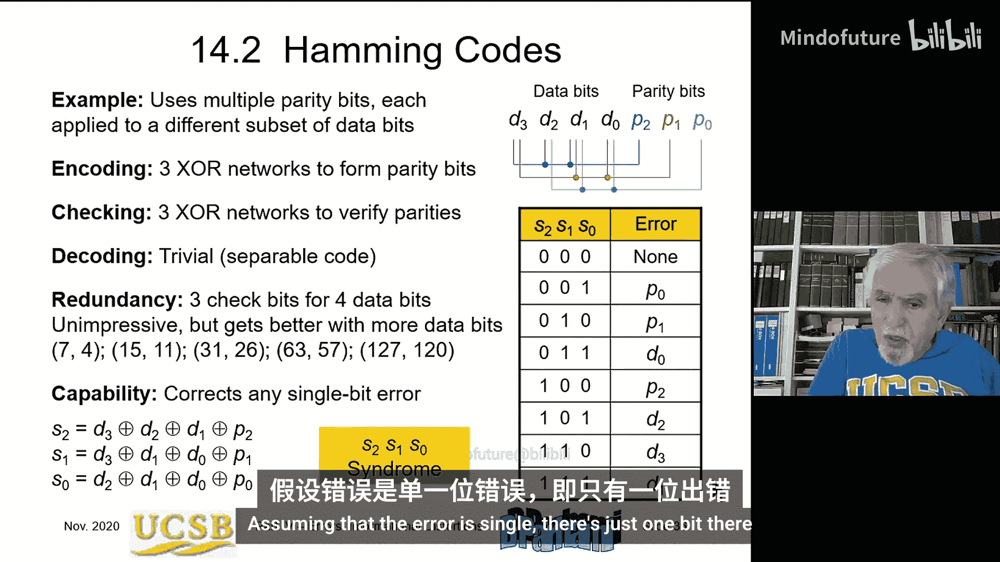

Okay， so hemming single error correcting code can be formulated。In terms of matrices。

 and this is helpful to see the patterns。And extend the code to larger code。So this is the same code。

 we sometimes call this the 47 code， meaning there are four8 bits and seven total bits。

 the  four7 code， so this is the notation used for error code。

K N code means K data bit and total bits。So there's a matrix called the parityche matrix。

 which when multiplied by the received word。Generates the syndromes， This basically says。

Now one point I should make here is that when we talk about matrix multiplication or matrix by vector multiplication。

In the context of a binary error code。So normal matrix multiplication would use multiplication。

Say1 times d3 then plus1 times d2， so you need multiply and add arithmetic operation。

And these in the context of error codes， binary error code。We do end， so1 and D3。

 which is the same thing as multiplication， so that part is not different。

When we do then exclusive or so one。Is D3。X or1 times d2， x or1 times d1 and so on。

 so that's basically the parity check。Because we are doing D3， D2， d1 and p2。D3， D2， D1， MP2。

 this is disparity check， and it generates S2。ok。😊，So we construct a parity check matrix。

That when multiplied by。The wart， the suspicious wordt， gives you the syndrome。

 as I mentioned before， if the syndrome is 000。Everything checks out and the。It award is correct。

And then you can use these four bits。If it doesn't check out if one of the syndrome bits is equal to one。

 then you can this table to see which。Of the data or parity vets is an error。And。

Then you can go ahead and correct that。Notice that the bit that is in error。

 the columns of this matrix， if you read them as binary numbers， so you have here 110 is6。

So if the syndrome is6 as a binary number， B3 is in error。6 is d3。It was 101 which just five。2。

 too is in error。Okay， so the syndrome。The column of that matrix that matches the syndrome pinpoints the erroneous bit。

Remember， again， I repeat this that matrix spectrum multiplication is done with n Xor。

Rather than the standard matrix multiplication that we are used to multiply and add。So as I said。

 n is the same as multiply， so you can say it's multiply and then modular2 add。Okay。

 we can rearrange the columns of the matrix， okay， if I， for example。

 switch the locations of these two columns。And also switch the location of these two entries。

Then the result will be the same。Okay， it doesn't change。 so one convenient。Rearrangement。

Is to rearrange this matrix so that its columns are binary number in order from smallest to largest one。

2。3，4。5ive， six， seven。 So there's a rearrangement of the original parity check matrix。

And so the rearrangement is shown here， they should rearrange these bits also accordingly， p0， P1。

 T0， p2。地球在水资源。It still gives me the same syndromes。Now the nice thing about this is that。

The syndrome。Directly corresponds to column number， so syndrome 001。Says that bit in column1。

 the bit corresponding to column 1。Is an error which is p0。Syyndum 10，0。

Indicates that the error is in the column 4。10，0， column 4 P2。

And this gives me a very simple way for error correction okay。

 so if I take the syndrome a three bit number and decode it。When I decode it， I have eight outs。

 number zero through seven。So if I have 0，00， output 0 will be a。We have 001。

 output 1 will be assert。So if output put0 is asserted。

That means everything is okay so that that output of the decoder tells me that everything is okay if it's one。

If any other column is one， that points to the bit that is in error。

 so I simply x or the remaining seven bits。With the seven bits。Arranged in this or there。

And that gives me the corrected word。Because the one。

Only one of the outputs is equal to one in the decoder， and that one pauses。

The appropriate bit to be inverted one x or something is in the inverse of that。

 so that bit is flipped the other bits。Are now changed。 And I have the corrected。

 So this is a very simple。诶。Eror correcting circuit， there's just a decoder， you decode the syndrome。

 and then on one bit of the decoder， one output of the decoder。

 if it's one tells you that everything is okay。If any other output is equal to one。

 it automatically causes the correction。Have the appropriate bit， so this is nice。

So just in case you're curious， this is Richards W Hamming inventor of Hammming code。

He was at Bell Laps for many years and then later in life he went to Naval postgraduate School up in Monterey。

 California。A second way， a second matrix formulation of heming codes。Is。Basically， generator matrix。

A generator matrix multiplied by a data word gives you the encoded。

If you know this generator matrix has the identity matrix up here。

That's because the first four bits of the code， we want to be the data bits。

So one times d3 plus0 times the other one gives you D3， this one gives you D2。

 this one gives you D1 d0。And this part is basically the parity。So for example， P2。Is deep3。X or D2。

 x or D1。P1 is D3 x or D1 x or D0， So this is a second way of formulating heing code in terms of matrices。

This is called the generator made。So this can be easily generalized now to wider havingming single error correcting。

So， the。A parity check matrix has columns that are one， two， three in binary。

Up to2 to dR minus1 all redundant bits。诶。And these are the data and pary bits。

So there are K data bits。And are airbits。And these are the R syndromes。Okay， as I mentioned。

 the redundancy improves when did you have four data words， you need three redundant bits。

When you get up here to 502 data words。We need only nine redundances。

And log base two have had 502 is roughly9， is's a little bit less than nine， we roughly need。嗯。

For large values of k， log to k。一たなで。Oops， and I mentioned at the beginning of our discussion that that's the minimum amount of redundancy。

That can allow you to correct a single error， therefore I codes are very efficient。

And then the correction circuit is basically the same thing， the syndrome is decoded。

 one output of the decoder tells you that everything is okay。

 the other outputs are xored with data andity bits。To correct。APoible error。

Now you can turn any single error correcting。Hming code into single letter correcting double error detecting code。

By adding a row。And the column。The parity check matrix and an extra redundant bit。So， basically。

The art syndrome。Is X or of everything， all the data and parity bits。Okay， and then this， sorry。

I'll let the。L it up to you to sort of verify that that is correct if you take this syndrome。And。

Imput it to the decoders， this is sort of like an enable signal So if this syndrome is zero。

This bit will be zero and then the outputs， all the outputs here will be zero and therefore everything is okay and。

嗯。Because you're doing parity check on all the bits， any single bit。

Error would make this bit equal to zero。Sorry， we'll violate this parent feature。So if this bit is0。

 then all the outputwards will be0 if this bit is 1， then the decoder is enabled。

 then now if the syndrome is equal to1， if the syndrome is equal to zero， all zeros。

 then this bit will be asserted。And that means that。We don't have a single error， okay。

 there is an error， but it's not a single error， it's a double error。Otherwise。

 if any other output of the decoder is asserted， then there is a single error and we just correct that single error。

Okay， so any am in code。Can be inverted to double error detection capability can be added to it。

By simply adding one redundant with one extra it。Now linear codes。Of which。

Haming code is a special case are defined in terms of either。The generator matrix。

So you have a generator matrix multiplied by the data vector。Gives you the code word。

Or in terms of its parity check matrix， parity check matrix multiplied by a wart that is suspicious gives you this syndrome。

And if the syndrome is all zeros。Then all the parity checks are satisfied， there's no error。

If the syndrome is non zero， it uniquely points to which bit or bits are in error。

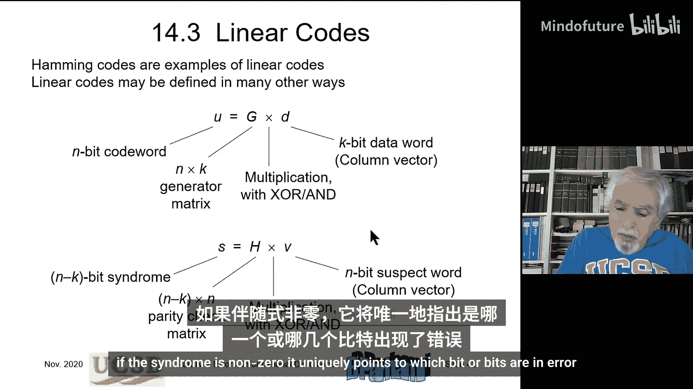

Okay， now this section I'm going to。Skip pretty much， I put it there so that you。Have heard of。

These other codes， PCH， both chary。hawking gamem。Coode， bH。

Of which special case read Solomon codes are very popular。

 so read Solomon codes are special cases of。ECCH code here's an example of read Solomon code。

It's the popular area is Reed Solomon。223 bytes of data， so this is not binary。

 it's the symbols and this code are bytes。223 bytes of data and 32。32。

 255 minus22 32 redundant bytes of data。And this can correct errors in up to 16 bytes anywhere in the code。

Its a very strong correction capability。Any 16 bytes。

 they don't have to be consecutive in other words not just burst  errors anywhere。

 any 16 bytes that are erroneous。Can be corrected。And this is used in Cd players or was used when Cd players are still。

Being used at digital audiotape and in digital television。So 223 bytes， you have to multiply it by8。

 so that's about 17， 1800 bits， it's a big block。Of data。

Now in these CD players and digital television， you deal with big blocks of data that are transmitted。

And then you add 32 redundant bys to it。And it becomes highly resilient。

 it can correct up to 16 byte okay， this is all I want to say if you are interested。

 as I mentioned last time when we talked about error detecting code。

Coding theory is a really broad topic， there are many different codes。

 many different theories for those codes。And each code finds basically some applications。

Vi of its strength in。Correcting or detecting the types of errors that we are interested in。

 so there are many， many codes。

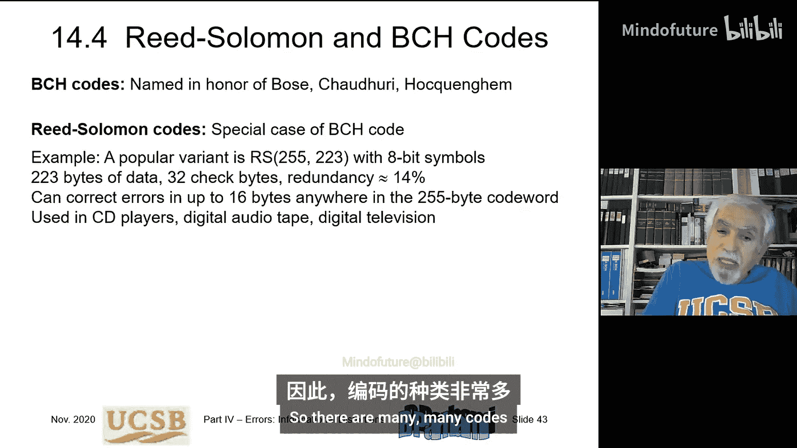

So I'm going to skip these a little bit more detailed discussion of Re Solomon codes in terms of galloo fields。

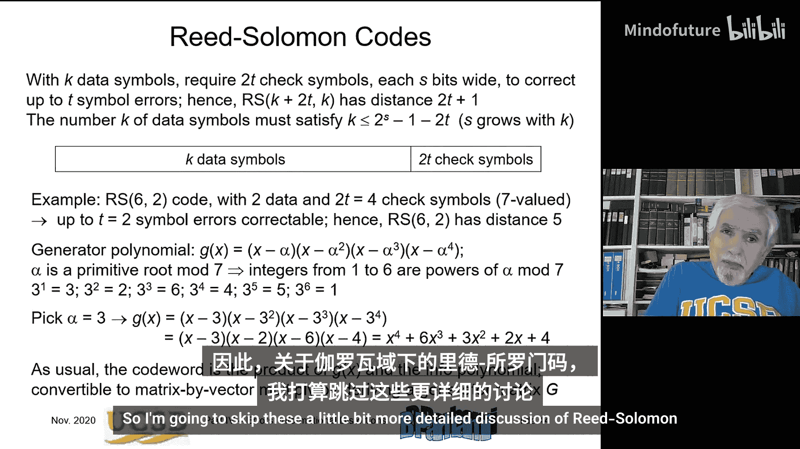

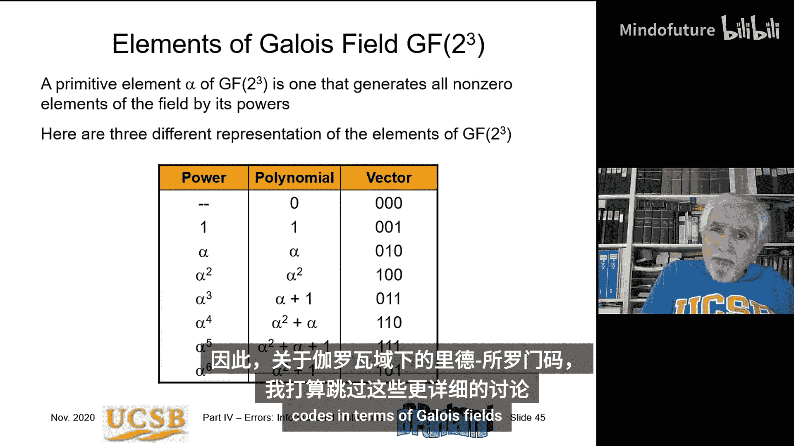

And then move to arithmetic error correcting code。Last time I discussed arithmetic error detecting code。

In particular， product code and residue code。Now residue codes。

Can be easily extended to correct errors。You following。So suppose you have 12 bits。😔，12 bits of data。

Okay， remember， when we talk about single arithmetic error， we means the addition of a power of two。

Or the subtraction of a power of two。So single arithmetic errors for these 12 bits of data。

Can add one to the zero to the one to the two all the way to the power 11。Or can subtract。

To the zero， to the one up to to the 11 from。From the code word， okay？

Now if you use for these 12 bits of data2。Moular check， modular 7 residue and Moular 15 residue。

Then an error that is one in magnitude adds one to the modular 7。And one to the module of 15。

In other words， these residues normally。Have to be the data word has a particular residue here。

 if you increase the data word by one， its mod seven residue will increase by one。

M 15 residue will increase by one。Okay， if you add 16。

The Mo7 residue will increase by two because 16 is two Mo7。

And the Mo 15 residue will increase by one and similarly for the subtraction。Now。

 if you compute the syndrome of a particular word and you see that the Mo 7 residue is off by6 and the Mo 15 residue is off by 11。

Syndrome 611， pinpoint。The error， the error is negative。And it's two to6， in other words。

 two to six pinpoint a particular bit。In the data word that is in error。

 notice that all these syndromes are unique， that's why we can correct。A single error。

 in other words， 611 does not appear anywhere else， okay， 6，7 only appears here nowhere else。

So because these syndromes are unique， they pinpoint the location of the error that we can correct and will be done with。

Now。Why do we have only 12 databits， what happens if I have 13 data bits with the same modular check？

It turns out that the 13 data bits， if it flips from  zero to 1， this is the error magnitude。

The 13th fifth is two to 12， this is2 to 12。She has residues of one and one。With respect to7 and 15。

 and then this syndrome will be indistinguishable from this syndrome。

So the maximum number of database bits that you can have and for these syndromes to be unique。

Because starting at bit 13， the syndromes start repeating and therefore you cannot uniquely pinpoint the error。

Now generally speaking， this is an instance of。By residue code。

 by residue means you have two residues。And both of the residue are Julyly。F form2 to the a minus1。

 this is 2 to the 3 minus1， this is 2 to 4 minus1。

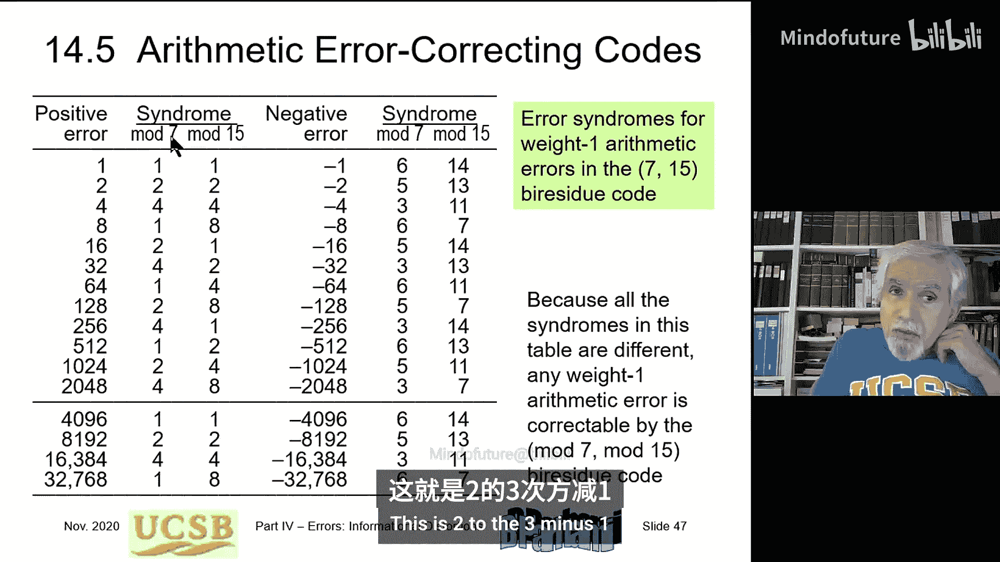

And generally。If you use two residues to the a minus1 and2 the b minus1， which are relatively prime。

Which was the case for7 and 15。It supportups a times b bits of data for weight1 error correction。

So a was three in the previous example， B was four， three times4 is 12。Okay。

 so if you want to have more than。诶。12 databases。Then you have to use different。A and B。

 lowercase AMmb or uppercase Amb， so for example， if you choose lowercase A B5 and6。

Which means 31 and 63， which are relatively prime， 31 and 63。Then you can have up to 30 database。

If you choose 11 and 12。So there's two to the 11 minus1。Whi is 2047 and 2 to 12 minus1。

 which is 4095 with those two check modi can have up to 120 database。

So redundancy as is the case for almost all codes， redundancy improves。Here， you had 7。

Redundant bits。For 12 databits。That's about 60%。Here you have 23 data bits， the 23 redundant bits。

For 120。Okay， this is 2 some percent， so it gets lower and lower comparing with heming， of course。

 redundancy is pretty high。So for example， take this 120 here you have 23 bits of redundancy。

Hamming weight with 128ab it for single error correction requires only seven。Redundants。

So redundancy is lower， but this is the price we pay to be able to keep the code closed under arithmetic operations。

So you can add multiply subtract without having to remove redundant bits from the code。

 so that provides some protection during the arithmetic operation。

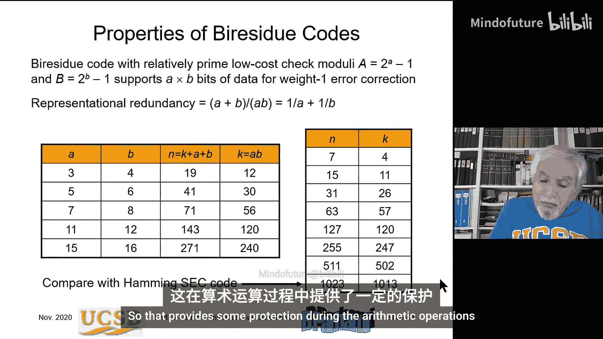

Okay， this one basically says you need two check processors， so if you have modo。7， a module of 15。

 so each input has two。Things attached to it。The residues。And then those two things。

 each of them goes into a separate check processor。

And if both of those residues that you compute match the residues of mod A and mod B of the result。

Then you are okay otherwise。You have an error。

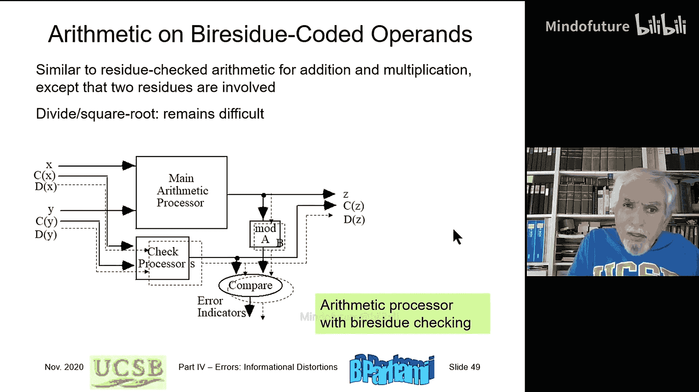

Okay， so here is just a listing of other code that you may have heard about。But。As I mentioned。

 you know， I just wanted you to to have。A picture of what error correcting codes are about and see some examples of such code。

And any other codes that you need to study， now you have the basics。

 you have the foundations to go and study those codes。So these are some of these codes。

 read mueller codes。A tuic codes。Low density parity check codes， these are pretty popular nowadays。

And the information dispersal。Which basically encodes data into n pieces such that any K of the pieces are adequate for reconstructing the data is a form of。

Er coding。So you basically tolerate up to n minus k erasures in this case。

So I have NP pieces of data。Any K of which are adequate to reconstruct the original。Original data。

 so if n minus K pieces disappear are erased， you still will be able to construct the data。

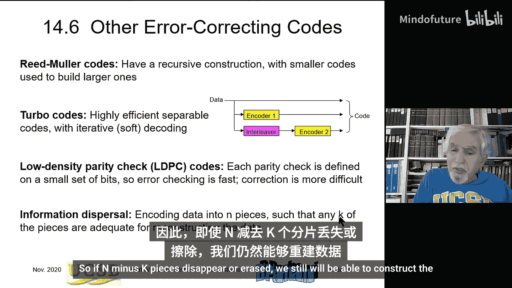

So this is a kind of erasure code。Okay， these discussions I'm going to skip because we're going to come back to this in particular algorithm based error tolerance later。

 this is just a preview and I'm going to skip so that I have time。

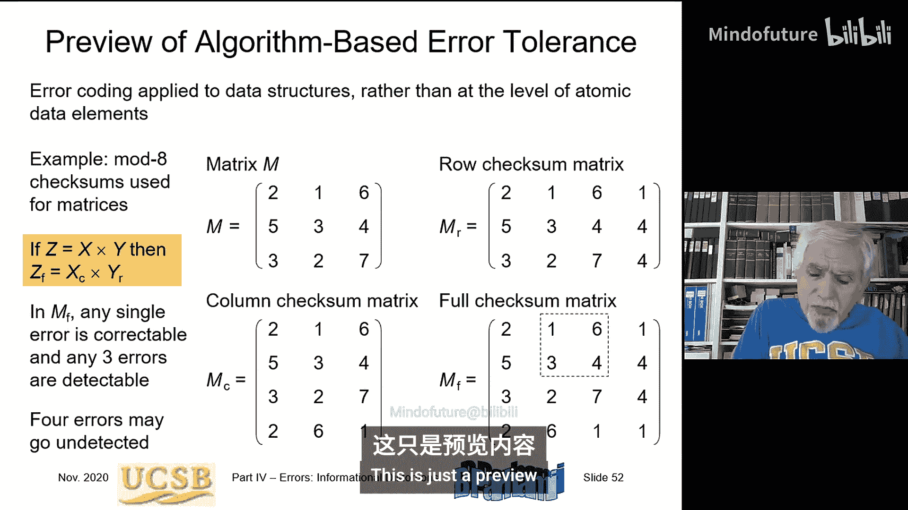

一个 into。Chapter 16。And discuss redundant disar race。

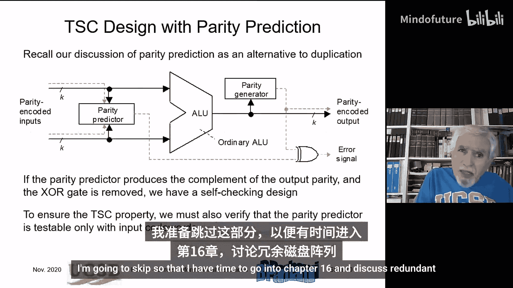

Which is a very important application nowadays of error correcting codes。So first。

 a brief overview or review， I should say， of disk memories， this is a typical disk memory。

Magnetic disk memory。With multiple plas， four plas。Each platter typically has two recording surfaces。

 one on each side。And then they are assembled on this spindle and they rotate at very high speed。

So 2700 RPm， 2700 revolutions per minute is common for disc today。The read right heads。

Are attached to these arms and all the arms are attached to an actctuator and this actctuator basically rotates around the axis as it rotates。

The heads move outward or inward under the disc。Aligning themselves for the different tracks on which information is stored。

So this top arm has just one head， the second arm may have two heads， one。

Reading the bottom of this platter and the other one reading the top of the next platter。

So these are all these moved together， so in other words。

 if this head is on the first track of this platter of this surface。

 then this one will also be on the first。🤢，In order to read data。

 you move the actuator so that the head is aligned with the track。That contains the data to be read。

And that's because it's a mechanical motion。😊，🤧咳。It takes a relatively long time compared with computer speed。

 it takes many milliseconds。Whereas in。Digital circuits。

 we talk about nanoseconds or fraction of nanoseconds to do operations。

 but this memory is extremely slow compared to。Electronic circuit speeds。So there are tracks。

And each track is divided into sectors。 The sector is basically。

Usually the unit of data transfer from disk， so we go to a disk to read a sector and that sector happens to be on a particular track。

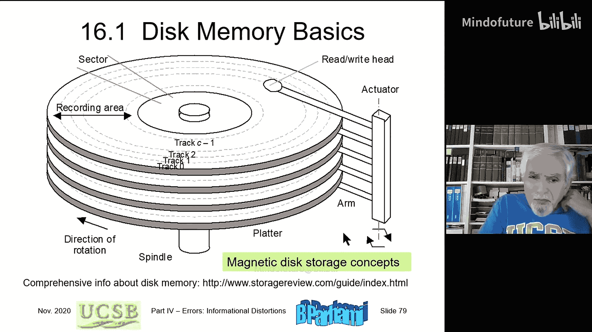

Okay。So these are some modern disk just。Looked up on a website， so this is up to date。

 although the web page says 2016， the web page。The URL says 2016 the data is actually 2020 so they updated the web page without changing the name of the web page。

 so these are typical modern this Seagate is one of the important manufacturers four of its products are featured here。

Western digital is another one。Okay， and three of its products are featured here。

 so these are names of this drives prices of these disk drives are mostly。With a few exceptions。

 there are under $100， so disk are very cheap。Nowadays。

Capacity is in the range of one to 20 terabytes again with a couple of exceptions。

 so it's multi terabytes。Each of them comes with the cache memory with the capacity in the range 64 to 256 megabytes。

Now cache memory， because the disc is slow helps in the following way。

 if you read a file from the disc。And then you make modifications on the different parts of the file。

 and then store back the file， you read the disk only once and bring the file， provided the file。

A small enough to fit and there's cache memory。You just read once and then write once so you minimize the number of disk accesses。

 the cache memory is solid state memory。Ass S Ram or D Ram。

 and therefore it's pretty fast to access the data rate of these disks are。

And the order of six gigabits per second。Can transfer the data at a very high rate。Okay。

 so this is just to give you an idea of now this。😊。

Low price is important because we are going to be talking about rate， redundant arrays。

Of independent disks。Initially this acronym stood for redundant arrays of inexpensiveness。

Now we no longer have expensive disk disk drives are。Hard disks are very inexpensive。

And therefore they change that eye to stand for independent rather than inexpensive because there's no such thing as expensiveness and I'll tell you why there are no expensiveness。

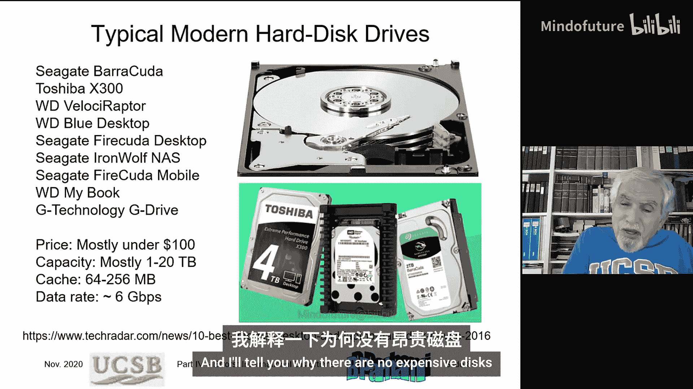

So this is basically。Schematic of what happens when you try to access a sector on the disk。诶。

There are three phases to the axis， one is called the seek time。

The head must move from whatever it happens to be。Usually the rest position for the head is outside the desk。

Within in the rest position， it has to move here if it's here and now you access something else that let's say on this track。

 then it moves from its current position。To disposition。So that's called the seek time。

As I mentioned， it's on the order of milliseconds。And it's a function of how many tracks you move if you move C tracks。

 the seek time is a function of C。Now if this movement wear uniform。The constant speed。

 then this will be a linear function。But because it involves acceleration of the head at the beginning and then deceleration at the end。

It also has this。🤧。Square root term。So it's a function of C， the more you move。The higher the sector。

Then once you get to the track that contains the data， the data may be somewhere else on the track。

You have to wait for the disk to rotate and for data to come under the head。

And on average you weigh half of this rotationation， in other words。

 if you are very lucky the data happens to be here， as soon as the head arrives here。

 it starts reading because the data is right there。

We are very unlucky the data just passed under this。Point and it' here。

 you have to wait a full rotation。To get the data， so on average half a rotation is needed。

And that half a rotation is obtained from this formula， 30，000 divided by the RPM for the disc。

 so it's the RPM is 3000。This will be 10 milliseconds。ok。😊，Then finally。

 once the data arrives under the head， it takes a while to read all the bits in that sector。

 this time is negligible， okay， you can basically ignore it without committing much error。Yeah。

Because the sector is such a small fraction of。At track。The reading part is very small。

Typically much less than one millisecond whereas this could be。10， 15 milliseconds。

 this rotational latency can be 10， 15 milliseconds。So that's negligible。

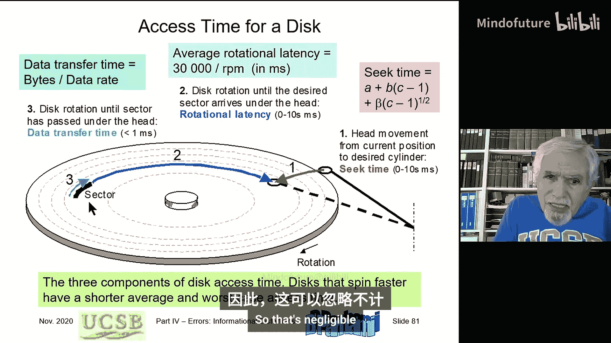

Okay， now。This one I'm going to skip。

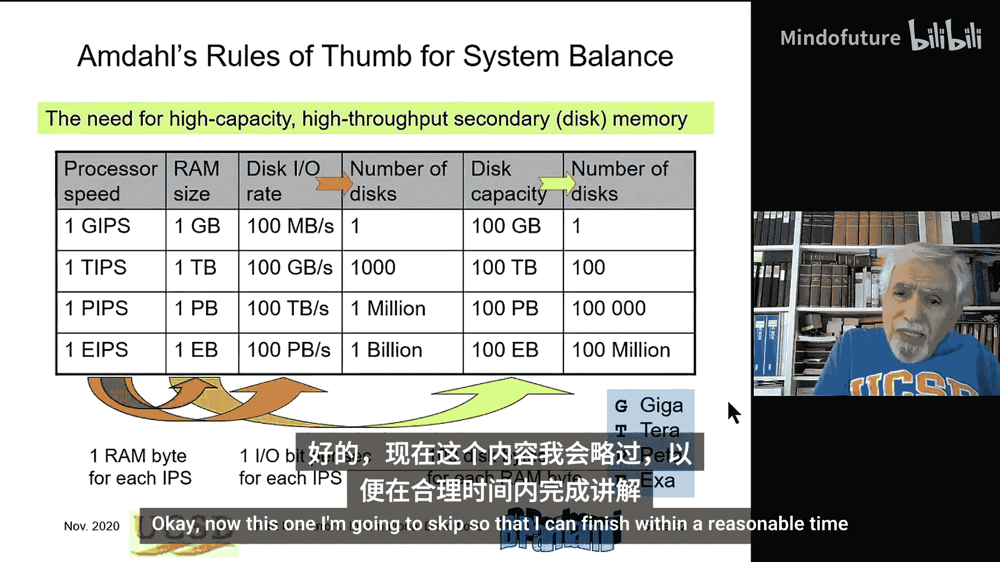

So that I can finish。Within a reasonable time now。In early days of supercomputers and high performance computing。

We had all these expensive fancy disks that people built。

In order to try to match the performance of the disk， the performance of the CPU， so as I mentioned。

 the disk is much slower than the CPU。And therefore these。Seek time rotational latency。A really huge。

The CPU would be sitting and waiting for a long time for data to come in from the disk。

So they tried to modify the disk， one modification was to provide one head per track。

 these were known as head per track disc。Instead of just a single head that moves back and forth between the tracks。

 so this eliminates the seat time because the head is permanently on the track。

And you just select the head that needs to read。And that selection is electronic。

 and therefore it takes very little time。But these discs are very expensive because you have to build a large number of heads。

🤢，And building these heads and making sure they're aligned with the tracks。Is nontributal。

In some cases， they went further and said， okay， let's provide two sets of these heads。

So that the average low rotational latency can be one quarter of a rotation rather than one half。

Okay， so for example， if the data is closer to these heads。What happens to be here。

 you read them with those heads。The data happens to be closer to this one as a discroate。So。

In this way， you eliminate the seek time altogether。And you reduce rotational latency by one half。

If you actually provide four sets of head， then you reduce it even for it。Okay， however。

 these expensive discs such as this one。At a very limited market。

 you know how many supercomputers are there in the world？You build these disks in thousands of units。

 whereas disks for personal computers， laptops， and so on， you build them in。

Tens or hundreds of millions units。 So the economy of scale leads to。

Reduction in the cost of those dayss that are much cheaper。And therefore。

 these discs are no longer cost affected， so people started to think， okay。

 how can we use those cheap disks？Which are， of course， smaller than these days。

And also perhaps less reliable because they're mass produced。

Two build disk memory units for supercomputers that are very large and also very reliable。Okay。

 so the idea is that use these。Small disk， inexpensive disk。

Many of them to provide high capacity and also use redundancy to provide high reliability。Okay。

 so these disk basically vanished。 we no longer build these special special disk。

 What we try to do is use。Same kind of disk that is used in a laptop or personal computer。

 but assemble them into disk arrays that provide high capacity and high reliability。

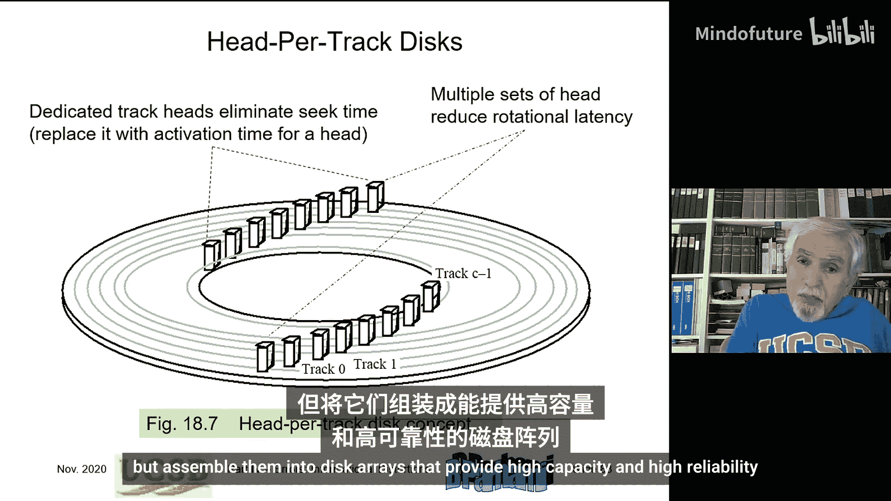

So the ideas of mirroring and striping discussed here。

 these were basically early ideas along this line， so to provide to make these inexpensive。

Mass produce disk more reliable， one idea is mirrortering。

Any data that is stored on this disc is also stored on a mirror disk。

So you're basically duplicating the data， this is sort of a parallel system know as long as one of these two disks。

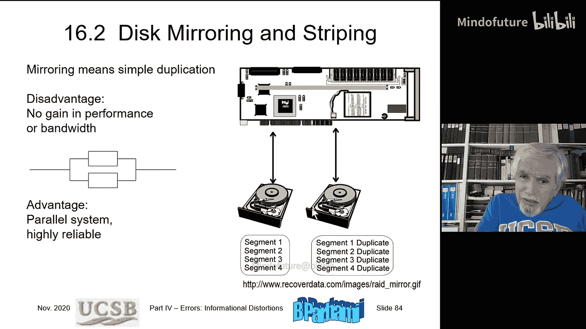

Opererates correctly。 You have access to your date。

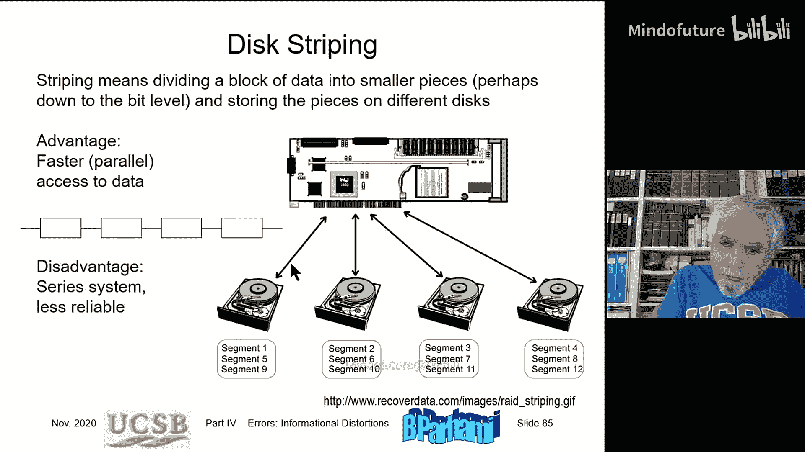

Okay， remember that disk memories have very strong error correcting codes for storing data on the disk surface。

Therefore， it's very unlikely for the data to become corrupted and for you not to detect that corruption because those codes are very strong。

They either correct。The corrupted data or at least signal that something so if you're using this disk and you notice that data is corrupted you switch to this disk which has a copy of every piece of data on this disk and use that so this is basically a parallel system therefore it will have extremely long life。

It is highly reliant。So that's the idea of disk mirroring。

Now this striping is used to increase the throughput data throughput from the desk。

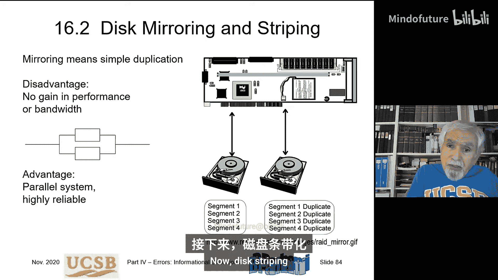

So if you have a file that you want to store。And stop storing the entire file on one this drive。

Divid it into pieces segment and then store each segment in one of these days。

This allows you to access the data at four times the throughput。Of a single disc。In other words。

 you can access four pieces of data at once， therefore the throughput increases。Unfortunately。

 this is a series system， in other words， if you lose one of these discs。

Which contain a part of data from every file。Then all the files basically become corrupt。

And we can't reconstruct the data， so this is a sea reed system。It increases the throughput。

 but it decreases the reliability substantially。

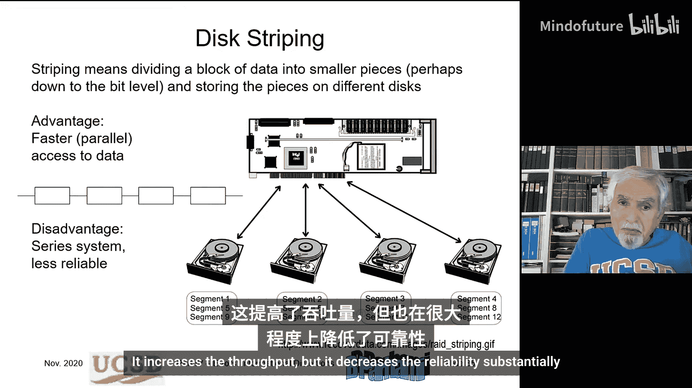

Okay。So the next idea， and I'm going to go through a sequence of ideas rather quickly for different types of rate。

System was to use coding and coding can be applied to bits， so for example。

 you can take one bit from this disk， one bit from this disk。One from this or one from this。

Compute a parity bit and store it on a fifth disk。Now if this disc fails so that you lose access to this one bit。

So the parentity bit is basically the X or of those four bits。Okay， so if you lose， let's say。

Man the bit D。This this crashes and you lose access to D。

 D can be constructed by xoring the or the example given here is in terms of B and B。

Is corrupted and therefore you don't have access to this bit B B is the x or of a。CDM。

 this is the property of parity computation。Okay， you can also do these Xort on blocks of data rather than bits of data。

Doesn't matter， so you take this block， x or it with this block， and so on。

 that will be the parity block and then if you lose access to this block。

We reconstruct that block by exorting the four blocks， A， C， D， N P。So this is the redundancy。

 the simplest kind of redundancy that you can think of in。A raid system。

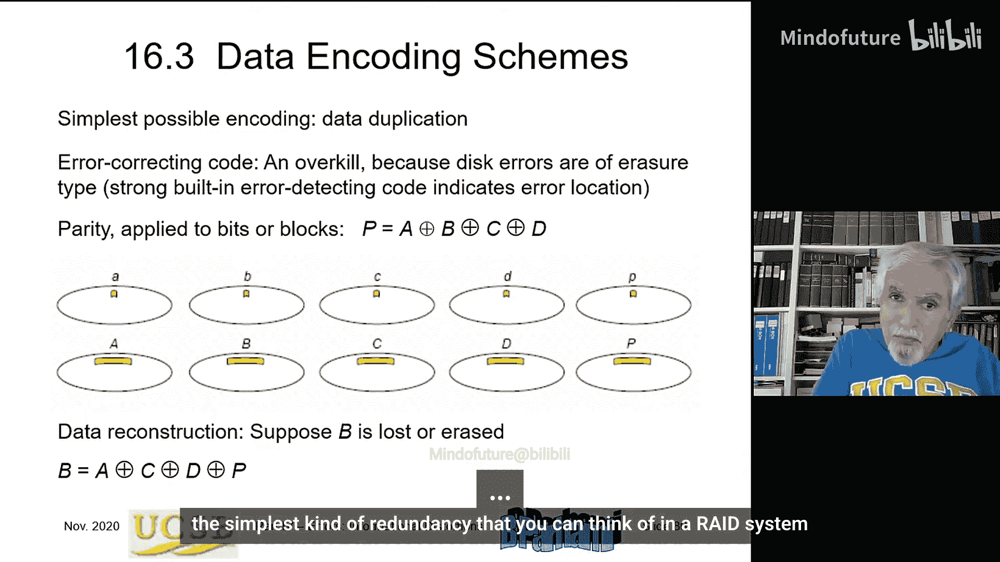

Okay， so here is basically a snapshot of all the different rates that have been defied over the years from rate zero。

 which is basically。Just mirroring multiple disc for sorry rate zero is striping。

 it has no redundancy， just higher data rate。Rade1 is mirror disk， it improves the reliability。

But it has a very high redundancy， you have double you need double the storage space。

Rate two used error correcting code， but quickly they came to the conclusion that this is really not an efficient way of doing things。

Rate three uses bit or byte level striping。So you have these， let's say， bytes on the four disk。

And there's the parity byte on a parity disk， and then there's a spare disk so that if this disc crashes。

 you reconstruct the data of that disk on the spare disk。

And then you can continue operation as if nothing happened。Unfortunately， however。

 and we'll talk about this a little bit more in a minute。And this is very time consuming。

 and the disks these days are huge。So if you want to reconstruct the data on this list， many。

Hundreds of megabytes or even terabytes。Each byte to be reconstructed requires four disk axises。

 this one， this one， this one and this one。So it takes hours and sometimes days to reconstruct the data。

Un thepar disc and meanwhile， during this long period of time， there's a chance that the second disc。

Fails。And therefore， you actually lose data。Because you are not set up。

To tolerate more than one disk failure。And you don't even have more than one spare this。Okay。

 one of the disadvantages。Of this ray tree is that this purity this quickly becomes a bottlene。

As long as you are reading data you're fine， you read this piece of data or you read this piece of data。

 no problem， but if you want to write something onto this this。

 you want to write into this Bte or this block。Writing to that block also modifies the parity changes the parity。

 so anytime you writing any of these disks， you also have to write a new parity block on the parity disk。

So this parity disc becomes a bottleneck because you have a lot of accesses to this。

 basically you add up。If you have 10 right accesses to each of these four disks。

 then you will have 40 accesses to the penaltyity disk to modify the parity block。

So rate four basically removed the bottleneck。Sorry， rate five。Rate  five remove this bottleneck。

 but distributing the parities。By not putting all the penalties on one this。

But distributing the parodies。So these four blocks have their paries stored here。These four blocks。

 the white ones。Have their parity stored here， so parity accesses are also distributed among this。

Finally， rate six provides a second checking mechanism。To allow double disc failures。

 I mentioned up here that reconstructing the contents open of these disk takes a long time。

And it's possible。That a second disc failure occurs。

Before you have completed the reconstruction and therefore you lose data。

 and that's undesirable so rate six。The most recent version has two checks Okay。

 now let me show you a sequence of figures very quickly。

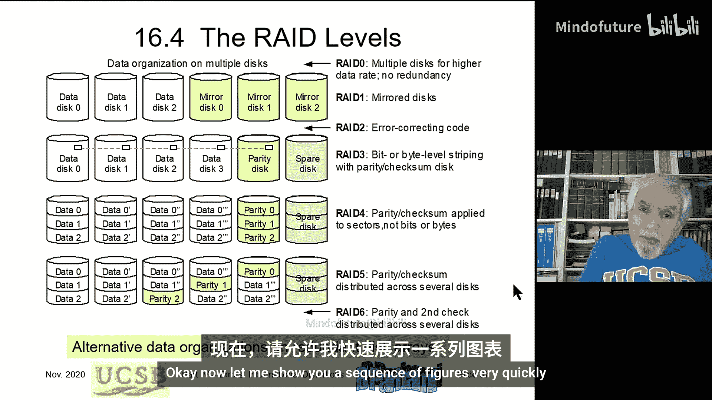

R zero and1， and I'll let you read the advantages and disadvantages for you。

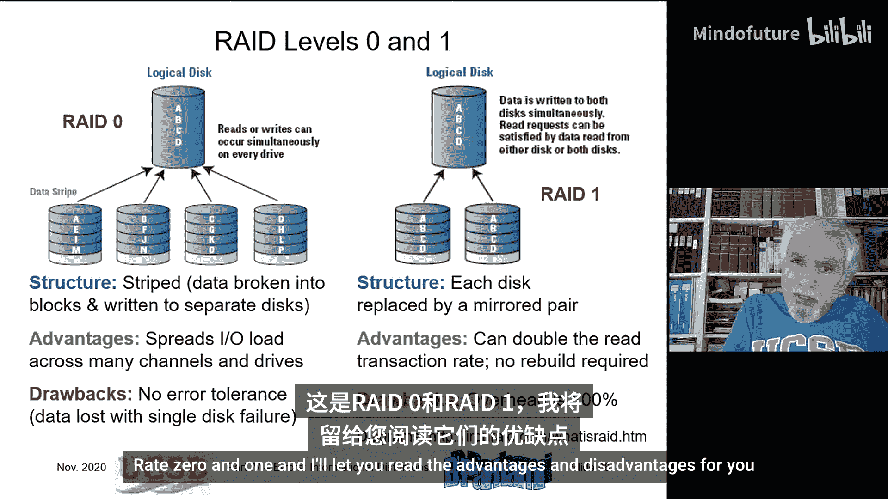

There are a combination of zeros and 1 known as rate 10。

It uses both erroring and striping rate 1 E as a variant of rate 1 that may not go into the details。

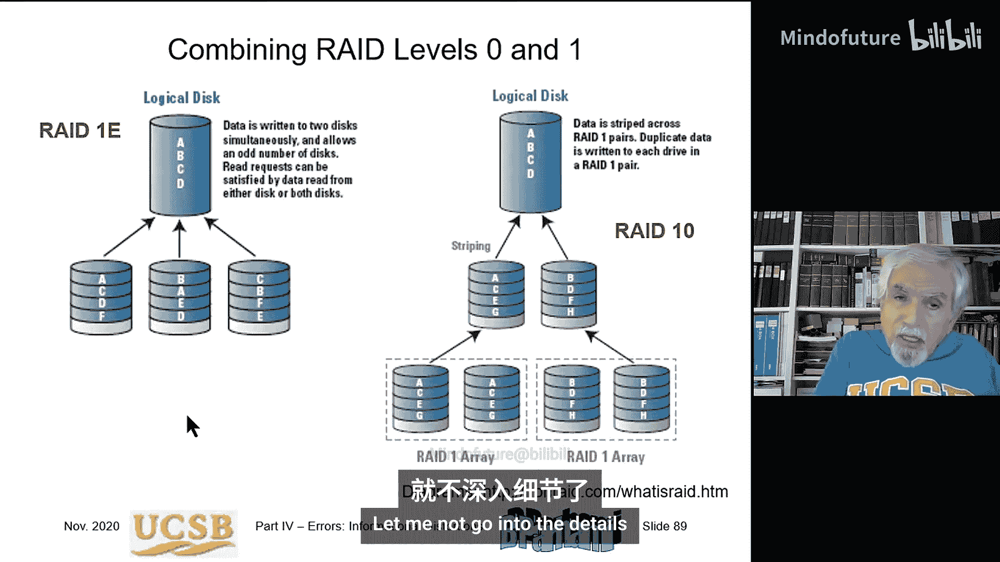

Rate level two uses coding。Use coding it was abandoned pretty quickly。So for example。

 if you use heming 47 code， there are four data bits。

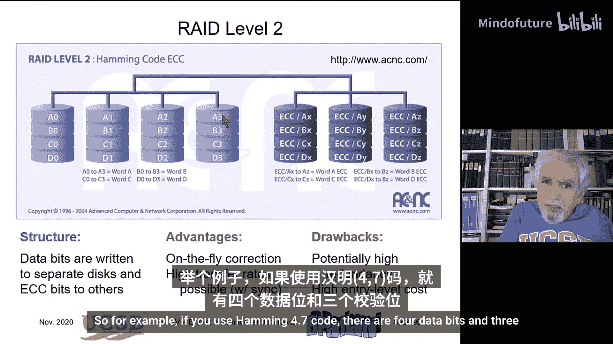

And three check bits。R 3。Use this parity。It4 also uses parity。

 but the parities are computed on larger blocks than。In rate 3。So it's somewhat more efficient。

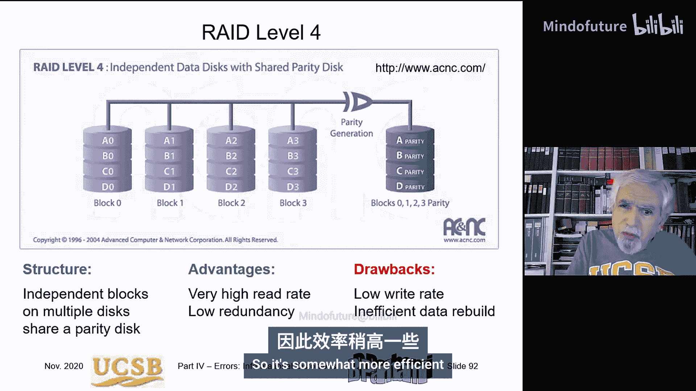

Rate five distributes the parity and different disc。

So it doesn't use one desk for all the parities and therefore it doesn't have the bottleneck for rightss。

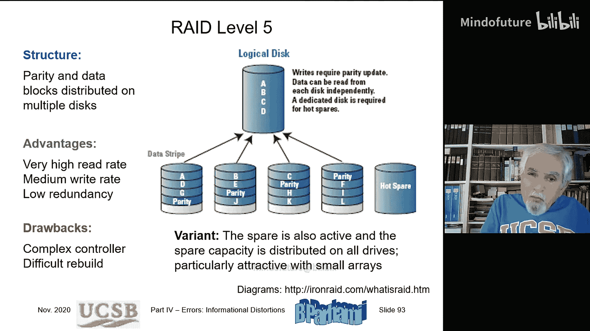

Rate level 6 uses2。So for example， blocks A0 and B0。Have a parity block P0。

 have a parity block P0 and a second check。Q0。And therefore， two disk failures can be tolerated。

Now one notion that I need to mention here is a notion of parity group。

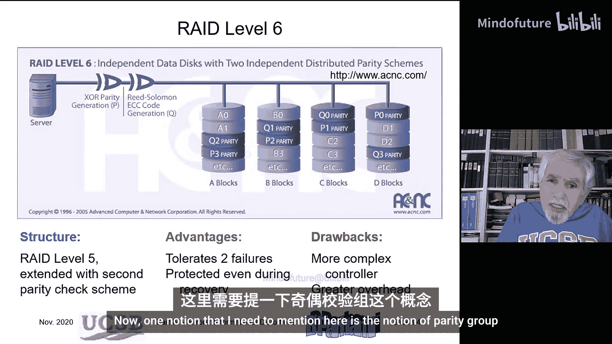

When you have， let's say。Let me go back to rate five。If you have four。Disk and one spare。

You really don't need to compute the parity across all the disks all four you can define what is called the parity group imagine you have this is particularly important when you have a large number of disk。

 imagine you have 20 disks。You don't have to have your parity group equal to 20 where the parity is computed on 19 data blocks。

 you can have your parity group equal to 10。So that nine data blocks and a parity block and another nine data blocks and another parity block。

Making the parity group smaller。Has the advantage that when you are doing reconstruction。

 so if parity， if you have 20 disk and your parity group is 10。

Then 10 of the disc will be involved in reconstruction when something goes wrong。

 the other 10 disc will not be affected， they can continue operation at their full performance。

And therefore making the parity block smaller has this advantage。Of course。

 if the penalty block is smaller， then the probability of failure goes up。

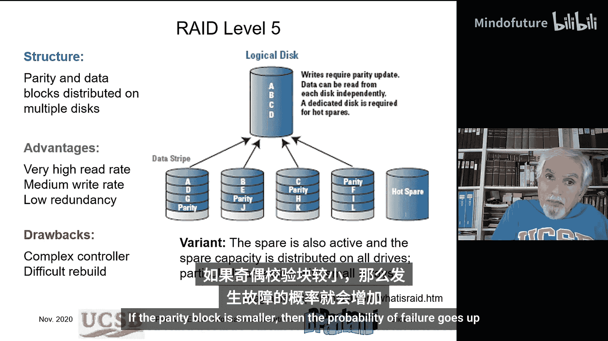

So there's a trade off。Okay， so。

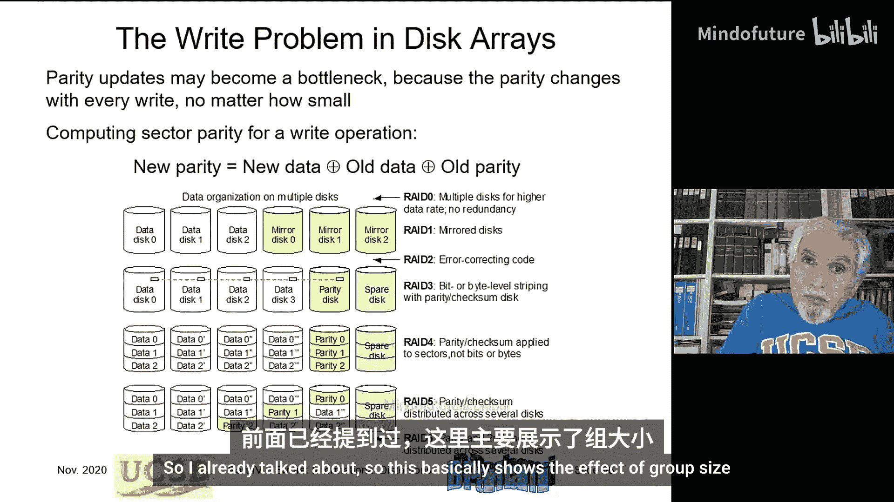

I already talked about。

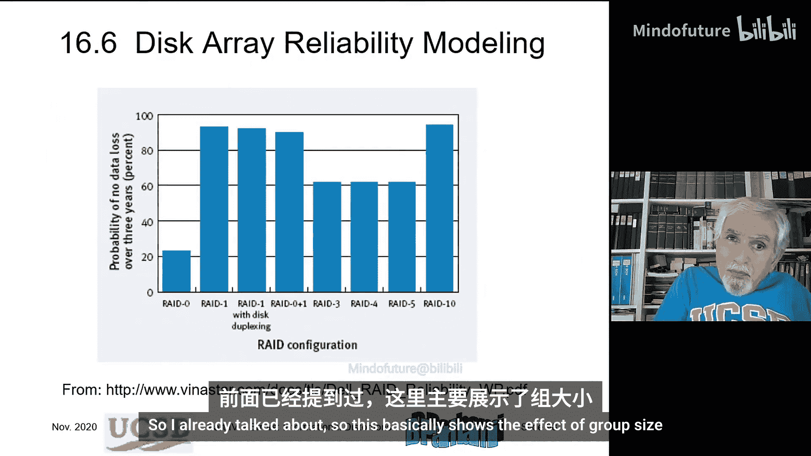

So this basically shows the effect of group size， parity group size and performance for different rates。

So as you see， for example， rate three as the group size increases， its performance deteriorates。

4 small reads。 So there are four categories， small read means reading of a few small amount of information large reads means you reading。

Maybe thousands of bits， tens of thousands of bits， okay， similarly for rights。

 small rights and large rights。Okay， large ride performance increases。

With group size for grade three and five。And the smaller rate for rate six， okay。

 so these are basically empirical studies that。Determine the performance so for small reason。

 small ride performance deteriorates as you increase。The group size。For rate5。

 it deteriorates and then。Becomes stable after a while。And well as for large rights and large reads。

 performance improves， throughput improves。So。You know。

 there's a trade off if you make your block size too big。

Then you suffer here if you make it too small。You suffer here。Okay。

 and finally I show you these without proof these。MTTF calculations for disk arrays， rate  one。

 MTTF and MTTR are the numbers for a single disc。So if a single disk has NtTF。Meantime to failure。

 entity or mean to repair， then these formulas can be used to determine the MTTF they're not hard to prove。

For rate one， rate 5 and rate 6。These are the ones most commonly used nowadays。

Yes you see that mtTF squared means if MTTF is large， this is a huge number。

MTTR is typically a small number， so。MTTF improves greatly。Here， too。You have mtTF squared。

 but you also have g minus1 in the denominator。So。MTTF increase is not。

 so this two is because the n is equal to2 there。Here you also have n， but also you have G minus1。

And then rate six， because it tolerates two errors， you have emptytTF cube。MTTR square。Okay。

 that's it for our discussion of error correction and error correcting code， and I'll see you。

In lecture 11。Stay safe。

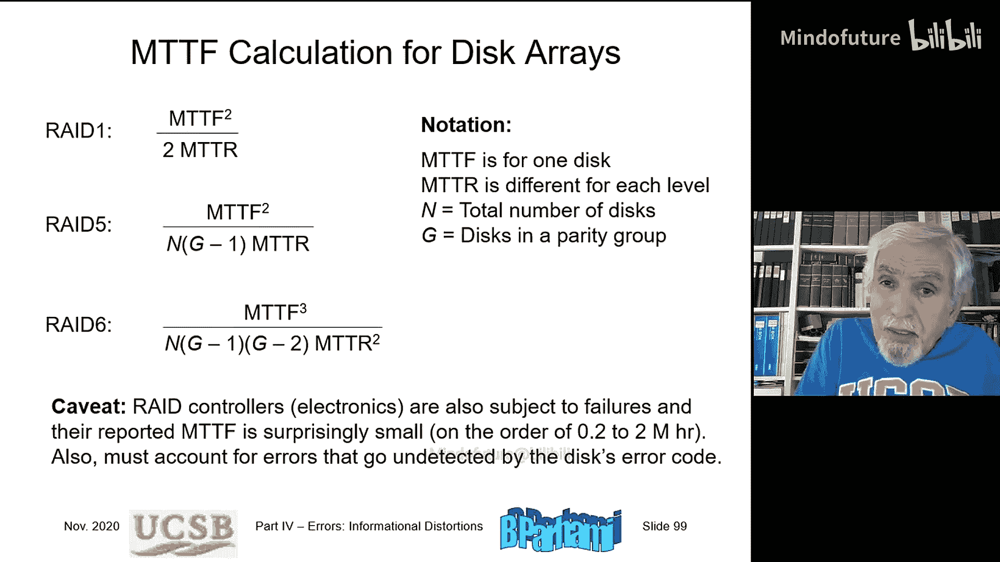

Until we meet again。