# 【加州大学】容错计算-｜-Fault-Tolerant-Computing-Ucsb-Ece-257A-p11-P11_第11讲_第17-19章_故障诊断--BV19cFyz8EPV_p11-

Hello and welcome to lecture number 11 for the course ECE257A。False polar and computing。

This lecture is the first of two。On part five of the textbook。Dealing with malfunctions。

Now malfunctions。It's a word I use。For what in the literature is sometimes referred to as system level faults。

诶。We talked about faults before logic faults。Where logic faults are basically。

Things that can happen at the gate and interconnection levels like a gate does not work correctly or wire is disconnected。

 so those are logic faults。🤢，At the system level， we deal with。Larger units that can be。

Al functioning， so to speak。So a processor unit can be malfunctioning memory unit。

DisC unit and so on。So we are talking at a higher， much higher level。

 and in order to distinguish these kinds of faults。From the faults that can occur at the gate level。

 at the logic level。Sometimes we use the term system level faults， okay？Now。

 because of the terminology we use， we don't have to use the qualifier system level because malfunctions。

Malfunction is the word that we use for a system level。

So that's one of the advantage of the terminology that。I've used in this textbook。

 we don't have to use all these qualifiers。Because we have a specific word。For system level faults。

Okay， so part five of the textbook。Consist of chapter 17 through 20。

And according to the usual pattern， I'll cover chapter 17 and 19。In this lecture。

And chapters 18 and 20 in lecture number 12。

Okay， so the first part of today's lecture is malfunction diagnosis。Basically。

 determining that something is wrong。At the system level and the modules that are interconnected。

To form the system。

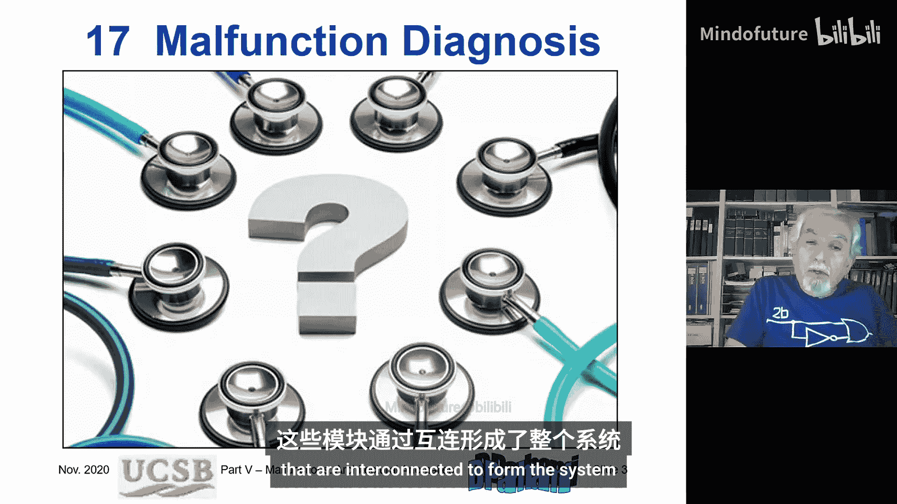

Okay， one of the ways in which we can diagnose malfunctions is through self diagnosis。

Because we are talking about units that have。嗯。Rather significant functionality if you talk about processor。

Memories nowadays know memories have memory controllers that are pretty intelligent。

 they're almost like a full blown processor， described as a controller that is again。

 like a processor。So these units， because of the built in intelligence。

 can do a lot in order to diagnose their own internal problems。Internal faults。Okay。

 so self diagnosis is one of the ways in which these units can。嗯。Basically。

 determine that something is wrong。Okay， of course。A natural question is that how can you trust？

A unit that is malfunctioning to diagnose itself because if something is wrong with it。

 how can you trust the outcome of a self diagnosis？

One of the ways in which we achieve this type of self diagnosis。Is through a layered approach。

And this is basically what happens when you。Boot up a computer。

It goes through a self diagnosis routine。To ensure that the system is okay and can basically。

Start operating safely。So what is a layered approach first a small part of the unit is tested。

So a kernel， a small part of the unit， is tested。we basically use a fairly extensive set of tests to determine that this kernel。

Is working correctly。And then we use the kernel。To diagnose。Unit A， maybe。

And then now we trust this part of the system。Then we use those trusted parts to diagnose unit B。

 so we basically extend。呃。The trusted part of the system until it covers the entire system。

So an example of this， the kernel may be the main part of the processor。

Let's say the instruction execution unit and some basic。Part of the ALU， once that part is tested。

 we can probably use the rest of the ALU， any co processorcesor that we have， any memory units。

 any describes and so on。So that kernel， because it's fairly small in size。

 you can afford to test it exhaustively。Or I shouldn't sayively extensively。

And then be fairly confident that it works correctly before proceeding to test self test the rest of the system。

So this is basically the way self diagnosis works in most modern systems。Okay， now。

The systems you use nowadays are basically collections of modules that are connected to each other。

 as I mentioned， the modules can be a processor。One or more memory units， one or more disk drives。

 network controllers and so on。Or they can be computer networks， networks of。Fooll long computers。

So one approach to do go no go testing， go no go testing is basically a test that says。

Whether a unit is okay or not okay， we don't try to diagnose you know what's wrong internally to that unit。

 we just want to determine whether that unit is okay or not okay so that's called a go no go test。

We can do this based on self diagnosis in the following way。So for example。

 let's say unit A is such a unit that has internal intelligence。And can use。Self diagnosis。

But as I mentioned， we can trust unit A to test itself if it's not actually working correctly。

So one way to do it is to supply。What we call a seed。To that self diagnosis unit。

 so the self diagnosis unit basically runs a program。

And that program puts the various part of that unit。Through its pace basically。

Asks various port to do things。And then depending on the initial seat that you provided。

It can generate an outcome or result， and that result will be dependent on the initial seat okay。

So let's say the kernel supplies that seed to unit A。

 unit A runs itself diagnostic with that seed and comes up with an answer and it sends the answer to the kernel。

And the colonel knows what the outcome of that self diagnosis should be with that particular。

If the outcome matches。The expected outcome in the kernel concludes that unit A。

And itself diagnosis as routine are okay， and therefore it can trust unit A。

 extend the domain of trust and then go to unit B and then to unit C。Okay。

 so rather than the kernel trying to supply a whole bunch of tests to unit A。

 which can take a long time and require a lot of communications within the two unit。

It can supply just one seed。Maybe。32 bids or 64 beds or 256 beds， whatever were the seat sizes。

A limited amount of information， then unit a uses that seed。As part of this diagnostic unit。

 so for example， it's an upper end。That the diagnostic unit operates on。And it sends out to the ALU。

 it sends it to memory， try to test various parts。Of the unit。And then at the end。

 it comes up with a results based on that seat。And then it sends that result。Back to the kernel。

And the colonel knows。It may have a table。That says for that particular seed。

 the expected result from unit A is this so if the。Expected result matches the actual result。

 then unit A can be trusted。Okay， if this return value， let's say is 32 bit。

The chances of slim that the correct 32 bit value is supplied。Bye。The malfunctioning unit。

If you properly designed a self diagnostic。Okay， it's very unlikely that the exact correct 32 bit result will be generated by a malfunctioning unit。

 it's very likely that something different will be generated and therefore the malfunction。But。

 we detected it。Okay， so this is basically the idea。Of self diagnostics。And mutual diagnosis。

 So mutual diagnosis。嗯。Between kernel and unit A may involve the kernel sending a seat to unit A and receiving a result and then judging。

The health of unit A。Based on the received outcome。

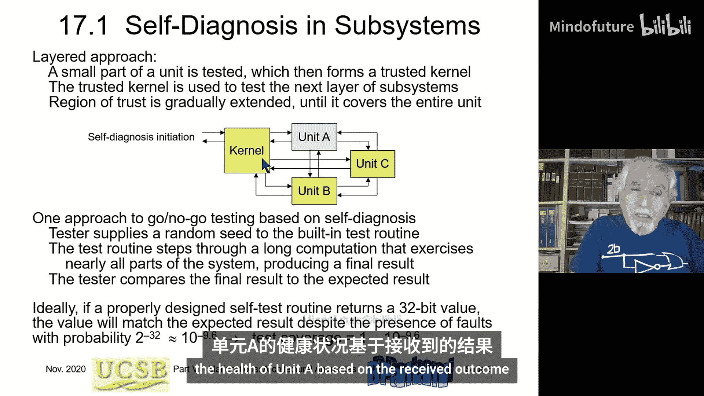

Okay， based on this。呃， foundation。If we have a bunch of units connected to each other。

 now these units can be different units within a computer， as I mentioned， CPU， memory disk。

 network controller and so on， or they can be different notes in a computer network， doesn't matter。

Methods are the same。So， suppose be。Have what we call a testing graph。

These are basically a bunch of directed links connecting these nodes to each other。

And the meaning of a directed link is that unit M0。Tests unit M1。Unit M1， test unit M2， unit M2。

 test unit M0， and so on。So these directed links basically tell us which unit will test which other units。

So it's called a testing graph。Of course， in order for the testing graph to make sense。

 there should be a connection from N0 to M1。So if this is a bus based system。

 then of course everything is connected to everything else。If this is an actual network。

 then we need to have these connections。Between the notes。

There may be other connections that are not shown here， so for example。

 M0 may also be connected to M3， but that's not part of the testing graph。

 so we don't use M0 to diagnose M3。We have not included that link。Okay， so at tester unit。

 I can test the unit J。And there are two possible outcomes。Zero or one。The outcome zero， so remember。

As I mentioned， a unit I can send a seed to unit J， unit J does's a self diagnosis。

 and then it returns returns the results to。Unitai， so this directed arrow。Does not show the return。

 it simply says that I test J， but I testing J involves sending a seed and receiving。

Receiving a result， okay？So the outcome zero means that unit I thinks that unit J is okay。

 in other words， based on the seat that was sent and the result that was received I。

Renders the judgment that it thinks unJ is okay。Of course， this judgment may be incorrect。

 but that's really the challenge of。The diagnosis problem。

Or unit I may think that unit J is not okay again， it may be。Iran is in this judgment。

But we have to work with these imperfect results。So unit I testing J as an outcome0。

 meaning I thinks j is okay， or outcome1， meaning I thinks that J is not okay。

And the verdict of unit I about unit J is denoted by DIj。In zero1，0 means I thinks J is okay。

 one means I thinks J is not okay。All the diagnostic verdicts constitute an end by N diagnosis matrix D。

Whose elements are these Dig。Diagnostic matrix D is usually sparse。

Because we all have d01 because unit0 tests unit 1。

 but we don't have D10 because unit1 does not test unit  zero。

So many of the entries of DIJ may be zero because no testing takes place for that particular。

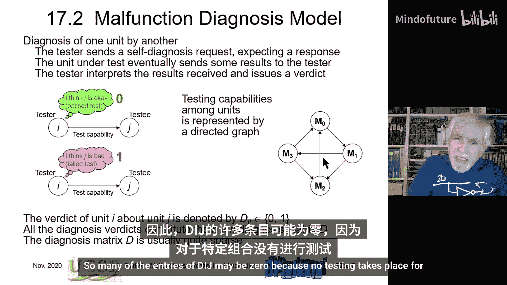

Combination。Okay， so this is an example of a diagnosis matrix。

D01 means judgment of unit zero about unit1 D12 means judgment of unit one about unit2。

Now this matrix is often sparse， as I mentioned。It's also anti symmetric usually if units zero test unit one。

Then we don't allow unit one to test unit zero， usually， you know， this is the usual way we use。

This type of diagnosis， because if there is mutual diagnosis。Zero testing one and one testing zero。

It's much trickier to deduce the health of the unit。That's what we'll see in a minute， okay？

So it's antisymmetric， meaning that if this entry。D01 exists。Then D10 does not exist if T20 exists。

 then d02 does not exist。Also， diagonal entries do not exist because a unit does not test itself。

Okay， units test other units according to the testing graph。Units do not test。Hmselves。And also。

 we usually。Preclude the possibility that two units test each other。Okay。

 one unit can test the other one， but not the other way around。Now this model。

That I just described is known as the PMC model。Is the most commonly used model of diagnosis。

Malfunction diagnosis。And PMC stands with the initial of Preparrata， Meze and Chiian。

And the three researchers who basically first dealt with this model。

There's also there are also other models， including what is called the comparison model。

 so here the PMC model relies on the judgment of one unit regarding another one。

The comparison diagnosis model is based on two units。Basically performing the same computation。

And the judgment about their health。Based on comparing the outcomes。So if the outcomes match。

 then we conclude that both units are okay。If the outcomes do not match。

 then we conclude that one or the other one， we don't know which one is not okay。So basically。

 if we do a whole bunch of these pairwise computations。And then we know， for example。

Let's say we have units one， two， three， and four， let's say one and two do the same computation and they disagree。

So the conclusion is either one or two is malfunction。

Let's say two and three also perform the same computation and they disagree。

Then we conclude that units two and three， one of the units two or three is malfunctioning and then based on the this global information about disagreements between pairs。

 we try to deduce which units are actually malfunction， so that's called the comparison model。

 we won't talk about that。Me， actually。Don't even cover the PMC model know， in great detail。

 there's a lot more to say than。What we can afford to cover given the limited time that we have。

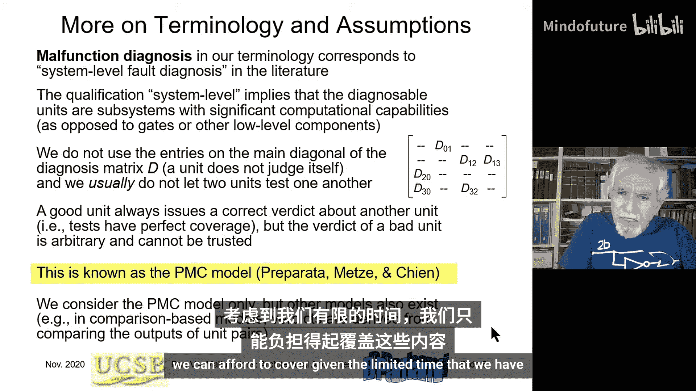

So the only model we cover is the PMC model。Okay。So， let's say。We have this four module system。

And we have done a bunch of tests。And these are the outcomes。

 so D01 is the outcome of M0 testing M1 and so on。And these are the outcomes。Of course。

 if all the modules are okay。Then all of these test results should be zero。

 remember zero means that the unit thinks。So if all four units。Are working correctly。

Then M0 testing M1 will conclude that it works correctly and so on， so the syndrome。Of the。

This testing scheme will be all zeros， and that corresponds to no malfunctioning algebra。Okay。

 I forgot to mention one thing。When a healthy module test another module。

We assume that the outcome is trustworthy in other words， if we know that M0 is a good module。

 is a healthy module。And M0 says that M1 is not good， there's malfunctioning。

 then M1 is actually malfunctioning。But if M0 says M1 is good， and M0 is known to be good。

Then M one is really good。However， if M0 is malfunctioning。

Then we can't trust the outcome of a testing M1。Okay。

 so if we somehow know that M0 is malfunctioning。And we can't rely on this test result， okay？

So that kind of test we。Dote like this， the outcome can be zero or1。

 we don't know which one is basically random， okay。Now， if M0 is malfunctioning。

 this will be the syndrome。In other words， if M0 is malfunctioning。

M0 is the only unit that is malfunctioning， everything is okay， then M2， which is good。

 will detect that malfunction。Okay， so Dt20 will be1。M3， which is good， will detect that malfunction。

 so D30。Will be one。However， d01 because M'm 0 is malfunctioning d01。Can be 0 or one。Okay。

 so notice that this case that we have the two cases that we have no malfunctioning unit。

Versus having only M0 malfunctioning are distinguishable。Because we have a one here and a zero here。

So the two signatures are distinct。Okay， the two signature may not be distinct in this entry because we can have zero here。

And that zero cannot be distinguished from that zero。However， if there's a T one。Of these tests。

 whose outcome is different。For the two。Falult patterns， malfunction patterns。

 then we can distinguish those two。So if M1 is malfunctioning。

It's easy to verify that this is the signature。So there are really four possible signatures depending on whether this is a zero or1 or this is a zero or1。

Again， this signature is distinct from M0 malfunctioning because these two are different。

And it's distinct from no malfunction because these two are different。This is one， this is you。

And these two are also different M0 malfunctioning versus M1 malfunctioning because they're different here。

Acate similarly for M2 and M3。But as long as you have a single malfunction。For no malfunction。

These test outcomes， the syndrome。Basically tells you whether you have no malfunction or you have one of these cases because all the signatures are distinguishable。

 so M3 from M0。Its distinguishable M3 malfunctioning versus M0 malfunctioning。

The two cases are distinguished。However， if you have two malfunctions， let's say M0 and M1。

This will be the signature。Okay， and this signature is not necessarily distinct from only M0 being malfunction。

Because。They can match in this first entry， this can be zero or1， this can be  zero or1。

 so the two highlighted roads。Can be identical。 This is zero， but this can also be zero。This is zero。

 this can also be zero， one matches 1， one matches1， zero matches zero。

So the two cases of M0 being the only malfunctioning module。

Or M0 and M1 being two malfunctioning modules are not distinguished。Okay。So we say that this system。

Is one step， one diagnosable。One step means you just run these diagnostics once。Based on the outcome。

Outcomes of those diagnostics。You can tell immediately in one step。What is wrong with it。

 as long as the number of malfunctions does not exceed one。Okay， so we can use a dictionary。

 basically the syndrome。All zeros correspond to okay。This has two syndromes，  zero，0，0，110 and 10，0。

110。So 0，0，0，110， that means M0。His mouth functioning。And1，0，0，1，1，0。It meansans M0 is malfunction。

Okay， so basically we run the diagnostics and find the syndrome。The six bit， basically syndrome。

We can consult this dictionary， syndrome dictionary。

And read out directly which unit is malfunctioning as long as we are sure。

There's just one at most one malfunctioning。So this is known as one step diagnosability。

This system is one step one diagnosable， meaning that one malfunction。Can be paying us。

We'll see later that。This system cannot be too diagnosable， okay？We prove it。

 actually here we observed that it's not too diagnosable。Because。If you have two al functions。

 the signature may be indistinguishable。From。A single malfunction。

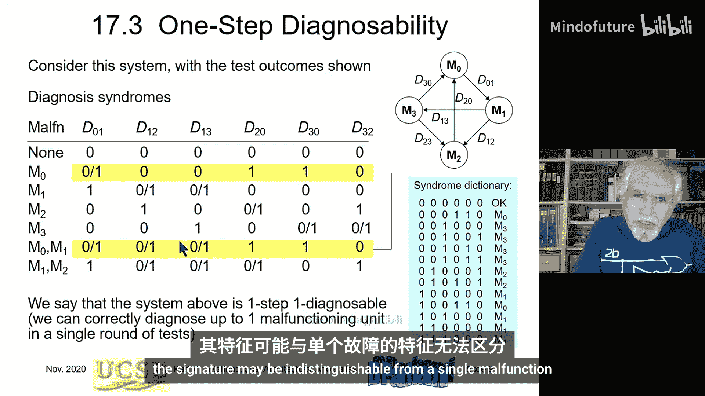

Okay。Noops。Okay， so here we talk about requirements for one step T diagnosibility。

An end unit system is one step T diagnosable， in other words， we run one set of tests。

Shown on the diagram。And up to T malfunctioning unit can be directly identified。

This happens obviously， if the diagnosis syndromes for conditions involving up to T malfunctions are all。

Distinct。Okay， we have two necessary conditions。For this too。诶。

To hold one step key diagnosability to hold。First， the number of modules and。

be at least two times T plus1 for T diagnoseagnosability。 we must have at least2 T plus1。

In other words， a majority of units must be good。This is an absolute requirement。

 so that's why this system with four modules。Can never be too diagnosable no matter what the testing graph is。

Okay， you may have thought that， okay， this was not too diagnosable。Maybe if we add more。More tests。

 it becomes toodiaaggnosible。A four module system can never become too diagnosable。Because。

A majority of the units must be good。And if two units are bad。

There are two good units which are not in majority， in the majority。

And each unit must be tested by at least two other units， so there are two necessary conditions。

N greater than or equal to 2 t plus 1， and each unit must be tested by at least two other units。

That also tells us that this system cannot be too diagnosable。

Because M1 is being tested by only one unit， okay？If we want this to be two that it can't be with four nodes。

 but even if it had five nodes and we had this situation that M1 was diagnosed only by one unit。

 then it could not be。Too diagnosable。So that's necessary condition。

A sufficient condition is this an end unit system in which no two units test one another。

Is one step t diagnosable？If and only if each unit is tested。By at least two other units。Okay。

 so if we have this requirement that is conditioned that no two units test each other。

 that's obviously satisfied。In this graph。And1 test M2 and2 does not test M1。

 so there are no links directed links in both directions， okay。So that requirement is satisfied。

So an end unit system in which no two units test one another is one step t diagnosable。

 even only if each unit is tested by at least two other units。So here M1 is tested by one unit。

M2 is tested by two units。M3 is tested by one unit， and M0 is tested by two units。

So the minimum number of units that test a particular unit is one。

 therefore this has the necessary and sufficient condition for being one diagnosable。

So I really didn't need to form this table because this result。Hells me， of course。

 I haven't proven this result but。The proof exists。😔，So this unit。

 but just looking at this testing graph， we could tell that there is one step。Undiagnosable。

 and we could also tell that it cannot be too diagnosable。

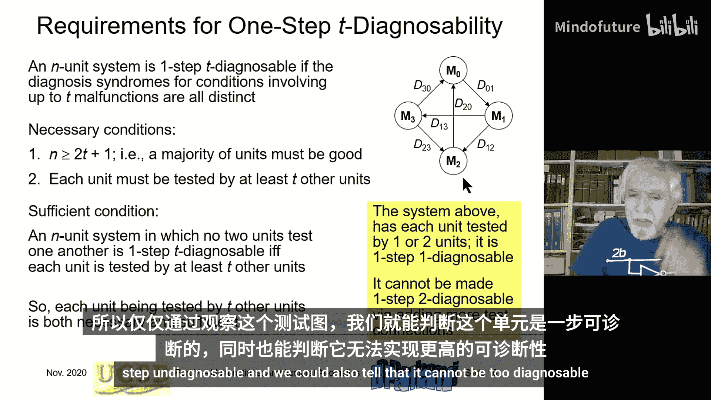

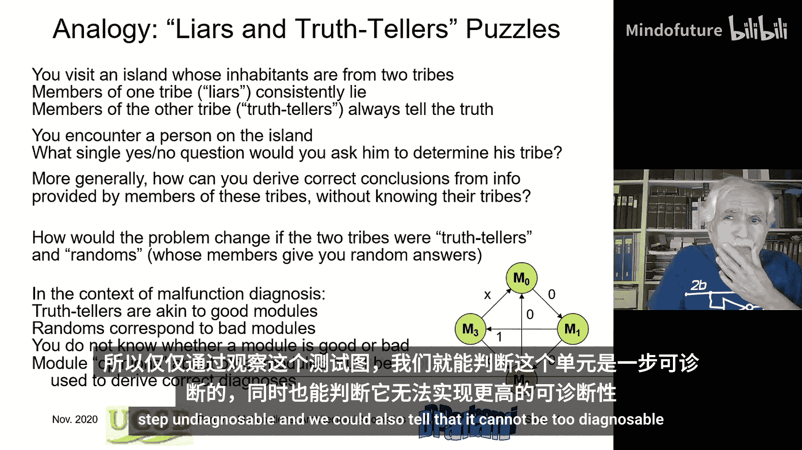

Okay， there's an analogy basically the challenge of determining which units are malfunctioning。

Exist because sometimes a malfunctioning unit gives us information about another unit。

 and we somehow have to weed out。That's incorrect information。

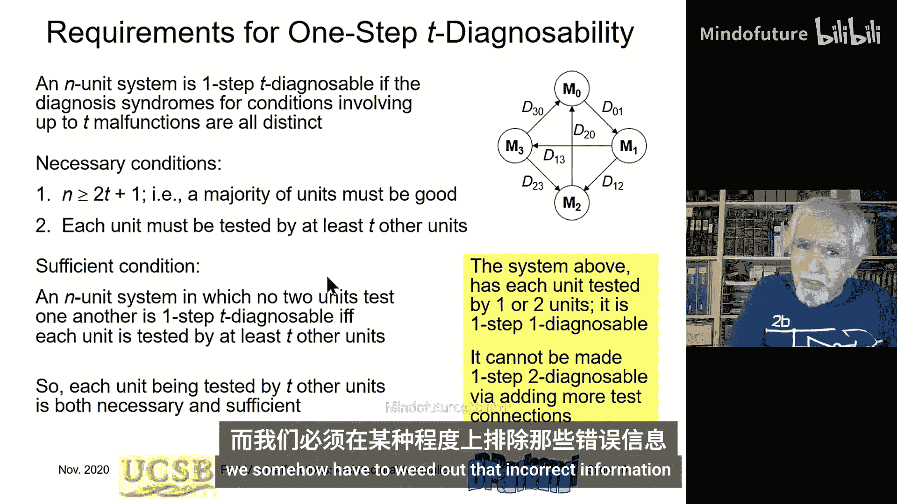

Okay。There are some puzzles about。You know， an island in which there are two tribes。

 one tribe consists of lawyers and another tribe。Itist of truth tellers and the challenge of determining。

 you know， by talking to these people， which ones are truth tellers and which ones。Our lawyers， okay。

I won't say more about this。So that's why the problem is challenging。

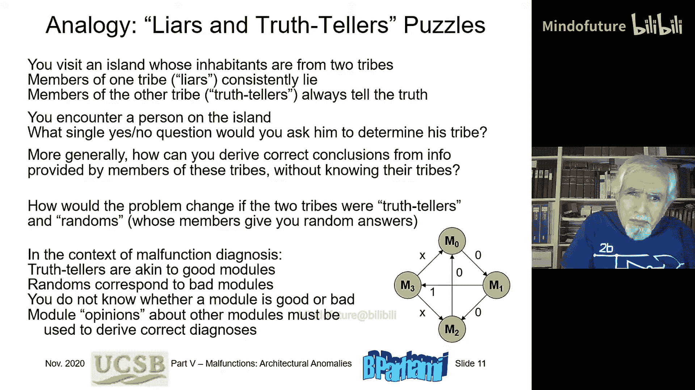

So one step anosibility。With regard to one step agnosibility， we have。Two set of problems。

 analysis problems and synthesis problems。Analysis problems are two of them。given the directed graph。

 defining the test links， find the largest value of T for which the system is one step T diagnosisal and as I give you the testing graph。

And then ask you。Is this system， let's say three diagnosable or four diagnosable。

 or what is the largest value of T for which this system is t diagnosable？

And you have to come up with the answer。Another analysis problem given the directed graph。

And its associated test outcomes identify ultra the malfunctioning units。

 assuming that there are no more than T， of course， if the system is t diagnosable。

We won't allow more than T malfunctioning units。Because that the agnoibility is only guaranteed up to T。

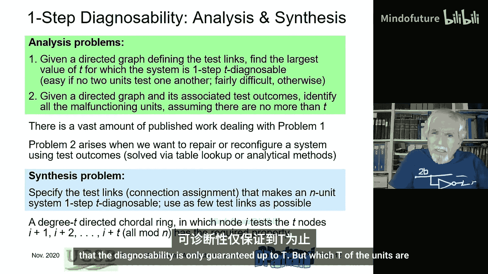

But which T of the units are malfunctioning？Okay， so for example in this。

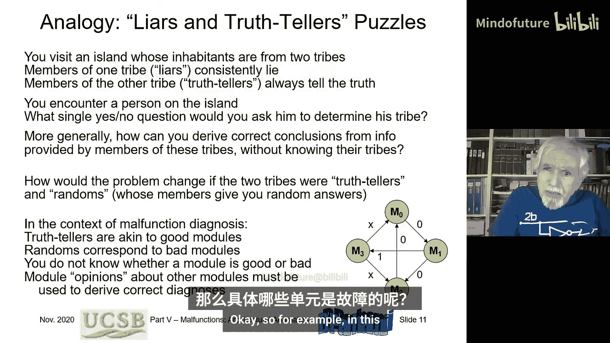

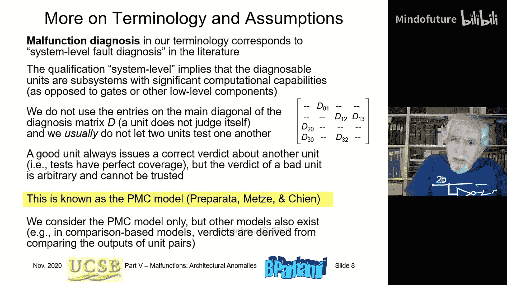

Oops。And this。

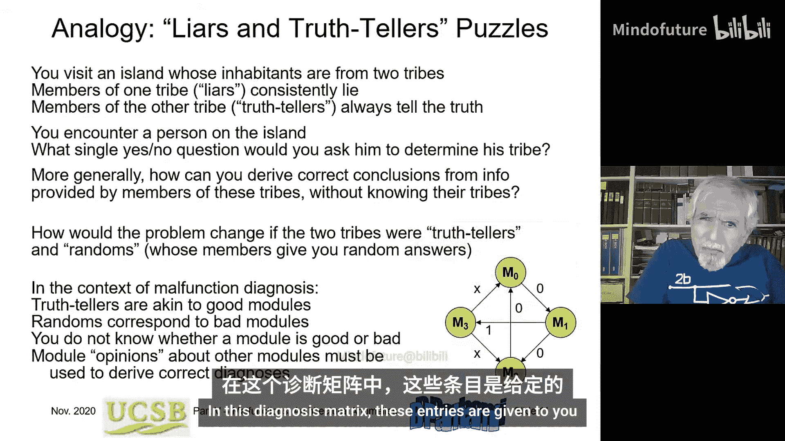

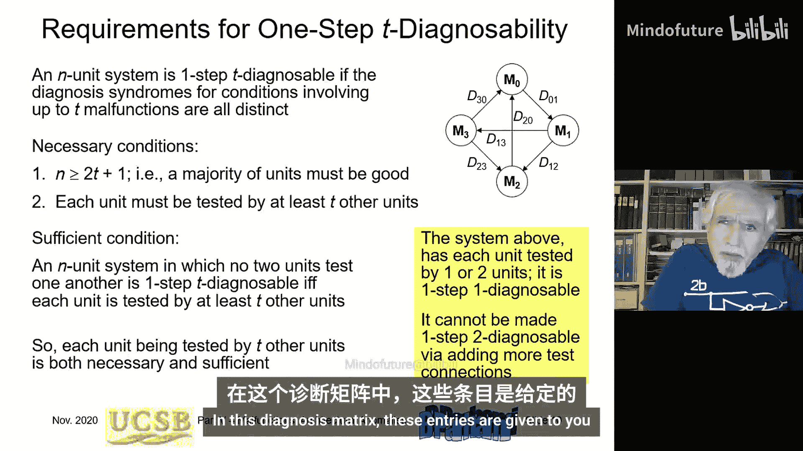

Yeah， and this。Diagnosis matrix， these entries are given to you， these are zeros and ones。

Your job is from this matrix， determine which unit is malfunctioning。

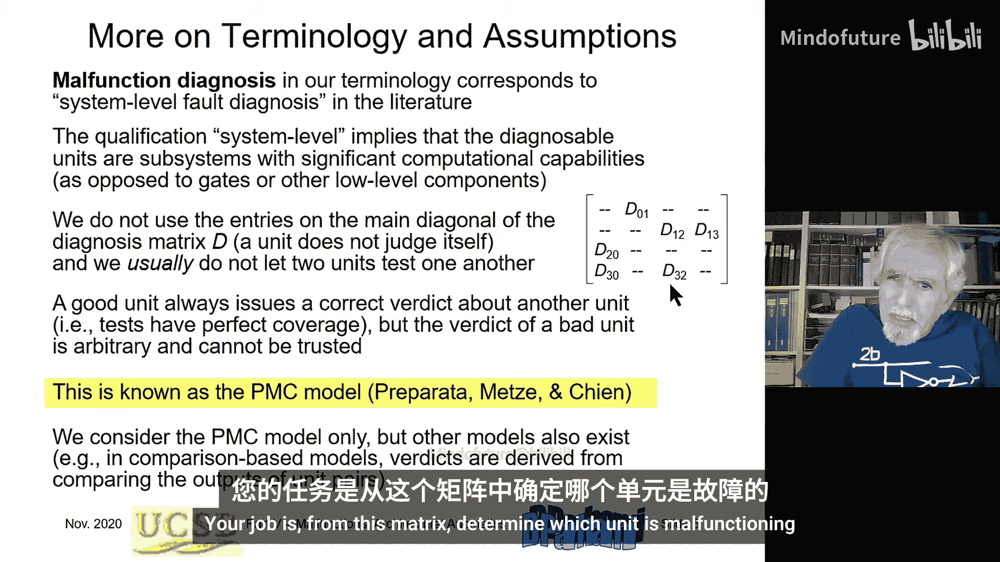

Okay， that's the second。

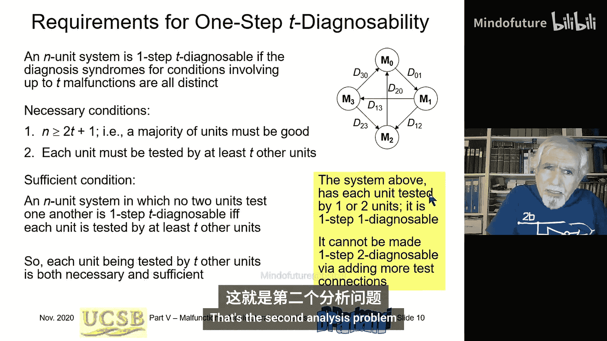

Analysis problem。The synthesis problem is。Basically a designing problem， okay。

 you want to design the testing graph。

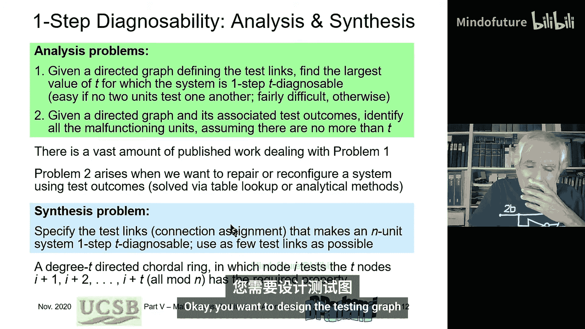

So that the system is one step T diagnosable using as few test links as possible。

 you want to minimize a number of tests。But still guaranteed that the system is one step T diagnosable。

Okay， this problem actually， we already know an answer， but， you know。

 you may look for better answers， different answers that are more。诶。

In line with the system's architecture。So if you have an endn。Corial rank。

In which node i is connected to node i+1， i+ 2， i+ 3， i+ T。

And this system is guaranteed to be one step T diaggnosable。So in this example。

 I have not shown all the testing links， but there are the green links going from node I to node I plus1。

 blue links going from node I to I+2， so similarly there will be a blue link between these two。

 a blue link between these two and so on。And then。The red links going from node i to i plus 3。

So there's one of them。Here' is another one， here's another one， and so on。

So if I provide all those testing links in this。Quter ring。Then the system will bediagnosable。ok。

It already satisfies the。A necessary condition， if a system has to be three diagnosable。

 it must have at least seven notes， okay， so it satisfies that necessary condition。

Note I is connected to node i+1， i+ 2， i+3， end node there are seven nodes。

AT is equal to3 and the system is3 dial。But if your system is has a different architecture。

 you have a network that doesn't have these connections。

 then you may want to design another testing graph。To ensure three diagnosability。

But there's at least one answer to that question。Okay。

 of specifying the this links or the connection assignment。Makes an end unit system。One step。

 T divnoible。Okay， with respect to the diagnosis algorithms given the test outcomes。

 an naive algorithm is order in cube in running time。You basically have to label。

All the nodes with good or bad， that's the outcome。So the diagnosis matrix is your input。

 your output。Consist of every node， every unit labeled good or bad。So here's the algorithm。

 while some units remain unlabeled， repeat this process。

Choose an unlabeled unit and label the G or B。Use labeled units to label other units。

 I'll talk about this in a second。If the new label leads to a contradiction。

 then backtrack and change the labels that you assign previously。

Until you get to the end of the process and no contradictions arise， so here is an example。

 suppose I assume that n0 is good so I label M0 with G。Okay。

 that's an arbitrary choice I could have started with B bad， okay， so I started with them0 G。

Then F M0 is good， M1 must be bad given this test outcome。

Because a good module always makes the correct diagnosis about another module。

 and this test outcome is one， therefore as M0 is good， M1 must be bad。Okay， M2 must be bad too。

 because M2 is saying that M0 is bad， but M0 is good， we assume that it's good， so M2 must be bad。

Here's a contradiction because I identify two bad modules。

And as I assume that there's no more than one bad module。So I backtrack and say， okay， M0。

Wwhich I assume is good that assumption was incorrect。

 let's say m0 is bad okay and so on and so forth， so this is an order in cube algorithm。

More efficient algorithms exist， for example， this is an order n the 2。5 step diagnosis algorithm。

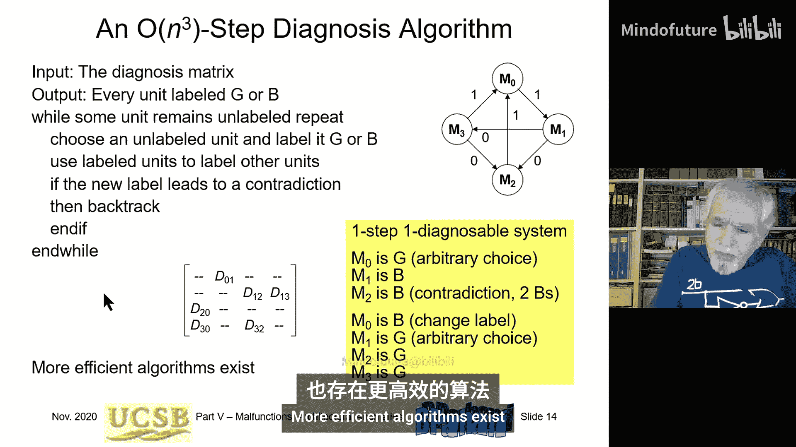

From the original testing graph。We construct something we call the L graph。

The L graph has the same nodes， the same four nodes as the original testing graph。Okay。

 there's a link from node I to node J in the L graph。

 if only if node I can be assumed to be malfunctioning。When no day is known to be good。Okay。

 so for example， if note M0 is known to be good。Then M1 is malfunctioning。Okay。

 so we can assume that the node is malfunctioning where another node is known to be good M0 is known to be good。

Leads to。The conclusion that M1 is malfunctioning。So there is a link from M1 to M0。です correct。Okay。

 similarly， if we know that M1 is good。If M1 is good。

 then M0 must be malfunctioning because of this test outcome。

Because a good module does not make an incorrect diagnosis， so it M1 is good and M0 must be bad。

So that's the reason for this link。Okay， so in this way， I can construct this L graph。

Now vertex cover of an L graph。😔，Is the set of malfunctioning notes？

And the vertex cover is basically a set of vertices that touch all the links and M0 is such a vertex cover because M0 touches all the links。

And this L graph。Therefore， M0 must be the malfunctioning unit。Okay， so from these test outcomes。

When I find the vertex cover， the minimal vertex cover。Of this graph， which is M0。

That tells me the malfunctioning unit。Okay I basically converted it。

The problem of finding them outfunctioning in it than this。Problem？Two。

 finding the vertex cover of another graph that can easily be constructed。

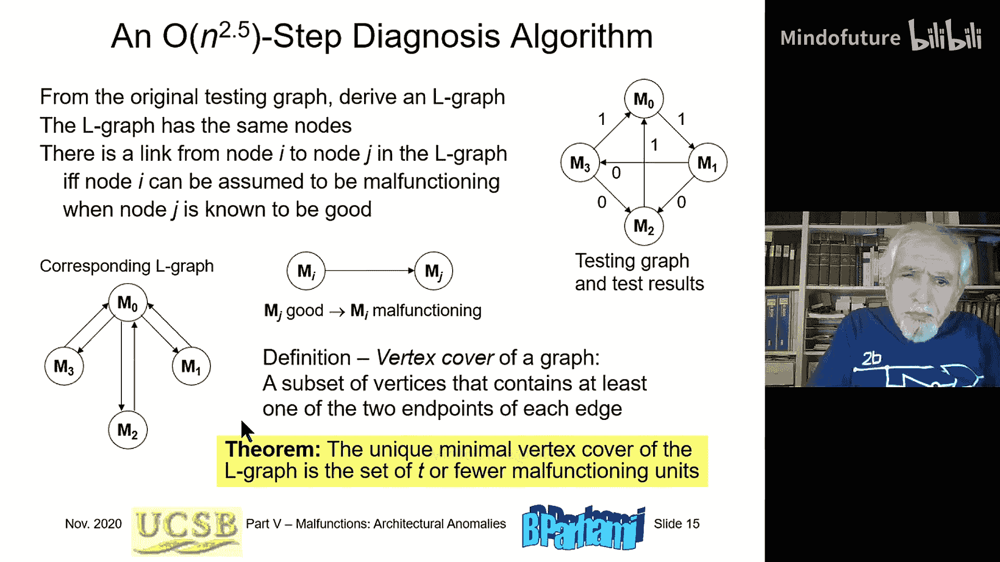

Okay， the next idea。Is that of sequential diagnosibility。

 so one step diagnosibility means in one step， we just say okay。

Let's see we have a whole bunch of modules， 10 modules， you say okay。

 n0 M3 M5 are the malfunctioning units in one step。Okay， in sequential diagnosability。😊。

The requirement is for us to be able to identify one malfunctioning unit。Okay， so for example， this。

This is a five node unit。And we know that it's not one step too diagnosable。

Because each unit is tested by just one unit， so it can't be too diagnosable， one step two diagsable。

But it is sequentially too diagnosable， what does that mean means that if you have up to two malfunctioning units。

You are able to identify one of them。And then you basically remove that。

 let's say M1 and M3 are malfunctioning。You are able to identify M1。To remove M1。

 replace it with a good module。And then now you have only one malfunctioning unit。

 and in a second phase， so it's not one step， it's multiple steps or phases。In one step。

 you identify one malfunctioning unit and in the next step， another malfunctioning unit and so on。

So an end unit system is sequentially dediaaggnosible。If the diagnosis syndromes。

 there are T or fewer malfunctions。Are such that they always identify unambiguously at least one malfunctioning unit。

As I mentioned， this is useful because some systems that are not one step two tdiaaggnosable are sequentially tdiaaggnosable。

 and this is a simple example， this is not one step two diagnosable。

 but it is sequentially too diagnosable。So for sequential heat aaggnosibility。

 we still need to have a majority of the units good。That's a necessary condition。

And for directed rings。An endode directed ring is sequentially tdiaagnosable。

For any T that satisfies this equation， the next slide is a little bit more detail。So this is。7 node。

Directed。Ring。And because tea。Equ three satisfies this inequality。At3 squared minus1 divided by 4。

 so that's 9 minus1 divided by 4 is2。2 plus three is 5，5 plus 2 is7。

 it is less than or equal to seven， therefore this is oops。This is sequentially re agnosible。Okay。

 we already know it can't be for diagnosable because。majorityrity of the units。It be good。

 so three diagnosibility is the best we can know for and this actually has that property。

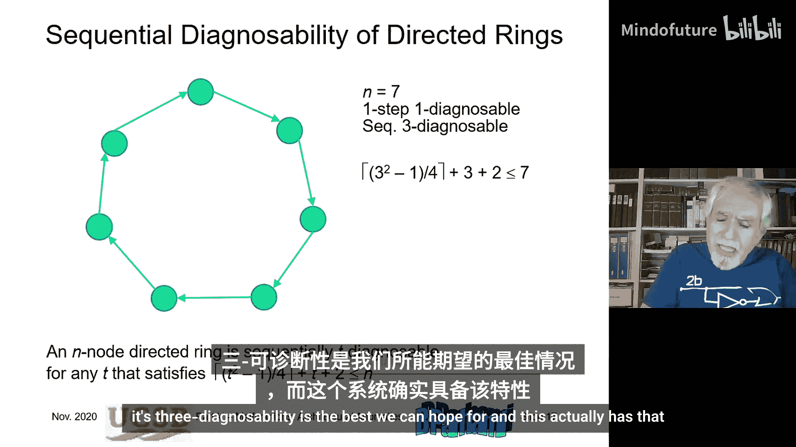

Okay， so this is basically sequential two diagnosibility of a five node ring。嗯。

I formed a syndrome table。No malfunction is all zero as I' have excluded that row M0 malfunctioning。

 this is the syndrome x means zero or1。M1 malfunctioning， M2 and3， M4， M0 or M1 malfunctioning。Okay。

 this syndrome is indistinguishable from M0。So that's why it's not the one step too diagnosable。

Because this first x can match that x， they can both be0 or1， this x can match that zero。

 this can be0。0，0，0，0，1，1。However， in both of these malfunction patterns， M0 is malfunctioning。

Therefore， even though these two are indistinguishable， they both tell me that N0 is malfunctioning。

So I can go ahead to remove M0， replace it with a good module and run the diagnostics again。

To find the second malfunctioning unit， if there is one。

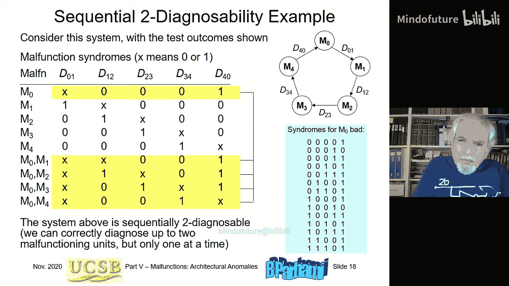

Okay， again， for sequential diagnosibility， we have analysis problems。And synthesis problem。

Given the directed graph， defining the test links find the largest value of T for which the system is sequentially tdiaaggnosable。

That's one analysis problem， given the directed graph and its associated test outcomes。

 identify at least one malfunctioning unit。Preferably more if you can do more。

 then obviously it's better because you need fewer step。At least one malfunctioning unit。

Assuming there are no more than t malfunctioning in it。And the synthesis problem as before。

 is specify the test links or connection assignment that makes an end unit system one step T diagnosal。

Again， the next slide。

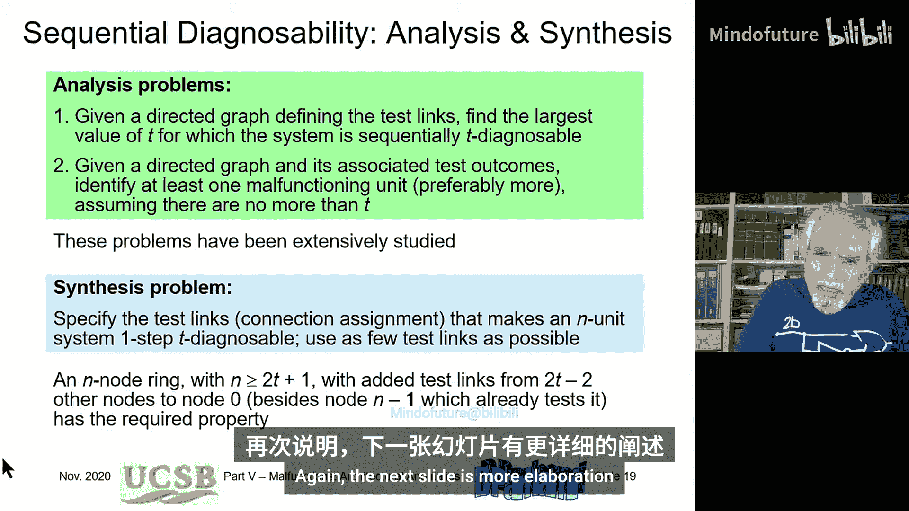

There's more elaboration。

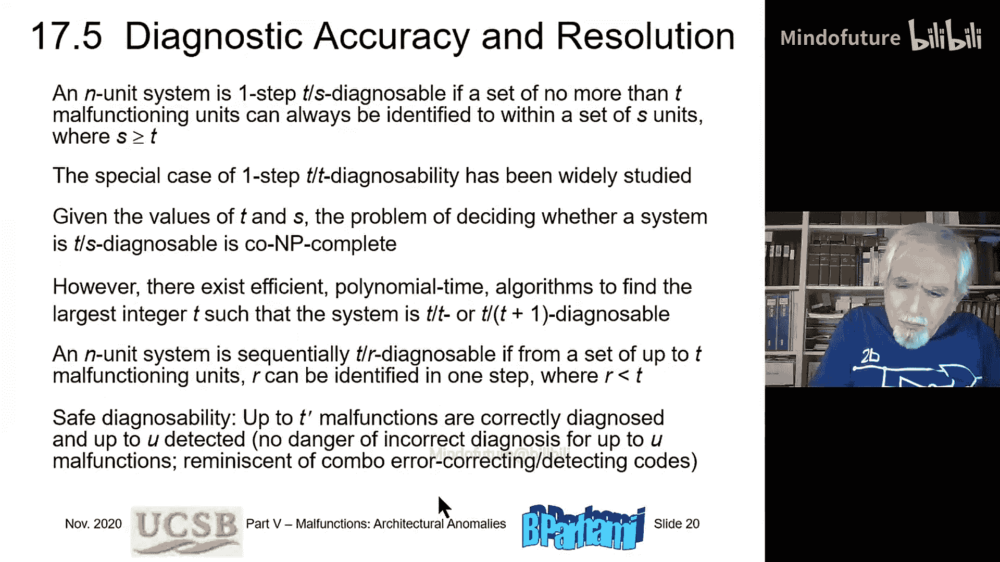

Oops。No， there's no other sorry， so an endnote ring。With。N greater than 2t plus1。

With added test links from 2 T minus2 other nodes to node zero。Okay， has the required property？Okay。

 I meant to include an actual diagram of this ring， but I forgot to do it， sorry。

So we know at least one architecture。That is sequentially T diagnosable， we may want to。Have other。诶。

Other test graphs that are more in line with the connections between modules that we already have in our system。

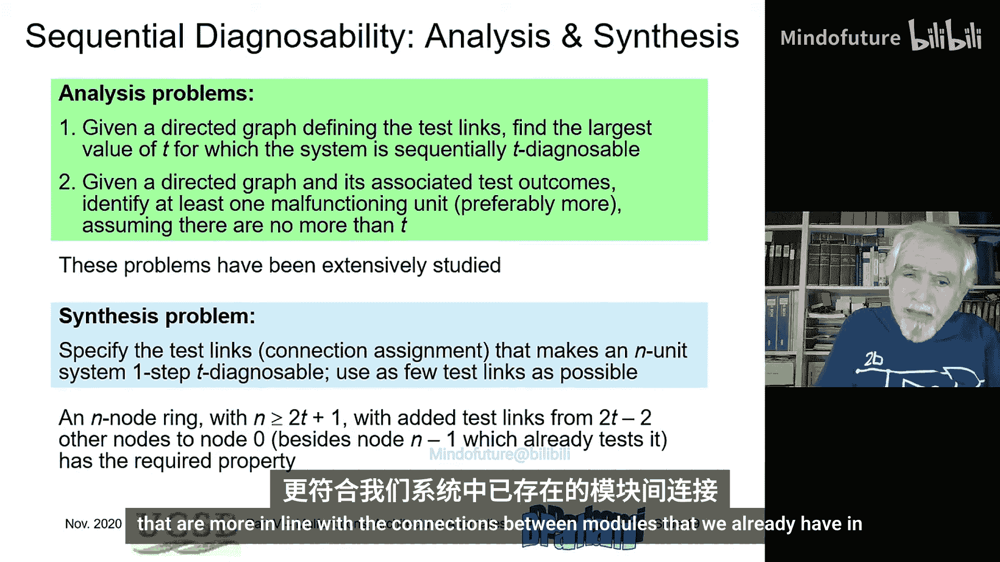

Okay， I'm going to skip this。Section about diagnostic accuracy， basically so far we。

Limited the diagnostic。Schemes to identifying bad modules， in other words， in one step anosibility。

 we identify all the bad modules。At once。In sequential diagnosibility， we identify。One bad modules。

 but there's no doubt that that module is bad and we remove it。So， if we are。Willing to allow。

Less accuracy， in other words， we say we want to have two diagnosability。

 but we are willing to sort of。Identify three modules。That have both of the bad modules。

But that's acceptable。And it's easier， we can sometimes guarantee two diagnosability。

We allow three modules to be removed。So in this case。

 one of the modules that is removed is a good module。

 so it's sort of viewed as wasteful that we remove three modules in order to guarantee。

To diagnosability。Then the other hand， the modules that are removed can be tested and if a module is good。

It can be returned to service later and not discarded。So it's really not wasteful in that sense。

It allows us to diagnose the system more conveniently Okay， so this is the idea if we are。

Willing to allow less accuracy in the diagnosis then we can do more。With diagnostic。Okay。

 there's a whole。诶。A bunch of papers in the literature that deal with diagnosibility of well known architectures。

Regular or irregular architectures。And you can look these up if you。For example。

 if you're using a cordo ring， then you can look up in the literature to see what people have discovered about the diagnosibility of cordo ring or hypercue。

Or。Forest networks and so on。

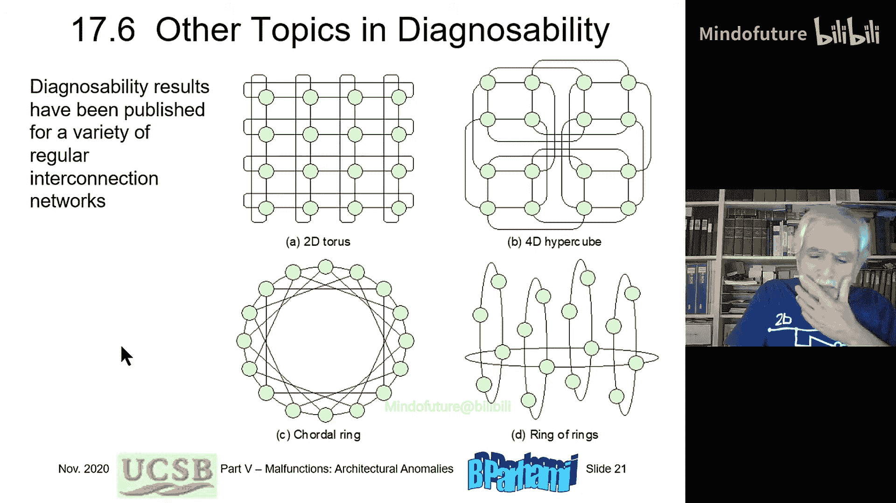

So what comes after malfunction diagnosis， so suppose you're diagnosed？The bad modules。

 the malfunctioning modules， what next？Well， I mentioned that you need to remove them。

 but how do you actually remove the modules？So usually removal is done through reconfiguration and that's the topic of。

诶。The next chapter that I'll cover。You have to。Recover state information from removed modules。

 so for example， if those modules have memories， you have to sort of preserve the memory contents。

Either from a backup copy or from the。Moduuleles themselves， if the memory has not been affected。

 the malfunction。You have to reassign tasks and reallocate data。

To other modules that will take the place of the malfunctioning module。

Sometimes you have to restart the computation from the last checkpoint or from scratch。

 we'll cover checkpointing in a later chapter。In a bus based system。

 we have to isolate the malfunctioning unit from the bus so that it doesn't cause trouble for the other remaining good modules。

Because if the unit is malfunctioning， it can do unpredictable things。

And therefore cause trouble on the bus that the good modules are using。Okay。

 in a system having point to point connectivity， we reconfigure by rearranging the connections。

In order to switch in spares and this what we'll talk about later。😔。

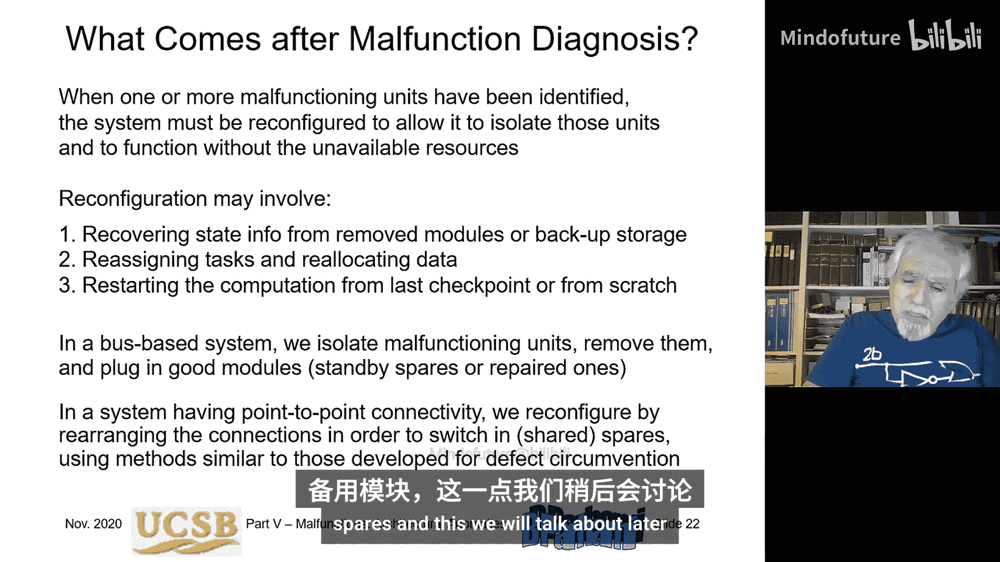

All right。So chapter 18 will be in the next lecture。So let me proceed to chapter 19。

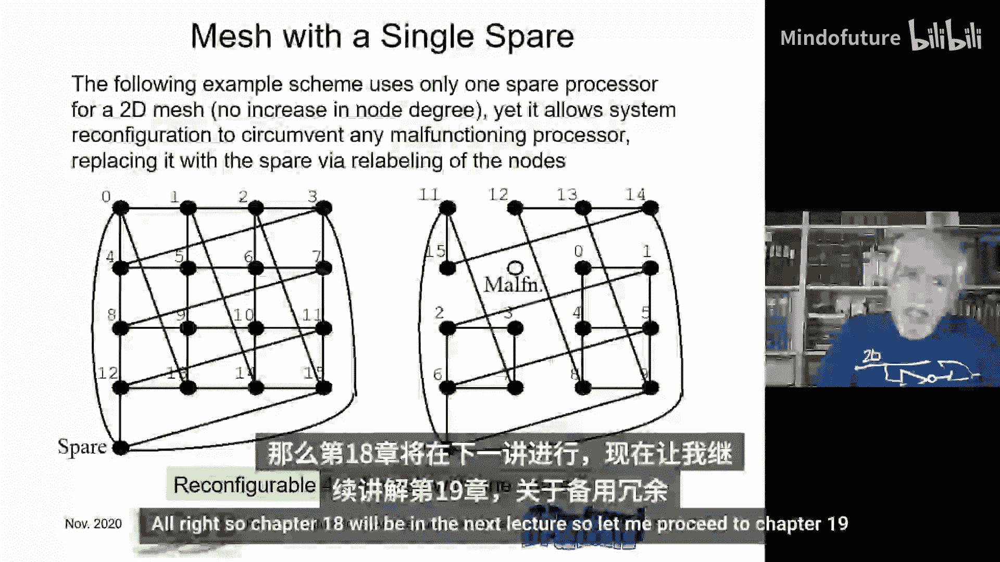

Standby redundancy。Okay， in order to use standby redundancy。

 meaning that you have an operating module and you have spares。That can take its place。

 you need to detect malfunctions okay， we just talked extensively about malfunction detection in a system。

So malfunction detection can be done through various methods， periodic testing is one of them。

So if you have a testing graph， periodically basically shut down the system and run your diagnostics and then determine which。

Moddules are bad and then do something about them， remove them。You can have self checking design。

 modules are self testing， self checking and self testing so that they can identify their own problems as they're running computations。

You can design modules to be malfunction stop or malfunctioned silent。

 meaning whenever something goes wrong with them， they basically shut down。So they don't mislead。

 they never mislead other units by sending。Corrupted data， bad data， they just shut down。

And that's basically a better situation than if they continue running。

And supply incorrect data to other parts of the system。

So malfunction stop operation is eventually detectable by a watchdog。So if you send， for example。

 a request to such a module that has shut down。And it doesn't respond after a certain。

Reasonable time period， then you assume that。That is malfunction。

So remember in all of these schemes that we have talked so far， we have discussed so far。

 malfunction detection comes with some delay， so if you do periodic testing depending on the period。

 you don't detect the malfunction right away okay。You have to wait until the next testing。F。

Until detecting the malfunction。If you have a malfunction， stop arrangement， then。

You may not detect the malfunction right away， but you will eventually detect。Okay。

And we can do coding。嗯。Coode the data， this is particularly suitable for memory and disc storage modules data is coded so whenever the coding。

As scheme is violated， you know that something is wrong。

So that's basically immediate detection of the malfunction。

And you can do monitoring and these are ad hoc schemes based on application and system dependent considerations so basically。

 for example， if a system the processor is connected to a bus。

You can have a unit a monitor looking at the bus。And then basically。

Determining that the processor is doing reasonable things on the bus sending addresses at receiving data。

And so on。And if it detects some sort of abnormal communication of behavior on the bus。

It assumes that something is wrong。 Of course， monitoring is not。100% foolproof。

But it can detect a large fraction of typical malfunctions。We can code control signals， for example。

Here you see。And microprogram control unit。Where micro instructions are read from the micro programgram memory。

And the micro instructionion is used to control。It contains control signals for the data path。

It also contains a field in this case， in this example， two bit。

That indicates which micro instruction should be fetched next， so one micro instruction is fetched。

It controls the system for one cycle。1 clock cycle。

And then it also determines the next micro instruction。

And the next micro instruction has four options。It can be micro instructionion zero。

 you basically go to the beginning of the microprogram。

It can be the next micro instruction in sequence， your basically micro programgram counter。

Incremented by one。That's so basically that's when you have multiple micro instructions in sequence。

Defining a particular instruction。Or it can come from。

Tables that's basically jump within your micropro and that those jumps can be instruction dependent。

So if you're executing an add instruction， for example， and you have done upper and fetch。

 then you go to a particular micro instruction to do the actual addition， if you're doing multiply。

 then you go to a different micro instruction。So the op code。

Deterines which entry of the ditch dispatch table。Dictates the next microin。Okay。

 so these are things that you should know from。Computer architecture。

The parts that are new here is that the micro instruction。Can be encoded by using check bits。

Make sure that the micro programgram memory content is not corrupted。Also。

 it may contain an address field in it so that when you fetch。

A micro instruction from a particular address， you can ascertain that it actually came from that address。

 in other words the decoder of this memory also worked correctly。

 so you compare this address to the address from which you fetched to make sure that you actually read correct。

A crane stretch。So you read the correct micro instructionion and that micro instruction has not been corrupted because you have check bits。

You have error codes there。

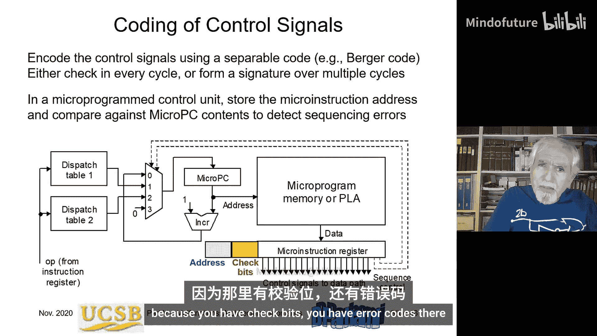

Okay， the next couple of slides basically lists a whole bunch of things that you can do。

In terms of monitoring。Using， say， watchdog timers。So for example， if a function unit does something。

And there should be a reaction to that thing within a certain time period。

 a watchdog timer can detect。At that time。Time limit has been exceeded and therefore something is wrong。

Okay， I won't go through the details of these two slides。

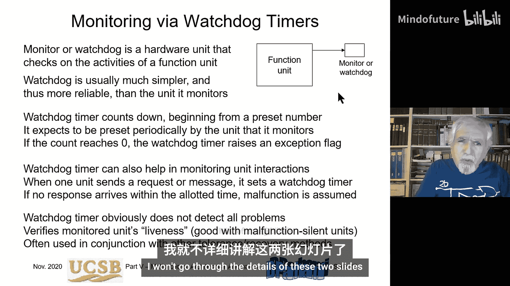

Also， activity monitorit can do similar things to check whether the activity of the function unit are reasonable or what we expect。

嗯。So for example， one of the things that can be done in practice is monitoring a program sequencing。

So when you write a program， that program consists of instructions that are executed in sequence。

And there are occasional branches or jumps。Okay， so if your program has a jump to a certain location。

The jump is executed that goes to a different location。

 a location that is unexpected that can be detected。So that is known as。

Program sequence monitoring so you monitor that the program is actually going through steps that you expect and those steps can be sequential execution of programs。

Or gems to specific。Locations。If there's a jump to an unexpected location， then something is wrong。

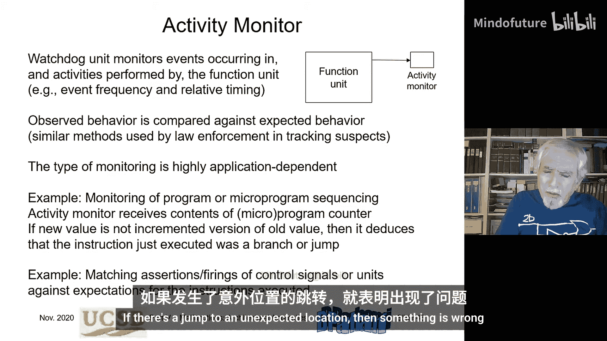

Okay。So when we use spare units， those spare units are some。Characerize as being hot spare unit。

 basically a spare unit that is running in parallel with the main function unit。And therefore。

 if a function unit malfunctions， this spare unit is completely ready to take over。

Because it was basically doing the same things as the main unit。

And therefore it's exactly in the same state as the main unit， that's a hot spare。

A cold spare basically is powered off。And therefore， if you need to bring it in。

 it has to be powered on， it has to be initialized with memory and other parts。

 program counter and everything initialized to the correct。

I use before it can step in and take over from the。Mlffunctioning unit， so this takes some time。

And therefore， it's less desirableable。But of course。

 it's more desirable in the sense that using less energy because it's powered off。And also。

Usually unit that is powered off has a lower failure rate， so it's less likely to fail。

In the powered off mode， then if you use it as a heart spare。😔。

Intermediate between cold and hot spares， we have warm spares， for example。

 a warm spare may be powered on， but it's not actually doing the same computations as the。

As the operational unit。You basically save energy because it doesn't undergo signal transitions and other。

嗯。What things that consume energy。Okay， there's nothing in this section yet。

Now when we talk about spares， the first thing that comes to our mind is some scheme like this where you have an active unit and there is one or two or more spares here。

For this you need an end to one switch。So that whenever this malfunctions。

 this unit malfunctions and it's detected here。By whatever means。

Then one of the spareion that steps in。By configuring the switch to use this output instead of this output。

Now this is a high redundancy scheme。And it's less desirable than low redundancy skin。

 so here's an example of a low redundancy skin。So here and I have a four by four array of processors。

And some of them can now function。But I don't want to provide 16 spare units so that each one of these has a dedicated spare unit。

I may choose to provide only four pairion in these grain circles。

So that this spare unit can replace any one of these four。

 so as long as only one of these units malfunctions。This spare unit can take over and so on。

So it's much less redundancy， there are only four spares for 16 units。Okay。

 so it's only 25% redundancy。Rather than 100% for one spare。However。There's a challenge here。Now。

 if I have a four by four processor or array。So that this processor is communicating with these three processors。

It has three neighbors， so to speak。Then if this one wants to take over for this one。

It'd better be able to communicate with this， with this， and with this。😔。

If it wants to take over for this one， better be able to communicate with this and this。

If it wants to take over for this one， additionally。

 it has to be able to communicate with this one and this one。And finally。

 if it wants to take over for this， should be able to communicate with this one。And this one。Okay。😊。

So this spare unit has to have a lot more communication link compared to the regular units in this so the maximum number of。

The links in this4 by four array is four。Whereas this spare unit unit must be able to connect to one。

 two， three。4，5，6，7，8 units。Okay， so this is a challenge because now the spare unit will not have the same design。

As the original unit。And furthermore。😔，You knowIt has to have eight communication ports which adds to its cost。

And energy consumption， and it has to be specially designed rather than just being。ARelica。

Of this or this， okay， so it's not trivial to do this kind of low redundancy sparing。Okay。

 this section again has nothing in it。And this section doesn't either。

 so that's basically all I want to say in this lecture。Next time we cover the remaining two chapters。

Part5。All right， bye for now， stay safe until the next lecture。

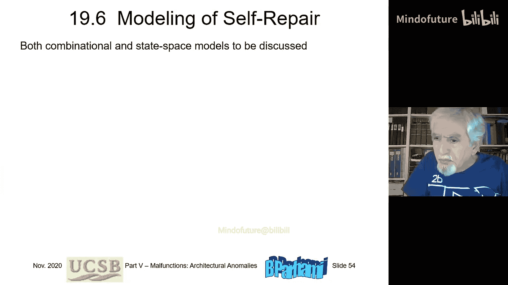