# 【加州大学】容错计算-｜-Fault-Tolerant-Computing-Ucsb-Ece-257A-p12-P12_第12讲_第18-20章_故障容忍--BV19cFyz8EPV_p12-

Hello and welcome to Lec 12 for the course ECE 257A。Falult， tolerant computing。This being lecture 12。

 and given that we have。16 lectures altogether， we are hitting the three quarters mark of the。

A course。Now， I hope you are making good progress。And you enjoying these lectures and learning from them。

Now today's lecture covers chapters 18。And 20。In the textbook。Malfunction tolerance in chapter 18。

And some of the methods of providing a function tolerance， some detailed methods in chapter 20。Okay。

 the malfunction tolerance is provided basically through system level reconfiguration method。

Just as we had malfunction diagnosis， which we also called system level fault diagnosis we have here reconfiguration at the system level。

As opposed to some of the reconfiguration schemes that we covered earlier。At the device level。

 for example。So here， the units being reconfigured are much more substantial in size and capability。

But the methods use are very similar to those that we use for defect tolerance， in fact。

 we will read。Examine some of those methods in the context of providing malfunction tolerance。

So a system from our point of view， consists of modular resources such as processors， memory banks。

 disk storage， network controllers and so on， and interconnects。

 interconnects are mechanisms for connecting all these resources together。

Now redundant resources can mitigate the effect of module functions。So if you have extra modules。

 you can tolerate， perhaps。诶。A small number of module malfunctions provided that you have provided you have。

Sort of supplied your system with the capability of reconfiguring around those malfunctioning units。

嗯。And of course， provided that malfunctions are properly diagnosed。

Because if you don't diagnose a malfunction， you don't know what is wrong with your system。Then。

No amount of reconfiguration capability is helpful。

 you have to know what you're trying to reconfigure around， you have to know where the functions are。

So in order to be able to tolerate malfunctions， one of the basic requirements is to have。

Multiple paths。From any source module to any destination module。

So here I've shown a four by four tourist network。A source node S and a destination node B。

And I've shown four different paths。Between S and D。The red part。

Because goes horizontally first from S and then vertically down to D。The blue pads。

It goes in the opposite order， it first goes down。Vertically。And then horizontally connects the D。

So those are two very obvious paths， but there are also the green and the brown pad。

 the green pad goes from S upwards。And then goes to the right to this corner。

And then use as one of these wraparound links to connect to。The brown pat。Goes this way。Then， down。

And wraps around to deep。Now in this particular example。

 all four paths that I've shown are of length for， this is not always the case。So。From S to D，123。

4 that's the red path， one，23，4 that's the blue path。1，2，3，4。 the green pad。1，2，3，4。

 That's the brown pad。So basically， if we have malfunctioning resources， let's say。

This particular node is malfunctioning so that I cannot use it to root。

Information from S toD and I can use one of the other three pads notice that these pads are what we call dis joint pads。

Sometimes we call them H disjoint paths or no disjoined paths or H and node disjoint paths。

Back in this case， the paths are。Note and edge this join， in other words， other than S and D。

 which are the source node and the destination node。

Which are obviously shared by all these paths because you're trying to send something from S toD。

This red pad does not use any of the nodes or length of the blue pad and similarly for all the other pads。

They're disjoint therefore if。A node malfunctions or an edge link malfunctions。

It can affect only one of these paths， okay the other three will remain available。

Another way of saying this is that node S， node S and D will not get disconnected。

When if you have a good three。How functionss。Because each malfunction at most in the worst case。

 can affect a different path。So for example。Let's say this node malfunctions。

Then maybe this edge malfunction。Then maybe this node malfunctions。

 and those three pads are unusable。But the brown pad that's still usable， okay， so this is tolerant。

To up to three malfunctions because there are four separate。

A node and edge destroyjoin paths between S and D。Of course。

 I just took one particular S and one particular D， the same can be said。For any other SD pairs。

 so for example， if I take S to be where it is now。But let's say D is now this。

Ex door neighbor to us。Then here is one path of length one。Here is one pad of length  three。😔。

Here's another pad of length 3。And then here's another part1。😔，2。😔，3。

So I have one path of length one， which is the shortest path and three paths of length three。Okay。

 so if this particular edge is now malfunctioning and I can't use it。

I pay in terms of performance because the path node that gets from S to this new D。ItWill be longer。

 it takes longer to send a message from S2D when this direct link is not available。Okay。

 so the existence of k edge destroy paths between two nodes。

Provides the means for tolerating k minus1 link malfunctions。

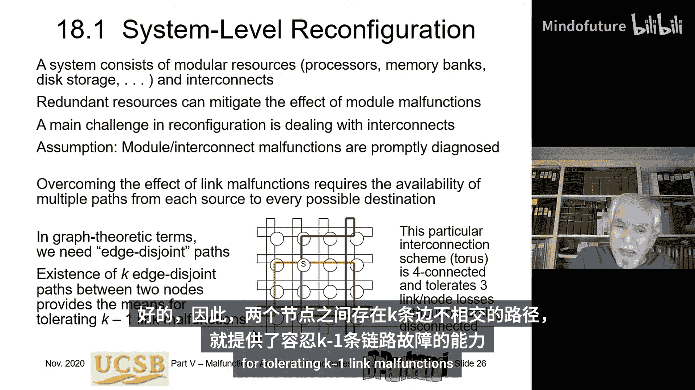

Okay， this is the reconfiguration scheme we talked about for defect。Tolerance or yield enhancement。

The same method can be used。To reconfigure。Processor array arrays in which the processors are basically more complex nodes。

 they're not just cells， logic cells， as we had before。Okay， so we in this example。

 I've shown some nodes are bypassed。And other nodes。

 basically pads are formed around effective nodes， so this defective node is bypassed in the column。

I'm assuming some mechanism there for bypassing the node other than these switches that are shown。

And then in that row。I simply use an alternate module。Instead of this。M malfunctioning module。Okay。

 and we talked about， you know， the conditions under which reconfiguration。Is possible。

And in particular mechanism for setting these switches。

 so this particular switch is set in this particular state。

How do we do that Well we do that either using a centralized reconfiguration unit that is sitting there and has access to all of these switches and sets them to。

The desire state when we need it。Or we can have。Each switch controlled by nearby module。

 so this switch， for example， can be controlled by maybe this one， this one and this module。

So any one of these three modules can control that particular switch。So， as long as the。

At least one of these modules is healthy。And those that are not healthy。

 we do know that they're not healthy and therefore we don't allow them to do anything。the switch。

 then we can set the state of the switch based on local control rather than centralized control。

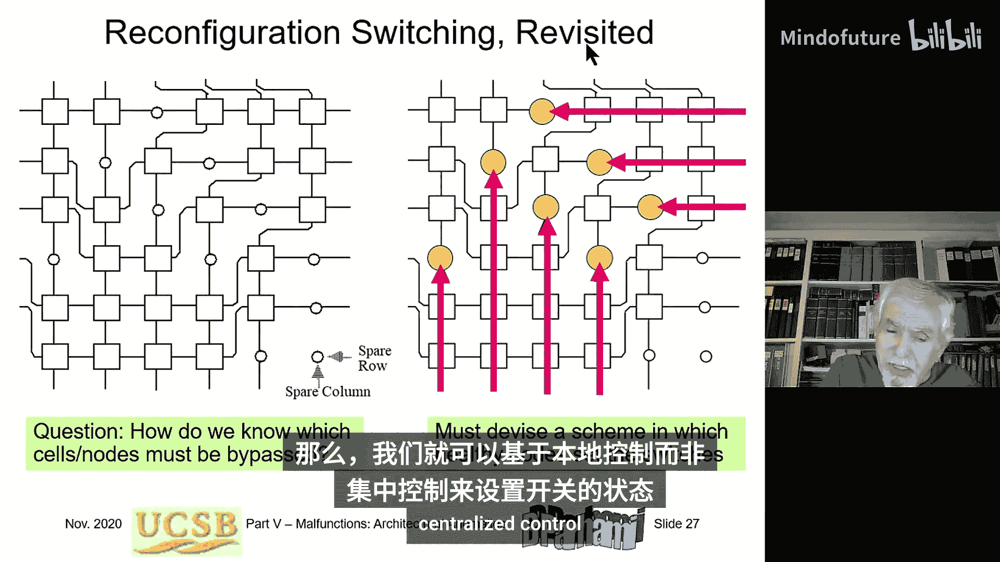

Okay， here's another idea for reconfiguration using programmable connections。

 this is very similar to what is done in FGAs。So， here are。Basically。

 node that we want to connect and we have a bunch of connections in this case。

 a bunch of vertical channels。And each port of these modules to be connected to each other。

Can be connected under program control to some of these channels。 So each of these heavy dots。

Represents a programmable connection in other we can program this connection to actually connect。

This horizontal wire to this vertical wire or just basically pass by without connecting。

So I have two options for this port one of this module。

It can connect to this vertical channel or it can connect to this vertical channel under program control。

Okay， so if I now want to connect this channel one of this module。

 port one of that module to port one of this module。Here is one way to do it。

 I program the switch to make connection。And then I programd this switch to make connection。

And therefore， the connection is made。Okay， now if this particular vertical channel。

Is not available because it's malfunctioning。Then there's no way in this particular scheme shown to connect port one of this module to port one of this module because port one。

Is connected to vertical wire 1， vertical wire 2， port one here is connected to vertical wire 1。

 vertical connectable， I should say。Under program control。

 so if this vertical while1 is not available， then there's no way to connect one to one。

Okay so the most flexibility obviously results when each of these ports can connect to everyone。

Of these vertical channels， in that case have the most flexibility， but on the other hand。

 I will have more programmable switches that increases the cost。

And also the time required to set all of those switches。Okay。

 so it's a trade off between flexibility， the more connections I have， the more flexible。

But also the more the cost。And also the time needed to set the larger number up。Sageches。Okay。

 similarly， I've shown port two of this module。Connected for two of this module。

Through this third vertical wire。Again， if the third vertical wire is not available。

 then this connection from2 to2 cannot be made。Because that's the only vertical wire where this shared in the connections。

Okay， when I have a malfunctioning unit， one of the things I have to ensure？

Before the rest of the system can continue operation。Is to isolate that malfunctioning unit。

 and this is particularly critical if I use a bus for communication between multiple modules。

But for all my modules are connected to a bus， the particular module is malfunctioning。

 I really don't want that module to remain connected to the bus。Because it's malfunctioning。

 you know its behavior is uncontrolled and therefore it can cause problems。

The bus where other units are trying to communicate。

So one idea that came from a Stanford project called SiF in the 1970s。

 software implemented fault tolerance。Is to。Allow a module to connect to a bus only if it has permission from two other modules。

 so basically the idea is that if this module is malfunctioning。

Then it's unlikely that both of these other two modules are also malfunctioning。So if this module。

Get permission from module 1 and module 2。Then it can connect to the bus in other words。

 this signal zero if there is no permission from one or the other， but if both of these allow。

The unit to connect to the bus both of these signals are asserted。

And an inserted signal value here will simply pass through and will affect the bus。

So the idea here is a malfunctioning module。Is isolated from the bus。

As long as at least one of these two units that give it permission are okay and therefore prevent it from。

Connecting to the bus。So these are known as bus guardians， so for each module。In this scheme。

 we have two bus guardians， unit one and unit two， sorry。

That have to issue permission for this unit to be able to connect to the bus。

Here's another idea when a unit needs to connect a bus。So the connection to the bus is the right。

Add through this gate and the re pad through this gate。

So when a module wants to write something to the bus， put something on the bus。

 the right enable signal will be asserted。And the value to be written is given on this bus set of lines。

 so the heavier lines basically represent multiple wires。But in order to。

This data to go through to the bus， we need of course， write the enable。

But we also need this connection flipflop to be set so that this signal is asserted。In other words。

 this flipflop being set enables this module to communicate with the bus。That flipfl is a reset。

Then this module cannot put anything on the bus。Ifq is 0。And similarly。

 it cannot read anything from the bus。Okay， of course， reading， you might say。

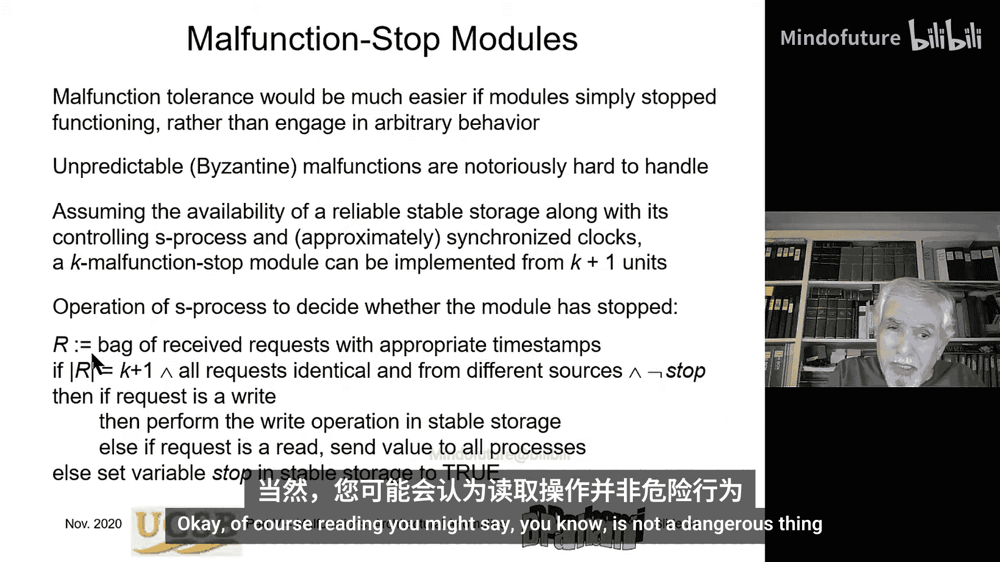

You know， it's not a dangerous thing， it may be if you're trying to protect user information from a malfunction。

 so the module is malfunctioning because it has been compromised。

Because some hackers have taken control of it。We don't want that module to read from the bus either。

 okay？So both the read function and the right function。Are disabled by。Resetting this flip plot。

As long as this flip fl remains reset。No communication with the bus is possible。

From this module that is malfunctioning or is suspected。To be malfunction。

But each of those programmable connections that we talked about before basically is a circuit such as this one。

Okay， so we set this flip fl in order to allow an activity to disperse。

 we reset this flip fl in order to disconnect。The module from the bus。

So in order to do reliability analysis for such a system。We basically say， okay。

 the bus is a critical part。If you have particular if you have a single bus。

 then that bus must be functional。In order for the system to work。

 also all the logic that you see within the circle must be functional。

So you lump all of this logic for different units with a bus。And assign it a reliability。

And then the modules themselves may be less critical， so for example。

 you may have 10 modules and you need maybe only eight of them to be operational。

In order for the system to work correctly。At the performance level that you want。Therefore。

 that would be an eight out of 10 system， whereas the bus and all the control logic associated with it will be part of the critical core of the system。

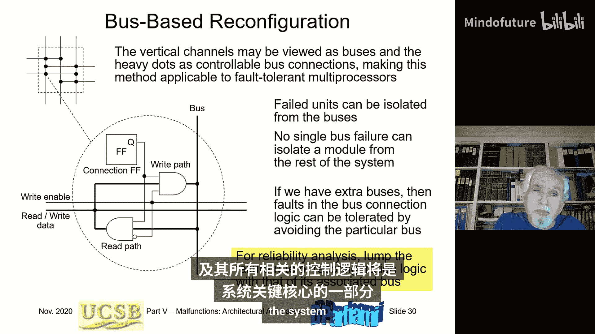

Okay， one idea that。Has been discussed， although it's seldom actually implemented because it involves high redundancy。

It provides high level of safety。This malfunction stop module。

 these are modules that basically detect their own malfunctions and stop operating。

 stop communicating with the external world whenever they detect that malfunction， so they stop。Okay。

 they become silent。Oh看。if you want to。Design。A unit。It can tolerate K malfunction。And it stops。

Without basically producing dangerous results for the external parts of the system。

Here's one way to do it。You have K+1 units。And these K+ one units basically cooperate。

And must agree on the function in order to be able to make changes in the。Stable storage。

 stable storage is a permanent storage where data is kept。And。If there is a malfunction。

 you don't want your stable storage to be affected。

You want to store things in that stable storage only if you're sure。That the results are correct。

So there's an S process。Okay， I've taken this name from the reference， so this is discussed。

 there is an S process。That decides whether the module has stopped or should stop， actually。

 we should say。So a bunch of requests are given to this S process。

If the number of requests is K+ one， in other words， all K+ one parts。Are submitting requests。

And all of the requests are identical and are coming from different sources。

So basically all K plus one units。The replicated units decide to do something and they agree about what to do all requests are identical。

And this stop variable in the stable storage is not set。In other words， it's false。

 the stop variable is false， in other words， the system has not stopped。

Then if the request is a right， then perform the right operation and stable storage。

If it requests a read， then send the value to all the requesting processes。Otherwise， in other words。

 if this is not true。Seit the variable stuff and stable storage to true。

 so from this point on this module。Become silent， it won't respond to any request。

 it won't change anything in the stable storage。And therefore， it's a sort of fail safe mechanism。

Okay， so if you want to tolerate one malfunction k equal to1， you will have two units。

 both of the units must agree。In order to be able to do something and change something in the stable storage。

 if they disagree， so for example， one of them submits a request， but the other one doesn't。

Or the requests that they submit are not identical。Okay。

 then the stop variable will be set to true and the module will not。

Will not respond to any requests from that point on。

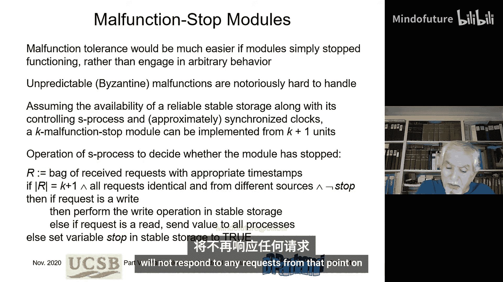

Okay， one of the things we need to do once a malfunction occurs。

And a module must be taken out of service and replaced by a spare。

Is to recover the data and state information。The module that malfunction and is going out so that the incoming module can be set to the same initial state with the same data in order to continue。

Operations as if nothing happened， okay？And for this， one of the common mechanisms， in fact。

 the most common mechanism that is used， the use of logs。So how do logs work？

Logs basically record changes that we make to a particular。Set of data database and stable storage。

Okay， so as we make changes to data and stable storage。

 we make a record of the change made and timestamp that change。So that if we have to go back。

You know， a malfunction occurs midway through doing some computation。

We have to go back and reverse all the changes that were made because those are partial changes。

The process， the transaction was not completed， therefore， we don't want partial changes to。

To remain there， we want to reverse them。And we construct the log in order to allow that to happen and we say。

 okay， the last thing we did to this database was to replace the value of x。From four to five。

So we go back and change it back to four。And similarly。

 we go back through the entries of the log and reverse everything that was done and return the state of the database to the original state before。

This partial transaction started。And then we perhaps restart the transaction on a different unit so that it can this time hopefully complete that transaction。

So logs are required for undoing the effects of incomplete transactions。

And redoing transactions whose effects are not reflected in stable storage。

So we have done the transaction， but we have not yet recorded the effect of that transaction in stable storage。

 we have to redo that so that this time the data goes to stable storage。

So logs maintain redundant information。Of course， they have to maintain it in stable storage so that if something goes wrong。

 we don't lose logs， the logs are permanent。Okay， one type of log is the so called right ahead log。

It basically requires that a transaction before performing changes。

To write an undo log entry before it overritedes an object in stable storage。Okay。

 so the idea here is that you can't go and make the change。And then produce a log entry afterwards。

That tells you how to reverse that change because there's a possibility that you made the change and before you write the log log entry。

The unit malfunctions。So you made the change and you did not create the log entry。

 therefore the change will not be reversed okay， so the idea is that the log entry must be created before the change is actually made。

So that if something goes wrong after the change is made， the log entry is already there。

So it's not safe to write blog after overwriting or committing a transaction。Now。

 Microsoft and other major companies that deal with databases have been doing research for many years。

That to allow。Qurying a database on its state at any desired time instant in the past。

 so imagine you have a database of， let's say students at UCSB。

I have all the current information for students at UCSB。

Every time information for a student changes or a new student enters the system。

 the database changes， it's always up to date okay。

Now imagine for some reason you want to know what was in this database， maybe exactly on October 1t。

 2020， what was the state of the database， you have a question about you know students that were in the database or information about them at that time。

Well， one way to do it is to keep logs， of course。But that will be a lot of overhead。

 so every time you make a change in the database。Create a log entry。Okay。And therefore。

 if you want to go back from today to October 1st， 2020， you go to those logs。And reverse。

All the changes that were made between that date and now， and then you have， of course。

 you would make that on a copy of the database so that you don't destroy the current state。

So you have now the database as it existed on that particular date okay。

 so the aim of research in this area is to do this more efficiently so that you don't have to spend a lot of time。

Consulting logs and reversing a lot of changes in order to get to the state of the database。

The particular time in the past。So it's nice if you have this capability。

 if you have a database and you can query the database。At any particular date in the past。

Then that's a useful capability to have。

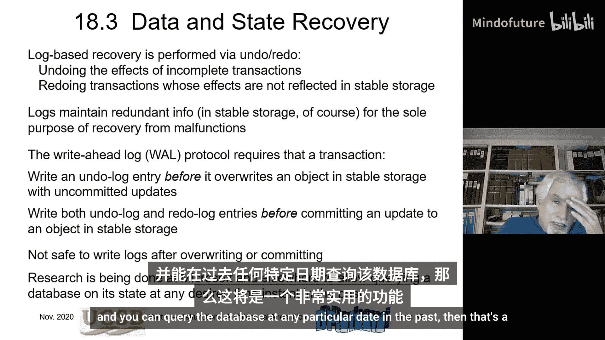

Okay， let's talk a little bit about regular arrays of modules and this discussion basically parallels what we did for reconfiguration。

 for defect tolerance or yield enhancement。So here is。

 I'll show you some examples of reconfiguration。Here I've shown a mechanism that allows you to bypass entire rows。

Of processors quite easily。Basically， these multiplexors allow this row of module。

To send their values to this row of modules。Or。Proper setting of this control signal。

 this row is bypassed and the values go。To this row further down。Okay。

 so setting the signal of the signal controlling all of these multiplexors are controlled。

By the same signal。That signal is set to zero。Then this row is not bypassed。

 that signal is set to one， then this row is bypass。

So allowing bypassing of rows and columns allows you to。Circuumvent。Some malfunctioning unit。

Of course， it's a little bit wasteful because if you have just one malfunction in this row。

Then you are forced to bypass the entire row， even though there are good modules in there。

 but this is a very simple。Switching mechanism。And so this is just for the downward propagation of signals。

 you have a similar bypass mechanism for upward goinging signals。

 for rightward goinging signals and leftward going signals。

 and therefore the module will look like this with four multiplexors allowing。

This row be bypassed in the downward direction。To be bypassed in the upward direction。

The column to be bypassed in the leftward direction or bypassed in the right word direction。

So you have some complexity in the switching。Mechanism needed to allow。

These rows and columns to be bypassed。Of course， that complexity is less when you。

Bypass entire rows and entire columns is less than if you try to bypass individual。It single notes。

Okay， we also。Connection with memory， we said that。

If we have the defect memory cells and we have spare rows and spare columns。Then we can reassign。

So for example， here we can say， okay， this row。Will be replaced by one of the sparearrows。

 this row will be replaced by another sparearrow。Then what we are left with are these three defective cells。

 then this column and this column so we are allowed we are able to。

Reconfigure around those defective memory cells and we talked about an algorithm we're doing that the exact same thing can be applied to processor。

Arayse， so if this is a processor array rather than a memory array and you have malfunctioning processors。

And you have spare columns and spare rows， then you can use the exact same algorithm。

In order to reconfigure。李ray。Okay， still more examples， this is what happens in FPGAs。

 you have what are known as switch boxeses。And sweet boxes allow programmable connections which mean。

 let's say vertical。Wires and horizontal wires。😔，And。Basically。

 the possible connections is that the law coming in。Can go straight through to the other side。

 that's one option。It can turn right。And connect this wire right turn。Or it can turn left。

And connect to this wire， so this particular switch。Buse。

Three different connections as well as no connection。

 so this may not be connected to anything that's one option。It can be connected straight through。

Another option， it can do a right turn。Or it can do a leftdown for this particular switch， okay？

There are more complex switches with many more channels coming in and going out。

And there are more options for connectivity。In this case， you need two bits， two control bits。

To control the connectivity of this。我也。Okay， so how many control bits altogether？

We actually need only8 control bit。Even though there are eight channels that needs to be controlled。

 once you say that this one makes a right turn and connects to this one。

 you're also effectively saying that this line makes a left turn and connects to this one。

 so we need half as many signals， eight controlled。Okay。

 so here I've shown the switch box settings to connect this port one of this module。

To port one of this module。So you see both of these boxes are programmed to send the signal straight through。

And then pour two of this module。So I have a left turn in this box。I have a right turn in this box。

And I have a left turn in this box。And these are also programmable connections。

 so this port is connected to this horizontal wire and not this one。Okay。

 so the same ideas that are used in FPGAs here we are interested in。

 so theres some logic function implemented in this box。Some other logic function here。

 and we want one output of this box to be an input to this box so we make connection。

The same can be done by for if these are processors。And we have switch boxes。

sittingitting here that can connect processors in different ways in order to get around malfunctioning processor。

 so ideas are similar。嗯。Okay so these are the switches that we have seen before except that this is a little bit different。

 the switches that we saw before had two states straight and bent。

 these switches have two types of bent states。This kind of bent。And this kind of bent。

 so there are three state switches。And if I put two tracks of such switches between rows and columns of processors。

I don't worry about you know how the design of this， where the switches are placed。

 how did we decide that， somebody came up with this design， but once the switches are in place。

 then they can be used to bypass。Say this processor， notice that we are not bypassing the entire row。

 but just this processor is bypassing its row。This processor。Is replaced。

With this processor in the row， so the row consisted of this processor and this one and some more。

 now it consists of this processor， this one and some more。Okay， so these are two tracks of switches。

嗯。This is the same two track set of switches。Here we need a four by four processor array。

And we provide two spare rows。And two spare columns in order to be able to tolerate the effect。

Have malfunctions in some of the。 So these white。With heavy borders。

 what squares with heavy borders on malfunctioning， processors， and they have been replaced。

So for example， and notice this one， this column。Has only three processors left。Okay。

 so we are using both this pair and this pair。So here's one。😔，2。Bypass three， four for that column。

And similarly for row by passing， so this is the two track switches that we have not discussed much。

 this is the one track switches that we talked about in detail when we discussed defect tolerance。

And here you notice that this particular switch is in this bent state。And therefore。

This processor instead of being connected to this one in the row。

Annects to that one and the row continues up here。Okay， similarly， this last row。Those。Through 1，2，3。

4our。And then the white boxes with regular borders， not the heavy borders， they're just bypassed。

They are unused units。

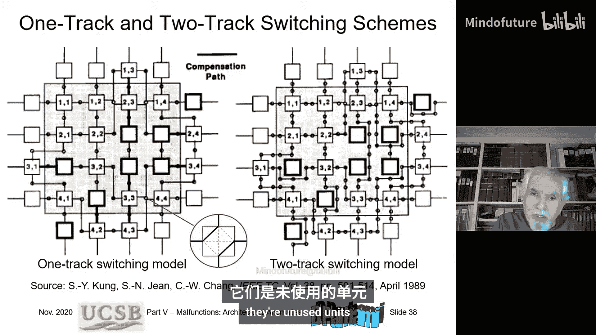

Okay， so the heavy borders represent。Mfunctioning processors and the regular borders represent just unused processors that are。

They passed。Their respective row column。So this is known as the one track switching model because there's one track of switches between rows and between columns of processors。

The particular two tracks， there are other variations of the scheme。

In different ways of using the switches in two tracks， there are two tracks of switches。

 two lines of switches between rows and between columns。Okay。

 we talked a little bit last time about low redundancy sparing and I mentioned at that time that if you have 16 units and you don't want to use 16 spares so that each unit has its own dedicated spare。

 you may decide to use。Perhaps just four spares that are shared， so for example。

 this one spare shared in these four。MolesSo as long as no more than one of these modules is malfunctioning。

And this pair can replace it， however， I mentioned that in order for this spare to be able to replace this module。

Should be able to communicate with this one because that one communicated。

Should be able to communicate with this one。And with this one。

 all three neighbors of the original note。As well as neighbors of the other notes that it can possibly replace。

So it has to be able to communicate with eight notes， the potential neighbors。

Of the node being replaced。Let's see， is it eight， one， two， three？4our， five， six， seven。

 eight yeah。Because this note does this name。Hey notes。Whereas this regular node。

Communicate with only four at most。Okay。So the spares become more complex and different from the regular mode。

Sometimes we get lucky and we can come up with a method。It is both low redundancy。

And it uses a spare that is identical to。The existing modules。And this is sort of a， you know， it's。

And a case by case basis， you know， you have to study the architecture you're trying to implement and see if you can come up with a scheme。

 low redundancy scheme that works so here。The objective was to have a four by four mesh。

So these are the 16 notes。4our by four mesh。So as long as there is no malfunctioning unit。

 this  four by four meshH works， but we also provide additional connections。

That are not required in the4 by4 mesh， and we also provide one spare unit。Okay。

 notice that the additional connections。Does not increase the complexity of the modules。

 in other words， the modules that we were using。Have four ports like this unit five has four ports。

B at six has four ports。Unit1 has only three ports in the mesh， but if we use identical modules。

 that other port there is unused， so we use that unused port to connect it to here and this one also has an unused port okay。

So luckily we are able to use the unused ports， so each of these edgech processors has one unused port。

 each of the corner processors has two unused ports。And in this case。

 I've used those two pos to make this connection and disconnect connection。

And the spare also has four ports， so this has the nice property that all the modules are identical。

 they are processors with four ports。Under normal conditions， these diagonal connections。

And these extra connections and the spare unit are not used because the 16 original units。

Are functional and therefore we are okay。This system can be reconfigured after one malfunction。

 obviously we can do more than one because we have just one spare。Okay， how do we do this。

 let's say this unit here， unit originally number five。Malfunctions and we want to remove it。

So what we do remember the other。Moduleles， the other processing nodes。In the following way。So0，1，2。

3 was the first row。It is 0，1，2，3。So I've restored the first row by using。These existing connections。

Then  four5，6，7， here it is  four，5，6，7。Eight， nine，10，11。8，9。10。11。So that role also exists。

By using these alternate connections， then 12， 13， 14， 15， it is 12， 13， 14， 15。

So all the rows that originally existed are still there except I'm using。

Different nodes for the rows and different connections for the， similarly for the column， 04812。

Here it is zero，4，8，12。And so on。So this system can be reconfigured。Of course。

 the reconfiguration is substantial， you have to rener all the processors。

But this reconfigured system。Can carry out all the algorithms that used to run in a 4 by four mesh because this is also essentially a4 by4 mesh。

 and therefore it can do whatever the original system did。As I mentioned， this is， you know。

 sheer luck and also ingenuity on the part of the designers to be able to come up with the scheme so that you can use a very low redundancy scheme just one pair。

And furthermore， the spare and all the node are identical in terms of their capabilities。

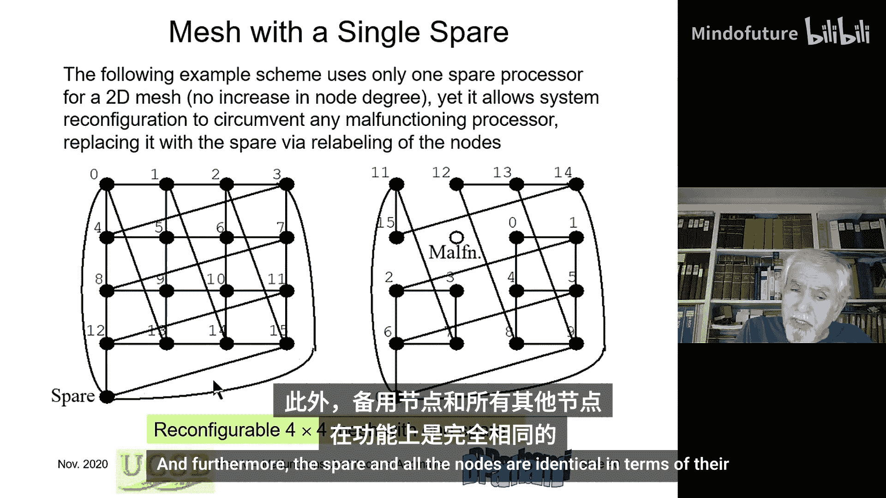

So this does not generalize to other architectures， we have to sit down and think。

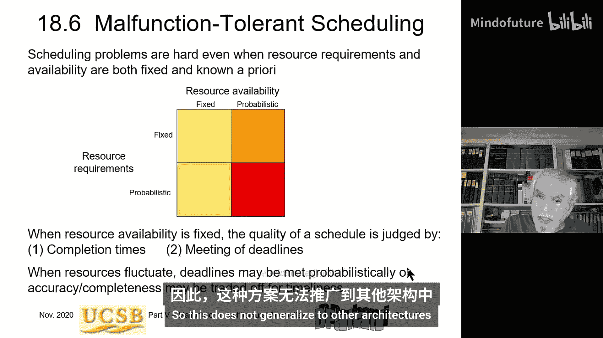

For each architecture， whether this can be done， even if you can't do it as nicely as this one。

 perhaps you can do it with a little bit more redundancy。

 but not quite the type of difficulties that we encountered here。

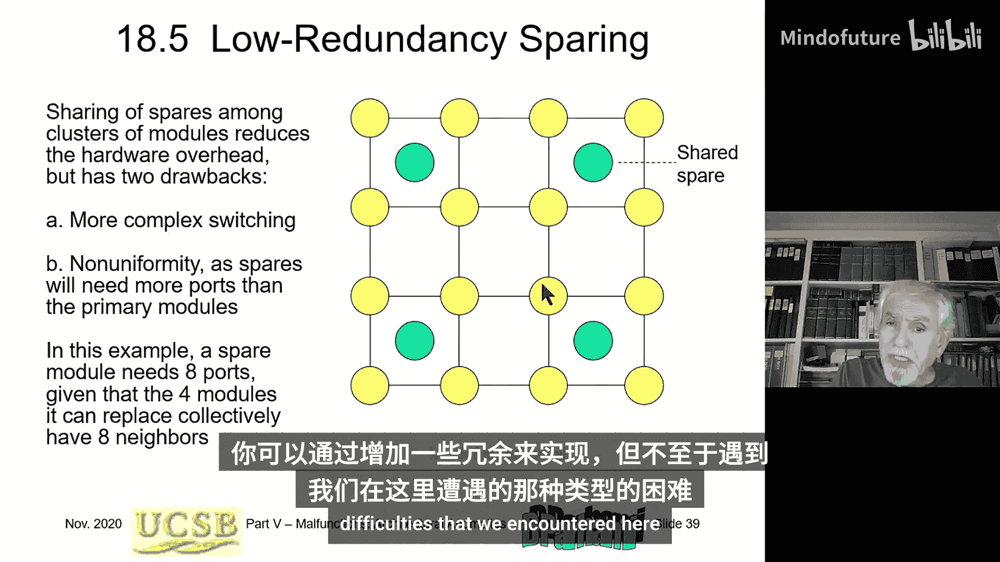

Okay。The final section。If this chapter is about scheduling。

 I won't talk much about scheduling except to categorize the problems that we encounter if we allow。

This type of reconfiguration for malfunction tolerant。

So scheduling basically means you have a set of resources， processors。

And a set of tasks that you need to run。And then you assign the tasks to the processes。

So if the tasks to be assigned and their interactions are fixed， no ahead of time。

And your processing resources are fixed。This is the simplest case of scheduling so I've using I'm using light color for simple darker color for more difficult now even in this case many scheduling problems are still MP hard so when I say they're simpler and speaking in relative terms relative to these other ones okay。

So now if the resource requirements are probabilistic， so we don't know ahead of time。

What resources are needed or even what tasks are going to be run because tasks as they execute。

 they create other tasks subtask， so ahead of time we don't know the exact number and nature of tasks。

We are faced with this probabilistic and then scheduling becomes more difficult。Now。

 if resources also fluctuate because we have these malfunctions。

And parts of the system suddenly become unavailable。In a probabilistic fashion。

 then scheduling becomes still harder。And finally， the hardest case when we have both。诶。

Changing resource requirements and changing resource availability。

 so basically we have very little knowledge ahead of time。

About the tasks that are going to be run and the resources that will be available to run them and then scheduling becomes extremely difficult。

So in this case， it's where resource availability is probabilistic。

We often cannot guarantee minimal completion times。Or meeting of all the deadlines。

Because we simply may not have enough resources to meet all the deadlines for the various task。

But in such cases， as we often can use probabilistic guarantees。So for example。

 we can say something to the effect that 95% probability， this scheduling scheme。

Meetets the deadlines for the tasks that are being executed。

So when you go to probabilistic resources， all the guarantees in terms of completion times and meeting of deadlines。

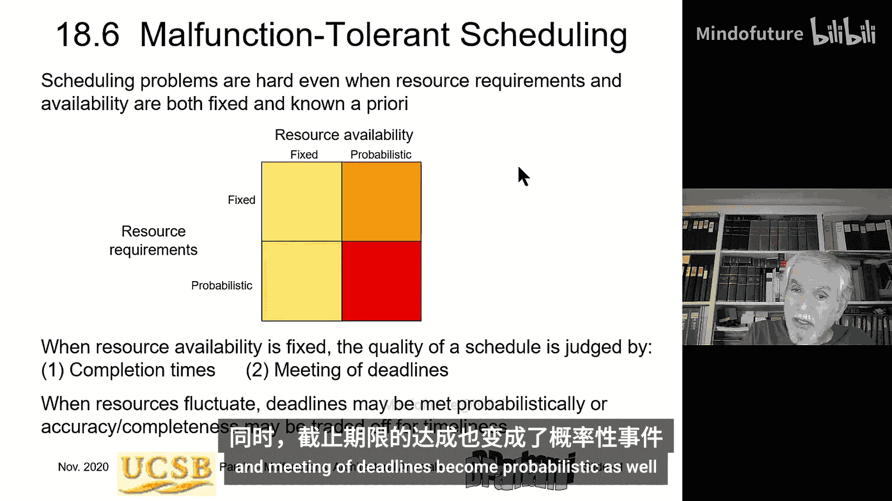

Become probabilistic as well。Okay。So， let me now move to chapter 20。And continue our discussion。

Chapter 20 is entitledRo Para Pro。It will become clear in the first few slides。

What do I mean by a robust panel process？Now， so far， in many of our examples。

 we have talked about normal modules， operating modules， and spare modules。

So spare modules are sitting on the side， and then they enter operation whenever the normal module。

The active module。Moduuleles malfunction and have to be taken。Out of service， okay？Now。

 empirical processing。We basically。Have a bunch of resources。

And we may decide simply not to provide any spares， so if I have this three by three mesh。

If I don't provide any spares and let's say this processor is zero malfunction。

 and I have to take it out。Of course I now have what is known as an incomplete mesh。However。

 if in executing the parallel programs， I don't rely on that complete three by three mesh。

 I simply view these processors as resources。That can run tasks and can communicate with each other okay。

 I have p0 malfunctions and I take it out and isolate it from the other unit。Now。

I still have eight processors， I have fewer resources。

 I can still execute tasks and I can still communicate between those processors。

In some cases with more difficulty， so for example， if I want to communicate between P1 and P3。

 I used to have two communication， two shortest paths。

And now' have only one shortestpat and if that shortpat happens to be congested because of a lot of other。

Communications， then communication between P1 and P3 may be late so this is the idea resources are not divided into normal operating modules and spares。

Everything is in there at once。So maybe we only needed processing power of eight processors。

 we built this nine processor system so that if one of them allfunction and we take it out of service。

 we still have enough processing powers and enough communication capability between the remaining processors。

 in order to accomplish the tasks。That the system needs to do with reasonable performance。

So if now a second processor malfunction， let's say p0 malfunction， p4 also malfunctions。

 what happens now？Then the remaining system is P1。P2 p5。P 8， p7， p6 p3。

And communication becomes severely limited because it's basically a linear array。Prosors。But still。

 you know， some more critical tasks can be scheduled and executed and perhaps other tasks that are less critical may be ignored because we don't have enough。

Processing power to execute everything。So the system still。Operates at a much lower performance。

 okay， so this is the idea of robust parallel processing。Of course。

 if we want to have this capability， we better design our system to have this robustness built in so here for example。

If one unit。All functions。The remaining units still。😔，Remain connected。Okay。😊。

Now if two units malfunction， let's say P1 and P3。And p0 basically becomes。

Isolated from the rest of the system because of P1 and P3 are not working。

P0 cannot communicate with the rest of the system。So the robustness of this system is just enough to be able to tolerate one malfunction。

Two malfunctions sometimes may be tolerated， for example。

 the previous example when I say p0 and P4 malfunction。But if I'm unlucky in P1 and P3 malfunction。

 then。Basically， I lose。The use of zero as well。 Now， this is a very bad。

Architecture with respect to robustness， the tree architecture is good from the point of view of executing certain algorithms efficiently。

But it's terrible with respect to robustness。If p0 malfunctions and I have to remove it。

 the two sides of the tree。Become disconnected。If this link malfunctions and I have to。

 I can't use it again， there's this connection。Okay， this one， on the other hand， is pretty robust。

As we will see later。So robustness requires among other things。

 is to have multiple processing resources， in fact， more resources。And is absolutely needed。

And also multiple alternate paths between these resources， so a tree。

 one of the reasons it's not good is that there's a unique path between node。

 so if I want to communicate1 p0 to p4 there is just this one path。32 P1。We want to P 0 P 0 to P4。

And if anything goes wrong along that path， then that connection cannot be established。Okay。

 here we are not interested in the type of communication， whether it' packet switching。

 store or store and forward communication， virtual cut through， warmhor routineuting。

These are protocols for communication that if you take the course parallel processing。

 we discuss them there， but fear from the point of view of this discussion。

 we are just interested in connectivity。If connectivity exists between two nodes。

 then we can send messages between the two。There we are using store and forward communication。

 or horse switching， and so on。

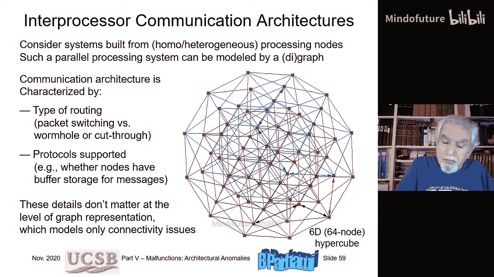

So these are some parameters of an interconnection networks， network that are relevant to。

It's robotsness and malfunction tolerance， the network size P。The more processors you have。

 of course， the more robust because you can afford to lose。

More processors and still have substantial processing capability left。

No degree or sometimes maximum node degree if no degree is not uniform， so in the case of this mesh。

 no degree is not uniform because we have a node of degree 4， we have nodes of degree 3。

 we have nodes of degree2 at the corners。So the maximum。No degree is4， minimum， no degree is2 here。

The diameter is basically the distance， the worst case distance between two nodes。

The diameter in this example is four。So I'm going from p0 to P8 to the other corner。

You have to go one， two， three，4 step and that's the worst case， so the diameter is4。

 that's basically a measure of the worst case communication latency。

 so communication between P0 and P1 is faster than between p0 and p8。

An average inter node distance often designated as deelta is the average message latency。

 so we have some pairs of nodes that are distance one from each other。

 we have some pairs of node that are distance two like this one， then we have distance three。

And we have distance four if you average all of those paths。You get the average internal distance。

And that's basically an indicator for the average communication lant。

Byissection width of bisection bandwidth is basically how many links do you need to cut in order to bisect。

 divide the architecture into two equal parts or almost equal parts in this case we have because I have nine nodes。

I can't divide it into exactly equal parts， so if I cut one， two， three， four links。

I can divide this。Into a part that has four nodes and another part that has five nodes。

And it's easily seen that four length is the minimum that I need to cut。

 and therefore that's the bisection width。bisection width is basically an indicator of how good the network will be in sending random messages around the network。

If you bisect network。And if you have random messages， so you have four nodes on this side。

Five nodes on this side， if every one of these five nodes send a message to every one of these four nodes。

 that's 20 messages。And similarly， 20 messages may want to go in the other direction。Four nodes。

 each of them sending to five node。40 messages。Those 4D messages have to go through these four channels。

The bisection。Okay， so each of those channels， even if you manage to distribute the load completely evenly。

 you will have to carry10 messages。And therefore， that's the latency now if the bisection width happened to be two。

Then。Instead stuff 10 messages， they had to carry 20 messages， so the latency would have increased。

 so a large bisection width is desirable。Reduce communication latency。

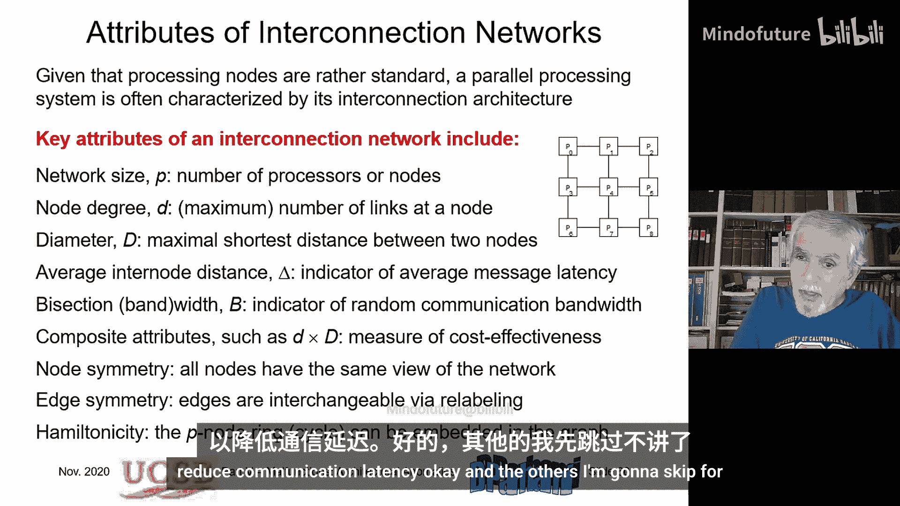

Okay， and the others I'm going to skip for now。So there are a large number of interconnection networks。

Either proposed or being used in implementing actual parallel machines。

 so some of them are actually used in machines， others are just theoretical they' have been proposed。

 they have some nice properties but they may not be used or at least they're not used widely。

 they may be used in a research prototype or a small number of systems。

So there's such a large number and people are still proposing new interconnection networks。

That it's kind of hard to keep up with everything that is available。

So if you need to select an interconnection network， you have a large task in front of you。

 you have to study all the available interconnection networks and decide which one of them is best suited to your purpose in designing a system。

Okay， robustness attributes of interconnection networks are listed in this slide。

One of them is connectivity。Which。As designated by the Greek letter Kappa。

So the connectivity of a network is the minimum number of disjoin or parallel paths between pairs of nodes。

 so this previous example that we saw between source node S。And destination node D。

 there are four parallel paths， the red path， the blue path。The green path。And。The brown path。Okay。

 and that's true for any other pair of notes， so from this S to this。So next to it， here's one path。

Here is the second path。Here is the third path。And here is the fourth path going around。😔。

And entering from the others side。So this particular network， we say has connectivity for。

In other words， between any pair of nodes there are always four disjoint ads。And as I mentioned。

 when connectivity is4， then means up to three malfunctions can be tolerated without。The network。

 which was。The connection is becoming disconnected， the network becoming disconnected。

Malfunction diameter is another indicator of robustness。If I now in this network， remove， let's say。

 this node。What happens to the diameter of the remaining network？

And this is not an easy thing always to determine， but people have studied a function diameter and results are available in the literature。

 for example， for this four by four torus。Malfunction diameter is the same as the original diameter。

 so the diameter does not increase。And you remove one node， of course。

 malfunction diameter is defined。For the case， when you remove the maximum number of nodes。

 so in this case you can remove up to three nodes， so if I remove three of the four neighbors of this node。

So this one， this one， and this one， this node still can communicate。

But then the distance between this node and this node will have increased。😔。

Because these two nodes are not available， so I can send the messages through those two。I have to go。

1， two， three， four in this case it doesn't increase。

 but I have to do it for all possible triple malfunctions and see what happens to the diameter。

 as I said， is's not an easy thing to determine。Wite diameter is the length of the longest of the disjoined parallel paths in the case of these four paths。

 all four paths are of length four。But then you have to do it for every other pair of notes。

And see what is the maximum？So you always get four parallel paths。

 but these parallel paths are not always of the same length。

 the length of the longest one of these among all possible pairs of nodes。

Is the wide diameter of the network。And the white diameter is often larger than the regular diameter。

And finally， malfunction Hamiltononicity means embedding a Hamiltonian cycle after malfunctions。

So this network， the original network without any malfunctions is Hamiltonian， in other words。

 I can start from here。And go up this column。连够 here。Go down here。Then up this column。

And down this column and then back， so this is a Hamiltonian cycle， okay going this way。When here。

When care。And down here and back to the starting note， that's a Hamiltonian cycle。Okay。

 so I may be curious to see whether if I remove a note， that is malfunctioning。

I can embed the Hamiltonian cycle。Okay， among the remaining notes。And the answer is not always yes。

 I may be able。To embed a cycle， but not a cycle that goes through all the remaining node。

 perhaps I have to skip。Some of the healthy nodes in order to embed the cycle。Okay， so here is。

My justification for calling this particular architecture robust because as you see between node zero and one。

There's this direct path。There's this blue pad。And then there's the screen pad。Of course。

 the red pad is a plan one。The blue paths are playingked one， two， three， four。

And the green paths are playingked 1，2， three。Okay， so the longest of these is four。

This one can tolerate two malfunctions because there are three disjoined paths。So for example。

If I want to send from zero to。诶。Let's say，3。Okay， without any malfunctions。

 I have this path of length three。One， two， three。I have this path of Plank2。

And I have this other panel， let's see。Do I have another pet？Okay， I can't find a third， let's see。

 from zero to2。2，3。I have。path of length three。Okay， that path 013。

 that's not disjoint for the first path so I can't use that one， so 01，23 is one of the paths。

Then I have to use a different way。😔，0 to3。Yeah， I can't have other node disjoint path but they can't have it。

Thisjo paths， I guess。Okay， so for example， I can go from zero。To here， to here。

 to here and then to three， that happens to be。Edge of this joint。 So the green set of lines。

Plus this one that goes from one to three， but it's not no disjoint from the first one。

 it is edge disjoint okay。All right， so this happens to be a directed network。

It were not directed if these edges were not directed。

 then I would have more options for choosing the paths。Okay， so when malfunctions occur。

 paths between nodes become dilated， dilated means they basically become longer， so for example。

 if this P4。Mdfunctions， the path from P3 to P5 that was originally of length 2 now becomes of length 4。

They're actually two paths。Okay， so it dilates， it lengths doubles because of that malfunction。

Malfunction diameter of the hypercu is known to be Q plus1。

 normally normal Q dimensional hypercu plus diameter Q， malfunctioning hyper cube。

With up to Q minus1。Mdfunctions has diameterq plus one。

 so diameter increases by one and if you want you can follow the details in this slide。

 the diameter increases by one because of those malfunction， which is pretty good because。

Out of the 16 nodes in this hypercue。I have three malfunctions。

 so a significant fractions fraction of the nodes are malfunctioning。

 but the diameter increases only by one。Okay， malfunction tolerant treating basically refers to classes of algorithms。

That allow messages to be sent between nodes despite malfunctions， so for example。

 one particular routing algorithm is the row first algorithm。

 so if I want to find a message from p0 to P8 the row first algorithm says first send a message across the row。

And then along the column， okay？So it's a particularly good and simple algorithm。That can be used。

 but if malfunctions are possible， I can't rely on that rooting algorithm， so T1 is malfunctioning。

Then the ro first algorithm does not work for sending。This message。

 perhaps I can switch to column first algorithm in that case。Okay， so。

These are known as adaptive rout algorithms， adaptive ro algorithms。

Basically allow multiple choices of routineing pads。So that if one Pat is not available。

 we can use an alternate path。Okay， now how do I decide which path to use the decision algorithm can be centralized。

 so p0。Which wants to send a message to P。Hein' it。

Assuming that it's aware of all the malfunctioning module， it knows that P1 for example。

 and P4 are malfunctioning。Then it computes a path from P0 to P8 that does not use P1 or P4。

 so this might be the path。And then the message takes that so the path that's precomputd。

And it's basically sent along with the message and the message takes that particular path。Hsually。

 especially in large parallel computers。WeWe prefer to avoid this centralized。Decision making。

Because basically informing all the nodes of all the malfunctions。It's a tricky situation。

 a lot of information must be exchanged。And furthermore， if a malfunction is over here。

 it may take a long time for the information to reach。This module。

So we try to use distributed decision making for our rout algorithm so that when P0 wants to send something to a module。

 no matter where。The only decision it makes is whether to send it this way or this way。

Based on tables that it has stored there says， okay， this pad seems to be more promising。

 so I'm going to send it there then P1 gets that message and in turn。

Notices that that message is headed for P8。And decides whether to send it this way， this way。

 So in this way， each node needs to have information only about。The health of。

Notes that are around it。Not global information about the entire system。Of course。

 a danger of this is that。A message can sort of。Not ever reach its destination because it comes here。

 this one decides to send it this way then this。NoteNots that this one is malfunctioning so it can't send it that way it has to send it back and so on。

 so the message can basically go around and around and never reach this destination you have to be careful to avoid。

Deadlocks， that's been。Messages are basically waiting for each other and can't make progress。

And live locks， that's basically a message。嗯，forever。

Goes around in the network and never reach its destination。

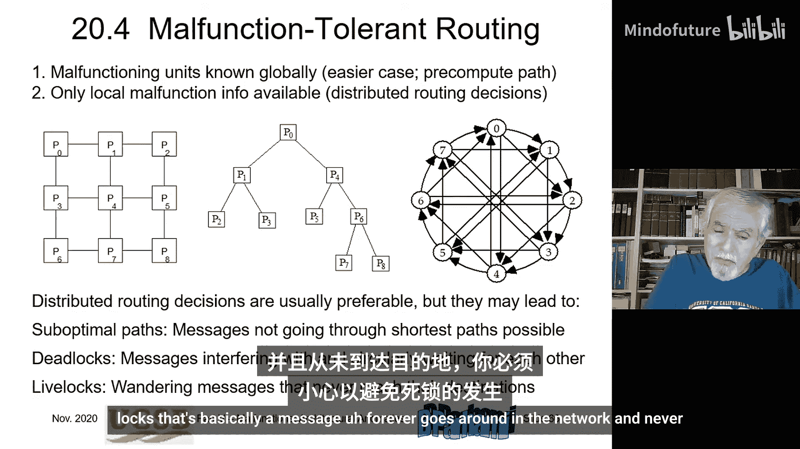

Okay， I'm going to skip this adaptive ro in a hypercue because then I have to describe hypercue and I don't want to do that in a mesh。

 adaptive routing is pretty simple。If the。Malfunctioning nodes。Are within convex areas。

 so for example， this is red。Rectangles are areas that are malfunctioning。So a message simply goes。

On its way， and then when it encounters these malfunctioning region， it basically makes a detour。AT。

Either in that direction or in this direction， and eventually finds its way as long as these areas are convex。

There are many algorithms that。Basically， unable to。呃Find。The path where they message it。

If those regions are not convex then algorithms become very complicated。

 so this is an extreme example， of course there are a lot of malfunctioning node。

 these shaded regions are malfunctioning areas and they are not convex they have these。Sort of。

On cave areas。So if a message comes。And hits this point。Okay， then it can go maybe in this direction。

 then it hits this point， it has to go in this direction。

 it may actually go around and around in a network if you're not careful。

And never reach this destination。Okay， of course， there are algorithms that this comes from this diagram comes from a particular paper that describes an algorithm for what can find a way around these。

嗯。Mfunctioning regions and。嗯。

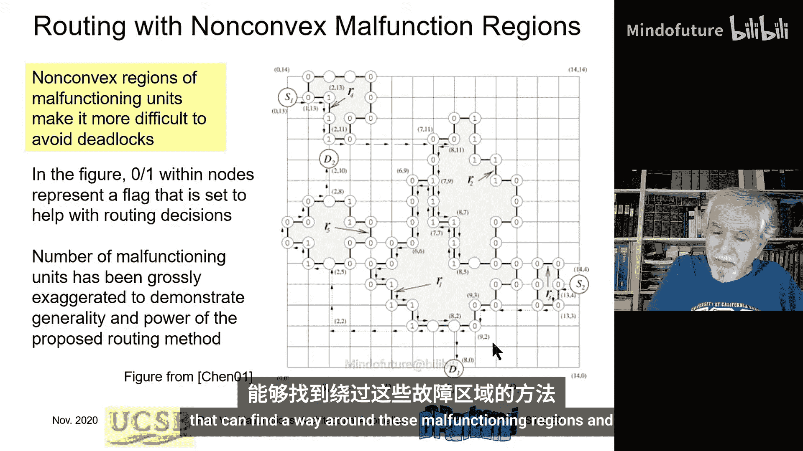

Allow the message to get to its destination。Okay， I'm going to skip section 20。

5 and we won't be responsible。

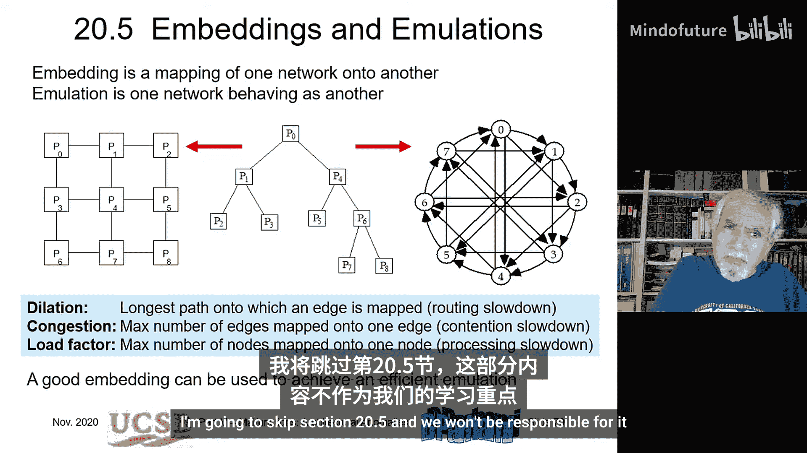

Fort。

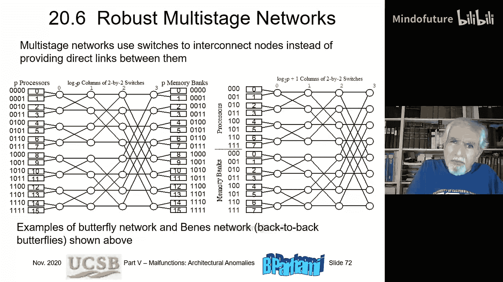

The final topic， section 20。6。Talks about。Robust multitage network now multistage networks are different。

From the other networks we have studied in the sense that these notes that you see here are not processors。

 they're just switches。Processors and perhaps memory modules to which they connect。

 or they can all be processor， this can be an interprocessor communication network in which case all the node on both sides are processors and these switches allow connections between them。

Or this can be a processor to memory interconnection network。Either way， in this case。

 the processors and the memories are on one side of the network。

And then the path through the network is found to connect the processor to a memory and again。

There can be more processors on this side rather than memories。Now。

 this network is known as the Butterfly Network。And one of its drawbacks is that there's a unique path。

From a source to a destination， so for example， if I want to connect processor four。

To memory module 7。I can find a path， there is a unique path through the network that makes that connection。

Because of that uniqueness of pad， if something goes wrong。

 if some of the switches are malfunctioning or some links are cut or otherwise unavailable。

 then the path， the unique path。Becomes disconnected and I can't send messages。

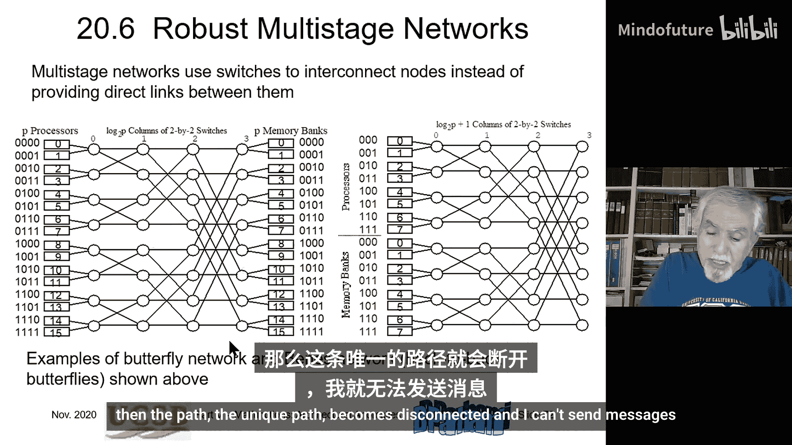

Okay， so one way to， and of course， there are many different multi stage interconnection networks。

 just as there were many direct interconnection networks。So there are some ideas。

 this is known as an extra stage butterfly network。So this is a regular butterfly network。

And here I've shown connection from processor four。To memory module 3。The path is unique。

 so this two by two switch makes this connection。This two by two switch makes disconnect connection。

Then this two by two switch makes the cross connection and then four is connected to three。

So if this switch。A functions then that path cannot be established here I've included an extra stage since of three columns of switches。

There are four columns。And the message coming in can either start in the original stage or it can start in the second stage。

It can end in the final stage as before or it can end in the next to the final stage。

 so basically I have the option of using these three columns。We're using these three columns。

To root the message， and this is enough redundancy to allow the existence of two paths。

Between processor 4 and memory module three and those two paths are。Distinct， in other words。

 one pad goes through a bunch of edges and these two switches。The other path goes through。Sorry。

 three switches， one， two， three。And this one goes through one two。

 three other switches and other links。Therefore， I can now tolerate。

The amount function of- so if this switch。Mdfunctions， I can't use this path。

But I can use the other path。Okay。So there's a lot of research that this is just an example of building these multistage interconnection networks networks so that they're robust and they can tolerate malfunctions。

Okay， so that's it for this lecture we are now。Don。But part five of the textbook in lecture 13。

 we will move to part six of the textbook。Bye for now and stay safe。

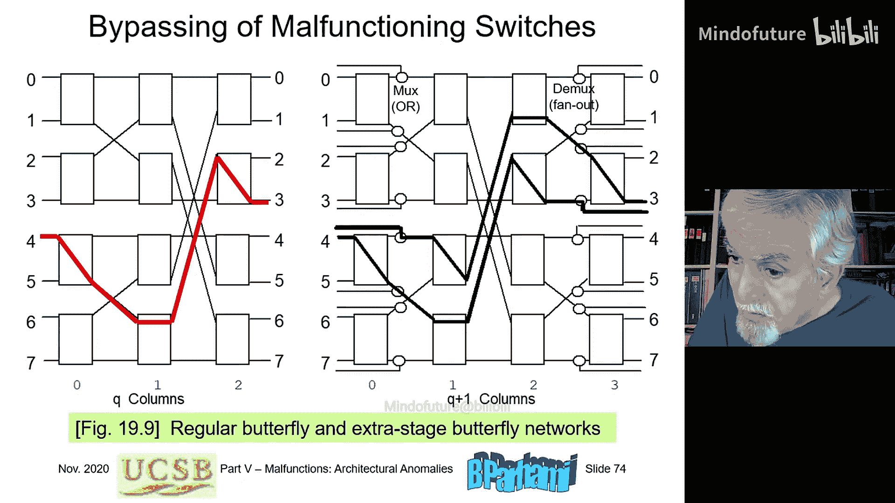