# 容错计算：12：故障容忍与鲁棒并行处理

在本节课中，我们将学习系统级的故障容忍方法，特别是通过系统重构来应对模块故障。课程内容涵盖教材的第18章和第20章，我们将探讨重构的基本概念、具体方法以及鲁棒并行处理的设计思路。

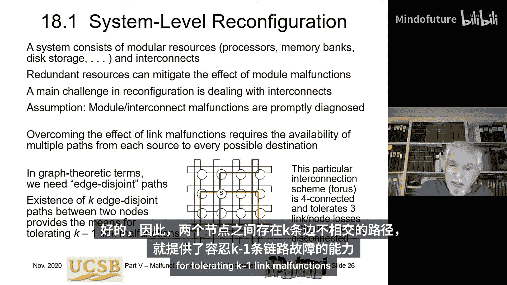

## 系统级重构概述

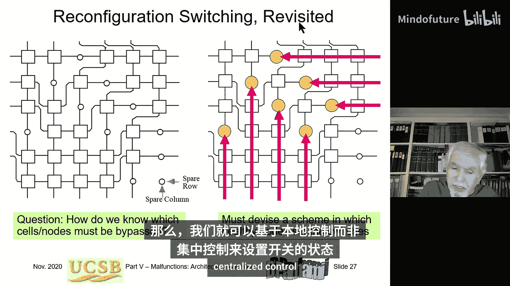

上一节我们介绍了故障诊断，本节中我们来看看系统级的故障容忍，这主要通过系统级重构方法实现。与之前讨论的设备级重构不同，这里的重构单元在规模和能力上都更为复杂。

一个系统由模块化资源（如处理器、内存、磁盘、网络控制器）和互连机制组成。冗余资源可以减轻模块故障的影响，前提是系统具备绕过故障单元进行重构的能力，并且故障已被正确诊断。

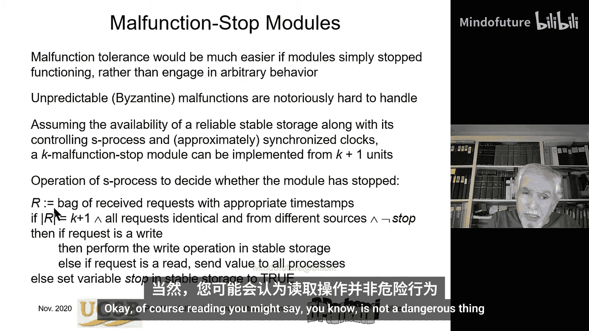

为了实现故障容忍，一个基本要求是在任何源模块和目标模块之间存在多条路径。

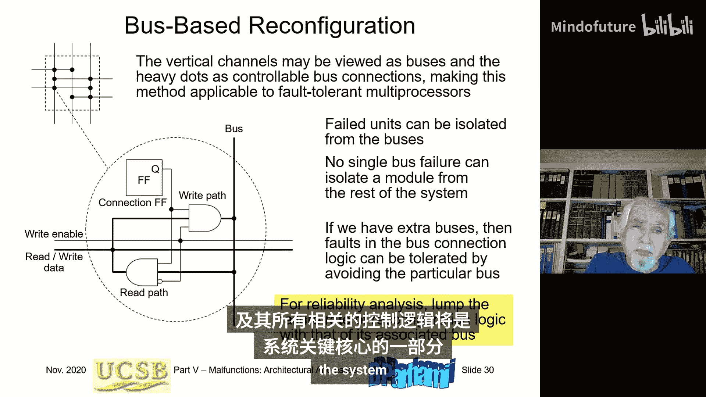

## 互连网络与路径冗余

以下是实现路径冗余的关键概念：

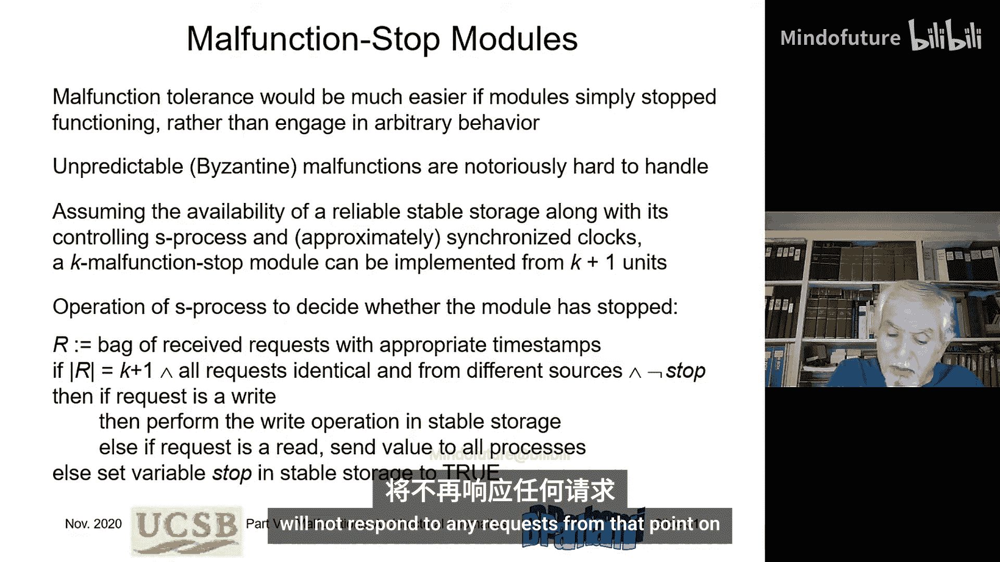

*   **节点/边不相交路径**：指除源节点和目标节点外，不共享任何节点或边的多条路径。如果存在 `k` 条这样的路径，则系统可以容忍最多 `k-1` 个链路或节点故障，因为每个故障最多只影响一条路径。
*   **性能影响**：当最短路径因故障不可用时，通信可能需要更长的路径，导致性能下降。

**公式**：存在 `k` 条边不相交路径的两个节点，可以提供容忍 `k-1` 个链路故障的能力。

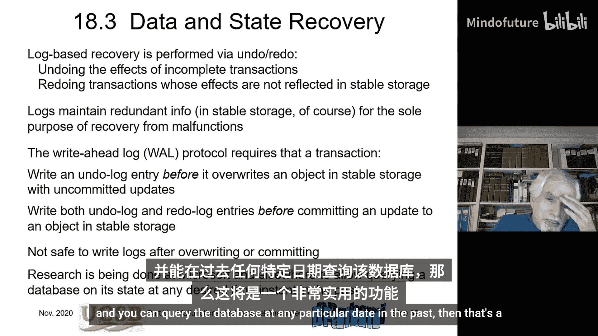

## 处理器阵列的重构方法

用于缺陷容忍或良率提升的重构方案，同样可以应用于处理器阵列。以下是几种常见的重构方法：

*   **行列旁路**：通过多路复用器等开关，可以旁路整行或整列的处理器。这种方法简单，但可能浪费完好的模块。开关状态可由集中式控制单元设置，也可由相邻的健康模块进行本地控制。
*   **可编程连接**：类似于FPGA中的方法，通过可编程开关盒连接模块端口与垂直/水平通道。灵活性越高（每个端口可连接的通道越多），成本和控制开销也越大。
*   **总线隔离**：在总线架构中，必须隔离故障模块以防止其干扰总线通信。例如，可以使用“总线守护者”机制，要求一个模块必须获得其他两个模块的许可才能连接总线。另一种方法是使用触发器控制模块的读写使能，当触发器复位时，模块与总线的连接被禁用。

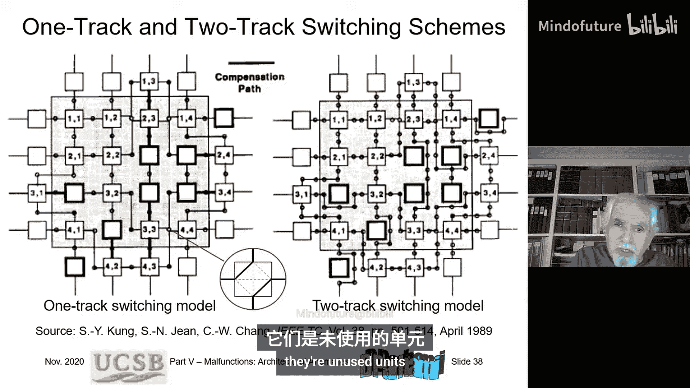

**代码示例（总线隔离控制逻辑）**：
```verilog
// 假设 q 是一个控制触发器
if (q == 1) {
    // 模块可以读写总线
    enable_read_write();
} else {
    // 模块与总线断开
    disable_read_write();
}
```

## 故障安全模块与日志恢复

当模块发生故障并被替换时，需要恢复其数据和状态信息，以便新模块能无缝接替工作。

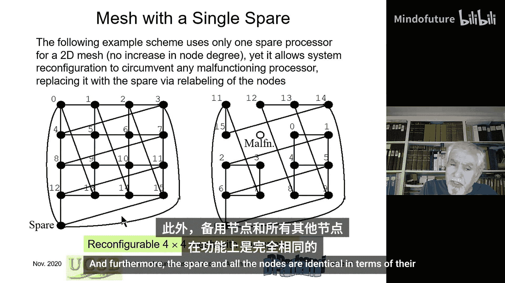

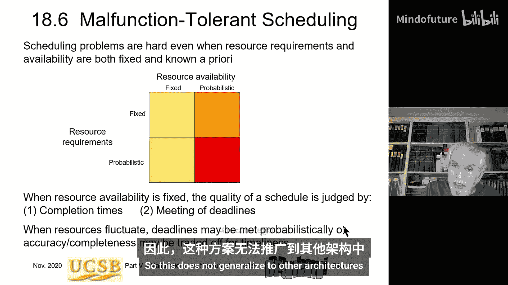

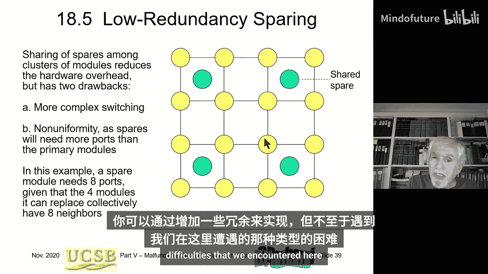

*   **故障安全模块**：一种高冗余设计，例如使用 `K+1` 个模块。只有当所有 `K+1` 个模块提交相同请求，且系统未处于停止状态时，才能对稳定存储进行更改。否则，系统将设置停止变量并进入静默的安全状态。
*   **日志恢复**：这是最常见的恢复机制。日志在稳定存储中记录对数据库的所有更改及其时间戳。
    *   **前写日志**：要求在覆盖稳定存储中的对象**之前**，先写入一条撤销日志条目。这确保了即使更改后立即发生故障，也有日志条目可以用于回滚。
    *   **作用**：日志用于撤销未完成事务的影响，以及重做那些效果尚未写入稳定存储的事务。

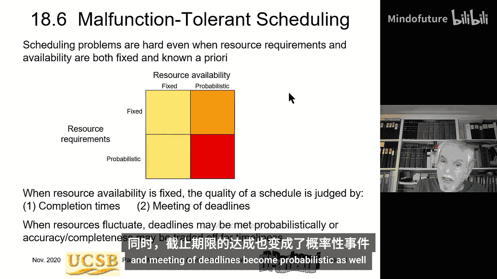

## 鲁棒并行处理

鲁棒并行处理不严格区分“工作模块”和“备用模块”，所有资源都处于活动状态。当部分处理器故障时，系统利用剩余资源继续运行，可能以较低的性能水平完成任务。

以下是评估互连网络鲁棒性的一些关键属性：

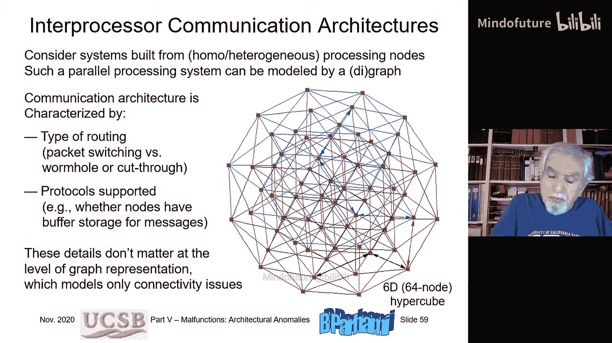

*   **网络规模 `P`**：处理器数量越多，可容忍的故障数量可能越多。
*   **节点度**：节点的连接数。均匀或较高的节点度通常有利于鲁棒性。
*   **直径**：网络中任意两节点间的最长最短路径长度，反映最坏情况通信延迟。
*   **对分宽度**：将网络分成两半所需切割的最少链路数。较大的对分宽度有助于降低随机通信的延迟。
*   **连通性 `κ`**：任意两节点间不相交路径的最小数量。连通性为 `κ` 的网络可容忍最多 `κ-1` 个故障而不断开。
*   **故障直径**：移除最多 `κ-1` 个节点后，剩余网络直径的变化。
*   **宽直径**：在所有节点对的不相交路径集合中，最长路径的长度。

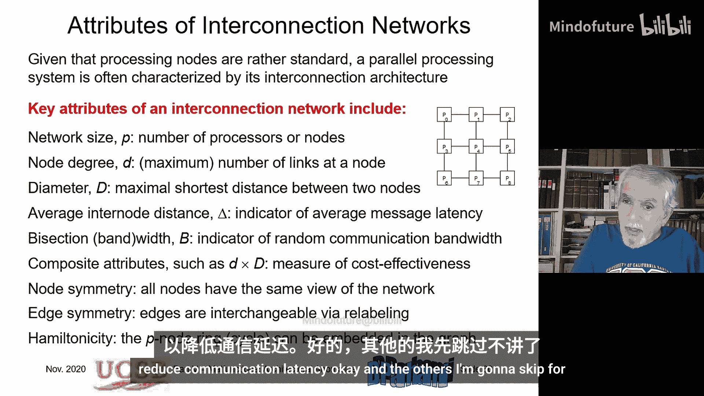

## 自适应路由

当网络中存在故障时，需要自适应路由算法来动态选择可用路径。

*   **集中式路由**：源节点基于全局故障信息计算路径。在大型系统中，维护和分发全局信息开销大。
*   **分布式路由**：每个节点根据本地信息（如邻居健康状况）做出路由决策。需要避免死锁（消息相互等待）和活锁（消息永远无法到达目的地）。
*   **凸故障区域**：如果故障节点集中在凸区域内，简单的绕行算法（如维序路由的变体）通常有效。对于非凸故障区域，路由算法会变得非常复杂。

## 鲁棒多级互连网络

多级互连网络（如蝶形网络）常用于连接处理器和存储器。其传统缺点是任意源-目标对之间通常只有唯一路径。

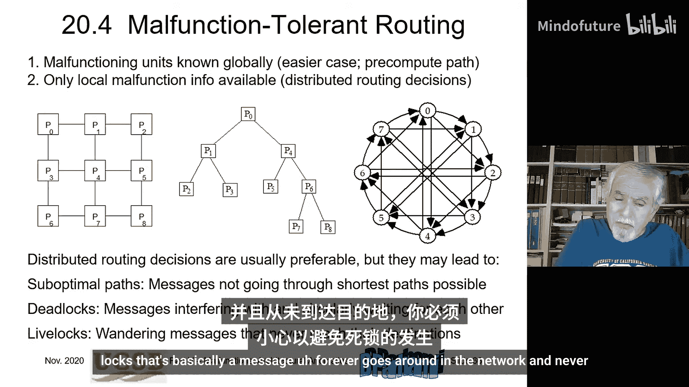

*   **额外级蝶形网络**：通过增加一个开关级，可以为源-目标对提供两条独立路径，从而容忍单个开关故障。消息可以选择从原始第一级或新增的第二级开始路由，提供了冗余路径。

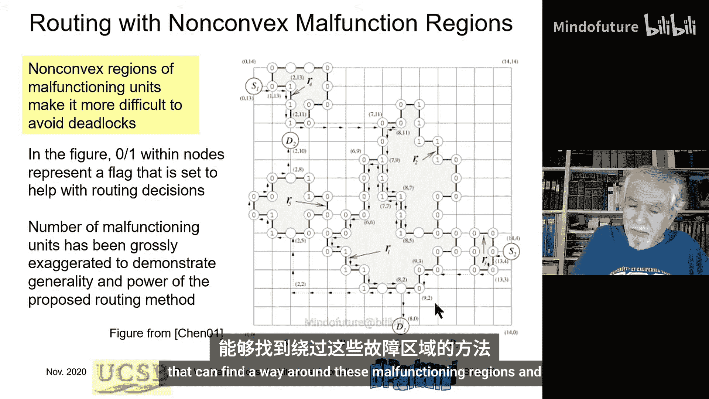

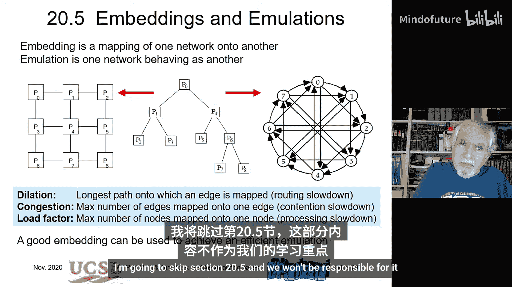

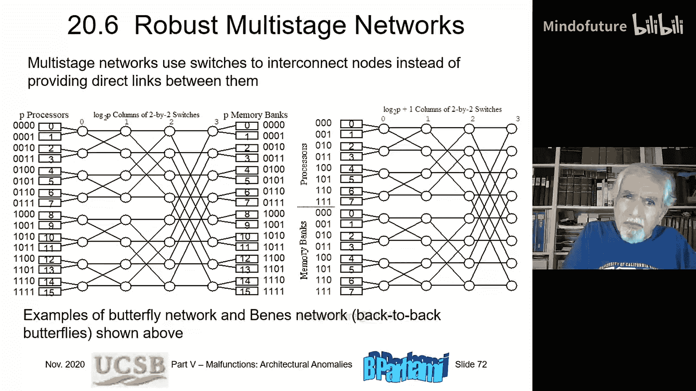

## 总结

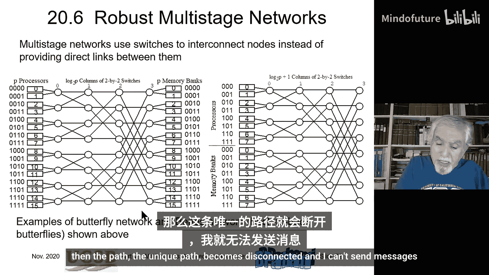

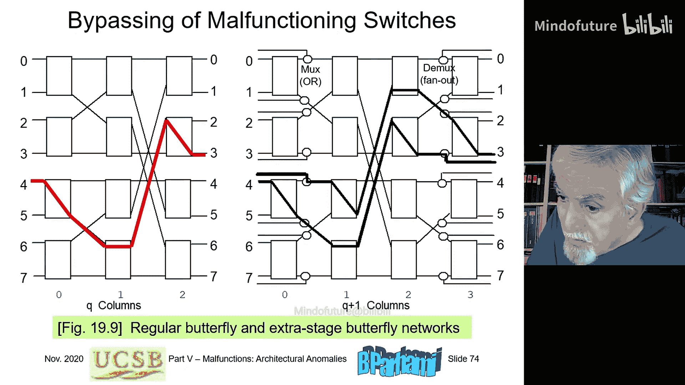

本节课我们一起学习了系统级故障容忍的核心方法。我们探讨了通过提供节点/边不相交路径来实现冗余，并介绍了多种处理器阵列的重构技术，包括行列旁路、可编程连接和总线隔离。我们还了解了故障安全模块的设计理念和基于日志的恢复机制。最后，我们引入了鲁棒并行处理的概念，分析了互连网络的鲁棒性属性，并简要介绍了自适应路由算法以及如何通过增加冗余级来增强多级互连网络的容错能力。这些方法共同构成了构建可靠计算系统的基础。