# 【加州大学】容错计算-｜-Fault-Tolerant-Computing-Ucsb-Ece-257A-p13-P13_第13讲_第21-23章_退化允许--BV19cFyz8EPV_p13-

Hello and welcome to Le 13。But of course， ECE257 a。Falult， tolerant， computing。

This is the first of two lectures from part six of the textbook。Entitled Adations， Behavial lapses。

This lecture。We'll cover chapters 21 and 23 in the textbook。And lecture 14， the next one。

We'll cover chapters 22 and 24。Okay， so let's get started with。

Chapter 21 entitled degradationdation Allowance。So what do we mean by degradation allowance？

First of all， we define a term known as graceful adation。So degradation means。

And the performance or other attributes of a computer system。Degrade， go down。

And graceful degradation means that this happens gracefully， gradually。

Sometimes graceful degradation。It's called Fa soft behavior。Okay， and gracefully degrading。

 which is the adjective form of the term。Ass equivalent to failof， so we talk of a failof。

Computer system or a gracefully grading computer system。

So the opposite of gracefully degrading is a computer system that basically。Falls apart， crashes。

Upon the slightest。呃。Malfunction in the system。So of course。

 graceful degradation is desirable because when something goes wrong。

 then we lose part of the functionality。It's a system。So graceful degradation or degradation。

It's basically the opposite of failure。Something that we try to accomplish instead of failure。

 so when we prevent failure。That means we allow the system to gracefullyrate。Now。

 graceful degradation for failure prevention requires quick malfunction diagnosis。

We have to find out right away that something is wrong， some part of the system is malfunctioning。

Be able to effectively isolate。The malfunctioning element or elements。呃。Ideally。

 we have to be able to perform online repair。Meaning that we don't have to shut down the rest of the system to repair or replace the part that is malfunctioning。

 and this is sometimes done through hot pluggable modules。So hot plugable means， for example。

 if the modules are connected to a bus， I can remove a module。Simply plug it out。And it doesn't。

The removal of that module does not affect the proper functioning of the other modules that are connected to the bus and this is not trivial you know you can't always do it unless you have。

You have provided design features to allow that to happen。And then perhaps the most important。

 we have to avoid catastrophic malfunctions。These are malfunctions that affect many different parts of the system so that basically graceful degradation becomes impossible。

So we have to avoid these multiple malfunctions or catastrophic malfunctions。

And then for single malfunctions or limited malfunctions。

You have to be able to quickly diagnose them。We have to be able to isolate the malfunctioning elements and be able to repair them online without basically turning the system off。

The rest of the elements will be working as we replace the malfunctioning one。

So degradation allowance is not automatic， you know， even if you have 20 processors in a system。

 that doesn't automatically means that when a single processor fails malfunctions。

And the other 19 will be able to operate correctly， we have to design this feature into the system。

And then degradationd management， which is what we cover in the next lecture。

Is to be able to solve when when the。AF of the system is reduced。We may have to prioritize tasks。

 basically do the ones that are more critical to the correct functioning of the system and ignore the rest for。

Short while until the system can be brought back to full functionality。

We have to monitor the system in order to keep track of system operation and degraded mode to make sure everything is going smoothly。

We have to reverse the effect of the malfunction， return the system to the intact。

 at least to less degraded mode of operation。And finally and ideally。

 return to normal operation as soon as possible。

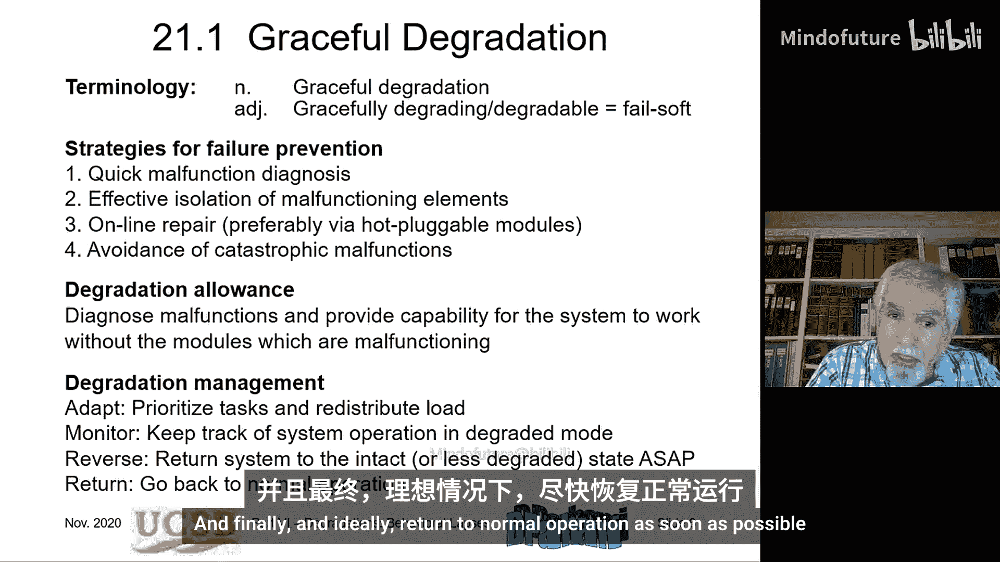

Okay， so degradation allowance is important because it's not necessarily automatic and this is sort of an analogy that I've shown here。

 let's say you can design a car， an automobile with three wheels。

 so three wheels are the minimum number required。For a car to be able to function。

 to be a car actually。So if a car has four wheels or even six wheels that doesn't automatically mean because it has extra wheels。

 doesn't mean that we can tolerate。The malfunction of one of the wheels， so the four wheel car。

 if one of the wheels malfunctions， let's say you have a flat tire， you can't。

You can't continue driving the car， even though。I mentioned that three wheels are adequate。

But three bills have to be designed in a specific way in order to be sufficient。For the car to。

Function， correct。

Okay， so performability。Of a fail soft system is defined in this diagramra。So in a fail system。

 we have different levels of performance from all the way at the top intact or full functionality。2。

The bottom which is crashed or no functionality at all have different levels of functionalities。

 some of these we call degraded。When they're close to intact， but they're less functional。

Some of these we call partially failed。The system is still operating， but at much less。

Performance or functionality。So it's a matter of degree whether we call a system degraded or partially failed。

And as the system operates over time。Initially， let's say it's intact。Then some art malfunctions。

 it goes to the next lower level of functionality of performance。

And then perhaps something else goes wrong。As long as we are within。One of these degraded states。

 the system can continue operation， although it won't have the full performance or functionality。

And if we are able to do online repair， as I mentioned， you know。

 we just removed the malfunctioning units。And repair them。

 repair these days often means just replace， the new module in， plug in a new module。

And then the system can go back。The less degraded state or perhaps to the full。Full function state。

So as long as we fluctuate between these levels of performance。

 the system is up and running and its doing the most critical tasks。Be required of it。Okay， however。

 if at some point。Too many things malfunction when we go to the crash state。

 we have to shut down the system and take care of the problem。Then that is known as offline repair。

 so the system is offline and we repair it as it's。Basically。嗯。Other cooperation。

And then eventually we succeed， so this offline repair is less desirable because the system has lost full functionality。

And the faster we can return it to the normal or elastic less degraded mode of operation， the better。

Ideally， in a failof system， we try to stay within these degraded states and never go to。

Theyve crashed state。Okay， now。View this， this is the same diagram with these areas。🤢。

Or the system is working， shaded。In yellow。So the area of these。Shaded regions。

It's basically the work that the system is doing， okay。

 so it has this full performance for this much time。

And lower level of performance with this much time and so on。

 so this area represents the amount of work the system oes。Of course。

 we want to maximize this area so that the system does as much work as possible。Okay。

 so if the system experiences failure， full failure。

Then this area is the computation that performs before failure。

the average of that area is called mean computation。For failure。

And that's an important measure for evaluating such a system， how much computation。

Does it do before it reaches a failure stake？Okay， of course。

 if a system never goes to that full failure state， it always fluctuates。There then that。

Mean computation before failure ands to infinity will be a lot of。And that's。

The most desirable state。So an ecommerce site， for example， such as Amazon。W to have。

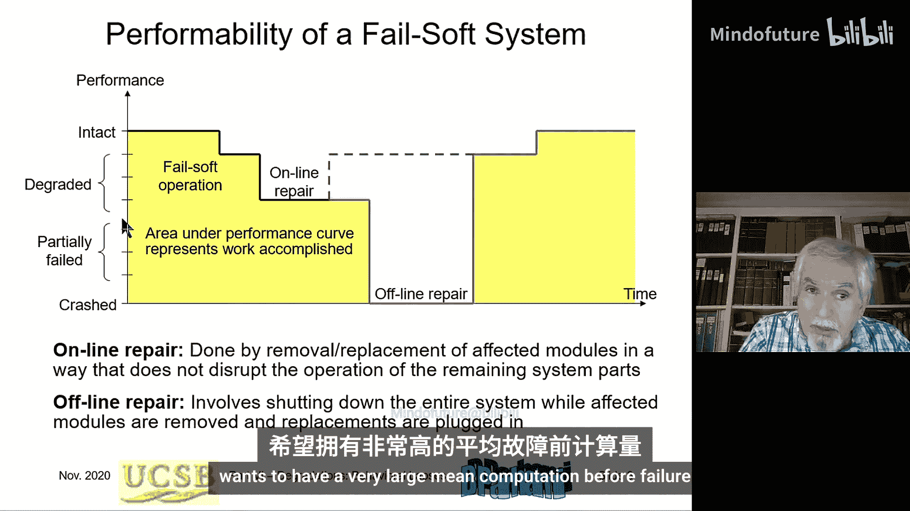

A very large mean computation before failure。Okay， so diagnosing the malfunction。

Removing the malfunctioning unit when we remove the malfunctioning unit。We have to update the system。

 basically operating system tables， you know， operating systems nowadays are designed to。

Be able to operate with different levels of resources。

 because the same operating system will be running on。Different computers， different processors。

 different amounts of memory。With the。Different types of functionalities。

 different amount of disk storage， space and so on。So they are often table driven， in other words。

 the operating system has tables。That tell it how much of each resource is available and where the resources are。

So basically， if you update those tables， the operating system can continue to function with those more limited resources。

You have to properly update the list of resources。Then you have to physically isolate。

The malfunctioning unit， so for example， we saw。And then the concept of Bo Guardian。

The unit is connected to the bus。These two guardians， the orange boxes。

Must with permission in order for the unit to put something under bus。

So if the unit is malfunctioning。And the guardians know that it's malfunctioning。

 they will not allow it to。Basically put stuff on the bus and corrupt。

The communication that goes on on the bus because a malfunctioning units behavior is。

Sort of unpredictable。 and we don't want it to cause。Harm to the other units that are using the bus。

So this is physical isolation， the unit。And then initiate， repair a rep。If this is a。

Computer system on board a spacecraft， then physical repair may be。Not be an option。

 so you just isolate the unit and hope that the remaining resources of your computer。

O enough for it to。Survive for the rest of the mission time， space mission time。

Then you have to create a new working configuration。For example， exclude a processor。

 channel or controller。Or I your device， for example， a sensor that is。Ha been。

Determined to be malfunctioning。Excluded from resources that MBU。For example， if a disc track is bad。

Ha been corrupted， then you can avoid that。Avoid garbled files。

 files have been garbled then you don't use those files。

 hopefully the rest of the files will be accessible and usable。

If some communication channels are noisy， you basically shut them down and no longer use them。

So we are assuming that we have sufficient redundancy in the system so that when we remove some of these malfunctioning resources。

 we still have enough。To be able to do the main tasks the system needs to perform。诶。

If parts of the main memory， for example， have been determined to be malfunctioning。

 we can remove those parts from use。A method called virtual address mapping。

 so the addresses originally in those bad parts will be remapped to other parts of the memory。

And the same can be done with cash， for example， if you have a cache memory and parts of it are malfunctioning。

 you just reduce the size of the cache。And continue operation with a smaller cash， of course。

 that affects performance but。It's better than just losing the entire system。Okay。

 then the final part of。Cing from a malfunction is to recover processes in their associated data and we'll talk about this one of the techniques that。

Commonly used， as called the。Checkpointing， rollback， talk in some detail about that。Okay。

 one of the requirements for being able to recover from malfunction is to have stable storage。

Stable storage is storage that won't lose its contents。So it's unlike registers SM， DM。

 which do lose their contents。So for example， flash memory is an example of stable and it's called non volatile storage。

Okay， combinedbined stability and reliability can be provided with rate like methods。

 the rate provides both stability because it's basically magnetic disk memory and reliability through coding techniques。

Okay， so for example， if you have memory that is not stable， it's volatile。

The one way of dealing with it and making sure that you don't lose data。To provide every backup。

For a time duration that is long enough to save the contents of such。The memories， for for example。

 this cash。If this catches DM。don't want to lose the contents of this cache because some changes in the disk cache may not yet be reflectedlicted in the disk itself。

So provide battery backup so that something goes wrong。

Have enough time to write back the contents of the disk cache onto the disc and therefore not lose data。

系啊。Before the battery runs out。Okay。Mfunction stop modules I already talked about in a previous lecture。

 so I'm going to skip this。Slide。We also talk briefly about logs。Because logs are so important。

 let me repeat some of the concepts here。就。Whatever we make changes in our database or other stable storage。

Areas in our system。We record the changes in logs。Okay。

 so if something goes wrong and we lose the changes。We can reconstruct。

Our database by going through by using a previous state of the database that we have recorded somewhere。

And these logs that tell us what changes are made before the malfunction occur。

So in order to use logs， we have to have the previous state of our database or system more generally。

And then we have to have logs saved and stable storage so that we can use those logs。Basically。

 records of changes。To reconstruct。stateate of the system that we lost due to malfunction。Okay， some。

 so logs are useful。When。嗯ello。Simple way of putting it is that the ideal way to design processes is that the processes。

Opererate and then they do output at the very end of the process。

 so in other words as the process is running。It doesn't make any changes in our database。

 So if the process。Its basically stopped due to a malfunction。

 no permanent damage has been done to the system。The opposite of that is that the process makes changes incrementally as it。

P seat。😊，And in particular， processes that。Deal with auators okay so for example。

We have a process control system in a factory。And the control program that is running its censs various conditions in the factory and then it affects changes。

 for example， if temperature goes up too much in a particular area。

Make sure that that area is called so that this action。Is them。 So if now。

You have to roll back that process and restart。You often cannot redo the effect of these。

irreversible actions basically that the process has done so that's a little bit more tricky and you have to consider that in the design of the system。

 but ideally the best thing to do is to design processes so that they run。

And then when they complete all the computations， then they affect some change at the very end。

So that changes take place in the system or actions。Are done， actuators are activated。

Only after you're sure that everything all the computation。has been done， correct。Okay。

 now the rest of this chapter deals in some detail with checkpointing and rollback。

This is a very important concept。AndIn fact， it's a very old concept because。Early computers。

Were so unreliable that if you had a computation that had to run for maybe three， four hours。

There basically zero chance that you could complete that computation before。

Some set of vacuum tubes failed and the computer crashed。Okay， so here's an example。

 suppose I have a computation。That runs for this amount of time。

And then the meantime the failure of the system on which it's running is this much。

So the running time of the computation is more than the mean time to failure。

This means that as you run this computation， it's very likely。

That the system will experience a failure somewhere。And then if a failure occurs， let's say here。

Shortly before the computation has been。Completed。You basically have to restart。

And if this probability of something going wrong is high， let's say 95%。

And you have to repeat the computation many times before eventually it becomes successful and is completed。

So a solution to this problem。Is。To insert checkpoints along the computation line。

A checkpoint is basically a recording of the state of the system。That particular point。

 so that if something goes wrong pass that checkpoint。

Don't have to go all the way back to the beginning。

 but you can go to that checkpoint and restart the computation。At that check one。

So you basically avoid repeating this part of the computation before the checkpoint。Therefore。

 you save time， however， a checkpoint itself has some overhead。Okay。

 so you pay that overhead of checkpointing， hopefully that overhead will be less than the gain。

The gain is of course， is not sure it's probabilistic if something goes wrong at this point。

Whi as I said， in a long running computation is' almost certain that something goes wrong。

But it may not be certain in maybe 60%。Then with 60% probability， we save this repetition。

With 100% probability， you'd spend some time in checkpoint。So you have to balance these two。

 a trade off。If you checkpoint too often。Then you pay a lot of overhead。

Then you avoid more of these repetitions。So there's a balance as we will discuss in a minute。

So here's checkpoint two， is checkpoint3。Therefore。

 hopefully if something goes wrong near the end of the computation。

You avoid recruiting a large part of the competition。Because you start at this point。

So checkpoints are often placed at convenient points along the computation path。

Notice that the way I've drawn here， the checkpoints are not equally spaced。Because。Though。

 not every point in the computation is equally convenient for inserting a check。

Typically computations are phases， you， phase one， phase two， phase three。

So there's maybe a sorting phase and there's some other operation and so on。

And it's more natural to insert checkpoints at the end。Of one of these phases。However。

 for simplicity in the analysis that I'll show you in a few minutes。

 we'll assume equally spaced checkpoint so that I just want to make a point。诶。

Even though the example is not very practical。So checkpointing entails some overhead。

 too few checkpoints would lead to a lot of wasted work。A lot of overhead。Sorry， two few checkpoints。

 so if I have just one checkpoint， something goes wrong after that checkpoint I will have to repeat。

No， large part of the computation。Too many checkpoints would lead to a lot of overhead and therefore it seems intuitively the case that there must be。

诶。An intermediate optimal point where the two overheads balance。

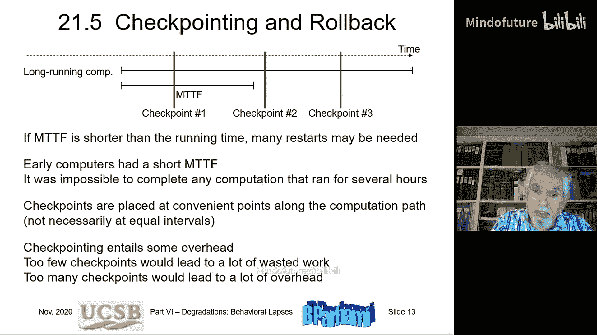

Okay， so here's an example that shows why checkpointing helps。

Suppose I have a long running computation that takes an amount of time equal2 times the mean the failure of the system on which it's running。

So there is a good chance that something goes wrong as we run this computation。Okay。

 and suppose we have。抽 tea。Time to complete this computation。If I run this computation， of course。

 the first time I run it， it may not complete， may have to run it a second time。

 I may have to run it the third time。But。I have only twice as much time。

 so at most I can run it twice。And if it doesn't work out the second time。

 then the task does not complete。Okay， so here I in this example。

 which is in the textbook in a little bit more detail。

I want to compute the probability that we can finish the computation in time2。

2 T is twice the running time of the task and the running time of the task is assumed to be two times。

Meantime to failure。Okay。So the first option is assume no checkpointing。Well。

 if there's no checkpointing， I just try to run it with completes， fine， it doesn't complete。

 I have more time to run it the second time， so this is the model of a system， model of our system。

there's a start state where the task has not run yet。And there's a completion state with the task。

Has completed。And because。第一。😊，Is two times mean to failure or two over lambda？

And if the reliability equation is exponential， e to the minus lambda t。

The probability of success is e to the minus2， the reliability or probability of success is e to the minus2。

 which is。135 approximate。So when I run the task， I have this much probability to。

Successfully completed the first time。Then if I don't complete it the first time。

 that has probability 865865。And perhaps the second temp will be successful， so 0。865 times 0。

135 plus 0。135， which is the success probability。嗯。In the first attempt。

 and that adds up to 25% success probability okay， so for this task。

If I have twice as much time as the running time of tasks to complete it。

I still have only a small success probability of 25%。So with 75% probability。

 I cannot complete this task before this time2。Now assume checkpointing at regular intervals of T over 2。

So there will be a checkpoint here， T over 2。Checkpoint here。T and the checkpoint here，3 T over2。

the model of the system。IsThis。The start state， the task has not been run。The task have completed。

 in other words we have reached this checkpoint。So that half of the task is done and we don't have to worry about that because。

Even if you have to go back， we go back to this checklist。So half done。And then completely done。

Now the reliability or the probability of going from this state to this state。Okay， so this is MtTF。

So lambmbda T will be one。So E to the minus lambda t will be e to minus1。So there's 0。368。

 roughly probability。Of successfully completing this one。And。Okay， so what are the success？Aces here。

 okay， I complete this one and I complete this one， that's one case。

 so the product of these two probabilities。I complete this one。

 I failed the first time I attempt this and the second time。So that's T over two。

Plus t over two plus t over two， it's still within the time limit。Complete， fail， fail， complete。

 still okay。Fail， complete， fail， complete， so I have to enumerate。All the cases。

That allow me to complete this task within the dutyT。Time limit， so this is T over2。

 this is T over two so I can afford to fail。Twice， so maybe once year， once year or twice here。

Or twice here。 Okay so I enumerate all of those。And the probability of all those successful cases add up 47%。

 so I almost double。Success probability by inserting these checkpoints， of course I've。

In this very simple example， I've ignored checkpointing overhead。

Because checkpointing does take some time。I'm assuming zero overhead for just to make this point that checkpointing actually does increase the probability of successfully completing a task within a certain allowed。

Time frame。Okay， so generally， when we run a program， we have multiple processes that are running。

So here I've shown some processes running at different time intervals， each one has a start time。

And then end time。So if。I insert a checkpoint there。I will be checkpointing。

 so this is basically global or centralized checkpoint。So some external mechanism。

 maybe the operating system indicates that we should checkpoint。

And then the processes that are running at that point， this one and this one。

We'll save the checkpoint， the other ones are not started yet。Then we may have another checkpoint。

Those three processes will checkpoint。Then at some point that red line。

 something goes wrong in the system。And when something goes wrong， it may affect only a subset。

 so whatever malfunctioned not affect some of the processes， but it did affect these two。

The heavy dots indicate that these two processes were affected。Then this process will backtrack。

First checkpoint， this one does not have a checkpoint yet， so it will basically restart。Okay。

 so these are independent processes， when you have independent processes。

 then they will independently backtrack。To either the previous checkpoint。

Or to the start of the process， if there is no previous check。Okay。Here's an example again。

 the textbook may provide a little bit more detail of this example this I've taken from。呃。The paper。

 a won and below tea again， just to make a point。It's not very detailed。

 it doesn't justify all the claims made here。So this assumes it's a system that has。Data replication。

 there's a primary site。K eupocytes。Okay， so we are trying to determine。

The optimal number of backup sites。So the way the system works is that primary site is where we access to read data。

And then the backup site hold copies of the data that have to be kept。Up to date。So。This system。

 the normal state， you know bulk of the time， the system is in the normal state where the primary copy is okay and data is available to users。

Okay， then the recovery state is where the primary site is changing。

So when the primary side malfunctions， we will。Sign a different site to be the primary site。

 therefore the primary site is changing， the system is reconfiguring to designate a different site。

As primary。And during that time， data is not available。Okay。😊，Then we have checkpoint state。

 that's when the primary is doing backup， so when we change the primary site。

Once in a while we go and reflect those changes in backup sites。

 we don't have to do it with every change because we can keep changes in a cash。So， that。

Once enough changes have been accumulated in that cash， we go and change the backups。Of course。

 that cash must be non volatile。Or must have a power so that if something goes wrong。

 we don't lose those changes。It are not yet reflected in all the backup sites。And then finally。

 the system is idle， none of the sites is okay， so we can't access the data。

The key observation here is that。The probability of being the amount of time we spend in checkpoint state or the probability of the system being in the checkpoint state where the primary is doing backup is an increasing function of K。

 in other words， the more backup sites you have， the more time it takes。To update those copies。

On the other hand， the probability that the system is id。

 none of the sites is okay so that data is not accessible to us is a decreasing function of K。

The more backups you have， the less likely that none of them is available， okay， so as K increases。

The amount of time you spend in checkpointing or backups。Increases。

And the amount of time that the system is totally unavailable decreases。Therefore。

 there there might be。Sweet spot。So， too many copies。

Would be detrimental because this time will be too large。

 too few copies would be detrimental because this probability would be too large。

So here's the result of the analysis by Huang and Jeotti they make some。

Some reasonable assumptions in their analysis and the。

The paper is a reference at the end of the chapter in the textbook。

They found that so K0 means there's no backup and the availability with the assumptions they make is roughly 92%。

 which is not good we do need these backup sites。If you have one backup site。

 the availability goes up to 98。7% much better。F backup sites you have still further increase in availability。

When you go to four backup sites。Itn't buy you much in terms of availability because of the interaction between these two。

If you go to eight backup sites， nothing basically no improvement at all。Okay。So as a designer。

 how many backup sites would you choose？Definitely don't want to have eight backup sites because it doesn't。

 it's just more expense without buying any。Improved availability， even four backup sites may not be。

This improvement is not enough to justify the cost of two additional backup sites， the redundancy。

If so maybe two would be。The ideal optimal choice for this particular system。

So this trade off between。Basically overhead and the gain in reliability and availability is ever present in discussions in this chapter。

🤢。

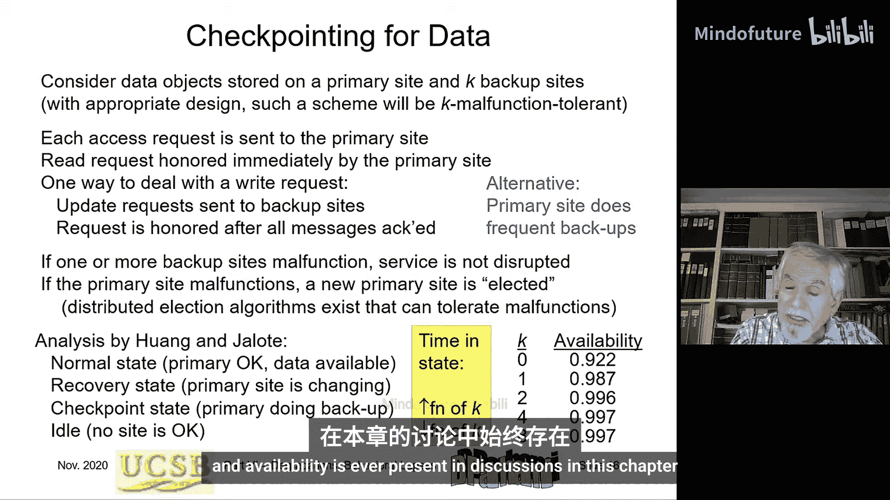

When you have asynchronous or distributed checkpointing。Then each process decides on its own。

 there's no central authority to tell the processes to checkpoint。

 each process at some point decides I want to checkpoint， checkpoints， checkpoints。

 so these green boxes are checkpoints and the checkpoints are different for a different process okay。

So if something goes wrong at this point。We detect the malfunction in the system and determine that。

 let's say these four processes have been affected。H。

Dots indicate that these four processes have been affected。

And if these processes are independent and you basically individually roll them back。

 so this one goes to the beginning。This one goes to his last checkpoint。

This one goes to this last checkpoint， which is further back。This one goes to his last check。

As long as these processes are independent then。No additional problem arises。Of course。

 when you have multiple processes in most systems， they are often communicating processes。

They interact with each other。So here I've shown， let's say， a message being sent by this process。

So this is event 3。1， event one for process three。This is event。

One for process five to sending of this message is an event for that process。

the reception of that message is an event for this process， and of course。

 the cause effect relationship says that this earth this event occurs later than this event。Okay。

 now。What happens here？Well， if you have to roll back， this process was unaffected， okay？

So it means this process will not be rolled back， it will just continue from this point as if nothing had happened。

This process will be rolled back here。Okay。So no problem， the interaction occurred。

Before this checkpoint， so whatever effect。To happen， whatever data had to be transferred。

 it was transferred and no problem arises。This event。

This message transmission does not cause a problem。What about this one， here's again。

 another message， another interaction。Between these two。

 well these two are not affected at all by the malfunction。Again， no problem。

Here is the first instance of a problem。There is an interaction between process one。

 let's say sending up a message。From process five， receiving F message。Now， if I roll back。

Process five。Because it was affected by the malfunction to hear。

Then the next time I execute this part， this interaction will not happen because that process was not rolled back。

Even if it were rolled back， it would be rolled back to this checkpoint。And therefore。

 still this event will not happen again。And therefore。

 the next the second execution of this part of the process will be missing this interaction will not receive this data and therefore will not operate。

As in the first instance。Okay， so when you have interacting processes like this one。

You have to find a set of consistent checkpoints to which you should go so in this case。

Because I want this message to be sent again， even though this process was not affected by this malfunction。

 I have to roll it back all the way to here。Okay， but if I roll back that one to there in this interaction。

will not occur in the next execution， so I have to roll back this one to this point okay so its kind of chain reaction occurs when I roll back one process that interact it with other processes that may lead to rollback in those other processes。

And in fact， in the worst case， I may have to roll everything back to。The beginning。

Because there were so many interactions that。As I try to maintain consistency。

I have to roll everything back to the beginning。Okay， so basically。

This may be a set of consistent checkpoints for these processes。

If these are the only interactions between them， then these checkpoints。

Form a set of consistent checkpoints or a recovery line。So when something goes wrong here。

 I rolled them back to these checkpoints in order to maintain consistency so this is a nontri problem in this example I was able to determine it。

 but if there are a whole lot of interactions then it's，Non trivial to find these。

 and if these are independent processes then。Kind of hard to determine what each of them has done in the course of its running。

 what checkpoint it。Kept， so we have to consult a lot of different tables to。

Determine what checkpoints。There are and which subset of the checkpoints form a recovery line？Okay。

 so I just wanted to point out the difficulty here， not the solution。

 the solution is rather difficult。

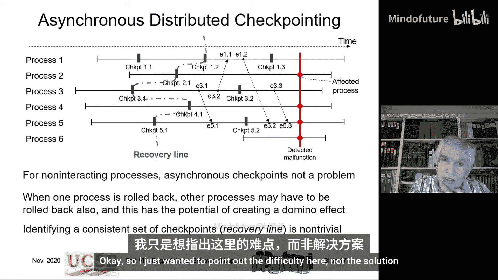

Okay， the final part of this chapter is discussion of optimal checkpoint insertion， as I mentioned。

 that the checkpointing overhead increases with the number of checkpoints。

 each checkpoint will have some overhead some time spent recording data。

So this is typically an increasing function of the number of checkpoints。

And then the expected work for recovering from a malfunction。

 is the decreasing function of the number of checks。More checkpoints you insert。

 the less rollback you have to。Perform and the less repetition。Of the computation。

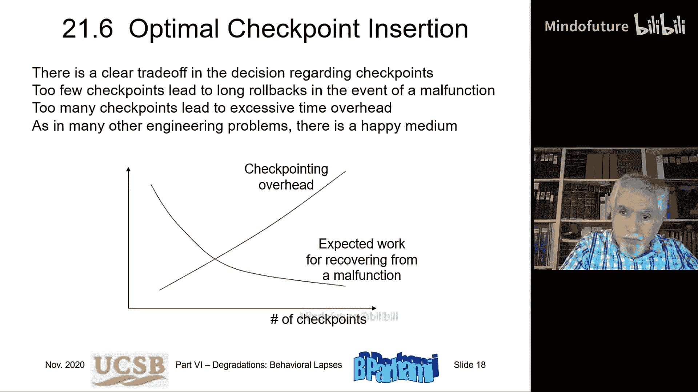

Okay， so let's take an example again， there are a lot of simplifying assumptions in this example。

So that we can。The computation is manageable。Because we are basically doing manual computation。

So assume we have a program that runs for time T。And I divide this program into Q segments。

Equally spaced， okay， this is the first simplifying assumption because。You know。

 equally space checkpoints are often not practical。So I divide the program into Q segments。

 therefore insert Q minus1 checkpoints。Okay， so the program runs for T over Q time。

A checkpoint is inserted。The state of the computation is recorded in stable storage and we continue the next segment and so on。

So this is basically the model， state space model of the system。

There's the start state where nothing of the task is done。

Then this is a state where this one of the task is done， it checkpointed。

 and therefore we never have to go back。Beyond this。

This is the state of the system at this checkpoint。

Okay now the probability that the system goes from here to here is not one。

 meaning that malfunctions can occur。And the probability of malfunction。

Is basically lambda times t over Q。UerQ is the amount of time， the time interval。

And Lambda is a failure rate。So this is the probability of。

Some malfunction occurring and one minus that is probability that successfully go from this state to this state。

Okay。And given that all of these intervals are identical， then the same probability。Okay。

 our objective is to end up in this end state。Okay， so with some probability we go here。

 some probability we go here， if we don't go here， that means we stay。

 so with probability lambda t over Q， we remain in this state。

Probability lambda he overcu would remain in the state。Okay， so this is a discrete Markov model。

And these numbers， these values are probabilities， so this is less than one。

Probability less than one we go from this state to this state。So computation time。

Originally was T computation time with checkpointing。From this model is computed to be T。

Over1 minus lambda t over  Q， you should be able to determine that。So T over this probability。

Plus Q minus1 checkpoints times the checkpointing overhead。

The amount of time we spend in each of these checkpoints is TCP。

And therefore Q minus one checkpoints have， so this is the total running time。With pickpointing。Okay。

Some algebraic manipulation， thats easy to prove the equivalence of these two expressions。

I write this as T original time plus。These other terms are the overhead。

The overhead consists of two parts， the checkpointing overhead。And the rollback。

 so this is the rollback overhead the amount， sometimes we don't go from here to here。

 we have to repeat this computation。🤢，So the sum of all those rollback overheads is reflected in this term。

So T， the original time。Let's roll back overhead。Plus， checkpointing。Okay。

 notice that the rollback overhead is inversely proportional with Q。So the larger the value of Q。

 the better off weR in this term。This is directly proportional to Q。

The larger the number of checkpoints， the more okay this term is inversely areas inversely with Q。

 this term areas directly Q。Okay， if I differentiate this with respect you。

And equate the derivative with0。I find that the number optimal number of segments。Remember。

 Q minus1 is the number of checkpoints。The optimal number of segments Q is given by this function。

So t times lambda plus square root of lambda divided by TCP。So you see that。

The optimal Q is directly proportional to T， the larger the value of T， the larger。

Number of optimal number of checkpoints， which makes sense if this is a very long running computation。

Can we better have a lot of checkpoints？It's also directly proportional lambda。

 the higher the failure rate。The more。Epoint we should have。

And it's inversely proportional with the checkpointing overhead。

 the larger the checkpointing overhead， the smaller the optimal number of checkpoints。

So it makes sense。That's why this particular function that's not very intuitive。Okay。

 so here's a numerical example， suppose T is 200 hours。Lambda is 0。01 per hour。

And the checkpointing overhead is 18 of an hour， so we have to record a lot of data on disk and that takes a long time。

Then with these particular numbers plug in into here， the optimal Q is 42。

So that means we will have 41 checkpoints， these assumptions。And the total running time will be 215。

 so the original running time was 200。The total running time is 215， which is not bad。

 so basically 15 hours。Is the total overhead。For the rollback。Time and for the checkpointing time。

So about 7，8% overhead。And running time to do checkpoint。Okay， now if I。Now there's a warning here。

 the model is accurate only when t over Q is much less than1 over lambda T over Q remember was the time duration of this one segment of the computation。

And the model is accurate only if that's。Much less than the mean to failure。Okay， so。

Here we computed the derivative of T with respect to Q if you compute the second derivative。

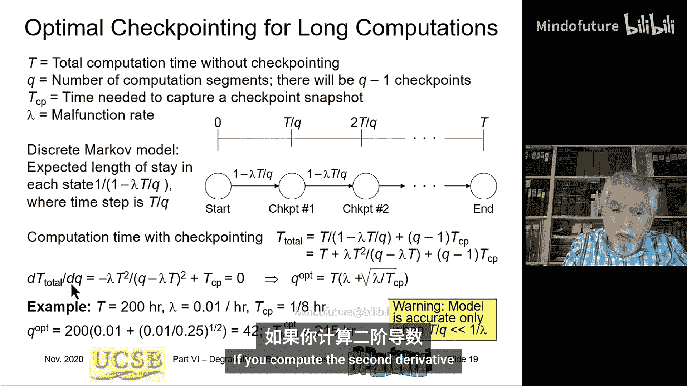

That second derivative can be proven to be positive all the time。

 so means the variation is sort of like a。Like a ball。The second derivative is positive。

Meaning that the curve。Is concave when you look at it from？Above。

And here with different values of TCP that is demonstrated。

 so TCP 18 was the assumption in the previous slide。If you do say checkpointing overhead one hour。

 a lot more checkpointing overhead。And for different values of U， see the total amount of time。

403 for four checkpoints。305 for six shape check。 so six is better than four。274 with eight。

 still better。259 with 10。You41 with 20。Then it starts increasing， as I mentioned as now。

 it's a bowl shaped curve。Because the second derivative is positive。Okay， so for this particular。

Case， checkpointing overhead one hour。Of course， 20 may not be optimal because I have not computed this for all。

Lads of Q between 10 and 20 and between 20 and 30， but it will be the optimal will be around。

20 maybe a little bit more， a little bit less。Okay， so all these highlighted entries。

 so you see in the checkpointing overhead， it's very large。And optimal Q will be much smaller。

If there is。If there's a much smaller overhead 18 than the optimal。Q， we be determined to be 40。

The reating in the previous slide， 42。42 is missing from the data here。This data 50。For 42。

 what was the？Value is 215 hours。So 40 and 42 are really not much different。

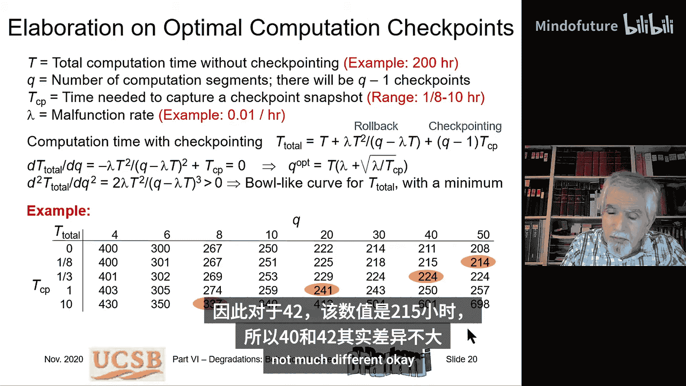

Okay。Now here is there are different ways you can analyze optimal checkpointing。

 this is with a different set of assumptions in transaction processing the difference in transaction processing is that when you are within one of those intervals。

This is the beginning of the interval， this is the checkpoint for that interval。

 the end of that interval。So there's a checkpointing overhead。Tcp。At the end of the interval。

But rollback is also not free of charge。In the previous example， rollback。Basically。

 you went to the beginning， so the penalty of rollvi was just a computation， recomputation。

But sometimes the actual rollback。It involves undoing stuff。And the overhead of going back here。

be linearly proportional to where the malfunction。If the malfunction occurred at x。

We have a rollback overhead。That is proportional， linearly proportional to x。

 so let's say the function a plus bx， so there's some constant overhead plus an overhead that is。

Basically a multiple effects， this is because the more advanced you are in this interval。

The more remember we said we have logs， you have logs and you have already done some stuff here and you have to roll back。

 you have to undo the effect of the stuff you did。Okay。

 and that takes time that is proportional to X we assuming this model。ok。😊，So again， with this model。

 we can determine the optimal checkpointing which will be different， of course。

 because we are doing different assumptions。And this time。诶。So there is the checkpointing overhead。

 there's the rollback overhead。And then， this is minimized。For PCP， basically the interval。

The checkpointing interval。Square root of 2 TCP divided by lambda B again。

 you see that this interval。Ass directly proportional to TCP。In other words how much overhead I have。

 the checkpoint， the more overhead I have。Then the larger this optimal interval。

Is inversely proportional lambda。And inversely proportional with this coefficient B。Okay。

So here are some numerical examples that I'll let you read on your own。So here with different TCPs。

Yeah 16 minutes thinking overhead。In the second example。We have。Let's say one minute。

So the checkpointing overhead is large because。We have to store things on disk。

 suppose we provide fast memory so that the checkpointing overhead。

Let's say flash memory is reduced from 16 minute to one minute。

 then the optimal interval for checkpointing reduces from 13。3 hours。

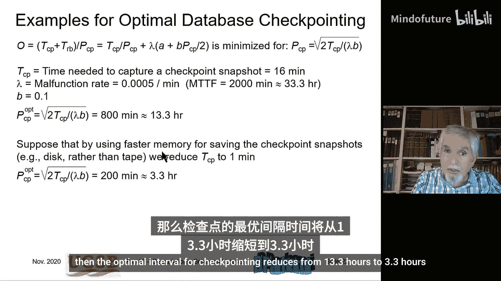

The 3。3 hours。Okay， let me now cover a few ideas from。Chapter 23。

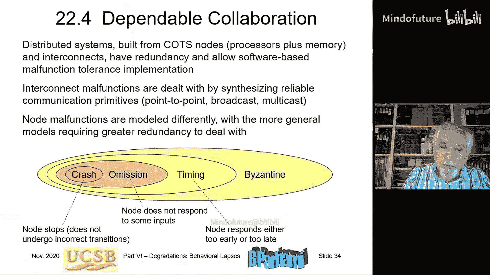

Dealing with resilient algorithms。😔，ok 诶。For much of the history of fault tole and computing。

People basically dealt with。buildinging system up from scratch， in other words。

 you design a system that is fault tolerant because you build in fault tolerance capabilities into it。

This is a pretty expensive process and not。Every organization can afford that， you know。

 organizations such as NASA。The Department of Defense。

 they have huge budgets and they can afford to build。Their own custom aid systems。

For the rest of applications， we prefer to build systems from commercial off the shelf。Component。

That are much cheaper。So we buy a processor from Intel or from arm。If buy memory， it tips from。

Another supplier and so on， so these are commercial off the shelf components that don't necessarily have any fault tolerance built in。

 and we have to build fault tolerance on top of these standard conventional commercial components。

Okay。So。There are， of course。Vendors that。Market。They call fault tolerance system。

 different levels of fault tolerance， for example arm as its fault torant version of arm。

 these may or may not be adequate for the purpose that you have in mind。

 but it's worth looking into them to see whether the amount of fault tolerance that they provide is enough for the application that you have in mind。

So there are commercial suppliers that basically sell fault toer and computers。Now。

 going back to the commercial off the shelf。Approach。

 this approach started in the 1970s with a system that was built by Stanford。

Actually Stanford and MIT were building rival systems。

 Stanford was focusing on software implemented fault tolerance。

And MIT was building a hardware implemented。Fallult tolerance system。

So the Stanford approach is more compatible with off the shelf component strategy they just bought。

Processors， memory modules and so on。 The only thing that they built from scratch for。

What they call sift software implemented fault tolerance system。

So the only part of CF that they actually built from scratch the special bus system。

 it was a critical part， so they built a bus system。

 but everything else was basically commercial components that they purchased。

the objective of both of these MIT and Stanford system systems was to achieve a system failure rate of 10 to the minus9 per hour。

Over a 10 hour flight。They were intended for aircraft。

So 10 to the minus9 per hour over a 10 hour flight translates to a failure rate of 10 to the minus8。

AF， flight failure of 10 to the minus。Okay。

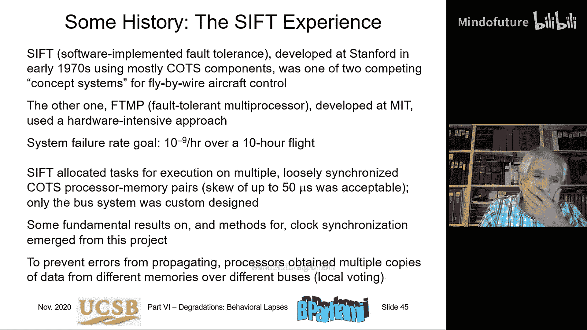

Of course， Cob's approach has a lot of limitations because。诶。

You may or may not be able to build fault tolerance features on top of something that's already been built and you had no control over。

So various approach like coding， like pary codes and so on are used in some of these systems。

 and retry capability is often provided so when an instruction is executed，And for some reason。

 the system detects that the instruction was not。Execut that correctly。

 they have retry capabilities and so on。 So there are some things that are built in。

And may be useful。But you have little control over them。Okay， let me skip the rest of the slide。

So some of the things that you can build on top of these commercial systems that are not specifically fault tolerance are discuss next。

 so robust data structures。As the idea of。Let's say you have a list， so a list is a data structure。

Let's say three element list containing X， Y， and Z。Okay。

 so a data structure is more than just the data that is in this structure， so X。

 Y and z are the elements of this data structure， but the ordering of X， Y， and z， the first element。

 the second， the third is also important it part of the information in this data structure。

In other words， if the elements are changed to Y Xz， then it's no longer the same data structure。

 even though the contents are the same。So the ordering is important。So。One of the。

Ways you can protect such a data structure against corruption or changes。

Is to add a check some at the end。So a check some protects the entries from changing。

 so one of these entries changes from x to let's say x plus 1。

A checks on may be violated and you find out， so it's an error detection scheme。On the other hand。

 if x and Y change places。And the check some may not change if it's just a straight checkone。However。

 if you wait if you use weights for this， so for example。

 the check sum will be1 times x plus2 times y plus3 times z。That checkon will take longer to compute。

 but it's resilient to change of locations， so if x and Y are different。

Then one times x plus two times y would be different than two times x plus one times y if these two switch。

Pces。Another idea is to store in a different field the difference between。Successive entries。

 So this is a form of duplication except that。诶。Because this is a different number than x。

 it's more resilient to certain types of errors。So the difference between x and y is stored here so that if x or y changes。

Okay， if x and Y switch places， then you can detect it with this。This is for lists。

Here's how you can protect the linked list， a linked list of course， is not resilient at all。

Because if you lose one of those links， if one of those links is corrupted。

So that it points to some other element other than the correct element here。Your other fuck。

You basically have lost access to these elements of the list。Okay。

 and this one may in turn lead to something else of totally incorrect elements for the less of the list。

So how do you protect such a list？One idea is to store an ID。In each node。

 so that that ID identifies these elements as belonging to a particular list。

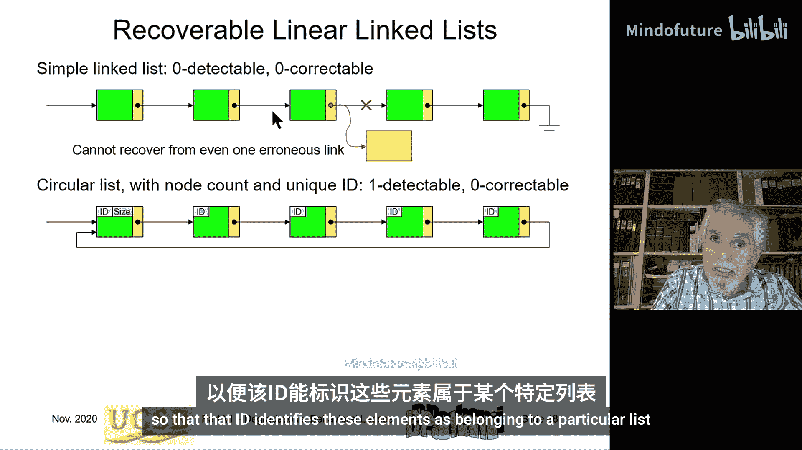

So this is list X， so the ID will be x， therefore if this happens and you go to a different location at ID。

 not there and you detect。Corruption。So this is error detecting if you store ID also if you put this。

Make it into a circular list。Then。This will be one error detectable。Okay。

 you also store the note count here so that if this。If one of the length is corrupted。

And points are somewhere else， you can detect that。If you go to the Bly linked list。😔。

Then it counts two detectable one correctable， another was one of those links。Can be corrupted。

 changed。And you can correct it because it's doubly linked。

I won't go into the details of how corrected， generally speaking。

So you can do this for other data structures， trees。Fifful， hs and so on。In general。

 a linked data structure is two detectable and one correctable。

If and only if the Li network is too connected。

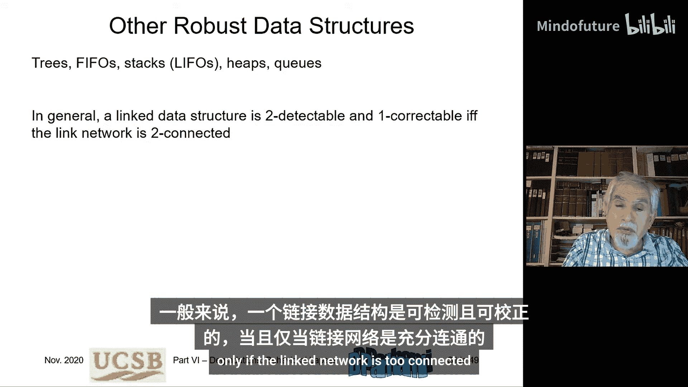

If you look at this。Link network here is too connected means from any。Note to any other node。

 there are two distinctint paths， so going from this node to this node， let's say this one。

 the middle one to this last one。This is one path。And this is another pill。

So the Link network is too connected， therefore by that general result。

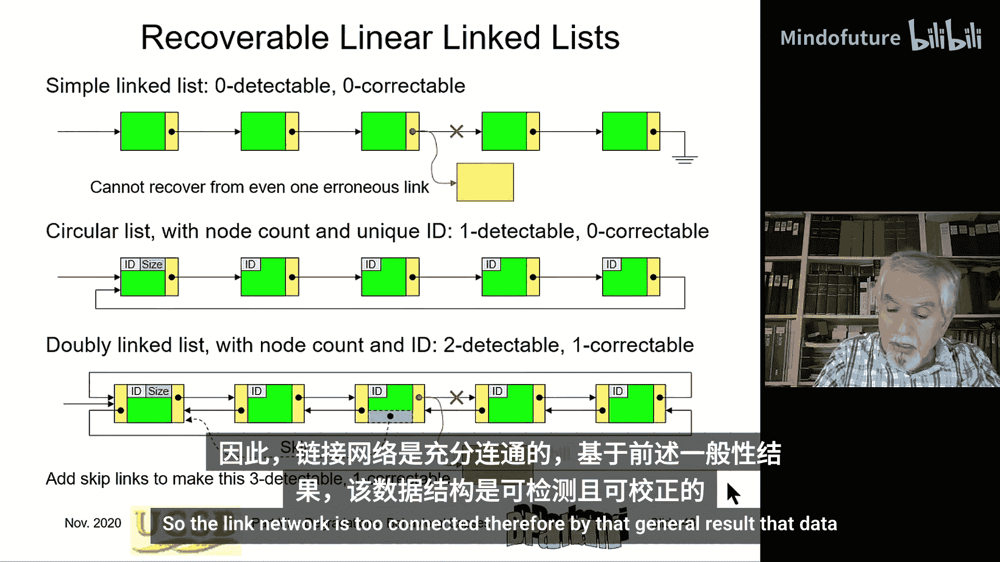

That data structure is two detectable and one correctable。

TheseSo robust data structures are things that you can use on top of commercial of the shelf components。

In order to protect against data corruption。So this is basically a type of software implemented fault tolerance。

Her algorithm implemented fault tolerance。

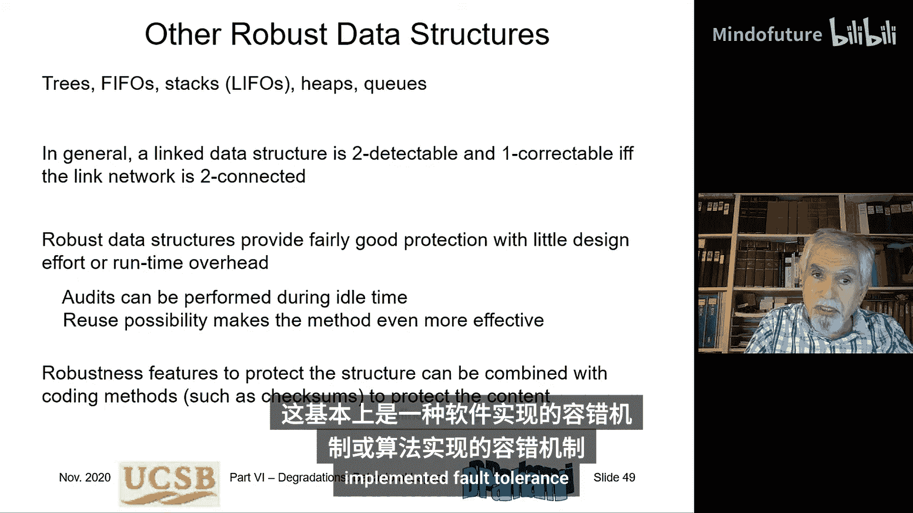

Here's an example of a binary tree， again， a binary tree is not robust because of one of the links。

It's corrupted。Then you lose access to this part of the data structure。However， if you。Basically。

Use a single bit to。Distinguish non leaf node from leaf node， so this is a non leaf node。

 this is a leaf node。And these links at leaf nodes become。Freed。

And you can use them to provide more robustness， so for example。

 you can make this link so you know this is a leaf note。So there are no children。

 this link is now used to point to， let's say， in this case， to the root node。

Or to some note higher up in the tree， and therefore now your tree becomes too connected。

 so from here to here there are two paths。One path and two path。

 therefore it will be one correctable。

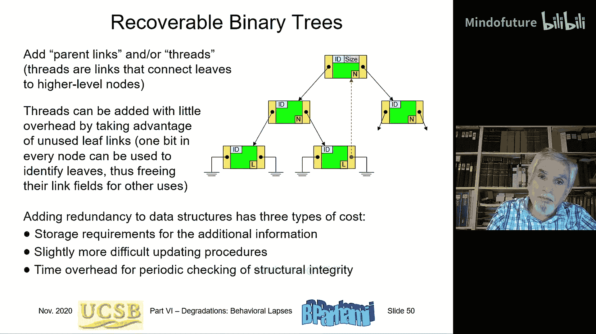

Okay another idea is to use what is known as data diversity。

 so what is data diversity here is a very simple example if you want to specify a rectangle。

You can specify it by its x and Y dimensions。You can specify it by the length of the diameter and the angle between the two diameters。

 so these two numbers also specify the rectangle uniquely。

 you can specify it also by this radius of the circle inside the rectangle。

And the circle circumscribing the rectangle。So these two numbers， so x and y， z and alpha。

 little R and big R are all ways of。Diverse ways of specifying this rectangle。诶。😊。

So this is known as data diversity。The good thing about data diversity is that you can obviously duplicate x and duplicate Y。

八三。The malfunctions may affect the two copies of X in the same way。

 but malfunctions are less likely to affect diverse data。In the same way。

So it's more likely to be detect。

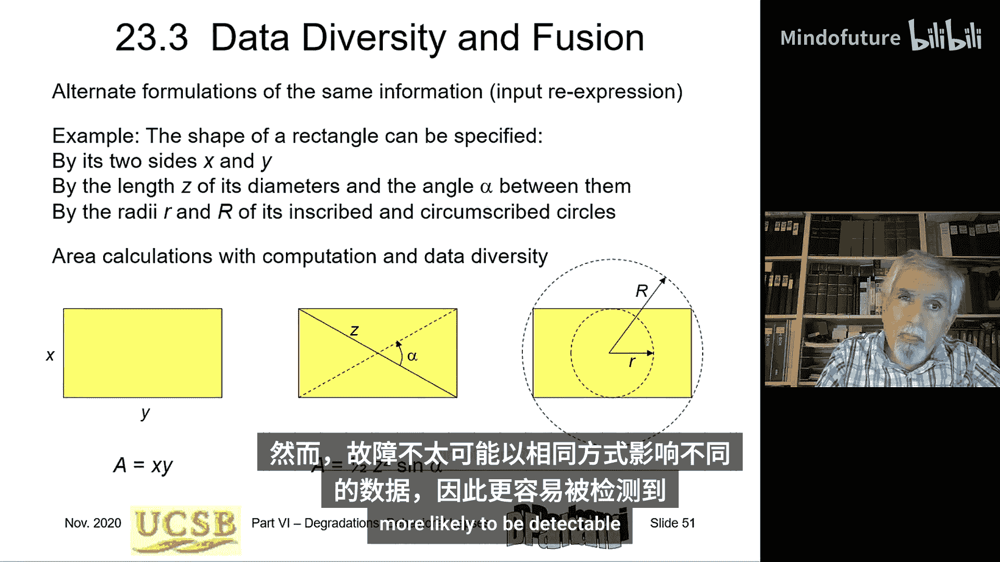

Here's another idea and this is application dependent for matrix computations a long time ago this scheme was designed。

 it's a way of encoding matrices so that。Errors in matrix operations can be detectable。

 so here is a matrix， a very simple matrix M。And here I've made all the elements less than eight。

But they don't have to be， they can be just regular integers or floating point numbers。Okay。

 you do row check sums， module A check sums， and compute a row check sum matrix。Okay。

 so2 plus 1 plus6 is9， which is1 minus8 and so on， so these are the row check sums。

 we can also do column check sums where you can do both of those。Full checks out matrix。Okay。

Now if you do this to a matrix。If z is the product of the two matrices， x and Y。

Then the full check sum matrix of Z， this is provable is the product of the column check sum matrix of x and the row check sum matrix of Y。

 so let's take this in the next slide， the example of this。So here are x and Y。

Here is the column checkum matrix F。Multiplied by the row check sum matrix of y。

And this is the product。Okay， so two times， let's say this element 46。

Comes from two times1 plus1 times2 plus six times seven。Just a regular matrix multiplplication。Okay。

And it turns out that。This matrix。The check some。Matches so you just multiply these two matrices now this is which is 4 modular8。

 the correct check sum for the sum of these values。Okay。

 now if something goes wrong in the course of multiplication。

 then these check sums are not likely to match and therefore you detect it。Now as a data structure。

Thiss full checks on matrix。Can correct a single error。So if this。One changes in value。

And this checkum will be violated。And this check some will be violated。And you can correct that。

If you have two。Errors like one and six in error。Then it's possible that the row check sum is not violated。

But you can still detect it because the two column checkums。Will be violated。Okay， now if you have。

F things going wrong， then it's possible that all four check sums are correct and therefore you don't even detect that。

So this particular scheme。Is one correctable and two detectable？Okay， for three， if one。

 six and three are。Aoneous and this chium may be correct， this chium may be correct。

 this chium is violated and this chicksum is violated。

So you would think that it is this element that is in error。Okay。

 so you would erroneously try to correct that， even though these three are erroneous， okay。

 so three errors are not detectable。Two errors， so this is one correctable， two detectable。

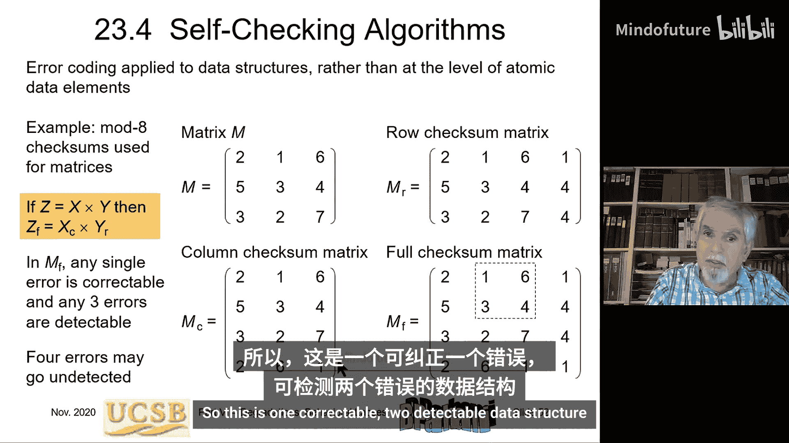

Data structure。Okay。All right， the next two sections don't have anything in them。

 so I'm going to stop at this point and I will see you。In lecture 14。

 just the rest of this part of the textbook。Okay， bye until Dan， stay safe。

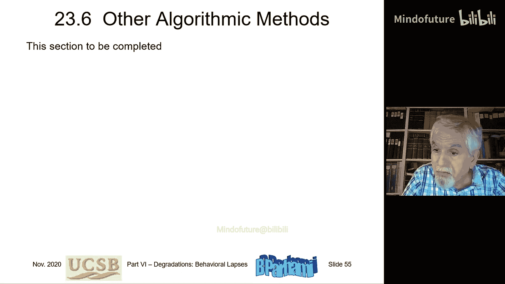