# 容错计算：13：退化允许与弹性算法 🛡️

在本节课中，我们将要学习容错计算中的两个核心概念：**退化允许**和**弹性算法**。我们将探讨系统如何在发生故障时优雅地降低性能，以及如何通过软件和算法层面的设计来增强系统的容错能力。

## 概述 📋

本课程内容基于教材第六部分“适应与行为失误”的前两章。本章节将涵盖第21章“退化允许”和第23章“弹性算法”。我们将学习如何设计系统，使其在组件发生故障时能够继续运行，尽管性能可能下降，而不是完全崩溃。

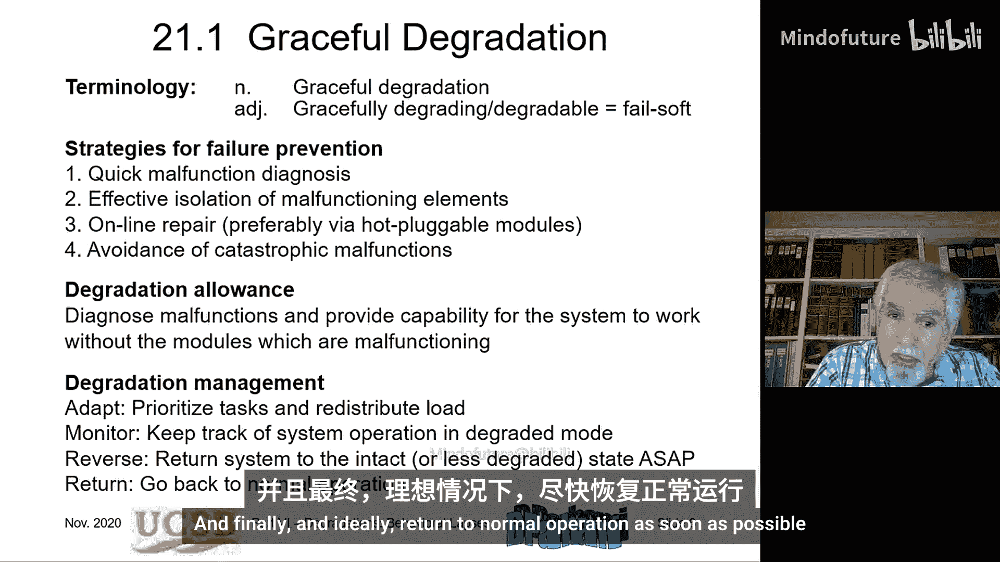

## 第21章：退化允许 📉


上一节我们介绍了课程的整体框架，本节中我们来看看什么是“退化允许”。

### 优雅退化的定义

**优雅退化**指的是计算机系统的性能或其他属性在发生故障时能够**逐渐地、可控地**下降。这有时也被称为**故障软化**行为。一个能够优雅退化的系统等同于一个**故障软化**系统。

其对立面是系统在发生最轻微的故障时就彻底崩溃。优雅退化是可取的，因为它允许系统在部分功能丧失的情况下继续运行。因此，防止完全失败意味着我们允许系统优雅地退化。

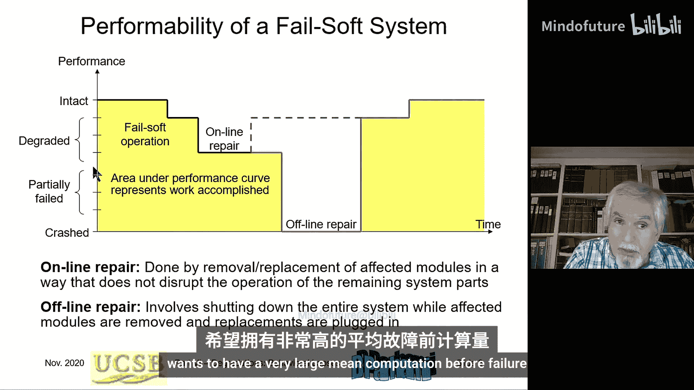

### 实现优雅退化的要求

为了实现故障预防和优雅退化，系统需要满足以下要求：

*   **快速故障诊断**：必须能立即发现系统某部分出现故障。
*   **有效隔离故障单元**：能够隔离发生故障的元件。
*   **在线修复能力**：无需关闭系统其他部分即可修复或更换故障部件，例如通过**热插拔模块**实现。
*   **避免灾难性故障**：必须避免影响系统多个部分的故障，否则优雅退化将无法实现。

对于单一或有限的故障，系统必须能够快速诊断、隔离故障元件，并在系统其他部分继续运行时进行在线修复。

### 退化允许并非自动实现

即使一个系统拥有20个处理器，也并不意味着当其中一个处理器发生故障时，其他19个能自动继续正确运行。这个特性必须被设计到系统中。

### 退化管理

退化管理涉及在系统能力降低时采取的行动，这将在下一讲中详细讨论。主要包括：
*   **任务优先级排序**：执行对系统运行更关键的任务。
*   **系统监控**：跟踪系统在退化模式下的运行状态。
*   **逆转故障影响**：使系统恢复到完整或较低退化状态。
*   **恢复正常运行**：尽快使系统恢复正常。

### 故障软化系统的可执行性

故障软化系统的性能水平可以从顶部的**完整功能**到底部的**崩溃（无功能）**。在这之间存在不同级别的功能状态，接近完整的称为**退化**，功能大幅降低的称为**部分失败**。

系统随时间运行，可能从完整状态因故障降至下一级。只要系统在这些退化状态之间波动，它就能继续运行。如果能够进行在线修复，系统可以恢复到较低退化状态甚至完整状态。

如果系统进入崩溃状态，则需要进行**离线修复**，这是不太理想的。在理想的故障软化系统中，我们应努力保持在退化状态，避免进入崩溃状态。

系统在各级性能状态下工作的时间所围成的面积，代表了系统完成的工作总量。我们希望最大化这个面积。

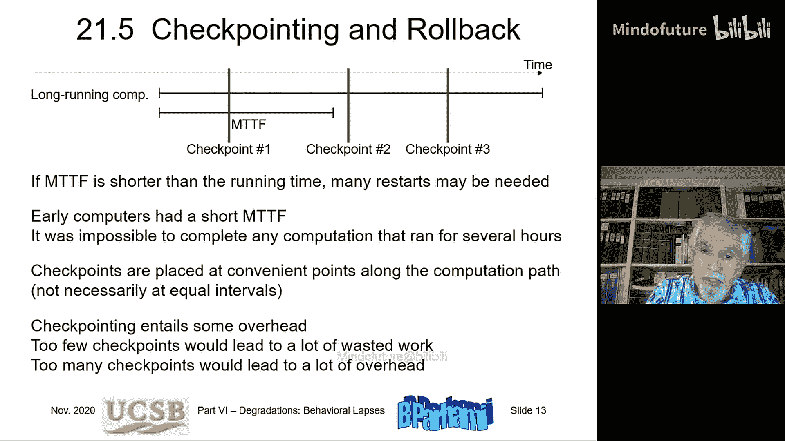

系统在发生完全故障前所完成计算的平均值，称为**平均故障前计算量**。这是一个评估此类系统的重要指标。对于一个永不进入完全故障状态的系统，这个值趋向于无穷大，这是最理想的状态。

### 从故障中恢复的步骤

当诊断出故障并移除故障单元后，系统需要执行一系列恢复步骤：

1.  **更新系统**：更新操作系统资源表，使其能适应更有限的资源。
2.  **物理隔离故障单元**：例如，通过总线守护机制防止故障单元干扰总线通信。
3.  **启动修复**：进行物理修复或更换。在某些场景（如航天器）下，可能仅进行隔离。
4.  **创建新的工作配置**：
    *   排除故障的处理器、通道或控制器。
    *   避免使用损坏的磁盘扇区或文件。
    *   关闭噪声过大的通信信道。
    *   假设系统有足够的冗余，在移除部分资源后仍能执行主要任务。
    *   对于故障的内存部分，可通过**虚拟地址映射**将其重映射到其他正常区域；对于缓存，可以减少其大小继续运行。
5.  **恢复进程及相关数据**：常用技术如**检查点与回滚**。

### 稳定存储与日志

能够从故障中恢复的一个要求是拥有**稳定存储**，即不会丢失内容的存储（如闪存）。结合编码技术（如RAID）可以提供稳定性和可靠性。

**日志**对于恢复至关重要。当数据库或稳定存储发生更改时，我们将更改记录在日志中。如果发生故障导致更改丢失，我们可以利用之前保存的数据库状态和记录更改的日志来重建系统。

理想情况下，进程应在运行结束时才输出结果或更改数据库，这样如果进程因故障中止，不会对系统造成永久性损害。对于涉及执行器（如工业控制）的进程，其操作可能是不可逆的，设计时需要特别考虑。

### 检查点与回滚

这是一个非常重要的概念。对于运行时间可能超过系统平均故障间隔时间的计算任务，插入**检查点**是有效的解决方案。

检查点是系统在某个时间点状态的记录。如果故障发生在某个检查点之后，我们可以从该检查点重启计算，而无需从头开始，从而节省时间。然而，设置检查点本身也有开销。

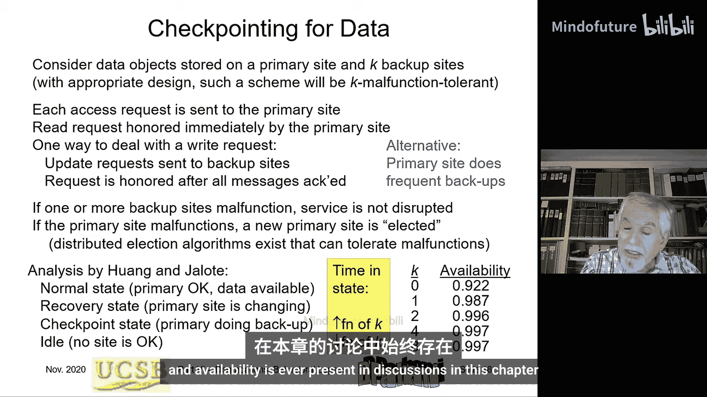

**检查点开销**与**因回滚导致的计算重复开销**之间存在权衡。检查点太少会导致大量计算重复；检查点太多则会导致设置开销过大。因此，存在一个最优的检查点间隔。

#### 检查点示例分析

假设一个计算任务运行时间为 `T`，系统平均故障间隔时间为 `MTTF`（故障率 `λ = 1/MTTF`）。将任务分为 `Q` 个等长段，插入 `Q-1` 个检查点，每段运行时间为 `T/Q`，每个检查点开销为 `T_cp`。

考虑一个简单的马尔可夫模型，系统从“任务未开始”状态，以概率 `1 - λ(T/Q)` 成功进入“完成一段”状态，或以概率 `λ(T/Q)` 因故障停留在原状态。最终目标是进入“任务完成”状态。

通过分析，包含检查点的总运行时间 `T_total` 可近似为：
```
T_total ≈ T / (1 - λT/Q) + (Q - 1) * T_cp
```
其中第一项是包含回滚重复的计算时间，第二项是检查点设置时间。

对 `Q` 求导并令导数为零，可求得最优分段数 `Q_opt`：
```
Q_opt ≈ T * √(λ / T_cp)
```
这表明：
*   任务时间 `T` 越长，最优检查点数量越多。
*   故障率 `λ` 越高，最优检查点数量越多。
*   检查点开销 `T_cp` 越大，最优检查点数量越少。

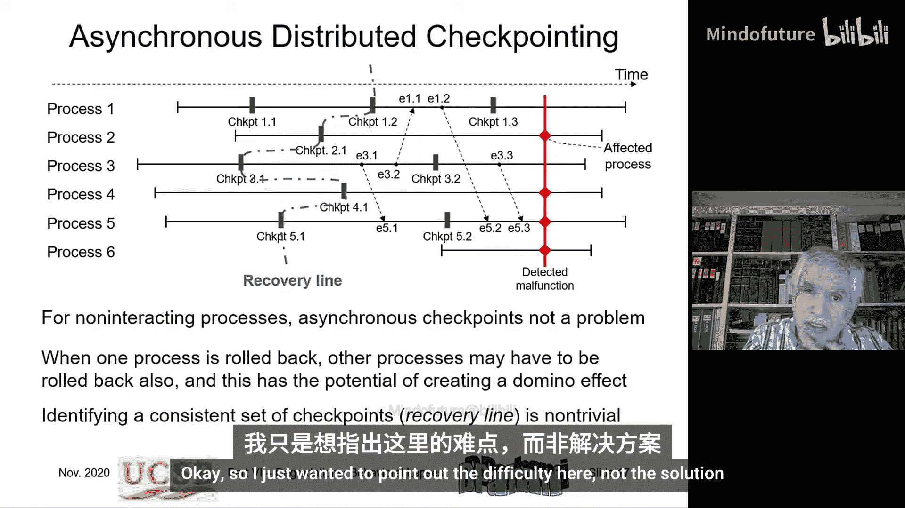

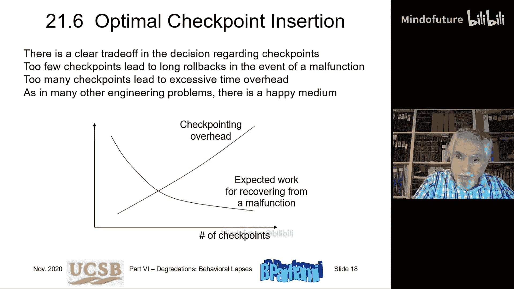

#### 交互进程的检查点

当系统中有多个交互进程时，设置一致的检查点（称为**恢复线**）变得复杂。如果一个进程回滚，与之交互的其他进程可能也需要回滚以保持状态一致性，否则可能因丢失交互信息而导致错误。在最坏情况下，可能需要所有进程都回滚到起点。

### 事务处理中的最优检查点

在事务处理等场景中，回滚开销可能不是简单的重新计算，而是与故障发生点距离检查点的长度 `x` 成正比（例如 `a + b*x`，`a` 为固定开销，`b` 为比例系数）。在这种情况下，最优检查点间隔 `P_opt` 的公式会有所不同：
```
P_opt ≈ √(2 * T_cp / (λ * b))
```

## 第23章：弹性算法 💡

上一节我们深入探讨了通过系统设计实现退化允许，本节中我们来看看如何通过算法和数据结构层面的设计来提升容错能力。

### 商用现货组件方法

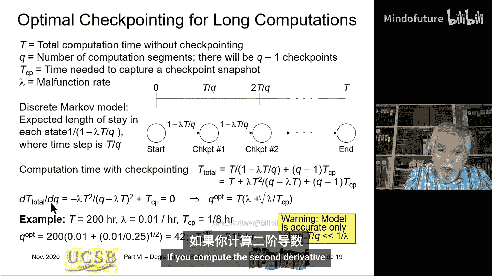

从容错计算的历史来看，许多系统是从头开始设计的，这通常成本高昂。更实用的方法是使用**商用现货组件**来构建系统，然后在其之上通过软件或算法添加容错功能。

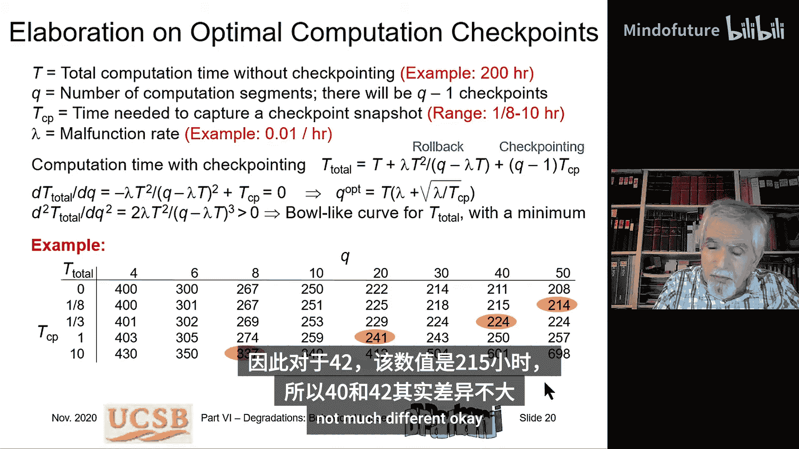

### 鲁棒数据结构

这是一种在现有非容错组件上实现容错的方法。目标是设计能够检测甚至纠正数据错误的数据结构。

#### 列表保护

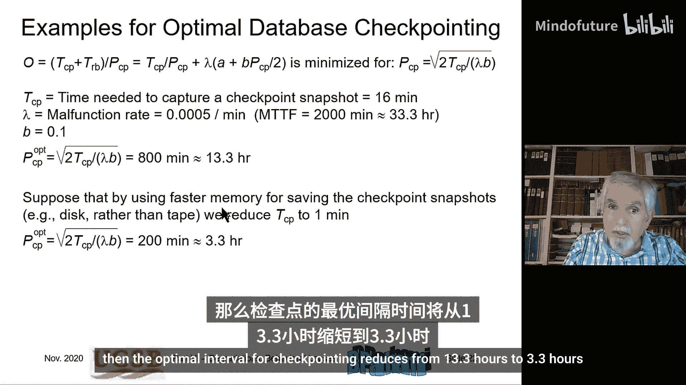

对于一个包含元素 `X, Y, Z` 的列表，其顺序也是信息的一部分。保护方法包括：
*   **加权校验和**：计算 `1*X + 2*Y + 3*Z`。即使元素值不变但位置互换，校验和也会改变，从而检测错误。
*   **存储差值**：额外存储相邻元素的差值（如 `Y-X`, `Z-Y`），作为一种重复形式，可增强错误检测能力。

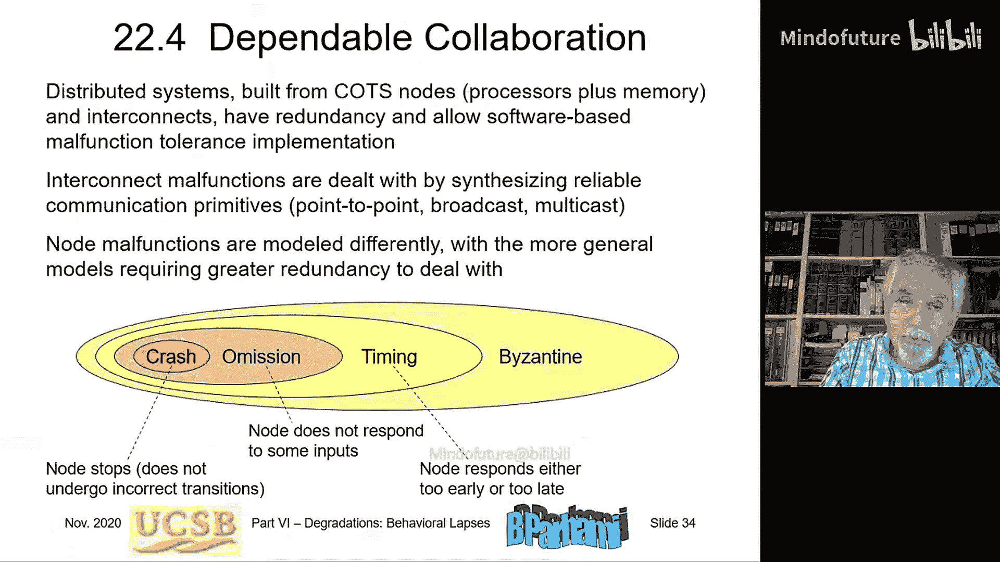

#### 链表保护

标准链表非常脆弱，一个损坏的指针就会导致部分数据丢失。保护方法包括：
*   **存储列表ID**：每个节点存储所属列表的ID，如果指针错误指向其他列表的节点，可通过ID不匹配检测出来。
*   **使链表成环**：可检测单个错误。
*   **使用双向链表**：可检测并纠正单个指针错误。
*   **通用结论**：一个链式数据结构的链接网络如果是**双连通的**（任意两节点间有两条独立路径），则它可以**检测两个错误并纠正一个错误**。

#### 二叉树保护

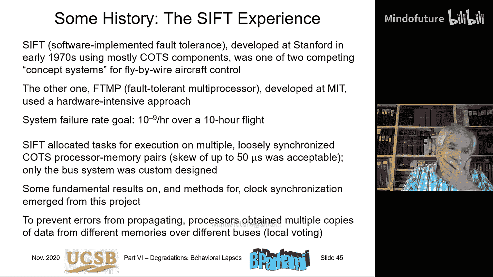

通过利用叶子节点的空指针，可以将其指向树中更高层的节点（例如根节点），从而将树转换为双连通网络，使其具备纠单错的能力。

### 数据多样性

同一信息用多种不同的数据形式表示。例如，一个矩形可以用长和宽 `(x, y)` 表示，也可以用对角线长度和夹角 `(d, α)` 表示，或用内切圆和外接圆半径 `(r, R)` 表示。

故障可能以相同方式影响相同数据的多个副本，但不太可能以相同方式影响**多样化**的数据表示，因此错误检测的可能性更高。

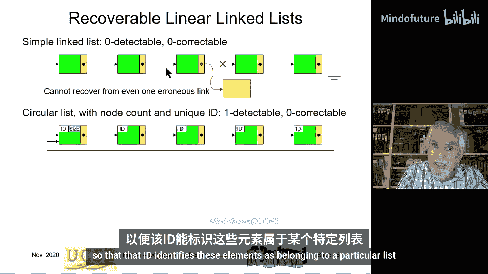

### 算法层面的容错：矩阵校验和

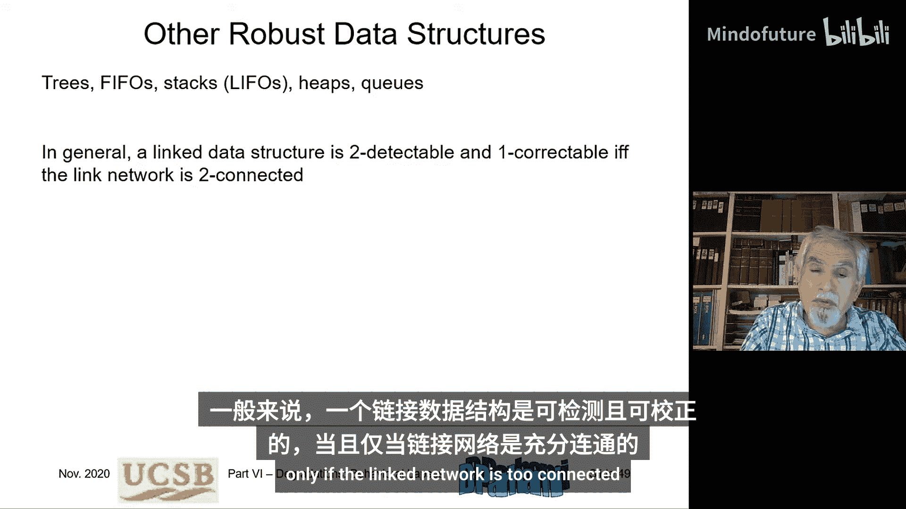

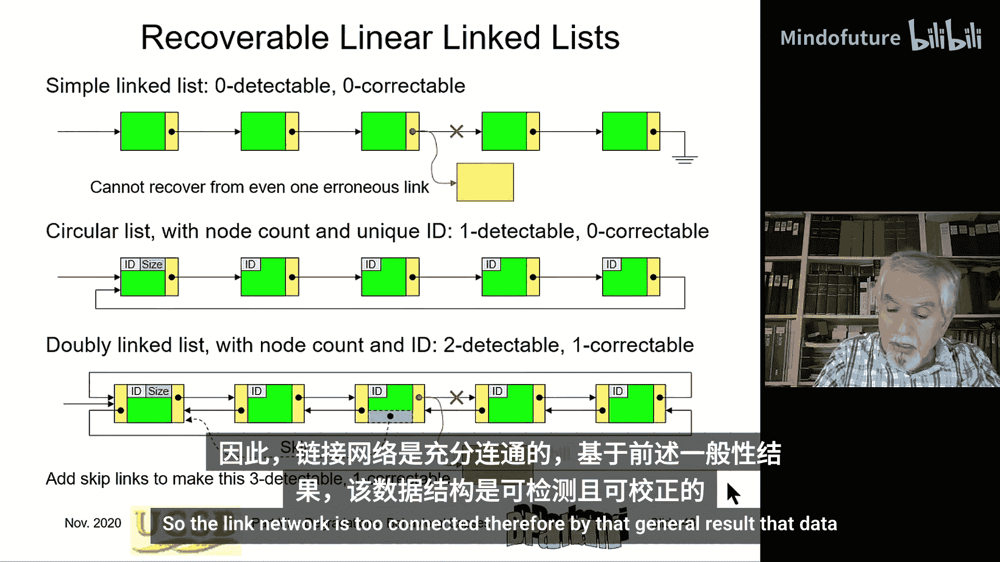

对于矩阵运算，可以通过添加校验行和校验列来构造一个**完全校验和矩阵**。对于矩阵乘法 `Z = X * Y`，有性质：`Z` 的完全校验和矩阵等于 `X` 的列校验和矩阵与 `Y` 的行校验和矩阵的乘积。

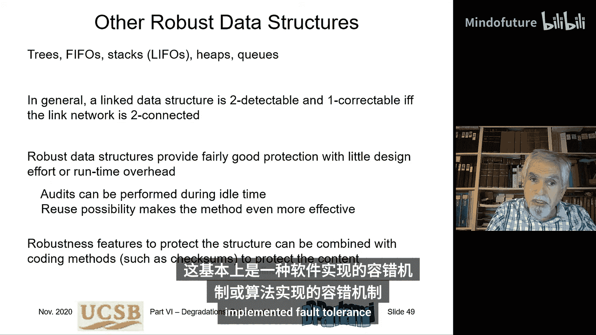

如果计算过程中发生错误，结果矩阵的校验和将不匹配，从而检测出错误。这种编码方案可以**纠正单个错误，检测两个错误**。但三个错误可能导致误纠。

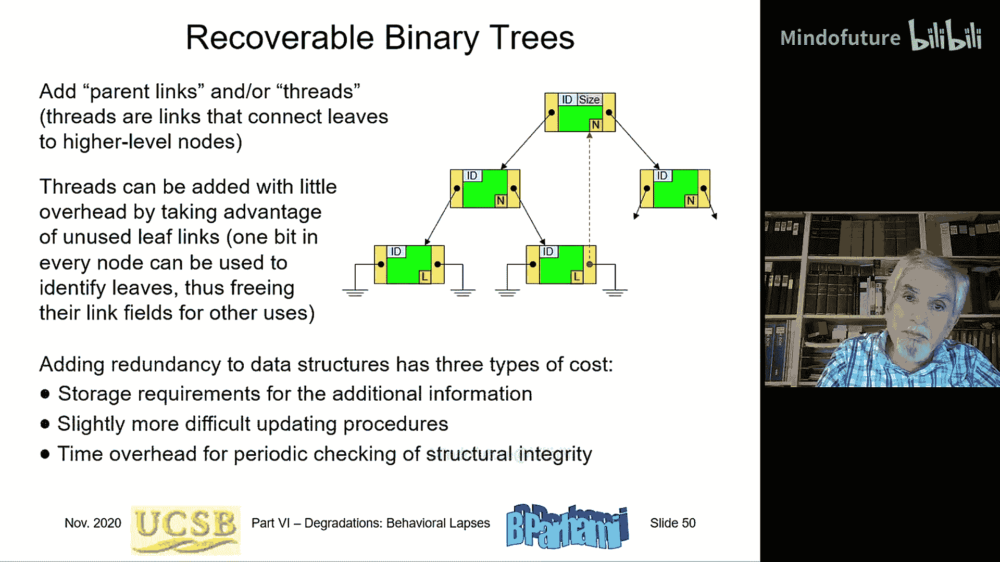

## 总结 🎯


本节课中我们一起学习了容错计算中的两个重要方面。

首先，我们深入了解了**退化允许**的概念。系统不应在发生故障时立即崩溃，而应能够**优雅地降低性能**，在资源减少的情况下继续执行关键任务。我们探讨了实现这一目标的要求，并重点学习了**检查点与回滚**这一核心技术，分析了如何通过权衡开销来确定最优的检查点策略。

其次，我们探讨了**弹性算法**，即如何在软件和算法层面，而非仅仅硬件层面，提升容错性。我们介绍了**鲁棒数据结构**（如通过加权校验和保护列表、增强链表和二叉树）、**数据多样性**以及用于矩阵运算的**校验和编码**等方法。这些技术使得基于商用现货组件构建的系统也能具备较强的错误检测和恢复能力。

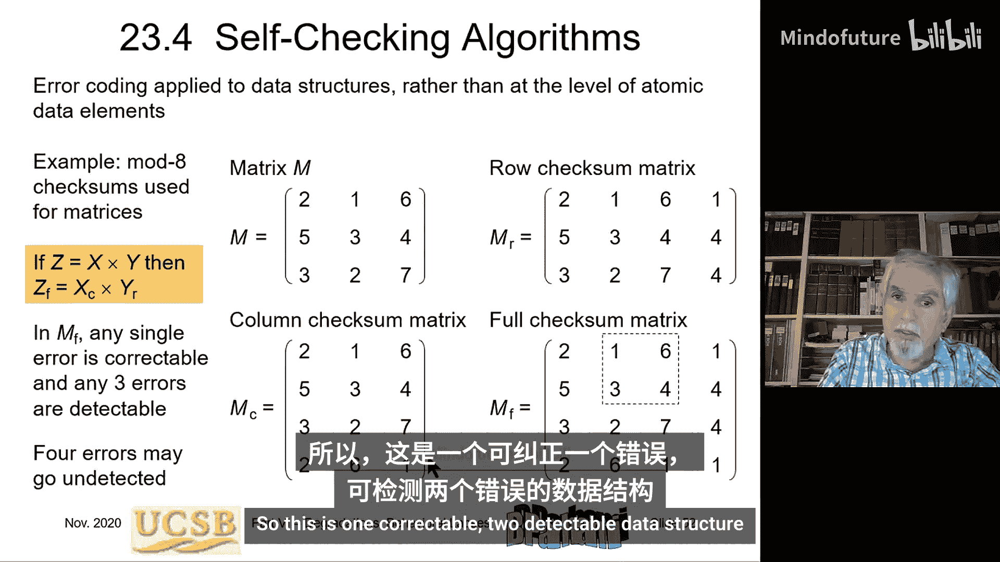


通过结合系统级的退化允许设计和算法级的弹性设计，我们可以构建出更健壮、更可靠的计算机系统。