# 【加州大学】容错计算-｜-Fault-Tolerant-Computing-Ucsb-Ece-257A-p14-P14_第14讲_第22-24章_退化管理--BV19cFyz8EPV_p14-

Hello and welcome to Lecture 14。For the course， ECE257A。Falult tolerancele computing。

This lecture basically finishes part six after textbook。By covering chapters 22 and 24。

 we cover chapters 21 and 23。In lecture 13。So the first item of business is defining what we mean by gradation management。

And then discuss various methods that are available to us。

For managing degradation previously we talk about degradation allowance。

Designing the system so that it allows degradations to occur。 Now。

 how do you manage those degradations？Okay。So one of the methods that is widely used for managing degradation is。

Data distribution myth。And data distribution methods are of two varieties， data replication。

And data dispersion。We have talked about this briefly before data replication means that we。

I have multiple copies of。Data items of interest so that if a site containing one copy of the data malfunction and that copy becomes inaccessible as a result。

 we still have other copies that we can access。AData replication is expensive in terms of the amount of redundancy。

Data dispersion avoids high redundancy by using various types of coding methods。To disperse the data。

So that we don't totally completely replicate the data， but we cut the data into pieces。

So that a subset of those pieces are sufficient for recovering data。

 so it's usually a form of encoding is used。

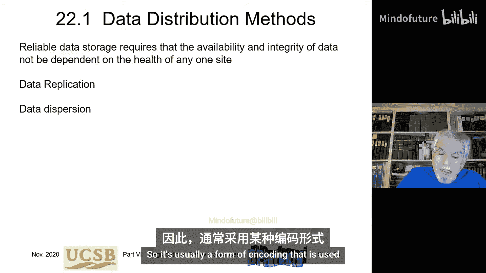

Okay， so how do we manage the manage replicated data previously we talked about。

Having two copies of data like main copy and a mirror copy or having multiple copies。

 the main copy in various backups。Okay， so methods that we talked about sort of。

Treat one of these copies as special main copy， and then we have a mirror of that or we have multiple。

Backup copies， okay？We don't really need to designate one copy as special。

Because if phone copy is special， then we need protocols。

To deal with that special copy in a different way。thanhan other copies， so for example。

 we always go to the primary or main copy。And only if that copy is not accessible or we find that。

It contains errors， we go to the other copies。So now imagine a more symmetric approach。

Here I've shown in this diagram nine copies， so each of those circles is a copy。

Of a particular data file or data item of interest。And they're all the same， none of them is special。

 so none of them is called primary and none are called backups。

 they're all the same they're nine copies。And I've logically arranged the nine copies into a three by three matrix。

 this is logical， okay。There is no。诶。Physical distribution and a 2D array implied here。

So the nine copies are on different site， logically， we group nine copies into three rows。

And three columns。And then we define read and write quos。 So this is just an example of。

A category of methods。Define， read and write quos。 So for example， we can say a write quorum is。

Any three copies。That form a row， so the top row constitutes a right quorum。

The middle row constitutes a right quorum， and the bottom row constitutes a right quorum。

Wr quo means basically when we want to write， so remember that if we have data replicated。

 when we write， we have to update all the replicas。

In order to continue operation with the same number of replicas。

 if we don't update one of the replicas。Because the site containing it is malfunctioning or is inaccessible。

Then we no longer have nine copies and therefore our system reliability deteriorates okay。

 so when we update data， we have to update all nine copies。However。

 it is completely possible that one of the sites holding the data is temporarily inaccessible。

It does malfunction or even it's just busy。诶。It's inundated with a lot of things to do a lot of communications and other tasks。

 and therefore it's very slow in responding。Okay， so some of these data pieces， the data copies。

Are not as easily accessible due to their sitess having malfunctioned。Of course， malfunction。

 we assume is temporary， eventually the sources of malfunction is removed。

And that data is brought back into service。It rejoins basically the other copies， however。

 meanwhile we want to be able to make progress towards our computation and not have to wait for all the malfunctioning sites to become operational before we continue。

So we define write quos and read quorums and read quorums in this example are columns okay。

 so we basically when we update the data。As soon as one of the roses。Has been updated。

We consider our task done， we don't have to wait for the other updates to occur other updates can proceed in the background and be done later eventually they'll be done but we don't have to wait for those。

Dates。So let's say the middle row has already been updated green circles。

Can continue operations even though the other six copies or replicas have not been updated。

The reason is that the right quoroom being a column。whatever we want to read。诶。The data。Okay。

 if we gain access to one of the columns， it's sufficient for us。

So if the other two columns have malfunctioning units or slow units。

We don't care as long as we can access the three units in one column。

We are done because those three units in one column are guaranteed to contain。诶。

Most up to date replica。Okay， so if we read， for example， the middle column。

 it has one of those green circles。Which is the most up to date。

And these updates typically are done by associating them with timestamps。

So that the three copies that I read and I don't have to wait for the other replicas as soon as I read the three copies in one column。

I start processing them， read the timestamps， identify the copy with the latest timestamp。

 which is the green one in this example。And then just use that data。Okay。

 so this basically relieves us from the。Requirement that whenever we update data。

We update all nine copies as soon as we have updated three copies， so we send the update。

Requires to all nine copies。And we start receiving acknowledgements from those copies that update has been carried out as soon as we receive three acknowledgements。

From copies that form one logical row。And we know that everything is okay and we can proceed。

 we don't have to wait。For the rest of updates too。Be carried out。Okay。

 so this makes data application， we still have a lot of redundancy that that problem has not been solved。

But the problem of malfunctioning sites or slow sites and thereby long or sometimes indefinite waits for data to come back to us has been solved。

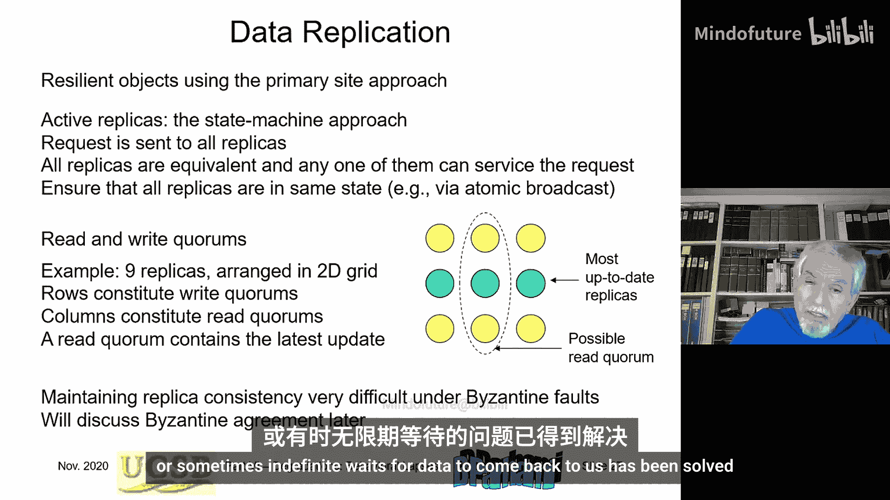

A similar technique can be used with data dispersion。This is an example that we had before。

 we have a data file on top。And we encode the data file。

 we cut it into six pieces and encode the six pieces using redundancy。

In such a way that any two pieces。Sufficient。For reconstructing the date， Okay。

 so there are six pieces。Each of those encoded pieces perhaps three times as large as the original。

He studied in code。And it is done in such a way that any two pieces would be sufficient。

To reconstruct the date。Now if I define a read quo and write quorum as constituting four of those pieces。

Okay， so for example， a possible update set are the four pieces on the right。

Whenever I want to update this data， I try to update all six pieces。

As soon as I receive acknowledgements that four of the pieces have been updated。

Youll need wait for the other two。Okay， and then a read set can be any for set， any four copies。

And because when I take four copies。诶。I write into four copies and then read from four copies and there are six copies altogether。

The two sets are guaranteed to have two in common。Okay。

 so if I have updated the four pieces on the right。And I read the four pieces on the left。

Then the four pieces that I read will have two。Most up to date pieces that are sufficient for reconstructing the data。

Again， it provides me with flexibility， I don't need to wait for all six pieces to be properly updated for proceeding。

And therefore， if I have malfunctioning sites or congested sites that are slow to react。

 it doesn't hurt the overall system performance too much。

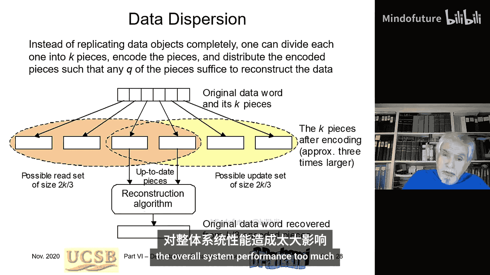

Okay， so that's one idea。嗯。That that had to do with data， another thing that we are faced with in。

Distributed systems。Is reaching agreements， agreement between multiple sites that are cooperating to do some task。

Okay， this idea is best introduced as a problem， a puzzle like problem that goes like this。

 it's called the two generals problem。You may have seen this in other courses。

 so let me explain what the two general problem。General's problem is。

So imagine that two generals G1 and G2 look at the diagram。

And their troops are camped outside an enemy city or territory。And。

They want to attack and take that territory。But they have to coordinate their actions so that they both attack。

Or neither one attacks because if only one of them attacks and the other one does not go along。Then。

That one general will be defeated because he won't have enough。Troops， enough forces to。

basically defeat the enemy。So the challenge for these two generals is that they want to coordinate their actions。

Imagine these are generals from the Byzantine era。And they don't have any radio communication。

 definitely those cell phones。The only way they can communicate is by sending messengers， people。

And the nature， the geography of this region is that messengers have to go through the enemy。

 so this is the setup of the problem， they have to go through the enemy territory to reach the Ossa。

So General one decides that tomorrow at noon is a good time to attack。

Send a messenger to carry this message to General 2。

So that General 2 also attacks tomorrow at noon and therefore their actions are coordinated。

Now this messenger。Can be captured。Or can perish。As。He crosses the enemy territory。

Or can be delayed because he may have to hide。For a while。If the conditions are not。

Suitable for crossing without being detected。So the messenger can be delayed beyond tomorrow at noon。

Or can actually never get through and get to general 2。

So General one says let's attack tomorrow at noon。But because he is not sure that General2 did get this message。

Okay， he can't attack tomorrow at noon until there is some assurance that General2 actually。

Is on the same page， so to speak， knows about this decision。Okay， so what to do？

An idea that comes to mind is that General2 send an acknowledgement。Send another messenger。

To acknowledge to General1 that he got the original message and therefore。

Is prepared to attack tomorrow at noon。But the second messenger， the acknowledgement messenger。

 may not get through。So general two。Has no way of knowing that General1 got the acknowledgement。

And of course， if Gen one does not get the acknowledgement， he will not attack。

That's part of the protocol they've agreed on。Okay。

 so General 2 sitting here has no way of knowing whether General 1 got acknowledgement。Okay so。

What's the solution， Well， you may think what about general one sending。Another acknowledgement。

To tell General2 that he got。This first acknowledge。But again。

 the same problem arises here because this third messenger may not get through。Okay。

And if that third messenger does not get through， then General2 will not know that General  one got his acknowledgement and therefore will not be sure that。

He will attack， okay， and you can continue this。Add infinitum， basically there's no end to it。

 no matter how many acknowledgement are sent。And forth。

There is never complete certainty between the two generals that they are in the same page and that they will both attack tomorrow at no。

Okay， so this is called the two generals problem or the two generals dilemma。Of course。

 once the number of acknowledgements。😔，Exceeds a certain number。

 let's say if you do this for 10 rounds。And it's extremely unlikely that。Basically。

 the two generals are not both aware of the attack time。Being tomorrow at noon。

So from a practical standpoint， you really can stop after a few rounds of。Acknowledgement。

 practically that's enough， okay？So what's the practical relevance of this problem imagine that。G2。

Is your bank's central computer where information about accounts are kept？

G1 is an ATM where you go to to get some money。So tell the ATM。I want， let's say， $40。

Now the ATM communicates with the computer to let it know that you are requesting $4D。

And to make sure that you have $40 in your account。And if that's decays。

And the computer reduces your balance $40。And the ATM dispenses $40 in cash。

And everything is basically。Okay， you got your cash， your account。

Which did have $40 or more in it was reduced， your account balance was reduced by $40。

Now these are two independent agents because it's entirely possible。For the ATM to dispense the cash。

And the computer basically malfunctions and does not deductox $40 from your。Balance。

So you want these two to basically be on the same page。

Either both of them do their part of this transaction， this one dispenses cash。

 this one reduces the balance。For neither of them do basically the ATM gives you a message， sorry。

 but this time I can't dispense the cash。There's some problem。

 so if the cash is not dispensed and the balance is not reduced it's okay if the cash is dispensed and the balance is reduced。

 it's okay， but you don't want one of them to happen without the other one。

You don't want cash to be dispensed without account balance reduced。

You don't want to account balance reduced without cash being dispensed， okay。

 so you see the problem here。Okay， so。Of course， if your account balance is reduced。

But you don't get the cash， you'll be very upset。If the cash is dispensed。

 but the balance is not reduced， bank will lose money。

 although know $40 is not a big deal for the bank， they may actually。

Be happy to tolerate that in order to。Basically let the transaction go through and the customer not be upset。

Okay， so this is the problem of coordinating independent agents。In a distributed system。Under。

UnReliable communication。Even if the communication is completely reliable。

 you still have that problem。The two agents are independent and one of them can malfunction。

And not do。 It's part of。嗯。

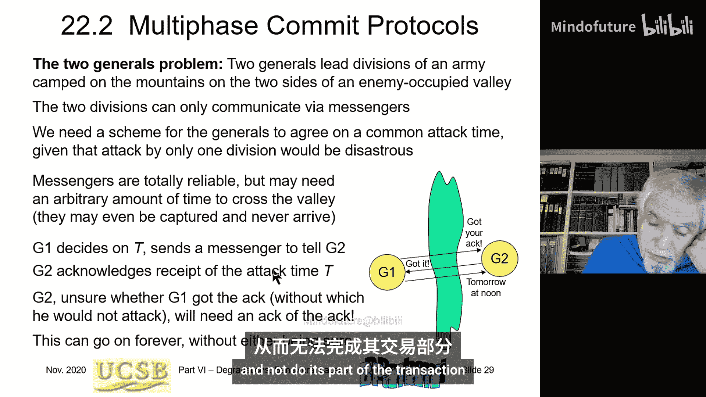

The transaction。Okay， in order to maintain system consistency。

 so consistency in the previous example is。The account balance。

And the cash being dispensed being consistent with each other。

So maintaining system consistency is done through atomic actions and there are various ways of performing atomic actions。

If you have ever taken an operating system course there some of the mechanisms for atomic actions are discussed。

 things like logs， for example。You lock a resource so that no other process can access it。

Perform all parts of this transaction that is supposed to be atomic。Then release the log。So。

In the interim， while you O the resource。Say memory location。

 no other process can access that and get inconsistent。Propartialally completed information。Okay。

So I won't say more about this。

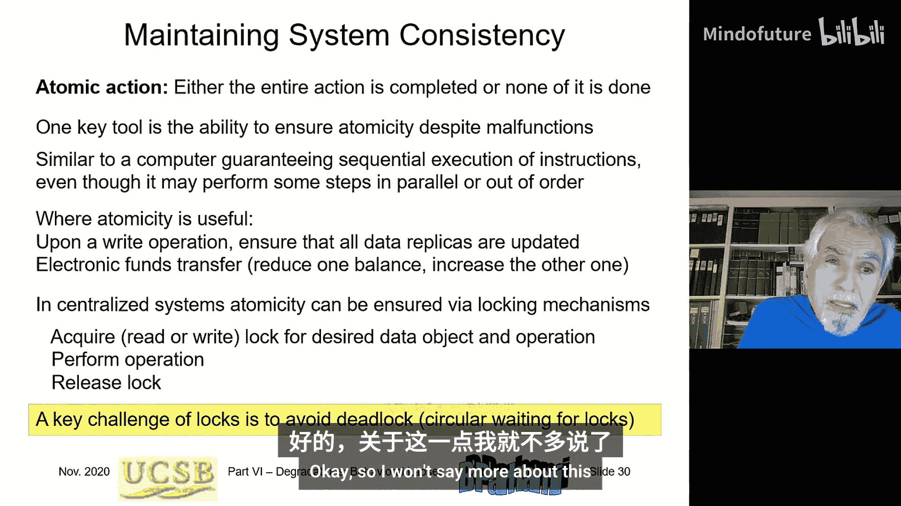

Practically speaking， we can achieve this by something called two phase commit。Ptoal。

For two phase commit protocol。Is。When you have a bunch of sites， one of them is。

Designated as coordinator， although the coordinator can be any one of the sites。

 it not a special site， but it's a designated site。And there are participants。

So the coordinator and a bunch of participants want to cooperate in performing a transaction in the previous example we had two one coordinator and one participant。

 but we can have more than one participant。Okay， now initially。

 the coordinator and the participant are in the quiet state， basically they're not doing anything。

With regard to this transaction that we are going to initiate。They may be doing other tasks。

 but they were quiet with regard to this transaction that we're going to talk about。

Then at some point the coordinator decides to begin executing a transaction。

 so this is sort of like the notation in a sequential machine。Where we have input。An output。

So a dash means there's no input， this is a spontaneous action。

The coordinator spontaneously decide to send a begin message to all participants。

So all the participants will receive a begin message from the coordinator。

 telling them to begin executing this transaction， okay。

 the coordinator goes into the wait state and waits for the participants to basically respond。Okay。

 so I participant receiving a begin message。Can have two reactions basically it says no。

 meaning that I'm not ready to participate in this transaction for whatever reason， okay。

 so when the participant responds no。It goes into。Keep losing my arrow。 Okay， it goes into。

The as state and aors that particular transaction and does nothing more。

Now when the coordinator receives a port。We receives a no。Response from any participant。

 even one participant。It also goes into the abor state and basically says because it needs all the participants。

It can do the job without even one of the participants。

 not taking part so it goes into a board state。And then it sends a board to all the participants。

 including other ones， so one participant said no， this one aborted the transaction and informed all the other participants to a boardt as well okay。

So the other branch is when participant says yes。It goes into a white state and waits to see what happens。

If all the participants say yes。To beginning this transaction then。So yes， from all participants。

 the coordinator sends commit to all and it goes into the commit。State itself。

And the waiting participants when they receive。The commit signal from the coordinator。

 they also commit now commit means they are committing to performing that transaction。Okay。

They may not be able to do it right away。But they keep a record that they are committed。

And basically eventually perform their part。Of that transaction。

 like updating a piece of database that they hold locally。And while that piece has not been updated。

 because the unit is committed to that change。It will not allow any access to that。

Unupdated piece of information okay， so this one is committed to making the change。

 it may not make the change right away。But eventually it will do it and meanwhile。

 it will not send inconsistent data to other nodes that basically try to。Access， so if this was say。

 the balance of an account being reduced。This note this participant is committed to that reduction。

And eventually we' reduce the balance。 Meanwhile， nobody else can access that。The old balance。

 which is inconsistent with the commitment of the note。ok。

So there is a problem with this two phase commit protocol， I won't go into a lot of details。

Basically， there is a chance that。Participants going to this wait state。So they're waiting there。

 Meanwhilewhile， the coordinator must send something。

Like a commit or a board for the participants to get out of that wait state。

Now I have to coordinateordinator malfunction suddenly。Does doesn't work anymore。

 but will never send a commit or a board， and therefore these participants will be permanently hanged。

In this white state。And that's undesirable， okay， so three phase commit protocol。

Take care of this in most cases。It's still not completely foolproof， but。

It's better than the two phase commit。So what has happened here compared to the previous？

Slide says a prepared state has been added between weight and permit。Okay。

 so when the coordinator receives yes from all participants， it tells everybody to go into。

Prepare state， not into the commit state。Okay， and this prepare state provides a sort of buffer。

 you know， the problem with the previous scheme was that a participant that is in the wait state。

Can eventually commit or abort there's no way for it to know ahead of time。

 whether it will be aborting or committing， it depends on information received from the coordinator。

Now， the prepare state is not like that。 The prepare state eventually。

The participant or the coordinator will eventually commit even though they have not committed yet。

So the weight state is not adjacent to put an a board state。

And a commit state this basically protects the system so if。A unit in the wait state。

 and it waits there too long， decides to use a watchdog timer。To time。Its presence in the wait state。

And then if that time exceed， it can abort。ok。え。Meanwhile。

 the other units that are in the wait state will not know that this one has aborted。

 but there are mechanisms to ensure that this information is propagated。

 and therefore it's less likely for the system to run into problems。

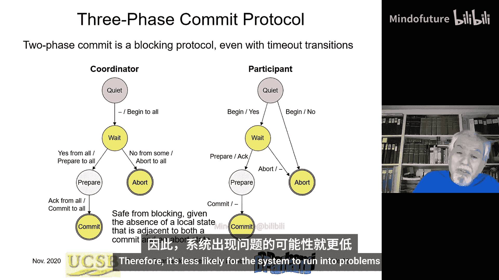

Okay， we also need， so we talked about dependability in data， ensuring。

Data integrity through replication or。Data dispersion。We can ensure coordination between。

Area sites using these commit protocols。You also need various forms of dependable communication between these sites。

And that is needed for both point to point。Messages that are sent from one side to another side and broadcast messages were one。

Site has to broadcast， send a message to all the sites。

So some common value of common knowledge should be sent to all the sites。For point to point messages。

 we use encoding。Eror detecting or correcting code。We use acknowledgements。

And we use timeout mechanisms。So timeout basically means if I send。

A message and don't receive an acknowledgement within the。Certain amount of time。

 I assume that the message was lost。I resend a message。

 of course this requires now for us to implement the mechanism to deal with duplicate messages。

Because I sent a message， I didn't get an acknowledgement。Because the message was delayed。

Or the acknowledgement message was delayed， I send it again so there's a chance that the recipient will get two copies。

Of the message or that I get two copies of。Acknowledgement for the same message。

So if we implement a way of detecting， duplicates and ignoring。Ignoring all the extra copies。

 then this scheme will work well。Now， reliable broadcasts。

 we won't cover the atomic and causal broadcasts， so they're more advanced topics。Is a broadcast。

Scheme， broadcasting system。In which a message is guaranteed to be received by older note。

So when I send a message in a distributed system。To many node。

 these different copies of the message that go to different node can experience different latencies。

So they are not received by the destinations at the same time。In fact。

 some of them may temporarily be lost because theyre an aocyte that suffers temporary malfunction。

Okay， so eventually the messages must be delivered to all the sides so that when I broadcast something。

 I can be sure。That， eventually。All the sites will receive。That message it。Okay。

Atomic broadcast I mentioned I won't talk about， also ensures that messages are received in the same order。

 so if I broadcast message one。And then broadcast message too。And as site receives both of them。

 it should receive M1 before M2。Despite print latencies in the network for。

Passages coming from various sources and going to different destinations。

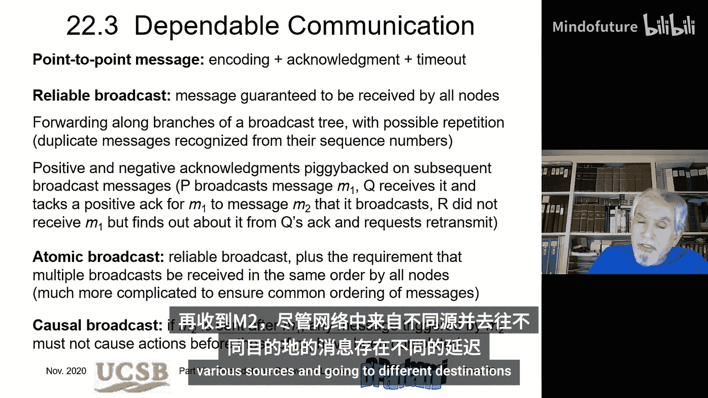

Okay， dependable collaboration between a set of nodes is basically the nodes。

 I mentioned the commit protocol。We also have to have some。Reasonable amount of。

Confidence that the sites are working， okay？So it's okay for a site to malfunction。

 temporarily or a small number of sites to malfunction if we have the capability for tolerating that many malfunctioning side。

We have to be able to sort of manage the overall goal of the system。

 the overall behavior of the system， despite these malfunctions。

So malfunctions with respect to severity are categorized as shown here。Crash malfunction。

Actually it seems very harsh， you know， a site has crashed， therefore it's not doing anything。

It's actually the most benign type of malfunction because a site that is crashed。

ItDoes not communicate with other sites also。Because it doesn't communicate。

 it is incapable of misleading the other sites。Omission。

Is a type of malfunction where a node does not respond to some inputs。

So use different sites and that note messages， that note responds to some of those。

 but oms the responses to other nodes。So it's a sort of incomplete functionality。And therefore。

 for example， if you are trying to。诶。Accomplish consensus between these sides is going to be trickyy because it's not。

It's not reacting in the same way to。TheDifferent sites。Timing malfunction。The note responds。

 but either responds too early。To early is often not a problem。

 but it can be a problem if you have a certain expectation for the latency or too late。

 so too late is usually a more serious type of timing malfunction。Okay。

 so sometimes you send it a message， it responds right away， sometimes it responds。Much delay。

 So it's it's not reliable in terms of。It's response time。And finally。

 the most serious type of function with respect to managing it。

And being able to ensure correct system operation is Byzantine。Mfunction。

AByzantine I function is when a unit。Is behaving totally unpredictably。In other words。

It follows no pattern， no scheme。Sometimes it doesn't respond to a message， sometimes it responds。

 sometimes it responds correctly， sometimes the response is erroneous。

 sometimes the response is delayed。So this is what happens， for example， when a site is compromised。

 an adversary takes over。And then makes the ps behave in the worst possible way。

With respect to behavior of the rest of the system。In other words， it will send the most damaging。

 it will show the most damaging kind of behavior。Toho mislead the rest of the system。Okay。

 so Byzantine malfunctions are the worst kind， crash malfunctions are the most benign kind that they're the most easier。

 the easiest ones to deal with。In the。Basically， designing robust computations。

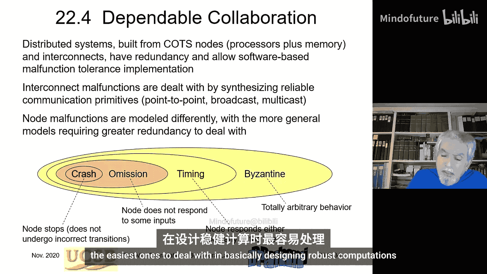

Okay， this slide， I'm going to skip。It's really not。

Related to the concepts that come later so you can safely delete it。

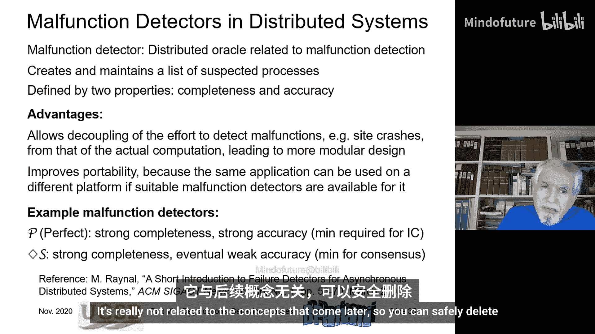

Okay， another thing that we need in distributed systems， by the way。

 we have a course on distributed systems 254 C。Has not been offered for a while。

But there is a similar course in the computer science department。So basically。

 all the topics that I discuss in this lecture。P covered in much detail in those distributed system。

 of course， algorithms。For， for。Execution on distributed systems in a reliable fashion。Okay。

 so one of the services that we need in distributed system is a group membership service or protocol。

So。In the distributed system， we often form groups。Let's say site A， site B， site C form a group to。

Collaborrate and executing a particular transaction。And that grew。Maybe dissolve later。

Or it may change membership， we may add sites to that group may remove。

 so at any point sites that are members of a group should be aware of the group's membership。

this group membership must be reliable， in other words。

 should be resilient to cite malfunction and also to communication errors。

 okay so there are various protocols that are used for ensuring that there's a type of service that the distributed system provides。

You form a group and then you consult at service to find out， you know which。

Their sites are in the same group as you for the sake of this transaction。

And the service is reliable， meaning that despite side malfunctions and communication。Errors。

 you can get reliable response to inquiries about group membership。

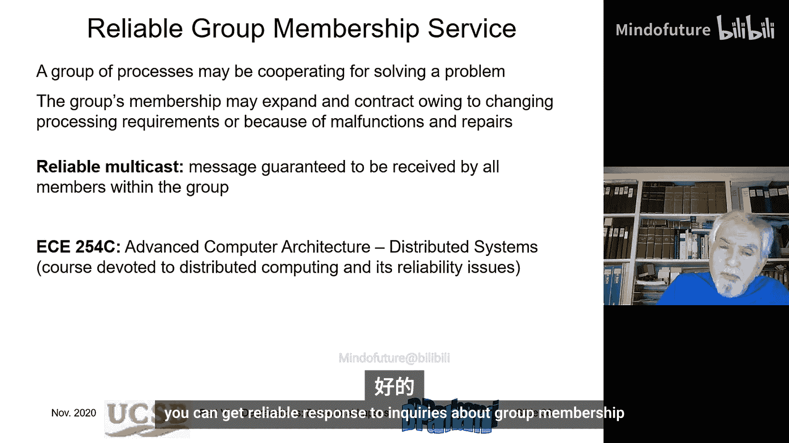

Okay。Another concept is remapping， so once a site。Milefunctions。

 we may have to remap the computation so that we avoid。Using that malfunctioning site。

And also load balancing is a related concept， so when sites malfunction。

 the load of the other side can get out of balance。

Because the load of the malfunctioning sites be distributed to others and if we are not careful。

The load gets out of balance， therefore some sites will be overwhelmed， but too much load。

 others will have light loads， and therefore the system will not work。Most efficiently。

 so we need load balancing， meaning。The ability to detect this condition that the load is。Unbalanced。

And moving tasks with insight in order to rebalance。

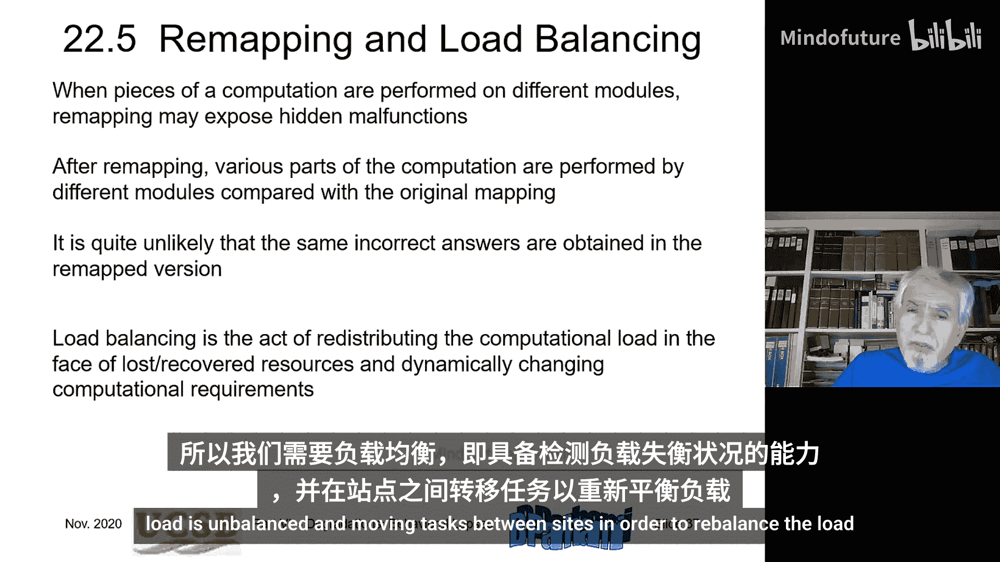

The load。Okay， so here is a very simple example of computation remapping。

So suppose there's a computation that has five parts， five segments。

And it's performed in a linear array so that the computation。

 part one is performed on this cell or two here， so these may be processors or special purpose cells。

So let's called them processor， processor one does part of the task。

 then process it due to the second part and so on。This blank processor at the end is spare and is normally not used when the other five。

Are working okay。Okay， now if we want to make sure that this task was completed correctly。

 one approach would be to sort of repeat， so take the output from here， store it。

And then repeat the task， take this output and compare it with the first output。

 That's basically redundancy in time that we。Examined before。Okay， however。

 if something is permanently wrong with one of these units， the malfunction is permanent。

 the second computation may sort of experience the same error and therefore the error will not be detected。

We can remap the computation so that the second。Version or the second copy of the computation。

So this cell or processor is ignored， the first part of the computation is not done by processor2。

The second part by processor three and so on。Now by doing this。

 if something was wrong in this computation。It's unlikely that this replica。

 repetition of that computation， which is done in a different piece of hardware。

 will experience the same problem， the same error， so it makes it more likely for this duplication in time。

To。Detect。A problem in the system。So this is just an example。Basically。

 remapping the computation so that it uses different resources。

Compared to the original computation is one way to ensure。

That same kind of error in the result does not occur。

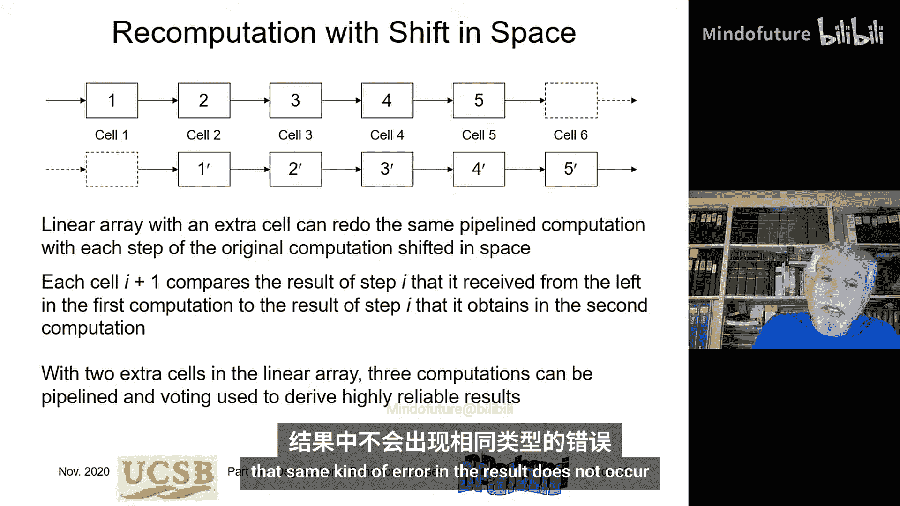

And the final idea in this chapter is that of modeling degradable systems， so a degradable system。

 as I mentioned before， can be in intact or fully functional state。

Or it can be in one of a number of degraded states， less functionality。

dependending what has been lost so maybe a processor was lost there。

 some memory was lost there and so on， so these are degraded states and some failed states that we hope never to get into。

And the system as usual， so this is a state space model transitions between these。就。

The processor malfunctions， if goes here， then we have repair。Take it back there。

So the hope is that these degraded states serve as buffers。

To prevent the system from going into the failed state。

So if we manage to repair it from this state back there， then nothing serious happened。

 it operated for a while in this degraded state， if we happen to go into this perhaps more degraded state。

 we are still okay， we can still go back。Then eventually if we either don't detect。The degradation。

Or。The next malfunction happens too quickly before we have had a chance to carry out these repairs。

Then we go into failed state and hopefully this is very unlikely。Okay， so these buffer states here。

 the more of these buffer states you have。The better off your are。

 the more likely to avoid transition into these。Faaied state。Okay， notice that here I've avoided。

 I've basically ignored the possibility that the system them。

Can go directly from the intact state or fail state。

And this was the notion of coverage that we discussed in some detail。So for example。

I mentioned this state corresponds to。One processor or malfunctioning。

If you don't detect that malfunction or the system is not able to reconfigure itself in order to tolerate that malfunction。

 that's the coverage with high probability it can， but there's a tiny probability that it can't and therefore we have what is known as a catastrophic malfunction the malfunction that did not take us into these buffer or degraded state。

 but took us directly into。A failed state and these are things that we want to avoid if at all possible。

Or to reduce the probability。To an extent that it's no longer a serious threat。

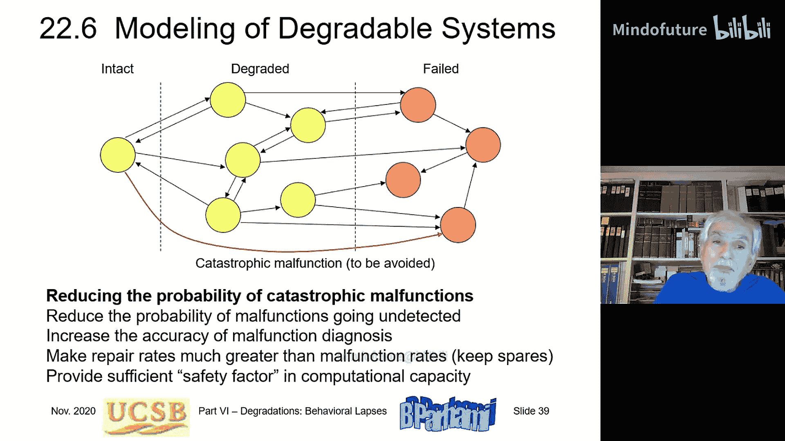

Okay， so。We talked about how to model this in the state space model that we discussed。

You basically have to assign a probability。To this direct path and hopefully that probability will be small enough so that this direct path is almost never taken and the indirect paths。

Have enough fur。

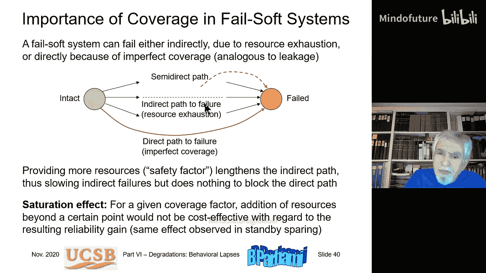

Although that buffer is not infinite。We may so there are basically two mechanisms by which such a system fails。

 one is a catastrophic malfunction。The other one is what we call resource exhaustion。

 so a processor failed， a second processor failed。The third processor failed。

 so resources have been exhausted， in other words， they have。

Becomes so low that the system can no longer。Perform its function in an acceptable manner。

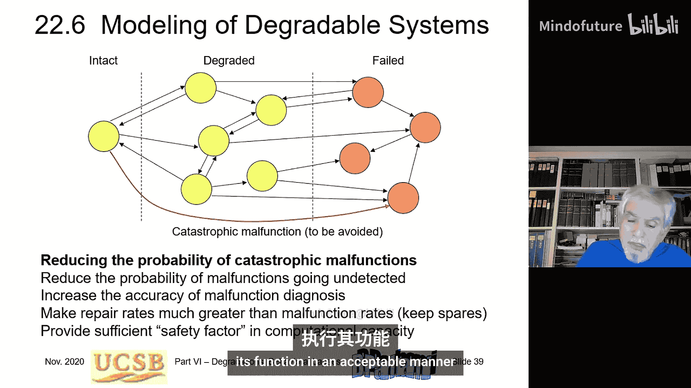

So。You can have。AF due to。Catastrophic malfunction because of imperfect coverage or due to resource exhaustion with this path。

It's taken。And leads to。呃，费力。Now， because of this direct path， even if it has a tiny probability。

And we discussed this before， it's sometimes not advantageous to add a lot of resources。Okay。

 a lot of spares， for example， in a redundant system。Because。As you add more spares。

 that reconfiguration mechanism becomes more complex。therefore。

 the probability of taking this direct path increases， so there's often a sort of a saturation point。

Where adding more resources stops being beneficial。

Because it adds to the system complexity and increases the probability of this catastrophic。

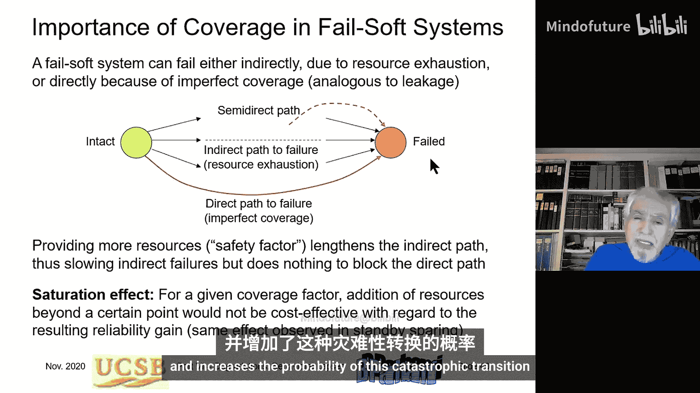

Transition。Okay， so let's now talk a little bit about some concepts on software redundancy。

From chapter 24， I will cover only a few key ideas in this chapter。And if you are interested。

 you can read on your own。And it's not necessary that you。Read them。

 especially since we don't have exams。 but if you're。If you have interest in the domain of software。

 then the ideas in this chapter are perhaps quite relevant to。

Your work or your research if you're doing research and software。Okay。😊，Software dependability。

You can read these two examples on your own， they' are quite funny。

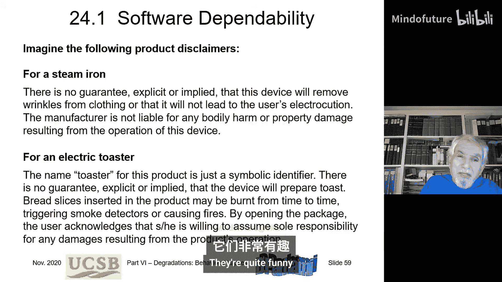

So how is software different from hardware in terms of dependability？Well。

 one difference is that software on reliability is caused predominantly by design slips and not by operational deviations。

Now notice that I'm using here the terms flaw or bug for software rather than fault or error in the literature you see references the software fault or software error。

In order because I'm trying to be very careful with terminology。Because the nature of software。

Faws or bugs are different they're basically things that exist in the design of the software not things that can go wrong as the software is being executed okay。

 so it's good to have。The distinct terms for this。So we can also have hardwareflow or hardware bug。

 and that's when the hardware design。Is not correct， okay？Hardware faultult， on the other hand。

 is something that happens。A connection thats basically broken or transistor burns out or something like that。

Whereas a hardware bag is a design。Design flow or。Okay， this example about 7，11。嗯。

Convenience store chain。How they dealt with the year 2K problem is really enlightening。

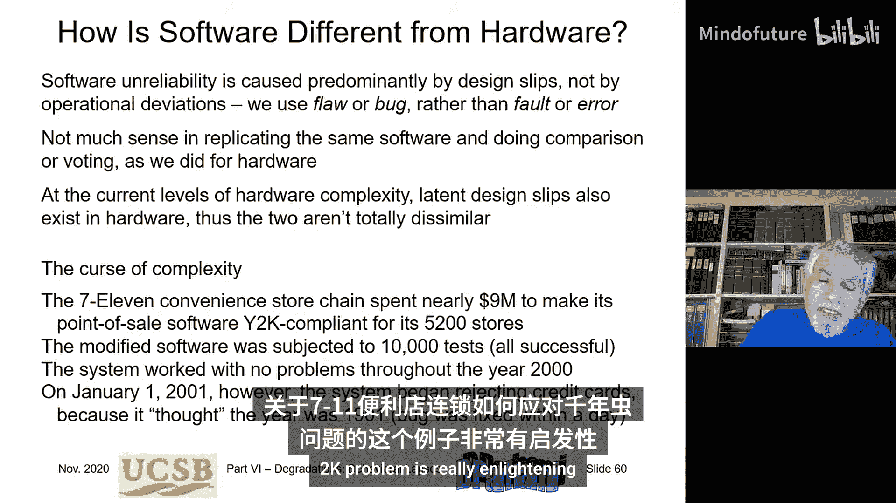

So read it on your own。Okay， so what is software dependability， in other words。

 do we have something like software reliability just as we had？For hardware。You know。

 hardware reliability makes sense because we had this probabilistic behavior。

 we said we have a failure rate。Lambda for hardware。

And then e to the minus lambdaity is the reliability。

Of the hardware and the hardware basically behaves probabilistically， sometimes it works。

For a long time。Sometimes it fails in a short time， its behavior is probabilistic。

Not deterministic in terms of failures。Okay， do we have the same thing for software Yeah。

 for many years in the early days of software development。The consensus was that no。

 we don't we model software in the same way as hardware， in other words。

 we can't say that we have this exponential reliability for software。Nowadays。

The consensus is that we can have this reliability model。 So here is basically the way。

The exponential reliability model works for software。

Now a software usually contains one or more flaws per thousand lines of code okay so ideally the software does not have any flaws。

 it's designed correctly。Or if it was not designed correctly to begin with。

 it's tested and eventually all the flaws are removed， they are perfect software。Well。

 such a perfect software does not exist。Any piece of software that we come in contact with in our daily lives have。

It has flaws in it。These are sometimes called the residual flaws， in other words。

 when the software is first written。There's a lot of flaws， testing removes a lot of those。

 the more obvious ones are removed。Some subtle fls remain in there。😔。

And basically sometimes persists at the end of the software's life。So。

Software usually contains one or more flaws per thousand， so this is basically a measure of quality。

If you say that a piece of software has fewer than one f。P1 thousand lines of code。

 typically this is a very good piece of software in other words it's highly reliable。And Linux。

Has been estimated to have 0。1 flaws per thousand0 line of code， so it's an extremely。

Reliable is sub software。Okay， now these flaws are typically hidden， in other words。

 you can run Linux。For months or years without hitting one of those flaws。Some combination of。

Conditions。In the environment that you're using。May expose one of these flaws， in which case。

 be software malfunctions。As a result of that flaw。ok。

So we can say that the reliability of a piece of software is exponential。E to the minus KFT。

F is the number of flaws that are remaining in the software， a is a constant。Of proportionality。

 and for example， k can be this small number。1。And thousands。Okay。

 and it's determined experimentally。Of course， we typically do not know the number of flaws in a piece of software because if we knew exactly how many flaws the T。

 that means we can go and fix those。So the number of flaws is typically an estimate。

So if we know that the software has been developed， a process。A be group。

That has typically one flaw in1 thousand lines of code。And then the softwareer has， let's say， 10。

000 lines of code。So we estimate that it has 10 flaws。Okay。

 so that's the estimated number of flaws in the software K is that's constant that is determined it's not always this。

 but depends on。🤧咳。🤧咳。Depends on the developer of the software。

 the level of difficulty in the software， and a number of other factors。

So K basically you can determine it experimentally K is known F is estimated。

 so this will be the reliability equation for that software。

 and it has been determined experimentally that's pretty good estimator for software in other words you can run the software and have a pretty good idea of how often。

It fails or malfunctions。

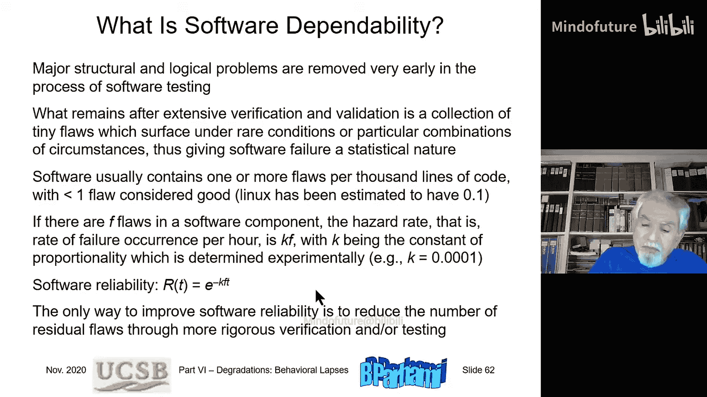

Okay， these residual flaws basically so that to give you an idea a visual。

Understanding of why these flaws exist， let's say I've written a piece of software that has two inputs X。

And why， so this is the space within which the software operates each time I give it an X input and a Y input。

I put the software in this point。And there operational point， okay？

And this particular piece of software works perfectly for that point。On the other hand。

 if x and Y put me here， that's one of those hidden flaws。Okay。

 and the software will produce an incorrect。Outward。Okay， so the red areas are those hidden flaws。

And typically there are very few of those and also they happened for。

Really rare values of x and Y because if they happened for common values of X and Y。

 they would have been detected during testing。Okay。

 so the fact that they went undetected during testing means。You know， they're not very common cases。

Okay， so when we test software， we tend to concentrate on what is known as corner cases。In it cases。

In case， so for example， extreme values affect。Are often used in the testing phase to make sure that the software does not fail for those extreme values。

Extreme values of why。嗯。Extreme on the other side， the minimum value effects so those edge cases are subjected to more rigorous testing。

 but still some。Some flaws remain。And as I said， you know， at 10，000。ALine piece of software。

Even if it's developed a process that ensures， let's say one flop or thousand line of earth will typically have ten flaws about1 flaws in it。

But it's not flawless， but those flaws hopefully do not show up very often。

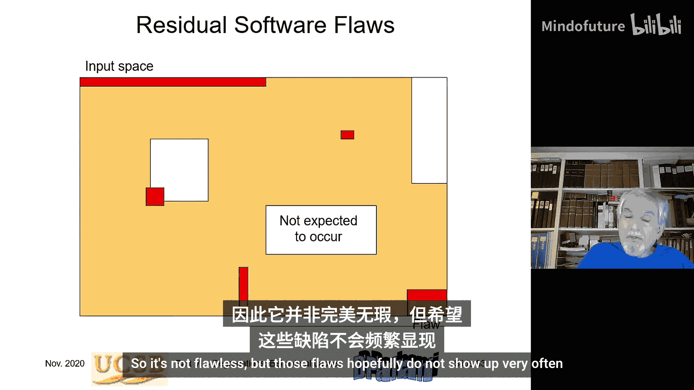

Okay。Now， how do we model， in other words， in order to。呃。Use that exponential equation。

 we need some basically estimate for the number of flaws。

 so here's a model of how flaws change as a result of testing。

So initially we develop a piece of software before testing， it has a certain number of flaws， again。

 we don't know the exact number， we estimate that it has a certain number of flaws。Okay。

 then as we start testing in the early days and weeks of testing。We remove a lot of those flaws。

 we basically run the software。 many of those flaws are caught because we noticed that。

Doesn't produce correct results， we go in and check what happened。Find out and know here's a flaw。

 fix it。And then as we remove more and more flaws， it becomes more and more difficult to remove additional flaws。

So the rate of floor removal decreases over time。Until it becomes very low， so here within a week。

 maybe we detect maybe one or two flaws。At some point， the manufacturer， the seller of the software。

 decides that the software should be released because we have hit a point where if we test the software for another。

Two months， we may not be。we may not do much better in terms of removing flaws。

So the software is released and the remaining flaws are basically。

A flock of the user of the software。Fier of the softwareer who will encounter them from un time。ok。😊。

So this is an optimistic model， it says that the initial flaws。

Whatever number where we remove some of them and eventually we are left with these residual flaws。

More realistic is this model。And as we remove flaws。New flaws are in to do， so any fix basically。

Has some possibility of introducing new flaws in the software。

So the number of flaws is basically a moving target。And as we remove more and more flaws。

 we sort of approach。There and eventually we say， okay。We removed enough flaws。

 let's release the software and let the user。Worry， of course， you know。

 the seller will help the user of these。Floaws， surface。Try to analyze and find the。

The reason for the malfunction and put patches in。Okay。

 but we don't delay the release of the software because otherwise we have to wait。

For a very long time。Before the number of residual flaws becomes very small。Okay。

 so from now on I'm going to focus on this simpler model。

 this is already pretty complicated for our discussion。

 I'm not going to discuss this right hand side。So there are a bunch of flaws and we reduce the number of flaws。

And the floor remove all the weight。Is a decreasing function initially we remove flaws at a high rate and that rate decreases and decreases。

Over time。

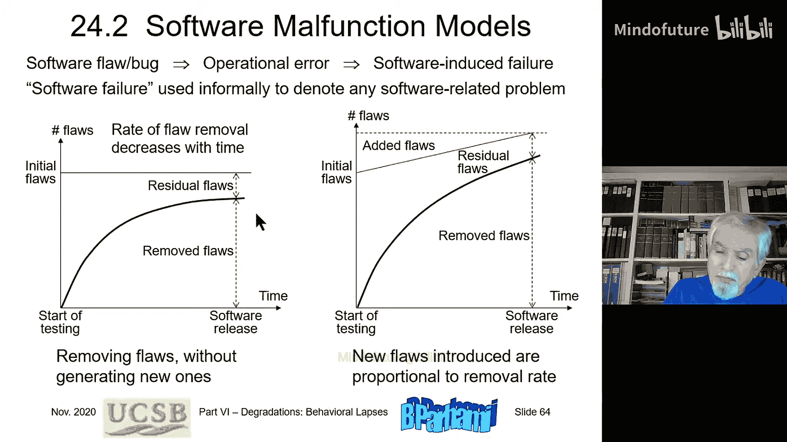

So let's model this process。So F is the number of flaws， the tau is the testing time。

 how much we have tested it。Okay， the rate of floor removal。

 so this is the rate Df of tau divided by D tau is the rate of floor removal。

Is a decreasing function of tau。And it's linear okay。

 so this is an assumption to make things manageable。Computationally manageable。

 I'm assuming that this rate declines linearly。And there are two parameters involved。That we have to。

诶。Basically determine experimentally， tau is the time。Okay， so if that's the case。

 then they can solve this differential equation and find。The number of flaws are time tell。

There's some F0， the initial number of flaws， of course， that's an estimate， as I mentioned。

Minus this quadratic function of tau。So for example， if the initial number of flaws is 130。

 it's estimated to be 130。And。A is 30。And。Let's see。B， let's see what we have assumed for be here。

 30 tau。😔，So be divided by 2 a。Is one over 16。So B divided by 60 is 1 over 16， so it's 60。

Let me make sure so that's 30 towelu。1 minus so B divided by 2 a is1 over 16。 Yeah， B divided by 60。

Is 1 over 16， so B is 60 over 16 or。About four。Okay。As I said。

 you know these companies that develop software from experience。

 they know what the values of these parameters are for their particular type of software development。

And there are also handbooks from which you can consult and read out these parameters。Okay。

 so basically。😊，If this is the number of flaws。The hazard function or the failure rate。

I mentioned is K times the number of fs。So this is the number of flaws from this equation K is that constant that dimension can be a very small number。

And therefore I now have the reliability expression for this software。

As a function of how much testing time I put in。The more testing time I put in。The more reliable。

The software becomes because there would be fewer residual flowaws okay so these are some numbers from an actual product if we do no testing at all the mean to failure is 58 hours that's basically for tau equal to zero。

Then as I increase Tu。Whatever unit this is， this may be two months， four months， six months。

 eight months， or two weeks， four weeks。It doesn't matter what it is that this is just relative comparing these numbers。

So if I do two months of testing， let's say。Meantime to failure becomes 98， so it increases。

And as I increase the amount of testing， meantime to failure increases。

 and then if it becomes acceptable， that's when I can stop testing。This is long enough。

 so eight months of testing is adequate。According to this model， of course。

 this model is itself approximate and we cannot depend on it 100%， but。

It's better than having nothing。

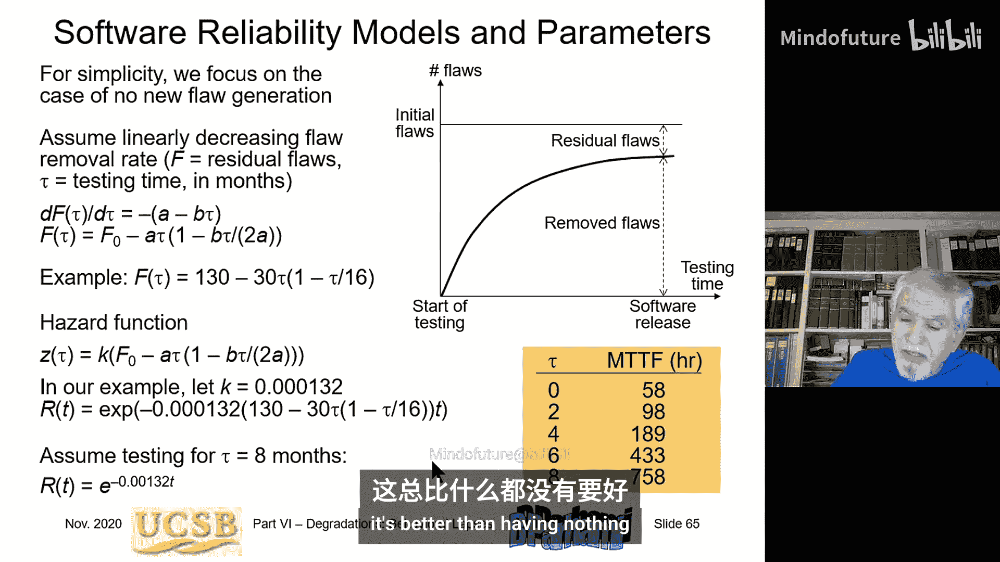

Okay， besides software reliability being represented by that exponential。

 so this is basically an example reliability equation for a piece of software。

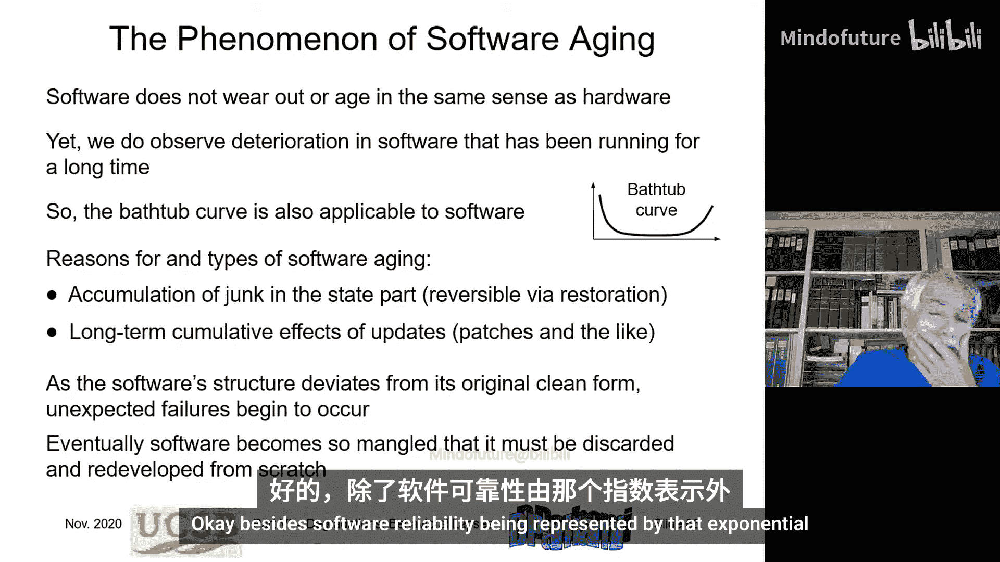

Model there。That's e to the minus 000132 T， the reliability。嗯。And of course。

 we have to know what the unit of T is， depending on what units we use for computing this。

It can be weeks or months or hours， whatever。When we develop this equation， we have to。

Be aware of what unit of time was used in these calculations。

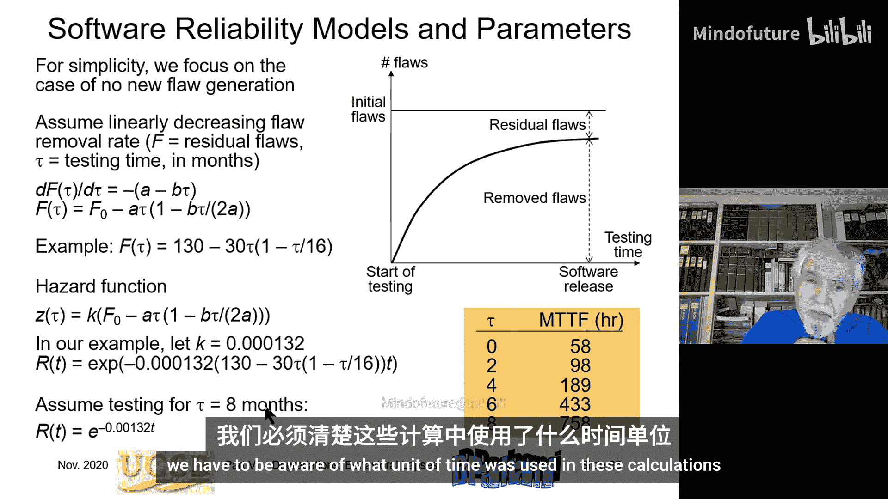

Okay， software also ages。Again， this is very counterintuitive because the software。

 say word processor， how can it age because you know it's just。A bunch of code。

And code doesn't change over time， okay， so what does it mean for software to age？

Software ages because so it does have this。诶。Basically， so it has。Infant mortality。Upon release。

 a soft term may fail right away。But then it has a constant failure rate。And it has this。

phenomenon of aging so what does mean for software to age first of all。

 there can be accumulation of junk in the state part。

Of the software and this is often reversible through restoration。 This is what happens， for example。

When the software misbehaves， then you。Use the option of resetting it。

 resetting your system to a factory setting， meaning that you restore the software to its initial state without all the junk that has been accumulated。

In the state part of the software。Okay， there's also a second mechanism for aging and that's the cumulative effect of updates patches and the like as you use a software from time to time。

 patches are issued and you implement those patches and those patches。

Sort of fix the immediate problem， but they may create other problems。And over time， it's just like。

诶。Now if you have a piece of furniture that you' patched。Many times。

Over the period you have owned it it starts looking ugly and undesirable and you may want to replace it。

 even though you know it's still working， it does its job， the same thing happens。Software。

 all these patches。It will make the softer behave unreliably。And therefore， you may want to go。

With a clean implementation from beginning and sometimes software vendors actually do that。

 they issue a completely new version of the software。In which basically they reimple many parts。呃。

So that all those patches not needed anymore。So this is the sense in which software ages。

 accumulation of junk and also cumulative effect of patches and updates。

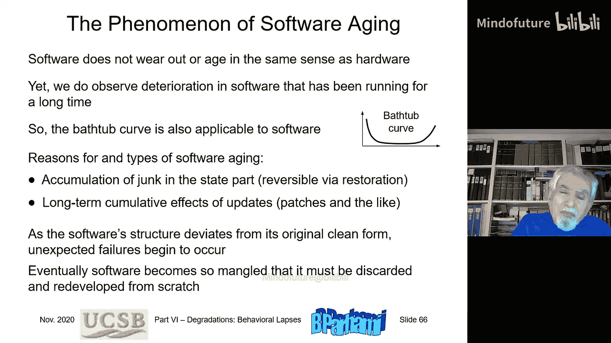

Okay。

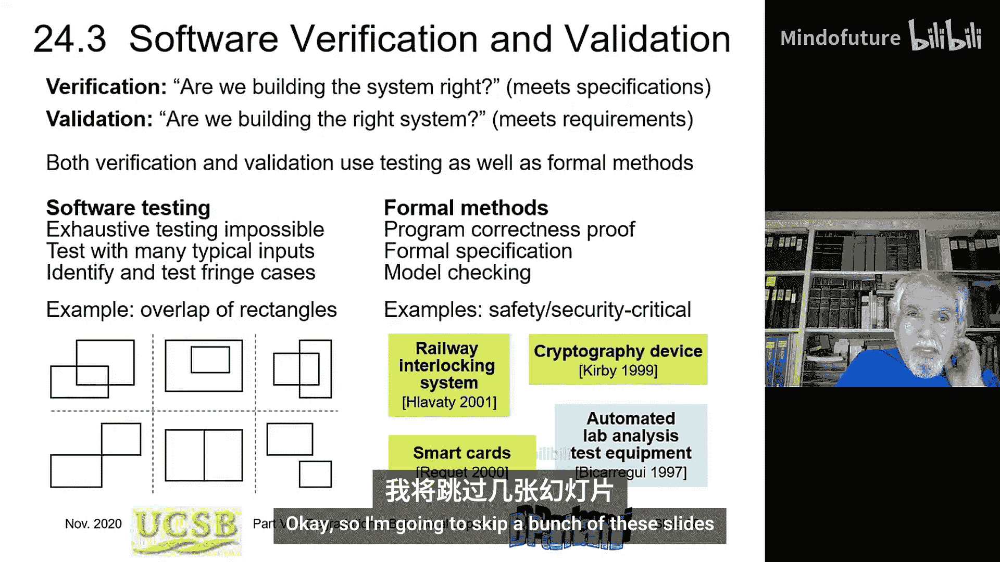

So。I'm going to skip a bunch of these slides， a formal proof of software， I'm going to skip。

 be aware that it exists， but it can。Usually be done only for toy examples。

You can't formally prove an operating system or even a compiler， there are just two。Complicated。

 they have too many parts。For you to mathematically prove that they're working correctly。

 but for some simple programs， it's possible to develop mathematical proofs。

That they're doing the function they're intended to do。

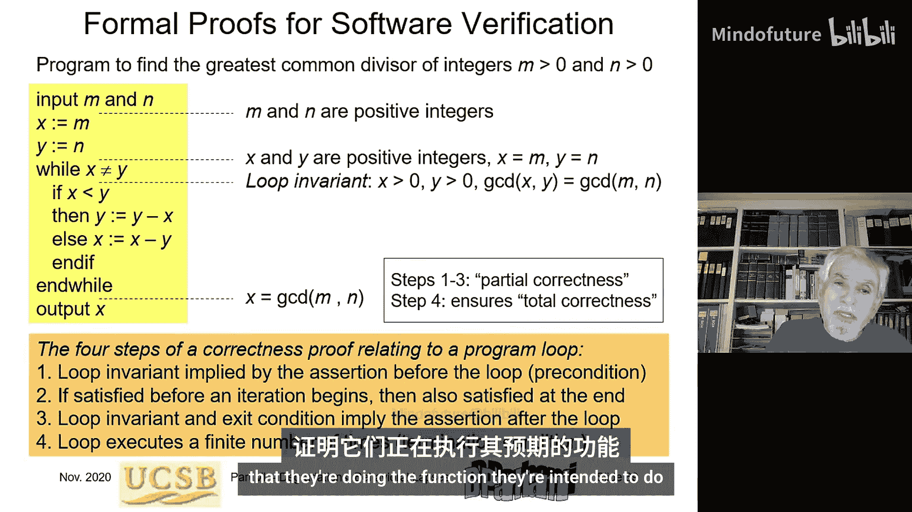

Okay， the last idea。As software flow tolerance， so so far we have been talking about floor avoidance。

And flaw modeling， basically try， first of all， not to have flaws in your software by rigorous testing and so on。

Or at least model the flaws so that you have an idea of the reliability。The soft。For hardware。

 we talked about tolerance methods， do we have corresponding techniques for software？

And the answer is yes， we do have it， although they are not in common use。

They are actually useful and they are being used and I'll show you examples of where they're used okay。

 so what is software flow tolerance， the oldest method。

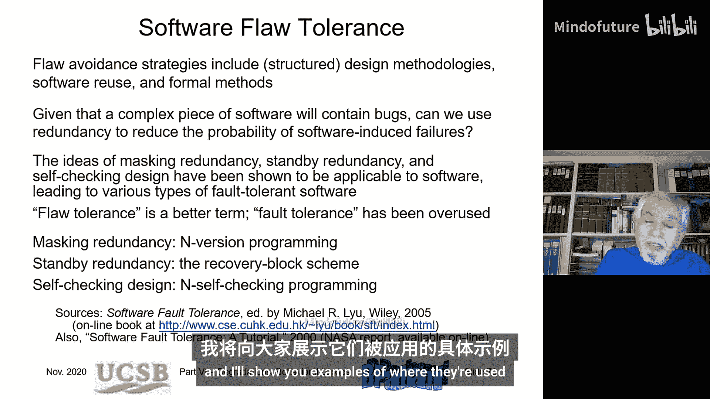

诶。It's proposed in the early 1970s as Nversion program。

So this is very similar to triplication and voting in the case of hardware。

Except that in the case of software， you don't want to do duplication because if you take a case of software。

Three copies of that exact same software will not be useful because if one of them produces an incorrect result。

 the other two will produce the exact same。Incorrect results。

 so the voter will not be of any help here， okay？So these are what are known as diverse versions of the software。

 they're not identical copies。Of the software， but they are diverse。😔，Versions。

And diversity can be in programming teams， different programming teams implemented those versions。

And the programming team can be have obviously different personnel and different structure。

 different methods of software development。Software architecture。

 they can use different software architectures。They can use different algorithms。In fact。

 the less coordination between these three teams， the better， the more diverse the software becomes。

They can even use different programming languages。Because an error committed when you implement a software。

 one programming language may not be committed if you're implemented。

 it' less likely to be committed if you're implemented with another programming language。

And they can use different verification tools and methods。And finally， they can use diverse data。

Again， so they don't use the same identical data， but diverse state。So they compute three versions。

Have the result and then we voting。看。The first complication compared with the case of hardware is that this voter。

Has to be more complicated， more sophisticated。Because suppose these versions are doing floating point computations。

Then when they obtain correct results because they're using different algorithm。

 different programming languages。Eors in the outputs will be different。

 so the outputs may be correct。But slightly different because floating point computations have errors in them。

 so the voter cannot just simply compare these three to see if they're identical。

Or two of them are identical and different from the third one。

But it needs to sort of process these inputs。And ensure that there is agreement between them。

 they won't be identical， but they may be。In agreement within then to the level of error tolerance that we have okay。

Furthermore， these versions in hardware， if you have three copies of a piece of hardware。

 the latency through them will be the same or almost exactly the same。

So the voter can be synchronized so that it allows a certain amount of time for the hardware。

To finish his job and then。Some instance later， it does the voting。Here are these versions。

 because they're diverse， they can take different amounts of time to execute。

So there won't be synchronous， but we need to do asynchronous with。So。To summarize。

 the voter is no longer a simple piece of hardware or software， but it's pretty sophisticated。

Units in its own right。But now if these。Three versions are diverse。And something goes wrong。

It's unlikely that all three versions produce identical errors or two versions even produce identical errors so that the voter is misled。

It produces an incorrect result。So that's the idea of n version programming in this example。

 n is equal to three， but it can be more than three。

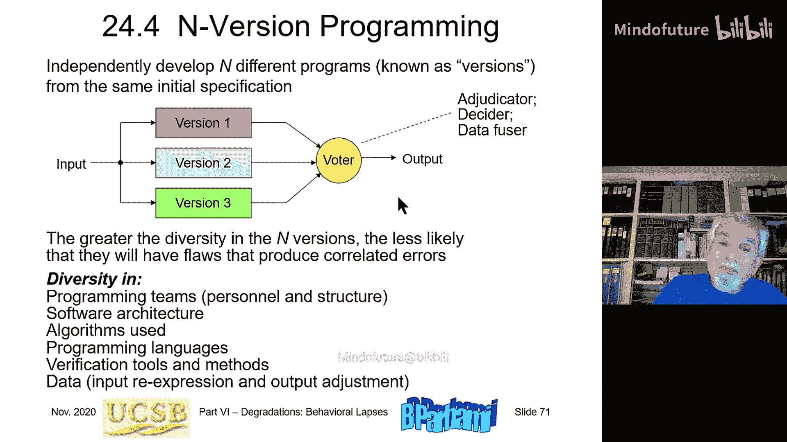

Okay， from the very beginning， a lot of people objected to the idea of。N version programming。

So here are some of the main objections developing programs is already a very expensive and slow process。

 why multiply the difficulties by N。Okay， well， a reasonable answer to that is that you cannot produce flawless software no matter how much money you're willing to spend。

So in fact， endversion programming sort of releases you from。

The requirement of high quality software， so if you produce five versions of a software。

affordYou can afford to have them of lower quality and still get。

The correct output by voting on the results。The second objection is that diversity does not ensure independent flaws。

It has been documented at multiple programming teams。And to overlook the same details。

And to fall into identical traps。This is a valid objection。And basically。诶。You know。

 it's possible that the multiple teams commit the same error based， for example。

 on the way they were educated。Or the way they were trained to do programming。

It's very possible that even though they're diverse， they commit。Identical errors。And therefore。

 identical， erroneous results will be produced by。The software。Now， this criticism is actually。

Criticism of the modeling use。 So if you say。

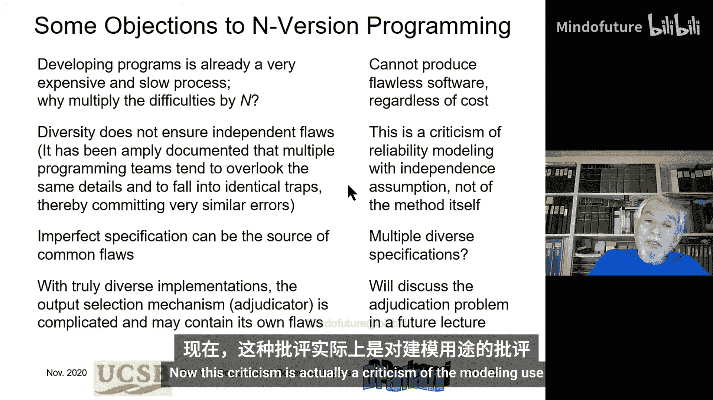

Okay， this is a two out of three system。And I assume that there are three versions。

Milefunction independently。Then of course that objection applies because there will be dependent malfunctions between two or more versions。

 so as long as you model those dependent malfunctions correctly， then you should be okay。

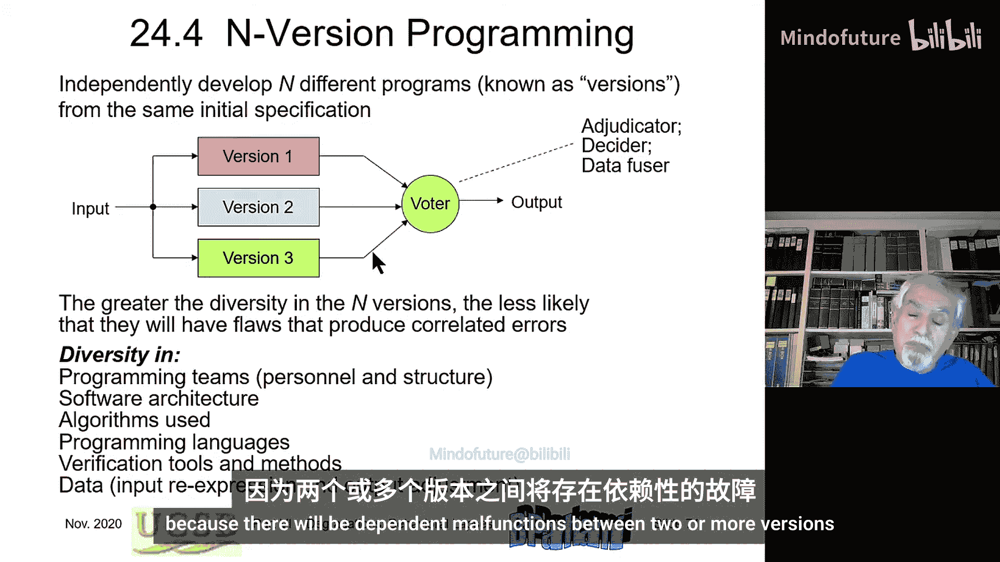

So you should not model the n versions as being independent units。That malfunction independently。

Okay imperfect specifications can be the source of common flaws。

 so these programming teams are given a specification of what they should develop and it's very possible that that specification contains errors if you give you an erroneous specification the three teams then obviously they all will produce bad software。

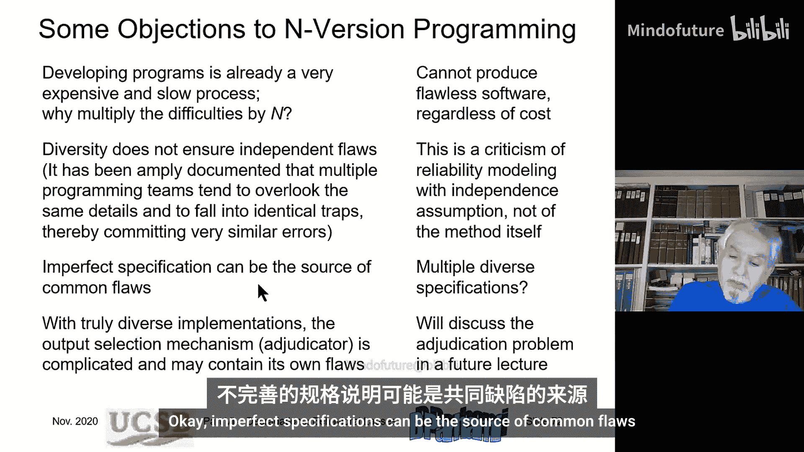

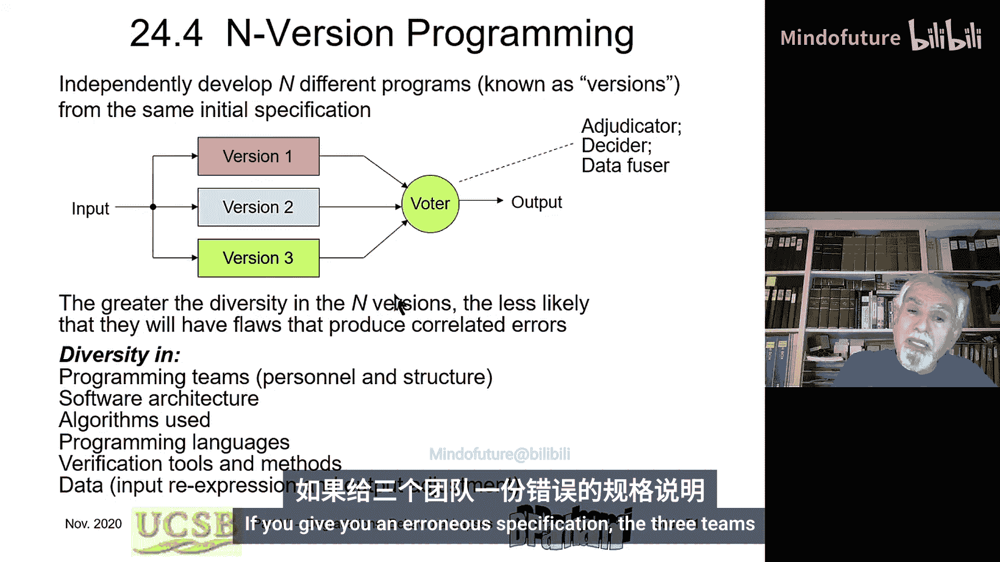

Okay， and the adjudicator's。Usually call the unit at the end， not a voter because it's really。

You know， votingoting creates the impression that's a simple thing， we call it adjudicator。

To sort of convey the fact that there's more complexity in it than a simple voter。

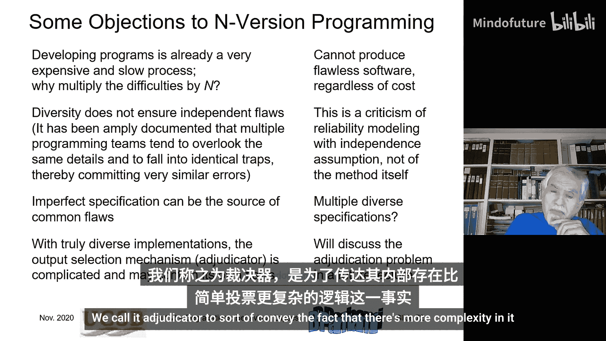

Okay， end version programming programs can be modeled by the fault tree analysis method that saw。

Earlier in the course， so heres an example for a three version software。

The three version software fails or malfunctions。If two of the three versions malfunction independently。

 so this is two out of three。And this is or， so this is one path。

To failure for the N version software。Or if all three versions fail。

 that has some probability that we have to determine experimentally。Or。

one and two simultaneously malfunction， one and three。2 and three， two out of the three。

 and we should actually quantify the probability of that happen。

So this is all the cases that lead to the end version program failing。Now。

 these dependent malfunctions of two units or all three units。

 here's an example from a four version software experiment。And。So you see that the number of cases。

 the number of observations。There were no error it pretty large。33322，000。

Whereas the cases were all four malfunctioned。It's 40。

 so the probability of this happening is small and we sort of can quantify it by looking at these numbers。

Three versions， malfunctioning together is a bigger number and so on。Okay， so。

Most likely you have no malfunction。The bulk of the cases or a single malfunction and this is basically designed to tolerate one。

呃， softwareer function。You get here， you're in trouble and then these kick in and the system can fail。

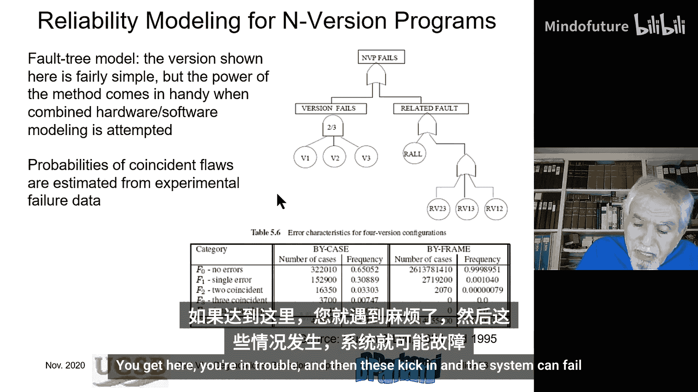

These are some applications that I've listed。And the number of versions。

So the number of versions typically in practical applications is small， two， three。Six。

 these the ones that have a large number of versions， these were mostly academic exercises。

 like maybe a class of 27 students。We're given the task of developing it。Different。

 so there were 27 versions of the software developed and then they were used。

In a 27 version programming scheme。

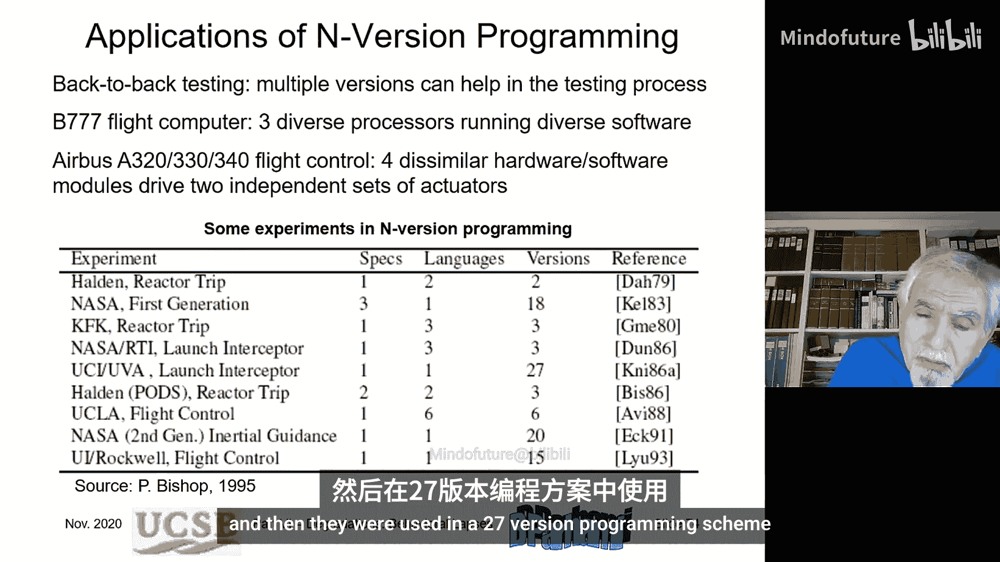

Okay， the last idea that I'll discuss is the recovery block method。

 which is a sort of dynamic redundancy counterpart to。In version programming。

 which is the static redundancy version。In other words， all the versions。Simultaneously compute。

Statically， and then you determine the outcome based on the output。In the dynamic redundancy version。

 only a primary module， primary software does the computation。

And then the output of that is subjected to an acceptance test。

So this is sort of the software construct that is used。We run the primary module。

 subject the output to an acceptance test， if it passes the acceptance test， then we are done。

We have。Correct output of course， acceptance tests may not be foolproof， that's a separate topic。

But if we have a good acceptance test that can detect problems in the output。And that's it。

If the acceptance test is not passed， then we use the first alternate。

So the versions are not run concurrently but one at a time。The primary version is run。

If it fails to pass the acceptance desk， then this one is run and so on。And nice thing about this。

 first of all， these are not run， so we don't use resources。For these， unless the primary module。

Our functions and we are forced to use those， so that's one advantage。

The second advantage is that these alternates， because they're rarely executed。

We don't really have to make them as efficient as the primary module， so the example I cite here。

That the primary module may be a quick sort routine。Whereas the alternates are bubble sword。

 insertion sword， and so on， these are simpler programs to develop。Therefore。

 less likely for us to commit。Design errors in and the software to have flaws in it。

That theyre less efficient， however， we don't use those very often。

 therefore it's not a big deal that they're less efficient。

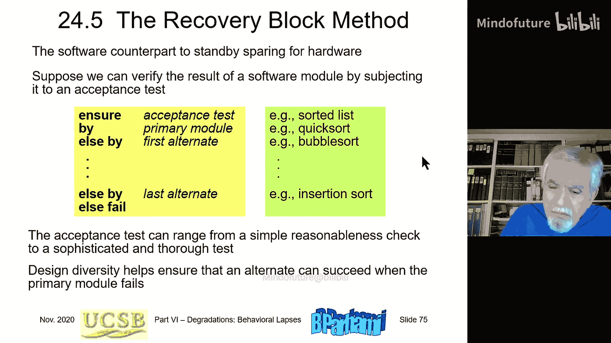

Okay， I mentioned that acceptance test is a challenge to develop。

 we don't always have good acceptance tests。So for example。

 if you compute the square root of a number。And the acceptance test may be to square the result and check to see if it matches the original number。

I squaring is simpler than square routing。Then this is good。

Because the acceptance test has a lower complexity than the in computation。

 but that's not always the case， so it's a challenge to develop that acceptance test。

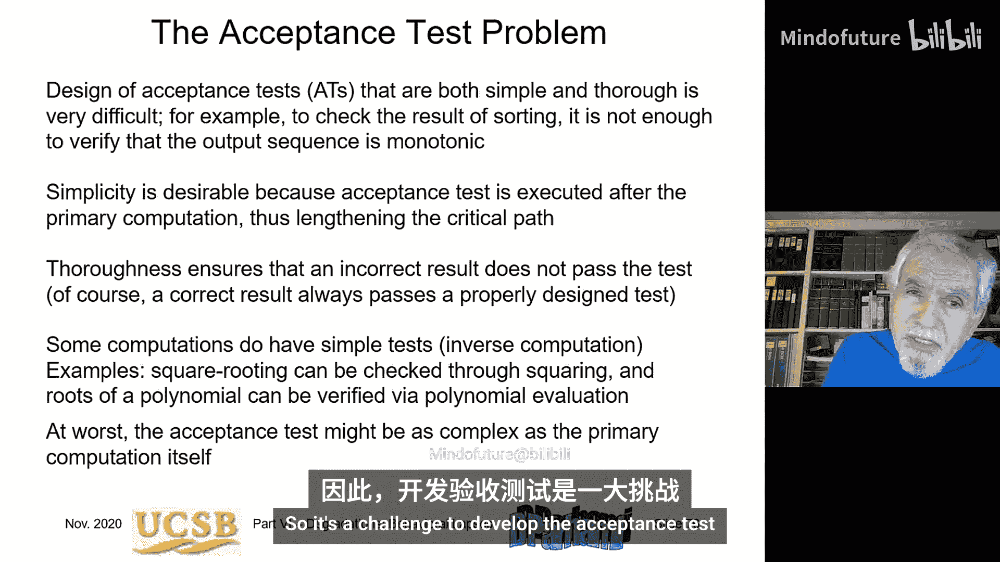

And finally， many years ago I developed。Sor of a method to combine the idea of endversion programming with acceptance testing。

And let me just show you the next slide， these are some examples， so this is a five version。

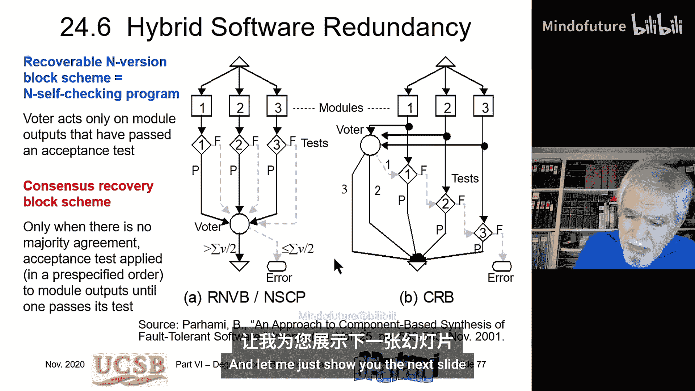

Program，5 version， voting。And then as long as three out of the five agree。And that's the output。

If there is no agreement between three， then we have。Filure。

So here's an alternative to fight version programming， there are three versions that are run here。

There's a fourth version here and there's an acceptance test here。

So an acceptance that I'll say is of the same order of complexity as one of these versions。

 so in terms of complexity， the two schemes are the same。However。

 this scheme only runs three of the versions and if all three agree。Which is the usual case？

Then we are done。So the other two versions are not even executed， so we save on execution。

If two versions agree。I two， let's say agree and the third one disagrees， then we can subject。

So here we have less confidence in the correctness， only two agree， and we have five versions okay。

So we can subject that output that was agreed upon by these two to an acceptance test and become more or less。

Confident that that's the correct output。Okay。😊，If none of these happens， in other words。

 there isn't three way agreement or two way agreement。With the passing of acceptance tests。

 in other words， there's failure here。Then we execute the fourth version and take the output of that。

As the overall output。 now， because here we had some。Milefunction already。In other words。

 either one of these failed and the acceptance test failed or two of these failed。

Then this one must be correct because we assume when we use five version programming。

There are no more than three malfunctions。Sorry， no more than two malfunction in other the majority of these。

provide the correct output okay， so if we already have two malfunction here。

 then we can assume that this for version is correct and we use its output。Okay。

 now this lecture became a little bit longer than the usual。

 I'm going to stop at this point and stay safe until the next lecture by。

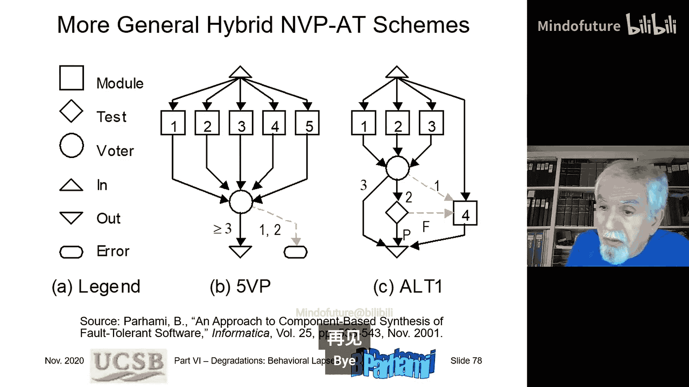