# 【加州大学】容错计算-｜-Fault-Tolerant-Computing-Ucsb-Ece-257A-p15-P15_第15讲_第25-27章_故障隔离--BV19cFyz8EPV_p15-

Hello and welcome to Lecture 15 for the course ECE 257A。诶。

In the model that we have been considering for dependable computing。

 we are now at the end of the line， which is failures。

 so part seven of the textbook deals with failures。Today's lecture， lecture 15。😊。

Cover is chapters 25 and 27。Dealing with failure， confinement。Chapter 25。

And agreement and ajudication chapter 27。Which contains basically a series of strategies。

For achieving failure confinement， in other words， if one part of the system fails。

Want to confine that failure。And basically prevent it from spreading to the rest of the system。

The last lecture， lecture 16。We'll be dealing with chapters 26 and 28， failure recovery chapter 26。

And fail safe system design。Chapter 28。And that basically concludes our discussion of。

Dependable computing in this course。Okay， let's now get started with chapter 25。

Failure confinement。Okay， so the first thing I want to mention。Is that that failed state。

 which was at the very bottom of our multi level model of penable computing。🤢，Is really not。

The last part， the last thing。Because a computer system is often， does not operate in a vacuum。

 but it's part of a larger system。That it helps。Control or you take the compute decisions for that larger system。

And therefore， if a computer system fails， often that does not mean that the system in which the computer system is embedded also fails。

And so I've shown here appended to the bottom of our model after the failed state。🤢。

Two other states bypassed and disaster。The bypass state is basically when we somehow bypass the computer system and a prime example of this is when you have annual overrite for computer system。

 this is routinely used， for example。And airliners。So an airliner has a computerized control system。

 however， there is also a manual overrite for that system。Which the pilot and experienced pilot if。

He or she notice as that something is wrong with the computer or with the decisions。

 recommendations of the computer。Those decisions and recommendations can be。Overri。

And basically manual decisions made。Of course， we hope that this doesn't happen often because airliners and basically almost all the systems that we use。

Nowadays are very complex， so it's not a trivial matter to control them by hand， but in an emergency。

The computer system has failed the pilot。Basically have training to be able to take over。

And manually control the airliner and safely land it。诶。🤧。Without any loss of life。 Okay。

 so that's the bypassed part。And now if we go beyond the bypass part， in other words。

 that bypassing is ineffective。Or doesn't solve our problem， then we enter that disaster state。

So there is a buffer between computer failure， failed state。

And a disaster which may lead to loss of life or。Weing major economic damage and stuff like that。

And that's the bypass state。Okay， and this bypass a manual。Override。

Is not just for safety critical systems， and here I've cited at the bottom of the slide an example。

In 1996。During the Thanksgiving weekend， which is one of the。And most。One of the busiest travel days。

Mtrax。Communication systems failed。So that the computers at train stations lost access to the centralized。

Database。And it turns out that they didn't have any manual overrdes， in other words。

 without communication access to central computer。They didn't have。

They didn't even have information about the price of tickets so that they could at least annually issue tickets to passengers。

This created a lot of inconvenience for passengers who were basically stuck。

At train stations without the ability to purchase tickets。

Travel to the destination and also a major loss of revenue for Amtrak。So basically。

 they should have known better that the communication system can fail。And therefore。

 they should have had at least some minimal capabilities for。Issuing tickets manually。

 in other words， they should have had pricing information printed in book。

And available at stations so that。Their operation would not be disrupted because of this。Of course。

 in some cases such as e-commerce site， like if you think of Amazon and manual systems are inible because those sites are built on the assumption that people。

For accesscc to。Computers and they can communicate with the servers at the e-commer site if that connection is cut for whatever reason then。

Manual operation is basically not an option。But when some form of manual operation is an option that provides a buffer between a computer system failing and disaster。

Either loss of life or economic disruption happening。

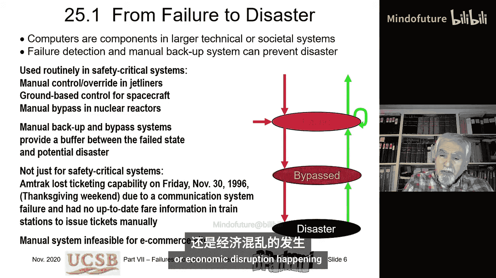

Okay， here's another example of the space shuttle Chaenger disaster。呃。Space shuthutle。

 Columbia was the first space shuttle。The second one was Challenger。

 so it was one of the early space shuttle models。And this challenger on its ten mission。

On January 28， 1986。Exploded 73 seconds after launch。And seven crew members were killed。

 it was one of the major space disasters in the United States。

And the reason for that was that temperature had dipped below freezing on launch day。

And engineers were actually concerned， they issued warning that this these below freezing temperatures。

May cause。This part oing that was used basically to。🤢，Sor of prevent leak of。AF。呃。

Between two parts of the system and the。Basically could malfunction。And for some reason。

 the investigation that followed basically revealed some major cultural problems at NASA。

Including ineffective communication channels。 So these warnings somehow。

Did not get to the top management。It could have made the decision to scrap the lunch and wait for a better。

different opportunity to do it。And after that as a result of the report at the commission。

Investigating the problem issued。They enacted major changes。Make sure that something like this。

 a technical problem that。Engineers were aware of。Actually was not ignored and there was effective channels for。

诶。Communicating this information throughout the various levels of management。So in this case。嗯。

There was no option for manual operation， but at the very least they could have scrapped a launch。

And waited for a better opportunity。But they could launch the space shuttle safely。

They could have investigated the oing。That may have deteriorated as a result of low temperatures and replaced the。

Replace the damaged part with。Intact new parts。And then had the launch trend day where。

Temperatures were more favorable。Okay， so the first thing that。We need。

In order to deal with failures， basically confining failures。Is an awareness of failures。Okay。

 if you don't know that a particular type of failure can occur。And if you don't have a good。

Estimate for the probability of it occurring。 Of course， you can't prepare for it。And therefore。

 when it occurs， it takes you by surprise and therefore。It will be very difficult to deal with。

So it is important to collect experimental failure data。And this has been done。

Throughout the computer industry。These lists that you see in this slide are some examples。呃。

Many of these are decades old， I'll tell you why these are so old。So for example。

 the first table you see on this slide。Different systems， Belco， tandem。

 tandem is a computer company specializing in fault tolerant computers， northern telecom。

Japanese commercial computers， so that's a category。

For which data had been collected and mainframe users。The numbers you see are different。

 but you see that。The failures are attributed to hardware causes， software causes。Operations。

And environment okay for the first system， Bel core。When they collected the data。

 they did not consider environment as a separate category， so there's no data there。

 doesn't mean it didn't fail due to environmental conditions， but that data was not collected for it。

And then these are average， so you see that the data is all over the place， different systems are。

Basically exhibit different mixture of causes for failure。

But if you take the overall average at the bottom， the red， the line in red。

You see that very roughly speaking， you know something that is easy to remember。

About a third of failures are。Hardware related hardware causes。

 about the third of them have software causes， this is very approximate。

And about a third are due to operations and environment。But these categories are roughly。Similar。

 they have the same importance with regards to causing computer failures。Okay。

 the second list that you see here。Bottom left of the slide。It'For tandem computers。

 unscheduled outages。Recorded outages and basically。

Attribute that each outage to one of these causes power。Communication lines， application software。

 file system and hardware。And you see more than half of the unscheduled outages were due to power。

So if you know that if you're aware that this is failure awareness。

 if you're aware that this is a major cause of computer failures。

Can you pay more attention to the power supply problem designing the power supply unit and。

Backrup power， stuff like that。Immediately basically reduces your failure rate substantially。

If you don't have any power problem。The communication lines， application software， file system。

Hardware is basically the least problematic。Item component in this system and that's in part because these are you know fault tolerant。

 especially designed to be fault tolerant and therefore it's not surprising that hardware problems are not a major contributor。

Contributor to the overall system failure， okay？But that's because they've specially designed these systems to have fewer hardware problems that there's redundancy。

Okay， now for hardware。If you look at the breakdown according to whether it's a disc storage。

 communications， hardware， processors， wiring， and spare units this is。Rough distribution， again。

 half of the hardware problems。Are due to disk storage。

 so this means that in designing dependable computer systems。You have to pay special attention to。

Disk storage and its reliability， so using things like rate and other。

Reliable disk storage systems is。Really， it pays off because it removes。

Or reduces substantially reduces one of the causes of。Hardware failures。Okay， spare units。

 as I mentioned， these contanem computers had spares so that when one unit basically malfunctioned and was removed。

 it could switch and spares。spares are basically rarely。呃。Cause of hardware failure in the system。

This shortage is the most important about one half and about a quarter of two problems comes from communications hardware。

So this is basically examples of awareness of failures and their causes being helpful。

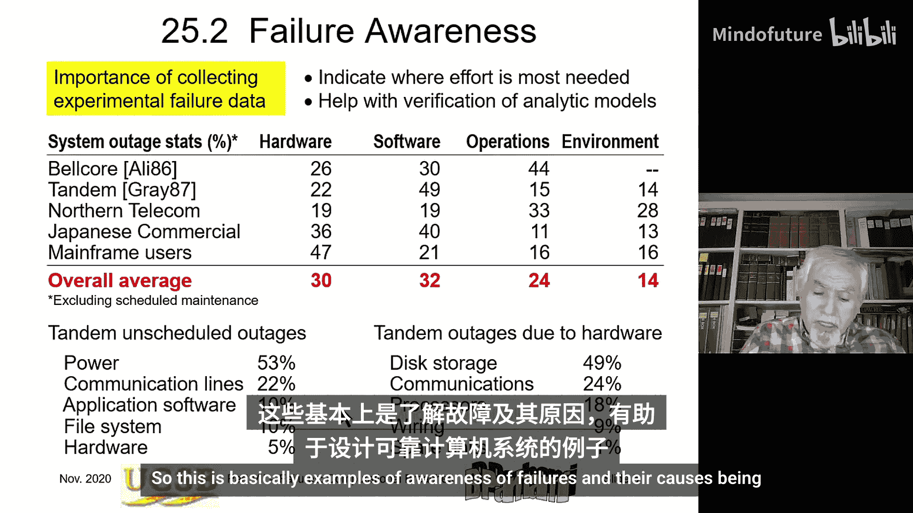

In designing dependable computer systems。

Okay， I was going to mention why these are rather all data。Unfortunately， over the years。

 manufacturers have become reluctant to share failure data as they did。Maybe three， four decades ago。

 they were much more open three， four decades ago in sharing failure data so that their customers。

Developed awareness they knew。What possible causes of failures are and could deal with them。Now。

 the computer industry and generally high tech industry has become very competitive。

And manufacturers are much。More reluctant to share data openly。In fact。

 this is not just for failures， it used to be that。For example， if a new processor was developed。

 all the details of this processor， internal design， algorithms and stuff were published。

And one could go to a journal article and find out exactly。What they did。

 you know how they designed the unit and how they measured the performance and so on。Nowadays。

 as much more。诶我哋。Reveal about their products as much more opaque as they don't give you a lot of details。

And that's because they are sort of afraid that the ideas will be copied by editors。诶。

That's very unfortunate because you know。And at educational institutions。

Very beneficial for us who teach and do research and for our students to learn about all these ideas from the industry。

Nowadays， they're more likely to protect those ideas with patents。

And therefore not share the details。So that they can earn money from licensing and also。

Have an edge over competitors in terms of。

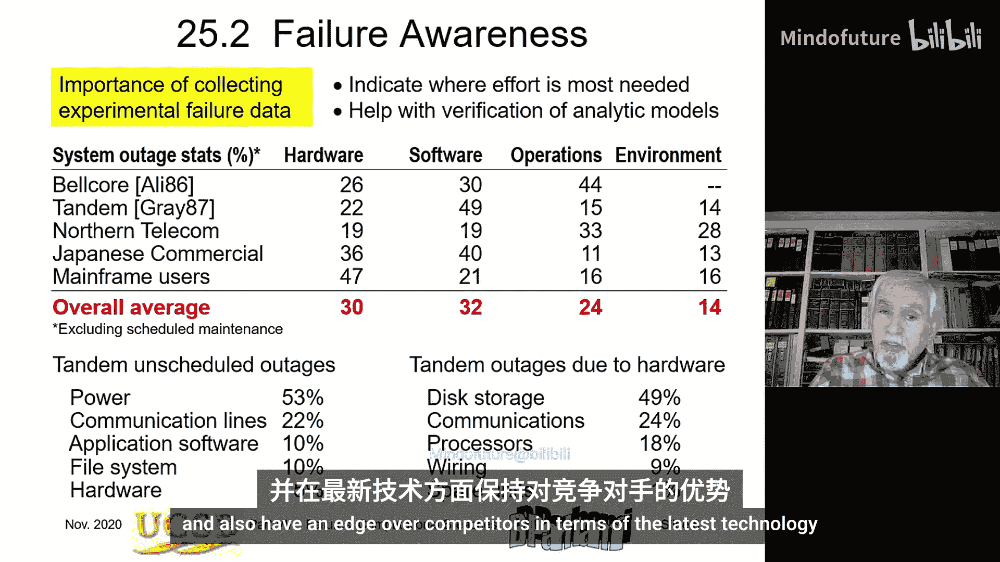

The latest technology。Okay， let's see， there are a bunch of system failure data repositories。

And these are two examples， the UsenIs computer failure data repository。

provided the link here and also Los Alamos National Laboratory data collected in 1996 and 2005。

From the systems， multi processor systems， clusters。And Nuumma， non uniform memory access。

Parallel computers that they had。And this data， again， the data is old。

 but it still provides some insight about。What causes these high performance systems to。诶。To fail。

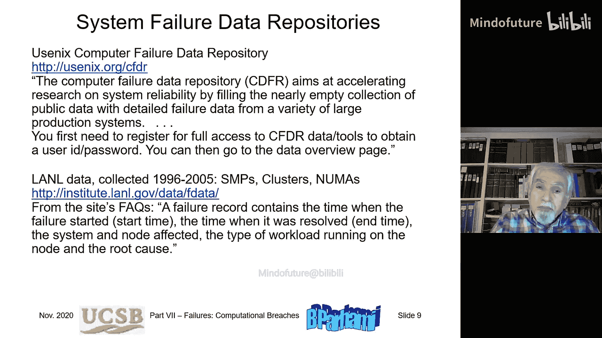

There are also。At least two repositories for memory and storage failure data。

And I provided the links here。诶。For example， for disk memory。诶。Observations of many。

Tens or hundreds of thousands of disk memories。LD to the conclusion that first of all， that curve。

For failure rate actually applies to disk memories。Because if you remember。

 I mentioned that this wear out。At the end of the bathtub curve。

Generally does not apply to electronics because electronics do not experience wear。

This commemor is do。Experience wear out because they have a lot of mechanical parts。Of course。

 the solid state disc are a different story。But this this is basically magnetic rotating disk。

 but there are a lot of mechanical parts Okay， so what this curve shows based on the data observation data。

Is that there is the infant mortality， high failure rate。Up to about a year。Okay。

 this is a very rough indication about the year， the first year of a disk memories。Liive。

Failure rate is rather high。So if you want to provide disc memories for dependable。

Computer installation。You may want to actually not use disk memories in the first year of life。

Wait until this first year has passed and then start using here。

 where there is a fairly low constant， roughly constant failure rate。Then。

Around five to seven years after the。Beginning of the life of the disc。The wear out period starts。

Again， the lesson that this teacher are。Is that we should be proactive， in other words。

 don't wait for disks to fail。After maybe five years。Just replace this， you know。

 of course it costs money to replace it。But that money is well spent because it reduces the probability of data loss during the disk crashing。

🤢，Of course， if you have raid， you can tolerate a small number of disc crashs。So for example。

 with parity， one this crash will not cause a problem。But the second dis can lead to data loss。

 therefore it's basically。Companies， organizations that operate large storage systems with many thousands or tens of thousands of disk units。

Put it into the practice to replace disc before they actually are worn out and start failing。Okay。

 they can still fail here， it doesn't mean that they won't fail， but it's much less likely。

For the best memory to fail in this region， then after。F out。

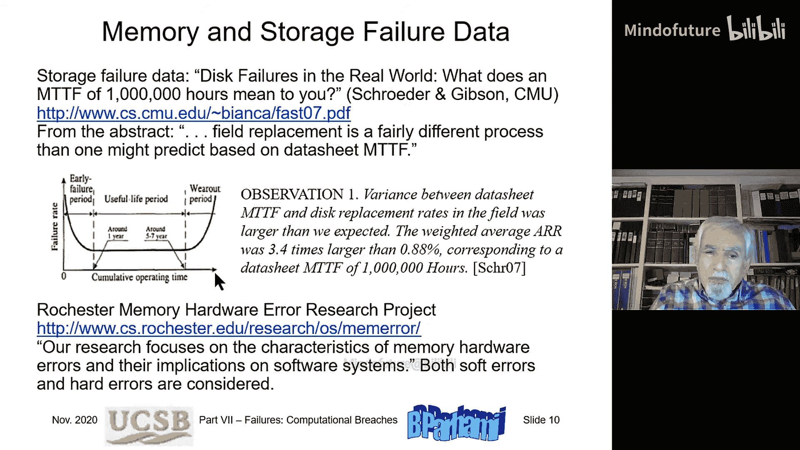

Okay。For software again。呃。I found these repositories years ago。

 unfortunately the second one of these， which was the more interesting one。Has become defunct。

Basically。Supply the list of software project failures。

And basically describe your project what the software did。And the causes of failures。Okay， now。嗯。

The reason that this went defunct， it's no longer accessible， was not made clear。

 but one can easily guess。That first of all， such information is very valuable maybe。

They decided they didn't want to provide that information free of charge。

Maybe there are some other companies providing that at a cost。The second reason。

 perhaps more important is that。OfDescribing these projects and their failures。

Sort of embarrassing to the companies and organizations that sort of implemented these projects。

And therefore， there may have been the question of legal liability。That。

 you know they could be sued for exposing these weaknesses of various companies and organizations in their software projects anyway。

 it's not accessible again a shame。Because it was very useful。

 I remember I spent sometimes hours going through these projects reading about them causes of failures and I learned a lot。

From the information on that site。

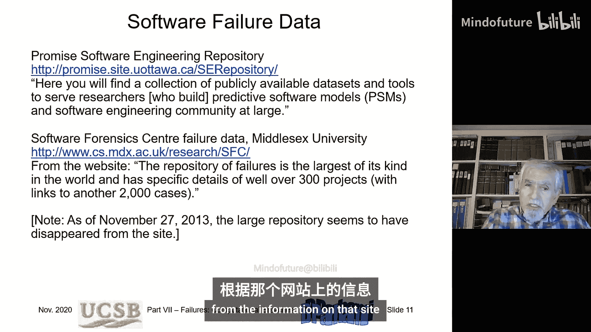

Okay， one of the， of course， having failure data， awareness of failure is important。In and of itself。

But it also helped us to validate or tune models and here I have a very interesting example。

Suppose I have a two disk system like the mirror disk。

 there's a main disc and there's a mirror disk and this two disk system。

Initially both tests are operating， so this is the model。

Then one disk fails or crashes and then you have just one disk， but you still have your data。

And then if before。The failed disk is repaired or is replaced with a new disk。

A second failure occurs then the system fails， so this is system failure state。This is full function。

And this is a state in which the data is still available on one of the discs。ok。

So it's easy to when you analyze this model， you find that the disk pair failure rate。

The effective failure rate is approximately two lambda squared over mu。Remember， Lambda is。A disc。

Failure rate for the disk， but the reason we have two Lada here is that two disks are operating。

Mux is the repair rate for that disc that failed。And2 lambda squared over me。

 remember that lambda is a very small number。Mux is。Also a small number。

 but it's much larger than Lambda。So if you compare this with Lambda。

 which is if you had just one this， the failure rate would be lambda。嗯。

2 lambda squared over mu is much less than lambda， so that this pair failure rate。

Heres a much smaller number than lambmbda， okay？This pair meantime to failure is the inverse of that failure rate。

And then if you accept。The manufacturers claim that the meantime to failure。Is 50，000 hours of 5。

7 years。The meantime to repair is five hours。Okay， so mu is five hours。Okay， one over Lambda。

Wwhich is mean to failure for a single disk is 50，000 hours and if you plug into that equation。

 you get 28，500 years， in other words， if this model is correct。

And if the manufacturers claim that the disk emptyTF is 50，000 hours。

And repairpair being five hours is reasonable， that's basically the data reconstruction time。

So it's unlikely that this is the source of the problem anyway。Now。In 48，000 years of observation。

 of course nobody can observe systems for 48，000 years， this is effective 48。

000 years because they observe 6，000 systems， each of which had four disc pairs。Okay， for two years。

So effectively they made 48，000。Years of observation for single despairs， okay？

They observe 35 double disc failures。So this basically。

 they recorded failures and there were 35 double disc failures。

This translates to a mean the failure of 1400 years， which is much smaller。

And what this model suggested， so something is wrong here， either our model is not。Accurate。

 we need to change our model for this claim。Of50。Thousand hours emptyTF is incorrect。

So now having this data。Allows us to go back and validate。 In this case。

 we don't validate this because。Obviously invalid because the model。

Adle result is much different from the actual。Observed outcome。Okay， so we can go back and say， okay。

 maybe we need a transition from this state view。The state zero。

 we need to augment this model with the transition here because it's possible。

That a single disc failure actually disables the system because we can't recover from it。

We don't detect it， for example， okay， so basically we have to change the model。

 we also have to double check this。To make sure that this claim。Is correct。

Now experimental failure data is difficult to correct， collect。

 in this case we were lucky that there were so many such a large number of systems。

we could observe for two years and get pretty good data imagine if we have one of a kind system。

 the type of computers， for example， that NASA。Designs and built。诶。

They have a very small number of copies， maybe less than a dozen of those computers are ever built。

 so we don't have thousands of systems to。Observe over a limited amount of time and get。

Acceptable failure data。And there are also psychological results， for example。

 logs may not be complete or accurate because。Especially failures that。

Are caused by incorrect operation， income incompetent。Operators。

 because those are very embarrassing for the operators and for the companies who employ them。

 sometimes that embarrassment factor leads them to underreport。Failures。

Assigning a cause to each failure is not an easy task， it takes a lot of work。

 a lot of investigation to see exactly what caused any particular failure。

Even when data is actually collected by vendors and the manufacturers of computer systems。

They may not be willing to share the data， this is something I referred to earlier。But they do have。

Data internally in the company， they may not be willing to share that data。

With customers and with the research community。No， you mentioned that this is impossible to do for one of a kind or very limited systems。

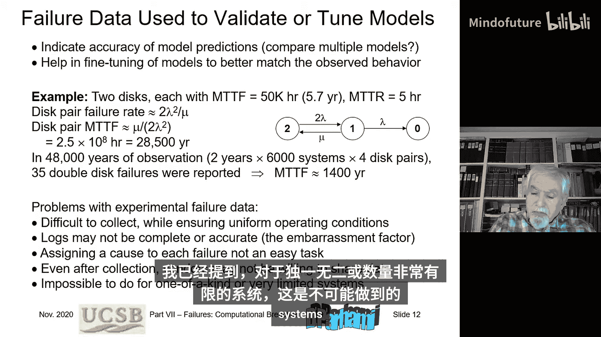

Okay， now once we have a good idea of failures and。Likelihood probabilities。

 we have to do what is known as risk assessment and we have talked about this before that the risk。

Is basically the product of two factors， the frequency of events。

That create those risks times the magnitude。Or consequence。Of those events， so for example。

 in the case of an airliner， the event may be airliner crash magnitude can be loss of life。

From the point of view of FAA or monetary damages that an airline company has to pay from the viewpoint of the airline company。

Of course， there are also intangible consequences。Like the reputation of the airline being damaged as a result of too many crashes。

 but those can also be translated into monetary damages， you know， if the reputation。

It's tarnished then maybe fewer passengers will travel with that airline or they have to discount their tickets or whatever so。

Okay， so frequency is basically unreliability or failure probability。So， for example。

A crash happens once every。100，000 flights okay。That's the unreliability。

Magnitude is estimated through economic analysis。Sometimes there is a direct economic consequence。

And sometimes we have to translate other consequences to。诶。Numbers。

 economic indicators and prime example。

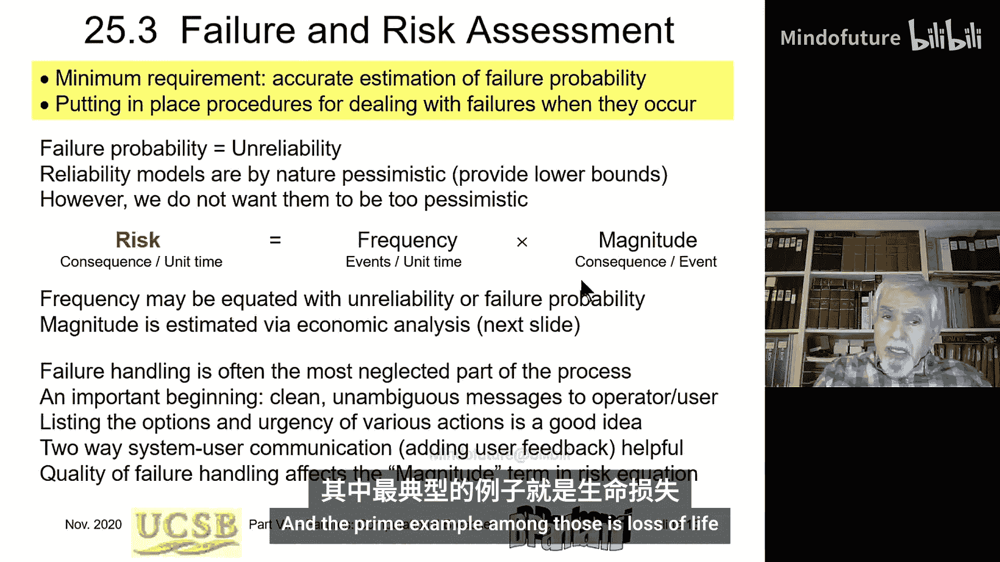

Among those is loss of life。Again， taking the airliner example。If。

Passengers die than the airline company。Must give provide damages， a damages。诶。Bapically。

 this happens by a settlement with the representatives of families who lost people。Anyway， for this。

 they have to have an idea of。How much？Basically， how much is a life worth。

 how much money do you have to pay？If you cause。You know， somebody to die。Okay。

 so here is a thought experiment， so suppose you are told that you have a one in 10。

000 chance of dying today。That's a small chance， but still， you know， it's not completely negligible。

How much would you be willing to pay to buy out this risk， suppose you could pay some some of money。

 some amount of money。🤢，To eliminate that risk， how much are you willing to pay？

This is basically how insurance works because insurance companies。

Have an idea about the risk of some event。Ocurring and then they know how much they have to pay if that event occurs。

 so the premium is computed based on similar considerations。Okay。

 so if your answer is this is a hard question to answer， if you have not thought about it before。

 suppose you say， okay， I'm willing to pay $1000， what does that mean？

That means that your life is worth to you about 10 million dollars，100。Dollar。For one in 10。

000 chances， so 1000 times 10，000 is 10 million。So if you consider your life worth 10 million。

 you're willing to pay $1，00 dollars。ToBy out this risk and orderll eliminate that risk。Okay。

 you can read the rest of the slide on your own。

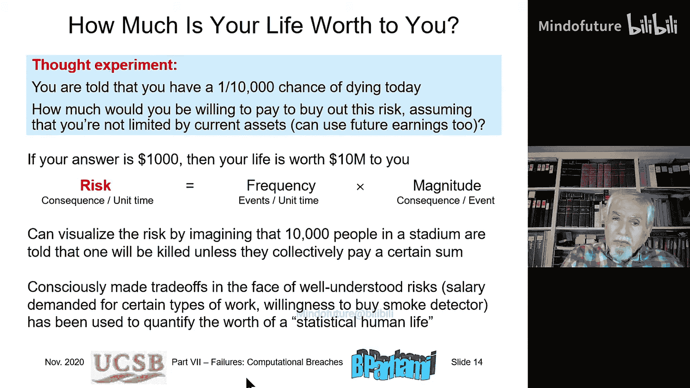

Now， risks， typically， especially serious risks， have associated with fairly small probabilitybabilities like an airliner crashing because a tiny probabilities。

And human beings， unfortunately， are not very good in estimating and interpreting very small probabilities。

So here are some numbers， these are not you know。If you look at different， different references。

 different sources， you may get different numbers， but basically here I'm trying to。

Convey to you that the risk of dying from flu。One in 5，000。Is greater than risk of dying。

Because of being struck by aardo。Tornado， the US Midwest。Earthquake in California。

Nuclear power plant accident。It's your right。So these are really tiny。Risk at the bottom here。

Yet people tend to be， that's the second earthquake， people tend to be a lot more scared。

Of earthquakes。Then let's say being struck by an no。And the reason is psychological because when。

A risk is familiar in other words you see autos every day， you drive an auto probably daily。

 so that's a familiar thing to you。And when something is familiar。

 your job may have some risks associated with it if you're a firefighter。

 but when you're familiar with the risk or the setting where the risk is created。

Can tolerate higher risk。Something is a mystery to you。

 so earthquake maybe you have never experienced a major earthquake。That causes serious damage。

 It's more scary。Okay， so。Here are some more data in this table， I'm going to skip this table。

But these are interesting， you know make sure to look at these and sort of try to learn from them。

US causes of death per million people。Okay， this is， these are annual data， other accident。

 210 work accident 150。So those are the top of the list。Homicide。

 everybody is scared of being killed。That's a much smaller risk being killed by。嗯Maybe日本 now。嗯。

Aviation。Okay， going on a flight airplane。The risk is very small。Compared to these at the top。

 but people are more scared， more people are scared of know flying。Dan of driving。Again， familiarity。

 also in aviation sometimes when a plane crashes。Perhaps hundreds of people die。

And accidents where there are a large number of victims at once tend to be more dramatic and more scary to people。

And an other accident that typically you know。Either does not kill anybody or maybe one or two。Okay。

So risk underestimation factors of familiarity， being part of our job， remoteness in time or space。

 so for example if a tsunami occurs in Asia and we are here in the United States。

 that distance makes it less scary and therefore we tend to underestimate。The risk or the damage。

Overestimation factors include scale， example， an event that kills thousands of people like the。

911 terrorist attacks in the US and proximity if some。Disaster happens in a nearby community。

 we tend to。Put more。Porance。Consider the more important and therefore overestimate the risk。

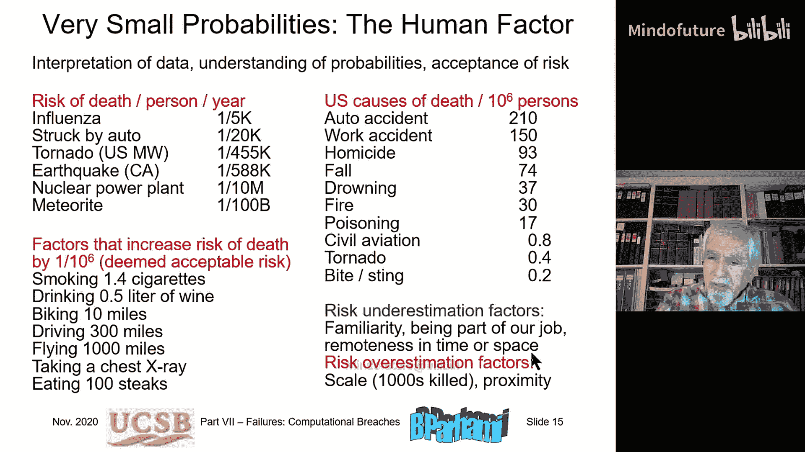

Okay。Now， to limit the damage from failures。Prompt failure detection is perhaps the most important。

Prerequisite。The sooner you find out that something has failed。

The less likely it is to cause major problems， so prompt failure detection is very important。Okay。

 in many cases。Like when dealing with mechanical elements such as wing flaps in an airplane。

 a reaction time of tens of seconds or hundreds of seconds， hundreds of milliseconds。Is adequate。

Because the mechanical systems have inertia， therefore。You have time to basically take the failure。

Andas in some other cases， you may not have that much time and you need very quick。Failure detection。

 electronic systems， for example。So here you see the result of an experimental study in which the probability of data loss。

And disc systems is plotted against。Detection latency in minutes。So， if you detect。The problems。

 let's say， in 10 minutes。The probability of data loss is much smaller。

 especially so these are different。Redundancy group sizes。

 but the shape of all the curves is basically increasing。

 so probability of data loss increases significantly。But the detection latency。

So the detection latency is 60 minutes。诶。Then。Probability update allows us's take this curve。

Is around maybe 15%。Whereas if it's only 10 minutes， that's 5%。

Quick failure detection reduces the probability of data loss in disk memory and more generally in any system。

Prompt failure detection is very important。

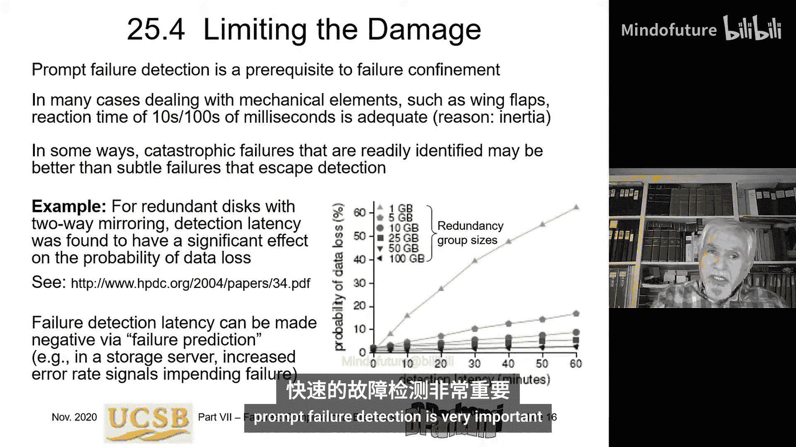

Okay， another strategy for dealing with failures is basically try to avoid them as much as you can。

And there are various strategies for failure avoidance。

 basically designing systems so that they are less likely to fail to begin with so that we don't have to worry。

About detecting failures and dealing with them。So these are some key。Recommendations or advice。4。呃。

Designing dependable systems。Okay。Limit novelty， in other words。

 stick with proven methods and technologies。If you want your system to be highly dependable。

Don't try to use the latest technology and the latest fad in design methods。诶。Basically。

 operations and features limit novelty。Use proven methods and technologies。

Adopt sweeping simplifications and very early in the course I mentioned that simplification when we talked about the。

Reliability equation being e to the minus n lambda T。Lambda is a failure rate， t is time。

 n is the number of components in your system。Fewer components you have。😔，Okay。

 the more reliable the system becomes， the less likely for it to fail。So as much as possible。

 simplify the system。Okay， don't put any。Bells and whistles are un needed features in the system because each additional feature。

Can create。No new points of failure， so try to avoid putting too many features if they're not absolutely needed。

Get something simple working soon， in other words， don't try to design the whole system at once。

Design a simpler version of the system， a prototype and make it work。

And then iteratively add capabilities， so those capabilities that you did not put。

In the simple system， add them gradually one at a time。

And then test the system after each capability is added。

So that incrementally you develop your system and introduce dependability in its operation。

We have incentives for reporting errors， okay， the team that works under design should be incentivized so that they report errors。

Thororoughly and quickly。So like rewards and。Bonusees for。Each error that is found or reported。

D scope is basically the same as simplification， reduced goals and specs early on。

 a lot of times people start working on a project that is very ambitious。And then near the end。

 they think， oh， that was too ambitious， maybe we can't finish this。

Product on budget or on time for even。Make it work okay。

 so at the end they just reduced the scope of the system。

 try to do this early on before you put in too much。Time and effort into the system。

WeMove stuff from the system that。诶。No， I not absolutely needed。

Give control to and keep it in a small design team Okay one of the causes of。Undependability。

 lack of dependability as huge design teams with ineffective communication。

Between members of the team。Typically， small design teams tend to be more efficient。And。

E in terms of internal communication， so keep the design team small， as small as possible。

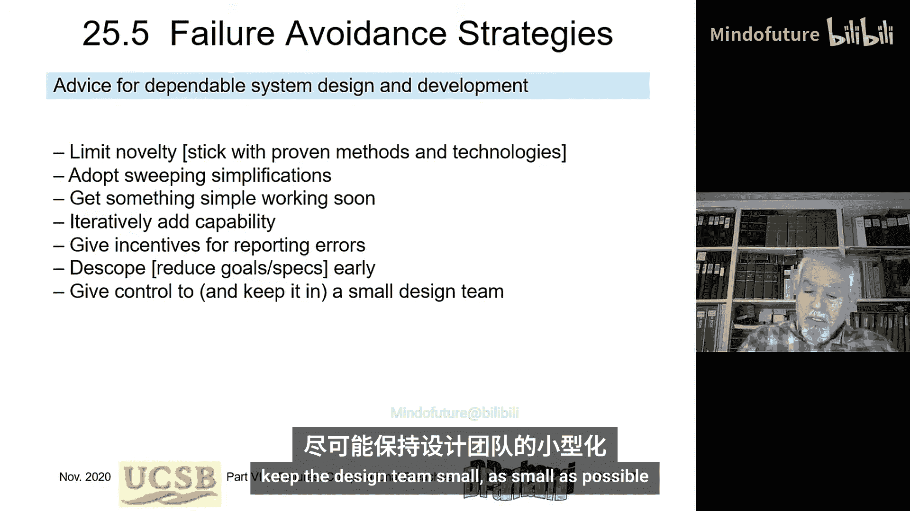

And finally， the last part of this chapter， ethical considerations。

Its another case of remember early in the course I mentioned that we really should not need a course on dependable computing。

Because other courses where you learn to design things whether software or hardware should incorporate all these dependability techniques in them。

Unfortunately， ethics is also treated in the same way。

The sense that we basically don't talk about ethics in most of our courses。

 and then there is in our undergraduate curriculum we have。An ethics course that students take。

So as if it's a separate。Thing and people sometimes don't even pay much attention to that course。

Just a record was that they have to complete and pass。it should be an integral part。

And in or graduate program， we don't even have an ethics course， okay？

So this is something that as computing professionals or basically in any technology。

 but especially in computing。You should be aware of now in computing， there are two main societies。

 Iroppole and ACM。Association for Comput machinery have code of ethics。

 So when you become members of these societies， you are essentially implicitly agreeing to follow。

The code of ethics。So I've listed here a few key points from Iroppoli Code of ethicics， items1。

6 and7。Except responsibility in making decisions consistent with the safety。

 health and welfare of the public。To disclose promptly factors that might endanger the public or the environment。

So the computing professionals， you should adhere to this principle。

Maintain and improve our technological competence to undertake technological tasks for others only if qualified by training or experience。

In other words， never accept。To work on a system for which you feel you are not qualified。

 you don't know enough。To design a safe。诶。System that does not threaten the welfare of the users。

And number seven， seek accept and offer honest criticism of technical work。

To acknowledge and correct errors and to credit properly the contribution of others。

If you see that something is wrong with the system and that it may endanger people's life or will cause economic damage。

You should speak up as a computing professional and these are not easy things to do。嗯。

Sometimes people have to pay a price for criticizing or。嗯有。

Raising a point that will cause a product not to be developed or to be delayed。

 the development to be delayed and therefore。The company might suffer some economic losses。

But that's our professional responsibility to do it。ACM is similar。So ACM。

 as part of the code of ethics， says that we should minimize malfunctions by following generally accepted standards for system design and testing。

And give comprehensive and thorough evaluations of computer systems。Their impact。

Including analysis of possible risks。 Okay， so these are the two。

Professional society is most directly related to。Computing， hardware and software。

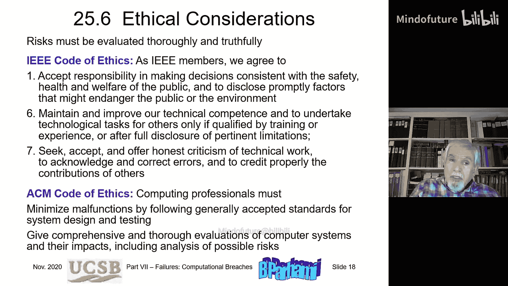

There's also a national society of professional engineers that has its own code of conduct。

 the principles are the same in all of these， the wording may be different。

 the emphasis may be different。But this is the same principle。

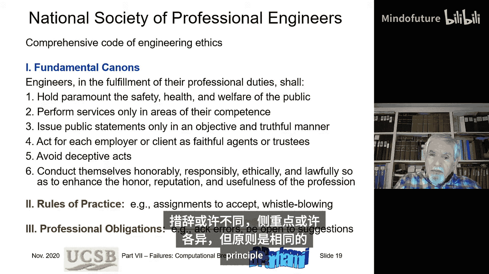

Okay。So this completes chapter 25， let me now go to chapter 27。

Dealing with agreement and adjudication。This is a very important topic。And in fact。

 it's an area that I have done research myself。系啊。My discussion of this topic is probably more comprehensive than what you see in other books of dependable computing because of my own。

Investment of time and effort to study this problem。Okay。So。The first idea。Is voting。

 we have already talked about voting。Now in my research on voting。I came across similar concepts。

In context outside depend， so dependable computing research of course。

 relies on voting way we have discussed before PMR NMR and so on。

But there's also a field called bitta fusion。拜。Therere is， let's say sensors collect data。

And then there's a fuser here。That gets these various pieces of data。

And sort of draws conclusions about what is being observed based on these。Various sensor outputs。

There's also a field within sociology called social Cho research。诶。That deals with similar concepts。

 or an example of social choice。Its， of course， elections。

 people vote for candidates and then candidates selected。But there are more。

Complicated versions of that， too。So if you want to have a party and you're trying to decide。

 you know what drinks to serve。You may sort of ask the opinions of。

The participants and based on the input you receive from。Those participants decide， you know。

What set of drinks to serve， So all of these。Are faced with similar problems so first thing I。

Did in this area of researchers too。Sort of improve the terminology so that when we talk about these methods。

 they can apply to these， so the problem is that in say election political elections。

We talk about voters， they voters here。And they。Sort of offer the votes。And then the fuser。

 basically extracts。Information about who was elected。

Things like runoffs there are a lot of complications there， but in the simplest case。

 people vote they're called voters。And then the roads is offered here and the fuser。

Ttermininees the election outcome Now notice that here we talk about voter as these people who cast votes。

In the context of dependable computing， we call this voter。Okay。

 so this creates problems if you want to talk about all of these ideas。

The terminology cannot be ambiguous， that in one case， you call these voters。AndIn one case。

 you call this vote， okay， so here's a uniform terminology。We have participants。

So the black terms that you see are the uniform terminology that you can use。

 the participants present opinions。And these opinions can have weights。

 so you know one participant's opinion may carry a higher weight than another one。

 those are weighted voting voting schemes。🤢，And then this is fuser。So we don't use voter here fuser。

 so participants offer opinions， the opinions may have weights， they may not be equal。

And then the fuser basically takes the opinions and weights and generates the outcome。

Of this process。So this is basically。Data fusion of various kinds。We have multiple data sources。

And refuse。The data from those sources， whether they're opinions or whatever into an outcome。Okay。

 so here is why。Voting or data fusion in our new terminology is important。

Suppose we use radar image analysis to classify approaching aircraft。As being a civilian。

A fighter jet。我 bomber。Okay， so basically fighters and bombers。Present threats， okay。

 so you're sitting at a military base。You want to know if a fighter jet approaching or a bomber jet approaching or it's just a civilian。

So there's no threat from a civilian airliner， but these are threats and the level of threat is different。

 the fighter jet can do less damage than a bomber， so you want to be able to tell。

Whether an aircraft is one of these， okay？就。The image analysis。

So in order to make this determination reliably， let's say you used to be different。

Units with different algorithms， different hardware， perhaps。And two of them。

Under the opinion and the measurement that what is approaching is a fighter jet。

And one of them says it's a bomber okay， because we can't be sure and different algorithms can lead to different outcomes。

So in this case。Majority of these image。Passifiers， image analyzers。

 say that we are dealing with a fighter jet。ok。So this is an instance where we have to sort of take these opinions and come up with an outcome。

The outcome will be any likely it's a fighter jet， but。We don't know。

We can't rule out the possibility that is's a bomber。 Okay， so maybe one of these。

Made a mistake and there should have been one， two， twos of1，1 two。Okay， so in this case。

 we can use majority that's the simplest kind of。Data fusion or voting is majority， okay？

Now suppose we also have sensors that determine the distance， okay？The airplane is coming。

 How far is it from us？And let's say our three systems sensors。Offer these opinions。

 12 and a half miles， 12。6 miles。14 miles。Now here there's no majority。

 so simple majority cannot be used here。Because no number has majority among these three。

 there could have been five of these， okay， but there's no majority。

But you can say that two of them are almost in agreement。That the distance is about 12。54。6。

 one of them is not in agreement， although is not。The opinion of this third one is not too far from the other ones。

But it's possible that it's malfunctioning and it's giving us the incorrect number。

So this is basically an approximate type of data fusion or voting。We deal with not exact numbers。

 but approximate numbers。Okay， so majority voting or majority fusion is an example。

The opinions are one， two， three， two， two。And the majority of these five opinions。Indicate that two。

Should be the outcome。Okay， now majority fusers。And be built。From comparators and multiplexors。Okay。

 so here's an example， this is three input majority fuser。Basically。

 we have just one comparator comparing x1 and x2。If。

The two agree in other words x1 is equal to x2 agree， I mean， they're either equal or agree。

In the sense here， in the sense， oops。😔。

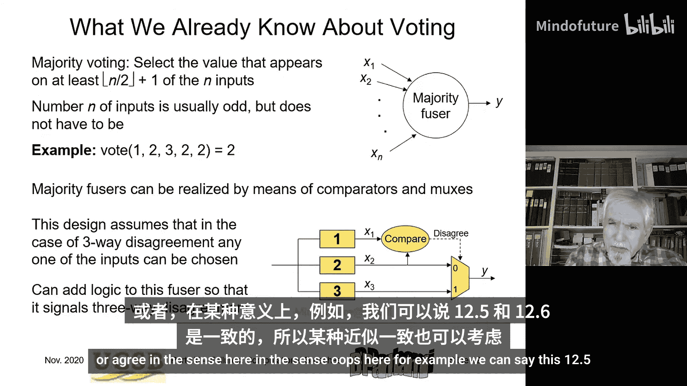

Here， for example， we can say this 12。5 and 12。6 are in agreement。

 so sort of approximate agreement can also be。

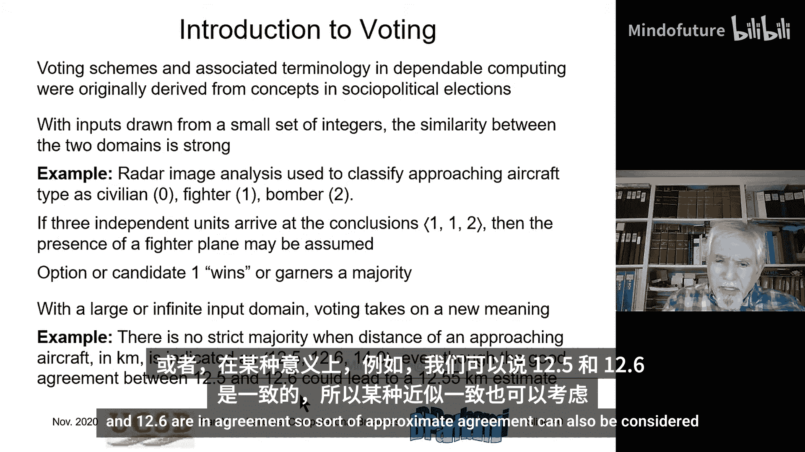

Consider it。

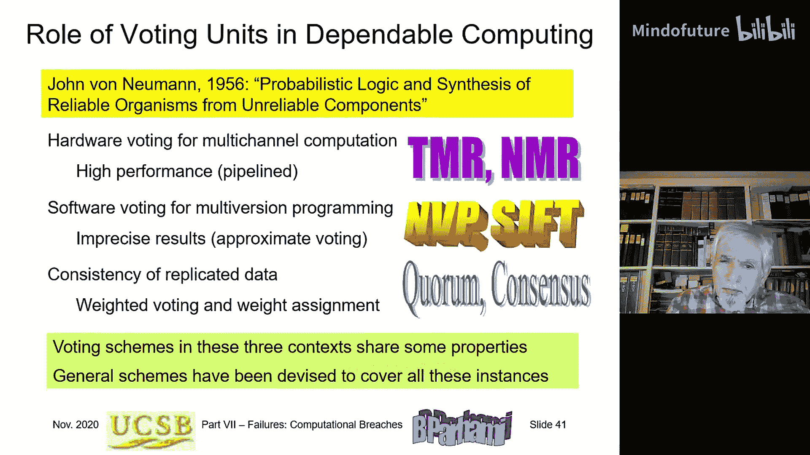

Okay， so these two are compares and if they。Agree， in other words， if this signal is zero。

 if the disagree signal is zero。N is x2 sent to the output is to agree。

 so one of them is sent to the output。If they disagree。Excuse me， they disagree then this third。

Input will be sent to the output， the idea being that。If these two disagree。

And if we do have majority。Then one of them must agree with this third one。And therefore。

 without further comparisons， we just send this to the。 So this is a very simple。Three input， user。

 majority user or voter in our world。Tele terminology consisting of a comparator。

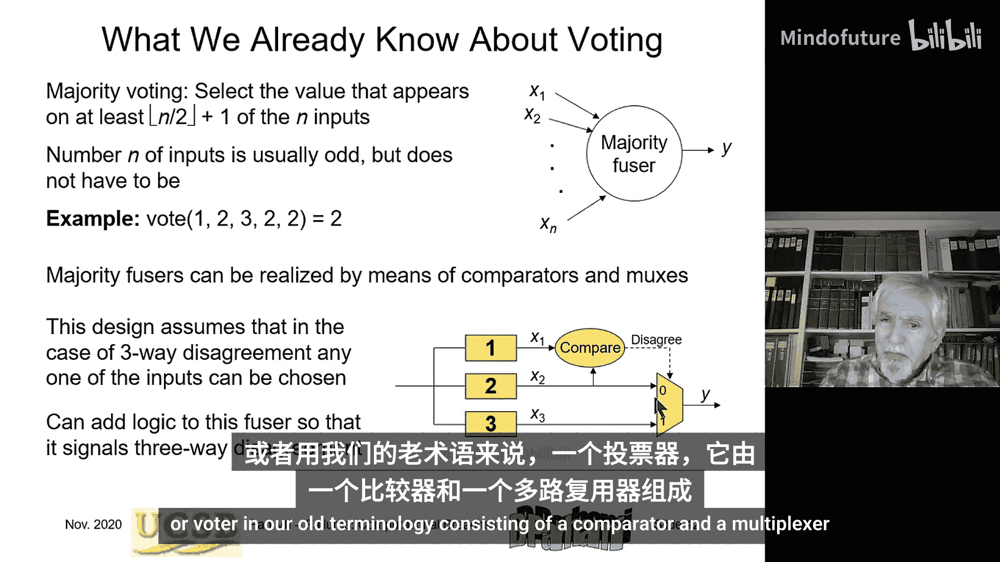

And then multiplex it。Okay， we can also have weighted booking or weighted。Fusing。

Where we have x1 x2 xn are the input values， the opinions。Each of them has a weight。

He one be to the end is at the weight。And those weights。

Can be integers or they can be real numbers for example， we can say okay。

 in within some organization we are doing voting this particular person because he or she is an expert。

In the domain that we are discussing。Give that person maybe two votes。So the weight will be2。

And as the other ones have one， so more generally。The weights can be different for different participants。

And then we determine an output。And it corresponding weight。Okay， let's say all these V1 v2 beN。

Add up to capital v， so that's the sum total of all the weights。ok。If we require that this output。😔。

Weight be V。This is unanimity， it's a kind of voting that basically is not really voting。

 but all of these must agree。In order for us to produce。

That agreed upon value as output and the weight of that output will be the sum of all these weights。

 okay， that's unanimity voting。Majority voting requires that the output weight。一。

Greater than the sum of the so remember this is weighted。So if all the weights are equal to one。

This basically says that。More than half of the inputs should agree。

 but if inputs have different weights then we deal with weights。

 the weight of the output should be greater than half of the total weights。That we have。

And this is known as supermajority， greater than or equal to 2 third。I vote。And this is Byzantine。

Strictly greater than。To be over 3。Plurality is basically when。诶。Some output is produced。

So that the weight associated with that output is greater than the weight associated with any other output。

So we don't need majority， so maybe only two of these agree。

But nothing else agrees with anything else， so that's plurality， meaning that。

Here is the maximum that。Pimum agreement that we have here。

 this is like when you have a political election。With maybe 10 candidates。

And they each get a number of votes， maybe the top candidate， let's say。A00 people vote。

 the top candidate get maybe 50 votes， the second candidates get 40 votes。And the other ones get the。

Fewer votes。The plurality voting in this case， the top vote together will。Selected。

And then threshold voting is when we require this weight。To exceed some preset。Overbound。

So for example， let's say all the weight are equal and let's say there are seven inputs。

So if we say threshold voting three out of seven。Three out of seven agree。Then we produced that out。

That's a threshold that we set。Okay， I'm going to go faster through。

There are a lot of slides in this chapter， and there are interesting topics， but we really。

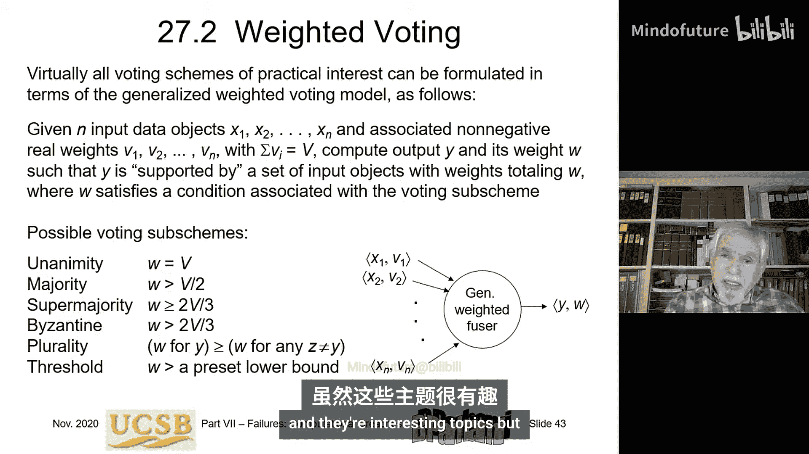

Don't have enough time to cover everything in great detail。Okay。

 so there's an example of plurality voting， so the five inputs presented to the plurality fuser。

Or one， three， two， three， four， three。There are two。

Opinions that are equal to three and opinions one， two， and four， theyre single。

Single units and therefore plurality。Of inputs indicate that go should be3。Okay， again。

 this is when the numbers are exact。The numbers are like this。诶。13。993。1。01。

 what should the output be？Okay， if you take this。Vi you over here，3。

The value3 constitutes two of the opinions， whereas the other three are single opinions。

 they're all different from each other， on the other hand， if these are approximate values。

 you can argue。That three of the opinions are roughly equal to one1。

This is a little bit less than one， this is a little bit greater than one。

So perhaps one would be the correct output。So these are the fine points that I mentioned。

Pretty broad and important research area when you。Add dig deeper and consider all these special cases。

Now， median voting is one way to deal with the approximate values。So if I take these five values。

What is the median of these values okay？Median basically takes。There are five of them。

 the way the two largest， which are these two。Put away the two smallest， 99 and1。

And then this emerges at the median。Okay when there is a majority。

 then the median always identifies the majority， so the nice thing about median is that if there's no majority it still gives you a reasonable value。

 if there is a majority， let's go back to one of the examples。🤢，That we had like here。

Jjority does exist if you compute the median， basically it says put away the two largest。

 let's say this three and this two。Put away the two small as this one and this two and two emerges at the。

As the outcome， and therefore， when there is majority， it does give you a majority。

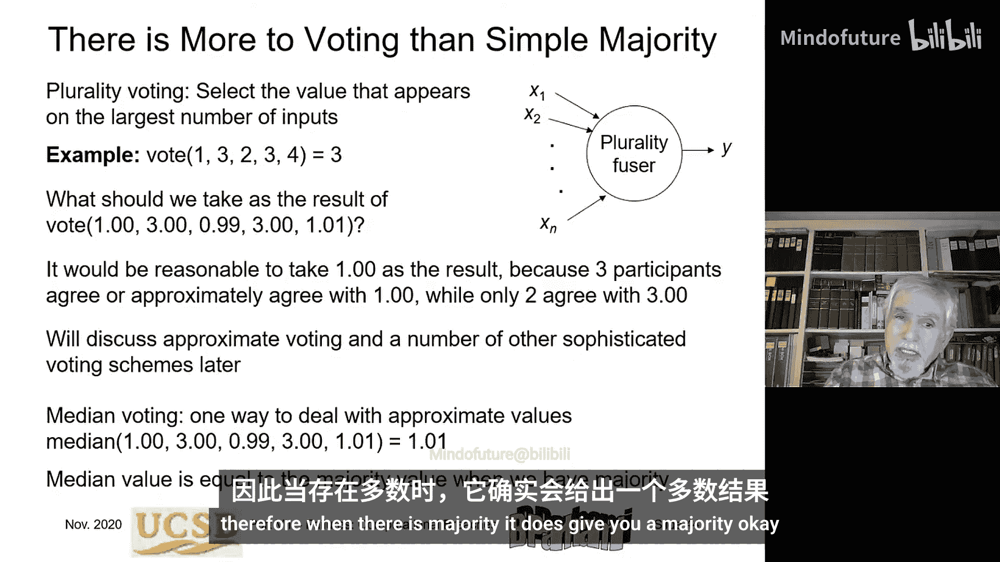

Okay， so this is from an old paper of mine， how do you design weighted voters because it's not immediately obvious？

How you implement a weighted voter because or weighted fuser， let me go back。Okay。

 if all the weights are equal to one， I mentioned that you can do comparisons and multiplexors。

But if these weights。Are arbitrary numbers real or integers， then it's not trivial？

To find what value has the largest。系。Okay， so here is a general design strategy。

If you have a bunch of。Opinions5 four，5 seven， four。Each with an associated weight， one， two， three。

 two， one。So here I've chosen integer weights， but they don't have to be integer。

There's a three phase。ACcuit that can basically find the result of weighted。A fusion of these input。

😔，First， sort by data。So the data is the first item here， the weight is the second sort by data。

 so the seven， which is the largest goes on top。Then the two fives。It doesn't matter which order。

And then the two fourths， so sort by date。Now in phase two。You design a circuit to combine weights。

Equal values， now because equal values are adjacent to each other and easily design a circuit to combine the vote。

7even is alone， so it just goes to the output， the two fives are combined。

By adding their weights and a dummy entry here is created。Because the number should always be five。

So this is basically the combination of these two entries， and this is a dummy entry similarly here。

 four and three。And a dummy entry。And then select the maximum weights。

 so look among the weights and somehow select the maximum。

 the maximum happens to be four in this example。So54 is chosen as the output。

 this means that among these inputs5 prevails。Because it has the largest possible。Support or wait。

It is four。Okay， you see that seven。Has only the support of two。And four has a support of three。

 so that's the correct choice。And I won't go through this。

 you can look through it if you are interested to see how these things are designed。

 sorting networks。Are well known and in fact， in my course on parallel processing。

Which will be offered in winter we talk in detail about how to design sorting networks。

 so that part is already well known。This is a combining network。

So these are basically combiners to compare these two。If there。诶。Data are identical， you combine。

The votes。So here in this case。诶。This is。Let me see。So， here's 7，2。Okay， this comparator。Five and4。

 remember， this is the sorting part， so five goes on top。And four at the bottom， so no change occurs。

And then this comparator。7 is larger， so it goes to the top。

 five goes to the bottom and this comparator now。Compare 7，2 with51， so7 goes at the top5。

Go here and so on and so forth。Okay， and this is the combining network and this is the selector。

 the selector is the easiest part because it's basically a maximum finding。Task。That can be done。

 so this basically means of these two。Compare the weights and put the larger one there。

Of these two compared the weights and put the larger one there and so on。

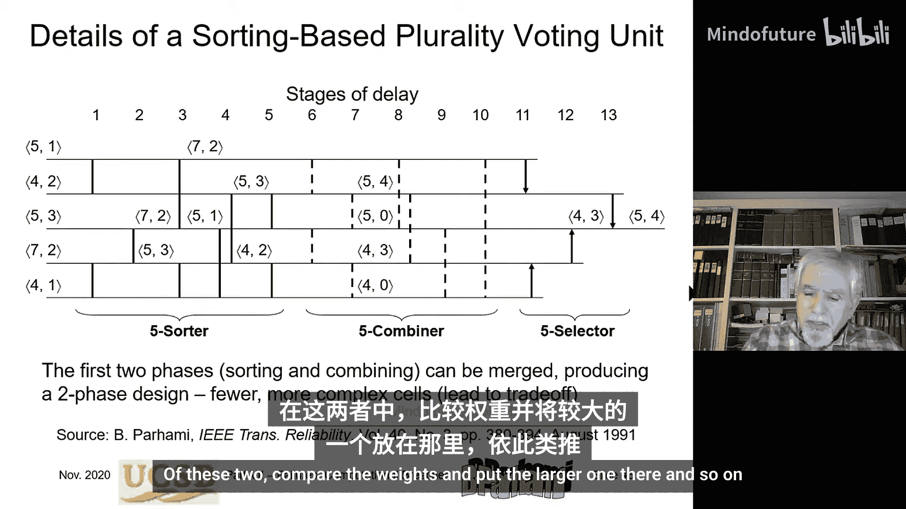

Okay， one way to generalize this kind of weighted voting or weighted fusion。

Schemes is called agreement or Qrum sets。Okay， so for example。If I list this set as the Qrum set。🤢。

This means if x1 and x2 agree， then they determine the output。If x2 and x3 agree。

 then that those two determine the output。If X3 and x1 agree then those two。

 this is basically two out of three majority， any two that agree。

 the output will be based on those two。Okay。Here's another example。If X1 and x2 agree。

 then they determine the output。If x1， x3 and x4 agree， they determine the output， if x2。

 x3 and x4 agree， so this is basically a quorum set。If you have this quorum， this agreement。

 then they determine the outcome。No。This is a。Basically。

 we are giving x1 and x2 more importance in this scheme。Because if X 1 and x2 agree with each other。

 they determine the output if they disagree。Then x1 must agree with two other。

Participants or extremists agree with two other participants。

Now it so happens that I can convert this to weighted fusion， weighted working。

All I need to do is to。Give a weight of2。To x1 and x2 and a weight of 1 to x3 and x4 and choose a threshold of four。

Okay， so2 plus2。Equals or exceed the threshold。2 plus 1 plus 1 equals or exceeds the threshold。

2 plus1 plus1。We also must make sure that no other combination。

Because when we say these are the agreement or quorum sets means that there are no other sets。

 I've listed all of the quorum sets。Okay， so not only it should have。

We should assign weights so that within these quorums we can equal or exceed the threshold。

 we should make sure that another like x3， x4。Does not have enough weight。Okay。

It's kind of tricky It turns out that this scheme is。More general， in fact， one of the。

Problems at the end of the chapter basically ask you to come up。With quorum sets。

That cannot be implemented。That are not equivalent and this particular quorum set was equivalent to weighted。

Threshold， fusion， okay？But you can come up with sets， quorum set。

That are not implementable as weighted。Prehold fusion。Okay， as I mentioned。

 I'm not going to discuss all the details here， so sometimes weighted threshold fusion can be。

 especially when the weight or integers can be。Converted to unweighted fusion。 So in this case。

 for example。And the weights of x1 and x2 are 2， weights of x3 and x4 are equal to1。

 we can basically duplicate。X1 and x2， and just do a straight unweighted。Fusion。Okay。

 so when the weights are small integers， then this works well。

In other cases you can do a bunch of comparisons and I leave it up to you to study this table。

 a bunch of comparisons and selections， multiplexors to implement。The voting scheme。Okay。

 agreement sets we already talked about， I'm going to skip this slide。

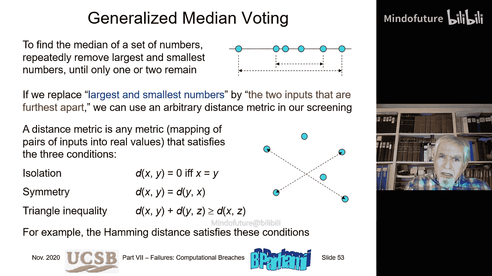

Okay， when I started looking at the literature and social choice。

 I came across something calledarrows theorem。It's basically an impossibility or incompleteness result Aris theorM says no voting scheme exists that satisfies all four desirable conditions。

For voting systems that are enumerated over here。And the fourDs are well， this is。

For political or social choice。Voting。There should be no big brother。

 in other words participants are free to express preferences， it's obviously a desirable。Attribute。

Independence of irrelevant alternatives， this is a fancy way of saying that preference for one candidate over another is independent of all other candidates。

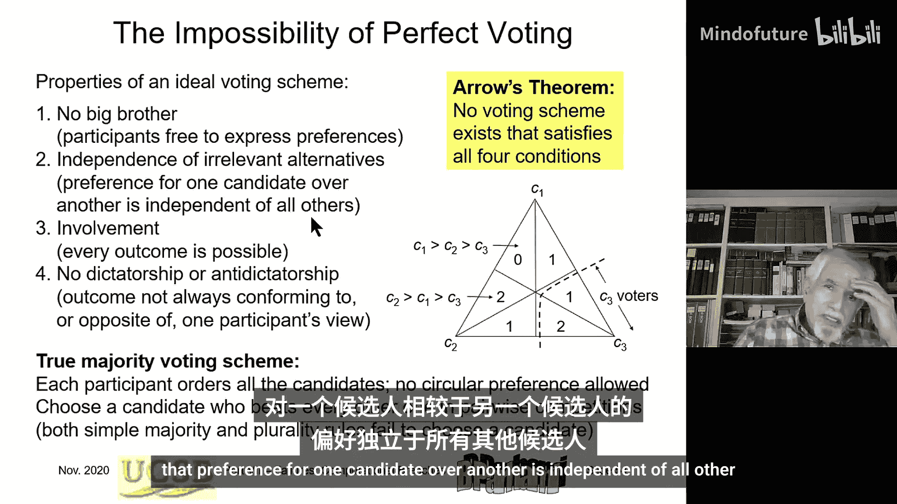

In other words， if I say I like candidate A better than candidate B。

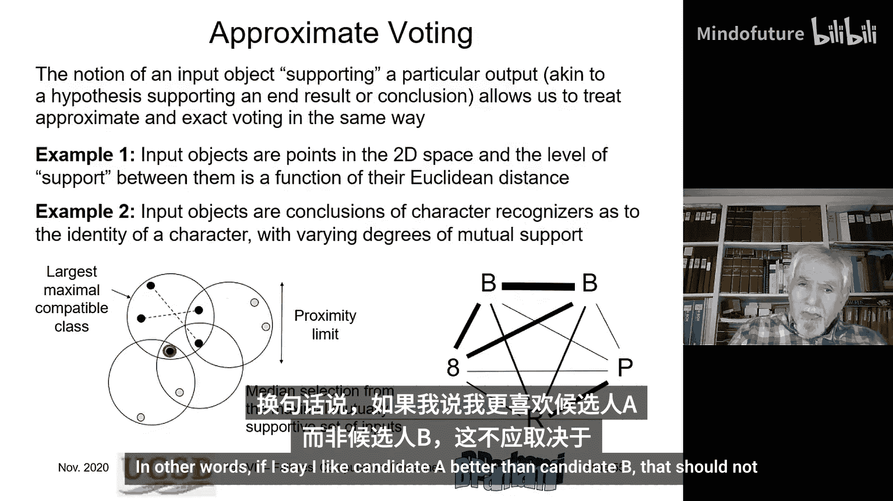

That should not depend。安。Which other candidates are running？Okay， in other words。

 I say candidate A is better， is a better candidate than B。And whether CE and F are running。

 that should not。Basically invalidate this preference。That's a reasonable thing too。Require。

Every outcome should be possible， in other words， beforehand we should not be able to rule out。

Anybody from being elected？That's also， if ahead of time you set the voting rules so that some people can never be elected。

 that's obviously undesirable。There should be no dictatorship or anti dictatorship dictatorship means that outcome is always conforming to。

The view of one person dictate anti dictatorship is just the opposite。

 the outcome is always in disagreement with the view of a particular person。Okay。

 and As theorem basically says you cannot satisfy all four of these conditions in any。

 no matter how elaborate your voting scheme， you can always come up with counter examples that says。

 you know，One， at least one of these。Desirable properties， attributes。

Will be violate yeah I won't go into the details it's a very interesting discussion it's probably not very relevant to dependable computing at least at this point。

Because we are not dealing with a large number of options and all these complications。

 but someday it may become relevant。At this point， I just wanted you to be aware。

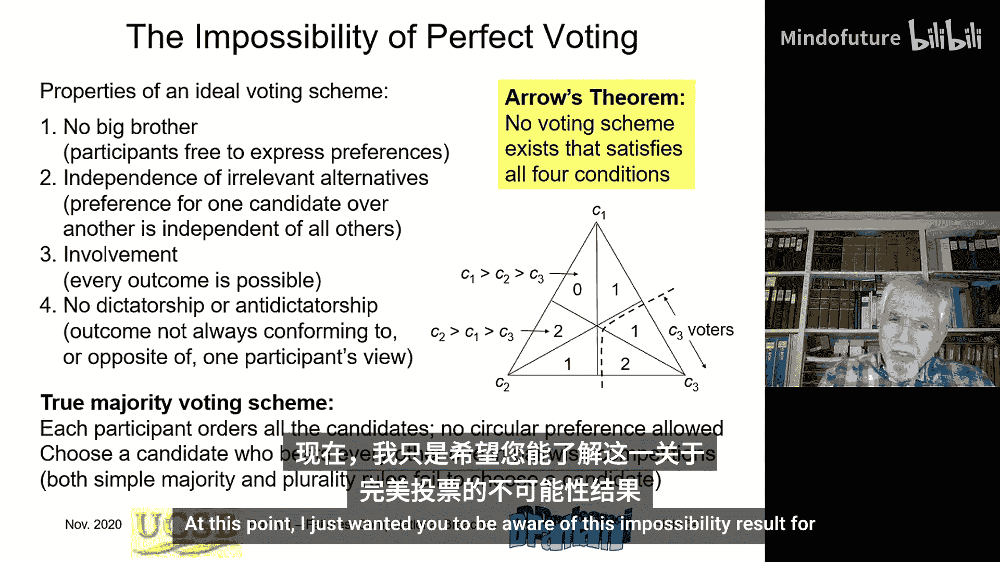

This impossibility result for perfect voting。Okay， approximate voting， some examples on this slide。

 please study it on your own， I won't go through the details。

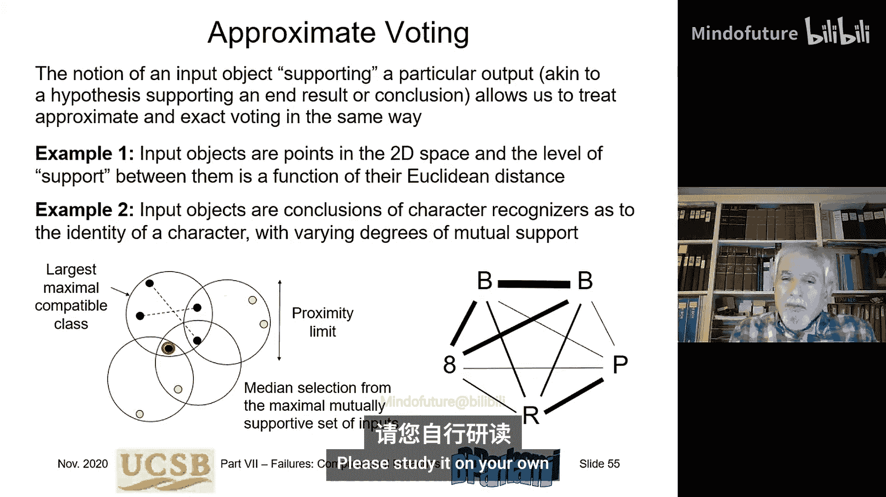

There is a voting scheme called approval voting。In which instead of a person。

Selecting just one candidate。You can vote for any number of candidates。

 basically you divide the candidates， let's say there are four candidates， ABCD。This is a voter。

The participant and this participant says A B or C， they're all acceptable from my viewpoint。

The obviously isn't。Okay， and similarly， the other voters。The other participants？

And then you just tally the votes。And say this one gets nine， this one gets nine， this one gets nine。

This last one gets four。Okay， this happens in political elections， for example。

 when three candidates are more or less similar。And the fourth candidate is different。走纹。

These three candidates are very similar and you force people to just vote for one person。Okay。

 the vote divided amongee， so this one votes for a， this one may vote for B， this one may vote for C。

So if let's say that division is。Completely symmetric， then each of these will get three words。

  three，3，3， and this this last candidate will win the election because。He or she got forward。

This approval voting avoids this kind of danger of multiple。

Similar candidates splitting the vote and therefore perhaps a less desirable or less qualified candidate。

Ning De。So there are all sorts of different putting schemes。

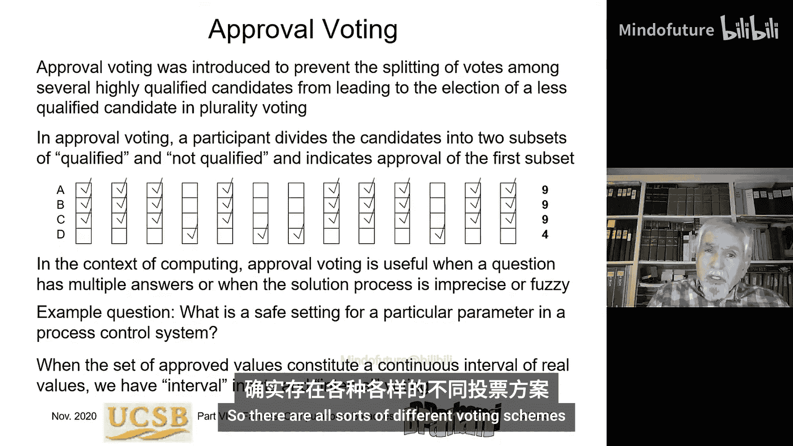

嗯。

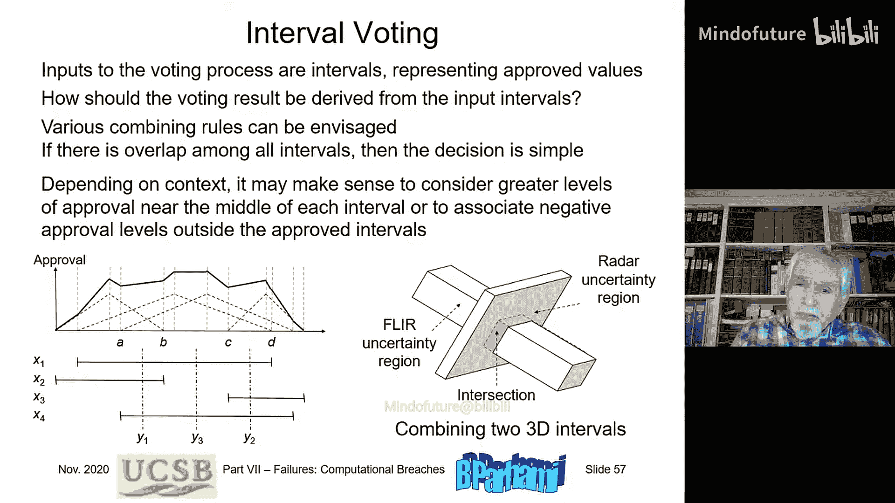

This one I'm going to skip。So that I can get to this idea of Byzantine。

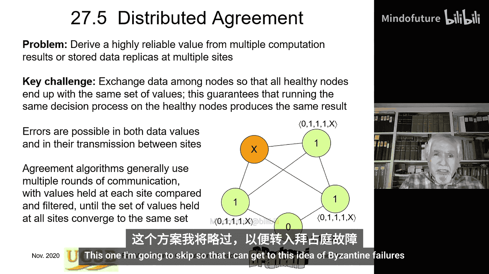

Pays and distributed voting， this is the last topic that I'm going to discuss。So， let's say。

We have three。Let's just talk about temperature sensors， three temperature sensors。

Ss the temperature of a particular device or site。And then they present the temperature to these processing nodes。

That do the fusion。Okay， now let's say this sensor。Is malfunctioning in such a way。

Not only thats the wrong。Wrong temperature。Also it's inconsistent， in other words。

 it communicates to this processor。Temperature of 1，05。121 to this one， 158。

 so it's completely unreliable。Basically， so it may be doing this on purpose， maybe this is a hacked。

Hack system and the hack carrier is trying to confuse。The system by producing these。

Inconsistent result。So if the processing units basically use the median rule。

This one will come up with 120， this one will come up with 121。So they get different results。Okay。

And the problem may get worse if you have more units。And more of these。😔，A Byzantine。

Mfunctions in your sensor。

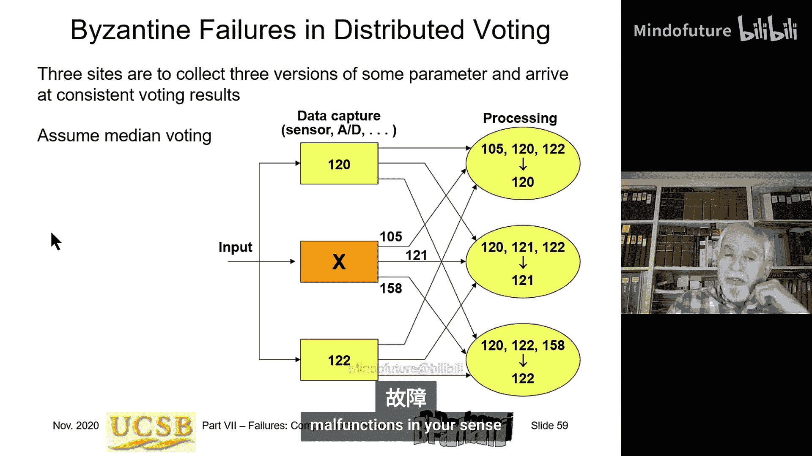

So this is an area that is studied in distributed systems me。

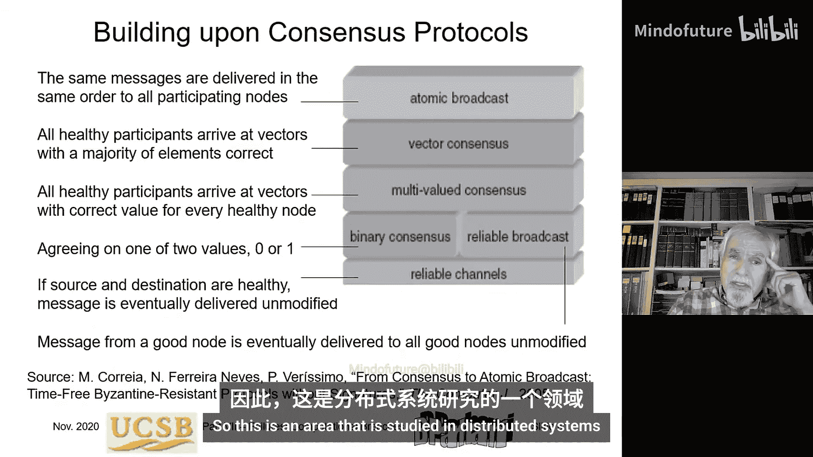

Just go。Through this a Byzantine general's problem， you may have seen this in other courses。

 especially if you have taken a distributed systems course。So remember。

 we talked about the two generals problem。A few generals paradox。This is in a way similar。

We have three generals， one commanding general and two lieutenant generals。

And they want to sort of come up with an agreed upon。A time to attack the enemy territory。

And we want them to old。Come up with the same decision。

In order to maximize the chance of being able to defeat the enemy。Again， as before they can send。诶。

Messengers to communicate with each other。Now the twist here， the additional twist。

 is that let's say one of these three can be a trader。Okay。

 so the commanding general can be a tradeor or lieeutenant one。

 let's say one at most one or Lieutenant2。And then trader can try to confuse things。

And cause basically lack of agreement so that。An attack， for example， L1 attacks。

 G attacks where D2 does not attack， so leads to defeat。For the forces of these three generals。Okay。

 now it turns out that if you have three generals。And one of them is a traitor。

 even though a majority of the generals。Are loyal。You cannot reach an agreement。

That is foolproof okay， so this is where majority of the generals being loyal is not sufficient。

 so let's see why。

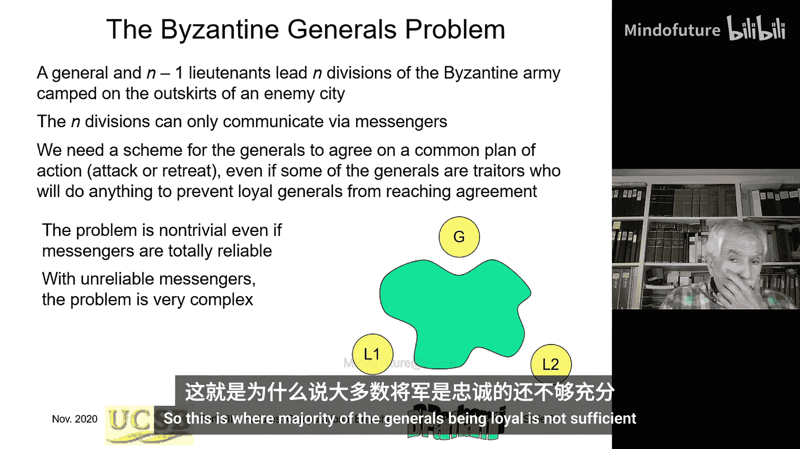

Here is a situation where the commanding general issues the attack command。And let's say， you know。

 communication is。Reliable。You know， it makes it even harder if the communication is not。

 so in other words， this general sends a messenger to each of the two generals and say attack。

At a certain time。Okay。So both of these lieutenant generals receive the attack command。And。However。

 Mr Lieutenant General sitting here， which receives the attack command。Because。

He cannot be sure that the general sending this command as a loyal general。

 remember we said can be one traitor。They cannot trust that command。

 so what should we do while maybe these two lieutenants can exchange information。

So the general said attack to both of them， this one receives an attack here， this is a traitor。

 so the tradeor tries to confuse things and then informs L1 that the general said retreatts do not attack。

So this general sitting here。Receives a direct attack command from the commanding General。

Received an indirect retreat。Command from the other lieutenant。And therefore does not do。

 does not know what to do， especially since if this general happens to be a traitor。

This situation is。Indistinguishable， these two situations are distinguished because this traitor commanding general can say attack。

this general and retreat to this one。Remember， a trader tries to confuse things。

And then this one being loyal。Coirectly， weed the information that the general told me to retreat。

So attack。Be treated completely identical to this situation。

 So Lieutenant one now does not know whether the commanding general is a tradeor。In which case。

 he should not follow the command。Or。Lieutenant too is a traitor。

 in which case he should follow the command of the general okay？

It turns out that if you have F Byzantine failures。You need at least3 F plus one node。

To reach agreement。Remember， majority says with F failures， you need2 f plus one。Okay。

 because if there are F。Faly notess。And you have two f plus one and the majority of the nodes are good。

 but in this case you need more， a lot more， free F plus one。

 so you need at least four generals in order to be able to tolerate one trader or one in the case of if this is a computer network。

 one。Byzantine node failure Byzantine means the node is completely is behaving completely arbitrarily。

 and therefore you cannot trust anything coming from that though。

So you need four and this example shows that four is enough。And。呃。

So to tolerate F Byzantine failures。Need3 F plus one or more。Falult containment regions。

 those are basically the node that we are。Using and we want to contain the fault within those notes。

The fault containment regions or the nodes must be interconnected via at least two f+ one disjoined paths。

And inputs must be exchanged in at least F plus1 rounds。Okay。

 so I won't go through the details of provingroving these， but let me go back。To hear。嗯。

So if I want to toleraterate the one Byzantine。Failure， I need at least four notes。

 so this is not enough it does have the second conditions that there are two。

Connecting paths so from G to L， this is one connecting path， this is the second connecting。

But this one satisfies both of those conditions， therefore this is enough。To reiterate。

We need three of plus one or more。Falult containment regions。

And these fault containment regions must be interconnected via at least2 f+1 disjoined paths。

So for ethical to one， there should be three， I made a mistake when I said that that。

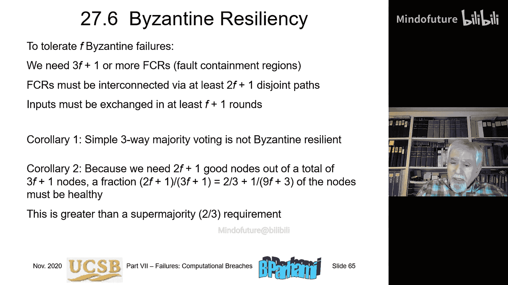

Opting， so this one does not have a second condition either they're not。Three pads。

 but here there are three paths。 so here's one pad from G2 L1。Here is a second path。

Here is a third grant。So it does satisfy that necessary condition。

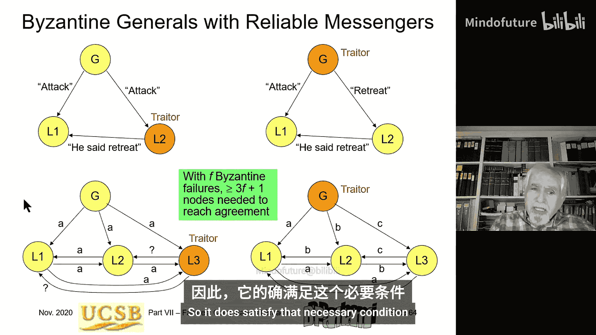

Okay， so let me stop at this point。And next lecture， we'll cover。

Chapters 26 and 28 and a little bit from the appendix that it's sort of like a separate chapter dealing with some miscellaneous information。

All right， stay safe until the next lecture。

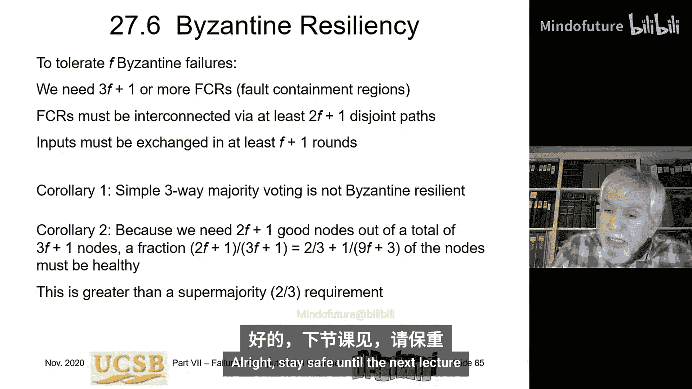