# 【加州大学】容错计算-｜-Fault-Tolerant-Computing-Ucsb-Ece-257A-p16-P16_第16讲_第26-28章_故障恢复--BV19cFyz8EPV_p16-

Hello and welcome to Lec 16 for the course。ECE 257 A fault tolerant computing。

This is the last lecture for the course。And it will cover chapters 26 and 28 in the textbook。

And a little bit of the appendix that cover some miscellaneous topics， including。

History of dependable computing。So let's start with chapter 26 dealing with failure recovery。Okay。

 failure recovery basically means that。F has occurred despite all the provisions and preventive measures。

And then we have to deal with that failure and the way to deal with failure is to recover from it。

Basically deal with the consequences of the failure and try to return the system to normal operation。

Through various means。And it's important for dealing in dealing with failures。

 recovering from failures， is to have documented plans。🤢，And have trained personnel。

So what do we mean by this？好。You can't leave dealing with failures and recovering from failures to chance or to。

Basically， incentives and ingenuity of the personnel。

 you actually have to explicitly train them for dealing with this。And in fact。

 since about a decade or even more ago。Major。Computer companies， especially in ecommerce。

Ive started to have basically drill dates， disaster drill dates。

Which means they actually purposely introduce some problem into their system。

And then have the personnel deal with those problems according to the procedures that are given in manuals and books。

See how they handle it and if there are any weaknesses in handling。诶。

Failure recovering from the failure， then they'll sort of go back and adjust their plans or provide additional training。

The personnel。Of course， you know， a site such as Amazon or Google not afford to introduce some totally random arbitrary failure and hope。

Hope that the personnel can deal with it so a plan for it so they say， for example。

 in such and such date， there will be some。Problems in the system and you have to deal with it。

So that they have some warning， okay， but other than that。

 the nature of the problem that occurs is not。Given to the personnel。

 and they have to figure out what went wrong and tried to hope it。This problem can be。

Confined to part of the system rather than， you know， bring down the entire system so that。

The commercial operations of the system are not affected while。

Personnel get some needed training in how to deal with such disasters。

So this is part of the training of the personnel of such companies。诶。

To be able to deal with unexpected events， things that can go wrong。

That training and also documented plans for how to build。Such problems is。

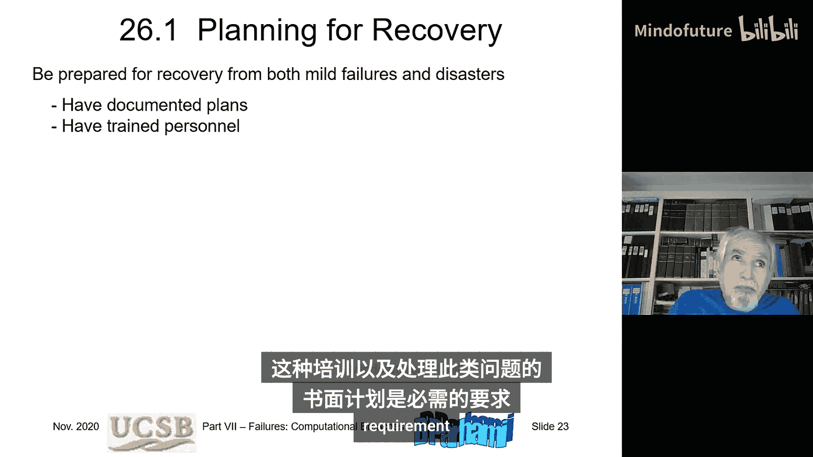

嗯ello。A requirement。Okay， I'm going to skip some slides in interest because we have a lot of material to cover today in this lecture。

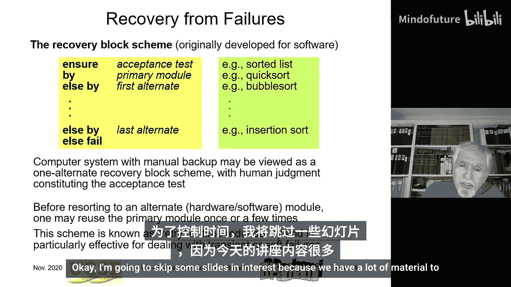

So these are some of the terms that are used in connection with failures and recovery from them。

On the left side of the slide， you see the terms fail slow， fail soft， fail safe。On the right side。

 you see fail fast， fail hard， fail stop， and we'll define these in a bit more detail in the。

Coming slide and then in the middle， these are the terms that are often used fail over and fail back。

AF forward is also a term that exists but it's。I have not seen it used in。🤢。

Connection with computing， it's used in some other fields。

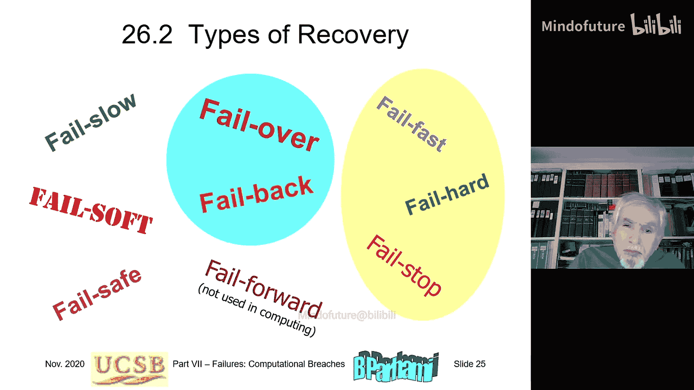

Okay， so what are these terms？嗯。It is true that subtle failures。

 especially in systems that are very complex。Are difficult to detect。Therefore。

 they can be worse than overt ones that are immediately noticed。

So I sometimes jokingly say that if the failure is such that the computer starts。

Emitting smoke or you see fire。Then you immediately know that something is wrong and you shut down the computer or do something。

Whereas a subtle failure is some zero somewhere in the memory changing to one。

 which is not immediately noticeable， but it can have pretty。Disastrous consequences。

So subtle failures are difficult to deep。And whereas overt failures that are more obvious are in a way more desirable because you want those kinds of failures to occur so that you notice them。

Quickly and deal with them。Okay， so we need to aim for designing systems so that their failures are difficult to miss。

 and these are known as fail hard system。opposedposed to fail soft systems。

 which fail softly and therefore you may not immediately notice that something went wrong。Okay。

 a core area of this principle is that unneeded system complexity must be avoided at all costs。

 and I have talked about avoiding complexity before， this is one more instance where。

That principle of avoiding complexity comes into play because complex systems。

And to have a lot of subtle failure modes。Which are difficult to detect by nature。

Also extended failure detection latency is undesirable， so if a failure occurs。

It takes you five minutes to detect it on this item you want to be able to。Clly detect failures。

And this leads to the term fail fast system。So the system。

From the time that something goes wrong to the time that it actually fails and we know this。Failure。

 the amount of time that eappses is very short。You quickly observe， checked the failure。

And of course， concurrent fault， error or malfunction detection。

Is better than periodic testing periodic testing by nature means every once in a while you test the system to see if something is wrong so depending on that period。

 the period of testing， it may take a while for you to notice that something is wrong so for example if you test the system every one minute。

It's possible that you don't know there' a failure。Until one minute。After it has occurred yes。

The test time may not arrive。Within that one minute。

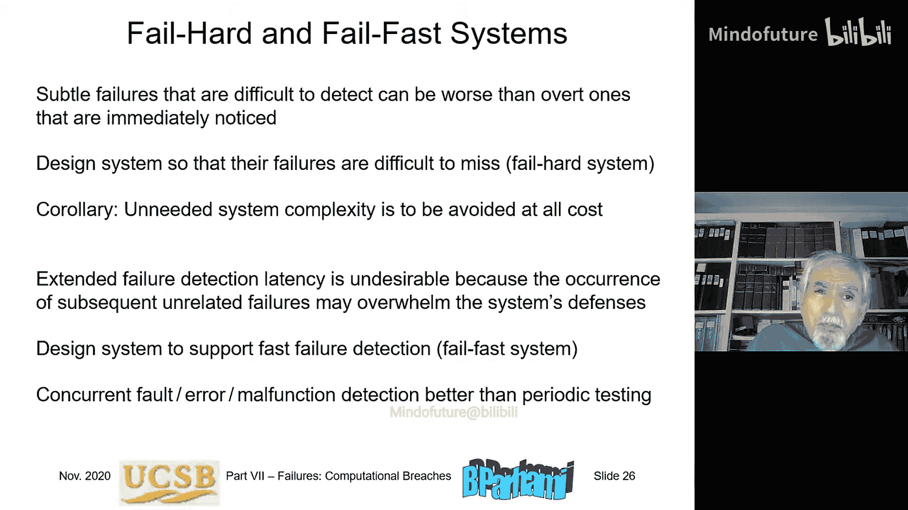

Okay， fail stop systems are systems that are designed and built in such a way that they cease to respond。

Or to take any action upon internal malfunction detection。So this is basically an instance of。

Fil safe system so we'll talk about fail safe systems in some detail in chapter 28 fail stop systems are sort of a kind of fail safe system because if they stop they don't take any action。

 they don't provide any data to us， that's sort of safe because we won't be using incorrect data。

The computer will not be taking any incorrect actions。When something goes wrong。

 so it's good to design systems so that they basically shut down。

 stop when something goes wrong in them。As I mentioned。

 these these form a subclass of fail safe systems that we'll talk about later。

The notion of failover is。Particularly relevant in。诶。

Places where they have a large number of servers。So at any given time。

 a server is attending to a customer， let's say at Google， a server is processing your customers。

A search request at Netflix， a server is streaming a particular video。That user。Okay。

 now that server。😊，Faiils。So that it can no longer do its job， a failover is a mechanism by which。

We basically transfer functions and the tasks of that failed server。

To a different server so that it can continue。servingerving the customer。Okay。

So this term failover means when something fails， the tasks are sent over to a different server。

 a different hardware resource now in the case of video streaming this is pretty easy to do。

Because when a server at Netflix is serving a video to you， you're watching a video。Basically。

 the only relevant information is which video you're watching。And at which point of that video？

You currently are what point of the video are you watching？

So if that server fails and we have to transfer the task to a different server。

 only two pieces of information need to be given。To that news server。

And the two pieces are the identity of the video。That was being screameded。And the point。

At which failure occurred so that the new server。Okay， so in this case。

 failover is very simple because a minimum amount of information。to be transferred to the new server。

 in other cases it may not be as simple， a lot of data must be transferred。

So that the new server can resume， can work， do the work after failed。Server。

Modern operating systems have failover mechanisms built in。So for example， Windows XP。

This particular site that you see here has some features built in and newer versions of windows。

 of course， have even more extensive。

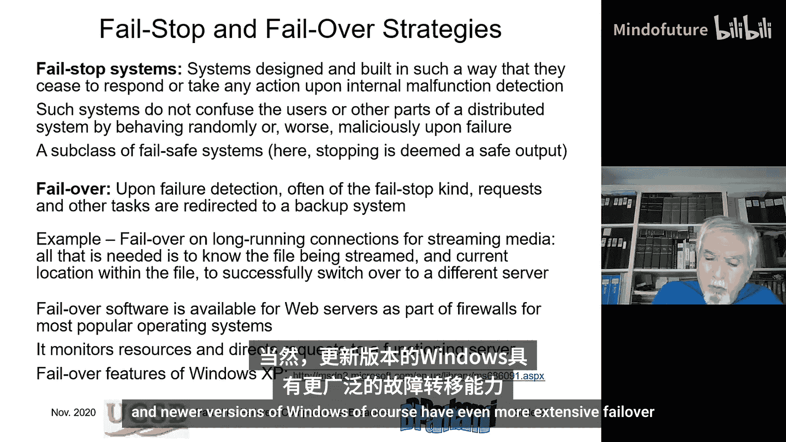

Failover capabilities。Okay， so I'm going to skip this slide which provides some details of this failover mechanism and Windows。

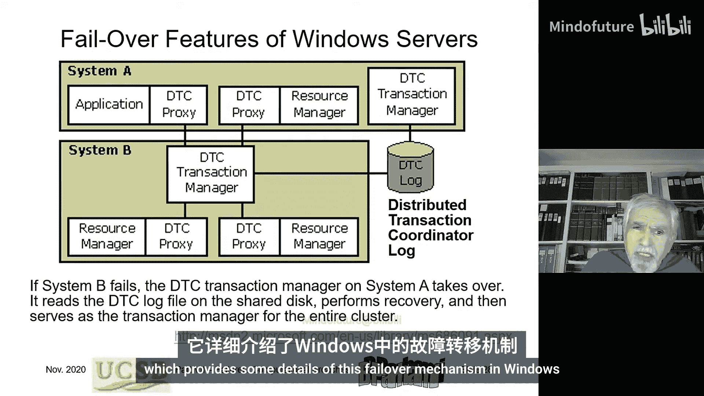

One of the most important aspects of dealing with failures and recovering from them is the human component。

 human interface。And here's a code that is one of my favorites。

And no warning system will function effectively。If its messages， however， logically arrived at。

 are ignored， disbelieved， or lead to inappropriate act。These warning systems。

 whether they're for computer failures or other natural disasters and so on。

Have to be made believable。So if you are in a building and the fire alarm goes off， you know every。

Three hours because somebody plays with it。Then you start disbelieving that alarm and then when a real fire occurs。

 you may think， you know something is。诶。It's not a serious problem and you may ignore it。

And this is basically why whenever there's a fire drill and they sound the alarm just for practice。

 it's important for everybody to leave the building。Because， for example。

 if they tell you we'll have a fire drill tomorrow at 10 a。And then maybe at 930 a real fire burst。

You may think that that's just a drill and so for drills， you don't leave the building。

You may get in trouble。 So in the case of fire alarms。

The authorities insist that everybody leave the building even though we know it's a drill。

Best in case。Okay， so there's a very。Important example of this disbelief in warnings。It's嗯。Over here。

Okay， in Hawaii。In May 1960 is tsunami。Curt。And people were given a 10 hour advance warning。

Through sirens。So people had 10 hours to basically leave their。

Its as if they were unsafe and get to a safe place。Despite this advanced warning。

 61 people were killed。And this was primarily because people just did not believe the warnings。Okay。

 so it's important for the warnings to be believable and be given in a way that。You know。

 create trust in people that are being worn。Of course， warnings must be。

Helpful and provide sufficient information。So in automobiles， this is my favorite。

 so sometimes a warning light goes on that says check engine。Very vague， doesn't say。

 you know how serious the problem might be， do I need to just stop my car right now and not drive it？

Or you know， I can just take it for a check。Next week。

This doesn't give you any information about how serious the problem is。

In the case of computer systems， it is to be， we don't have this very often nowadays。

 on the screen you read fatal error， nothing else， no more information about what happened。

How you need to deal with it， you know， what is the fix， just fatal error。

A very vague and unhelpful warning。😔，Given to the user。

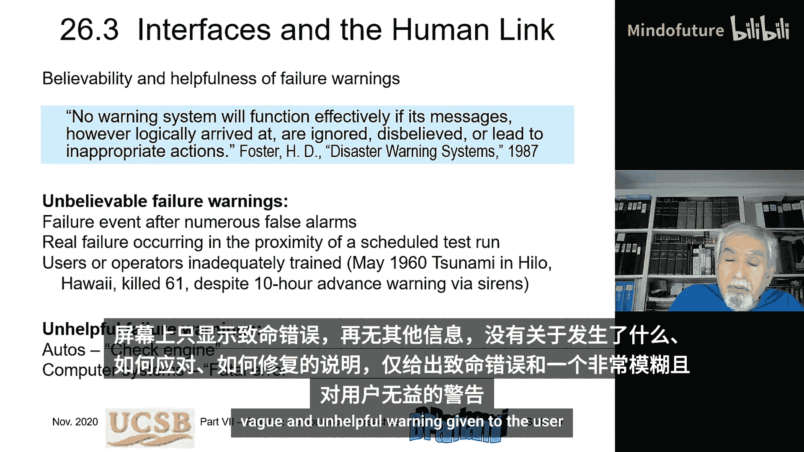

Now。Of course， when automation efforts are highly successful， this is sometimes sometimes creates。

Basically lacks attitude towards safety。A good example that I have not done here is for self driving cars these days。

You know， pretty soon。All computer， all car manufacturers。

Well introduce self driving cars and the first models will likely require the driver to be there。

Okay， it's not completely self driving， it's mostly self driving， but as a safety。A prerecaution。

 the driver should be there in case something goes wrong and the driver has to take over。

And if these self driving cars are rather successful。

And the driver basically seldom has to do anything or almost never has to do anything。

Then the human operator tends to switch off in these cases。Okay。

 after a few hours of driving and nothing goes wrong。

 you tend to swish off and basically not pay attention， therefore if something does go wrong。

 then you are not prepared。Not in a prepared mental state to take over。

So if a human operator is necessary， then we should provide。

Some mechanism to make sure that the human operator is engaged。

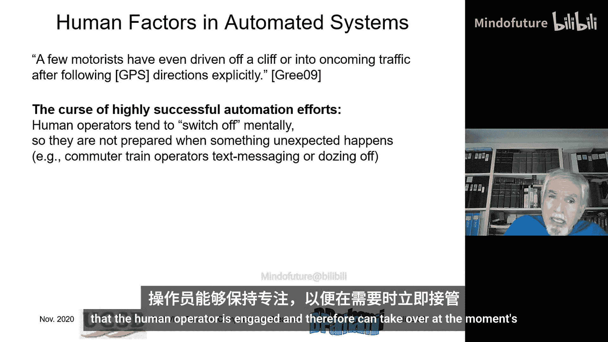

And therefore can take over the moment notice this。

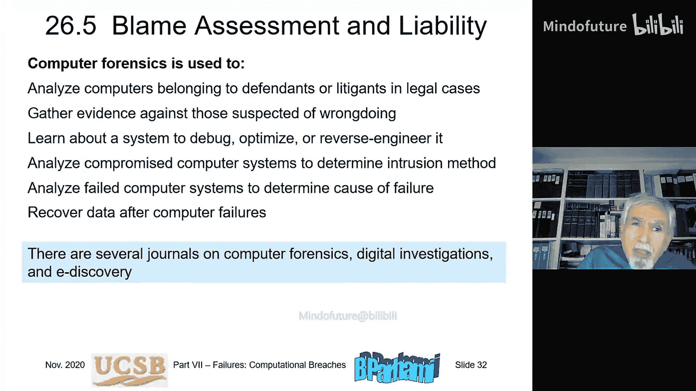

都。Okay， backing up data is an important aspect of recovering from failures。And unfortunately。

 despite repeated warnings， many people actually do not back up their data。hel。If data is。嗯。

Not photos and other。Ths。And you lose them。Well， it's not disasters， of course， some people。诶。

you know， become distraught when they lose a whole bunch of photos that represent memories。

 but it's not something that causes lack of safety if you lose them， but in other cases，Data。

Preserving the data may have safety implications and that data。Have to make sure this preserve。

 we have backup copies of it in case。ItDs as a result of computer failure。Now， personally。

 we all do backups to various extents。We may use removable storage。

 external hard drive or flash drive or CD DVD。To back up our files。It takes some work。

 so a lot of people just ignore packing up data。Another way that I。Itally found to be useful。

Is emailing a file copy to myself。Whi of course is not usable for very large files。

 but whenever I work on a paper， let's say， let's say a week or two I'm working on。

Defining and finalizing your research paper。Once or twice a day。

 I email a copy of the file to myself。And then basically continue working。诶。What I'm doing。

 I'm essentially using the email stber of our department as a backup。Medium。

 so when I email a file that email is stored on the email server。

Later I can access that file if needed， if my main file disappears it corrupted。

 I have at least that version of the file。嗯。Okay， of course。

 there are backup utilities that you can install on your computer。

Where your files are periodically backed up to cloud。

And therefore you always have the latest copy of each file， but usually cost money。

And people are less motivated to use them。And one practical tip is try not to overwrite files。

 so it's very tempting， you have a file of a paper you're working on。

 you just open it and make changes and save it， which means that the previous version of the file。

Basically disappears。诶。Make it a habit to create new versions， so make a copy。

Pter file with a new name。 and then。Apply the modifications to that new copy so that you always have a trace of the work that you。

Have done in these previous versions of。Of the file。

Businesses also need backups for programs and computer resources， not just files。

So if you have purchased a program。You may have to store a backup copy。

In case the original copy is corrupted。Of course often nowadays you can get a new copy of the program from。

诶。The supplier， the vendor of the program if you need to。

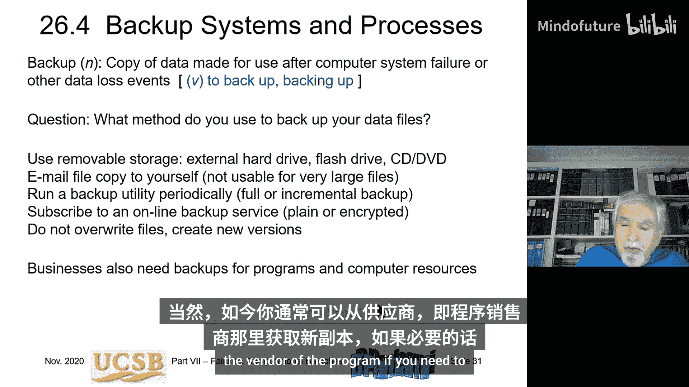

Okay， there is an area of computer engineering these days called computer forensics。

That's a field that basically deals with various。AW of。When the computer fails。Trying to determine。

What went wrong and also able to extract data from the hard drive other parts of your？File system。

In order to sort of resume normal operations， perhaps in a different computer。

So computer forensics is a rapidly expanding field and things that computer。

Forensic experts do include the following analyzed computers belonging to defendants。

Who are being prosecuted for various wrongdoing and legal cases。嗯。

If you obtain a laptop or other computer devices from a defendant。

Experts can go into it and try to see。What's there， not only what's there。

 but what used to be there because sometimes even files that are erased have been erased。

Can be recovered from the computer。They gatherer evidence against those suspected of wrongdoing。

Learned about the system。In order to back， optimize or reverse engineer it。Okay， so you。

Get your hands on a particular new computer model。From a rival company and you look into it。

With the aim of reverse engineering it。Or if it's your own computer， you may want to optimize it。

 okay， analyze data storage and other aspects of the system in order to optimize the buckets operation。

Analyzing compromised computer systems to determine intrusion methods。

 this is nowadays very important because hacking。And intrusion is a major。

Major problem for many computer users， especially corporate users。

Because hackers constantly try to disrupt their operations or extract data from their systems。

So analyzing a compromised computer system to determine what method was used for intrusion or perhaps finding out who did the intrusion。

That's big business these days。嗯。Analyze failed computer systems to determine cause of failure， okay。

 I showed you。In the last lecture。Various causes of computer failures。

 you how much are attributed hardware。Communications to storage and so on。

These are determined by forensic experts， so a computer has failed， to go into it。

 examine it in detail to find out exactly what went wrong。And finally。

 recover data after computer failures。Your， let's say。Laptop crashes and you can't turn it on。

Your data is on the hard disk drive and it's relatively easy for an expert to actually recover the data from the hard drive。

Provided that， you know the computer crash was not due to a hard drive failure， this crash。

 but even when there's this crash， parts of the data。So the crash of head， let's say。

 on the desk can damage a lot of data。You may still be able to recover some other parts of your date。

Of course， this may not be needed if you。Sort of diligently back all your data。

 but if you don't back up。Then you have to。Basically， go in and try to recover your data from。

The damage drivefe。Okay， there are several journals nowadays。

Fields that are known as computer forensics， digital investigations， and e discovery。

Here if you search under these terms on Google， you'll be able to。

Locate a bunch of journals that publish research in these areas。

 and these are very active research areas nowadays。

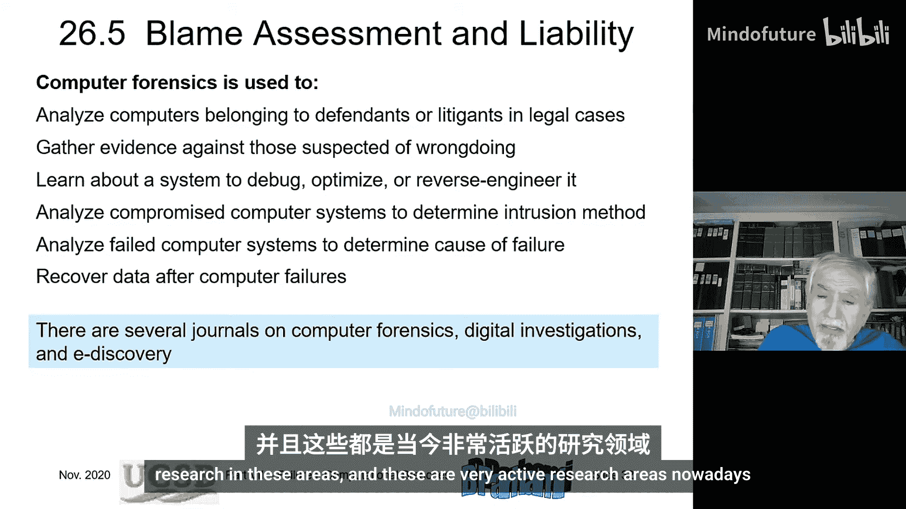

Okay， I showed you this quotation from Henry Petrosky before。

 it doesn't hurt to remind you of it because it's very important。

Ptroski says the complex system succeeds that success masks its proximity to failure。

Does the failure of the Titanic contributed much more to the design of Sa ocean liners than would have her success。

 that is the paradox of engineering and design。So basically he's saying Perasky is saying that failures are part of the learning process。

 if all failures are eliminated， then we have we'll have a hard time， harder time。To learn。

From our mistakes。So if the Titanic had not sung。Still had all the defects or the problems that led to its sinking。

🤢，And then we would not have learned about those problems as quickly and therefore future ocean liners would not have been。

Safer。Okay， so here in this and the next slide， I list some very。famousamous failed systems。

And these are mostly systems that never even got started working， in other words。

 it's not that they worked for a while and then failed。诶。They basically started in the failed state。

So these are some examples， let me just mention a few of them。诶。Hilton Marriott。

These are hotel operators budget。Is a cor rental company in American Airlines。1988。

Started building a computerized system for hotel reservations。

It would be linked with airline reservations and car rental reservations。

This system was so ambitious， you know tried to do so many things。After four years。It was scrapped。

 in other words， they came to the conclusion that it's hopeless and they can't build it。

After they had spent $125 million on working on it。Okay， and that's not the worst of them。IBM。

Tried to build an operating system with all sorts of nice features。

 it was going to be based on Mark 3 an existing operating system。It had to have you know。

 new clock management a new remote procedure card， they basically tried to do everything。🤢。

And new from scratch， a new IO system and new CPU。The project started in 1991 and after five years it was scrapped。

Again， they decided it was hopeless， it was too ambitious。

They had spent already $2 billion on the project。Okay， in this last example。

 the monetary damage was not that much but。Lives were lost， London ambulanceance dispatch service。

 the project started working in 1991。And it was scrapped in 1992。Because in two days of operation。

 20 lives had been lost that could be。Braised to。Errors and system operation。

Okay remember I mentioned before that it's very important to limit the scope of the system。

Do not introduce too many new technologies and new methods。In a system that is safety critical。

Or is important， it's financially a huge system。If you wanted not to fail。

 you have to do incremental improvements。Rather than trying to change everything at once。

And say I'm going to do everything you know， as in the IBM system， new clock management system。

 new remote procedure called new IO， everything new and wonderful。

 but when you put them together they don't work。

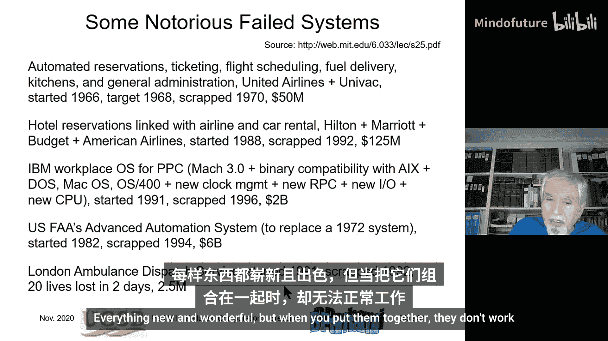

Okay， here is an even longer list of various。Project that LED to failure and the amount of money。

The date of the project and the amount of money that was lost because the project never got。

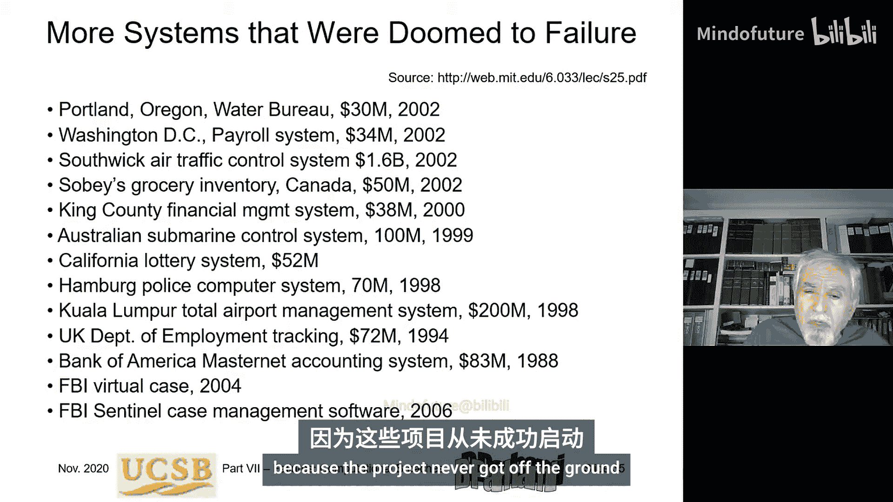

Off the ground。Okay。So let me now go to chapter 28。

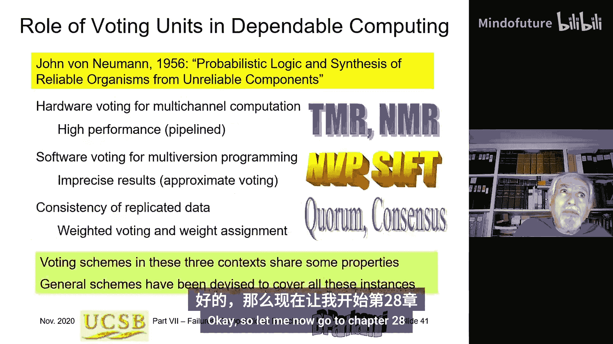

Dealing with fail safe system design， this is a very important topic。In safety critical systems。

Of course you try to avoid failures， but the next best thing to avoiding failures is making sure that the failure of the system is safe。

And because traffic lights are the common examples that are used。You illustrate this。

 so if you have an intersection。two sets of traffic lights。

 one for each direction at the intersection。If both sides， both of those lights show red。

 meaning all traffic stops。That's a safe failure。If both sides show green。

That's an unsafe failure because then cars。Coming from each direction we think that they have the green light。

 they will drive through the intersection and will have。Pollion。

So this picture that I put in the cover of this。诶。Slightdes for this chapter as a humor as basically there's redundancy in the traffic lights in order to make them more reliable。

 of course， this is not the way to make the traffic lights more reliable。Okay。

 so a fail safe system produces one of a predetermined set of safe outputs。

And it fails as a result of undesirable event。Okay，Even that it cannot tolerate。

So there are some things that you can tolerate that's fine， then it continues working。

 the things that it cannot tolerate are beyond its tolerance limit。

 then we design a system so that it produces one of a predetermined set of safe outputs。

It or fail safe traffic light will remain stuck and red。Because red is safe， you know。

 people stop and then after a couple of minutes they notice that the light is not changing to green。

 they guess that something is wrong and may proceed with caution。

But they won't just drive through the intersection。

 in the case of green because that can cause collision。Okay， in the。

TheGas ranges that we might have at home。There's a pilot flame。

That pilot flame basically has a small flame going。At all times。And then so whenever you turn on。

One of the units in your。Gas range or in furnace， heating furnace。

And the pilot flame will light the the main burner。🤢，And you can use the unit。Now。

 if the pilot is blown off， in other words， a pilot flame goes off。Well there's a danger。

 the gas that is used to light that pilot flame。Can leak into。The house and create danger。Okay。

 either。Hurt people or cause an explosion and we destroy the entire house。So these pilot flames。

Our design。So that when the flame goes off accidentally。That pilot unit。Fulls off。

It's usually warm because the flame is on at all times， but when the flame goes off。

Then the unit cools off and that cooling off。Causes the valve， the gas valves to close。

So the gas intake will stop。And therefore， gas will not leak as a result of the pilot going off。

I is an example of a fail safe system。诶。So you won't be able to light your range after that because the pilot has been extinguished and the gas has shut off。

But please， the situation is safe。Now failSafe digital system。

 like in self checking units we said before， you should have at least two outputs。It。

A unit generates the output 0 or 1 under normal condition。

 and let's say zero is a safe output because let's say it doesn't do anything and one is an unsafe output。

If you have just a single line and that line happens to be stuck at one。

 then you will have that unsafe condition and you're not able to do anything about it。

So as in the case of self checking units， we should have at least two outputs。

 and here is an example， you can say， okay， zero is represented as01 on the two output。

One is represented as 10。And the other two combinations indicate some sort of failure。

 some sort of problem。Okay， in this case， if one of these two light lines is stuck。

 let's say this one is stuck at one。And then the output has to be0，1， you get  one，1。

So you detect the problem。Okay， so unless both of those lines are stack， it is unlikely。IYou're okay。

 it's always safe。

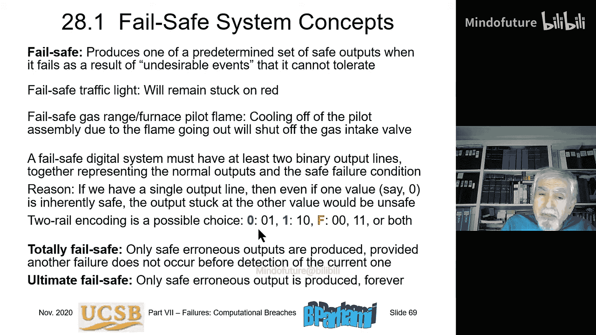

Okay。So。There is a field of engineering called safety engineering。In our university at UCSP。

 the Department of Mechanical Engineering。Has specialists and courses in that field。So in 1987。

 a long time ago， Jack Goldberg who。Was a researcher in fault tolerant computing。

 basically went and studied the literature of safety engineering。And extracted seven principles。

That we should。Sort of observe in order to design safe systems。

So let me quickly go through these seven principles。嗯。You know， if we deal safety critical systems。

 it might be a good idea to put these seven principles on a piece of paper or somewhere so that you constantly see them。

Principle one。Use barriers and interlocks to constrain access to critical system resources or state。

So if there are some critical resources。That you should be careful in exercising them。

Then you should have barriers and interlocks， safety checks before any part of your program or your system accesses those。

Partical resources。And we'll see an example of this in an example that follows a traffic light design problem that。

Okay。Perform critical actions， principle two， perform critical actions incrementally rather than a single step。

So when the system is trying to do a critical action and that action has multiple parts。

 try to perform the action incrementally rather than changing everything all at once。

 because it's more that you will observe that something is wrong as you go incrementally through the steps。

 then if you try to change everything at once。Principle three。

Dynaically modify system goals to avoid or mitigate images。

So as things go wrong in the system or you see either you see that something is going wrong。

 or you anticipate， you predict that something is about to go wrong， you should modify system goals。

In order to avoid or mitigate damages。So for example， if you see that the disk drive is。

Sort of behaving badly。Heiving marginally， perhaps you want to shut that down。

And adjust the goals of the system so that it doesn't use that disk drive until you have。

Sor of determined what's wrong or fixed the problem。Principle4。

Manage the resources needed to deal with the safety crisis so that enough will be available in an emergency。

Okay， so for example， if you have backup batteries。

For when power goes off and you want to operate your system。When there's no hour from the grid。

Then you better make sure that resources， the batteries that are。Going to be used to。For backup。

Theyre in top shape， they're fully charged and so on manage them， take care of them。

 if there is extra storage， for example， that you have set aside for emergency and make sure that that storage is still functional and available and so on。

Principle 5。Exercise all critical functions and safety features regularly。

To assess and maintain their viability。Okay， so for example。

 most cars have one or two spare tires in their trunk。

That are used when you develop a flat tire if you leave the spare tires there and not。

Use them for years because you didn't have a flat tire。

Then when time comes that you need the spare fire。May go and see that it's flat or damaged。

 you better check those。Periodically， to make sure that those resources。

Neithed to deal with a safety crisis areail。And also， you know。

 exercise means if you have a backup power system， you have to actually use it。Once in a while。

 even though you don't need it because power is not off。

You actually use it once in a while to make sure that when the need arises。It actually function。

According to your need。OkayPinciple6 designed the operator interface to provide the information and power needed to deal with exceptions。

So the operator should be given enough information。

And enough authority be able to deal problems as they arise。Principle7。

Defend the system against malicious attacks of course in 1987 there were some malicious attacks。

 but not very many of them and this has become now one of the major。Issues。

In protecting computer systems and making sure that they operate。

Depenably make sure that malicious attacks like hacking and hostile takeover of computer systems do not occur。

 So this principle 7 is now。A lot more important than it was in 197 when Goldberg wrote。诶。

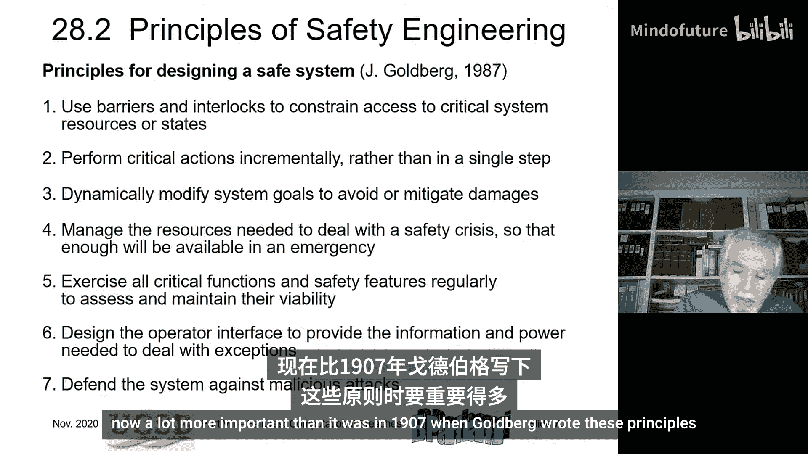

Wrote these principles down。Okay， heres an example of a fail safe specification。

 things that can go wrong and many people don't pay attention to it。So here we have a system with。

Input， some inputs that can be given to it for any particular input。There is a correct output。Okay。

 so if something goes wrong in the system and I'll show you an example here， something goes wrong。

Then we definitely don't want the system to produce another valid output that is not the correct output。

Okay， so this will be avoided。We also don't want the system to produce an unsafe output that should be avoided。

However， we can designate a subset of all outputs as save outputs。

And allow the system to produce one of those because that doesn't create any danger so under。

Internal failures in the system， the system either creates the correct output。Or it produces。

One of these。One of the set of safe outs。In this subset。But not that unsafe output。

Or a valid outward。By looking at it， you don't know that it's wrong because it's a valid output and there's some other。

Input some other circumstances， so you won't be able to tell that something has gone wrong here you。

Whereas when one of these safe outputs is produced， you are able to tell that something is wrong。

So this is basically a very simple exercise。Suppose in an amusement park or in a zoo someplace。

 there is this train。At。Moves on the track so the track goes from a beginning point to an end point and the train basically moves from beginning to end and then returns to the beginning and so on which's the right to visitors to the park。

 usually children use these trains okay。So as part of the safety mechanism for this train。

 there's a sensor at the beginning。That。As search the signal as sub B， so sensor for the beginning。

Indates that the train is at the beginning of the track。

And when the trains are the beginning of the track。It will be allowed to move forward。

But should not be allowed to go back， so there are interlocking mechanisms in the train's engine。

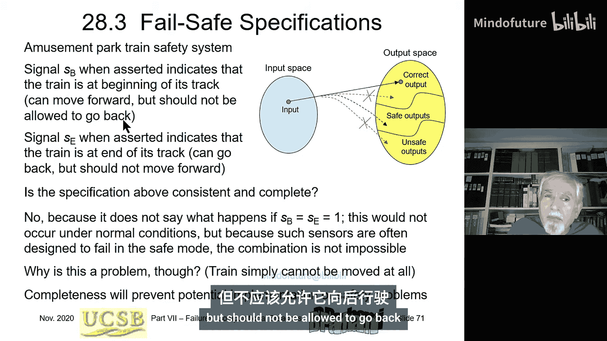

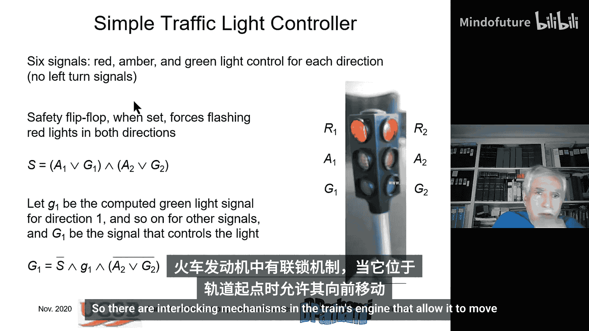

Excuse me。And that allow it to move forward when that's at the beginning of the track。

 but will not allow it to go back because it will basically crash into a building or fall off the track。

Okay， similarly， there is a sensor at the end of the track that senses the presence of the train at the end。

And when this signal is asserted by that sensor。Indates that the train is at the end of the track。

 it can go back but should not be able to move forward。Okay。😊，So the question is。

 is this specification？Complete。Edequate for designing。The safety mechanism for this strain。

The answer is no， cows the specifications。Do not say。

What happens if both of these signals are assertive？Of course， under normal conditions。

 the train is either at the beginning or well not either so it's at the beginning at the end or somewhere else under track so at most one of these two signals can be asserted if it's at the beginning this signal is asserted。

But at the end， this signal is asserted。But somewhere in the middle。

 neither of those signals is asserted。Okay， so the combinations0，0， either one asserted 10 and 01。

 those are all possibilities，1 one is impossible under normal condition that can occur。

If one of these sensors is malfunctioning。Okay， and in fact。

 because these sensors are often designed to fail in the safe mode。

 no safe mode for these signals is to be one。Because if the train is at the beginning。

And this signal is zero， it fails to zero， then that's unsafe。But if it fails to one。

 that's a safe failure mode。So because these sensors are designed to fail in that safe failure mode where the output is one。

 in fact， this is possible。And we have to indicate in the specs what needs to be done in that case。

 in other words， how do we design？Train and its control mechanism， how should it behave？In this case。

Okay， so completeness of the specifications。Which also consider cases that are not common are not expected。

To arise as a result of failures must be。Specified so that the designer。

Basically knows what to do in those cases。

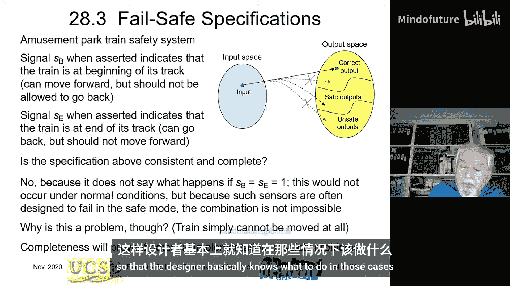

Okay， so let's take a very simple， as I mentioned， you know， traffic lights are。The诶。

Main examples that are used in describing safety critical systems because everybody is familiar with traffic lights。

So。Let's say we have a very simple traffic light with two sets of lights and there are two basically。

Two intersecting roads， one set of lightss。诶。Are for Road one。Red Amber green。

 and the second set that for row two， red Amber green。As I mentioned。

 you don't want the failure to occur so that G1 and G2 are both asserted these are signals so that these two lights go on。

That's an unsafe situation。On the other hand， R1 and R2 both asserted the two signals。

 that's a safe failure。It's inconvenient but it doesn't cause any crashes。Okay， so we sort of。

For this logical expression。So remember。RA G， these are signals that turn on the lights， okay？

So if the signal that turns on number one。Or green one。

Is asserted at the same time as amber2 or green 2， this is an unsafe condition。

And we better detect that and set a safety flip fl， so the safety flip fl is set if ever。

 for whatever reason。A1 or G1 is asserted at the same time as A2 or G2。Okay。

So let's lower case G1 be the computer now these traffic lights nowadays have complicated algorithms controlling them。

So typically traffic lights。Are connected to sensors that sense the presence of carss in various lanes。

Buttons that pedestrians may have pressed and so on。

 and that information comes in and given to an algorithm， an algorithm runs based on those inputs。

Conditions on the road， existence of pedestrians and so on。Comps。What needs to be done？And of course。

 there are time limits， so when the green one turns on， maybe after a 30 second。

 it has to be turned off。And the other。Road be given the chance to。

Cars on the other road be given a chance to pass and so on。

 so there's a complicated algorithm that runs and basically computes。G1。

 meaning that green light 1 should be on。So this is the output of the algorithm。

 this is the signal that actually turns the light on。It's given to the light and turns it on。

So the signal that turns。The green light one on。Will be one。

When these three conditions are satisfied， first of all。

 the algorithm says that that light should be on。That's an essential requirement。

The algorithm based on the inputs provided to it says that that light should be on。

 but that's not enough。We also check to see that the safety flipflop is not set。

Because if the safety flip flow is set due to a safety violation。

 then we don't want the screen light to turn on。And。Yess to be sure， this is redundant。

We turn green light one。One， if Amber like2。Or green light， too。Is not turned on。Okay。

 it shouldn't be turned on if our algorithm is correct， but just in case that this signal。

 let's say is stuck at one。It may be， so if this is stuck at one， it may。EBasically。

 it will be asserted permanently， so when this one is asserted， we have a safety problem okay。

So we double check here， so these are examples of interlocks。We assert this signal。

Only if it should be asserted according to an algorithm， but that's not enough。

 but we also check various safety conditions。Make sure that it's a good idea to turn this on。

Before traffic lights nowadays is much more complicated than just having these lights。

 there are pedestrian signals， some intersections， there are special bicycle signals and so on。

You get。You know， the point of safety here， we have to。呃。

Make sure that these unsafe conditions do never occur， so we have to。Use interlogs and safety checks。

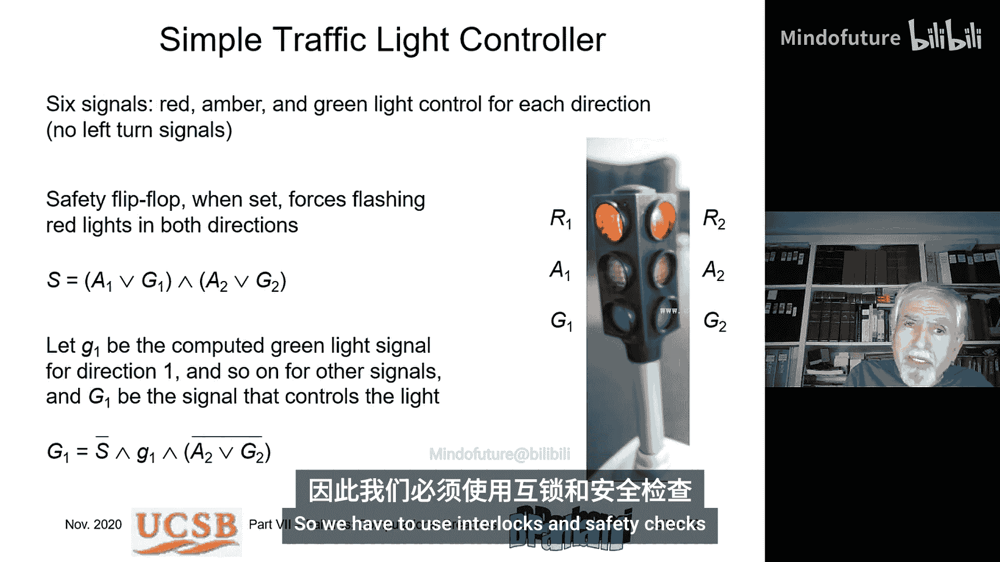

Okay， we can design fail safe combinational logic and the ideas are very similar to the self checking。

Design that we covered。Earlier。Okay， so I won't discuss this。Much。Just give you an example。

 so this is a failSa two out of four。Co checker， what does a two out of four code checker do while a two out of four code checker？

诶。Receives four bits， a dim ABCD。And it checks to see that two out of the four inputs are one。

 so the valid codes that come in will have two ones among the four bits。

 anything else is invalid okay。But the output should be 0。

1 or 10 if the input is one of these valid codes。Remember， I said， you have to have two outputs？

You can have one。So these two combinations are output with 0，1 and 10。

Tell us that everything is okay here。Okay，00 is a safe erroneous output。

 so it's okay to get 00 at the output， that's considered safe。

 but you never want to get 11 at the output， that's unsafe。The mechanism shown here， basically。

Detect the safety violation if you have 11。So these are the two parts of the circuit that compute to outputs。

we don't put those connect those directly to the output。

 we have this safety mechanism here if 11 occurs for whatever reason， for example。

 this line being stuck at one。So you're supposed to have zero one here。

 but this line is stuck at one， so you get one one if that occurs。Then this flip fl is reset。

 if that flip fl is reset， the outputs， the two outputs become00。Okay。

So we preset this flipp at the beginning。Seet。And therefore， the output is simply forwarded。

 the output generated by the circuit is simply forwarded too。The outputs。

But if that unsafe condition ever occurs， this flip fl is reset and from that point on。

We just don't trust circuit and therefore we produce zero， zero at the output。

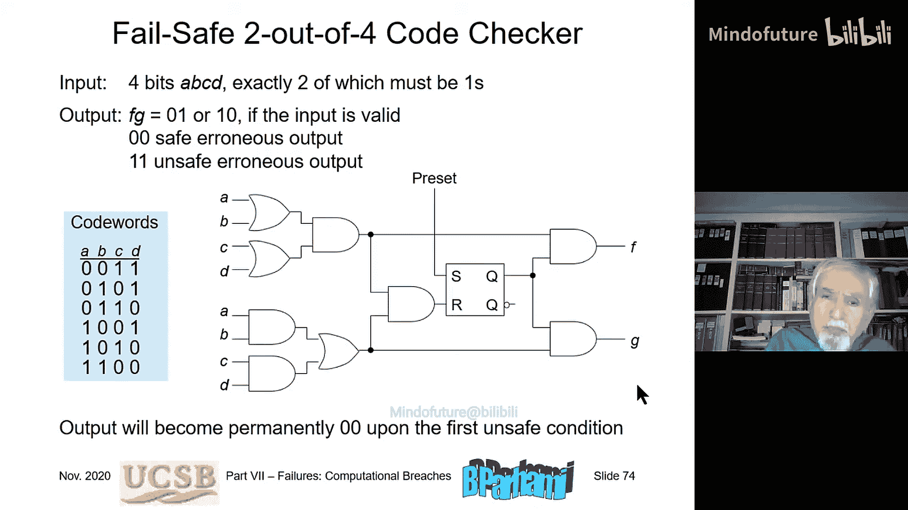

Okay， we can also design faila state machines or sequential machines， and here's a simple example。

 it's a five state machine with state table given here。There's one input。

And then these are the next states。According to what the input is， we encode the states in binary。

 so state 1，2，3，4，5 and also encode it in burger code， remember burger code。Ass a code that attaches。

To the main data。The number of zeros that it has， so in this case， 001 has two zeros。

So this 210 indicates that there are two zeros。Okay，10，1 has 10， so you have 01 here。Okay。

 and the design strategy that is listed here， I won't read。The details to you。

Ensures that such a sequential machine。With state encoded using Bur code。

And with the next state logic equations implemented in a certain way that is specified here。

Will be safe？For all unidirectal errors and no matter how many unidirectal。

 how many errors provided they are unidirectal。Accur。This。System never goes into an incorrect state。

 so these are the states of the system， so 00110 is a valid state。Z1，01，0 is a valid state。

If something goes wrong， it may go to。An invalid say never goes to an incorrect state。

It always goes into an invalid state， so for example， if you go into state 00010。

 it's not a valid state。And once it gets into an invalid state， it stays into an invalid state。

 in other words， further transitions never take it back to one of these valid states and therefore。

Those are basically safe states， you can tell that something is wrong and you don't trust the output of this sequential machine。

Okay。

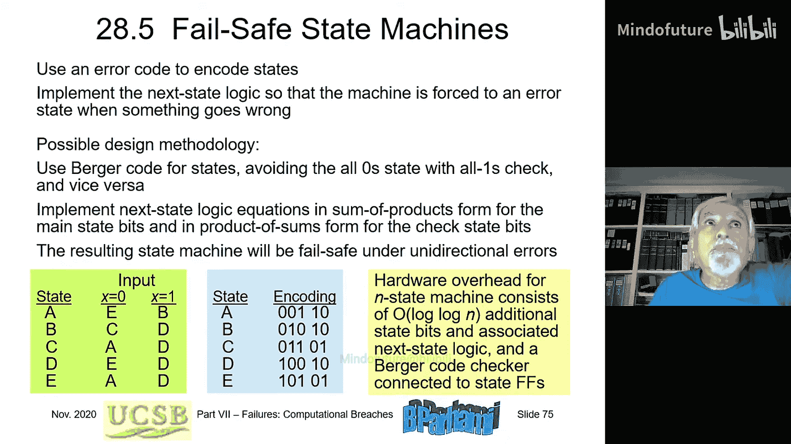

Again I'm going to skip a few slides here in order to。

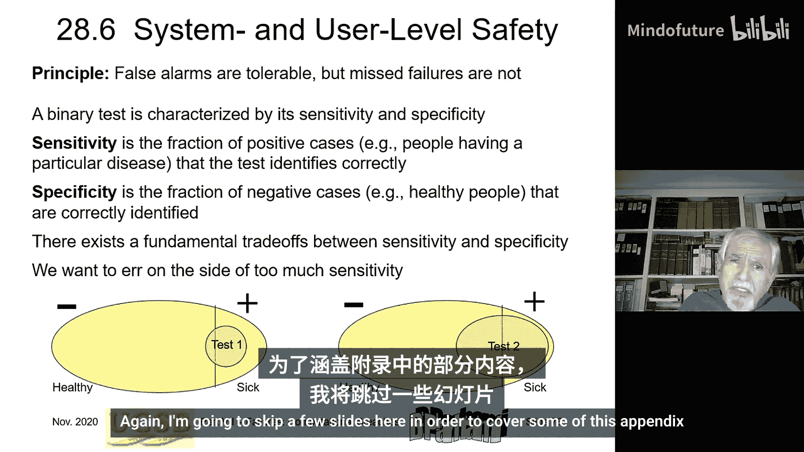

Cover some of this appendix and the appendix I will cover very briefly。诶。You can read it on your own。

 there's some interesting stuff there， for example is。Historically。

 you know the first fault tolerant computer was one of the first computers actually。Bilt。

A fellow named Antonin Sboda。In Czechoslovakia。So Abboa later actually immigrated to the US and was a faculty member。

At UCLA， when you passed away in 1980。So he built， he led a team that built the SappO SAPO computer that was。

Use triplication and voting。And they were motivated in those days。By the fact that。You know。

 the Czech Army。诶。Was in a war， so。They sort of use all the good。

 dependable components that manufacturers in the country could build。For building military systems。

So university researchers such as Voboda were left with sort of you know， parts components that。诶。

Very low quality in other words， they didn't pass the quality test of the army so they were just given to others and they were so low quality that if they built the computer with those components it would not work。

 so they used tuplication。To overcome the effect of these highly unreliable components。

Another early computer that was called tolerant was the JPL。Star computer。

StR stood for self testing and repairing computer。And it was a research prototype。Intended for use。

 it was never actually used on a spacecraft， was intended for use。long duration missions。

 such as  ten0 year missions。Exploring the solar system， so it has to had to last for 10 years。

With its functionality intact， of course， this prototype was huge， would not fit on a spacecraft。

 but eventually they plan to。Shrink the size， bidding all these components and chips。

So that they would fit。In a spacecraft。Okay， then I have a bunch of slides that sort of list the main events in each of the decades since the 1950s。

And I'm going to just。Step through them， 50s， 60， 70s，80s， 90s。202010。

 some of the key events that occurred in the history of dependable computing。In those decades。

Then the next three sections of the appendix， which I'm also going to skip。

Describe some examples from three categories of systems。

That we in the field of dependable computing deal with。Long life systems。

 this is such as the star computer。A computer is designed to have a long life so that they can operate for that period of time without a need for repair。

Safety critical systems， these are systems that are used for applications in which safety。

Is that issue， and therefore they have to be highly reliable。At least safe， if not highly reliable。

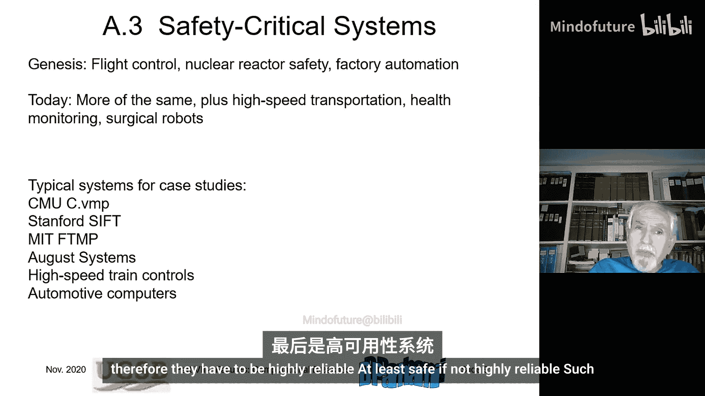

The just。Flight control systems。

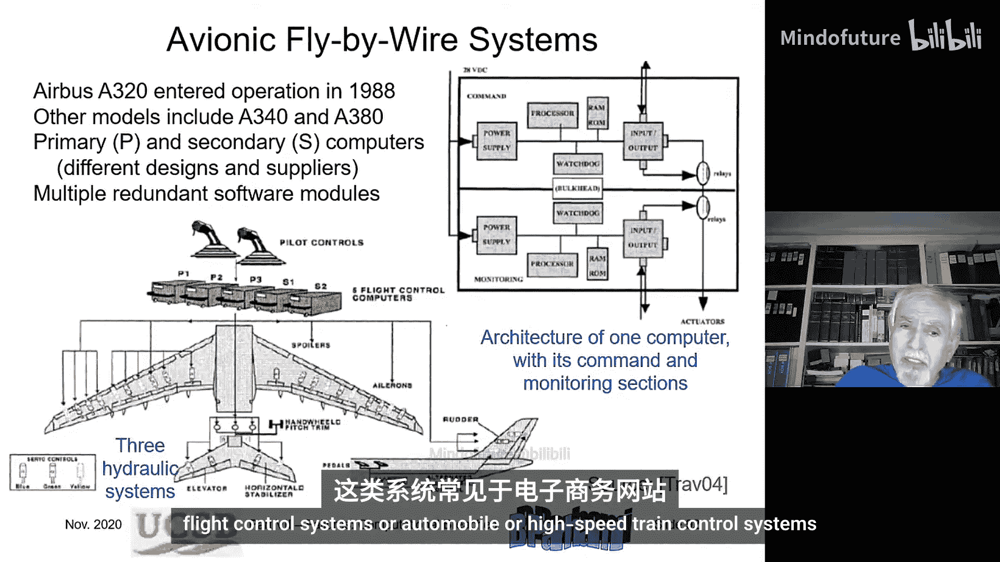

Or automobile or high speed train control systems。

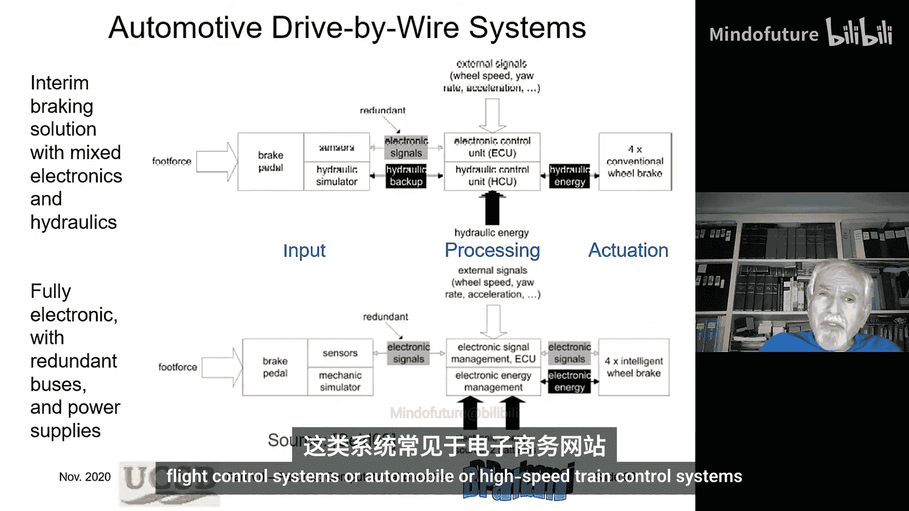

And finally， high availability systems， these are the type of systems used by ecommerce sites。

They don't want the system to be unavailable even for a short duration of time because that will mean。

Loss of avenue and also loss of trust on the part of the customers。

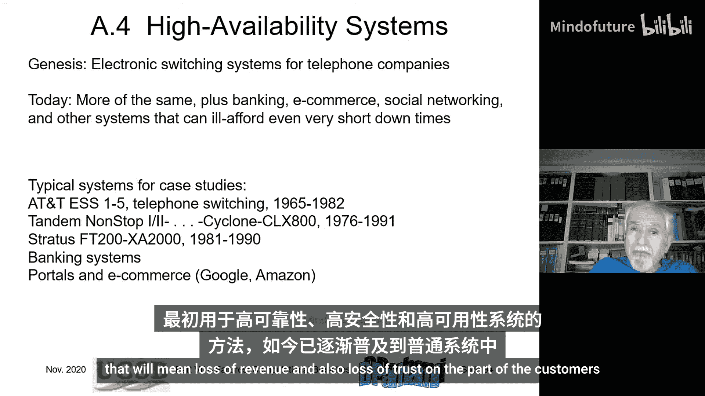

Okay， so handem onstop。Computers and Google data Center are examples。

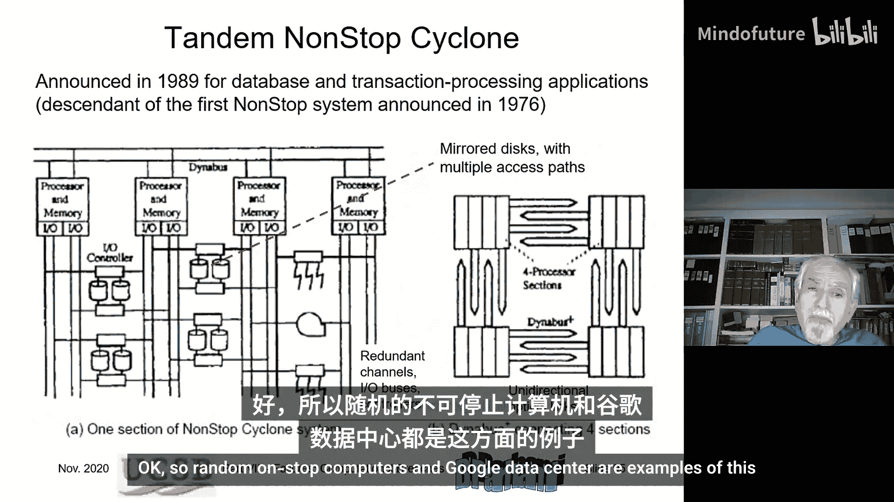

And of course， nowadays， we have dependability feature also in。

Just regular computers and even personal systems。So sort of the methods that I used initially for those high reliability。

 high。Safety and highly available systems trickle down and are used eventually on just regular computers that we use daily。

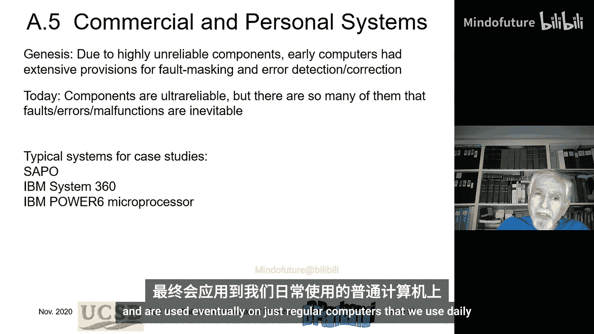

Okay。All right， the last section of the appendix。诶。I have listed here seven challenges。

That we are going to be facing。In the 2020s and beyond。And each of these challenges is。

 so I'm not going to go through these because there are slides for each of these challenges coming up。

 so I'll just show you one slide for each of those and describe。

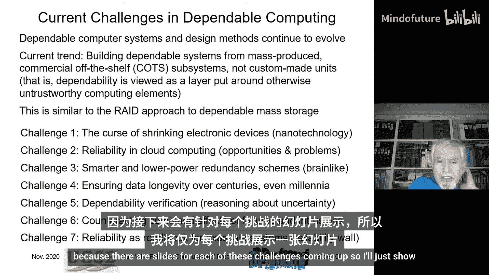

So the curse of shrinking electronic devices。nanoanotechnology has caused devices to shrink。诶。

And as the devices shrink， they become less and less reliable due to manufacturing problems。

And therefore， we have to come up with new methods， both in terms of redundancy。

Some of the area power gains from shrinkage making things smaller must be reinvested in reliability feature。

So for example， we may have to tripate or even have a higher number of copies of circuits in order to ensure reliable operation circuit modeling becomes more difficult and testing。

 of course， becomes very challenging。So that's the first challenge。

The curves of shrinking electronic devices。

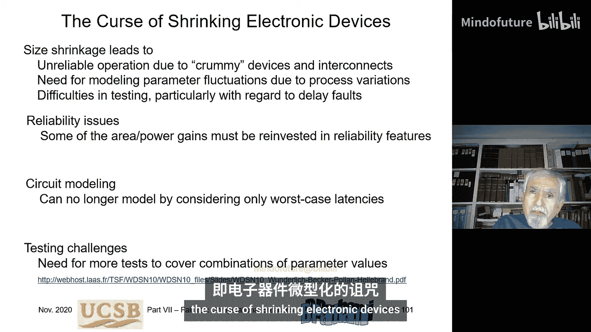

嗯。Pantum cellular automata， which is one of the new technologies that。We are hoping to use and field。

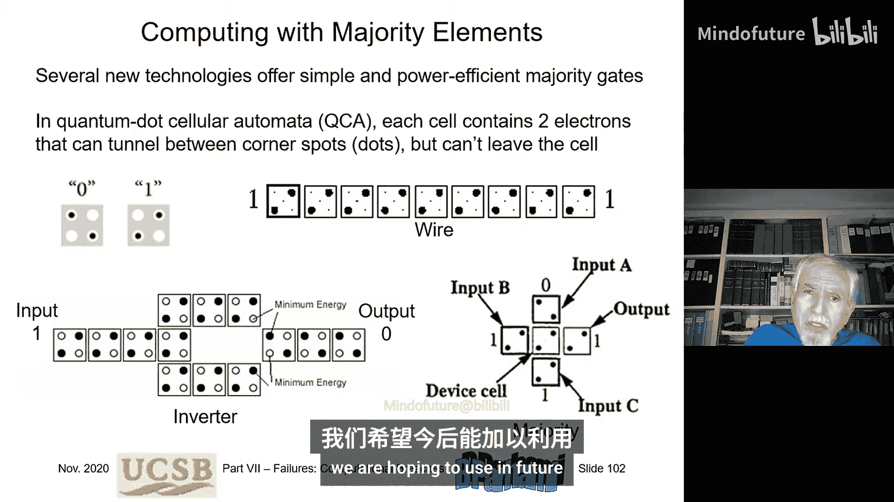

Okay。Nowadays， a lot of things we put in the cloud that that has an upside because we sort of。诶。

Outload the problems of maintenance and so on to somebody else。

But it also brings with it challenges in terms of data security and reliability。

So when we put all of our data in the cloud， then we essentially lose control over it。

And depending on how secure the cloud is， other people may gain access to it。

And also the reliability of the cloud is now beyond our control。Of course。

 you know cloud operators promise high reliability but。There can be trusted。

And this promise is an open question at this point。

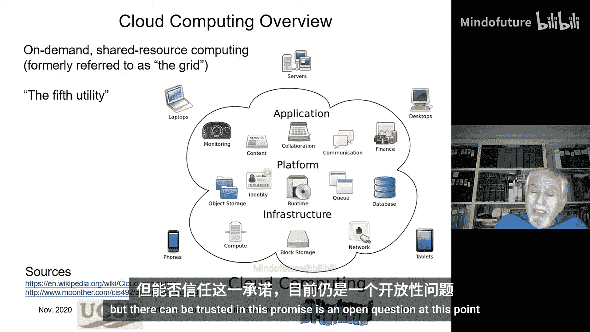

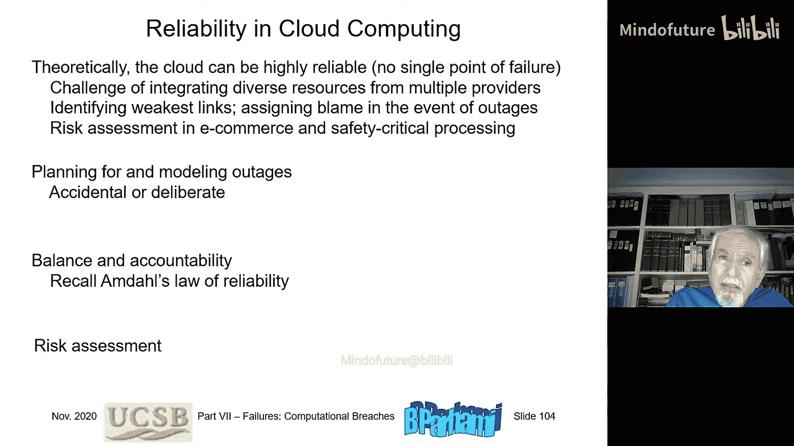

Okay， the third challenge is designing systems to be smaller and lower power and in this we。

Sor that we have started mimicking the systems and processes in the human brain because the human brain。

Is highly energy efficient human brain consumes roughly。诶。On the order of 20 watts of power。

Whereas microprocessor chips nowadays， the high power chips。

Consume on the order of 200 watts of power， and then we have to put many of these chips together to build a supercomputer that can do some of the things that are brained does。

The brain is orders of magnitude more energy efficient than。

Supercomputers that we use nowadays and therefore learning about how the brain does various functions is very important。

In the hopes of being able to mimic those processes。

 this is sometimes referred to as brain inspired computing。

 using methods similar to the brain to achieve energy efficiency and also lower algorithmic complexity。

Because when we look at the face of someone， we very quickly recognize。

Who that person is if we know the person。Whereas similar algorithms were doing face recognition。

Take a lot of compute power。

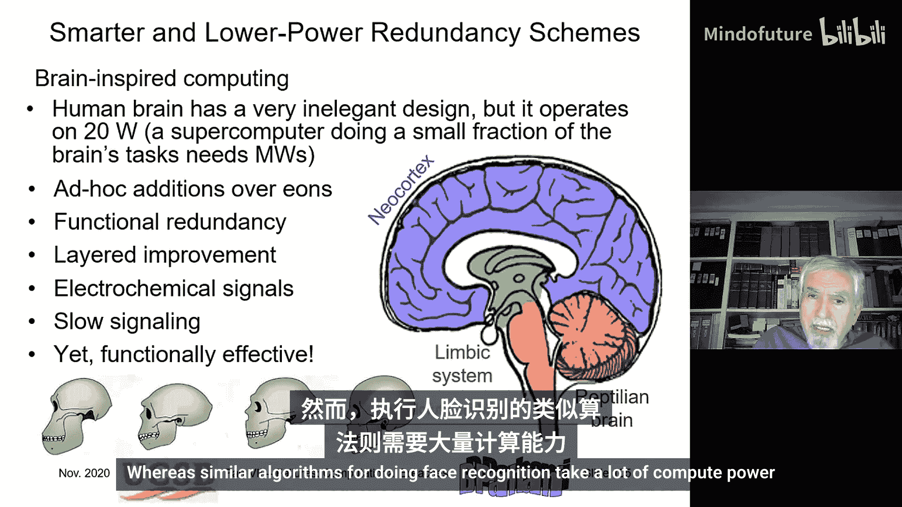

O。

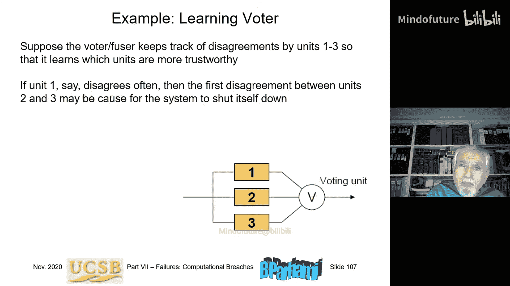

Ensuring data longevity is another challenge that we face。Of course， nowadays。

 computers become obsolete so quickly that before data becomes obsolete。

 we tend to move to another computer and copy our data。

 so our data really does not become obsolete because it moves from system to system。But imagine。

 you know now nowadays。We have books from thousands of years ago， okay， handwritten books。

That have survived。Will our data today survive 1000， 2，000 years from today。系。Well。

 we have to sort of work on it and make sure that it survives。

Sometimes the data itself survives so if you have one of these。Old floppy disks。Okay。

 the data on the floppy disk going survive， even though it has a limited time span。

 but if you have one of those floppy disk at home right now you just kept it。嗯。As a souvenir。诶。

There's no floppy desk reader that you can put this into and read the data。

 so survival of data on the medium is one thing。And being able to read that data of the medium is another thing。

Okay， there's this encyclopedia article that I wrote。

A year or so ago that discusses this issue of data longevity， if you are interested in looking at it。

 you can get a PDF copy from my publications page。

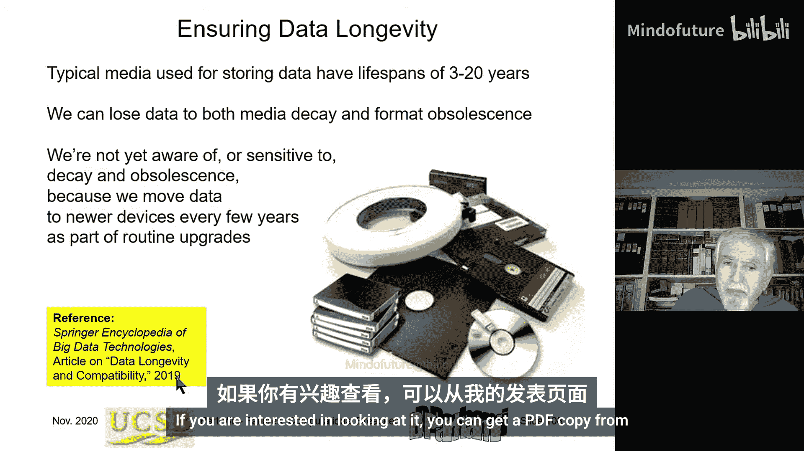

Oops。Okay， an important point is that。Failures and intrusions sometimes interact。 in fact。

 one of the。Common ways that。Eckers， intruders try to take over systems is by taking advantage of failures。

So we have all these security software running in our system， so under normal conditions。

If the security software is well designed， it will prevent hackers from gaining access。

But if a failure。Occurs in the system。Then all bets are off because the system will start behaving unpredictably and there's no guarantee that the same。

Same security mechanisms will work on a failed system as they work on a normal system。

So this is really important to。So to make sure that the system is still secure。

Even when failures occur in it。A reliability wall， I won't discuss the details in this slide。

 just mention what it is you may have heard of the notion of memory wall。

Memory wall basically is a concept that says the performance of our highest performing systems nowaday。

 nowadays is limited by memory rather than processor so we can make our processors faster and use more processors。

To improve the computing power。But often the performance of the overall system is limited by the memory。

Access speed and bandwidth。Not by the processor so the same thing has been observed for reliability in other words。

 we can make our systems bigger use more processor to improve。The processing power。However。

 as the number of components， number of processors， amount of memory increases， then failures become。

More likely， the more components you have， the more parts you have。More failures you can expect。

 and therefore reliability also erects a wall。On the path to gaining higher performance。

So let me leave this at that。There is memory wall and there's reliability wall that basically prevent us from improving the performance and capabilities of the systems。

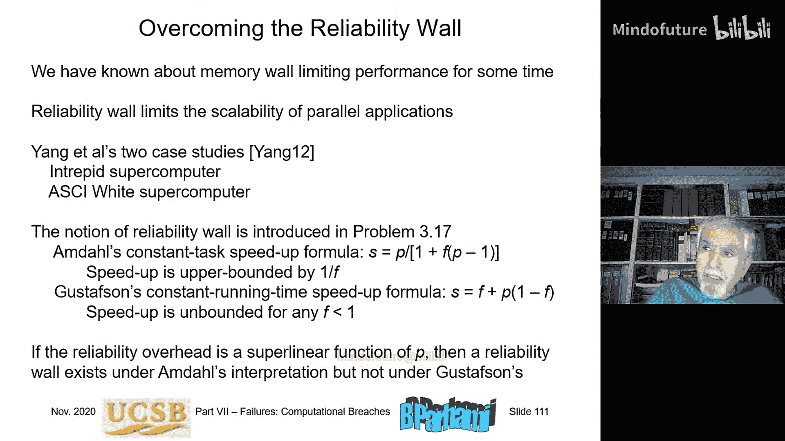

Beyond a certain limit。Okay， this is a timeline。It's incomplete at this point。

 I will be working and completing this timeline。Some key events in the history of dependable computing are listed here。

In particular， the first conference。In the field， fall Tolerant computing Sposium was held in 1971。

 the first， and the 50th we just held that。So。There is a。

So of history of 50 years in holding these fault tole。Computing conferences every year。诶。

We now have a journal Ipoly Transactions on dependable and secure systemss。

That started being published in 2004。And so on， so I will complete this and provide some other。

Additional milestones in the history of dependable computing。

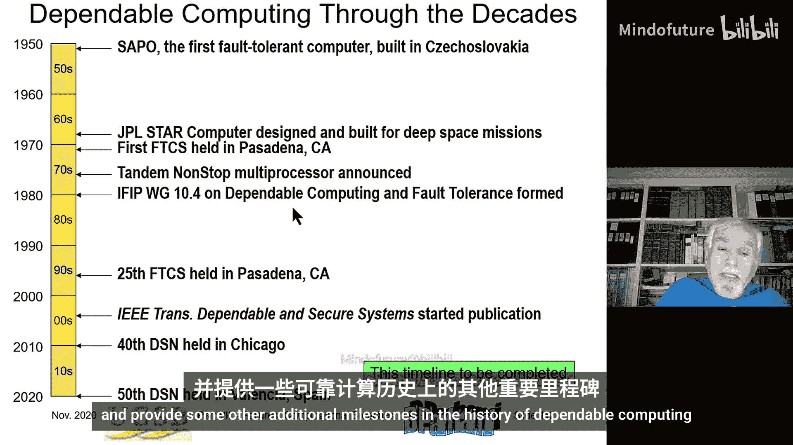

These are some resources。诶。But the conference that I mentioned is now called dependable systems and networks that change name。

It has a website。That leads you to the latest conference and also has a section that you can access the information about previous conferences。

 the next one of this series 2021 will be in Taipei。European dependable Computing Conference。

Pacific Rim， Sposium and dependable computing， so these are three main conferences。

Safe comp is another conference， not as prominent as the other three。

It focuses on safety and security。Iterpoee transaction on dependable and secure computing I already mentioned。

 and there's also an IF working group 10。4 IFP stands for。

International Federation for Information Procesing。

It's an international body that maintains a working group。Independable computing， sponsors。

 conferences， and other projects。

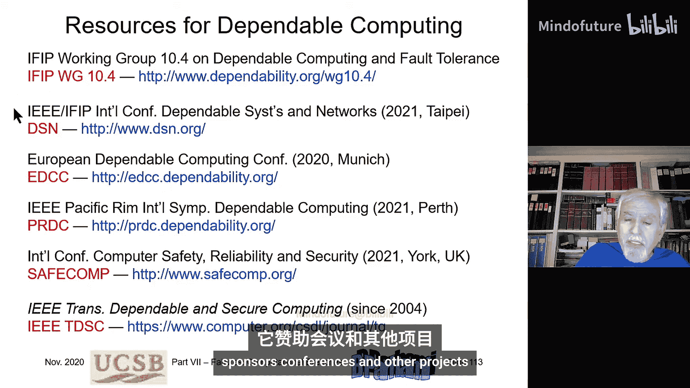

Okay， the final slide for the course。Ass intended to show you that in this course we built。

A framework。In other words， we covered a lot of things and we sort of related all these different concepts together。

In effect， building a framework。And we supplied some details in some cases， Okay， for example。

 I mentioned in the case of coding that you can。诶 talk。For weeks。

An entire semester about coding methods。So I gave you the basics。

And then in the course of your career， if you were encounter need for。

Designing systems that are highly dependable， this framework will serve you well。

 but you may have to go and fill in some details。That we did not cover in this course for the particular purpose。

 you know that you have。In your job or in your project。Okay。

 so we skimmed over a number of applicable techniques and you should now be ready to pursue some of the details。

As the need arises， there's no point in learning all the details。

That you're not going to use in your work。Do have the basics， you have the structure。

 you have the terminology to be able to talk。About these concepts and relate them。To each other。Okay。

 so this concludes the course ECE 257A fault Tolerant computing or dependable computing。

I hope you enjoyed the course and learned from it。Every time I teach this course。

 I learn new stuff myself because when I update the slides or the textbook。

Or read the new publications， you know， itpoe transactions of dependable secure systems。

 the various conferences that I mentioned every year new ideas are presented and。

And some of them are incorporated in my textbook and slides。And you know。

 one has to in any field of computing nowadays， you know， things move very fast。

And you have to keep up to date by consulting。The literature， were there conference proceedings。

For journals to make sure that you are up to date。Okay。

 good luck in using this material in your work。And bye for now。

