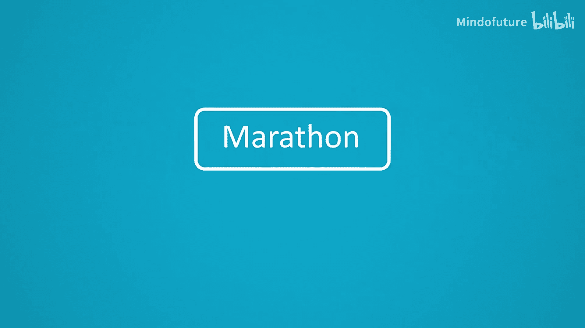
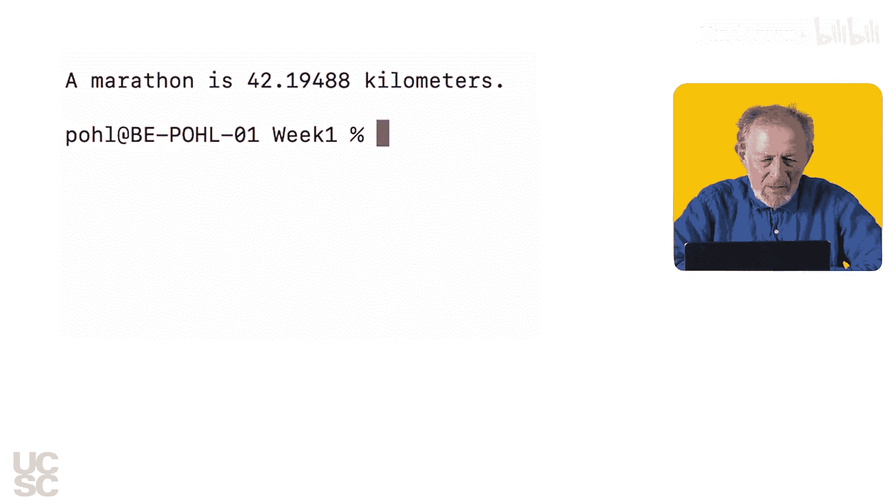

# 004：马拉松距离转换程序




在本节课中，我们将编写一个程序，将马拉松的距离从英里和码转换为公里。这将为我们提供编写基础程序的进一步练习，同时也会涉及格式化输出和Go语言中类型转换的概念。与C语言等语言不同，Go语言要求显式地进行类型转换，这使其成为一种更安全的语言。

## 程序概述

我们将编写一个程序，计算马拉松距离对应的公里数。马拉松的标准距离是26英里385码。程序将声明整数类型的英里和码变量，通过显式类型转换进行计算，最终以浮点数形式输出公里数。

## 代码实现

以下是完整的Go程序代码：

```go
package main

import "fmt"

func main() {
    // 声明并初始化变量
    var miles int32 = 26
    var yards int32 = 385

    // 进行类型转换和计算
    var kilometers float32
    kilometers = 1.60934 * (float32(miles) + float32(yards)/1760.0)

    // 格式化输出结果
    fmt.Printf("\nA marathon is %g kilometers.\n\n", kilometers)
}
```

## 关键概念解析

上一节我们展示了完整的程序代码，本节中我们来详细解析其中的关键部分。

### 1. 变量声明与类型

在Go语言中，我们需要显式声明变量的类型。在本程序中，我们使用了`int32`类型来存储英里和码。

```go
var miles int32 = 26
var yards int32 = 385
```
*   `int32`：表示32位有符号整数，其取值范围约为±21亿。对于本例中的距离值，这个范围完全足够。
*   初始化：我们在声明变量的同时赋予了初始值（26和385）。如果不进行初始化，Go语言会将其默认值设为0。

### 2. 显式类型转换

这是本程序的核心，也是Go语言与C语言的一个重要区别。在C语言中，编译器常常会自动进行隐式类型转换，但这可能导致意外的精度损失或错误。Go语言为了安全，要求开发者进行显式转换。

计算公里数的公式为：
`公里数 = 1.60934 * (英里数 + 码数 / 1760)`

由于`1.60934`是一个浮点数常量，而`miles`和`yards`是整数，直接运算会导致问题。特别是`yards/1760`在整数除法中结果将为0。因此，我们必须使用`float32()`将整数转换为浮点数：

```go
kilometers = 1.60934 * (float32(miles) + float32(yards)/1760.0)
```
*   `float32(miles)`：将整数值`26`转换为浮点数`26.0`。
*   `float32(yards)/1760.0`：将整数值`385`转换为浮点数后与`1760.0`相除，得到正确的分数部分。
*   如果一开始就将`miles`和`yards`声明为`float32`类型，则不需要这些转换，但那样就无法演示处理混合类型时所需的转换操作。

### 3. 格式化输出

我们使用`fmt.Printf`函数进行格式化输出。

```go
fmt.Printf("\nA marathon is %g kilometers.\n\n", kilometers)
```
*   `%g`：这是一个通用的浮点数格式化动词。它会根据数值的大小自动选择`%f`（普通小数形式，如42.19488）或`%e`（科学计数法形式）中更紧凑的一种来输出。对于本例的结果，它会输出为小数形式。
*   **注意**：虽然Go语言的`fmt`包与C语言的`printf`函数在用法上很相似，但格式化动词的细节并非完全相同。在使用时需要参考Go语言的具体文档。

## 程序运行与结果

现在，让我们来看看这段代码运行的结果。

编译并运行上述程序，终端将输出：
```
A marathon is 42.19488 kilometers.
```

所以，马拉松的距离大约是42.195公里。下次当你遇到跑马拉松的朋友时，就可以告诉他们这个准确的公里数了。

## 总结

本节课中我们一起学习了如何编写一个将英里和码转换为公里的Go程序。我们重点掌握了：
1.  **变量声明**：如何使用`var`关键字声明并初始化指定类型（如`int32`）的变量。
2.  **显式类型转换**：理解Go语言要求显式类型转换的设计哲学，并学会使用`float32()`等转换函数来确保混合类型运算的正确性。
3.  **格式化输出**：使用`fmt.Printf`和`%g`等格式化动词来控制程序的输出格式。




通过这个简单的例子，你体会到了Go语言在类型安全上的严格性，这是它成为一门可靠系统语言的重要特性之一。