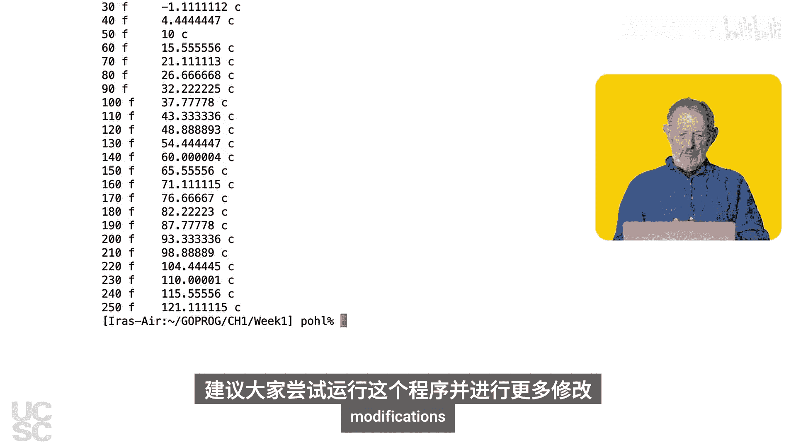

# 005：温度转换程序


在本节课中，我们将学习编写一个经典的华氏度与摄氏度转换程序。这个程序将展示Go语言中**循环**结构的使用，这是编程中处理重复任务的核心概念。

## 循环结构简介

上一节我们介绍了程序的线性执行流程。本节中我们来看看**循环**。循环允许程序重复执行一段代码，直到满足特定条件。这对于处理大量数据或重复计算至关重要。

以下是循环的基本概念：
*   **线性流程**：程序像菜谱一样，按顺序一步步执行。
*   **循环流程**：程序可以根据条件（例如“尝一下汤，如果不够咸就继续加盐”）重复执行某些步骤。

在Go语言中，我们使用 `for` 关键字来实现循环。

## 程序目标与设计

我们将编写一个程序，打印从0到250华氏度（步长为10）对应的摄氏度表格。程序将展示如何使用 `for` 循环来迭代一系列值。

以下是程序的核心变量：
*   `from`：起始华氏温度，值为 `0`。
*   `to`：结束华氏温度，值为 `250`。
*   `step`：每次增加的步长，值为 `10`。
*   `fahrenheit`：当前正在处理的华氏温度。
*   `centigrade`：计算出的对应摄氏温度。

程序逻辑是：从 `fahrenheit = from` 开始，只要 `fahrenheit <= to`，就计算对应的摄氏度并打印，然后将 `fahrenheit` 增加 `step`，重复此过程。

## 代码详解与Go语言特性

现在，我们来分析程序代码，并指出Go语言与C语言的一些关键区别。

程序的核心是 `for` 循环。其通用语法如下：
```go
for 初始化表达式; 条件表达式; 增量表达式 {
    // 循环体
}
```
当初始化表达式和增量表达式被省略时，就得到了 `while` 循环的效果。Go语言没有专门的 `while` 关键字，而是用 `for` 来实现。

在我们的温度转换程序中，循环是这样写的：
```go
for fahrenheit := from; fahrenheit <= to; fahrenheit += step {
    centigrade = (5.0 / 9.0) * (float64(fahrenheit) - 32)
    fmt.Printf("%d\t%.2f\n", fahrenheit, centigrade)
}
```

需要注意以下几点：
1.  **类型转换**：`fahrenheit` 最初是整数，但在计算公式中需要转换为浮点数 `float64(fahrenheit)`，因为摄氏度的计算涉及小数。
2.  **浮点数运算**：公式 `(5.0 / 9.0)` 中使用 `5.0` 和 `9.0` 确保进行浮点数除法。如果写成 `5/9`，在Go语言中整数除法的结果会是 `0`。
3.  **循环条件**：`fahrenheit <= to` 是一个比较运算，结果为布尔值（`true` 或 `false`）。只要为 `true`，循环就继续。
4.  **复合赋值**：`fahrenheit += step` 是 `fahrenheit = fahrenheit + step` 的简写。
5.  **格式化输出**：`fmt.Printf` 使用 `%d` 打印整数，`%.2f` 打印保留两位小数的浮点数，`\t` 是制表符，用于对齐表格。
6.  **花括号是必须的**：在Go语言中，即使循环体只有一行代码，`for` 语句后的花括号 `{}` 也是强制要求的。这使得代码块非常清晰。

## 运行示例与扩展练习

运行程序后，会在终端输出一个温度对照表。例如，0华氏度约等于-17.78摄氏度。水的沸点（100摄氏度）约对应212华氏度。

为了让程序更实用，可以尝试进行以下修改：
*   修改 `from`、`to`、`step` 的值，生成不同范围和精度的表格。
*   尝试将步长 `step` 改为 `1`，观察输出有何变化。
*   **挑战**：修改程序，使其能够从用户输入（例如使用 `fmt.Scan`）读取 `from`、`to`、`step` 的值，而不是在代码中写死。

## 总结




本节课中我们一起学习了Go语言中的 `for` 循环结构。我们通过编写一个经典的华氏度转摄氏度程序，理解了如何使用循环来迭代处理一系列数据。关键点包括：`for` 循环的语法、省略初始化/增量表达式以实现 `while` 循环、必要的类型转换以确保计算正确，以及Go语言在语法上（如强制使用花括号、没有 `while` 关键字）与C语言的一些区别。掌握循环是迈向编写强大、自动化程序的重要一步。